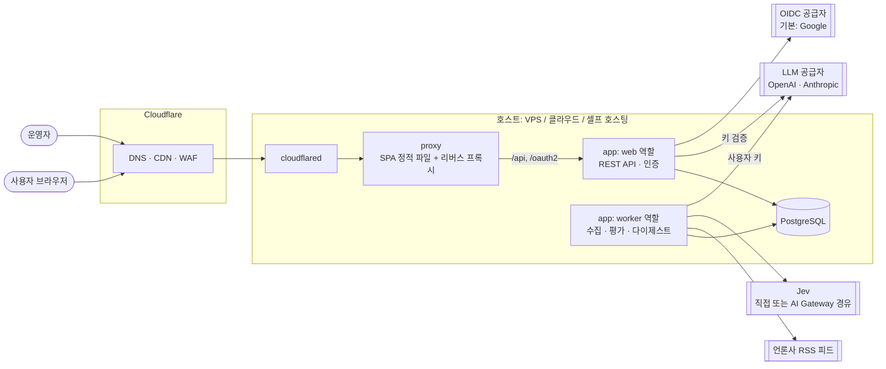
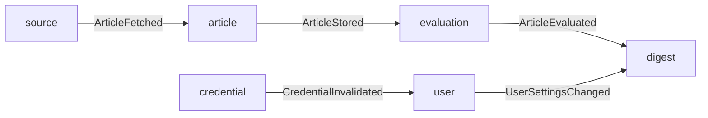

# 02. 아키텍처

## 시스템 컨텍스트



- 브라우저에는 **단일 오리진**으로 서비스한다. `proxy`가 React SPA 정적 파일을 내려주고 `/api/**`, `/oauth2/**`, `/login/**`을 `web`으로 넘긴다. CORS와 교차 사이트 쿠키 문제를 피하고, 셀프 호스팅과 클라우드 배포의 구성을 같게 유지하기 위해서다. 정적 파일 캐싱은 Cloudflare CDN이 맡는다.
- `web`과 `worker`는 **같은 컨테이너 이미지**를 Spring profile로 역할만 나눠 실행한다. 작은 배포에서는 두 profile을 한 프로세스에서 함께 켤 수도 있다.
- 외부 API와 MCP 서버는 v1 이후 `web` 역할에 추가한다 ([07-roadmap.md](07-roadmap.md)).

## 기술 스택

| 영역 | 선택 | 비고 |
|---|---|---|
| 언어/런타임 | Java 25 (LTS) | |
| 프레임워크 | Spring Boot 4.x, Spring Modulith | 모듈러 모놀리스 |
| LLM 연동 | Spring AI 2.x | v1 공급자는 OpenAI, Anthropic ([ADR-0008](adr/0008-v1-llm-providers.md)). MCP 서버 지원 포함 |
| 인증 | Spring Security (OIDC 공급자 설정형 — 기본 Google, + 이메일·비밀번호), Spring Session JDBC | 세션 쿠키 기반 ([ADR-0009](adr/0009-authentication-google-and-local.md), [ADR-0012](adr/0012-swappable-external-dependencies.md)) |
| DB | PostgreSQL 17+ | 마이그레이션은 Flyway |
| 데이터 접근 | Spring Data JDBC(aggregate) + JdbcClient(조회·대량 처리) | [ADR-0014](adr/0014-spring-data-jdbc.md) |
| 백그라운드 작업 | JobRunr (PostgreSQL 저장소) | 반복 작업 · 재시도 · 대시보드 |
| RSS 파싱 | Rome | 관대한 파싱 + 자체 보정 |
| 빌드 | Gradle (Kotlin DSL) | |
| 테스트 | JUnit 5, Testcontainers, WireMock | 외부 API는 WireMock으로 대체 |
| 프론트엔드 | React + TypeScript + Vite, React Router, TanStack Query, Tailwind CSS + shadcn/ui | SPA |
| API 계약 | OpenAPI (springdoc) → TS 타입 생성 | 프론트와 백엔드 타입 동기화 |
| 배포 | Docker 이미지 + Docker Compose | Cloudflare Tunnel 연동 |

결정 근거: [ADR-0004](adr/0004-tech-stack.md), [ADR-0013](adr/0013-architecture-patterns.md), [ADR-0014](adr/0014-spring-data-jdbc.md), [ADR-0005](adr/0005-frontend-react-spa.md), [ADR-0006](adr/0006-deployment-compose-cloudflare.md)

## 모듈 구조

Spring Modulith 기준의 애플리케이션 모듈이다. 모듈 간에는 공개 API(인터페이스)나 도메인 이벤트로만 통신하고, 다른 모듈의 내부 패키지에 접근하지 않는다. 모듈 경계 위반은 Modulith 검증 테스트로 막는다. 모듈 내부 구조(실용적 헥사고날)는 [ADR-0013](adr/0013-architecture-patterns.md)을 따른다. 각 모듈의 REST 컨트롤러는 그 모듈 안(`adapter/in/web`)에 둔다.

```
net.yozmnews
├── source        피드 등록·상태, 수집 스케줄, RSS 파싱, 정규화
├── article       기사 저장, 중복 제거, 기사 조회
├── evaluation    태그 체계, ArticleEvaluator, Jev 구현체, 평가 결과
├── digest        후보 선별, 프롬프트 구성, DigestGenerator, 결과 검증·저장
├── llm           공급자/모델 목록, 사용자 키로 ChatModel 생성, 키 검증
├── credential    BYOK 키 암호화 보관 (envelope encryption)
├── user          계정, OIDC 연동, 자체 로그인(비밀번호·복구 코드), 화면 내 알림, 사용자 설정·관심사·구독
├── feedback      좋아요/싫어요
├── admin         운영자 기능 (피드·태그 체계·평가 결과 관리)
└── platform      여러 모듈에 걸친 것: 보안 설정, 오류 응답 형식, 공통 타입(ID, 시간, 페이지네이션), 프로필별 설정 검사
```

### 모듈 간 이벤트



- 이벤트는 Spring Modulith의 이벤트 발행 레지스트리(JDBC)에 기록되어, 처리 중 프로세스가 죽어도 재시작 후 다시 처리된다.
- `ArticleEvaluated`를 받은 `digest`는 아무것도 즉시 하지 않는다. 다이제스트는 사용자 일정에 따라 생성되고, 이벤트는 "생성 시각 이후 새로 평가된 기사가 있는지" 같은 지표 갱신에만 쓴다.

## 핵심 인터페이스

```java
// source: 뉴스 공급원. v1 구현체는 RssArticleSource 하나.
public interface ArticleSource {
    FetchResult fetch(FeedDescriptor feed, FetchState previous); // ETag/Last-Modified 포함
}

// article: 본문 추출. v1은 NoopContentExtractor. 소스별로 켤 수 있다.
public interface ContentExtractor {
    Optional<ExtractedContent> extract(ArticleRef article);
}

// evaluation: 공유 평가. 사용자 정보를 받지 않는다.
public interface ArticleEvaluator {
    EvaluatorInfo info();                                        // 이름, 모델 버전
    List<Evaluation> evaluate(List<EvaluationInput> inputs, Taxonomy taxonomy);
}

// digest: 사용자별 종합 다이제스트 생성.
public interface DigestGenerator {
    GeneratedDigest generate(DigestRequest request, LlmHandle llm); // 후보 + 사용자 관심사
}

// llm: 사용자 키로 호출 가능한 모델 핸들을 만든다. 키 평문은 이 모듈 밖으로 나가지 않는다.
public interface LlmClientFactory {
    LlmHandle forUser(UserId userId);                // 키 복호화는 내부에서, 호출 직전에만
    KeyValidationResult validate(Provider p, SecretValue key);
}
```

- `ArticleEvaluator`의 v1 구현체는 `JevArticleEvaluator`. Jev 호출 경로(직접 API 또는 AI Gateway)는 설정으로 바꾼다.
- `DigestGenerator`의 v1 구현체는 Spring AI `ChatClient` 기반 `LlmDigestGenerator`. 공급자별 차이는 Spring AI가 흡수한다.
- Spring AI의 `ChatModel`은 보통 애플리케이션 전역 빈으로 쓰지만, BYOK에서는 **요청마다 사용자 키로 인스턴스를 만든다**. `LlmClientFactory`가 이 차이를 감춘다.

## 런타임 역할

| 역할 | 하는 일 | 확장 |
|---|---|---|
| `web` | 화면용 REST API, 로그인(OIDC·자체), 세션, 키 등록·검증, 운영자 API | 무상태(세션은 DB). 여러 개로 늘릴 수 있다 |
| `worker` | JobRunr 작업 처리: 피드 수집, Jev 평가, 다이제스트 생성, 정리 작업 | JobRunr가 DB로 작업을 분배하므로 여러 개로 늘릴 수 있다 |

### 주요 백그라운드 작업

| 작업 | 주기/계기 | 내용 |
|---|---|---|
| `PollDueFeeds` | 1분마다 | `next_poll_at`이 지난 피드를 골라 수집 작업 등록 |
| `PollFeed(feedId)` | 위에서 등록 | 조건부 GET, 파싱, 정규화, 기사 저장 |
| `EvaluatePendingArticles` | 1분마다 + `ArticleStored` | 평가 대기 기사를 묶어서 Jev 호출 |
| `ScheduleDueDigests` | 1분마다 | 생성 시각이 다가온 사용자의 다이제스트 생성 작업 등록 |
| `GenerateDigest(userId, date)` | 위에서 등록 / 사용자 수동 요청 | 후보 선별 → LLM 호출 → 검증 → 저장 |
| `FeedHealthCheck` | 1시간마다 | 연속 실패·장기 무소식 피드 표시, 운영자 알림 |
| `Retention` | 하루 1회 | 보존 기간이 지난 데이터 정리 ([04-data-model.md](04-data-model.md)) |

## 외부 API와 MCP (v1 이후)

- 경로를 분리한다: 화면용 `/api/**`(세션 쿠키), 외부용 `/public-api/v1/**`(Personal Access Token), MCP `/mcp`(OAuth 2.1).
- 화면용 API와 외부 API는 계약을 따로 관리한다. 외부 API는 하위 호환을 지켜야 하는 공개 계약이고, 화면용 API는 프론트엔드와 함께 자유롭게 바뀐다.
- MCP 서버는 Spring AI의 MCP 서버 기능(Streamable HTTP)으로 구현하고, 내부적으로는 외부 API와 같은 서비스 계층을 호출한다. ChatGPT 등 원격 MCP 클라이언트 연결에는 OAuth 2.1 인가 서버(Spring Authorization Server)가 필요하다.
- 외부에는 **다이제스트 요약문, 기사 메타데이터, 원문 링크**만 제공한다. RSS 요약문 원문은 외부 API로 내보내지 않는다 ([06-security.md](06-security.md)).
