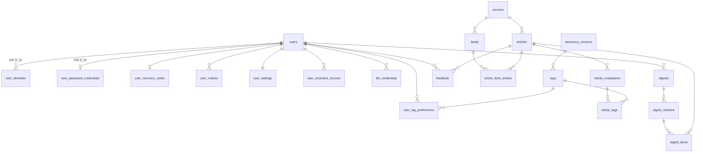

# 04. 데이터 모델

PostgreSQL 단일 DB. 스키마는 Flyway로 관리한다. 아래는 논리 모델이며 컬럼 타입·인덱스는 구현 시 확정한다.

## 개요

## 사용자

| 테이블 | 주요 컬럼 | 비고 |
|---|---|---|
| `users` | id, display_name, email, role(`USER`/`ADMIN`), status(`ACTIVE`/`SUSPENDED`/`DELETED`), created_at, deleted_at | |
| `user_identities` | user_id, provider(`google`), subject, email, linked_at | 외부 로그인 연동. (provider, subject) 고유. 한 사용자가 여러 로그인 수단을 연결할 수 있다 |
| `user_password_credentials` | user_id, email(고유, 소문자 정규화), email_verified_at(v1에서는 항상 비어 있음), password_hash, password_changed_at, failed_attempts, last_failed_at | 자체 로그인. Google만 쓰는 사용자는 행이 없다 |
| `user_recovery_codes` | user_id, code_hash, created_at, used_at | 자체 로그인 복구 코드. 사용자당 유효한 코드 1개. 쓰면 새로 발급한다 ([ADR-0011](adr/0011-no-email-in-v1.md)) |
| `user_notices` | id, user_id, kind(`PASSWORD_CHANGED`/`KEY_INVALID`/`DIGEST_FAILED`…), payload(jsonb), created_at, read_at | 메일 대신 쓰는 화면 내 알림 |
| `user_settings` | user_id, timezone, digest_time, interest_text, max_candidates, llm_provider, llm_model, updated_at | `interest_text`는 자유 텍스트 관심사. 길이 제한 있음 |
| `user_tag_preferences` | user_id, dimension(`topic`/`region`/`format`), tag_key, mode(`SUBSCRIBE`/`EXCLUDE`), created_at | 태그 **키**로 연결해 체계 버전이 바뀌어도 유지된다. 대분류 구독은 하위 전체 구독으로 해석한다. 형식의 기본 제외값은 가입 시 행으로 넣는다 |
| `user_excluded_sources` | user_id, source_id | |

## LLM 키 (BYOK)

| 테이블 | 주요 컬럼 | 비고 |
|---|---|---|
| `llm_credentials` | id, user_id, provider(`openai`/`anthropic`), ciphertext, encrypted_dek, kek_version, key_hint(끝 4자리), status(`VALID`/`INVALID`/`UNVERIFIED`), validated_at, last_used_at, created_at | 사용자 × 공급자당 1개. 암호화 방식은 [06-security.md](06-security.md) |

## 소스와 기사

| 테이블 | 주요 컬럼 | 비고 |
|---|---|---|
| `sources` | id, name, homepage_url, language, terms_reviewed_at, extraction_allowed | 출처 표기와 이용조건 검토 이력 |
| `feeds` | id, source_id, url, section_label, poll_interval, status(`ACTIVE`/`DEGRADED`/`STALE`/`DISABLED`), etag, last_modified, next_poll_at, last_success_at, last_new_item_at, consecutive_failures, last_error | |
| `articles` | id, source_id, canonical_url, url_hash(고유), title, summary_text, author, published_at, published_at_estimated, image_url, first_seen_at, eval_status(`PENDING`/`DONE`/`FAILED`) | `summary_text`는 RSS 요약문(최대 1,000자) |
| `article_feed_entries` | article_id, feed_id, guid, feed_category, seen_at | 어떤 피드에서 언제 봤는지. 중복 제거 근거 |

## 평가

| 테이블 | 주요 컬럼 | 비고 |
|---|---|---|
| `taxonomy_versions` | id, version, active, created_at, created_by | 태그 체계 버전 |
| `taxonomy_thresholds` | taxonomy_version_id, dimension, threshold, store_floor, updated_at, updated_by | 축별 임계값 `τ`와 저장 하한. 조정 이력은 별도 감사 로그로 남긴다 |
| `tags` | id, taxonomy_version_id, dimension(`topic`/`region`/`format`), key, parent_key, name, description, question_text, iptc_code, sort_order | (version, dimension, key) 고유. 주제 대분류는 `parent_key`가 없고 Jev에 묻지 않는 행 |
| `importance_rubrics` | taxonomy_version_id, level, description | 중요도 Score 기준 |
| `article_evaluations` | id, article_id, taxonomy_version_id, evaluator, model_version, format_key, format_probability, importance, importance_distribution(jsonb), low_confidence, raw_response(jsonb), input_tokens, evaluated_at | 기사당 평가 1회. 원본 응답까지 저장한다 |
| `article_tags` | article_id, evaluation_id, dimension, tag_key, probability | 주제·지역 태그. 저장 하한 이상인 태그를 확률과 함께 저장한다. "붙었는지"는 조회 시 `τ`와 비교한다. 대분류는 저장하지 않고 조회 시 `parent_key`로 펼친다 |

## 다이제스트

| 테이블 | 주요 컬럼 | 비고 |
|---|---|---|
| `digests` | id, user_id, digest_date, period_start, period_end, status(`SCHEDULED`/`RUNNING`/`READY`/`EMPTY`/`FAILED`), trigger(`SCHEDULED`/`MANUAL`), provider, model, candidate_count, input_tokens, output_tokens, duration_ms, error_code, error_message, created_at, completed_at | (user_id, digest_date, trigger, 순번)으로 여러 번 생성 이력을 남긴다. 화면에는 날짜별 최신 `READY`를 보여준다 |
| `digest_sections` | id, digest_id, kind(`OVERVIEW`/`TOP_STORY`/`MORE_HEADLINES`), position, title, body | |
| `digest_items` | digest_section_id, article_id, position, note | 섹션이 인용한 기사 |
| `digest_candidates` | digest_id, article_id, alias | 이번 생성에 넣은 후보와 별칭. 디버깅과 품질 분석용 |

## 피드백

| 테이블 | 주요 컬럼 | 비고 |
|---|---|---|
| `feedback` | user_id, article_id, value(+1/-1), digest_id, updated_at | (user_id, article_id) 고유. "없음"으로 바꾸면 행을 삭제한다 |

## 프레임워크 테이블

- JobRunr 작업 테이블, Spring Modulith 이벤트 발행 레지스트리, Spring Session 테이블. 각 라이브러리가 제공하는 스키마를 Flyway 마이그레이션에 포함한다.

## 보존 정책 (초안)

| 데이터 | 보존 | 이유 |
|---|---|---|
| 기사 메타데이터 (제목, 링크, 시각, 출처) | 무기한 | 지난 다이제스트의 링크를 유지하기 위해 |
| 기사 요약문 (`summary_text`) | 90일 후 삭제 | 언론사 콘텐츠 보관을 최소화한다. 지난 다이제스트는 LLM 종합문과 메타데이터만으로 표시된다 |
| 평가 원본 응답 (`raw_response`) | 180일 | 임계값 분석에 충분한 기간 |
| 다이제스트 | 사용자 탈퇴 시까지 | |
| `digest_candidates` | 30일 | 디버깅용 |
| 탈퇴 사용자 | 즉시 비식별화, 30일 후 완전 삭제 | 실수로 탈퇴한 경우의 복구 기간 |

보존 기간은 [open-questions.md](open-questions.md)에서 확정한다.
