# 데이터 모델

PostgreSQL 단일 DB(벡터는 pgvector 확장 — [ADR-0027](adr/0027-pgvector-for-vector-storage.md)). 스키마는 Flyway로 관리한다. 아래는 논리 모델이며 컬럼 타입·인덱스는 구현 시 확정한다.

## 개요

```mermaid
erDiagram
    users ||--o{ user_identities : "외부 로그인"
    users ||--o| user_password_credentials : "자체 로그인"
    users ||--o| user_recovery_codes : ""
    users ||--o{ user_notices : ""
    users ||--|| user_settings : ""
    users ||--o{ user_tag_preferences : ""
    users ||--o{ user_excluded_sources : ""
    users ||--o{ llm_credentials : ""
    users ||--o{ digests : ""
    users ||--o{ feedback : ""
    users ||--o{ feedback_events : ""
    users ||--o{ user_tag_preference_events : ""
    users ||--o{ reports : ""

    sources ||--o{ feeds : ""
    sources ||--o| source_fetch_slots : ""
    sources ||--o| source_attributions : ""
    feeds ||--|| feed_poll_states : ""
    sources ||--o{ article_feed_entries : ""
    feeds ||--o{ article_feed_entries : ""
    articles ||--o{ article_feed_entries : ""

    tag_sets ||--o{ tags : ""
    tag_sets ||--o{ importance_rubrics : ""
    tag_sets ||--o{ tag_set_thresholds : ""
    tag_sets ||--o{ tag_set_threshold_changes : ""
    articles ||--o| evaluation_queue : ""
    articles ||--o{ article_evaluations : ""
    article_evaluations ||--o{ article_tags : ""
    tags ||--o{ article_tags : ""
    tags ||--o{ user_tag_preferences : ""
    tag_sets ||--o{ tag_key_lineage : ""
    articles ||--o{ article_event_judgements : ""
    articles ||--o{ article_tag_judgements : ""
    article_tag_judgements ||--o| article_evaluations : ""

    articles ||--o| event_intake_queue : ""
    articles ||--o{ article_match_features : ""
    articles ||--o| event_assignment_queue : ""
    events ||--o{ event_articles : ""
    articles ||--o| event_articles : ""
    events ||--o{ event_key_terms : ""
    event_assignment_criteria ||--o{ event_articles : ""
    articles ||--o{ event_article_candidates : ""
    article_event_judgements |o--o{ event_articles : ""
    article_event_judgements |o--o{ event_merge_judgements : ""

    storylines ||--o{ storyline_members : ""
    events ||--o{ storyline_members : ""
    storylines ||--o{ storyline_key_terms : ""
    storyline_linking_criteria |o--o{ storyline_members : ""
    events ||--o| storyline_linking_queue : ""

    digests ||--o{ digest_sections : ""
    digest_sections ||--o{ digest_items : ""
    articles ||--o{ digest_items : ""
    articles ||--o{ feedback : ""

    reports ||--o{ report_sections : ""
    report_sections ||--o{ report_items : ""
```

## 사용자

| 테이블 | 주요 컬럼 | 비고 |
|---|---|---|
| `users` | id, display_name, email, role(`USER`/`ADMIN`), status(`ACTIVE`/`SUSPENDED`/`DELETED`), created_at, deleted_at | |
| `user_identities` | user_id, provider(`google`), subject, email, linked_at | 외부 로그인 연동. (provider, subject) 고유. 한 사용자가 여러 로그인 수단을 연결할 수 있다 |
| `user_password_credentials` | user_id, email(고유, 소문자 정규화), email_verified_at(v1에서는 항상 비어 있음), password_hash, password_changed_at, failed_attempts, last_failed_at | 자체 로그인. Google만 쓰는 사용자는 행이 없다 |
| `user_recovery_codes` | user_id, code_hash, created_at, used_at | 자체 로그인 복구 코드. 사용자당 유효한 코드 1개. 쓰면 새로 발급한다 ([ADR-0011](adr/0011-no-email-in-v1.md)) |
| `user_notices` | id, user_id, kind(`PASSWORD_CHANGED`/`KEY_INVALID`/`DIGEST_FAILED`…), payload(jsonb), created_at, read_at | 메일 대신 쓰는 화면 내 알림 |
| `user_settings` | user_id, timezone, digest_time, interest_text, max_candidates, llm_provider, llm_model, weekly_report_enabled, weekly_report_weekday, monthly_report_enabled, updated_at | `interest_text`는 자유 텍스트 관심사. 길이 제한 있음 |
| `user_tag_preferences` | user_id, tag_kind(`TOPIC`/`REGION`/`FORMAT`), tag_key, mode(`SUBSCRIBE`/`EXCLUDE`), created_at | 현재 상태 — `user_tag_preference_events` 의 투영. 태그 **키**로 연결해 체계 버전이 바뀌어도 유지된다(키가 바뀌면 태그 키 계보를 따른다). 대분류 구독은 하위 전체 구독으로 해석한다. 형식의 기본 제외값(활성 태그 체계에서 기본 제외인 형식)은 가입 시 행으로 넣는다 |
| `user_tag_preference_events` | id, user_id, tag_kind, tag_key, mode, action(`ADD`/`REMOVE`), occurred_at | 구독 · 제외 변경 이력. 추가만 한다(관심 신호 — [ADR-0028](adr/0028-explicit-signals-and-interest-weighted-candidates.md)) |
| `user_excluded_sources` | user_id, source_id | |

## LLM 키 (BYOK)

| 테이블 | 주요 컬럼 | 비고 |
|---|---|---|
| `llm_credentials` | id, user_id, provider(`openai`/`anthropic`), ciphertext, encrypted_dek, kek_version, key_hint(끝 4자리), status(`VALID`/`INVALID`/`UNVERIFIED`), validated_at, last_used_at, created_at | 사용자 × 공급자당 1개. 암호화 방식은 [security.md](security.md) |

## 소스와 기사

소스 테이블(`sources` · `feeds` · `feed_poll_states` · `source_fetch_slots` · `source_attributions`)은 [source Spec §6](specs/source.md#6-데이터), 기사 테이블(`articles` · `article_feed_entries`)은 [article Spec §6](specs/article.md#6-데이터)에 있다.

## 평가

태그 체계 테이블(`tag_sets` · `tags` · `importance_rubrics` · `tag_set_thresholds` · `tag_set_threshold_changes`)과 평가 대기 · 평가 결과 테이블(`evaluation_queue` · `article_evaluations` · `article_tags` · `tag_key_lineage` · `tag_backfills` · `tag_backfill_versions`)은 [tag Spec §6](specs/tag.md#6-데이터)에, 판정 원본 테이블(`article_tag_judgements` · `article_event_judgements`)은 [evaluation Spec §6](specs/evaluation.md#6-데이터)에 있다. 평가 행(`article_evaluations.judgement_id`)은 태그 판정 원본을 ID 로 가리킨다 — 모듈 사이라 FK 가 없다.

## 사건

사건 묶기 대기 · 기사 표현 테이블(`event_intake_queue` · `article_match_features`)과 사건 · 배정 테이블(`events` · `event_key_terms` · `event_assignment_criteria` · `event_articles` · `event_article_candidates` · `event_assignment_queue` · `event_merge_judgements`), 큰 사건 기준 테이블(`event_big_criteria` · `event_big_criteria_changes`)은 [event Spec §6](specs/event.md#6-데이터)에 있다.

## 다이제스트

| 테이블 | 주요 컬럼 | 비고 |
|---|---|---|
| `digests` | id, user_id, digest_date, period_start, period_end, status(`SCHEDULED`/`RUNNING`/`READY`/`EMPTY`/`FAILED`), trigger(`SCHEDULED`/`MANUAL`), provider, model, candidate_count, input_tokens, output_tokens, duration_ms, error_code, error_message, created_at, completed_at | (user_id, digest_date, trigger, 순번)으로 여러 번 생성 이력을 남긴다. 화면에는 날짜별 최신 `READY`를 보여준다 |
| `digest_sections` | id, digest_id, kind(`OVERVIEW`/`TOP_STORY`/`MORE_HEADLINES`), position, title, body | `TOP_STORY` 가 주요 뉴스다 |
| `digest_items` | digest_section_id, article_id, position, note, selection_reason(`SUBSCRIBED`/`INTEREST`/`MAJOR_STORYLINE`) | 섹션이 인용한 기사와 선정 이유. 노출 기록이다 |
| `digest_candidates` | digest_id, article_id, alias | 이번 생성에 넣은 후보와 별칭. 디버깅과 품질 분석용 |

## 스토리라인

- 공유 스토리라인 테이블(`storylines` · `storyline_key_terms` — 사용자를 모른다), 사건의 소속(`storyline_members` — 사건 하나가 스토리라인 0개 이상에 든다), 잇기 대기(`storyline_linking_queue`), 기준 이력(`storyline_linking_criteria`)은 [storyline Spec §6](specs/storyline.md#6-데이터)에 있다. 사건은 ID 로만 가리킨다
- **(미설계)** 스토리라인 사이 관계의 테이블은 관계를 정할 때 정한다([ADR-0101](adr/0101-shared-storylines-connect-events-and-the-personal-side-is-storyline-subscriptions-and-interests.md))
- **(미설계)** 스토리라인 구독과 그 변경 이력(추가 전용 — 현재 구독은 그 투영)은 `user` 의 테이블이다. 스토리라인은 ID 로만 가리킨다

## 피드백

| 테이블 | 주요 컬럼 | 비고 |
|---|---|---|
| `feedback_events` | id, user_id, article_id, value(+1/-1/0), digest_id, occurred_at | 좋아요 / 싫어요 / 없음 이력. 추가만 한다 — 정본 |
| `feedback` | user_id, article_id, value(+1/-1), digest_id, updated_at | 현재 상태 — `feedback_events` 의 투영. (user_id, article_id) 고유. "없음"이면 행이 없다 |

## 변화 리포트

| 테이블 | 주요 컬럼 | 비고 |
|---|---|---|
| `reports` | id, user_id, period_kind(`WEEK`/`MONTH`), period_start, period_end, status(`SCHEDULED`/`RUNNING`/`READY`/`EMPTY`/`FAILED`), provider, model, input_tokens, output_tokens, stats_snapshot(jsonb), error_code, error_message, created_at, completed_at | 생성에 쓴 통계를 `stats_snapshot` 에 함께 저장한다. 이전 리포트와의 비교는 이 스냅숏으로 한다 |
| `report_sections` | id, report_id, kind, position, title, body | |
| `report_items` | report_section_id, position, storyline_id, article_id | 섹션이 인용한 스토리라인 · 기사(둘 중 하나) |

## 프레임워크 테이블

- 각 라이브러리가 제공하는 스키마를 Flyway 마이그레이션에 담고, 라이브러리의 스키마 자동 생성은 끈다.
- JobRunr 작업 테이블과 Spring Modulith 이벤트 발행 레지스트리는 첫 마이그레이션 `V1` 에 라이브러리 원문 그대로 들어 있다. 원문 대조 테스트가 라이브러리가 지금 내놓는 원문과 같은지 확인한다([ADR-0023](adr/0023-jobrunr-oss-framework-schema-and-event-resubmission.md)).
- Spring Session 테이블은 인증 기능을 더할 때 같은 방식으로 담는다.

## 보존 정책 (초안)

| 데이터 | 보존 | 이유 |
|---|---|---|
| 기사 메타데이터 (제목, 링크, 시각, 출처) | 무기한 | 지난 다이제스트의 링크를 유지하기 위해. 출처는 그 기사의 엔트리가 가리키는 소스들의 이름이다 — 프로필을 얻지 못하면 기록된 출처 이름([source Spec 출처 이름](specs/source.md#출처-이름) · [ADR-0053](adr/0053-source-records-last-confirmed-name-apart-from-operating-settings.md)) |
| 기사 요약문 (`summary_text`) | 기본 무기한. 운영 설정(보존 일수, 기본 꺼짐)을 켜면 그 뒤 삭제 | 재평가 · 임베딩 재계산 · 검색에 쓴다. 사용자 화면 · 외부 API 에는 노출하지 않고 운영자 화면에서만 보인다. 지워진 기사도 장기 기능에서 처리된다 ([ADR-0029](adr/0029-indefinite-summary-retention-with-optional-deletion.md) · [ADR-0068](adr/0068-rss-summaries-shown-only-on-operator-screens-and-users-get-processed-information.md)) |
| 주제 · 지역 태그(`article_tags`), 태그 체계, 태그 기준 · 저장 기준과 그 변경 이력, 태그 키 계보 | 무기한 | 주제별 보도량과 관심사 히스토리의 근거 |
| 빠진 태그 채움 기록(`tag_backfills` · `tag_backfill_versions`) | 무기한 | 끝난 채움이 저장 바닥 계산의 입력이다 — 지우면 태그 기준 · 저장 기준의 경고와 평가 현황 표시가 바뀐다([tag-R32](specs/tag.md#빠진-태그-채움--저장-바닥)) |
| 사건 배정 입력 (`article_match_features`) | 그 기사의 사건이 닫힐 때까지. 그 모델 버전의 열린 사건에 배정되지 않은 표현은 만든 뒤 사건 배정 시간 창 + 여유 | 열린 사건의 서술 기사 · 재판정 · 기사 빼기에 쓴다. 배정 대기 기사의 표현은 지우면 다시 만든다([event-R13](specs/event.md#사건-정리) · [ADR-0088](adr/0088-article-features-kept-until-their-event-closes-and-unassigned-ones-for-the-window-plus-a-margin.md)) |
| 사건 (`events` · `event_key_terms` · `event_articles`) · 저장 후보 (`event_article_candidates`) · 기준 이력 (`event_assignment_criteria`) · 병합 판정 기록 (`event_merge_judgements`) | 무기한. 합쳐진 사건 행과 병합 판정 기록은 가리키는 사건(남는 사건 · 쌍의 사건)을 지울 때 함께 지운다 | 사건 · 스토리라인 보도량의 근거. 저장 후보 · 기준 이력은 기준을 바꿀 때 재판정의 재료다. 저장 후보의 판정 확률은 병합이 사건 쌍을 물을지 정할 때도 읽는다. 병합 판정 기록은 같은 사건 쌍을 다시 묻지 않게 한다 |
| 배정 대기 (`event_assignment_queue`) | 배정하면 지운다 | 처리할 기사의 목록이다 |
| 큰 사건 기준과 그 변경 이력 (`event_big_criteria` · `event_big_criteria_changes`) | 무기한 | 운영자가 조정한 이력 — 태그 기준 · 저장 기준의 이력과 같다 |
| 스토리라인 (`storylines` · `storyline_key_terms`) · 소속 (`storyline_members`) · 기준 이력 (`storyline_linking_criteria`) | 무기한. 구성 사건이 지워지면 그 소속을 지운다. 구성 사건이 남지 않으면 스토리라인을 지우고, 사건 하나만 남으면 그 사건을 가진 다른 스토리라인에 합치거나 풀어 지운다. 합칠 때 합쳐진 쪽의 소속 · 핵심 말은 지우고(같은 사건이 남는 쪽에 있다) 행은 남는 스토리라인을 가리키며 남는다 — 남는 스토리라인을 지울 때 함께 지운다 | 구독 · 타임라인 · 리포트 인용이 스토리라인 ID 를 가리킨다 — 합쳐진 ID 는 남는 스토리라인으로 따라간다([storyline-R6](specs/storyline.md#사건-변화-따르기) · [storyline-R17 · R18](specs/storyline.md#정돈)) |
| 잇기 대기 (`storyline_linking_queue`) | 판정하면 지운다. 판정이 거듭 실패하면 뺀다 | 판정할 사건의 목록이다([storyline-R3](specs/storyline.md#잇기-대기와-회차) · [storyline-R4](specs/storyline.md#잇기-대기와-회차)) |
| 사건 소속 판정 원본 (`article_event_judgements`) | 180일 | 태그 판정 원본과 같다 |
| 태그 판정 원본 (`article_tag_judgements`) | 180일 | 태그 기준 · 저장 기준 분석과 저장 기준을 낮춘 뒤 빠진 태그 채움([tag-R31](specs/tag.md#빠진-태그-채움--저장-바닥) — 채울 기간의 상한도 180일)에 충분한 기간. **(미설계)** 지운 뒤 원본이 없는 평가의 채움 처분은 보존을 구현하는 작업이 정한다 |
| 다이제스트 | 사용자 탈퇴 시까지 | 인용 항목은 노출 기록이다 |
| 관심 신호 이력(`feedback_events` · `user_tag_preference_events` · 스토리라인 구독 이력) · 변화 리포트 | 사용자 탈퇴 시까지 | 관심사 히스토리 · 리포트의 근거 |
| `digest_candidates` | 30일 | 디버깅용 |
| 탈퇴 사용자 | 즉시 비식별화, 30일 후 완전 삭제 | 실수로 탈퇴한 경우의 복구 기간 |
| JobRunr 작업 기록 | 성공하고 36시간 뒤 삭제 상태, 다시 72시간 뒤 영구 삭제. 실패한 작업은 남는다 | JobRunr 기본값. 작업의 결과는 각 모듈의 데이터에 남는다 |
| 이벤트 발행 기록 (`event_publication`) | 완료 즉시 삭제. 실패한 발행은 운영자가 폐기할 때까지 남는다 | 결과는 각 모듈의 데이터에 남고, 실패한 발행은 재처리와 원인 조사의 근거다([ADR-0023](adr/0023-jobrunr-oss-framework-schema-and-event-resubmission.md) · [ADR-0050](adr/0050-operator-resubmits-once-or-discards-stranded-event-publications-read-from-registry.md)) |

- **무기한은 자동으로 지우지 않는다는 뜻이다.** 숨긴 소스 · 피드의 기사도 남는다. 운영자가 소스 · 피드를 지우면 그 소스 · 피드만 가진 기사(메타데이터 · 요약문 · 엔트리)가 함께 지워지고, 다른 소스 · 피드도 가진 기사는 남는다([source Spec 숨김과 삭제](specs/source.md#숨김과-삭제) · [article Spec](specs/article.md#지운-소스--피드) · [ADR-0051](adr/0051-operator-hides-or-deletes-sources-and-feeds-and-deletion-removes-exclusive-articles.md) · [ADR-0052](adr/0052-article-sources-live-in-feed-entries-and-late-items-of-deleted-feeds-are-dropped.md)). 기사를 가리키는 다른 모듈의 데이터는 `article` 이 알리는 지운 기사 ID 로 함께 지워진다 — 지금은 평가 대기 · 평가 · 태그 · 태그 판정 원본 · 사건 소속 판정 원본 · 사건 묶기 대기 · 배정 대기 · 기사 표현 · 배정 · 저장 후보, 그리고 사건에 남긴 대표 기사(비운다)([overview.md §5](overview.md#5-모듈-지도) · [ADR-0060](adr/0060-article-deletion-announced-by-removed-article-ids-and-followed-by-referencing-modules.md))

보존 기간은 [open-questions.md](open-questions.md)에서 확정한다.
