# 데이터 모델

PostgreSQL 단일 DB 다. 벡터는 pgvector 확장에 둔다([ADR-0027](adr/0027-pgvector-for-vector-storage.md)). 스키마는 Flyway 로 관리하고, 테이블 · 컬럼의 정본은 마이그레이션이다. 모듈 테이블의 뜻은 그 모듈 Spec 의 데이터 절(§6)이 갖는다. 이 문서는 모듈 사이 관계 · 보존 정책 · 프레임워크 테이블을 갖는다.

## 개요

모듈 사이 참조만 그린다. 선은 가리켜지는 테이블에서 가리키는 테이블로 긋고, 선의 글은 가리키는 칸이다. 모듈 안의 관계는 그 모듈 Spec 의 데이터 절에 있다.

```mermaid
erDiagram
    articles ||--o{ article_evaluations : "article_id"
    articles ||--o{ article_tags : "article_id"
    articles ||--o{ evaluation_queue : "article_id"
    articles ||--o{ article_tag_judgements : "article_id"
    articles ||--o{ article_event_judgements : "article_id"
    articles ||--o{ storyline_membership_judgements : "article_id"
    articles ||--o{ article_match_features : "article_id"
    articles ||--o{ event_intake_queue : "article_id"
    articles ||--o{ event_assignment_queue : "article_id"
    articles ||--o{ event_articles : "article_id"
    articles ||--o{ event_article_candidates : "article_id"
    articles ||--o{ events : "representative_article_id"
    articles ||--o{ digest_candidates : "article_id"
    articles ||--o{ digest_items : "article_id"
    articles ||--o{ user_storyline_summary_events : "article_id"
    sources ||--o{ article_feed_entries : "source_id"
    feeds ||--o{ article_feed_entries : "feed_id"
    sources ||--o{ user_excluded_sources : "source_id"
    article_tag_judgements ||--o{ article_evaluations : "judgement_id"
    article_event_judgements ||--o{ event_articles : "judgement_id"
    article_event_judgements ||--o{ event_merge_judgements : "judgement_id"
    storyline_membership_judgements ||--o{ storyline_members : "judgement_id"
    storyline_membership_judgements ||--o{ storyline_link_asked : "judgement_id"
    storyline_membership_judgements ||--o{ storyline_pair_asked : "judgement_id"
    storyline_relation_judgements ||--o{ storyline_relations : "judgement_id"
    storyline_relation_judgements ||--o{ storyline_relation_asked : "judgement_id"
    storyline_relation_judgements ||--o{ storylines : "merge_judgement_id"
    storylines ||--o{ storyline_relation_judgements : "first_storyline_id"
    storylines ||--o{ storyline_relation_judgements : "second_storyline_id"
    events ||--o{ storyline_members : "event_id"
    events ||--o{ storyline_linking_queue : "event_id"
    events ||--o{ storyline_link_asked : "event_id"
    events ||--o{ storyline_pair_asked : "event_id"
    events ||--o{ storyline_pair_asked : "partner_id"
    events ||--o{ storylines : "representative_event_id"
    events ||--o{ digest_section_events : "event_id"
    storylines ||--o{ digest_sections : "storyline_id"
    events ||--o{ feedback : "event_id"
    events ||--o{ feedback_events : "event_id"
    events ||--o{ feedback_items : "item_event_id"
    digests ||--o{ feedback : "digest_id"
    digests ||--o{ feedback_events : "digest_id"
    digests ||--o{ feedback_items : "digest_id"
    events ||--o{ report_items : "event_id"
    storylines ||--o{ report_items : "storyline_id"
    storylines ||--o{ user_storyline_members : "storyline_id"
    storylines ||--o{ user_storyline_tracked_seeds : "storyline_id"
    storylines ||--o{ user_storyline_subscription_events : "storyline_id"
    storylines ||--o{ user_storyline_top_summaries : "storyline_id"
    events ||--o{ user_storyline_summary_events : "event_id"
    tag_sets ||--o{ user_settings : "tag_set_id"
    tag_sets ||--o{ user_tag_preference_events : "tag_set_id"
    tag_sets ||--o{ user_topic_suggestion_declines : "tag_set_id"
    users ||--o{ user_notices : "user_id"
    users ||--o{ user_feed_status_receipts : "user_id"
    users ||--o{ user_settings : "user_id"
    users ||--o{ user_tag_preferences : "user_id"
    users ||--o{ user_tag_preference_events : "user_id"
    users ||--o{ user_excluded_sources : "user_id"
    users ||--o{ user_storylines : "user_id"
    users ||--o{ user_storyline_subscriptions : "user_id"
    users ||--o{ user_storyline_subscription_events : "user_id"
    users ||--o{ user_topic_suggestion_declines : "user_id"
    users ||--o{ llm_credentials : "user_id"
    users ||--o{ digests : "user_id"
    users ||--o{ feedback : "user_id"
    users ||--o{ feedback_events : "user_id"
    users ||--o{ feedback_items : "user_id"
    users ||--o{ reports : "user_id"
```

## 모듈 사이 참조

- 다른 모듈의 행은 ID 로만 가리키고 FK 를 두지 않는다. 사용자 데이터는 계정을 `users` 의 ID 로 가리킨다
- 가리킨 행을 지우거나 합칠 때 따르는 규칙은 테이블마다 아래 보존 정책 표의 행에 있다. 지운 기사 · 지운 사건을 따르는 모듈은 [overview.md §5](overview.md#5-모듈-지도)에 있다

## 프레임워크 테이블

- 각 라이브러리가 제공하는 스키마를 Flyway 마이그레이션에 담고, 라이브러리의 스키마 자동 생성은 끈다.
- JobRunr 작업 테이블과 Spring Modulith 이벤트 발행 레지스트리는 첫 마이그레이션 `V1` 에 라이브러리 원문 그대로 들어 있다. 원문 대조 테스트가 라이브러리가 지금 내놓는 원문과 같은지 확인한다([ADR-0023](adr/0023-jobrunr-oss-framework-schema-and-event-resubmission.md)).
- Spring Session 의 세션 테이블(`spring_session` · `spring_session_attributes`)은 마이그레이션 `V32` 에 라이브러리 원문 그대로 들어 있고, 같은 원문 대조 테스트가 확인한다. 세션에 담는 값과 수명은 [account Spec](specs/account.md#세션)에 있다.

## 보존 정책

| 데이터 | 보존 | 이유 |
|---|---|---|
| 기사 메타데이터 (제목, 링크, 시각, 출처) | 무기한 — 운영자가 소스 · 피드를 지우면 그것만 가진 기사는 지운다 | 지난 다이제스트의 링크를 유지하기 위해. 운영자가 지운 기사는 지난 다이제스트에서도 인용을 지운다([ADR-0186](adr/0186-digests-follow-removed-articles-by-deleting-their-rows-and-show-no-summary-without-any-citation.md)). 출처는 그 기사의 엔트리가 가리키는 소스들의 이름이다 — 프로필을 얻지 못하면 기록된 출처 이름([source Spec 출처 이름](specs/source.md#출처-이름) · [ADR-0053](adr/0053-source-records-last-confirmed-name-apart-from-operating-settings.md)) |
| 기사 요약문 (`summary_text`) | 기본 무기한. **(미구현)** 운영 설정(보존 일수, 기본 꺼짐)을 켜면 그 뒤 삭제 | 재평가 · 임베딩 재계산 · 검색에 쓴다. 사용자 화면 · 외부 API 에는 노출하지 않고 운영자 화면에서만 보인다. 지워진 기사도 장기 기능에서 처리된다 ([ADR-0029](adr/0029-indefinite-summary-retention-with-optional-deletion.md) · [ADR-0068](adr/0068-rss-summaries-shown-only-on-operator-screens-and-users-get-processed-information.md)) |
| 주제 · 지역 태그(`article_tags`), 태그 체계, 태그 기준 · 저장 기준과 그 변경 이력, 태그 키 계보 | 무기한 | 주제별 보도량과, 관심사 히스토리가 지난 기간의 기사 주제를 활성 키로 잇는 근거 |
| 빠진 태그 채움 기록(`tag_backfills` · `tag_backfill_versions`) | 무기한 | 끝난 채움이 저장 바닥 계산의 입력이다 — 지우면 태그 기준 · 저장 기준의 경고와 평가 현황 표시가 바뀐다([tag-R32](specs/tag.md#빠진-태그-채움--저장-바닥)) |
| 사건 배정 입력 (`article_match_features`) | 그 기사의 사건이 닫힐 때까지. 그 모델 버전의 열린 사건에 배정되지 않은 표현은 만든 뒤 사건 배정 시간 창 + 여유 | 열린 사건의 서술 기사 · 재판정 · 기사 빼기에 쓴다. 배정 대기 기사의 표현은 지우면 다시 만든다([event-R13](specs/event.md#사건-정리) · [ADR-0088](adr/0088-article-features-kept-until-their-event-closes-and-unassigned-ones-for-the-window-plus-a-margin.md)) |
| 사건 (`events` · `event_key_terms` · `event_articles`) · 저장 후보 (`event_article_candidates`) · 기준 이력 (`event_assignment_criteria`) · 병합 판정 기록 (`event_merge_judgements`) | 무기한. 합쳐진 사건 행과 병합 판정 기록은 가리키는 사건(남는 사건 · 쌍의 사건)을 지울 때 함께 지운다 | 사건 · 스토리라인 보도량의 근거. 저장 후보 · 기준 이력은 기준을 바꿀 때 재판정의 재료다. 저장 후보의 판정 확률은 병합이 사건 쌍을 물을지 정할 때도 읽는다. 병합 판정 기록은 같은 사건 쌍을 다시 묻지 않게 한다 |
| 배정 대기 (`event_assignment_queue`) | 배정하면 지운다 | 처리할 기사의 목록이다 |
| 큰 판정 기준과 그 변경 이력 (`storyline_big_criteria` · `storyline_big_criteria_changes`) | 무기한 | 운영자가 조정한 이력 — 태그 기준 · 저장 기준의 이력과 같다 |
| 스토리라인 (`storylines` · `storyline_key_terms`) · 소속 (`storyline_members`) · 기준 이력 (`storyline_linking_criteria`) | 무기한. 구성 사건이 지워지면 그 소속을 지운다. 구성 사건이 남지 않으면 스토리라인을 지우고, 사건 하나만 남으면 그 사건을 가진 다른 스토리라인에 합치거나 풀어 지운다. 관계 판정이 같은 사안의 조각이라고 답한 두 스토리라인도 합친다. 합칠 때 합쳐진 쪽의 소속 가운데 남는 쪽에 없는 사건은 근거 그대로 남는 쪽으로 옮기고, 합쳐진 쪽의 소속 · 핵심 말은 지우고 행은 남는 스토리라인을 가리키며(조각 합치기면 그 판정 · 기준과 함께) 남는다 — 남는 스토리라인을 지울 때 함께 지운다 | 구독 · 타임라인 · 리포트 인용이 스토리라인 ID 를 가리킨다 — 합쳐진 ID 는 남는 스토리라인으로 따라간다([storyline-R6](specs/storyline.md#사건-변화-따르기) · [storyline-R17 · R18](specs/storyline.md#정돈) · [storyline-R21](specs/storyline.md#공개-조회)) |
| 잇기 대기 (`storyline_linking_queue`) | 판정하면 지운다. 판정이 예상하지 못한 예외로 거듭 실패하면 뺀다 — 평가기 일시 실패는 미룰 뿐 빼지 않는다 | 판정할 사건의 목록이다([storyline-R3](specs/storyline.md#잇기-대기와-회차) · [storyline-R4](specs/storyline.md#잇기-대기와-회차)) |
| 스토리라인 사이 관계 (`storyline_relations`) · 물은 기록 (`storyline_relation_asked`) · 관계 기준 이력 (`storyline_relation_criteria`) | 무기한. 스토리라인을 지우면 그 관계 · 물은 기록을 함께 지운다. 합칠 때 합쳐진 쪽의 관계는 남는 쪽으로 옮기고 물은 기록은 지운다. 다시 물은 판정이 맺지 않으면 그 관계를 지운다 | 관계는 타임라인 · 집계의 근거이고, 물은 기록은 같은 쌍을 다시 물을 때를 정한다([storyline-R29 · R30 · R32](specs/storyline.md#스토리라인-사이-관계)) |
| 잇기 물은 기록 (`storyline_link_asked` · `storyline_pair_asked`) | 무기한. 스토리라인을 지우면 그 붙이기 기록을 함께 지우고, 합칠 때 합쳐진 쪽의 기록을 지운다. 사건이 지워지거나 합쳐지면 그 사건의 기록을 지운다. 크기가 두 배가 되면 다시 물어 덮어쓴다. 스토리라인 소속 판정의 문구 버전을 바꾸면 비운다 | 같은 쌍을 거듭 묻지 않게 하는 확률의 정본이다([storyline-R36](specs/storyline.md#띠-판정)) |
| 관계 대기 (`storyline_relation_queue`) | 후보를 모두 물으면 지운다. 판정이 일시 실패하면 미룰 뿐 빼지 않는다 | 판정할 스토리라인의 목록이다([storyline-R26 · R31](specs/storyline.md#스토리라인-사이-관계)) |
| 사건 소속 판정 원본 (`article_event_judgements`) | **(미구현)** 180일 | 태그 판정 원본과 같다 |
| 스토리라인 소속 판정 원본 (`storyline_membership_judgements`) | **(미구현)** 180일 | 태그 판정 원본과 같다. 소속 · 잇기 물은 기록이 가리키는 원본이 먼저 지워질 수 있다 — 그 ID 는 FK 가 아니다 |
| 관계 판정 원본 (`storyline_relation_judgements`) | **(미구현)** 180일 | 태그 판정 원본과 같다. 관계 · 물은 기록이 가리키는 원본이 먼저 지워질 수 있다 — 그 ID 는 FK 가 아니다 |
| 태그 판정 원본 (`article_tag_judgements`) | **(미구현)** 180일 | 태그 기준 · 저장 기준 분석과 저장 기준을 낮춘 뒤 빠진 태그 채움([tag-R31](specs/tag.md#빠진-태그-채움--저장-바닥))에 충분한 기간. 채울 기간의 상한도 180일이다. **(미설계)** 지운 뒤 원본이 없는 평가의 채움 처분은 보존을 구현하는 작업이 정한다 |
| 다이제스트 (`digests` · `digest_sections` · `digest_section_events` · `digest_items`) | 사용자 탈퇴 시까지. 지운 기사의 인용과 인용이 남지 않은 섹션은 지운다 — 다이제스트 행은 남는다 | 섹션 사건은 노출 기록이다([digest Spec](specs/digest.md#지운-기사-따르기) digest-R10) |
| 관심 신호 이력(`feedback_events` · `user_tag_preference_events` · `user_storyline_subscription_events`) · 변화 리포트(`reports` · `report_sections` · `report_items`) | 사용자 탈퇴 시까지. 지운 사건의 좋아요 / 싫어요 이력(`feedback_events`)은 그 사건을 지울 때 지운다. 리포트 인용(`report_items`)은 지운 사건 · 스토리라인을 가리켜도 남고 조회가 뺀다 | 관심사 히스토리 · 리포트의 근거. 지운 사건은 주제를 셀 소속 기사가 없어 그 이력이 관심도에 쓰이지 못한다([feedback Spec](specs/feedback.md#지운-사건--지운-항목-따르기) feedback-R5) |
| 계정 (`users` · `user_password_credentials`) | 사용자 탈퇴 시까지 | 사용자 데이터의 주인이고 로그인의 근거다([account Spec](specs/account.md#계정과-자격)) |
| 관심 설정의 현재 상태 (`user_settings` · `user_tag_preferences` · `user_excluded_sources`) | 사용자 탈퇴 시까지. 태그 체계를 바꿔 활성하면 태그 선호를 활성 키로 고쳐 쓰고, 소스를 지우면 그 소스의 제외를 지운다 | 다이제스트 후보 선별의 입력이다([user Spec](specs/user.md#관심-설정) user-R47 · R49) |
| 사용자 스토리라인(`user_storylines` · `user_storyline_members` · `user_storyline_tracked_seeds`)과 스토리라인 구독의 현재 상태(`user_storyline_subscriptions`) | 사용자 탈퇴 시까지. 추적 중이 아닌 사용자 스토리라인은 관심 창(120일) 안에 신호가 없으면 다음 맞추기에서 지운다. 합쳐진 스토리라인의 추적 씨앗은 남는 스토리라인으로 옮기고, 사라진 스토리라인의 추적 씨앗은 뺀다 | 사용자 스토리라인은 신호 이력과 지금 관계에서 다시 낼 수 있고, 추적 씨앗은 구독 이력의 투영이다([user Spec](specs/user.md#사용자-스토리라인) user-R53 · R66) |
| 사용자 스토리라인의 정리(`user_storyline_summaries` · `user_storyline_top_summaries` · `user_storyline_summary_events`)와 시도 기록(`user_storyline_summary_attempts`) | 정리는 그 사용자 스토리라인이 관심 스토리라인이거나 남길 스토리라인인 동안. 지운 기사를 넣은 정리는 그 기사를 지울 때 지운다. 시도 기록은 사용자 스토리라인이 사라질 때까지. 모두 사용자 탈퇴 때 지운다 | 정리는 사건의 대표 기사에서 다시 만들 수 있고, 시도 기록은 그 사용자 스토리라인에 쓴 사용자 비용의 합이다([user Spec](specs/user.md#사용자-스토리라인의-정리) user-R69 · R71 · R72) |
| 구독 제안 거절 (`user_topic_suggestion_declines`) | 사용자 탈퇴 시까지. 같은 체계 버전의 같은 주제를 다시 거절하면 그 행의 관심 · 시각을 고쳐 쓴다 | 거절 뒤 그 주제를 다시 제안할 때를 정한다([user Spec](specs/user.md#구독-제안-거절) user-R64 · R65) |
| 좋아요 / 싫어요의 사건마다 현재 상태 (`feedback`) | 사용자 탈퇴 시까지. 지운 사건의 행은 그 사건을 지울 때 지운다 | 사건마다 지금 값이다 — 바뀐 차례는 `feedback_events` 에 있다([feedback Spec](specs/feedback.md#지운-사건--지운-항목-따르기) feedback-R5) |
| 항목에 누른 값 (`feedback_items`) | 사용자 탈퇴 시까지. 지운 항목 섹션의 행은 그 섹션을 지울 때 지운다 | 화면이 그 항목에 보이는 값이다 — 관심 신호는 사건마다의 이력이 맡는다([feedback Spec](specs/feedback.md#지운-사건--지운-항목-따르기) feedback-R5) |
| LLM 키 (`llm_credentials`) | 사용자가 지우거나 탈퇴할 때까지. 교체하면 옛 행을 지우고 새 행을 넣는다 | 다이제스트 생성에 쓴다. 상태가 `INVALID` 여도 남는다([credential Spec](specs/credential.md#등록과-삭제) credential-R11 · R16) |
| `digest_candidates` | 다이제스트를 만들고 30일. 지운 기사의 행은 곧바로 지운다 | 생성 중 지운 기사의 표시이고 그 뒤로는 디버깅용이다. `digest` 의 후보 행 지우기가 지운다([digest Spec](specs/digest.md#후보-행-보존) digest-R11) |
| 화면 내 알림 (`user_notices`) | 읽은 알림은 읽고 90일 뒤 삭제. 안 읽은 알림은 볼 때까지 남는다 | 지나간 일을 알리는 것이고 장기 기능의 근거가 아니다. 안 읽은 보안 알림은 다음 로그인 때 보여야 한다([ADR-0134](adr/0134-in-app-notices-are-one-row-per-recipient-with-a-closed-kind-and-per-kind-jsonb-content-and-read-notices-are-deleted-after-ninety-days.md)) |
| 피드 상태 알림의 반영 기준 (`user_feed_status_receipts`) | 사용자 탈퇴 시까지 | 사용자마다 한 행이고, 다시 처리된 회차를 거르는 데 쓴다([user Spec](specs/user.md#화면-내-알림) user-R24) |
| 복구 코드 (`user_recovery_codes`) | 사용자 탈퇴 시까지 — 새 코드를 주면 바뀐다 | 사용자마다 많아야 한 행([account Spec](specs/account.md#비밀번호-변경과-복구-코드) account-R23) |
| 가입 정책과 그 이력 (`user_sign_up_policy` · `user_sign_up_policy_changes`) | 무기한 | 지금 값 한 행과 그 변경의 추가 전용 이력이다. 운영 설정의 이력이다([account Spec](specs/account.md#가입-정책) account-R25) |
| 초대 (`user_invitations`) | 무기한 — 쓴 · 만료 · 취소 초대도 지우지 않는다 | 행 수가 운영자의 발급 수에 비례한다. 가입한 계정을 지우면 그 칸만 빈다([account Spec](specs/account.md#초대) account-R24) |
| 탈퇴 사용자 | **(미구현)** 즉시 비식별화, 30일 후 완전 삭제 | 실수로 탈퇴한 경우의 복구 기간 |
| 요청 제한 기록 (`request_limit_counts`) | 창이 끝나면 10분 안에 삭제(창은 길어야 1시간) | 지금 창의 요청 수만 판정에 쓴다. 대상(IP 주소 · 사용자 ID)은 다이제스트로만 둔다([account-R31 · R34](specs/account.md#요청-방어)) |
| 로그인 · 복구 실패 기록 (`login_failures`) | 그 종류의 대조에 성공하면 지운다. 마지막 실패에서 24시간이 지난 기록은 1시간마다 도는 작업이 지운다 | 제출된 이메일마다 실패 지연을 정한다. 대상은 이메일의 다이제스트로만 둔다([account Spec](specs/account.md#로그인) account-R58 · R61 · R63) |
| 세션 (`spring_session` · `spring_session_attributes`) | 로그아웃 · 비밀번호 변경으로 끝나면 지운다. 비활성 기간이 지난 세션은 10분마다 도는 작업이 지운다 | 로그인 상태다. 담는 앱 값은 사용자 ID 하나다([account Spec](specs/account.md#세션) account-R8 · R11 · R12 · R52 · R60) |
| JobRunr 작업 기록 | 성공하고 36시간 뒤 삭제 상태, 다시 72시간 뒤 영구 삭제. 실패한 작업은 남는다 | JobRunr 기본값. 작업의 결과는 각 모듈의 데이터에 남는다 |
| 이벤트 발행 기록 (`event_publication`) | 완료 즉시 삭제. 실패한 발행은 운영자가 폐기할 때까지 남는다 | 결과는 각 모듈의 데이터에 남고, 실패한 발행은 재처리와 원인 조사의 근거다([ADR-0023](adr/0023-jobrunr-oss-framework-schema-and-event-resubmission.md) · [ADR-0050](adr/0050-operator-resubmits-once-or-discards-stranded-event-publications-read-from-registry.md)) |
| 측정용 시계 (`measurement_clock` · `measurement_clock_jumps`) | 무기한. 측정 프로필로 띄운 인스턴스에만 생긴다 | 측정 기간의 시각 이동 기록이다. 사용자 데이터가 아니다([ADR-0251](adr/0251-the-measurement-clock-starts-only-with-the-measurement-profile-and-a-clock-row-and-moves-forward-through-the-operator-api.md)) |
| 회차 기록 (`round_runs`) | 끝난 지 2일 — 하루 한 번 반복 작업이 지운다 | 운영자 화면 처리 현황의 최근 1시간 처리량과 마지막 회차를 읽는 기록이다. 사용자 데이터가 아니다([ADR-0348](adr/0348-each-round-leaves-a-round-record-in-platform-and-the-operator-screen-shows-backlog-and-recent-throughput-per-round.md)) |

- **무기한은 자동으로 지우지 않는다는 뜻이다.** 숨긴 소스 · 피드의 기사도 남는다. 운영자가 소스 · 피드를 지우면 그 소스 · 피드만 가진 기사(메타데이터 · 요약문 · 엔트리)가 함께 지워지고, 다른 소스 · 피드도 가진 기사는 남는다([source Spec 숨김과 삭제](specs/source.md#숨김과-삭제) · [article Spec](specs/article.md#지운-소스--피드) · [ADR-0051](adr/0051-operator-hides-or-deletes-sources-and-feeds-and-deletion-removes-exclusive-articles.md) · [ADR-0052](adr/0052-article-sources-live-in-feed-entries-and-late-items-of-deleted-feeds-are-dropped.md)). 기사를 가리키는 다른 모듈의 데이터는 `article` 이 알리는 지운 기사 ID 로 함께 지워진다. 따르는 모듈과 지우는 행은 [overview.md §5](overview.md#5-모듈-지도)에 있다([ADR-0060](adr/0060-article-deletion-announced-by-removed-article-ids-and-followed-by-referencing-modules.md))
- **보존 기간은 마이그레이션에도 적용된다** — 사용자 데이터와 그것이 가리키는 공유 데이터를 마이그레이션이 지우지 않는 규칙과 그 예외(기능을 없앤 설정 칸)는 [CONTRIBUTING.md §7](../CONTRIBUTING.md#7-코드)에 있다([ADR-0212](adr/0212-migrations-never-delete-user-data-or-the-shared-rows-and-ids-it-references-and-moved-data-is-checked-by-a-data-test.md) · [ADR-0315](adr/0315-a-settings-column-of-a-removed-feature-may-be-dropped-by-a-migration-with-the-adr-that-removed-it.md))

보존 기간은 [open-questions.md](open-questions.md)에서 확정한다.
