# 데이터 모델

PostgreSQL 단일 DB(벡터는 pgvector 확장 — [ADR-0027](adr/0027-pgvector-for-vector-storage.md)). 스키마는 Flyway로 관리한다. 아래는 논리 모델이며 컬럼 타입·인덱스는 구현 시 확정한다.

## 개요

```mermaid
erDiagram
    users ||--o{ user_identities : "외부 로그인"
    users ||--o| user_password_credentials : "자체 로그인"
    users ||--o| user_recovery_codes : ""
    users ||--o{ user_notices : ""
    users ||--|| user_settings : ""
    users ||--o{ user_tag_preferences : ""
    users ||--o{ user_excluded_sources : ""
    users ||--o{ llm_credentials : ""
    users ||--o{ digests : ""
    users ||--o{ feedback : ""
    users ||--o{ feedback_events : ""
    users ||--o{ user_tag_preference_events : ""
    users ||--o{ storylines : ""
    users ||--o{ reports : ""

    sources ||--o{ feeds : ""
    sources ||--o| source_fetch_slots : ""
    feeds ||--|| feed_poll_states : ""
    sources ||--o{ articles : ""
    feeds ||--o{ article_feed_entries : ""
    articles ||--o{ article_feed_entries : ""

    taxonomy_versions ||--o{ tags : ""
    articles ||--o{ article_evaluations : ""
    article_evaluations ||--o{ article_tags : ""
    tags ||--o{ article_tags : ""
    tags ||--o{ user_tag_preferences : ""
    taxonomy_versions ||--o{ tag_key_lineage : ""
    articles ||--o{ article_event_judgements : ""

    articles ||--o{ article_match_features : ""
    events ||--o{ event_articles : ""
    articles ||--o| event_articles : ""

    storylines ||--o{ storyline_tracking_events : ""
    storylines ||--o{ digest_sections : ""

    digests ||--o{ digest_sections : ""
    digest_sections ||--o{ digest_items : ""
    articles ||--o{ digest_items : ""
    articles ||--o{ feedback : ""

    reports ||--o{ report_sections : ""
    report_sections ||--o{ report_items : ""
```

## 사용자

| 테이블 | 주요 컬럼 | 비고 |
|---|---|---|
| `users` | id, display_name, email, role(`USER`/`ADMIN`), status(`ACTIVE`/`SUSPENDED`/`DELETED`), created_at, deleted_at | |
| `user_identities` | user_id, provider(`google`), subject, email, linked_at | 외부 로그인 연동. (provider, subject) 고유. 한 사용자가 여러 로그인 수단을 연결할 수 있다 |
| `user_password_credentials` | user_id, email(고유, 소문자 정규화), email_verified_at(v1에서는 항상 비어 있음), password_hash, password_changed_at, failed_attempts, last_failed_at | 자체 로그인. Google만 쓰는 사용자는 행이 없다 |
| `user_recovery_codes` | user_id, code_hash, created_at, used_at | 자체 로그인 복구 코드. 사용자당 유효한 코드 1개. 쓰면 새로 발급한다 ([ADR-0011](adr/0011-no-email-in-v1.md)) |
| `user_notices` | id, user_id, kind(`PASSWORD_CHANGED`/`KEY_INVALID`/`DIGEST_FAILED`…), payload(jsonb), created_at, read_at | 메일 대신 쓰는 화면 내 알림 |
| `user_settings` | user_id, timezone, digest_time, interest_text, max_candidates, llm_provider, llm_model, weekly_report_enabled, weekly_report_weekday, monthly_report_enabled, updated_at | `interest_text`는 자유 텍스트 관심사. 길이 제한 있음 |
| `user_tag_preferences` | user_id, dimension(`topic`/`region`/`format`), tag_key, mode(`SUBSCRIBE`/`EXCLUDE`), created_at | 현재 상태 — `user_tag_preference_events` 의 투영. 태그 **키**로 연결해 체계 버전이 바뀌어도 유지된다(키가 바뀌면 태그 키 계보를 따른다). 대분류 구독은 하위 전체 구독으로 해석한다. 형식의 기본 제외값은 가입 시 행으로 넣는다 |
| `user_tag_preference_events` | id, user_id, dimension, tag_key, mode, action(`ADD`/`REMOVE`), occurred_at | 구독 · 제외 변경 이력. 추가만 한다(관심 신호 — [ADR-0028](adr/0028-explicit-signals-and-interest-weighted-candidates.md)) |
| `user_excluded_sources` | user_id, source_id | |

## LLM 키 (BYOK)

| 테이블 | 주요 컬럼 | 비고 |
|---|---|---|
| `llm_credentials` | id, user_id, provider(`openai`/`anthropic`), ciphertext, encrypted_dek, kek_version, key_hint(끝 4자리), status(`VALID`/`INVALID`/`UNVERIFIED`), validated_at, last_used_at, created_at | 사용자 × 공급자당 1개. 암호화 방식은 [security.md](security.md) |

## 소스와 기사

| 테이블 | 주요 컬럼 | 비고 |
|---|---|---|
| `sources` | id, preset_key(고유), profile(텍스트), enabled, poll_interval_minutes | 이름 · 홈페이지 · 언어 · 이용조건 검토일 · 피드 목록 · 권장 수집 주기는 수집 프로필에 있다([ADR-0015](adr/0015-source-presets-and-collection-profiles.md) · [ADR-0024](adr/0024-collection-profile-yaml-and-preset-reference-or-own-profile.md)). `preset_key` 와 `profile` 은 둘 중 하나다(제약) — `preset_key` 면 프리셋을 참조하고(프리셋은 저장소 파일이 정본이라 DB 에 복사하지 않는다), `profile` 이면 운영자 프로필 원문이다. 원문은 주석까지 그대로 두고 읽을 때마다 검증한다([ADR-0033](adr/0033-feed-polling-db-lease-per-feed-new-items-and-per-source-request-spacing.md)). 같은 프리셋을 두 소스가 참조하지 않는다. `poll_interval_minutes` 는 운영자 수집 주기 설정(소스 단위, 분, 정하지 않았으면 비어 있다)이고, 실제 주기를 정하는 순서는 [pipeline.md](pipeline.md#수집-동작) 다. 본문 추출 허용 여부는 추출을 켤 때 더한다 |
| `feeds` | id, source_id, feed_key, enabled, poll_interval_minutes | 운영자가 쓰는 운영 설정만 둔다. `feed_key` 는 수집 프로필 안의 피드 식별자이고, 소스 안에서 고유하다. URL · 섹션은 프로필에 있다. `poll_interval_minutes` 는 운영자 수집 주기 설정(피드 단위)이다. 행은 지우지 않는다 — 받은 기사의 기록(`article_feed_entries.feed_id`)이 가리킨다. 프로필에서 빠진 피드의 행도 남는다 |
| `feed_poll_states` | feed_id, status(`ACTIVE`/`DEGRADED`/`STALE`), next_poll_at, lease_token, lease_scheduled_at, etag, last_modified, last_polled_at, last_success_at, last_new_item_at, consecutive_failures, last_error_reason · message · status · at, moved_to, last_overflow_at, overflow_count, previous_item_keys | 피드의 수집 상태 — 피드당 1행, 수집 작업만 쓴다. 운영자 스위치(`feeds.enabled`)와 다른 행이라 서로 독립이고 서로를 덮어쓰지 않는다. 점유 중이면 `lease_token` · `lease_scheduled_at` 이 함께 있고(제약) `next_poll_at` 은 예약 시각 + 점유 기간이다. `last_error_*` 는 마지막 실패이고 성공한 뒤에도 남는다(이유 · 시각이 함께 있다 — 제약). `moved_to` 는 마지막 결과가 거친 영구 이동의 대상이다. `previous_item_keys` 는 직전 성공 수집의 항목 키(`text[]`)이고, 비어 있으면(NULL) 아직 성공한 수집이 없다는 뜻이라 빈 배열과 다르다. `status` 는 수집 상태이고, 판정은 [pipeline.md](pipeline.md#수집-동작) 의 기준을 따른다 |
| `source_fetch_slots` | source_id, next_fetch_at | 소스마다 다음 요청을 시작할 수 있는 시각 — 소스당 1행. 같은 언론사의 요청 시작 사이를 띄우는 예약이다. 비어 있으면(NULL) 아직 요청한 적이 없다 |
| `articles` | id, source_id, canonical_url, url_hash(고유), title, summary_text, author, published_at, published_at_estimated, image_url, first_seen_at, eval_status(`PENDING`/`DONE`/`FAILED`) | `summary_text`는 RSS 요약문(최대 1,000자) |
| `article_feed_entries` | article_id, feed_id, guid, feed_category, seen_at | 어떤 피드에서 언제 봤는지. 중복 제거 근거 |

## 평가

| 테이블 | 주요 컬럼 | 비고 |
|---|---|---|
| `taxonomy_versions` | id, version, active, created_at, created_by | 태그 체계 버전 |
| `taxonomy_thresholds` | taxonomy_version_id, dimension, threshold, store_floor, updated_at, updated_by | 축별 임계값 `τ`와 저장 하한. 조정 이력은 별도 감사 로그로 남긴다 |
| `tags` | id, taxonomy_version_id, dimension(`topic`/`region`/`format`), key, parent_key, name, description, question_text, iptc_code, sort_order | (version, dimension, key) 고유. 주제 대분류는 `parent_key`가 없고 Jev에 묻지 않는 행 |
| `importance_rubrics` | taxonomy_version_id, level, description | 중요도 Score 기준 |
| `article_evaluations` | id, article_id, taxonomy_version_id, evaluator, model_version, format_key, format_probability, importance, importance_distribution(jsonb), low_confidence, raw_response(jsonb), input_tokens, evaluated_at | 기사당 평가 1회. 원본 응답까지 저장한다 |
| `article_tags` | article_id, evaluation_id, dimension, tag_key, probability | 주제·지역 태그. 저장 하한 이상인 태그를 확률과 함께 저장한다. "붙었는지"는 조회 시 `τ`와 비교한다. 대분류는 저장하지 않고 조회 시 `parent_key`로 펼친다 |
| `tag_key_lineage` | taxonomy_version_id, dimension, from_key, to_key, kind(`RENAME`/`SPLIT`/`MERGE`) | 태그 키 계보. 이 버전에서 이전 키가 어느 새 키로 이어지는지. 사용자 선호와 주제별 시계열이 따라간다 |
| `article_event_judgements` | id, article_id, evaluator, model_version, candidates(jsonb — 후보 사건 ID와 확률), raw_response(jsonb), input_tokens, judged_at | 사건 소속 판정 원본(애매한 구간만). 배정 결과는 `event_articles` |

## 사건

| 테이블 | 주요 컬럼 | 비고 |
|---|---|---|
| `article_match_features` | article_id, model_version, embedding(`vector`), entities, created_at | 사건 배정 입력(임베딩 · 고유명사). 기사 × 모델 버전마다 1행. 짧게 보관하고 요약문으로 다시 계산한다 |
| `events` | id, status(`OPEN`/`CLOSED`), centroid(`halfvec`), entities, model_version, first_article_at, last_article_at, merged_into, created_at, closed_at | 공유 사건. 장기 검색용 HNSW 인덱스는 `centroid` 에만 둔다. 합쳐진 사건은 `merged_into` 로 남는 사건을 가리킨다 |
| `event_articles` | event_id, article_id(고유), score, decided_by(`FORMULA`/`EVALUATOR`), assigned_at | 기사당 한 사건. 사건이 합쳐지면 남는 사건으로 옮긴다 |

## 다이제스트

| 테이블 | 주요 컬럼 | 비고 |
|---|---|---|
| `digests` | id, user_id, digest_date, period_start, period_end, status(`SCHEDULED`/`RUNNING`/`READY`/`EMPTY`/`FAILED`), trigger(`SCHEDULED`/`MANUAL`), provider, model, candidate_count, input_tokens, output_tokens, duration_ms, error_code, error_message, created_at, completed_at | (user_id, digest_date, trigger, 순번)으로 여러 번 생성 이력을 남긴다. 화면에는 날짜별 최신 `READY`를 보여준다 |
| `digest_sections` | id, digest_id, kind(`OVERVIEW`/`TOP_STORY`/`MORE_HEADLINES`), position, title, body, storyline_id | `TOP_STORY` 가 주요 뉴스다. `storyline_id` 는 이슈(`storyline`)에 이은 주요 뉴스만 갖는다 — 이슈 타임라인의 정본 |
| `digest_items` | digest_section_id, article_id, position, note, selection_reason(`SUBSCRIBED`/`INTEREST`/`MAJOR_EVENT`) | 섹션이 인용한 기사와 선정 이유. 노출 기록이다 |
| `digest_candidates` | digest_id, article_id, alias | 이번 생성에 넣은 후보와 별칭. 디버깅과 품질 분석용 |

## 이슈

| 테이블 | 주요 컬럼 | 비고 |
|---|---|---|
| `storylines` | id, user_id, title, state_summary, status(`ACTIVE`/`DORMANT`/`RESOLVED`), tracked, created_at, updated_at | 사용자별 이슈. 연결 날짜는 저장하지 않는다 — 타임라인은 `digest_sections.storyline_id` 가 정본이다 |
| `storyline_tracking_events` | id, storyline_id, user_id, action(`TRACK`/`UNTRACK`), occurred_at | 추적 · 해제 이력. 추가만 한다. `storylines.tracked` 는 그 투영 |

## 피드백

| 테이블 | 주요 컬럼 | 비고 |
|---|---|---|
| `feedback_events` | id, user_id, article_id, value(+1/-1/0), digest_id, occurred_at | 좋아요 / 싫어요 / 없음 이력. 추가만 한다 — 정본 |
| `feedback` | user_id, article_id, value(+1/-1), digest_id, updated_at | 현재 상태 — `feedback_events` 의 투영. (user_id, article_id) 고유. "없음"이면 행이 없다 |

## 변화 리포트

| 테이블 | 주요 컬럼 | 비고 |
|---|---|---|
| `reports` | id, user_id, period_kind(`WEEK`/`MONTH`), period_start, period_end, status(`SCHEDULED`/`RUNNING`/`READY`/`EMPTY`/`FAILED`), provider, model, input_tokens, output_tokens, stats_snapshot(jsonb), error_code, error_message, created_at, completed_at | 생성에 쓴 통계를 `stats_snapshot` 에 함께 저장한다. 이전 리포트와의 비교는 이 스냅숏으로 한다 |
| `report_sections` | id, report_id, kind, position, title, body | |
| `report_items` | report_section_id, position, storyline_id, article_id | 섹션이 인용한 이슈 · 기사(둘 중 하나) |

## 프레임워크 테이블

- 각 라이브러리가 제공하는 스키마를 Flyway 마이그레이션에 담고, 라이브러리의 스키마 자동 생성은 끈다.
- JobRunr 작업 테이블과 Spring Modulith 이벤트 발행 레지스트리는 첫 마이그레이션 `V1` 에 라이브러리 원문 그대로 들어 있다. 원문 대조 테스트가 라이브러리가 지금 내놓는 원문과 같은지 확인한다([ADR-0023](adr/0023-jobrunr-oss-framework-schema-and-event-resubmission.md)).
- Spring Session 테이블은 인증 기능을 더할 때 같은 방식으로 담는다.

## 보존 정책 (초안)

| 데이터 | 보존 | 이유 |
|---|---|---|
| 기사 메타데이터 (제목, 링크, 시각, 출처) | 무기한 | 지난 다이제스트의 링크를 유지하기 위해 |
| 기사 요약문 (`summary_text`) | 기본 무기한. 운영 설정(보존 일수, 기본 꺼짐)을 켜면 그 뒤 삭제 | 재평가 · 임베딩 재계산 · 검색에 쓴다. 화면 · 외부 API 에는 노출하지 않는다. 지워진 기사도 장기 기능에서 처리된다 ([ADR-0029](adr/0029-indefinite-summary-retention-with-optional-deletion.md)) |
| 주제 · 지역 태그(`article_tags`), 태그 체계, 태그 키 계보 | 무기한 | 주제별 보도량과 관심사 히스토리의 근거 |
| 사건 배정 입력 (`article_match_features`) | 사건 배정 시간 창 + 여유 | 요약문으로 다시 계산한다 |
| 사건 (`events` · `event_articles`) | 무기한 | 사건 · 이슈 보도량의 근거 |
| 사건 소속 판정 원본 (`article_event_judgements`) | 180일 | 평가 원본 응답과 같다 |
| 평가 원본 응답 (`raw_response`) | 180일 | 임계값 분석에 충분한 기간 |
| 다이제스트 | 사용자 탈퇴 시까지 | 주요 뉴스 섹션은 이슈 타임라인의 정본, 인용 항목은 노출 기록이다 |
| 이슈 · 관심 신호 이력(`feedback_events` · `storyline_tracking_events` · `user_tag_preference_events`) · 변화 리포트 | 사용자 탈퇴 시까지 | 관심사 히스토리 · 리포트의 근거 |
| `digest_candidates` | 30일 | 디버깅용 |
| 탈퇴 사용자 | 즉시 비식별화, 30일 후 완전 삭제 | 실수로 탈퇴한 경우의 복구 기간 |
| JobRunr 작업 기록 | 성공하고 36시간 뒤 삭제 상태, 다시 72시간 뒤 영구 삭제. 실패한 작업은 남는다 | JobRunr 기본값. 작업의 결과는 각 모듈의 데이터에 남는다 |
| 이벤트 발행 기록 (`event_publication`) | 완료 즉시 삭제. 실패한 발행은 남는다 | 결과는 각 모듈의 데이터에 남고, 실패한 발행은 재처리와 원인 조사의 근거다([ADR-0023](adr/0023-jobrunr-oss-framework-schema-and-event-resubmission.md)) |

보존 기간은 [open-questions.md](open-questions.md)에서 확정한다.
