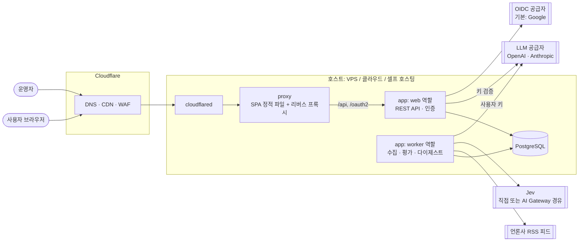
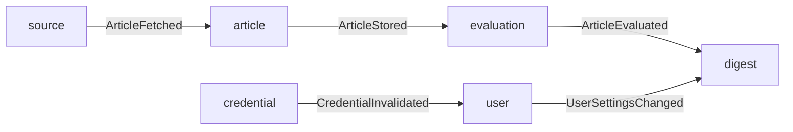

# 시스템 개요

요즘뉴스의 1층 문서다. 목적 · 범위 · 품질 목표 · 시스템 구성 · 모듈 지도 · 횡단 규약 · 용어를 담는다. 모듈 하나의 계약과 내부 규칙은 모듈 Spec(`specs/`)이, 결정의 이유는 [ADR](adr/README.md)이 소유한다.

## 1. 목적

매일 확인할 만한 관심 뉴스를 짧은 시간 안에 파악하게 해 주는 **개인화 뉴스 다이제스트 웹 서비스**다. 단순한 기사 목록이 아니라, 사용자 관심에 맞춰 여러 기사를 종합한 요약과 주요 이슈 정리가 핵심 가치다.

- 누구나 가입해 쓰는 공개 서비스다. 사용자 규모가 작아도 인증 · 데이터 격리 · 키 보관 · 악용 방지는 공개 서비스 수준으로 한다
- 대규모 인프라를 쓰지 않는다. 같은 컨테이너 구성을 소규모 VPS · 관리형 클라우드 · 셀프 호스팅 어디에든 올린다

```
[운영자 큐레이션 RSS 피드]
        │  주기적 수집 · 정규화 · 중복 제거
        ▼
[기사 저장소] ──► [Jev 공유 평가] 주제·지역 태그 · 형식 · 중요도
        │                       (기사당 1회, 운영자 비용)
        ▼
[사용자별 후보 선별] 구독 주제 · 제외 조건 · 중요도 · 기간
        │
        ▼
[사용자 LLM으로 종합 다이제스트 생성] (사용자 BYOK 키, 사용자 비용)
        │
        ▼
[웹 UI] 주요 이슈 + 추가 헤드라인 + 원문 링크 + 좋아요/싫어요
```

## 2. 범위

### v1 포함

- 운영자가 켠 소스의 RSS 피드에서 기사 수집, 정규화, 중복 제거, 피드 상태 모니터링(실패 · 방치된 피드 감지). 소스는 수집 프로필로 등록하고, 주요 언론사는 프리셋으로 제공한다([ADR-0015](adr/0015-source-presets-and-collection-profiles.md))
- 운영자가 관리하는 태그 체계(주제 2단계 · 지역 · 형식)와 Jev 공유 평가(주제 · 지역 다중 태그, 기사 형식, 중요도)
- 가입 · 로그인: OIDC 로그인(기본 Google), 자체 로그인(이메일 · 비밀번호, 복구 코드)
- LLM API 키 등록(BYOK — OpenAI · Anthropic). 키가 없는 사용자에게는 키 등록 페이지만 보여준다
- 관심 설정: 구독 주제, 지역 · 형식 제외, 자유 텍스트 관심사, 제외할 소스, 다이제스트 생성 시각
- 사용자별 일일 다이제스트 생성(여러 기사를 종합한 요약 + 추가 헤드라인)과 열람(오늘 · 지난 날짜), 원문 링크
- 기사별 좋아요 / 싫어요
- 운영자 화면: 피드 · 태그 체계 · 평가 결과

### v1 제외

- 외부 API(제3자 조회용)와 MCP 어댑터 — [로드맵](roadmap.md)
- 사용자 피드 추가, 기사 본문 추출(파이프라인 자리만 둔다)
- 같은 사건 기사의 임베딩 기반 묶기(v1 은 LLM 종합 단계에 맡긴다 — [ADR-0007](adr/0007-defer-event-clustering.md))
- 피드백을 반영한 우선순위 조정, 저가 모델 기반 기본 티어
- 메일 발송(이메일 인증 · 메일 기반 비밀번호 재설정 · 알림 — [ADR-0011](adr/0011-no-email-in-v1.md)), 메신저 알림, 모바일 앱

## 3. 품질 목표와 제약

1. **교체 가능한 경계** — 뉴스 공급원(`ArticleSource`), 본문 추출(`ContentExtractor`), 평가(`ArticleEvaluator`), 다이제스트 생성(`DigestGenerator`)은 인터페이스 뒤에 둔다. 특정 공급자의 API 형태가 도메인 모델로 새어 들어오지 않는다
2. **셀프 호스팅 가능** — 외부 서비스(로그인 · 메일 · 봇 차단 · Cloudflare 등)는 표준 프로토콜(OIDC · SMTP · S3)이나 자체 인터페이스로 연결하고, 설정으로 교체하거나 끌 수 있다. 개발과 테스트는 외부 계정 없이 로컬 대체물로 돈다 ([ADR-0012](adr/0012-swappable-external-dependencies.md))
3. **도메인은 관심 분야를 모른다** — 다루는 주제는 코드가 아니라 태그 체계와 사용자 설정으로 정해진다
4. **비용 주체에 따라 단계를 나눈다** — 사용자 수와 무관한 일(수집 · 공유 평가)은 운영자 비용, 사용자 수에 비례하는 일(다이제스트 생성)은 사용자 비용이다. 운영자 비용은 사용자 수가 늘어도 일정하다 ([ADR-0002](adr/0002-shared-evaluation-with-jev.md) · [ADR-0003](adr/0003-byok-personalized-digest.md))
5. **판단 근거를 남긴다** — Jev 의 태그별 확률, 모델 버전, 태그 체계 버전, LLM 토큰 사용량을 저장해 임계값 조정과 품질 분석에 쓴다
6. **원문은 원문 사이트에서** — 기사 본문을 재게시하지 않는다. 종합 요약 · 원문 링크 · 출처 표기만 제공한다
7. **LLM 출력은 데이터로 다룬다** — 링크와 기사 정보는 LLM 이 아니라 DB 에서 가져와 렌더링한다. LLM 은 후보 별칭으로만 인용한다
8. **작게 운영 가능하게** — v1 은 PostgreSQL 하나 외에 별도 상태 저장소(Redis · 메시지 브로커)를 두지 않는다

## 4. 시스템 구성



- 브라우저에는 **단일 오리진**으로 서비스한다. `proxy` 가 React SPA 정적 파일을 내려주고 `/api/**` · `/oauth2/**` · `/login/**` 을 `web` 으로 넘긴다
- `web` 과 `worker` 는 **같은 컨테이너 이미지**를 Spring profile 로 역할만 나눠 실행한다. 작은 배포에서는 두 profile 을 한 프로세스에서 함께 켤 수 있다
- Cloudflare 는 권장 구성이며 필수가 아니다 — 셀프 호스팅에서는 일반 리버스 프록시로 대체한다 ([infrastructure.md](infrastructure.md))

| 역할 | 하는 일 | 확장 |
|---|---|---|
| `web` | 화면용 REST API, 로그인(OIDC · 자체), 세션, 키 등록 · 검증, 운영자 API | 무상태(세션은 DB). 여러 개로 늘릴 수 있다 |
| `worker` | 백그라운드 작업: 피드 수집, Jev 평가, 다이제스트 생성, 정리 작업 | 작업 큐가 DB 로 작업을 분배하므로 여러 개로 늘릴 수 있다 |

## 5. 모듈 지도

기본 패키지 `net.yozmnews` 바로 아래 패키지 하나가 Spring Modulith 모듈 하나다. 모듈 내부 구조(실용적 헥사고날 — `domain` / `application` / `adapter`)와 패턴은 [ADR-0013](adr/0013-architecture-patterns.md)을 따른다. 각 모듈의 REST 컨트롤러는 그 모듈 안(`adapter/in/web`)에 있다.

| 모듈 | 책임 |
|---|---|
| `source` | 소스 등록(수집 프로필 · 프리셋) · 켜기 · 끄기 · 피드 상태, 수집 스케줄, RSS 파싱 · 정규화 |
| `article` | 같은 기사 판정(정규 URL · 제목 비교 키) · 중복 제거, 기사 저장 · 조회 |
| `evaluation` | 태그 체계, 공유 평가(`ArticleEvaluator` — Jev), 평가 결과 |
| `digest` | 후보 선별, 프롬프트 구성, 다이제스트 생성 · 검증 · 저장 |
| `llm` | 공급자 · 모델 목록, 사용자 키로 LLM 클라이언트 생성, 키 검증 |
| `credential` | BYOK 키 암호화 보관(envelope encryption) |
| `user` | 계정, OIDC 연동, 자체 로그인(비밀번호 · 복구 코드), 화면 내 알림, 사용자 설정 · 태그 선호 |
| `feedback` | 좋아요 / 싫어요 |
| `admin` | 운영자 기능(피드 · 태그 체계 · 평가 결과) |
| `platform` | 여러 모듈에 걸친 것: 보안 설정, 오류 응답 형식, 공통 타입, 프로필별 설정 검사 |



- 모듈 간에는 **공개 API(모듈 최상위 패키지의 타입)와 도메인 이벤트로만** 연결한다. 다른 모듈의 하위 패키지 접근은 Modulith 검증 테스트가 막는다
- 이벤트는 Spring Modulith 이벤트 발행 레지스트리(JDBC)에 기록되어, 처리 중 프로세스가 죽어도 재시작 후 다시 처리된다
- `ArticleEvaluated` 를 받은 `digest` 는 즉시 생성하지 않는다. 다이제스트는 사용자 일정에 따라 생성되고, 이 이벤트는 지표 갱신에만 쓴다

모듈 인터페이스 초안과 백그라운드 작업 목록은 [architecture.md](architecture.md)에 있다.

## 6. 횡단 규약

| 규약 | 내용 | 근거 |
|---|---|---|
| aggregate 참조 | aggregate 사이 참조는 ID 로만 한다. 다른 모듈의 엔티티를 객체로 붙잡지 않는다 | [ADR-0013](adr/0013-architecture-patterns.md) · [ADR-0014](adr/0014-spring-data-jdbc.md) |
| 데이터 접근 | 쓰기는 aggregate(Spring Data JDBC), 화면 · 운영자 조회와 후보 선별 · 대량 처리는 SQL 조회 모델(JdbcClient). 스키마의 정본은 Flyway 마이그레이션 | [ADR-0014](adr/0014-spring-data-jdbc.md) |
| 트랜잭션 경계 | 외부 호출(LLM · Jev · 피드)은 DB 트랜잭션 밖에서 한다 — 상태 `RUNNING` 커밋 → 외부 호출 → 새 트랜잭션에서 결과 저장 | [ADR-0013](adr/0013-architecture-patterns.md) |
| 상태 전이 · 작업 | 상태 전이는 aggregate 메서드로만, 백그라운드 작업은 다시 실행해도 결과가 같다 | [ADR-0013](adr/0013-architecture-patterns.md) |
| 사용자 범위 | 화면 · API 의 사용자 데이터 조회는 세션의 `userId` 로만 범위를 정한다. 요청으로 받은 사용자 ID 는 신뢰하지 않는다 | [security.md](security.md) |
| 비밀 값 | BYOK 키 평문은 `llm` 모듈 안에서 호출 직전에만 존재하고, 로그 · 오류 · 응답에 남지 않는다 | [security.md](security.md) |
| LLM 입출력 | RSS 내용은 신뢰할 수 없는 입력, LLM 출력은 스키마로 검증하는 데이터 | [pipeline.md](pipeline.md) · [security.md](security.md) |
| 외부 의존성 | 표준 프로토콜 · 자체 인터페이스 뒤, 설정으로 교체 · 비활성, 로컬 대체물 | [ADR-0012](adr/0012-swappable-external-dependencies.md) |
| 판정 시점 | 바뀔 수 있는 임계값은 저장 시점이 아니라 조회 시점에 적용한다 | [ADR-0010](adr/0010-tag-taxonomy.md) |

## 7. 기술 스택

| 영역 | 선택 | 근거 |
|---|---|---|
| 언어 · 프레임워크 | Java 25, Spring Boot 4, Spring Modulith | [ADR-0004](adr/0004-tech-stack.md) · [ADR-0013](adr/0013-architecture-patterns.md) |
| 데이터 | PostgreSQL, Flyway, Spring Data JDBC + JdbcClient | [ADR-0004](adr/0004-tech-stack.md) · [ADR-0014](adr/0014-spring-data-jdbc.md) |
| LLM · 평가 | Spring AI 2.x(OpenAI · Anthropic), Jev | [ADR-0008](adr/0008-v1-llm-providers.md) · [ADR-0002](adr/0002-shared-evaluation-with-jev.md) |
| 인증 | Spring Security(OIDC + 이메일 · 비밀번호), Spring Session JDBC | [ADR-0009](adr/0009-authentication-google-and-local.md) · [ADR-0011](adr/0011-no-email-in-v1.md) |
| 백그라운드 작업 · RSS | JobRunr(PostgreSQL 저장소), Rome | [ADR-0004](adr/0004-tech-stack.md) |
| 빌드 · 테스트 | Gradle(Kotlin DSL), JUnit 5, Testcontainers, WireMock | [ADR-0004](adr/0004-tech-stack.md) · [테스트 전략](qa/test-strategy.md) |
| 프론트엔드 | React + TypeScript + Vite, React Router, TanStack Query, Tailwind + shadcn/ui, OpenAPI → TS 타입 생성 | [ADR-0005](adr/0005-frontend-react-spa.md) |
| 배포 | Docker 이미지 + Docker Compose, Cloudflare(선택) | [ADR-0006](adr/0006-deployment-compose-cloudflare.md) |

라이브러리 버전의 정본은 `backend/build.gradle.kts` 다.

## 8. 용어

| 용어 | 뜻 |
|---|---|
| 소스(Source) | 언론사 등 기사 발행 주체 |
| 피드(Feed) | 소스가 제공하는 RSS/Atom 피드 하나. 한 소스가 여러 피드를 가질 수 있다 |
| 수집 프로필 | 소스의 피드 목록과, 그 피드를 읽고 형식을 보정하는 방법을 선언형으로 적은 것 |
| 프리셋 | 개발팀이 저장소에서 관리하고 테스트로 검증한 주요 언론사의 수집 프로필. 운영자는 참조해서 켜고 끈다 |
| 기사(Article) | 중복 제거된 기사 1건. 여러 피드에서 같은 기사가 들어와도 1건으로 저장한다 |
| 공유 평가 | 사용자와 무관하게 기사마다 한 번만 수행하는 Jev 평가(태그 · 형식 · 중요도). 비용은 운영자가 부담 |
| 태그 체계(Taxonomy) | 운영자가 관리하는 통제 어휘. 주제(2단계) · 지역 · 형식 축으로 나뉘고 버전을 가진다. 기사에는 여러 태그가 붙을 수 있다 |
| 후보(Candidate) | 다이제스트 생성 시 한 사용자에게 LLM 입력으로 넘기는 기사 집합 |
| 다이제스트(Digest) | 한 사용자의 한 기간(기본: 하루)에 대해 LLM 이 여러 기사를 종합해 만든 결과물 |
| BYOK | Bring Your Own Key. 사용자가 자기 LLM API 키를 등록해 다이제스트 생성 비용을 직접 부담하는 방식 |
