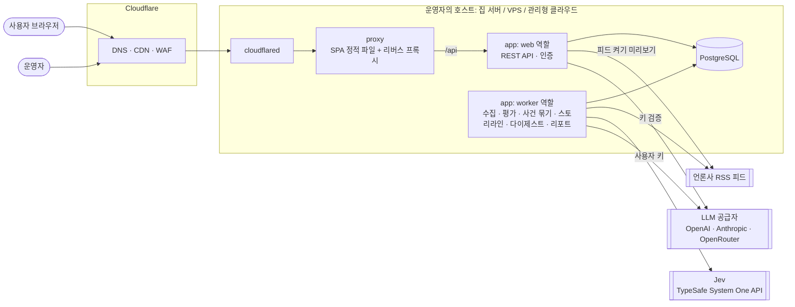
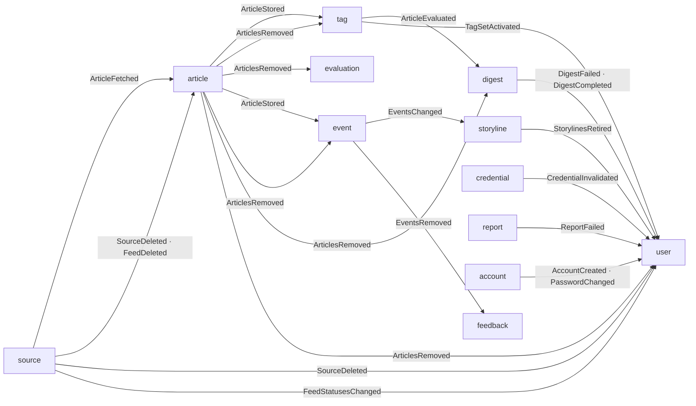

# 시스템 개요

요즘뉴스의 1층 문서다. 목적 · 범위 · 품질 목표 · 시스템 구성 · 모듈 지도 · 횡단 규약 · 용어를 담는다. v1 전체의 시스템 지도라 아직 코드가 없는 모듈 · 의존 · 이벤트도 담고, 아직 설계되지 않은 부분은 항목 앞에 **(미설계)** 를 적는다 — 그 부분을 설계하는 이슈가 표시를 지운다. 모듈 하나의 계약 · 내부 구조 · 규칙은 [모듈 Spec](specs/README.md)이, 결정의 이유는 [ADR](adr/README.md)이 소유한다.

## 1. 목적

매일 확인할 만한 관심 뉴스를 짧은 시간 안에 파악하게 해 주고, 그 기록을 오래 쌓아 뉴스의 흐름과 관심의 변화를 보여 주는 **셀프 호스팅 개인화 뉴스 다이제스트 소프트웨어**다. 핵심 가치는 둘이다 ([ADR-0025](adr/0025-long-term-personal-news-history-in-v1.md)).

- **매일 다이제스트** — 단순한 기사 목록이 아니라, 사용자 관심에 맞춰 여러 기사를 종합한 요약과 주요 뉴스 정리. 사용자가 매일 들어오는 기본 기능이다
- **개인 뉴스 히스토리** — 기사 · 사건 · 사용자 반응을 쌓아, 사건들이 이어진 흐름(스토리라인)의 전개와 관심의 변화를 보여 준다. 쌓일수록 가치가 커지는 장기적인 차별점이다

- 어떤 소스를 켜고 누구와 함께 쓸지, 소스의 이용조건을 어떻게 판단할지는 인스턴스를 띄운 운영자가 정한다 ([ADR-0047](adr/0047-self-hosted-software-run-by-instance-operators.md))
- 한 인스턴스를 운영자가 허락한 몇 사람이 함께 쓴다. 운영자가 인스턴스를 인터넷에 열 수 있고 여러 사람의 데이터와 LLM 키가 한곳에 모이므로, 인증 · 데이터 격리 · 키 보관 · 악용 방지는 공개 서비스 수준으로 한다
- 대규모 인프라를 쓰지 않는다. 같은 컨테이너 구성을 운영자의 호스트(집 서버 · VPS · 관리형 클라우드) 어디에든 올린다

```
[운영자 큐레이션 RSS 피드]
        │  주기적 수집 · 정규화 · 중복 제거
        ▼
[기사 저장소] ──► [Jev 공유 평가] 주제·지역 태그 · 형식 · 중요도
        │        └─► [사건 묶기] 한 번 일어난 일의 기사 묶기
        │                 └─► [스토리라인] 사건을 스토리라인으로 잇기 · 큰 판정
        │                       (사용자와 무관, 운영자 비용)
        ▼
[사용자별 후보 선별] 사건 단위 — 구독 주제 · 제외 조건 · 사건 중요도 × 관심도 · 큰 스토리라인 · 기간
        │        └─► [항목 묶기] 고른 사건을 스토리라인 포함 나무로 묶고 주요 뉴스 · 헤드라인으로 가르기
        │
        ▼
[사용자 LLM으로 종합 다이제스트 생성] 항목마다 제목 · 요약 (사용자 BYOK 키, 사용자 비용)
        │        ├─► [사용자 스토리라인의 정리] 관심이 쌓인 사용자 스토리라인의 제목 · 요약 (사용자 BYOK 키, 사용자 비용)
        │        └─► [변화 리포트] 주간 · 월간 (사용자 BYOK 키, 사용자 비용)
        ▼
[웹 UI] 주요 뉴스 · 헤드라인 항목(좋아요/싫어요) + 출처 기사(원문 링크)
        사건 흐름(정리된 내 흐름) · 타임라인 · 관심사 히스토리 · 변화 리포트
```

## 2. 범위

### v1 포함

- 운영자가 켠 소스의 RSS 피드에서 기사 수집, 정규화, 중복 제거, 피드 상태 모니터링(실패 · 방치된 피드 감지). 소스는 수집 프로필로 등록하고, 주요 언론사는 프리셋으로 제공한다([ADR-0015](adr/0015-source-presets-and-collection-profiles.md))
- 운영자가 관리하는 태그 체계(주제 2단계 · 지역 · 형식)와 Jev 공유 평가(주제 · 지역 다중 태그, 기사 형식, 중요도)
- 가입 · 로그인: 운영자의 초대 링크 · 계정 생성으로 가입(공개 가입은 운영자 화면에서 연다, 첫 운영자는 환경 변수), 자체 로그인(이메일 · 비밀번호, 복구 코드 재설정, 첫 로그인의 비밀번호 변경)
- LLM API 키 등록(BYOK — OpenAI · Anthropic · 중계 공급자 OpenRouter). 키가 없는 사용자는 키 등록 · 계정 설정 · 알림 · 관심 설정 화면만 쓴다
- 관심 설정: 구독 주제, 지역 · 형식 제외, 제외할 소스, 다이제스트 생성 시각
- 한 번 일어난 일을 다룬 기사의 공유 묶기(사건) ([ADR-0026](adr/0026-event-clustering-with-local-embeddings-and-jev.md) · [ADR-0102](adr/0102-an-event-is-the-reports-of-one-happening-narrowed-by-the-event-membership-question-wording.md))
- 사용자별 일일 다이제스트 생성(고른 사건을 스토리라인으로 묶은 항목마다 여러 기사를 종합한 주요 뉴스 + 헤드라인)과 열람(오늘 · 지난 날짜), 출처 기사의 원문 링크
- 스토리라인: 사건들을 이은 흐름을 모든 사용자가 공유하도록 잇기(운영자 비용), 큰 판정(구독과 무관하게 알릴 만한 스토리라인), 사용자가 관심 신호를 준 스토리라인을 따라가는 사용자 스토리라인과 흐름 추적(스토리라인 구독) · 해제, 관심이 쌓인 사용자 스토리라인을 사용자 LLM 으로 간추린 정리(사용자 비용 — 그 사용자에게만 보인다), 타임라인 ([ADR-0101](adr/0101-shared-storylines-connect-events-and-the-personal-side-is-storyline-subscriptions-and-interests.md) · [ADR-0103](adr/0103-big-judgement-on-storylines-and-the-storyline-milestone-right-after-event-clustering-takes-over-big-events.md))
- 관심도를 반영한 사건 단위 후보 선별, 구독과 무관하게 넣는 큰 스토리라인, 항목별 선정 이유 표시, 구독 제안 ([ADR-0028](adr/0028-explicit-signals-and-interest-weighted-candidates.md) · [ADR-0103](adr/0103-big-judgement-on-storylines-and-the-storyline-milestone-right-after-event-clustering-takes-over-big-events.md) · [ADR-0260](adr/0260-digest-candidates-are-events-and-only-assigned-events-with-an-article-first-evaluated-in-the-period-enter.md) · [ADR-0262](adr/0262-chosen-events-are-grouped-into-items-by-containment-tree-top-code-splits-top-stories-and-headlines-the-llm-writes-per-item-and-an-item-has-one-badge.md))
- 관심 신호(다이제스트 항목에 누르는 좋아요 / 싫어요 — 그 항목의 사건마다 기록 · 주제와 스토리라인의 구독 변경)의 이력과 관심사 히스토리
- 변화 리포트: 주간 · 월간
- 운영자 화면: 피드 · 태그 체계 · 평가 결과 · 사건 · 스토리라인
- 운영자가 설정하면 보이는 개인정보처리방침 · 이용약관 링크

### v1 제외

- 외부 API(제3자 조회용)와 MCP 어댑터 — [로드맵](roadmap.md)
- 외부 로그인(OIDC 공급자 로그인 · 외부 계정 연결) — [로드맵](roadmap.md)
- 사용자 피드 추가, 기사 본문 추출(파이프라인 자리만 둔다)
- 분기 · 연간 변화 리포트, 키워드 구독
- 메일 발송(이메일 인증 · 메일 기반 비밀번호 재설정 · 알림 — [ADR-0011](adr/0011-no-email-in-v1.md)), 메신저 알림, 모바일 앱

## 3. 품질 목표와 제약

1. **교체 가능한 경계** — 뉴스 공급원(`ArticleSource`), 본문 추출(`ContentExtractor`), 모델 평가(`ArticleEvaluator` — 태그 판정 · 사건 소속 판정), 기사 임베딩(`ArticleEmbedder` — `evaluation` 의 임베딩 공개 API 뒤), 다이제스트 생성(`DigestGenerator`), 변화 리포트 생성(`ReportGenerator`)은 인터페이스 뒤에 둔다. 특정 공급자의 API 형태가 도메인 모델로 새어 들어오지 않는다
2. **셀프 호스팅 가능** — 외부 서비스(로그인 · 메일 · 봇 차단 · Cloudflare 등)는 표준 프로토콜(OIDC · SMTP · S3)이나 자체 인터페이스로 연결하고, 설정으로 교체하거나 끌 수 있다. 개발과 테스트는 외부 계정 없이 로컬 대체물로 돈다 ([ADR-0012](adr/0012-swappable-external-dependencies.md))
3. **도메인은 관심 분야를 모른다** — 다루는 주제는 코드가 아니라 태그 체계와 사용자 설정으로 정해진다
4. **비용 주체에 따라 단계를 나눈다** — 사용자 수와 무관한 일(수집 · 공유 평가 · 사건 묶기 · 스토리라인 잇기)은 운영자 비용, 사용자 수에 비례하는 일(다이제스트 · 사용자 스토리라인의 정리 · 변화 리포트 생성)은 사용자 비용이다. 운영자는 생성형 LLM 을 쓰지 않는다. 운영자 비용은 사용자 수가 늘어도 일정하다 ([ADR-0002](adr/0002-shared-evaluation-with-jev.md) · [ADR-0003](adr/0003-byok-personalized-digest.md) · [ADR-0025](adr/0025-long-term-personal-news-history-in-v1.md) · [ADR-0101](adr/0101-shared-storylines-connect-events-and-the-personal-side-is-storyline-subscriptions-and-interests.md))
5. **판단 근거를 남긴다** — Jev 의 태그별 확률, 모델 버전, 태그 체계 버전, 사건 소속 판정 원본, 임베딩 모델 버전, LLM 토큰 사용량을 저장해 임계값 조정과 품질 분석에 쓴다
6. **원문은 원문 사이트에서** — 기사 본문을 재게시하지 않는다. 사용자에게는 종합 요약 · 원문 링크 · 출처 표기만 제공하고, RSS 요약문 원문은 운영자 화면에서만 보인다 ([ADR-0068](adr/0068-rss-summaries-shown-only-on-operator-screens-and-users-get-processed-information.md))
7. **LLM 출력은 데이터로 다룬다** — 링크와 기사 정보는 LLM 이 아니라 DB 에서 가져와 렌더링한다. LLM 은 이번 요청의 항목 별칭으로만 항목을 가리키고, 인용은 코드가 정한 그 항목의 표본 기사다([ADR-0262](adr/0262-chosen-events-are-grouped-into-items-by-containment-tree-top-code-splits-top-stories-and-headlines-the-llm-writes-per-item-and-an-item-has-one-badge.md))
8. **작게 운영 가능하게** — v1 은 PostgreSQL 하나 외에 별도 상태 저장소(Redis · 메시지 브로커 · 벡터 DB)를 두지 않는다. 벡터는 pgvector 확장에 둔다 ([ADR-0027](adr/0027-pgvector-for-vector-storage.md))
9. **관심 신호는 명시적 행동만** — 좋아요 / 싫어요 · 구독 변경(주제 · 스토리라인)만 관심 신호로 쓰고, 클릭 · 열람은 추적하지 않는다 ([ADR-0028](adr/0028-explicit-signals-and-interest-weighted-candidates.md))
10. **장기 기능은 RSS 요약문에 기대지 않는다** — 요약문은 기본으로 무기한 보존하지만 운영 설정으로 지울 수 있다. 스토리라인 · 관심사 히스토리 · 변화 리포트 · 검색은 요약문이 없는 기사에서도 동작한다 ([ADR-0029](adr/0029-indefinite-summary-retention-with-optional-deletion.md))

## 4. 시스템 구성



- 브라우저에는 **단일 오리진**으로 서비스한다. `proxy` 가 React SPA 정적 파일을 내려주고 `/api/**` 를 `web` 으로 넘긴다
- `web` 과 `worker` 는 **같은 컨테이너 이미지**를 Spring profile 로 역할만 나눠 실행한다. 기본 배포 구성은 두 profile 을 함께 켠 프로세스 하나(서비스 `app`)이고, 나눠 띄울 때는 `web` · `worker` 두 서비스로 둔다 ([operations/deployment.md](operations/deployment.md#서비스))
- 역할 profile 을 하나도 켜지 않으면 두 역할을 함께 하고, 다른 profile 만 켜 역할이 하나도 없으면 기동하지 않는다. 어느 구성요소가 어느 역할에 속하는지는 [platform Spec](specs/platform.md#역할)(platform-R8 · R9, [ADR-0042](adr/0042-app-roles-as-web-worker-profiles-marked-by-platform-annotations.md))에 있다. `web` 도 피드 켜기의 미리보기로 피드에 요청한다([ADR-0041](adr/0041-activation-gate-previews-a-feed-on-enable-and-judges-by-code-constants.md))
- Cloudflare 는 권장 구성이며 필수가 아니다 — 일반 리버스 프록시나 다른 터널로 대체할 수 있다 ([operations/deployment.md](operations/deployment.md#공개-경로와-외부-서비스))

| 역할 | 하는 일 | 확장 |
|---|---|---|
| `web` | 화면용 REST API, 로그인(자체), 세션, 키 등록 · 검증, 운영자 API | 무상태(세션은 DB). 여러 개로 늘릴 수 있다 |
| `worker` | 백그라운드 작업: 피드 수집, Jev 평가, 사건 묶기, 스토리라인 잇기, 다이제스트 · 변화 리포트 생성, 정리 작업 | 작업 큐가 DB 로 작업을 분배하므로 여러 개로 늘릴 수 있다 |

## 5. 모듈 지도

기본 패키지 `net.yozmnews` 바로 아래 패키지 하나가 Spring Modulith 모듈 하나다. 모듈 내부 구조(실용적 헥사고날 — `domain` / `application` / `adapter`)와 패턴은 [ADR-0013](adr/0013-architecture-patterns.md)을 따른다. 각 모듈의 REST 컨트롤러는 그 모듈 안(`adapter/in/web`)에 있다 — 운영자 화면은 `admin`, 뉴스 내용을 보이는 독자 화면은 `reader` 가 각 모듈의 공개 API 를 엮어 낸다([ADR-0045](adr/0045-admin-module-serves-operator-api-over-module-public-operation-apis.md) · [ADR-0192](adr/0192-reader-screens-are-composed-by-the-reader-module-over-module-public-queries.md)).

| 모듈 | 책임 |
|---|---|
| [`source`](specs/source.md) | 소스 등록(수집 프로필 · 프리셋) · 켜기 · 끄기 · 숨김 · 삭제 · 피드 상태, 출처 이름 기록, 수집 스케줄, RSS 파싱 · 정규화(`ArticleSource` — 모든 피드 수집이 거치는 포트) |
| [`article`](specs/article.md) | 같은 기사 판정(정규 URL · 제목 비교 키) · 중복 제거, 기사 저장 · 조회(출처 이름을 엮은 헤드라인 포함), 피드별 엔트리 집계(중복률 · 날짜 추정 비율), 지운 소스 · 피드의 기사 삭제, 본문 추출(`ContentExtractor` — v1 비활성) |
| [`tag`](specs/tag.md) | 태그 체계(기본 체계 적재 · 태그 기준 · 저장 기준과 그 변경 이력)와 태그 키 계보, 공유 평가(평가 대기 · 회차 — 판정은 `evaluation` 의 태그 판정), 평가 결과와 조회 시점 판정, 평가 현황 · 주제별 보도량 · 검수 · 기준 미리보기, 저장 기준을 낮춘 뒤 빠진 태그 채움 |
| [`evaluation`](specs/evaluation.md) | 모델 평가 관문 — 판정마다 공개 API 하나로 모델 요청을 조립해 부르고 결과를 대조해 판정 원본을 기록한다(`ArticleEvaluator` — Jev 를 부르는 유일한 포트). 태그 판정(`ArticleTagging`) · 사건 소속 판정(`EventMembership`) · 스토리라인 잇기의 스토리라인 소속 판정(`StorylineMembership`) · 스토리라인 관계 판정(`StorylineRelation`)과 판정 원본 조회(관계 판정 원본은 평가기가 원본 응답을 다시 읽어 확률을 낸다), 기사 임베딩(`TextEmbedding` — 임베더 포트 `ArticleEmbedder`, 결과를 확인하고 기록하지 않는다), 평가기 시간(`EvaluatorTiming` — 요청 마감 · 판정 한 번의 가장 긴 시간 · 일시 실패 뒤 간격), 지운 기사의 판정 원본 지우기. 사용자 · 태그 체계 · 사건 · 스토리라인을 모른다 |
| [`digest`](specs/digest.md) | 다이제스트 상태와 생성 흐름(프롬프트 구성 · 생성기 포트 `DigestGenerator` 와 실제 생성기 · 로컬 대체물 — 생성기는 트랜잭션 밖에서 부르고, 끝까지 쓴 응답을 읽지 못하거나 칸이 빠진 항목이 있으면 한 번 다시 묻는다), 출력 읽기 · 항목 대조, 섹션(항목) · 섹션 사건(노출 기록) · 인용 저장, 지운 기사 따르기(지운 항목의 항목 기록은 `feedback` 의 `DigestItemRemoval` 로), 후보 행 보존, 받은 소식(사용자가 날짜별로 보이는 다이제스트에서 받은 기사와 날짜 — `ReceivedArticles`), 항목 확인(주어진 다이제스트가 그 사용자의 것이고 그 사건이 든 항목이 하나면 그 항목의 사건들 — `feedback` 의 `DigestItems` 구현). 후보 선별(후보는 사건 — 사건의 값 · 구독 필터 · 큰 슬롯 · 구독 행마다 몫 · 최대 후보 수 · 사건마다 표본 · 입력 토큰 예산 · 선정 이유 — 관심도를 곱한 순위, 싫어요 사건 제외)과 항목 묶기(스토리라인 포함 나무의 꼭대기) · 주요 뉴스와 헤드라인 가르기, 생성의 입력(프로필 · 항목 → 사건 → 표본 기사), 관심도(신호 이력과 노출 — 사건 × 항목 몫 — 에서 조회 때 계산 — 저장하지 않는다), 관심사 히스토리(기간마다 같은 산식의 관심 · 새로 생긴 관심 · 사라진 관심 · 사용자가 바꾼 주제 구독 — `InterestHistory`). 일정(생성 시각이 된 사용자의 다이제스트를 날짜마다 한 번 만들고 생성 작업 등록) · 수동 생성(`DigestRequests` — 하루 세 번) · 멈춘 다이제스트 거두기 · 실패 이벤트 발행. 다이제스트 조회(날짜마다 보이는 다이제스트와 가장 최근 시도 · 날짜 목록 · 수동 생성 상태 — `DigestDirectory`, 화면용 API 는 `reader`). 구독 제안(구독하지 않은 중분류의 지금 관심이 제안 기준 이상이고 거절에 막히지 않은 것 — `TopicSuggestions`, 거절 때 관심은 `user` 가 선언한 `TopicInterestNow` 를 구현해 답한다) |
| [`llm`](specs/llm.md) | 공급자 · 허용 모델 목록(`LlmModels`), 입력 토큰 어림(`TokenEstimate` — 다이제스트 · 변화 리포트가 입력을 예산 안으로 맞출 때 쓴다), 키 검증과 사용자 키로 LLM 클라이언트 생성(`LlmClientFactory` — 모든 LLM 호출과 BYOK 키 복호화가 거치는 관문). 공급자 SDK · Spring AI 의 타입은 이 모듈 밖으로 나가지 않는다. 저장한 키의 길 — 저장한 키를 공급 인터페이스(`StoredKeySource`)로 받아 검증하고 생성 호출(지시 · 사용자 구획 · 출력 스키마를 넘겨 본문 · 토큰 · 종료 사유를 받는다 — 스키마 · 추론 강도 · 출력 상한을 공급자의 꼴로 옮기고 일시 장애를 다시 보낸다)을 한다 |
| [`credential`](specs/credential.md) | BYOK 키의 암호화 보관(envelope encryption — 키마다 DEK, 운영자가 파일로 주는 버전 있는 KEK 와 재암호화), 키 등록 · 다시 검증 · 삭제, 키의 상태와 무효 알림(`CredentialInvalidated`), 저장한 키를 `llm` 에 건네는 공급 구현, 키 유무 조회(`LlmKeys`) |
| [`account`](specs/account.md) | 계정, 계정을 만드는 길(공개 가입 · 초대 · 운영자 계정 생성 · 첫 운영자)과 가입 정책, 자체 로그인(비밀번호 · 실패 지연 · 복구 코드 · 비밀번호 변경), 보안 구성(운영자 토큰 · 세션 · CSRF)과 세션 사용자 범위, LLM 키가 없는 세션 사용자의 키 관문, 요청 방어(요청 제한 · 봇 차단). 계정의 사실(계정 생김 · 비밀번호 바뀜)을 커밋 뒤 이벤트로 알리고, 다른 모듈이 계정을 읽는 공개 조회(`AccountDirectory`)를 낸다 |
| [`user`](specs/user.md) | 사용자 한 사람의 관심과 그 사람에게 보이는 기록 — 화면 내 알림(비밀번호 알림은 `account` 의 비밀번호 바뀜을 받아), 관심 설정(계정 생김을 받아 기본값을 넣는다)(태그 선호와 그 변경 이력 · 제외 소스 · 일정 · 변화 리포트 설정 · 고른 모델과 쓸 모델 · 추론 강도 · 다이제스트 분량과 요약 길이 — 태그 체계의 활성 전환을 따라 선호를 고쳐 쓴다 — 다이제스트가 읽는 조회를 낸다), 사용자 스토리라인(관심 신호를 준 스토리라인 — 이어짐을 따라 추적 대상을 넓히고 공용 관계의 변화를 따른다 — 다이제스트의 관심도가 읽는 조회를 낸다)과 그 정리(다이제스트가 끝난 뒤 관심 스토리라인만 그 사용자의 LLM 키로 간추린 제목 · 흐름 요약 · 최근 전개 — 생성기 포트 `StorylineSummarizer` 와 로컬 대체물, 시도 기록, 독자 화면이 읽는 조회를 낸다), 스토리라인 구독(사용자 스토리라인을 가리킨다 — 화면 이름 "흐름 추적") · 그 변경 이력(사라진 구독을 알린다 — 소비자 조회를 낸다). 다이제스트의 관심도 · 관심사 히스토리가 읽는 주제 구독 변경 조회와 사용자 시간대 조회. 구독 제안 거절(거절 때 관심과 함께 기록 — 처리기, 활성 키로 풀어 내는 소비자 조회). 변화 리포트의 일정이 읽는 리포트 일정 목록과 쓸 모델 조회, 리포트 실패 알림(`report` 가 내는 실패를 받아) |
| [`feedback`](specs/feedback.md) | 좋아요 / 싫어요 — 다이제스트 항목에 한 번 누르고, 그 항목에 누른 값(항목 기록 — 화면이 보이는 값)과 그 항목의 사건마다의 현재 상태 · 추가 전용 이력(관심 신호 — 누른 다이제스트를 함께 남긴다)을 기록한다. 받을 수 있는 항목의 판정(그 사용자의 다이제스트에서 그 사건이 든 항목 — 이 모듈이 선언한 `DigestItems` 로 묻고 `digest` 가 답한다), 지운 사건 · 지운 항목 따르기, 누르기 · 되돌리기 · 항목 기록 조회의 화면용 API, 소비자 조회(`EventFeedback` — 싫어요 사건 · 기간의 이력, 합쳐진 사건은 읽을 때 `event` 로 푼다) |
| [`admin`](specs/admin.md) | 운영자 기능의 HTTP API(소스 · 피드 관리, 수집 현황, 이벤트 발행, 태그 체계 버전, 평가 현황, 평가 검수, 태그 기준 · 저장 기준, 빠진 태그 채움, 사건 묶기 채우기, 사건 조회 · 판정 기록, 스토리라인 잇기 채우기, 스토리라인 조회(목록 · 타임라인과 소속 근거 · 관계 · 물은 쌍), 큰 스토리라인 · 큰 판정 기준, 계정 · 초대 · 가입 정책) — 각 모듈의 공개 API(운영 API · 공개 조회)를 부른다 |
| [`platform`](specs/platform.md) | 여러 모듈에 걸친 것: 실패한 이벤트 발행 재처리와 남겨진 발행의 운영자 처리, 화면용 API 명세 설정 · API 계약 확인 엔드포인트, 역할(profile `web` · `worker`)과 그 기동 검사, DB 확장(pgvector) 요건 검사, 로컬 개발 표시(profile `local` — 로컬 대체물 등록), 화면용 API 경로 규약 · 공개 처리기 표시, 오류 응답 형식, YAML 원문 읽기, 날짜 범위 변환, 벡터의 pgvector 텍스트 표현 |
| [`event`](specs/event.md) | 공유 사건 묶기 — 사건 묶기 대기, 기사 표현(표현 텍스트 · 핵심 말과 임베딩 벡터의 저장), 사건 배정과 재판정, 사건 조회 · 대표 기사 · 사건 묶음의 기간 집계(기사 수 · 서로 다른 소스 수 · 중요도 평균 · 중요도 합)와 기간 전체 집계, 사건 정리(병합 · 닫기 · 장기 검색 인덱스 · 기사 표현 정리), 사건 변화 알림(`EventsChanged`)과 스토리라인 잇기 · 조회의 재료 조회. 사용자를 모른다 |
| [`storyline`](specs/storyline.md) | 공유 스토리라인 — 사건 변화를 따라 사건들을 스토리라인으로 잇기(사건은 스토리라인 0개 이상에 든다 — 사건 중심의 코사인과 무게를 준 핵심 말 겹침으로 점수를 매기고, 점수가 애매한 띠 안 후보는 `evaluation` 의 스토리라인 소속 판정에 물어 확률로 고르며 물은 확률을 쌍마다 기록한다, [ADR-0194](adr/0194-storyline-linking-asks-jev-only-for-band-candidates-and-reuses-recorded-probabilities-until-either-side-doubles.md)), 소속과 그 판정 근거, 정돈(같은 사건들로 된 스토리라인 합치기 · 사건 하나만 남은 스토리라인 합치기 · 풀기), 조회 때 정하는 상태(진행 · 잠잠 · 끝남), 운영자 채우기, 스토리라인 사이 관계(포함 · 이어짐 — 후보 쌍을 `evaluation` 의 관계 판정에 물어 맺는 명시 고리, 포함은 상위 하나의 나무, [ADR-0131](adr/0131-storyline-relations-are-explicit-links-with-containment-as-a-single-parent-tree-gathered-at-query-time.md) · [ADR-0132](adr/0132-storyline-relations-are-judged-by-jev-on-candidate-pairs-and-linked-only-above-a-probability-threshold.md)), 같은 사안의 조각 합치기(관계 판정이 조각이라고 답하고 확률이 합치기 확률 기준 이상이면 하나로 합친다 — 되돌리지 않는다, [ADR-0234](adr/0234-fragments-of-one-matter-are-recognised-by-the-relation-judgement-and-merged-above-a-merge-probability-without-a-way-back.md)), 공개 조회(스토리라인 · 타임라인 · 사건의 스토리라인 · 사건마다 포함 나무의 꼭대기 · 기간의 목록 · 소속 없는 사건 · 관계 — 포함의 상위는 하위의 사건까지 센다), 운영자 조회(소속 근거 · 관계의 확률 · 물은 기록 · 합쳐진 스토리라인 · 지금 기준), 큰 판정(기간 안 중요도 합을 그 기간에 기사가 있는 소스 수와 일수로 나눈 보도 강도가 기준 이상인 스토리라인 — 기준은 운영자 설정, 목록은 포함 나무마다 한 행 — [ADR-0235](adr/0235-the-big-list-has-one-row-per-containment-tree-carrying-the-big-storylines-under-it.md), [ADR-0103](adr/0103-big-judgement-on-storylines-and-the-storyline-milestone-right-after-event-clustering-takes-over-big-events.md) · [ADR-0116](adr/0116-storyline-big-judgement-starts-with-a-provisional-rule-of-distinct-sources-and-mean-importance-judged-at-query-time.md) · [ADR-0147](adr/0147-storyline-big-judgement-compares-importance-weighted-coverage-per-source-and-day-with-one-criterion-at-query-time.md)). 운영자는 관계를 하나씩 고치지 않고 관계 기준으로 조정한다([ADR-0137](adr/0137-storyline-relations-are-not-edited-one-by-one-by-operators-and-are-tuned-through-relation-criteria.md)). 사용자를 모른다 ([ADR-0101](adr/0101-shared-storylines-connect-events-and-the-personal-side-is-storyline-subscriptions-and-interests.md)) |
| [`report`](specs/report.md) | 변화 리포트 재료 조립(그 사용자와 관계된 것만 — 추적한 사용자 스토리라인 · 구독 주제 보도량 · 관심 변화, 직전 리포트의 스냅숏과 비교) · 생성(입력을 예산에 맞추기 · 프롬프트 구성 · 생성기 포트 `ReportGenerator` 와 실제 생성기 · 로컬 대체물 — 생성기는 트랜잭션 밖에서 부르고, 끝까지 쓴 응답을 읽지 못하거나 칸이 빠진 갈래가 있으면 한 번 다시 묻는다) · 출력 검증 · 저장 · 조회, 일정(고른 요일 · 날짜의 다이제스트 생성 시각에서 기간을 끊고 생성 조건을 채운 기간만 — 반복 작업) · 생성 작업 · 거두기 · 실패 알림 발행(`user` 가 선언한 `ReportFailed`) · 실패한 리포트 다시 만들기(공개 API). 입력은 [pipeline.md §10](pipeline.md#10-변화-리포트) |
| [`reader`](specs/reader.md) | 독자 화면의 HTTP API — 뉴스 내용(기사 · 사건 · 스토리라인 · 사용자 스토리라인의 정리 · 다이제스트 · 변화 리포트 · 관심사 히스토리)을 보이는 사용자 화면의 응답을 각 모듈의 공개 조회로 엮는다. 데이터 · 판정이 없다. 정리된 사용자 스토리라인(목록 · 하나 · 그 사용자 스토리라인에 묶인 지난 다이제스트 항목), 스토리라인 타임라인(받은 날짜) · 카드, 관심사 히스토리, 다이제스트(홈 · 날짜 · 날짜 목록 · 수동 생성 요청), 구독 제안, 변화 리포트(종류 하나의 목록 · 한 편) |



- 모듈 간에는 **공개 API(모듈 최상위 패키지의 타입)와 도메인 이벤트로만** 연결한다. 다른 모듈의 하위 패키지 접근은 Modulith 검증 테스트가 막는다
- 이벤트는 Spring Modulith 이벤트 발행 레지스트리(JDBC)에 기록된다. 리스너가 실패한 발행은 반복 작업이 주기적으로 다시 처리하고, 처리 도중 프로세스가 죽어 멈춘 발행은 정해진 시간이 지나면 실패로 바뀌어 같은 경로로 다시 처리된다. 정해진 횟수를 넘긴 발행과 이벤트를 읽을 수 없는 발행은 다시 처리하지 않고 남기며, 운영자가 화면에서 다시 처리하거나 폐기한다 — 규칙은 [platform Spec](specs/platform.md#이벤트-발행-재처리)([ADR-0023](adr/0023-jobrunr-oss-framework-schema-and-event-resubmission.md))
- `ArticleEvaluated` 는 `tag` 가 낸다 — **(미설계)** 발행 시점 · 내용. `TagSetActivated` 는 `tag` 가 활성화 트랜잭션에서 내고 `user` 가 받아 사용자의 태그 선호를 활성 키로 고쳐 쓴다([ADR-0175](adr/0175-tag-preferences-follow-tag-set-activation-events-and-are-rewritten-to-active-keys.md)). `AccountCreated` · `PasswordChanged` 는 `account` 가 계정을 만들거나 사용자가 비밀번호를 바꾼 트랜잭션에서 내고 `user` 가 커밋 뒤 받아 관심 설정 기본값 · 비밀번호 알림을 쓴다([ADR-0309](adr/0309-account-facts-are-published-after-commit-and-user-writes-interest-defaults-and-password-notices-from-them.md)). `user` 는 관심 설정 · 스토리라인 구독이 바뀌어도 이벤트를 내지 않는다 — 소비자가 조회한다([ADR-0180](adr/0180-user-settings-changes-publish-no-event-and-consumers-query.md)). `CredentialInvalidated` 는 `credential` 이 키가 무효가 되는 전이마다 내고 `user` 가 키 무효 알림을 남긴다([credential Spec](specs/credential.md#credentialinvalidated)). `DigestFailed` 는 받는 쪽 `user` 가 선언하고 `digest` 가 다이제스트를 실패로 끝내는 트랜잭션에서 내며 `user` 가 다이제스트 실패 알림을 남긴다 — 다른 알림 이벤트와 달리 받는 쪽이 선언한다(`digest` 가 이미 `user` 를 읽어 반대 방향이면 순환이다 — [ADR-0233](adr/0233-digest-failure-notices-come-through-an-event-declared-by-the-receiving-user-module-for-every-failed-digest.md)). `DigestCompleted` 도 `user` 가 선언하고 `digest` 가 다이제스트를 내용 있음 · 후보 없음으로 끝내는 트랜잭션에서 내며 `user` 가 그 사용자의 정리 작업을 등록한다([ADR-0287](adr/0287-user-storyline-summaries-are-made-and-stored-by-user-with-the-users-key-and-digest-supplies-the-flow-standing.md))
- `ArticleEvaluated` 를 받은 `digest` 는 즉시 생성하지 않는다. 다이제스트는 사용자 일정에 따라 생성되고, 이 이벤트는 지표 갱신에만 쓴다
- 그림은 이벤트만 그린다. **모듈 사이 의존(공개 API · 이벤트)의 정본은 이 절이다** — 각 모듈 Spec 은 그 모듈이 내놓는 것(공개 인터페이스 · 발행 이벤트)만 갖고 의존은 이 절을 가리킨다. 각 모듈의 화면 · 작업 진입점은 `platform` 의 역할 애너테이션(공개 타입)에 의존한다 — 그래서 `platform` 은 다른 모듈의 타입에 의존하지 않는다([ADR-0042](adr/0042-app-roles-as-web-worker-profiles-marked-by-platform-annotations.md)). 사건 · 스토리라인 · 관심도 · 변화 리포트에 걸친 공개 API 의존은 `digest` → `event` · `storyline` · `feedback` · `user` · `tag` · `source` · `llm` · `article` · `platform`, `event` → `article` · `tag` · `evaluation` · `source` · `platform`, `report` → `digest` · `event` · `tag` · `storyline` · `user` · `article` · `llm` · `platform`, `storyline` → `event` · `evaluation` · `article` · `platform`, `feedback` → `event` · `platform`, `user` → `storyline` · `event` · `article`, `admin` → `tag` · `evaluation` · `event` · `storyline`, `reader` → `storyline` · `event` · `article` · `digest` · `report` · `tag` · `user` · `platform` 이다
- `source` · `tag` → `platform` 의 공개 API 의존은 YAML 원문 읽기(`YamlTextReader` · `StrictYamlBinding`)다 — 수집 프로필과 기본 태그 체계 파일을 같은 공통 거부로 읽는다. `source` · `evaluation` · `event` · `digest` 는 길이 상한을 코드 포인트로 자를 때 `platform` 의 `CodePoints` 를 쓴다. `tag` · `evaluation` · `event` 는 날짜 범위를 시각 범위로 옮길 때 `platform` 의 `DayRange` 를 쓴다(집계 기간 · 판정 원본 조회 기간 · 사건 조회 기간). `evaluation` · `event` 는 외부 API 응답 본문의 상한에 `CappedBody` 를 쓴다. `tag` · `storyline` · `account` 는 운영 설정 이력의 행위자 종류로 `platform` 의 `ChangeActor` 를 쓰고, `account` 는 표시 이름을 자를 때 `CodePoints` 를 쓴다. `llm` → `platform` 의 공개 API 의존은 비밀 값 평문의 래퍼(`SecretValue`) · 헤더에 실을 값의 꼴(`HeaderValueShape`) · YAML 원문 읽기(허용 모델 목록 파일) · 응답 본문 상한(`CappedBody`) · 로컬 개발 표시다. `evaluation` 도 Jev 키 · 임베딩 키의 꼴을 `HeaderValueShape` 로 본다. `llm` 은 `platform` 밖의 모듈을 모른다
- `account` → `platform` 의 공개 API 의존은 화면용 API 경로 규약(`ApiPaths`) · 공개 처리기 표시(`@PublicApi`) · 변경 전 허용 표시(`@AllowedBeforePasswordChange`) · 키 없이 허용 표시(`@AllowedWithoutLlmKey`)와 그 판정(`PublicApis`) · 문제 응답(`ProblemResponses`) · 사용자 식별자(`UserId`)다 — 보안 구성은 `account` 가 갖고, 경로 규약과 공개 표시는 `platform` 의 공개 타입이라 `platform` 은 `account` 를 모른다. 세션 없이 여는 처리기를 가진 모듈은 그 처리기에 `@PublicApi` 를 달고, 사용자 데이터 처리기를 가진 모듈은 세션 사용자를 `platform` 의 `UserId` 인자로 받는다([ADR-0124](adr/0124-security-configuration-lives-in-the-user-module-and-platform-keeps-only-the-screen-api-path-convention.md) · [ADR-0308](adr/0308-account-authentication-and-security-live-in-the-account-module-while-interests-and-notices-stay-in-user.md) · [ADR-0125](adr/0125-screen-api-handlers-need-a-session-unless-marked-public-and-take-the-user-only-as-a-session-filled-argument.md))
- `user` → `source` 의 공개 API 의존은 피드 상태 변화 이벤트(`FeedStatusesChanged` 와 그 값 · 피드 식별자 · 피드 상태)와 피드의 출처 이름 · 섹션 조회(`FeedLabels`)다 — `source` 의 피드 건강 검사가 바뀐 피드가 있는 회차마다 전이를 알리고, `user` 가 그때 쓰는 운영자 계정마다 안 읽은 피드 상태 알림에 모은다([ADR-0135](adr/0135-feed-status-changes-publish-each-check-runs-transitions-and-gather-into-one-unread-notice-per-active-admin-read-up-to-the-seen-revision.md)). `source` 는 `user` 를 모른다
- `credential` → `llm` 의 공개 API 의존은 키 검증과 저장한 키의 길(`LlmClientFactory`), 공급자 · 실패 종류, 그리고 `llm` 이 선언한 공급 인터페이스(`StoredKeySource` · `StoredKey`)다 — `credential` 이 그 인터페이스를 구현해 저장한 키를 건네고 결과를 받는다. 공급 인터페이스는 `credential` 에만 열린 명명 인터페이스이고 `llm` 은 `credential` 을 모른다([ADR-0157](adr/0157-credential-depends-on-llm-and-stored-keys-reach-llm-through-a-supply-interface-that-llm-declares-and-credential-implements.md)). `credential` → `platform` 은 사용자 식별자 · 비밀 값 래퍼 · 역할 애너테이션 · 키 없이 허용 표시다
- `account` → `credential` 의 공개 API 의존은 키 유무 조회(`LlmKeys` — 세션 체인의 키 관문과 로그인 상태 조회가 읽는다)다. `account` 는 `platform` · `credential` 밖의 모듈을 모른다
- `user` → `account` 의 공개 API 의존은 계정 공개 조회(`AccountDirectory` — 계정 있음 · 쓰는 계정 · 쓰는 운영자 · 계정 쪽)와 계정의 사실 이벤트(`AccountCreated` · `PasswordChanged` 와 그 값)다 — `account` 는 `user` 를 모르고, 계정을 만들거나 비밀번호를 바꾸는 트랜잭션은 다른 모듈의 표를 쓰지 않는다. `user` 의 표는 계정을 ID 로만 가리키고 `users` 에 FK 를 두지 않는다([ADR-0308](adr/0308-account-authentication-and-security-live-in-the-account-module-while-interests-and-notices-stay-in-user.md) · [ADR-0309](adr/0309-account-facts-are-published-after-commit-and-user-writes-interest-defaults-and-password-notices-from-them.md))
- `user` → `credential` 의 공개 API 의존은 키 조회(`LlmKeys` — 관심 설정의 모델 고르기 · 쓸 모델이 키가 있는 공급자 · 쓸 수 있는 키의 공급자를 읽는다)와 키 무효 이벤트(`CredentialInvalidated`)다. `user` → `llm` 은 그 이벤트가 담는 공급자 타입(`Provider`)과 관심 설정이 읽는 허용 모델 목록(`LlmModels`), 그리고 사용자 스토리라인의 정리가 부르는 저장한 키의 생성 호출(`LlmClientFactory.generateStored` 와 그 요청 · 결과 타입)이다. `user` 의 정리는 재료를 `storyline` 의 타임라인(`StorylineDirectory.events`) · `event` 의 대표 기사(`EventDirectory.representativesOfAll`) · `article` 의 기사 조회(`ArticleDirectory` — 제목 · 요약문)로 읽고, 지운 기사 이벤트(`ArticlesRemoved`)를 받아 그 기사를 넣은 정리를 지우며, LLM 출력을 `platform` 의 `OutputShape` · `StructuredOutputReader` · `StructuredOutputSchema` 로 읽는다. 스토리라인 판정은 `user` 가 선언한 공급 인터페이스(`StorylineStandingNow`)를 `digest` 가 구현해 답한다 — `user` 는 `digest` 를 모른다([ADR-0287](adr/0287-user-storyline-summaries-are-made-and-stored-by-user-with-the-users-key-and-digest-supplies-the-flow-standing.md)). `user` → `tag` 의 공개 API 의존은 활성 체계 · 버전 내용 조회(`TagSetDirectory`) · 계보 표(`TagKeyLineage`) · 활성 전환 이벤트(`TagSetActivated`)이고, 체계 내용이 담는 값 타입이 `user` → `evaluation` 의존이다. `user` → `source` 는 고를 소스 목록(`SourceNames`)과 소스 삭제 이벤트(`SourceDeleted`)도 쓴다. `user` → `storyline` 의 공개 API 의존은 합치거나 지운 스토리라인 알림(`StorylinesRetired`)과 스토리라인 묶음 찾기(`StorylineDirectory.findAll` — 추적 씨앗을 남는 스토리라인으로 풀고 지금 상태를 읽는다), 꼭대기와 이어짐(`topsOf` · `topsOfStorylines` · `continuationsOf` — 사용자 스토리라인의 묶음을 낸다)이다 — `storyline` 이 정돈에서 합치거나 지운 스토리라인을 알리면 `user` 가 그 스토리라인을 가진 사용자의 사용자 스토리라인을 맞추고 사라진 구독을 알린다([ADR-0188](adr/0188-storyline-subscriptions-follow-retired-storylines-by-event-and-before-each-use-and-notices-point-to-the-remaining-event.md) · [ADR-0282](adr/0282-flow-tracking-points-to-a-user-storyline-which-user-handlers-store-under-the-settings-lock-while-readers-get-the-result-of-the-same-rule.md)). `user` → `feedback` 은 사용자 스토리라인의 씨앗이 되는 좋아요 / 싫어요 이력(`EventFeedback.changes`)이다([ADR-0281](adr/0281-a-user-storyline-is-a-flow-that-received-interest-signals-and-tracks-the-tops-reached-forward-along-follows-from-its-seeds-as-one-group.md)). `user` → `event` · `article` 은 사라진 구독 알림이 가리키는 사건의 대표 기사 제목을 알림함에서 읽는 것이다(`EventDirectory.find` · `representativesOfAll` · `ArticleDirectory.findAll`). 사용자 스토리라인의 소비자 조회(`UserStorylineDirectory`)는 다이제스트의 관심도가 읽고, 관심 창의 시작은 `user` 가 선언한 공급 인터페이스(`InterestSignalWindow`)로 `digest` 가 답한다. 스토리라인 구독의 소비자 조회(`StorylineSubscriptionDirectory`)는 관심도 · 변화 리포트가 읽는다([ADR-0191](adr/0191-the-consumer-query-of-storyline-subscriptions-is-opened-with-the-subscriptions-and-resolves-ids-without-writing.md)). 주제 구독 이력의 소비자 조회(`TopicSubscriptionHistory`)는 다이제스트의 관심도가 읽는다 — 쓰지 않고 기록 버전으로 펼쳐 활성 중분류로 풀어 낸다([user Spec](specs/user.md#주제-구독-이력-조회) user-R58). 구독 제안 거절의 소비자 조회(`TopicSuggestionDeclines`)는 다이제스트의 구독 제안이 읽는다([user Spec](specs/user.md#구독-제안-거절) user-R65). `tag` · `evaluation` · `source` · `storyline` · `event` · `article` · `feedback` 은 `user` 를 모른다. 사용자 식별자가 `platform` 의 타입이라 `credential` · `llm` 은 `user` 를 모른다([ADR-0156](adr/0156-user-id-is-a-platform-public-type.md))
- `article` → `source` 의 공개 API 의존은 `SourceDirectory`(피드가 아직 있는지 — 지운 피드의 늦은 항목을 버린다)와 `FeedLabels`(헤드라인의 출처 이름 — 엔트리 순서로 엮는 규칙은 `article` 의 것이다)다. 기사의 출처 이름은 `source` 가 기록한다
- `digest` → `article` 의 공개 API 의존은 지운 기사 이벤트(`ArticlesRemoved`) · 기사 ID 타입(`ArticleId`) · 생성 중 지운 기사를 거르는 기사 조회(`ArticleDirectory.findAll`)다. `digest` 의 공개 조회는 받은 소식(`ReceivedArticles`) · 다이제스트 조회(`DigestDirectory`) · 관심사 히스토리(`InterestHistory`) · 구독 제안(`TopicSuggestions`)이고, 공개 API 는 수동 생성(`DigestRequests`)이다 — 다섯 모두 `reader` 가 부른다(관심사 히스토리는 변화 리포트의 재료 조립도 읽는다 — `at`). `digest` 는 `user` 가 선언한 공급 인터페이스 셋(`TopicInterestNow` · `InterestSignalWindow` · `StorylineStandingNow`)을 구현하고 `user` 가 선언한 이벤트 둘(`DigestFailed` · `DigestCompleted`)을 낸다. `digest` → `llm` 은 쓸 모델의 타입(`LlmModel` · `Provider`), 생성 호출 한 번의 가장 긴 시간(`LlmClientFactory.LONGEST_GENERATION_CALL` — 거두기의 임대)과 입력 토큰 어림(`TokenEstimate`)이고, `digest` → `platform` 은 사용자 식별자(`UserId`) · 역할 애너테이션 · 로컬 개발 표시 · LLM 출력 읽기(`OutputShape` · `StructuredOutputReader` · `StructuredOutputSchema`)다. `article` · `llm` 은 `digest` 를 모른다
- `digest` 의 후보 선별은 `user` 의 다이제스트가 읽는 관심 설정(`DigestInterestsDirectory` — 쓰지 않는다, [ADR-0211](adr/0211-the-digest-consumer-query-of-interest-settings-writes-nothing-and-returns-followed-preferences-with-expanded-topics.md)), `tag` 의 첫 평가 시각의 기사 · 기사 여럿의 평가(`ArticleEvaluations.firstEvaluatedIn` · `findAll`) · 계보 표(`TagKeyLineage`), `article` 의 발행 시각 · 소스 · 내용(`ArticleDirectory.publishedAt` · `sources` · `findAll`), `event` 의 기사의 사건 · 사건의 소속 기사 · 사건 묶음의 기간 집계 · 사건의 기사(`EventDirectory`), `storyline` 의 큰 판정 목록 · 스토리라인의 사건 · 사건마다 포함 나무의 꼭대기(`StorylineDirectory.bigStorylines` · `events` · `topsOf`), `feedback` 의 싫어요 사건(`EventFeedback.dislikedAmong`)을 읽고, `source` 의 소스 ID 값(`SourceId`)을 쓴다. 일정 · 생성 작업 · 수동 생성은 `user` 의 다이제스트 일정 목록(`DigestScheduleDirectory`) · 쓸 모델(`DigestModelDirectory`) · 사용자 시간대(`UserTimezones` — 관심사 히스토리도 읽는다)를, 수동 생성 상태는 사용자 하나의 일정(`UserDigestSchedules`)을 읽고, 실패를 끝낼 때 `user` 가 선언한 `DigestFailed` 와 그 갈래(`GenerationFailureCause`)를 낸다. `digest` 의 공개 조회 `ReadyDigestDays`(READY 다이제스트 날짜 수)는 `report` 의 일정이 읽는다. 구독 제안은 `user` 의 다이제스트가 읽는 관심 설정(`DigestInterestsDirectory` — 세션 사용자의 화면 경로에서도 부른다, [ADR-0248](adr/0248-the-digest-interests-and-topic-suggestion-queries-may-be-called-on-screen-paths-with-the-session-user.md)) · 거절 조회(`TopicSuggestionDeclines`)와 `tag` 의 이름 조회(`TagSetDirectory.names` — 체계 순서)를 읽고, `user` 가 선언한 지금 관심 공급 인터페이스(`TopicInterestNow`)를 구현한다 — 거절 처리기가 그것으로 거절 때 관심을 묻고 `user` 는 `digest` 를 모른다([ADR-0247](adr/0247-topic-suggestion-declines-are-kept-by-user-with-the-recorded-version-and-digest-answers-the-interest-at-decline-through-an-interface-declared-by-user.md)). 이 모듈들은 `digest` 를 모른다
- `feedback` → `event` 의 공개 API 의존은 사건 삭제 알림(`EventsRemoved`) · 사건 ID 타입(`EventId`) · 합쳐진 사건 풀기(`EventDirectory.currentOf` · `absorbedInto`)이고, `feedback` → `platform` 은 사용자 식별자(`UserId`) · 역할 애너테이션 · 요청 방어 표시(`@RequestLimited` · `GuardedAction`)다. `event` 는 `feedback` 을 모른다([ADR-0266](adr/0266-feedback-is-recorded-under-the-original-event-id-and-feedback-resolves-merged-events-through-event-when-reading-with-the-last-pressed-value-winning.md) · [ADR-0267](adr/0267-removed-events-are-announced-by-event-and-feedback-deletes-their-feedback-with-recording-and-removal-ordered-by-a-fence.md)). `digest` → `feedback` 은 `feedback` 이 선언한 항목 확인 인터페이스(`DigestItems`)의 구현, 지운 항목의 항목 기록 지우기(`DigestItemRemoval`)와 소비자 조회(`EventFeedback`)다 — `feedback` 은 `digest` 를 모르고 다이제스트를 ID 로만 든다([ADR-0196](adr/0196-feedback-is-accepted-only-on-articles-cited-by-the-users-digest-and-digest-answers-through-an-interface-declared-by-feedback.md) · [ADR-0265](adr/0265-feedback-is-pressed-once-per-digest-item-and-recorded-on-each-event-of-the-item-the-screen-shows-the-item-value-and-signals-use-event-records.md)). `feedback` 의 소비자 조회(`EventFeedback`)는 `digest` 의 후보 선별(싫어요 사건)과 관심도(기간의 이력)가 읽는다
- `report` → `event` · `storyline` 의 공개 API 의존은 인용 ID 타입(`EventId` · `StorylineId`)과 합쳐진 것 풀기(`EventDirectory.currentOf` · `StorylineDirectory.findAll`)이고, `report` → `llm` 은 쓸 모델 · 종료 사유 · 추론 강도(`LlmModel` · `Provider` · `GenerationStop` · `ReasoningEffort`), 입력 토큰 어림(`TokenEstimate`), 실제 생성기의 생성 호출(`LlmClientFactory.generateStored` · `GenerationRequest` · `StoredGeneration` · `GenerationResult` · `LlmFailureKind`), `report` → `platform` 은 사용자 식별자(`UserId`) · 로컬 개발 표시(`@LocalDevelopment`) · LLM 출력 읽기(`OutputShape` · `StructuredOutputReader` · `StructuredOutputSchema`) · 앱 시계 · 코드 포인트 자르기다. `report` 는 사건 · 스토리라인의 이벤트를 받지 않는다 — 합쳐지거나 지워진 것은 조회가 푼다([ADR-0275](adr/0275-report-citations-resolve-removed-and-merged-events-and-storylines-when-read-and-a-section-that-lost-every-citation-is-hidden.md)). 재료 조립의 의존은 `report` → `user` 의 관심 설정 · 사용자 스토리라인 · 그 정리 · 추적 이력(`DigestInterestsDirectory` · `UserStorylineDirectory` · `UserStorylineSummaries` · `StorylineSubscriptionDirectory`), `tag` 의 활성 체계 · 이름 · 주제별 보도량 · 계보 표(`TagSetDirectory` · `TopicCoverage` · `TagKeyLineage`), `storyline` 의 사건 · 묶음 집계 · 꼭대기(`StorylineDirectory.events` · `tallies` · `topsOfStorylines`), `event` 의 사건 묶음 집계 · 대표 기사(`EventDirectory.tallies` · `representativesOfAll`), `article` 의 기사 제목(`ArticleDirectory.headlines`), `digest` 의 관심사 히스토리(`InterestHistory.at`)다. 일정 · 생성 작업 · 다시 만들기의 의존은 `report` → `user` 의 리포트 일정 목록 · 쓸 모델(`ReportScheduleDirectory` · `ReportModelDirectory`), `digest` 의 READY 다이제스트 날짜 수(`ReadyDigestDays`)이고, 실패를 끝낼 때 `user` 가 선언한 `ReportFailed` 와 그 갈래(`GenerationFailureCause`)를 낸다([ADR-0321](adr/0321-change-report-periods-end-at-the-digest-time-of-the-chosen-weekday-or-day-are-made-within-two-hours-and-a-changed-setting-makes-a-whole-new-period.md) · [ADR-0322](adr/0322-a-weekly-report-needs-three-ready-digest-days-a-monthly-report-two-ready-weeklies-wholly-inside-and-a-monthly-waits-for-unfinished-weeklies.md) · [ADR-0324](adr/0324-report-failures-become-notices-through-an-event-declared-by-the-receiving-user-module-like-digest-failures.md)). 조회 · 시작하지 않은 끝내기는 생성을 기다리는 리포트 · 끝낼 때의 기간 날짜를 `user` 의 사용자 시간대(`UserTimezones`)로 적는다([ADR-0318](adr/0318-change-report-period-days-are-written-in-the-users-zone-at-start-and-the-row-keeps-that-zone.md) · [ADR-0303](adr/0303-a-change-report-covers-only-what-relates-to-the-user-in-three-sections-tracked-flows-subscribed-topic-coverage-and-interest-changes.md) · [ADR-0305](adr/0305-a-change-report-describes-flows-by-the-user-storyline-summary-and-events-by-the-representative-article-title-and-cites-a-flow-by-its-head.md))
- `digest` 의 관심도는 자기 노출 기록(섹션 사건) 위에 `feedback` 의 좋아요 / 싫어요 이력(`EventFeedback.changes` — 행마다 지금 사건), `user` 의 주제 구독 변경(`TopicSubscriptionHistory` — 활성 중분류로 풀어 낸다) · 스토리라인 구독 변경(`StorylineSubscriptionDirectory.changes`), `user` 의 사용자 스토리라인(`UserStorylineDirectory.of` — 스토리라인 관심의 키가 되는 묶음), `storyline` 의 노출 사건의 꼭대기 · 구독 스토리라인의 꼭대기(`StorylineDirectory.topsOf` · `topsOfStorylines`), `event` 의 사건의 소속 기사 · 합쳐진 사건 풀기(`EventDirectory.articleIdsOf` · `currentOf`), `tag` 의 평가 · 계보 표를 읽는다. 후보 선별은 같은 재료의 추적 중인 사용자 스토리라인을 관심 스토리라인에 쓴다(주제 구독 밖 관심 스토리라인의 길). 날짜 보기는 섹션이 저장한 꼭대기를 `storyline` 의 `topsOfStorylines` 로 푼다. 이 모듈들은 `digest` 를 모른다 — `user` 가 선언한 공급 인터페이스(`TopicInterestNow` · `InterestSignalWindow`)를 `digest` 가 구현한다
- 운영자가 소스 · 피드를 지우면 `article` 이 그 소스 · 피드만 가진 기사를 지우고 지운 기사 ID 를 `ArticlesRemoved` 로 알린다. 기사를 ID 로 가리키는 모듈은 그 이벤트를 받아 자기 행을 지운다 — 지금은 `tag`(평가 대기 · 평가 · 태그), `evaluation`(태그 판정 원본 · 사건 소속 판정 원본 · 스토리라인 소속 판정 원본 — 관계 판정 원본은 판정할 기사가 없어 따르지 않는다), `event`(사건 묶기 대기 · 배정 대기 · 기사 표현 · 배정 · 저장 후보, 그리고 그 기사를 뺀 사건), `digest`(후보 · 인용 행과 인용이 남지 않은 섹션 — 다이제스트 행은 남기고, 지운 항목 섹션의 항목 기록은 같은 트랜잭션에서 `feedback` 이 지운다, [ADR-0186](adr/0186-digests-follow-removed-articles-by-deleting-their-rows-and-show-no-summary-without-any-citation.md) · [ADR-0267](adr/0267-removed-events-are-announced-by-event-and-feedback-deletes-their-feedback-with-recording-and-removal-ordered-by-a-fence.md)), `user`(그 기사를 넣은 사용자 스토리라인의 정리 — 다음 정리 실행이 남은 사건으로 다시 만든다)다([ADR-0060](adr/0060-article-deletion-announced-by-removed-article-ids-and-followed-by-referencing-modules.md)). 기사를 빼 사건이 비면 `event` 가 그 사건을 지우고 지운 사건 ID 를 `EventsRemoved` 로 알린다 — 사건을 ID 로 가리키는 `feedback` 이 받아 그 사건의 현재 상태 · 이력 행을 지운다([ADR-0267](adr/0267-removed-events-are-announced-by-event-and-feedback-deletes-their-feedback-with-recording-and-removal-ordered-by-a-fence.md))
- `tag` → `evaluation` 의 공개 API 의존은 태그 판정(`ArticleTagging`)과 그 질문 묶음 타입(`TagQuestions` 와 값 타입), 평가기 시간(`EvaluatorTiming`)이다 — 평가 회차가 기사 ID 와 활성 버전의 질문 묶음을 작업 역할에서 트랜잭션 밖으로 묻고, 빠진 태그 채움이 판정 원본을 다시 읽고, 평가 현황 · 검수가 판정 원본의 평가기 · 모델 버전 · 입력 토큰을 읽는다. 질문 묶음 타입은 `evaluation` 이 소유하고 `tag` 의 체계 내용 타입이 그것을 품는다. 평가 행은 판정 원본 ID 를 가리킨다([ADR-0112](adr/0112-tags-split-into-a-tag-module-and-evaluation-is-the-model-gateway-that-assembles-calls-and-records-each-judgement.md)). `tag` → `article` 의 공개 API 의존은 재평가 대상(처음 본 시각이 기간 안인 기사 — `ArticleDirectory.firstSeenSince`)이다
- `evaluation` → `article` · `source` 의 공개 API 의존은 판정의 입력이다 — 기사의 제목 · 요약문 · 엔트리(판정할 기사와 서술 기사 포함)는 `article` 의 `ArticleDirectory` 가, 피드의 출처 이름 · 섹션은 `source` 의 `FeedLabels` 가 낸다
- `event` → `article` 의 공개 API 의존은 기사 표현 · 배정 · 기간 집계의 입력이다 — 기사의 제목 · 요약문 · 발행 시각, 채우기 대상(처음 본 시각이 기간 안인 기사), 기간 집계의 소스 수를 셀 기사의 엔트리 소스(`sources`)는 `article` 의 `ArticleDirectory` 가 낸다. 그 소스의 값 타입(`SourceId`)이 `event` → `source` 의존이다
- `event` → `evaluation` 의 공개 API 의존은 기사 임베딩(`TextEmbedding`)과 사건 소속 판정(`EventMembership`), 평가기 시간(`EvaluatorTiming`)이고, `event` → `tag` 의 공개 API 의존은 기간 집계의 중요도다 — 사건 배정이 애매한 구간의 기사를, 사건 병합이 애매한 구간의 사건 쌍을(바뀐 사건의 서술 기사 하나를 판정할 기사로) 작업 역할에서 트랜잭션 밖으로 묻고, 기간 집계의 중요도 평균 · 합을 셀 기사의 중요도는 `tag` 의 `ArticleEvaluations.importances` 가 낸다. 표현 회차가 표현 텍스트 묶음을, 배정 회차가 지금 모델 버전을 작업 역할에서 트랜잭션 밖으로 임베딩에 묻는다 — 임베딩 결과는 `evaluation` 이 기록하지 않고 `event` 가 저장한다([ADR-0114](adr/0114-article-embedding-is-a-gateway-operation-of-evaluation-taking-callers-texts-checking-results-and-recording-nothing.md)). 요청 · 결과 타입(벡터 값 타입 `Embedding` 포함)은 `evaluation` 이 소유한다
- `admin` 은 운영자 기능을 가진 모듈의 공개 운영 API 를 부른다 — 지금은 `source` 의 `SourceAdministration`(소스 · 피드 관리 · 숨김 · 삭제 · 수집 상태), `article` 의 `ArticleAdministration`(엔트리 집계 · 삭제하면 함께 지워질 기사 수), `tag` 의 `TagSetAdministration`(태그 체계 버전 목록 · 원문 · 확인 · 활성화, 태그 기준 · 저장 기준의 상태 · 미리보기 · 변경) · `EvaluationAdministration`(평가 대기 · 평가 현황) · `TagBackfillAdministration`(빠진 태그 채움의 확인 · 요청 · 목록) · `EvaluationReview`(평가 결과 목록 · 표본 · 상세), `event` 의 `EventIntakeAdministration`(사건 묶기 채우기), `storyline` 의 `StorylineLinkingAdministration`(스토리라인 잇기 채우기) · `BigStorylineAdministration`(큰 판정 기준의 지금 값 · 변경 · 이력 · 미리보기), `platform` 의 `EventPublicationAdministration`(남겨진 이벤트 발행의 다시 처리 · 폐기). 운영자 화면에 기사 정보를 맞붙이려고 공개 조회도 부른다 — `tag` 의 `TopicCoverage`(주제별 보도량), `evaluation` 의 `EventJudgementLog`(사건 소속 판정 원본) · `RelationJudgementLog`(관계 판정 원본과 다시 읽은 확률), `event` 의 `EventDirectory`(사건 목록 · 사건 · 대표 기사) · `EventReview`(사건 배정 기준 · 합쳐진 사건 · 판정 원본의 쓰임), `storyline` 의 `StorylineDirectory`(스토리라인 목록 · 스토리라인 · 타임라인 · 사건의 스토리라인 · 큰 스토리라인 · 소속 없는 사건) · `StorylineReview`(소속 근거 · 관계의 확률 · 물은 기록 · 지금 기준), `article` 의 `ArticleDirectory`(제목 · 요약문 · 정규 URL · 발행 시각 · 엔트리 · 헤드라인), `source` 의 `FeedLabels`(출처 이름 · 섹션). `account` 의 `AccountAdministration`(운영자 계정 생성 · 초기 비밀번호 다시 정하기) · `InvitationAdministration`(초대 발급 · 목록 · 취소) · `SignUpPolicyAdministration`(가입 정책 · 이력 · 변경)도 부른다. 운영 결과의 타입은 그 모듈이 공개하고 HTTP 응답 모양은 `admin` 이 정한다. 오류 응답은 `platform` 의 `ProblemResponses` · `ApiProblem` 으로 쓴다([ADR-0045](adr/0045-admin-module-serves-operator-api-over-module-public-operation-apis.md))
- `reader` 는 독자 화면의 응답을 공개 조회로 엮는다 — 지금은 `storyline` 의 `StorylineDirectory`(스토리라인 · 여럿 찾기 · 타임라인 · 관계 · 포함 나무의 꼭대기), `event` 의 `EventDirectory`(대표 기사 `representativesOfAll` · 사건 여럿의 기사 ID `articleIdsOf`), `article` 의 `ArticleDirectory.headlines`(제목 · 출처 이름 · 발행 시각 · 원문 링크), `digest` 의 `ReceivedArticles`(받은 소식 — 세션 사용자의 것) · `DigestDirectory`(다이제스트 조회 · 스토리라인에 묶인 지난 항목 — 세션 사용자의 것) · `DigestRequests`(수동 생성 요청) · `InterestHistory`(관심사 히스토리 — 세션 사용자의 것) · `TopicSuggestions`(구독 제안 — 세션 사용자의 것), `tag` 의 `TagSetDirectory.names`(주제 이름 · 대분류 · 체계 순서), `user` 의 `UserStorylineSummaries`(정리된 사용자 스토리라인 — 세션 사용자의 것), `report` 의 `ReportDirectory`(변화 리포트 목록 · 한 편 — 세션 사용자의 것) · `ReportRequests`(실패한 리포트 다시 만들기 — 세션 사용자의 것) · `ReportConditions`(생성 조건의 값)를 부르고, `user` 의 그 밖의 것은 값 타입(`TopicSubscriptionAction` · `GenerationFailureCause`)만 쓴다. 응답 모양은 `reader` 가 정하고, 판단(상태 · 대표 · 받은 소식의 뜻 · 무엇이 정리된 사용자 스토리라인인지 · 리포트의 비교와 숨기기)은 그 모듈이 갖는다. 어느 모듈도 `reader` 를 모른다([ADR-0192](adr/0192-reader-screens-are-composed-by-the-reader-module-over-module-public-queries.md))
- **(미설계)** 여러 모듈의 데이터에 걸친 작업(보존 정리)의 소속은 아직 설계되지 않았다
- `event` 는 사건을 열고 · 고치고 · 지우고 · 합치고 · 닫을 때마다 바뀐 사건 ID 를 `EventsChanged` 로 알린다. `storyline` 은 그 알림을 받아 사건을 잇기 대기에 넣고, `storyline` → `event` 의 공개 API 의존은 잇기와 조회의 재료다 — 잇기는 사건의 지금 상태(`find`), 사건 표현 · 이웃 사건 · 말 수 · 채우기 대상(`EventDirectory` 의 `profiles` · `neighbors` · `termCounts` · `lastArticleSince`), 조회는 기간 안 사건 · 사건 묶음의 기간 집계 · 기간 전체 집계 · 사건들(`articleCountsIn` · `tallies` · `total` · `views`)이다. 큰 판정의 재료인 기간 집계는 `event` 가 세고 `storyline` 은 구성 사건 ID 만 넘긴다([ADR-0117](adr/0117-big-judgement-materials-are-tallied-by-event-per-group-of-events-and-storyline-passes-only-event-ids.md)). `storyline` → `evaluation` 의 공개 API 의존은 스토리라인 소속 판정(`StorylineMembership`)과 관계 판정(`StorylineRelation`), 평가기 시간(`EvaluatorTiming`)이다 — 잇기 회차가 띠 안 후보를(판정할 사건의 대표 기사 ID 와 후보마다 서술 기사 ID) 작업 역할에서 트랜잭션 밖으로 묻고 소속 · 잇기 물은 기록이 판정 원본 ID 를 가리킨다([ADR-0194](adr/0194-storyline-linking-asks-jev-only-for-band-candidates-and-reuses-recorded-probabilities-until-either-side-doubles.md)). 관계 판정은 관계 회차가 후보 쌍의 두 스토리라인(스토리라인 ID 와 서술 사건의 대표 기사 ID · 시각)을 작업 역할에서 트랜잭션 밖으로 묻고, 관계와 물은 기록이 판정 원본 ID 를 가리킨다([ADR-0132](adr/0132-storyline-relations-are-judged-by-jev-on-candidate-pairs-and-linked-only-above-a-probability-threshold.md)). `storyline` → `article` 의 의존은 기사 ID 타입(`ArticleId`) 하나다 — `event` 의 대표 기사 ID 를 받아 스토리라인 소속 판정 · 관계 판정에 넘기기만 하고 저장하지 않는다. 스토리라인은 사건 ID 만 가리키고 기사를 읽지 않는다 — 기사 삭제는 `event` 가 사건을 줄이거나 지워 알리는 것으로 따른다([ADR-0105](adr/0105-storylines-link-incrementally-from-event-change-notifications-and-events-publish-changed-event-ids.md)). `storyline` → `platform` 의 공개 API 의존은 벡터의 pgvector 텍스트 표현(`VectorText`)이고, `event` 도 같은 타입을 쓴다
- 모듈 사이 순환 의존은 Modulith 검증 테스트가 실패로 판정하고, 다른 모듈의 이벤트 타입을 받는 것도 의존으로 센다. 그래서 관심도는 노출 기록을 가진 `digest` 가 내주고, `storyline` 은 `digest` · `user` 를 모르며(구독은 `user` 가 스토리라인 ID 로 갖는다), `report` 는 다른 모듈을 읽고 실패만 `user` 가 선언한 이벤트로 알린다. 사건 소속 판정 · 스토리라인 소속 판정 · 태그 판정 · 관계 판정 · 임베딩의 인자 · 반환 타입은 `evaluation` 이 소유한다 ([ADR-0025](adr/0025-long-term-personal-news-history-in-v1.md) · [ADR-0026](adr/0026-event-clustering-with-local-embeddings-and-jev.md) · [ADR-0101](adr/0101-shared-storylines-connect-events-and-the-personal-side-is-storyline-subscriptions-and-interests.md))

코드가 있는 모듈의 공개 인터페이스 · 작업은 그 모듈 Spec 에, 아직 모듈이 없는 포트 · 백그라운드 작업의 초안은 [architecture.md](architecture.md)에 있다.

## 6. 횡단 규약

| 규약 | 내용 | 근거 |
|---|---|---|
| aggregate 참조 | aggregate 사이 참조는 ID 로만 한다. 다른 모듈의 엔티티를 객체로 붙잡지 않는다 | [ADR-0013](adr/0013-architecture-patterns.md) · [ADR-0014](adr/0014-spring-data-jdbc.md) |
| 데이터 접근 | 쓰기는 aggregate(Spring Data JDBC), 화면 · 운영자 조회와 후보 선별 · 대량 처리는 SQL 조회 모델(JdbcClient). 스키마의 정본은 Flyway 마이그레이션 — 예외는 사건의 장기 검색 HNSW 인덱스(모델 버전마다)이고 작업 역할이 실행 중에 만든다 | [ADR-0014](adr/0014-spring-data-jdbc.md) · [ADR-0089](adr/0089-long-term-hnsw-indexes-on-closed-events-created-per-model-version-at-runtime-by-the-worker-role.md) |
| 트랜잭션 경계 | 외부 호출(LLM · Jev · 피드)은 DB 트랜잭션 밖에서 한다 — 진행 표시(상태 · 점유)를 커밋 → 외부 호출 → 새 트랜잭션에서 결과 저장 | [ADR-0013](adr/0013-architecture-patterns.md) · [ADR-0033](adr/0033-feed-polling-db-lease-per-feed-new-items-and-per-source-request-spacing.md) |
| 상태 전이 · 작업 | 상태 전이는 aggregate 메서드로만(피드의 수집 상태 · 피드 상태는 `domain` 의 상태 객체 · 판정 함수가 계산하고 SQL 로 쓴다), 백그라운드 작업과 이벤트 리스너는 다시 실행해도 결과가 같다(이벤트는 최소 한 번 처리된다) | [ADR-0013](adr/0013-architecture-patterns.md) · [ADR-0023](adr/0023-jobrunr-oss-framework-schema-and-event-resubmission.md) · [ADR-0033](adr/0033-feed-polling-db-lease-per-feed-new-items-and-per-source-request-spacing.md) · [ADR-0040](adr/0040-feed-status-stored-in-poll-state-and-rejudged-hourly-by-health-check.md) |
| 사용자 범위 | 화면 · API 의 사용자 데이터 조회는 세션의 `userId` 로만 범위를 정한다. 요청으로 받은 사용자 ID 는 신뢰하지 않는다 — 화면용 API 처리기는 사용자를 세션에서 채우는 인자 `UserId` 로만 받고, 운영자 경로 밖의 처리기는 공개 표시(`@PublicApi`)가 있거나 사용자 격리 시험에 등록된다 | [security.md](security.md) · [account Spec](specs/account.md#화면용-api-의-공개와-세션-사용자) · [ADR-0125](adr/0125-screen-api-handlers-need-a-session-unless-marked-public-and-take-the-user-only-as-a-session-filled-argument.md) |
| 비밀 값 | BYOK 키의 평문은 `platform` 의 `SecretValue` 로 감싸 다루고 로그 · 오류 · 응답 · 직렬화에 남지 않는다. 저장한 키는 `llm` 이 저장한 키의 길에서 물을 때만 `credential` 의 공급 구현이 복호화하고, 평문은 `SecretValue` 로 `llm` 에만 건너가 호출이 끝날 때까지만 있다. 사용자 키와 프롬프트는 공급자에만 간다 — 공급자 주소는 코드 상수다 | [security.md](security.md) · [platform Spec](specs/platform.md#비밀-값) · [llm Spec](specs/llm.md#공급자-클라이언트) · [credential Spec](specs/credential.md#저장한-키와-상태) |
| LLM 입출력 | RSS 내용은 신뢰할 수 없는 입력, LLM 출력은 스키마로 검증하는 데이터 | [pipeline.md](pipeline.md) · [security.md](security.md) |
| 외부 의존성 | 표준 프로토콜 · 자체 인터페이스 뒤, 설정으로 교체 · 비활성, 로컬 대체물(profile `local` 에서만 등록 — 켜는 운영 설정 없음). 평가기는 핵심 기능이라 교체만 하고 끄지 않는다 — 작업 역할은 평가기 없이 운영하지 않는다 | [ADR-0012](adr/0012-swappable-external-dependencies.md) · [ADR-0057](adr/0057-local-substitutes-registered-only-in-local-profile-without-operator-switch.md) · [ADR-0061](adr/0061-worker-role-does-not-run-without-an-evaluator.md) |
| 시각 | 앱의 지금은 `platform` 의 앱 시계(`AppClock` bean 하나)에서 읽는다 — 다른 곳에서 벽시계를 직접 읽지 않는다. 진행 중 작업의 멈춤(임대 · 기한)과 걸린 시간은 시계가 넘긴 시간을 뺀 경과로 잰다. 측정용 시계(지난 데이터로 여러 날을 확인하는 일회용 인스턴스)는 profile `measurement` 와 DB 의 시계 행이 함께 있을 때만 뜨고, 그때는 수집하지 않는다 | [ADR-0250](adr/0250-the-apps-now-comes-from-one-appclock-bean-that-is-not-a-java-time-clock.md) · [ADR-0251](adr/0251-the-measurement-clock-starts-only-with-the-measurement-profile-and-a-clock-row-and-moves-forward-through-the-operator-api.md) · [ADR-0252](adr/0252-the-stall-and-duration-of-work-in-progress-are-measured-as-elapsed-time-without-the-jumps-of-the-clock.md) · [ADR-0253](adr/0253-the-measurement-clock-does-not-collect-feeds.md) · [platform Spec](specs/platform.md#앱-시계) |
| 판정 시점 | 바뀔 수 있는 임계값은 저장 시점이 아니라 조회 시점에 적용한다(피드 상태는 저장하되 매 실행 현재 기준으로 다시 판정한다). 사건 배정처럼 판정 결과가 누적 상태라 조회 시점에 판정할 수 없으면, 판정 재료(저장 기준 이상의 점수 · 확률)와 판정에 쓴 기준을 남기고 기준이 바뀌면 그 재료로 다시 판정한다. 예외로 사건의 닫기 · 병합과 스토리라인의 합치기(구성 사건이 같거나 같은 사안의 조각으로 판정됨)는 한 방향이다 — 기준이 바뀌면 그 뒤의 닫기 · 병합 · 합치기에만 쓰고, 닫힌 사건의 배정과 합친 스토리라인은 다시 판정하지 않는다 | [ADR-0010](adr/0010-tag-taxonomy.md) · [ADR-0040](adr/0040-feed-status-stored-in-poll-state-and-rejudged-hourly-by-health-check.md) · [ADR-0081](adr/0081-event-assignment-criteria-in-settings-and-rejudgement-within-stored-scores.md) · [ADR-0087](adr/0087-closed-event-assignments-are-not-rejudged-and-closing-and-merging-are-not-undone.md) · [ADR-0234](adr/0234-fragments-of-one-matter-are-recognised-by-the-relation-judgement-and-merged-above-a-merge-probability-without-a-way-back.md) |
| 신호 이력 | 관심 신호(좋아요 / 싫어요 · 주제와 스토리라인의 구독 변경)는 추가 전용 이벤트 기록이 정본이고, 현재 상태는 그 투영이다. 신호는 각 모듈이 자기 것을 기록한다 — 좋아요 / 싫어요는 `feedback`(항목에 누르고 그 항목의 사건마다), 구독 변경은 `user`. 이력은 고쳐 쓰지 않는다 — 지운 사건의 좋아요 / 싫어요 이력은 그 사건을 따라 지운다 | [ADR-0028](adr/0028-explicit-signals-and-interest-weighted-candidates.md) · [ADR-0101](adr/0101-shared-storylines-connect-events-and-the-personal-side-is-storyline-subscriptions-and-interests.md) · [ADR-0265](adr/0265-feedback-is-pressed-once-per-digest-item-and-recorded-on-each-event-of-the-item-the-screen-shows-the-item-value-and-signals-use-event-records.md) · [ADR-0267](adr/0267-removed-events-are-announced-by-event-and-feedback-deletes-their-feedback-with-recording-and-removal-ordered-by-a-fence.md) |
| 화면용 API 계약 | 정본은 커밋된 OpenAPI 명세 `api/openapi.json` 이고 백엔드 검사가 코드와 대조한다. 객체 속성은 모두 필수이고, null 이 될 수 있는 속성은 JSpecify `@Nullable` 로 표시한다. 프론트엔드 타입은 이 명세에서 생성한다 | [ADR-0020](adr/0020-screen-api-contract-from-committed-openapi-spec.md) |
| 오류 응답 형식 | 판정 결과는 판별자 `result` 하나의 평평한 200 응답이고, 요청의 문제만 HTTP 오류다. 오류 본문은 RFC 9457 의 필드 이름을 따르는 `application/problem+json`(`platform` 의 `ApiProblem`)이고 모든 속성이 값을 갖는다 | [ADR-0044](adr/0044-screen-api-results-as-flat-discriminated-200-and-rfc9457-problems.md) · [platform Spec](specs/platform.md#오류-응답-형식) |
| 운영자 인가 | 운영자 경로(`/api/admin/**`)는 `ADMIN` 역할만 쓴다 — `ADMIN` 계정 세션(CSRF)으로 열고, 스크립트 · 도구는 선택 운영자 토큰으로 연다. LLM 키는 보지 않는다 | [ADR-0183](adr/0183-admin-paths-open-with-admin-account-sessions-and-keep-the-operator-token-as-an-optional-script-bearer-with-csrf-only-for-sessions.md) · [ADR-0185](adr/0185-admin-paths-stay-outside-the-llm-key-gate-and-look-only-at-the-role.md) · [security.md](security.md#인가와-데이터-격리) · [account Spec](specs/account.md#운영자-접근-통제) |
| 요청 방어 · 클라이언트 IP | 요청 제한 · 봇 차단은 처리기에 `platform` 의 표시를 달고 `account` 의 세션 체인이 처리기 앞에서 건다 — 각 모듈은 처리기에 표시만 단다. 클라이언트 IP 는 배포 proxy 가 신뢰 범위에서 정해 헤더 하나(`X-Real-IP`)로 넘기고, 앱은 그 헤더만 읽는다 | [ADR-0168](adr/0168-client-ip-is-read-by-the-proxy-from-trusted-ranges-right-to-left-and-passed-as-one-overwritten-header.md) · [ADR-0169](adr/0169-request-limits-and-bot-checks-are-platform-marks-applied-by-the-user-session-chain-before-the-handler.md) · [account Spec](specs/account.md#요청-방어) |

## 7. 기술 스택

| 영역 | 선택 | 근거 |
|---|---|---|
| 언어 · 프레임워크 | Java 25, Spring Boot 4, Spring Modulith | [ADR-0004](adr/0004-tech-stack.md) · [ADR-0013](adr/0013-architecture-patterns.md) |
| 데이터 | PostgreSQL(pgvector 확장), Flyway, Spring Data JDBC + JdbcClient | [ADR-0004](adr/0004-tech-stack.md) · [ADR-0014](adr/0014-spring-data-jdbc.md) · [ADR-0027](adr/0027-pgvector-for-vector-storage.md) |
| 사건 묶기 | ONNX Runtime · DJL tokenizers(로컬 임베딩 — multilingual-e5-small int8, 기본) 또는 OpenAI 호환 임베딩 API(설정), Lucene Nori(고유명사) | [ADR-0026](adr/0026-event-clustering-with-local-embeddings-and-jev.md) · [ADR-0090](adr/0090-article-embedding-defaults-to-an-in-app-local-model-with-an-openai-compatible-api-by-setting.md) · [ADR-0091](adr/0091-local-embedding-model-is-multilingual-e5-small-int8-fetched-at-build-into-the-image-with-onnx-telemetry-off.md) |
| LLM · 평가 | Spring AI 2.x(OpenAI · Anthropic — 공급자 공식 SDK 위, 스타터 없이. OpenRouter 는 OpenAI SDK 로), Jev | [ADR-0008](adr/0008-v1-llm-providers.md) · [ADR-0202](adr/0202-openrouter-is-added-as-a-user-llm-provider-and-its-default-models-are-the-two-providers-models-under-openrouter-ids.md) · [ADR-0149](adr/0149-llm-calls-use-spring-ai-2-without-the-starter-and-build-sdk-clients-with-explicit-address-key-and-log-level-and-close-them.md) · [ADR-0002](adr/0002-shared-evaluation-with-jev.md) |
| 인증 | Spring Security(이메일 · 비밀번호), Spring Session JDBC | [ADR-0009](adr/0009-authentication-google-and-local.md) · [ADR-0011](adr/0011-no-email-in-v1.md) · [ADR-0123](adr/0123-v1-login-is-local-only-and-oidc-and-account-linking-come-after-v1.md) |
| 백그라운드 작업 · RSS | JobRunr OSS(PostgreSQL 저장소), Apache HttpClient 5(피드 요청), Rome(피드 형식 판별 · 제목 · 링크), jsoup(피드 텍스트의 HTML 제거), snakeyaml-engine(수집 프로필 YAML) | [ADR-0004](adr/0004-tech-stack.md) · [ADR-0023](adr/0023-jobrunr-oss-framework-schema-and-event-resubmission.md) · [ADR-0024](adr/0024-collection-profile-yaml-and-preset-reference-or-own-profile.md) · [ADR-0030](adr/0030-feed-xml-own-parser-and-rome-for-format-title-link.md) · [ADR-0031](adr/0031-feed-request-blocks-internal-addresses-with-apache-httpclient-deadline.md) |
| 빌드 · 테스트 | Gradle(Kotlin DSL), JUnit 5, Testcontainers, WireMock. 검사는 컨테이너에서 돌고 CI(GitHub Actions)와 로컬이 같은 Compose 정의를 쓴다 | [ADR-0004](adr/0004-tech-stack.md) · [ADR-0016](adr/0016-containerized-checks.md) · [테스트 전략](qa/test-strategy.md) |
| 프론트엔드 | React + TypeScript + Vite, React Router, TanStack Query, Tailwind + shadcn/ui, OpenAPI → TS 타입 생성 | [ADR-0005](adr/0005-frontend-react-spa.md) · [ADR-0020](adr/0020-screen-api-contract-from-committed-openapi-spec.md) |
| 배포 | Docker 이미지 + Docker Compose, Cloudflare(선택) | [ADR-0006](adr/0006-deployment-compose-cloudflare.md) |

라이브러리 버전의 정본은 `backend/build.gradle.kts` 다.

## 8. 용어

| 용어 | 뜻 |
|---|---|
| 인스턴스 | 운영자가 자기 서버에 띄운 요즘뉴스 한 벌 |
| 운영자 | 인스턴스를 띄우고 소스 · 태그 체계 · 함께 쓸 사람을 정하는 사람 |
| 소스(Source) | 언론사 등 기사 발행 주체 |
| 피드(Feed) | 소스가 제공하는 RSS/Atom 피드 하나. 한 소스가 여러 피드를 가질 수 있다 |
| 수집 프로필 | 소스의 피드 목록과, 그 피드를 읽고 형식을 보정하는 방법을 선언형으로 적은 것 |
| 프리셋 | 개발팀이 저장소에서 관리하고 테스트로 검증한 주요 언론사의 수집 프로필. 운영자는 참조해서 켜고 끈다 |
| 운영자 프로필 | 운영자가 쓴 완결된 수집 프로필. 프리셋 원문을 복사해 고친 것일 수 있지만, 프리셋 수정을 따라가지 않는다 |
| 기사(Article) | 중복 제거된 기사 1건. 여러 피드에서 같은 기사가 들어와도 1건으로 저장한다 |
| 공유 평가 | 사용자와 무관하게 기사마다 한 번만 수행하는 Jev 평가(태그 · 형식 · 중요도). 비용은 운영자가 부담 |
| 태그 체계(Tag set) | 운영자가 관리하는 통제 어휘. 주제(2단계) · 지역 · 형식의 태그 종류로 나뉘고 버전을 가진다. 기사에는 여러 태그가 붙을 수 있다 |
| 태그 종류 | 태그 체계의 갈래 — 주제 · 지역 · 형식. 기사는 종류마다 따로 태그를 받는다. 주제 · 지역은 여러 태그가, 형식은 하나가 붙는다 |
| 태그 기준 | 주제 · 지역 태그가 기사에 붙었는지 가르는 확률 값. 조회할 때 적용하므로 바꿔도 다시 평가하지 않는다 — 규칙은 [tag Spec](specs/tag.md) |
| 후보(Candidate) | 다이제스트 생성 시 한 사용자에게 LLM 입력으로 넘기는 사건 — 그 기간에 첫 평가된 기사가 있는 배정된 사건이고, 사건마다 기사 몇 건(표본)을 넘긴다 |
| 항목 | 다이제스트에서 한 스토리라인으로 묶은 고른 사건들 — 스토리라인 포함 나무의 꼭대기로 묶고, 주요 뉴스 하나 또는 헤드라인 하나가 된다([digest Spec](specs/digest.md#항목-묶기와-가르기)) |
| 다이제스트(Digest) | 한 사용자의 한 기간(기본: 하루)에 대해 LLM 이 여러 기사를 종합해 만든 결과물 |
| BYOK | Bring Your Own Key. 사용자가 자기 LLM API 키를 등록해 다이제스트 · 변화 리포트 생성 비용을 직접 부담하는 방식 |
| 사건(Event) | 한 번 일어난 일을 다룬 기사를 사용자와 무관하게 묶은 공유 묶음. 다른 주체의 반응 · 같은 사안의 다음 단계는 다른 사건이다. 비용은 운영자가 부담 — 범위는 [ADR-0102](adr/0102-an-event-is-the-reports-of-one-happening-narrowed-by-the-event-membership-question-wording.md) |
| 스토리라인(`storyline`) | 사건들이 이어진 흐름 — 같은 큰 일의 여러 갈래와 시간이 지나 생긴 후속. 모든 사용자가 공유하고 운영자 비용으로 잇는다. 사건은 스토리라인 여럿에 들 수 있고, 스토리라인 사이에는 포함(상위 스토리라인과 그 갈래 — 상위는 하나)과 이어짐(앞 스토리라인이 뒤 스토리라인을 낳음) 관계가 있다([storyline Spec](specs/storyline.md#스토리라인-사이-관계)). 독자 화면과 운영자 화면 · 운영 문서는 "사건 흐름"(탭 · 메뉴 · 화면 제목) · "흐름"(본문)이라 부른다([ADR-0292](adr/0292-reader-screens-call-a-storyline-an-event-flow.md) · [ADR-0320](adr/0320-operator-screens-operations-docs-and-the-evaluation-tool-also-call-a-storyline-an-event-flow-and-a-big-one-a-big-topic.md)). 큰 판정을 지난 것은 "큰 스토리라인"이다 — 화면에서는 "큰 화제"라 부르고, 다이제스트의 큰 슬롯과 그 선정 이유도 독자 화면에서 "큰 화제"다([ADR-0241](adr/0241-selection-reasons-mark-only-citations-outside-subscribed-topics-named-interest-and-big-topic.md)) ([ADR-0101](adr/0101-shared-storylines-connect-events-and-the-personal-side-is-storyline-subscriptions-and-interests.md)) |
| 큰 판정 | 구독과 무관하게 알릴 만한 스토리라인을 고르는 판정. 판정 규칙은 [storyline Spec](specs/storyline.md#큰-판정). 다이제스트의 큰 슬롯 · 선정 이유가 쓴다. 운영자 화면 · 운영 문서는 이 판정을 "큰 화제 판정", 그 기준을 "큰 화제 기준"이라 부른다([ADR-0320](adr/0320-operator-screens-operations-docs-and-the-evaluation-tool-also-call-a-storyline-an-event-flow-and-a-big-one-a-big-topic.md)) ([ADR-0103](adr/0103-big-judgement-on-storylines-and-the-storyline-milestone-right-after-event-clustering-takes-over-big-events.md)) |
| 사용자 스토리라인 | 사용자가 관심 신호(좋아요 · 싫어요 · 흐름 추적)를 준 스토리라인 — 신호를 받은 꼭대기에서 이어짐을 앞에서 뒤로 따라 닿는 끝(헤드)마다의 꼭대기 묶음. 갈라지기 전 꼭대기는 갈래 여럿에 든다. 공용 스토리라인과 다른 개체이고 `user` 가 갖는다. 개발 이름은 `UserStoryline` 이고 공용 스토리라인은 `Storyline` 이다([ADR-0326](adr/0326-development-names-call-a-shared-storyline-storyline-a-user-storyline-user-storyline-and-a-judgement-candidate-of-unknown-kind-candidate.md)) |
| 정리 | 사용자 스토리라인 하나를 그 사용자의 LLM 키로 간추린 글 — 제목 · 흐름 요약 · 최근 전개. 관심 스토리라인만 만들고, 정리가 있는 사용자 스토리라인만 독자 화면의 사건 흐름 탭 · 다이제스트 항목 · 관심사 히스토리에 보인다. `user` 가 만들고 갖는다([user Spec](specs/user.md#사용자-스토리라인의-정리)) |
| 스토리라인 구독 | 사용자 스토리라인을 추적하는 상태와 그 변경 이력 — 화면 이름은 "흐름 추적"이다. `user` 가 갖는다 |
| 받은 소식 | 사용자가 날짜별로 보이는 다이제스트에서 받은 기사 — 독자 화면은 스토리라인 타임라인의 사건마다 받은 날짜를 단다([digest Spec](specs/digest.md#받은-소식) · [ADR-0193](adr/0193-the-per-user-storyline-information-is-the-received-news-counted-from-the-digest-shown-for-each-date.md)) |
| 주요 뉴스(`top_stories`) | 다이제스트에서 항목 하나의 여러 기사를 종합한 섹션 — 큰 화제 항목과 순위가 높은 항목이다. 그 밖의 항목은 헤드라인(제목 · 짧은 코멘트)이다 |
| 주제 | 태그 체계의 주제 태그(대분류 · 중분류). 보도량과 관심도를 세는 단위이고, Topic 이라는 별도 용어를 두지 않는다 |
| 관심도 | 명시적 신호로 계산한, 기간 × 주제별 · 스토리라인(사용자 스토리라인 — 그 꼭대기에 펼치고, 묶음 여럿에 든 꼭대기는 평균)별 관심의 크기. 후보 순위 · 거름과 관심사 히스토리에 쓰인다. 계산 방법은 [pipeline.md](pipeline.md) |
| 관심사 | 한 사용자의 관심과 그 변화 — 관심도 · 관심사 히스토리로 나타낸다. 스토리라인 구독과 다른 개념이다 |
| 관심사 히스토리 | 쌓인 명시적 신호로 계산한 관심도의 기간별 변화 — 주제 중분류의 관심 · 새로 생긴 관심 · 사라진 관심과 사용자가 바꾼 주제 구독을 보인다 |
| 선정 이유 | 후보 사건이 들어간 이유(`SUBSCRIBED` · `INTEREST` · `MAJOR_STORYLINE` — 화면 이름은 구독 주제 · 관심 반영 · 큰 화제). 사건마다 기록하고, 화면은 항목마다 하나 — 구독 주제가 아닌 것만 보인다([ADR-0241](adr/0241-selection-reasons-mark-only-citations-outside-subscribed-topics-named-interest-and-big-topic.md) · [ADR-0262](adr/0262-chosen-events-are-grouped-into-items-by-containment-tree-top-code-splits-top-stories-and-headlines-the-llm-writes-per-item-and-an-item-has-one-badge.md)) |
| 구독 제안 | 구독하지 않은 주제 중분류의 지금 관심이 제안 기준 이상일 때 다이제스트 홈에서 그 주제의 구독을 권하는 것. 구독 여부는 사용자가 정하고, 거절한 제안은 기간이 지나고 관심이 더 커져야 다시 권한다([digest Spec](specs/digest.md#구독-제안) · [ADR-0245](adr/0245-a-topic-suggestion-is-made-when-the-current-interest-of-an-unsubscribed-subtopic-reaches-its-own-threshold.md)) |
| 변화 리포트 | 한 사용자의 한 기간(주간 · 월간)에 무엇이 달라졌는지 LLM 이 정리한 결과물 |
