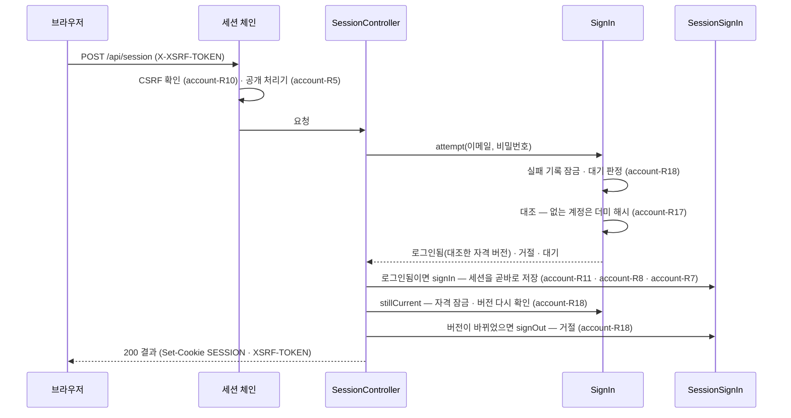

# account 모듈 Spec

공통 구조와 쓰는 규칙은 [specs/README.md](README.md)에 있다.

## 1. 책임과 범위

`account` 는 계정과 그 인증을 맡는다. 앱의 보안 구성 전체가 이 모듈에 있다.

- **계정 · 자격** — 계정(역할 `USER` · `ADMIN`, 상태)과 자체 로그인 자격(이메일 · 비밀번호 해시 · 강제 변경 표시)을 저장한다. 이메일 정규화 · 비밀번호 규칙 · 표시 이름 규칙의 정본이다
- **계정 들이기** — 계정을 만드는 길 넷(공개 가입 · 초대 가입 · 운영자 계정 생성 · 첫 운영자)과 그 정본 하나, 가입 정책(운영자 설정), 초대 링크, 첫 로그인 전 계정의 초기 비밀번호 다시 정하기. 운영 기능은 공개 운영 API 로 두고 운영자 경로는 `admin` 이 낸다
- **비밀번호와 복구** — 첫 로그인의 비밀번호 강제 변경과 그 서버 제한, 비밀번호 변경, 복구 코드(발급 · 재발급 · 복구 재설정), 비밀번호가 바뀌면 그 사용자의 다른 세션 종료
- **보안 구성** — 요청을 세 보안 체인(운영자 · 세션 · 기본)으로 나눈다. 두 역할 공통이다
- **운영자 접근 통제** — 운영자 경로를 `ADMIN` 계정 세션(CSRF)과 스크립트용 선택 운영자 토큰(서버 설정 하나)으로 연다
- **세션** — 화면용 API 를 사용자 ID 만 담은 DB 세션 · 쿠키 CSRF 로 인증하고, 요청마다 계정 상태 · 역할을 읽는다. 공개 표시가 없는 처리기는 세션을 요구한다
- **키 관문** — LLM 키가 없는 세션 사용자에게는 키 없이도 여는 표시가 있는 처리기만 연다. 키 유무는 `credential` 에 묻는다(account-R5)
- **세션 사용자 범위** — 화면용 API 처리기가 사용자를 인자 타입 `UserId` 로만 받게 한다(요청에서 사용자 ID 를 받지 않는다)
- **자체 로그인** — 로그인 · 로그아웃 · 로그인 상태 조회. 로그인 실패는 계정 유무와 무관하게 같은 응답을 주고, 제출된 이메일마다 연속 실패에 지연을 늘린다
- **요청 방어** — `platform` 의 요청 방어 표시가 있는 처리기의 요청을 처리기 앞에서 클라이언트 주소 · 세션 사용자로 세고(고정 창 — PostgreSQL), 한도를 넘으면 429 로 거부한다. 봇 차단을 켠 인스턴스에서는 로그인 · 복구 · 공개 가입의 사람 확인 토큰을 봇 차단 서비스(Turnstile — 포트 `HumanVerifier`)로 확인한다. 클라이언트 주소는 배포 proxy 가 덮어쓴 헤더 하나에서 읽는다
- **정리** — 만료 세션과 오래된 실패 기록(로그인 · 복구), 끝난 요청 제한 창을 지운다
- **계정의 사실 알리기** — 계정이 생기면(`AccountCreated`) · 사용자가 비밀번호를 바꾸면(`PasswordChanged`) 그 사실을 이벤트로 알린다. 받는 쪽을 모른다 — 관심 설정 기본값 · 비밀번호 알림은 받는 `user` 가 쓴다(account-R35 · R36)
- **계정 공개 조회** — 다른 모듈이 계정의 있음 · 쓰는 계정 · 쓰는 운영자 · 계정 목록을 읽는 공개 조회(`AccountDirectory`). 다른 모듈은 계정 표를 읽지 않고 이 조회로 읽는다(account-R37)

하지 않는 것:

- 화면용 API 경로의 규약(`/api/**` · `/api/admin/**`)과 공개 표시 · 요청 방어 표시 애너테이션을 갖지 않는다 — `platform` 의 공개 타입이다([platform Spec §3](platform.md#3-공개-인터페이스))
- 클라이언트 IP 를 믿을 앞단의 범위를 정하지 않는다 — 배포 proxy 설정의 것이다([configuration.md "공개"](../operations/configuration.md#공개))
- 다른 모듈의 처리기가 공개인지 정하지 않는다 — 각 모듈이 자기 처리기에 공개 표시를 단다
- 운영자 경로의 기능을 갖지 않는다 — 운영자 API 는 `admin` 이 이 모듈의 운영 API 를 불러 낸다
- 계정의 역할을 바꾸지 않는다 — `ADMIN` 은 첫 운영자로만 생긴다(account-R21)
- 메일을 보내지 않는다 — 이메일은 인증하지 않는 로그인 식별자다([ADR-0011](../adr/0011-no-email-in-v1.md))
- LLM 키를 보관하거나 키의 상태를 정하지 않는다 — `credential` 의 것이고, 이 모듈은 키 관문 · 로그인 상태 조회에서 키 유무를 묻기만 한다
- 관심 설정 · 화면 내 알림을 갖지 않는다 — `user` 의 것이다. 계정을 만드는 트랜잭션 · 비밀번호를 바꾸는 트랜잭션은 다른 모듈의 표를 쓰지 않고, 그 사실을 이벤트로 알리기만 한다([ADR-0309](../adr/0309-account-facts-are-published-after-commit-and-user-writes-interest-defaults-and-password-notices-from-them.md))

다른 모듈과의 의존과 이벤트 흐름은 [overview.md §5](../overview.md#5-모듈-지도)에 있다. 모듈의 경계를 정한 이유는 [ADR-0308](../adr/0308-account-authentication-and-security-live-in-the-account-module-while-interests-and-notices-stay-in-user.md)에 있다.

## 2. 용어

공개 처리기는 [platform Spec §2](platform.md#2-용어)에 있다.

| 용어 | 뜻 |
|---|---|
| 세션 사용자 | 요청의 세션이 가리키는 계정 — 세션에는 사용자 ID 만 있고, 역할 · 상태는 요청마다 계정에서 읽는다(account-R7) |
| 로그인 유지 | 로그인 때 고르는 선택. 켜면 지속 쿠키 · 비활성 7일, 끄면 브라우저 세션 쿠키 · 비활성 2시간(account-R8) |
| 실패 기록 | 제출된 정규화 이메일의 다이제스트마다 종류(로그인 · 복구)별로 센 연속 실패 — 계정이 없어도 생긴다(account-R19) |
| 계정을 만드는 길 | 계정이 생기는 경로 — 공개 가입 · 초대 가입 · 운영자 계정 생성 · 첫 운영자 넷이고, 길마다 역할 · 강제 변경 · 만들 때 복구 코드가 정해진다(account-R21) |
| 초기 비밀번호 | 계정 주인이 아닌 사람(운영자 · 서버 운영자)이 정한 비밀번호 — 운영자 계정 생성 · 첫 운영자가 쓴다 |
| 강제 변경 | 초기 비밀번호로 만든 계정이 첫 로그인에서 비밀번호를 바꾸기 전의 상태 — 그 세션은 비밀번호 변경 · 상태 조회 · 로그아웃만 쓴다(account-R22) |
| 키 관문 | LLM 키가 없는 세션 사용자의 요청을 키 없이도 여는 표시가 있는 처리기에만 여는 것(account-R5) |
| 복구 코드 | 계정마다 하나인 160비트 무작위 값 — 비밀번호를 잊었을 때 이메일과 함께 내 비밀번호를 다시 정한다. 한 번만 보여 준다(account-R23) |
| 초대 | 운영자가 발급한 일회용 · 7일 가입 링크(`/invite#토큰`) — 이메일에 묶이지 않는다(account-R24) |
| 가입 정책 | 공개 가입을 여는가 — 운영자 설정이고 처음 값은 닫힘이다(account-R25) |
| 첫 운영자 | 기동 때 설정의 이메일 · 초기 비밀번호로 만드는 `ADMIN` 계정(account-R27) |
| 운영자 토큰 | 스크립트 · 도구가 운영자 경로를 여는 선택 비밀 값 하나 — 서버 설정으로 받고 `Authorization: Bearer` 로 보낸다. 화면은 보내지 않는다. 설정하지 않으면 Bearer 인증이 없을 뿐 운영자 경로는 계정 세션으로 열린다(account-R1 · account-R2) |
| 클라이언트 주소 | 요청을 보낸 클라이언트의 IP — 배포 proxy 가 덮어쓴 헤더 `X-Real-IP` 에서 읽는다(account-R29) |
| 요청 제한 | 지키는 동작([platform Spec §2](platform.md#2-용어))마다 클라이언트 주소 · 세션 사용자로 창 하나에 받는 요청 수를 정하고, 넘은 요청을 처리기 앞에서 429 로 거부하는 것(account-R30 ~ R32) |
| 창 | 요청 제한이 세는 고정 시간 칸 — 유닉스 기원부터 창 길이로 나눈 칸이고 시작은 포함 · 끝은 제외다(account-R31) |
| 봇 차단 | 로그인 · 복구 · 공개 가입에서 사람 확인 토큰을 봇 차단 서비스로 확인하는 것 — 운영자 설정으로 켜고 끈다(account-R33) |
| 사람 확인 토큰 | 화면의 봇 차단 위젯이 준 일회용 토큰 — 요청 헤더 `X-Human-Check` 로 보낸다(account-R33) |
| 계정의 사실 | 계정이 생겼다 · 사용자가 비밀번호를 바꿨다는 사실 — 이 모듈이 커밋 뒤 받는 이벤트로 알리고, 받는 쪽이 자기 데이터를 맞춘다(account-R35 · R36) |

## 3. 공개 인터페이스

받는 이벤트는 없다. 내는 이벤트는 계정 생김(`AccountCreated`)과 비밀번호 바뀜(`PasswordChanged`)이다(account-R35 · R36).

모듈 최상위 패키지 `net.yozmnews.account` 의 공개 타입은 비밀번호 규칙 위반의 까닭 하나(`PasswordProblem`), 계정 들이기의 운영 API 셋(`AccountAdministration` · `InvitationAdministration` · `SignUpPolicyAdministration`)과 그 결과 · 값 타입(`AccountCreationResult` · `InitialPasswordResetResult` · `IssuedInvitation` · `InvitationView` · `InvitationState` · `InvitationRevocationResult` · `UnknownInvitationException` · `SignUpPolicyChange` · `SignUpPolicyChangeResult`), 계정의 사실 이벤트 둘(`AccountCreated` · `PasswordChanged`)과 그 값 타입(`PasswordChangeMethod`), 계정 공개 조회(`AccountDirectory`)다. 운영 API 는 `admin` 이 운영자 경로로 낸다. 사용자 식별자 `UserId` 는 `platform` 의 공개 타입이다([platform Spec](platform.md#userid)).

HTTP 엔드포인트:

| 경로 | 메서드 | 용도 |
|---|---|---|
| `/api/session` | `POST` | 로그인 — 판정 결과(로그인됨 · 거절 · 대기)를 200 으로 낸다(account-R17) |
| `/api/session` | `DELETE` | 로그아웃 — 세션이 없어도 204(account-R11) |
| `/api/me` | `GET` | 로그인 상태 조회 — 로그인 여부와 무관하게 200(account-R20) |
| `/api/sign-up-policy` | `GET` | 공개 가입이 열렸는가 — `{open}`(account-R25) |
| `/api/human-check` | `GET` | 봇 차단 설정 — `{provider: OFF · TURNSTILE, siteKey}`(account-R33) |
| `/api/sign-ups` | `POST` | 공개 가입 — `SIGNED_UP`(+복구 코드) · `CLOSED` · `EMAIL_UNAVAILABLE` · `EMAIL_MALFORMED` · `DISPLAY_NAME_MALFORMED` · `PASSWORD_REJECTED`(+까닭)(account-R26) |
| `/api/invitation-checks` | `POST` | 초대 토큰의 상태 — `VALID` · `USED` · `EXPIRED` · `REVOKED` · `UNKNOWN`(account-R24) |
| `/api/invitation-acceptances` | `POST` | 초대 가입 — 공개 가입의 결과에서 `CLOSED` 대신 `INVITATION_UNUSABLE`(+초대 상태 `invitation`)(account-R24 · account-R26) |
| `/api/account-recoveries` | `POST` | 복구 코드로 비밀번호 재설정 — `RESET`(+새 복구 코드) · `REJECTED` · `WAIT`(+남은 초) · `PASSWORD_REJECTED`(+까닭)(account-R23) |
| `/api/account/password` | `PUT` | 비밀번호 변경 — `CHANGED`(+강제 변경이었으면 새 복구 코드) · `REJECTED` · `WAIT` · `PASSWORD_REJECTED`(account-R22) |
| `/api/account/recovery-code` | `POST` | 복구 코드 재발급 — `ISSUED`(+새 복구 코드) · `REJECTED` · `WAIT`(account-R23) |

로그인 · 로그아웃 · 로그인 상태 조회 · 가입 정책 조회 · 봇 차단 설정 조회 · 가입 둘 · 초대 상태 · 복구 재설정은 공개 처리기다. 로그인 · 복구 재설정 · 초대 상태 · 초대 가입 · 공개 가입에는 요청 제한이 걸려 넘으면 429 이고(account-R30 · R32), 로그인 · 복구 재설정 · 공개 가입에는 봇 차단을 켠 인스턴스에서 사람 확인이 걸린다(account-R33). 비밀번호 변경 · 복구 코드 재발급은 세션이 필요하며 사용자 격리 시험에 등록돼 있고(account-R5 · account-R6), LLM 키가 없는 세션 사용자에게도 연다(`@AllowedWithoutLlmKey` — account-R5). 비밀번호 변경은 강제 변경 중에도 연다(`@AllowedBeforePasswordChange` — account-R22). 판정 결과는 200 이고 요청 본문의 칸이 없으면 본문 형식 400 이다. 요청 · 응답 형식은 `api/openapi.json` 에 있다.

### PasswordProblem

비밀번호 규칙을 어긴 까닭 — 가입 · 재설정 · 변경의 응답과 운영자 계정 운영의 결과가 싣는다.

```java
public enum PasswordProblem { TOO_SHORT, TOO_LONG }
```

관련 규칙: account-R14.

### AccountAdministration

운영자 계정 운영 — `admin` 이 운영자 경로로 낸다. 길이 상수는 운영자 응답의 거부 설명이 읽고, 정본은 표시 이름 · 비밀번호 규칙이다.

```java
public interface AccountAdministration {
	int DISPLAY_NAME_MAX_CODE_POINTS = DisplayName.MAX_CODE_POINTS;
	int PASSWORD_MIN_CODE_POINTS = PasswordPolicy.MIN_CODE_POINTS;
	int PASSWORD_MAX_CODE_POINTS = PasswordPolicy.MAX_CODE_POINTS;
	AccountCreationResult create(String email, String displayName, String initialPassword);
	InitialPasswordResetResult resetInitialPassword(String email, String initialPassword);
}
```

| 메서드 | 결과 |
|---|---|
| `create` | `AccountCreationResult` — `Created(UserId user)` · `EmailTaken()` · `EmailMalformed()` · `DisplayNameMalformed()` · `PasswordRejected(PasswordProblem problem)`. 만든 계정은 `USER` · 강제 변경이다 |
| `resetInitialPassword` | `InitialPasswordResetResult` — `Reset()` · `NotPending()`(계정 주인이 이미 바꿨다) · `NoAccount()`(쓰는 계정이 없거나 이메일이 아니다) · `PasswordRejected(PasswordProblem problem)` |

- 계약
  - 결과는 봉인 인터페이스다 — 받는 쪽은 기본 갈래 없는 망라 분기로 가른다
  - 비밀번호는 결과 · 예외 · 로그에 실리지 않는다

관련 규칙: account-R21 · account-R28.

### InvitationAdministration

초대 운영 — `admin` 이 운영자 경로로 낸다.

```java
public interface InvitationAdministration {
	IssuedInvitation issue(@Nullable String memo);
	List<InvitationView> recent();
	InvitationRevocationResult revoke(long invitationId);
}

public record InvitationView(long id, @Nullable String memo, Instant createdAt, Instant expiresAt,
		InvitationState state, @Nullable Instant usedAt, @Nullable String usedByEmail, @Nullable Instant revokedAt) {}

public enum InvitationState { VALID, USED, EXPIRED, REVOKED }
```

| 메서드 | 결과 |
|---|---|
| `issue` | `IssuedInvitation` — `Issued(long id, String token, Instant expiresAt)`(토큰은 여기서 한 번만 — 문자열 표현은 숨긴다) · `MemoTooLong(int max)` |
| `recent` | 최근 발급한 초대 50개(`InvitationPolicy.LIST_SIZE`), 발급 역순. 토큰은 없다. `usedByEmail` 은 가입한 계정이 지워졌으면 null |
| `revoke` | `InvitationRevocationResult` — `Revoked()` · `NotRevocable(InvitationState state)`(유효한 초대가 아니다). 없는 초대는 `UnknownInvitationException`(`invitationId()`, 문구 "없는 초대: {ID}") |

관련 규칙: account-R24.

### SignUpPolicyAdministration

가입 정책 운영 — `admin` 이 운영자 경로로 낸다.

```java
public interface SignUpPolicyAdministration {
	boolean open();
	SignUpPolicyChangeResult change(boolean open, ChangeActor actor);
	List<SignUpPolicyChange> changes();
}

public record SignUpPolicyChange(@Nullable Boolean previousOpen, boolean open, ChangeActor actor, Instant changedAt) {}
```

| 메서드 | 결과 |
|---|---|
| `open` | 지금 값 |
| `change` | `SignUpPolicyChangeResult` — `Changed(boolean previous, boolean current)` · `Unchanged(boolean current)`(같은 값 — 이력 없음) |
| `changes` | 이력 전부, 최근부터. 처음 값의 `previousOpen` 은 null |

관련 규칙: account-R25.

### AccountCreated

계정이 생겼다 — 계정을 만드는 정본(`AccountProvisioning`)이 계정을 쓴 트랜잭션에서 낸다. `user` 가 받아 관심 설정 기본값을 쓴다([ADR-0309](../adr/0309-account-facts-are-published-after-commit-and-user-writes-interest-defaults-and-password-notices-from-them.md)).

```java
public record AccountCreated(UserId user, Instant createdAt) {}
```

| 멤버 | 뜻 |
|---|---|
| `user` | 만든 계정 |
| `createdAt` | 계정을 만든 시각 — 계정 행의 만든 시각과 같다 |

- 계약
  - 계정을 만드는 네 길 모두 계정 하나에 하나다. 같은 이메일 결과(아무것도 쓰지 않음)에는 내지 않는다
  - 받는 쪽은 커밋 뒤 받는다 — 그사이 계정이 이미 쓰일 수 있다. 같은 발행을 거듭 받을 수 있다

관련 규칙: account-R35.

### PasswordChanged

사용자가 고른 비밀번호로 바꿨다 — 비밀번호 변경 · 복구 재설정이 자격을 바꾼 트랜잭션에서 낸다. `user` 가 받아 비밀번호 알림을 남긴다([ADR-0309](../adr/0309-account-facts-are-published-after-commit-and-user-writes-interest-defaults-and-password-notices-from-them.md)).

```java
public record PasswordChanged(UserId user, PasswordChangeMethod method, Instant changedAt) {}

public enum PasswordChangeMethod { CHANGE, RECOVERY }
```

| 멤버 | 뜻 |
|---|---|
| `method` | 바꾼 방법 — `CHANGE` 세션 사용자가 현재 비밀번호를 확인하고 바꿨다 · `RECOVERY` 복구 코드로 다시 정했다 |
| `changedAt` | 자격을 바꾼 시각 — 같은 변경의 발행이면 언제나 같다 |

- 계약
  - 첫 로그인의 강제 변경 · 운영자의 초기 비밀번호 다시 정하기 · 복구 코드 재발급에는 내지 않는다
  - 받는 쪽은 커밋 뒤 받는다. 같은 발행을 거듭 받을 수 있다

관련 규칙: account-R36.

### AccountDirectory

계정 공개 조회 — 다른 모듈이 계정의 사실을 읽는 길이다. 구현은 `application` 의 `AccountDirectoryService` 다.

```java
public interface AccountDirectory {
	int MAX_PAGE = 500;
	boolean exists(UserId user);
	boolean active(UserId user);
	List<UserId> activeAdmins();
	List<UserId> page(long afterUserId, int limit);
	List<UserId> activePage(long afterUserId, int limit);
}
```

| 메서드 | 뜻 |
|---|---|
| `exists` | 계정이 있는가 — 상태와 무관하다 |
| `active` | 쓰는(`ACTIVE`) 계정인가 — 없으면 거짓 |
| `activeAdmins` | 쓰는 운영자(`ADMIN` · `ACTIVE`) 계정 전부 — 계정 ID 순 |
| `page` | 계정 ID 가 `afterUserId` 보다 큰 계정을 ID 순으로 `limit` 개까지 — 상태와 무관하다 |
| `activePage` | `page` 와 같되 쓰는 계정만 |

- 계약
  - `exists` · `active` 는 사용자를 인자로 받는 조회다 — 화면 경로에서는 세션 사용자로만 부른다([ADR-0228](../adr/0228-consumer-queries-scoped-by-a-user-argument-may-be-called-on-screen-paths-with-the-session-user.md))
  - `activeAdmins` · `page` · `activePage` 는 사용자 범위가 없다 — 백그라운드 작업 · 리스너만 부른다
  - `limit` 이 1 ~ `MAX_PAGE` 밖이면 `IllegalArgumentException`
  - 쓰지 않는다 — 읽기 전용 트랜잭션 하나다

관련 규칙: account-R37.

## 4. 내부 구조

### 개관

| 패키지 | 책임 |
|---|---|
| (최상위) | 비밀번호 규칙 위반의 까닭 · 계정 들이기의 운영 API 셋과 그 결과 · 값, 계정의 사실 이벤트 둘과 그 값, 계정 공개 조회(§3) |
| `adapter/in/job` | 만료 세션 정리 · 오래된 실패 기록 정리 · 끝난 요청 제한 창 정리 반복 작업 |
| `adapter/in/web` | 로그인 · 로그아웃 · 상태 조회 · 가입 · 초대 · 복구 · 비밀번호 변경 · 봇 차단 설정 조회 엔드포인트와 그 요청 · 응답 값, 세션 사용자 인자 해석과 그 인자를 화면용 API 명세에서 빼는 설정 |
| `adapter/out/persistence` | 실패 기록의 잠금 · 기록 · 삭제, 요청 제한 기록의 더하기 · 정리, 복구 코드 저장소, 요청의 세션 계정 조회, 가입 정책 저장소, 첫 운영자 잠금 |
| `adapter/out/turnstile` | 봇 차단 검증 포트의 Turnstile 구현, 봇 차단 설정(`yozmnews.human-check`)의 결선, 비밀 키 유무의 등록 조건 |
| `adapter/out/local` | 로컬 개발의 항상 통과 봇 차단 검증기와 그 결선(platform-R18) |
| `application` | 보안 구성(체인 셋 · 쿠키 · CSRF), 운영자 토큰 인증 · 운영자 경로 인가, 세션 인증 · 계정 확인 필터 · 공개 처리기 인가 · 처리기 찾기 · 요청 방어 필터 · 클라이언트 주소, 요청 제한 · 봇 차단 유스케이스, 세션 로그인 · 로그아웃, 로그인 유스케이스, 비밀번호 해시, 계정을 만드는 정본과 가입 · 운영자 계정 · 첫 운영자 유스케이스와 기동 단계, 가입 정책 · 초대 운영, 비밀번호 변경 · 복구 재설정 · 복구 코드 재발급과 다른 세션 종료, 정리 유스케이스, 문제 유형, 계정 공개 조회 |
| `domain` | `account`(계정 aggregate · 이메일 · 표시 이름 · 계정을 만드는 길), `credential`(자격 aggregate · 비밀번호 규칙), `secret`(비밀 다이제스트 · 복구 코드 · 초대 토큰), `recovery`(복구 코드 저장), `session`(세션 수명 · 요청의 세션 계정 · 세션 접근 판정 · 운영자 경로 접근 판정), `throttle`(실패 지연 일정 · 실패 기록 · 종류 · 남은 초), `guard`(클라이언트 주소 · 정책 표 · 축 · 규칙 · 창 · 키 · 판정 · 요청 제한 기록 저장), `humancheck`(사람 확인 토큰 · 결과 · 검증 포트 · 설정 판정 · Turnstile 응답 판정), `invitation`(초대 aggregate · 규칙), `signup`(가입 정책 저장), `bootstrap`(첫 운영자 값 · 판정 · 잠금), 최상위 운영자 자격 판정 |

협력: 요청은 `SecurityConfiguration` 의 체인 셋 가운데 하나를 탄다(account-R4). 운영자 체인은 세션 체인과 같은 세션 인증 구성(세션 문맥 저장소 · `SessionAccountFilter`)으로 세션 사용자를 읽고, `Authorization` 헤더를 낸 요청은 `AdminTokenFilter` 가 제시된 토큰을 `AdminTokenAuthenticationProvider` 에 맡겨 `AdminCredential` 과 대조한 뒤, `AdminAuthorization` 이 운영자 토큰 인증 · 세션 사용자의 강제 변경 · 역할을 `AdminAccess` 에 넘겨 인가한다. 세션 체인은 Spring Session 이 DB 에서 세션을 읽은 뒤 `SessionAccountFilter` 가 세션의 사용자 ID 로 `SessionAccounts`(계정 상태 · 역할 · 강제 변경)를 읽어 요청의 인증을 정하고, `PublicApiAuthorization` 이 처리기의 공개 · 변경 전 허용 · 키 없이 허용 표시와 세션 사용자의 강제 변경 · 키 유무(`credential` 의 `LlmKeys`)를 `SessionAccess` 에 넘겨 인가한다(처리기는 `HandlerLookup` 이 찾는다). 인가 뒤 `RequestGuardFilter` 가 같은 `HandlerLookup` 으로 처리기의 요청 방어 표시(`platform` 의 `HandlerGuards`)를 읽어, `ClientAddresses` 의 주소와 세션 사용자로 `RequestLimiter` 에 세고(`RequestCounts`) 넘으면 429 로 끝내며, 봇 차단 표시가 있고 켰으면 `HumanCheck` 가 요청 헤더의 토큰을 `HumanVerifier` 로 확인한다. 로그인은 `SessionController` → `SignIn`(`FailureThrottle` 의 실패 기록 · 계정 · 자격 · `PasswordHashing`) → 성공이면 `SessionSignIn` 이 세션을 만들고(세션 저장소가 곧바로 저장한다), `SignIn.stillCurrent` 가 자격 행을 잠가 대조한 자격의 버전을 다시 확인한다 — 바뀌었으면 `SessionSignIn` 이 그 세션을 거둔다. 처리기 인자 `UserId` 는 `SessionUserArgumentResolver` 가 요청의 인증에서 채운다. 보안 진입점 · 거부 처리기는 `platform` 의 `ProblemResponses` 로 문제 응답을 쓴다.

계정 들이기: 가입 둘(`SignUpController` → `SignUp`)과 운영자 계정 생성(`OperatorAccountService`) · 첫 운영자(`FirstAdminBootstrap`)가 모두 `AccountProvisioning` 으로 계정 · 자격(· 복구 코드)을 만들고 같은 트랜잭션에서 `AccountCreated` 를 낸다. 그 트랜잭션 경계(같은 이메일 고유 제약 위반을 결과로 옮기기)도 `AccountProvisioning` 하나다. 가입 정책은 `SignUpPolicyService` · `SignUpPolicySeeding` → `SignUpPolicyRepository`, 초대는 `InvitationService` → `InvitationRepository` 다. 가입 · 복구가 로그인하면 `SessionSignIn` 이 들고 온 세션을 버리고 새 세션을 만든다.

비밀번호: 변경(`AccountController` → `PasswordChange`) · 재발급(`RecoveryCodeReissue`)은 `CurrentPasswordCheck` 로 현재 비밀번호를 확인하고, 복구 재설정(`AccountRecovery`)은 `FailureThrottle` 의 복구 실패 기록에 걸어 복구 코드를 대조한다. 자격을 바꾼 유스케이스는 커밋 직전 마지막 단계로 `OtherSessions` 가 그 사용자의 세션을 지우고, 강제 변경이 아닌 변경 · 복구 재설정은 같은 트랜잭션에서 `PasswordChanged` 를 낸다.

계정 공개 조회: 다른 모듈은 계정의 사실을 `AccountDirectoryService` 로 읽는다 — 계정 저장소와 계정 표만 읽는 읽기 전용 트랜잭션이다.



역할: `SessionController` · `SignUpController` · `AccountController` · `HumanCheckController` · `UserWebConfiguration` 은 화면 역할, `ExpireSessionsJob` · `ForgetLoginFailuresJob` · `ForgetRequestCountsJob` 은 작업 역할에서만 켜진다. 보안 구성 · 봇 차단 결선(`HumanCheckConfiguration`)과 설정 검사 · `SignUpPolicySeeding` · `FirstAdminBootstrap` · `AccountDirectoryService` 를 포함한 나머지는 두 역할 공통이다(account-R4 · [platform Spec](platform.md#역할) platform-R9).

### 들어오는 쪽

| 진입점 | 구성 요소 | 계기 | 내용 |
|---|---|---|---|
| 보안 체인 | `SecurityConfiguration` 의 운영자 · 세션 · 기본 체인 | 모든 HTTP 요청 | 운영자 경로는 운영자 계정 세션 · CSRF 와 운영자 토큰, 화면용 API 는 세션 · CSRF, 그 밖은 연다(account-R1 · R4 · R5 · R10) |
| 운영자 자격 검사 | `SecurityConfiguration` | 기동 | 설정한 운영자 토큰의 형식을 확인하고, 틀리면 기동하지 않는다(account-R2) |
| 요청 방어 | `RequestGuardFilter`(세션 체인 안, 인가 뒤) | 요청 방어 표시가 있는 처리기의 요청 | 요청 제한(account-R29 ~ R32)과 봇 차단(account-R33). 빈이 아니다 |
| 봇 차단 설정 검사 | `HumanCheckConfiguration` · `HumanCheck` | 기동 | 설정 값을 판정하고, 켰는데 사이트 키나 검증기가 없거나 모르는 값이면 기동하지 않는다(account-R33) |
| 봇 차단 설정 조회 | `HumanCheckController` | `GET /api/human-check` | account-R33. 응답 값 `HumanCheckResponse` |
| 로그인 · 로그아웃 · 상태 조회 | `SessionController` | `POST` · `DELETE /api/session`, `GET /api/me` | account-R11 · R17 · R20. 응답 값 `SignInResponse` · `MeResponse` |
| 세션 사용자 인자 | `UserWebConfiguration` · `SessionUserArgumentResolver` | 처리기 인자 `UserId` | 요청의 세션 사용자로 채운다(account-R6) |
| 가입 · 초대 | `SignUpController` | `GET /api/sign-up-policy`, `POST /api/sign-ups` · `/api/invitation-checks` · `/api/invitation-acceptances` | account-R24 ~ R26. 응답 값 `SignUpPolicyResponse` · `SignUpResponse` · `InvitationCheckResponse`(`InvitationStatus` — 초대 상태에 `UNKNOWN` 을 더한 것) |
| 복구 · 비밀번호 | `AccountController` | `POST /api/account-recoveries`, `PUT /api/account/password`, `POST /api/account/recovery-code` | account-R22 · R23. 응답 값 `AccountRecoveryResponse` · `PasswordChangeResponse` · `RecoveryCodeResponse`(대기 초는 domain 의 `RetryAfter`) |
| 운영 API | `OperatorAccountService` · `InvitationService` · `SignUpPolicyService` | `admin` 의 운영자 경로 | §3 의 운영 API 셋의 구현(account-R24 · R25 · R28) |
| 가입 정책 처음 값 | `SignUpPolicySeeding` | 기동 | 지금 값이 없으면 닫힘을 이력과 함께 넣는다(account-R25) |
| 첫 운영자 | `FirstAdminBootstrap` | 기동 단계(`AccountStartup.PHASE` — 웹 서버 앞, account-R27) | 설정 `yozmnews.first-admin.*` 로 첫 운영자를 판정 · 생성하거나 경고 · 기동 실패(account-R27) |
| 만료 세션 정리 — 반복 작업 ID `expire-sessions` | `ExpireSessionsJob` | 10분마다 | 만료 세션을 지운다(account-R12). 재시도하지 않는다 — 다음 회차가 이어 지운다 |
| 실패 기록 정리 — 반복 작업 ID `forget-login-failures` | `ForgetLoginFailuresJob` | 1시간마다 | 마지막 실패에서 24시간이 지난 실패 기록을 지운다(account-R19). 재시도하지 않는다 |
| 끝난 요청 제한 창 정리 — 반복 작업 ID `forget-request-counts` | `ForgetRequestCountsJob` | 10분마다 | 끝난 창의 요청 제한 기록을 지운다(account-R34). 재시도하지 않는다 — 다음 회차가 이어 지운다 |
| 계정 공개 조회 | `AccountDirectoryService` | 다른 모듈의 조회(세션 사용자의 화면 경로 포함) · 백그라운드 작업 · 리스너 | §3 `AccountDirectory` 의 구현(account-R37). 읽기 전용 트랜잭션 |

### `application`

- `SecurityConfiguration` — 보안 구성. 체인 셋(운영자 · 세션 · 기본)의 순서와 경로, 두 세션 인증 체인의 공통 구성, 운영자 자격과 토큰 대조 provider, 거부의 문제 응답(account-R1 · R4)
- `AdminTokenFilter` — 운영자 체인 안(CSRF 필터 앞)에서 `Authorization` 헤더를 낸 요청을 운영자 토큰으로만 판정한다 — 맞으면 운영자 인증을 두고, 틀리면 401 로 끝낸다(세션으로 넘어가지 않는다). 빈이 아니다(account-R1)
- `AdminTokenAuthenticationProvider` — 제시된 토큰을 운영자 자격과 대조하는 유일한 자리(account-R2)
- `SessionAccountFilter` — 세션 체인 · 운영자 체인 안에서 세션의 사용자 ID 로 계정을 읽어 요청의 인증(역할 권한)을 정하거나 세션을 끊는다. 빈이 아니다(account-R7)
- `SessionSecurityContexts` — 세션의 보안 문맥 저장소. 읽지 못하는 세션은 지우고 익명으로 둔다. 세션에는 세션 사용자 인증만 저장한다 — 운영자 토큰 인증은 저장하지 않는다(account-R7)
- `SessionPrincipalNames` — 세션 저장소의 사용자 이름 색인 해석기. 보안 문맥을 읽지 못하는 세션은 빈 색인으로 저장한다 — 곧바로 저장하는 세션 저장소에서 그 요청이 세션을 지우기 전에 저장이 실패하지 않게 한다(account-R7)
- `PublicApiAuthorization` — 세션 체인의 인가. 요청의 처리기(`HandlerLookup`)의 표시와 세션 사용자의 상태를 `SessionAccess` 로 판정하고, 거부의 까닭을 거부 처리기에 넘긴다(account-R5)
- `AdminAuthorization` — 운영자 체인의 인가. 요청의 인증(운영자 토큰 인증 · 세션 사용자)을 `AdminAccess` 로 판정하고, 거부의 까닭을 거부 처리기에 넘긴다. 처리기를 찾지 않는다(account-R1)
- `HandlerLookup` — 세션 체인에서 요청의 처리기를 앱의 처리기 매핑에서 찾는 정본 — 인가와 요청 방어 필터가 함께 쓴다(account-R5 · R32)
- `RequestGuardFilter` — 세션 체인 안(인가 뒤)의 요청 방어 — 요청 제한 → 봇 차단 → 처리기 순서, 거부의 문제 응답. 빈이 아니다(account-R32 · R33)
- `ClientAddresses` — 요청의 클라이언트 주소 — 헤더 이름 `X-Real-IP` 의 코드 쪽 정본(account-R29)
- `RequestLimiter` — 요청 하나를 동작의 규칙마다 세고 판정하는 유스케이스, 넘은 판정의 남은 초(account-R30 · R31)
- `HumanCheck` — 봇 차단 유스케이스 — 켬 · 끔, 토큰 읽기와 검증기에 묻기, 켰는데 검증기가 없으면 기동 실패(account-R33)
- `SessionCookies` — 세션 쿠키 직렬화기와 CSRF 토큰 저장소. 쿠키 속성의 정본이다(account-R9)
- `SessionSignIn` — 세션 로그인(세션 ID 교체 · CSRF 토큰 교체 · 보안 문맥 저장 · 수명) · 들고 온 세션을 버린 새 로그인(가입 · 복구) · 지금 세션의 ID 교체(비밀번호 변경) · 로그아웃(account-R8 · R11)
- `SignIn` — 로그인 유스케이스. 한 번의 시도가 트랜잭션 하나이고, 실패 기록 행 잠금이 대조 동안 이어진다. 결과에 대조한 자격의 버전을 싣고, 세션을 연 뒤의 다시 확인(`stillCurrent` — 자격 행 잠금)을 따로 한 트랜잭션으로 한다(account-R17 · R18)
- `FailureThrottle` — 실패 기록에 건 대조의 정본 — 잠금 · 대기 판정 · 성공이면 지우기 · 실패면 올리기. 결과 `Throttled`(통과 · 실패 · 대기). 로그인 · 현재 비밀번호 확인 · 복구가 쓴다(account-R18 · R19)
- `AccountProvisioning` — 계정을 만드는 정본(계정 · 자격 · 복구 코드 · 계정 생김 발행)과 계정을 만드는 유스케이스의 트랜잭션 경계(account-R21). 결과 `ProvisionResult`(만듦 · 같은 이메일)
- `SignUp` — 공개 가입 · 초대 가입 유스케이스(account-R26). 입력 `SignUpForm`, 결과 `SignUpOutcome`
- `InvitationService` — 초대 운영(`InvitationAdministration`)과 링크를 연 사람의 상태 확인(account-R24)
- `SignUpPolicyService` · `SignUpPolicySeeding` — 가입 정책 운영(`SignUpPolicyAdministration`)과 처음 값 적재(account-R25)
- `OperatorAccountService` — 운영자 계정 생성 · 초기 비밀번호 다시 정하기(`AccountAdministration`)(account-R28)
- `FirstAdminBootstrap` — 첫 운영자 기동 처리 — 잠금 · 판정 · 생성 · 로그 · 기동 실패(account-R27). 설정 값 `FirstAdminProperties`(문자열 표현은 값을 숨긴다)
- `CurrentPasswordCheck` — 세션 사용자의 현재 비밀번호 확인 — 자격 잠금 뒤 로그인 실패 기록에 걸어 대조(account-R19 · R22)
- `PasswordChange` · `AccountRecovery` · `RecoveryCodeReissue` — 비밀번호 변경 · 복구 재설정 · 복구 코드 재발급(account-R22 · R23). 결과 `PasswordChangeOutcome` · `RecoveryOutcome` · `ReissueOutcome`
- `OtherSessions` — 한 사용자의 세션 지우기 — 전부 · 지금 세션 빼고(account-R22)
- `PasswordHashing` — Argon2id 해시 · 대조와 더미 해시 대조(account-R15 · R17)
- `SessionExpiry` · `LoginFailureCleanup` · `RequestCountCleanup` — 정리 유스케이스(account-R12 · R19 · R34)
- `AccountQueries` — 쓰는 계정 조회. 로그인 상태 조회가 세션 사용자의 계정을 읽는다(account-R20)
- `ProblemTypes` — 보안 거부(요청 방어 포함)의 문제 유형 URI 와 제목의 정본(account-R3)
- 그 밖의 값: `AdminSecurityProperties`(설정 `yozmnews.admin` — §7) · `AdminTokenAuthentication`(제시된 토큰 · 운영자 인증) · `AccountAuthentication`(세션 사용자 인증 — 세션에 직렬화되는 유일한 앱 타입, 역할 권한 이름의 정본) · `SignInOutcome`(로그인됨 · 거절 · 대기)
- `AccountStartup` — 기동 단계 상수 `PHASE` 의 정본 — 첫 운영자가 돈다(account-R27)
- `AccountDirectoryService` — 공개 조회 `AccountDirectory` 의 구현. 읽기 전용이다(account-R37)

### `domain`

- `Account` — 계정 aggregate(`users`). 이메일 · 표시 이름 · 역할 · 상태. 비밀번호 해시를 갖지 않는다. 저장소 `AccountRepository`(이메일로 찾기 · 역할과 상태의 계정이 있는가 · 역할과 상태의 계정 ID · 계정 ID 쪽 — 계정 공개 조회가 읽는다)
- `PasswordCredential` — 자체 로그인 자격 aggregate(`user_password_credentials`). 해시 · 강제 변경 표시 · 바꾼 시각과 그 전이(바꾸기 · 초기 비밀번호 다시 정하기). 계정과 사용자 ID 로만 잇는다. 저장소 `PasswordCredentialRepository`(갱신용 잠금)
- `EmailAddress` — 이메일 정규화의 정본(account-R13)
- `DisplayName` — 표시 이름 규칙의 정본 — 앞뒤 공백을 지운 1 ~ 50 코드 포인트(`MAX_CODE_POINTS`), 이메일의 `@` 앞부분에서 만들기(account-R21)
- `Onboarding` — 계정을 만드는 길의 닫힌 집합 정본 — 길마다 역할 · 강제 변경 · 만들 때 복구 코드(account-R21)
- `PasswordPolicy` — 비밀번호 규칙의 정본 — 정규화 · 최소 · 최대 길이 상수(account-R14)
- `SessionLifetime` — 세션 수명의 정본 — 로그인 유지 · 유지 안 함의 비활성 기간 상수(account-R8)
- `SessionAccess` — 세션 체인 인가 판정의 정본 — 처리기의 표시(`HandlerMarks`)와 세션 사용자의 강제 변경 · 키 유무에서 열림 · 세션 없음 · 비밀번호 변경 필요 · 키 필요를 정한다(account-R5)
- `AdminAccess` — 운영자 경로 인가 판정의 정본 — 운영자 토큰 인증과 세션 사용자의 강제 변경 · 역할에서 열림 · 인증 없음 · 비밀번호 변경 필요 · 운영자 아님을 정한다. LLM 키를 보지 않는다(account-R1)
- `SessionAccounts` — 요청의 세션 계정 조회(계정 상태 · 역할 · 강제 변경 — 읽기 값 `SessionAccount`). 구현은 `JdbcSessionAccounts` 다(account-R7)
- `LoginThrottle` — 실패 지연 일정의 정본 — 지연 없는 실패 수 · 첫 대기 · 최대 대기 · 기록을 잊는 기간 상수, 다시 시도할 수 있는 때와 정리 기준 시각(account-R19)
- `ThrottledAttempt` — 실패 기록 종류의 닫힌 집합 — 로그인(`SIGN_IN` — 현재 비밀번호 확인도) · 복구(`RECOVERY`)(account-R19)
- `LoginFailures` — 실패 기록의 잠금 · 기록 · 삭제 저장 인터페이스(종류를 첫 인자로). 구현은 `adapter/out/persistence` 의 `JdbcLoginFailures` 다(account-R18 · R19)
- `RetryAfter` — 다시 시도할 수 있을 때까지 남은 초(올림 · 1 이상)의 정본 — 실패 지연 응답과 요청 제한 거부가 함께 쓴다(account-R17 · R32)
- `ClientAddress` — 클라이언트 주소 — IP 리터럴만 읽기, 세는 대상(IPv4 · IPv6 /64), 원래 주소(account-R29)
- `RequestLimits` · `LimitRule` · `LimitAxis` — 요청 제한 정책 표의 정본 — 동작마다 규칙(축 · 한도 · 창)(account-R30)
- `LimitWindow` · `LimitKey` · `LimitDecision` — 고정 창 · 기록 키(다이제스트) · 판정의 정본(account-R31)
- `RequestCounts` — 요청 제한 기록의 더하기 · 정리 저장 인터페이스. 구현은 `JdbcRequestCounts` 다(account-R31 · R34)
- `HumanCheckToken` · `HumanCheckResult` — 사람 확인 토큰(1 ~ 2,048자, 문자열 표현이 값을 숨긴다)과 결과(통과 · 거부 · 닿지 못함)(account-R33)
- `HumanCheckSetting` — 봇 차단 설정 값의 판정 정본(끔 · Turnstile)과 설정 · 환경 변수 이름(account-R33)
- `TurnstileAnswers` — Turnstile 검증 응답의 판정 정본(account-R33)
- `SecretDigest` — 높은 엔트로피 비밀(운영자 토큰 · 초대 토큰 · 복구 코드)의 SHA-256 다이제스트와 상수 시간 대조의 정본(account-R2 · R23 · R24)
- `RecoveryCode` — 복구 코드 — 생성 · 읽기(정규형) · 보이는 꼴(account-R23). 저장 인터페이스 `RecoveryCodeRepository`(사용자마다 한 행 바꾸기 · 읽기), 구현 `JdbcRecoveryCodes`
- `InvitationToken` — 초대 토큰 — 생성 · 형식 읽기(account-R24)
- `Invitation` — 초대 aggregate(`user_invitations`) — 상태 판정 · 쓰기 · 취소. 규칙 `InvitationPolicy`(만료 7일 · 메모 · 목록 크기). 저장소 `InvitationRepository`(토큰 다이제스트 · ID 로 잠금, 최근 목록)(account-R24)
- `SignUpPolicyRepository` — 가입 정책의 지금 값(적재 전 없음) · 잠금 · 바꾸기 · 이력 · 처음 값 적재. 처음 값 상수 `INITIAL_OPEN`. 구현 `JdbcSignUpPolicy`(account-R25)
- `FirstAdminValues` · `FirstAdminDecision` — 첫 운영자 값 읽기(없음 · 하나만 · 규칙 위반 · 있음)와 기동 판정의 정본, 기동 실패 이유 문구(account-R27). 잠금 `FirstAdminLock`, 구현 `JdbcFirstAdminLock`
- `AdminCredential` — 운영자 자격의 판정 정본 — 토큰 형식(최소 · 최대 길이 상수), 설정 여부, 상수 시간 대조. 값은 `SecretDigest` 로만 갖는다(account-R2)

### 나가는 쪽

포트는 하나다 — 봇 차단 검증. 구현은 `adapter/out/turnstile` 의 `TurnstileHumanVerifier`(비밀 키가 있을 때)와 `adapter/out/local` 의 `AlwaysPassHumanVerifier`(로컬 개발 · 비밀 키 없음)(account-R33).

```java
public interface HumanVerifier {
	HumanCheckResult verify(HumanCheckToken token, GuardedAction action, ClientAddress client);
}
```

세션 저장소(Spring Session JDBC)와 반복 작업(JobRunr)은 프레임워크다. 저장 인터페이스의 구현(`JdbcLoginFailures` · `JdbcRequestCounts` · `JdbcRecoveryCodes` · `JdbcSessionAccounts` · `JdbcSignUpPolicy` · `JdbcFirstAdminLock`)이 직접 읽고 쓴다(§6). 세션 지우기(`OtherSessions`)는 세션 저장소의 사용자 이름 색인을 쓴다. 세션 사용자의 키 유무는 `credential` 의 공개 조회 `LlmKeys` 로 읽는다([overview §5](../overview.md#5-모듈-지도)).

신뢰할 수 없는 입력: 로그인 요청의 이메일 · 비밀번호(account-R13 · R14 · R17), 가입 · 초대 가입의 이메일 · 표시 이름 · 비밀번호 · 토큰(account-R24 · R26), 복구 요청의 이메일 · 복구 코드 · 새 비밀번호(account-R23), 비밀번호 변경 · 재발급의 비밀번호(account-R22 · R23), 세션 쿠키 · CSRF 헤더(account-R7 · R10), 운영자 토큰 헤더(account-R1), 클라이언트 주소 헤더(account-R29), 사람 확인 토큰 헤더 · Turnstile 검증 응답 본문(account-R33). 운영자 입력(메모 · 계정 생성 칸)과 첫 운영자 설정 값도 규칙으로 거른다(account-R24 · R27 · R28).

## 5. 규칙과 불변식

### 운영자 접근 통제

판단의 이유는 [ADR-0043](../adr/0043-admin-functions-guarded-by-env-bearer-token-until-account-roles.md) · [ADR-0183](../adr/0183-admin-paths-open-with-admin-account-sessions-and-keep-the-operator-token-as-an-optional-script-bearer-with-csrf-only-for-sessions.md) · [ADR-0184](../adr/0184-admin-path-denials-share-the-session-chain-problem-types-and-only-a-wrong-operator-token-is-admin-unauthorized.md) · [ADR-0185](../adr/0185-admin-paths-stay-outside-the-llm-key-gate-and-look-only-at-the-role.md)에 있다.

- **account-R1** — 운영자 경로(`/api/admin/**` — `platform` 의 `ApiPaths.ADMIN`)는 `ADMIN` 역할만 쓴다. 운영자 체인은 세션 체인과 같은 세션 인증 구성(account-R7)으로 세션 사용자를 읽고, `Authorization` 헤더를 낸 요청은 운영자 토큰으로만 판정한다 — `Bearer`(스킴은 대소문자 무시)로 제시한 토큰이 맞으면 `ADMIN` 역할로 인증하고, 스킴 · 형식 · 값이 틀리거나 토큰을 설정하지 않았으면 세션으로 넘어가지 않고 401 `admin-unauthorized` 에 `WWW-Authenticate: Bearer` 를 단다. 인가(`AdminAccess`)는 운영자 토큰 인증이면 열고, 그 밖은 세션 사용자가 없으면 401 `unauthenticated`, 강제 변경이면 403 `password-change-required`(account-R22), `ADMIN` 이 아니면 403 `admin-forbidden` 이다 — LLM 키는 보지 않는다(account-R5 의 키 관문 밖). 처리기가 없는 운영자 경로도 이 판정이 먼저다. 세션으로 인증한 변경 요청(`POST` · `PUT` · `PATCH` · `DELETE`)은 CSRF 토큰이 맞아야 하고(account-R10 과 같은 쿠키 · 헤더 · 403 `csrf-rejected` — 익명의 변경 요청도 CSRF 가 먼저 막는다. CSRF 토큰 쿠키가 없는 요청의 응답에 새 토큰 쿠키를 싣는 것도 같다), 운영자 토큰으로 인증한 요청은 쿠키 자격이 아니라 CSRF 를 면한다. 운영자 토큰 인증은 세션에 남지 않는다(account-R7). 운영자 화면의 동작은 [web-R1](web.md#로그인과-계정)이다
- **account-R2** — 운영자 토큰은 설정 `yozmnews.admin.token`(§7) 하나이고 스크립트 · 도구용 선택 설정이다 — 없거나 빈 값이면 Bearer 인증이 없을 뿐 운영자 경로는 계정 세션으로 열린다. 화면은 토큰을 다루지 않는다([web-R2](web.md#로그인과-계정)). 값은 RFC 6750 b64token(영문 대소문자 · 숫자 · `-` `.` `_` `~` `+` `/`, 끝에 `=` 0개 이상)으로 32 ~ 512 자다(`AdminCredential.MIN_LENGTH` · `MAX_LENGTH`) — 어기면 기동하지 않는다. 대조는 SHA-256 다이제스트(`SecretDigest`)를 상수 시간으로 견주고, 대조하는 자리는 하나다. 값은 로그 · 예외 문구 · 응답 · 문자열 표현에 남지 않는다(형식 오류의 기동 실패 문구 포함). 틀린 토큰의 요청을 따로 제한하지 않는다
- **account-R3** — 문제 유형 URI 는 화면과의 계약이다(명세의 `type` 은 열거가 아니다). 정본은 `ProblemTypes` 다: `urn:yozmnews:problem:admin-unauthorized`(401, 운영자 토큰(Bearer)이 틀림 · 형식 오류 · 토큰 미설정) · `urn:yozmnews:problem:admin-forbidden`(403, 세션 사용자가 `ADMIN` 이 아님) · `urn:yozmnews:problem:unauthenticated`(401, 세션 없음 · 만료) · `urn:yozmnews:problem:csrf-rejected`(403, CSRF 토큰 없음 · 틀림) · `urn:yozmnews:problem:password-change-required`(403, 비밀번호를 바꿔야 한다 — account-R22) · `urn:yozmnews:problem:llm-key-required`(403, LLM 키를 등록해야 한다 — account-R5) · `urn:yozmnews:problem:rate-limited`(429, 요청이 너무 많다 — account-R32) · `urn:yozmnews:problem:human-check-failed`(403, 사람 확인에 실패했다 — account-R33). 화면은 `unauthenticated` 로 로그인 이동을 가른다(운영자 화면은 로그인 상태를 다시 읽는다 — [web-R1](web.md#로그인과-계정))

### 보안 구성

판단의 이유는 [ADR-0124](../adr/0124-security-configuration-lives-in-the-user-module-and-platform-keeps-only-the-screen-api-path-convention.md)에 있다.

- **account-R4** — 요청은 체인 셋 가운데 처음 맞는 하나를 탄다: ① 운영자 체인 — 운영자 경로, 운영자 토큰 · 세션 · CSRF(account-R1) ② 세션 체인 — 그 밖의 화면용 API 경로(`/api/**` — `ApiPaths.API`, account-R5 ~ R11 · 인가 뒤의 요청 방어 account-R32 · R33) ③ 기본 체인 — 나머지(관리 엔드포인트 · 오류 경로), 모두 허용 · 세션 없음 · CSRF 없음. 보안 구성은 두 역할 공통이다 — 어느 프로세스에도 Spring Boot 의 기본 사용자 · 생성 비밀번호가 생기지 않는다

### 화면용 API 의 공개와 세션 사용자

판단의 이유는 [ADR-0125](../adr/0125-screen-api-handlers-need-a-session-unless-marked-public-and-take-the-user-only-as-a-session-filled-argument.md) · [ADR-0146](../adr/0146-sessions-of-accounts-with-an-initial-password-open-only-password-change-status-and-sign-out-marked-by-a-platform-annotation.md) · [ADR-0158](../adr/0158-requests-of-session-users-without-a-key-are-closed-by-default-and-handlers-open-without-a-key-carry-a-platform-annotation.md) · [ADR-0159](../adr/0159-having-a-key-means-having-any-stored-key-regardless-of-its-status.md) · [ADR-0160](../adr/0160-users-without-a-key-may-use-key-account-and-notice-handlers.md)에 있다.

- **account-R5** — 세션 체인의 인가: 요청의 처리기(메서드나 그 클래스)에 `platform` 의 `@PublicApi` 가 있으면(판정 정본 `PublicApis`) 세션 없이 연다. 처리기가 없는 요청(없는 경로 · 다른 메서드 · 받지 않는 미디어 타입)은 연다 — 404 · 405 · 415 는 MVC 가 낸다(변경 요청은 그 전에 CSRF 를 본다 — account-R10). 그 밖은 세션 사용자가 있어야 하고, 없으면 401 `unauthenticated` 다. 세션 사용자가 강제 변경이면 `platform` 의 `@AllowedBeforePasswordChange` 가 있는 처리기(판정 정본 `PublicApis`)만 열고 그 밖은 403 `password-change-required` 다(account-R22). 강제 변경이 아닌 세션 사용자에게 LLM 키가 없으면(`credential` 의 `LlmKeys.present` 가 거짓 — 저장한 키가 하나도 없다) `platform` 의 `@AllowedWithoutLlmKey` 가 있는 처리기만 열고 그 밖은 403 `llm-key-required` 다 — 지금 그 표시가 있는 것은 키 처리기([credential Spec](credential.md#3-공개-인터페이스)) · 비밀번호 변경 · 복구 코드 재발급 · 알림 세 경로 · 관심 설정 열두 경로([ADR-0179](../adr/0179-interest-settings-handlers-are-open-without-a-key.md)) · 스토리라인 구독 다섯 경로([ADR-0190](../adr/0190-storyline-subscription-handlers-are-open-without-a-key.md) · [ADR-0244](../adr/0244-the-storyline-subscription-history-handler-is-opened-by-user-without-a-key-and-reads-recent-pages-in-the-module.md)) · 변화 리포트의 생성 조건 한 경로([reader-R17](reader.md#변화-리포트))다. 판정의 순서는 공개 · 처리기 없음 → 세션 사용자 → 강제 변경 → 키이고 정본은 `SessionAccess` 하나다 — 키 유무는 앞 갈래에서 끝나지 않은 요청에만 묻는다. 운영자 경로는 이 판정 밖이다 — 키를 보지 않는다(account-R1). `@PublicApi` · `@AllowedBeforePasswordChange` · `@AllowedWithoutLlmKey` 의 이유는 비울 수 없고, 공개 처리기에는 뒤의 두 표시를 달지 않는다 — 등록 가드가 모두 확인한다
- **account-R6** — 화면용 API 처리기는 사용자를 묶기 애너테이션이 없는 인자 타입 `UserId`(`platform` 의 공개 타입 — [platform Spec](platform.md#userid))로만 받는다 — 요청의 세션 사용자로 채운다. 경로 · 질의 · 본문(본문 레코드의 구성 요소 포함) · 헤더 · 쿠키에서 사용자 ID(`UserId` 타입이나 이름 `userId`)를 받지 않는다. 운영자 경로 밖의 화면용 API 처리기는 모두 공개 처리기이거나 사용자 격리 시험에 등록된다 — 시험 `UserScopeTests` 가 앱의 처리기를 열거해 확인한다([test-strategy §13](../qa/test-strategy.md#13-사용자-격리-시험)). 세션 사용자 인자 `UserId` 는 화면용 API 명세의 요청 인자가 아니다 — `UserWebConfiguration` 이 명세에서 뺀다(명세 설정의 나머지는 [platform Spec](platform.md) 이 갖는다)

### 세션

판단의 이유는 [ADR-0126](../adr/0126-user-paths-authenticate-with-a-jdbc-session-holding-only-the-user-id-and-cookie-csrf-reading-the-account-per-request.md) · [ADR-0127](../adr/0127-sessions-idle-out-after-seven-days-without-an-absolute-limit-and-without-keep-signed-in-use-a-browser-cookie-and-two-hours.md) · [ADR-0128](../adr/0128-session-and-csrf-cookies-are-always-secure-assuming-tls-in-front.md)에 있다.

- **account-R7** — 세션은 Spring Session JDBC 로 DB 에 둔다. 세션에 담는 앱 값은 사용자 ID 하나이고, 세션의 사용자 이름(`PRINCIPAL_NAME`)은 사용자 ID 의 문자열이다. 세션 체인 · 운영자 체인은 요청마다 세션의 사용자 ID 로 계정을 읽는다 — 계정이 없거나 상태가 `ACTIVE` 가 아니면 세션을 지우고 익명으로 처리하며, 그렇지 않으면 그 계정의 역할을 요청의 권한으로 둔다 — 자격이 강제 변경이면 역할 대신 강제 변경 권한 하나다(역할 권한이 없다). 상태 · 역할 · 강제 변경은 한 조회로 읽는다. 요청마다 정한 권한은 세션에 저장하지 않는다. 세션에 저장하는 인증은 세션 사용자 인증뿐이다 — 운영자 토큰 인증은 세션에 남지 않는다(account-R1). 세션에 담긴 보안 문맥을 읽지 못하면(배포로 직렬화 형식이 바뀐 세션 등) 그 세션을 지우고 익명으로 처리한다 — 공개 처리기 · 로그인은 그대로 쓸 수 있다. 세션 저장소는 세션의 변경을 요청 끝이 아니라 바뀔 때 곧바로 저장한다(§7) — 로그인의 다시 확인(account-R18)은 저장된 세션을 전제로 한다
- **account-R8** — 세션 수명은 마지막 요청 뒤의 비활성 기간이고 절대 상한이 없다. 로그인 유지를 켜면 7일(`SessionLifetime.KEEP`)이고 세션 쿠키가 지속 쿠키다 — 쿠키 수명은 서버 만료에 맡긴다. 끄면 2시간(`SessionLifetime.BRIEF`)이고 세션 쿠키는 브라우저 세션 쿠키다
- **account-R9** — 세션 쿠키 `SESSION` 은 `HttpOnly` · `Secure` · `SameSite=Lax` · 경로 `/` 다. CSRF 토큰 쿠키 `XSRF-TOKEN` 은 `HttpOnly` 가 아니고(화면이 읽는다) `Secure` · `SameSite=Lax` · 경로 `/` 다. `Secure` 는 요청의 스킴과 무관하게 언제나 단다 — 앞단(Tunnel · 리버스 프록시)이 TLS 를 맡는다는 전제다
- **account-R10** — 세션 체인의 변경 요청(`POST` · `PUT` · `PATCH` · `DELETE`)은 공개 처리기(로그인 · 로그아웃 포함)도 `X-XSRF-TOKEN` 헤더의 CSRF 토큰이 `XSRF-TOKEN` 쿠키와 맞아야 한다 — 아니면 403 `csrf-rejected`. CSRF 토큰 쿠키가 없는 요청에는 세션 체인이 응답에 새 토큰 쿠키를 싣는다
- **account-R11** — 로그인에 성공하면 세션 ID 와 CSRF 토큰을 새로 발급한다(세션 고정 방지) — 새 CSRF 토큰은 그 응답의 쿠키에 바로 싣는다. 가입 · 초대 가입 · 복구 재설정이 로그인할 때는 들고 온 세션(다른 계정의 것이어도)을 버리고 새 세션을 만든다. 비밀번호 변경은 지금 세션의 ID 와 CSRF 토큰을 새로 발급한다. 로그아웃은 세션을 지우고 세션 쿠키와 CSRF 토큰 쿠키를 만료시키며, 세션이 없어도 204 다
- **account-R12** — 만료 세션은 작업 역할의 반복 작업이 10분마다 지운다. Spring Session 의 자체 정리 작업은 끈다([platform Spec](platform.md#역할) platform-R9)

### 계정과 자격

판단의 이유는 [ADR-0129](../adr/0129-passwords-are-free-form-from-eight-to-128-code-points-without-a-common-password-list.md)에 있다.

- **account-R13** — 이메일 정규화: 앞뒤 공백을 지우고 소문자로 바꾼다(로캘 무관). 정규화한 값이 254 자 이하이고 `@` 가 정확히 하나이며 그 앞뒤가 비지 않아야 이메일이다. 정규화한 이메일이 계정의 고유 키다
- **account-R14** — 비밀번호는 NFKC 로 정규화한 뒤 코드 포인트로 8 ~ 128 자다(`PasswordPolicy.MIN_CODE_POINTS` · `MAX_CODE_POINTS`). 문자 종류를 강제하지 않고 흔한 비밀번호 목록과 대조하지 않는다. 해시와 로그인 대조는 정규화한 값으로 한다
- **account-R15** — 비밀번호 해시는 Argon2id 다 — 솔트 16바이트 · 해시 32바이트 · 병렬 1 · 메모리 19,456 KiB · 반복 2. 파라미터는 해시 문자열에 함께 저장해, 파라미터를 바꿔도 기존 해시를 그대로 대조한다. 비밀번호 · 해시는 로그 · 예외 문구 · 응답에 남지 않는다
- **account-R16** — 계정 하나는 자체 로그인 자격 하나를 반드시 갖는다(§6). 비밀번호 해시는 자격에만 있고 계정 조회에 딸려 오지 않는다

### 로그인

판단의 이유는 [ADR-0130](../adr/0130-sign-in-failure-delays-count-per-digest-of-the-submitted-normalized-email-regardless-of-account.md) · [ADR-0144](../adr/0144-recovery-code-failures-are-delayed-on-the-sign-in-schedule-in-a-separate-record-and-current-password-checks-share-the-sign-in-record.md) · [ADR-0044](../adr/0044-screen-api-results-as-flat-discriminated-200-and-rfc9457-problems.md) · [ADR-0224](../adr/0224-sign-in-rechecks-the-credential-version-under-its-lock-after-storing-the-session-and-sessions-are-saved-as-they-change.md)에 있다.

- **account-R17** — 로그인 결과는 200 판정 결과(`result`)다: `SIGNED_IN` · `REJECTED` · `WAIT`(남은 초 — 올림, 다른 결과에서는 null). 계정이 없거나 `ACTIVE` 가 아니거나 비밀번호가 틀리면 모두 같은 본문의 `REJECTED` 다. 계정이 없거나 `ACTIVE` 가 아니면 같은 파라미터의 더미 해시와 한 번 대조해 있는 계정과 같은 계산을 한다. 정규화한 비밀번호가 128 코드 포인트를 넘으면 대조하지 않고 실패로 센다. 요청 본문의 칸(이메일 · 비밀번호 · 로그인 유지)이 없으면 본문 형식 400 이다
- **account-R18** — 한 번의 시도는 트랜잭션 하나다: 제출된 이메일의 그 종류 실패 기록을 잠그고(없으면 만든다) → 기다릴 때면 대조 없이 `WAIT` → 아니면 대조 → 성공이면 실패 기록을 지우고 `SIGNED_IN`, 실패면 실패 기록을 올리고 `REJECTED`. 잠금이 대조 동안 이어져 같은 이메일의 동시 시도는 줄을 선다. 로그인의 대조는 자격 행을 잠그지 않는다 — `SIGNED_IN` 이면 세션을 열어 세션 저장소에 저장한 뒤(account-R7 · R11), 따로 한 트랜잭션에서 자격 행을 잠가 대조한 자격의 버전이 그대로인지 다시 확인한다. 바뀌었거나 자격이 없으면 연 세션을 거두고(로그아웃과 같다 — account-R11) `REJECTED` 다 — 실패 기록은 성공 때 지운 그대로다. 비밀번호를 바꾸는 길(account-R22 · R23 · R28)은 자격 행을 잠근 뒤 마지막으로 세션을 지우므로, 다시 확인이 그 잠금보다 먼저면 그 세션 지우기가 저장된 세션을 지우고, 나중이면 다시 확인이 그 커밋을 기다려 바뀐 버전을 본다 — 비밀번호가 바뀐 뒤에는 그 전에 대조를 마친 로그인의 세션도 남지 않는다
- **account-R19** — 실패 기록은 종류와, 제출된 이메일을 정규화한 값(이메일로 읽을 수 없으면 앞뒤 공백을 지운 소문자)의 SHA-256 다이제스트의 짝마다 하나다 — 계정 유무와 무관하다. 종류는 로그인(`SIGN_IN`)과 복구(`RECOVERY`)다. 현재 비밀번호 확인(비밀번호 변경 · 복구 코드 재발급)은 그 계정 이메일의 로그인 기록을 쓰고, 복구 코드 대조는 복구 기록을 쓴다. 일정 · 정리는 종류와 무관하게 같다. 마지막 실패에서 24시간(`LoginThrottle.FORGET_AFTER`) 안의 연속 실패가 n 회면 다시 시도할 수 있는 때는 마지막 실패 시각 + 대기이고, 대기는 n ≤ 3(`FREE_FAILURES`)이면 0, 그 밖 `min(1초(FIRST_WAIT) × 2^(n−4), 15분(MAX_WAIT))` 이다. 24시간이 지난 기록은 실패 0 회로 보고, 작업 역할의 반복 작업이 1시간마다 종류와 무관하게 지운다
- **account-R20** — 로그인 상태 조회는 200 판정 결과(`result`)다: `SIGNED_IN`(사용자 ID · 이메일 · 표시 이름 · 역할 · `passwordChangeRequired` · `llmKeyRequired`) · `ANONYMOUS`(나머지 null, `passwordChangeRequired` · `llmKeyRequired` 는 false). `passwordChangeRequired` 는 이 요청의 세션 체인이 정한 강제 변경이다. `llmKeyRequired` 는 그 사용자에게 LLM 키가 없다는 것이다 — 키 관문과 같은 물음(`LlmKeys.present`)이고 강제 변경 여부와 무관하다. 화면의 이동과 조회 캐시는 [web-R3](web.md#로그인과-계정)이다

### 계정을 만드는 길

판단의 이유는 [ADR-0048](../adr/0048-sign-up-closed-by-default-with-invitations-and-operator-bootstrap.md) · [ADR-0142](../adr/0142-invitations-and-operator-created-accounts-are-always-users-and-admins-come-only-from-the-first-admin.md)에 있다.

- **account-R21** — 계정을 만드는 길은 넷이다(`Onboarding`):

  | 길 | 역할 | 비밀번호 | 강제 변경 | 만들 때 복구 코드 |
  |---|---|---|---|---|
  | 공개 가입 | `USER` | 본인 | 아니다 | 준다 |
  | 초대 가입 | `USER` | 본인 | 아니다 | 준다 |
  | 운영자 계정 생성 | `USER` | 초기 비밀번호 | 그렇다 | 주지 않는다 — 첫 로그인의 변경 때 준다 |
  | 첫 운영자 | `ADMIN` | 초기 비밀번호 | 그렇다 | 주지 않는다 — 첫 로그인의 변경 때 준다 |

  모든 길은 정본 하나(`AccountProvisioning`)로 계정 · 자격(· 복구 코드)을 한 트랜잭션에서 만들고 같은 트랜잭션에서 계정 생김을 알린다(account-R35). 같은 이메일의 계정이 있으면 아무것도 쓰지 않고 "같은 이메일" 결과다 — 먼저 본 뒤 끼어든 같은 이메일은 `users.email` 의 고유 제약이 트랜잭션을 깨고, 트랜잭션 바깥에서 같은 결과로 옮긴다. 비밀번호 해시는 이메일 중복과 무관하게 한 번 계산한다. 표시 이름은 앞뒤 공백을 지운 1 ~ 50 코드 포인트(`DisplayName.MAX_CODE_POINTS`)다 — 가입은 본인이, 운영자 계정 생성은 운영자가 입력하고, 첫 운영자는 이메일의 `@` 앞부분(50 코드 포인트까지)이다. 역할을 바꾸는 길은 없다

### 비밀번호 변경과 복구 코드

판단의 이유는 [ADR-0011](../adr/0011-no-email-in-v1.md) · [ADR-0144](../adr/0144-recovery-code-failures-are-delayed-on-the-sign-in-schedule-in-a-separate-record-and-current-password-checks-share-the-sign-in-record.md) · [ADR-0145](../adr/0145-password-notices-are-left-for-password-changes-and-recovery-resets-but-not-for-the-forced-first-sign-in-change.md) · [ADR-0146](../adr/0146-sessions-of-accounts-with-an-initial-password-open-only-password-change-status-and-sign-out-marked-by-a-platform-annotation.md)에 있다.

- **account-R22** — 강제 변경과 비밀번호 변경:
  - 초기 비밀번호로 만든 계정의 자격은 강제 변경이다. 그 세션 사용자는 공개 처리기와 `@AllowedBeforePasswordChange` 처리기(지금 비밀번호 변경 하나)만 쓰고, 그 밖의 화면용 API 는 403 `password-change-required` 다(account-R5 · account-R7). 운영자 경로도 운영자 토큰으로 인증하지 않은 요청은 같은 403 이다(account-R1)
  - 비밀번호 변경은 세션 사용자의 일이고 한 번이 트랜잭션 하나다: 새 비밀번호 규칙(어기면 `PASSWORD_REJECTED` + 까닭) → 현재 비밀번호 확인(account-R19 — 자격을 잠근 뒤 대조, 틀리면 `REJECTED`, 기다릴 때면 `WAIT`) → 자격을 새 해시로 바꾸고 바꾼 시각을 쓴다 → 강제 변경이었으면 강제 변경을 풀고 복구 코드를 새로 준다(비밀번호 바뀜을 알리지 않는다), 아니면 비밀번호 바뀜(방법 `CHANGE`)을 알린다(account-R36) → 마지막으로 이 세션을 뺀 그 사용자의 세션을 모두 지운다 → `CHANGED`(강제 변경이었을 때만 복구 코드). 지금 세션은 ID 와 CSRF 토큰이 바뀌어 이어진다(account-R11)
  - 비밀번호 바뀜은 사용자가 고른 비밀번호로 바꿀 때마다 하나다 — 첫 로그인의 강제 변경 · 복구 코드 재발급에는 알리지 않는다(account-R36). 비밀번호 알림은 받는 쪽이 남긴다([user Spec](user.md#화면-내-알림) user-R74)
  - 세션 지우기는 세션 저장소의 사용자 이름 색인으로 하고 자기 트랜잭션으로 곧바로 커밋한다 — 그래서 자격을 바꾸는 유스케이스의 마지막 단계다. 지우기가 실패하면 자격 변경이 롤백된다. 바꾸기 전에 대조를 마친 채 겹친 로그인의 세션은 로그인의 다시 확인이 거둔다(account-R18)
  - 화면 동작은 [web-R4](web.md#로그인과-계정)다
- **account-R23** — 복구 코드:
  - 계정마다 하나인 160비트 무작위 값이고, Crockford Base32 32자를 4자씩 `-` 로 이어 보인다. 읽을 때 대소문자 · 공백 · `-` 를 무시하고 `I` · `L` 은 `1`, `O` 는 `0` 으로 읽는다. 저장 · 대조는 정규형의 SHA-256 다이제스트로만 하고, 코드는 그 응답에 한 번만 나간다 — 로그 · 예외 · 문자열 표현에 남지 않는다
  - 새 코드를 줄 때(가입 · 첫 로그인의 변경 · 복구 재설정 · 재발급) 앞 코드는 무효다
  - 복구 재설정은 로그인하지 않은 사람의 일이고 한 번이 트랜잭션 하나다: 새 비밀번호 규칙(`PASSWORD_REJECTED` — 까닭을 알려도 계정 유무가 드러나지 않는다) → 제출된 이메일의 복구 실패 기록에 걸어(account-R19 — 기다릴 때면 `WAIT`) 코드를 대조한다 — 계정이 없거나 쓰지 않거나 코드가 없거나 읽을 수 없으면 더미 다이제스트와 같은 대조를 하고 `REJECTED`(로그인과 같은 응답 규칙) → 맞으면 비밀번호를 바꾸고(강제 변경도 풀린다) 복구 코드를 새로 주며 비밀번호 바뀜(방법 `RECOVERY`)을 알리고(account-R36), 마지막으로 그 사용자의 세션을 모두 지운 뒤 로그인한다(로그인 유지는 요청 칸 — account-R11) → `RESET`(새 복구 코드). 재설정 전에 옛 비밀번호로 대조를 마친 로그인도 세션을 남기지 못한다(account-R18)
  - 재발급은 세션 사용자의 일이다: 현재 비밀번호 확인(account-R19) → 새 코드 → `ISSUED`. 세션은 그대로다
  - 화면 동작은 [web-R5](web.md#로그인과-계정)다

### 초대

판단의 이유는 [ADR-0141](../adr/0141-invitation-links-are-seven-day-single-use-links-not-bound-to-an-email-with-the-token-in-the-fragment-stored-only-as-a-digest.md)에 있다.

- **account-R24** — 초대는 이메일에 묶이지 않은 일회용 가입 링크다:
  - 토큰은 128비트 무작위 값의 base64url(채움 없음) 22자다. 저장 · 대조는 SHA-256 다이제스트로만 하고, 토큰은 발급 결과에 한 번만 나간다. 링크의 꼴과 토큰을 싣는 자리는 [web-R6](web.md#로그인과-계정)이다
  - 만료는 발급 시각 + 7일(`InvitationPolicy.VALID_FOR`)이고 그 시각부터 만료다. 상태는 조회 때 정한다 — 쓴 것(`USED`) · 취소한 것(`REVOKED`) · 만료한 것(`EXPIRED`) · 유효한 것(`VALID`) 순이다. 상태 확인은 토큰이 형식에 맞지 않거나 없는 초대면 `UNKNOWN` 이다
  - 메모(선택)는 앞뒤 공백을 지우고 비면 없음이며, 100 코드 포인트(`MEMO_MAX_CODE_POINTS`)를 넘으면 발급하지 않는다(`MemoTooLong`)
  - 초대 가입은 그 초대 행을 잠근 뒤 상태를 보고(유효하지 않으면 `INVITATION_UNUSABLE` + 상태), 계정을 만들고 초대를 쓴 것(쓴 시각 · 가입한 계정)으로 한다 — 같은 초대의 동시 가입은 하나만 된다. 가입한 계정을 지우면 초대의 가입한 계정이 비고 쓴 시각은 남는다
  - 운영자는 유효한 초대만 취소한다(`NotRevocable` + 지금 상태). 취소는 그 행을 잠그고 한다. 최근 목록은 50개(`LIST_SIZE`)이고 토큰을 싣지 않는다. 쓴 · 만료 · 취소 초대는 지우지 않는다

### 가입 정책

판단의 이유는 [ADR-0048](../adr/0048-sign-up-closed-by-default-with-invitations-and-operator-bootstrap.md) · [ADR-0140](../adr/0140-sign-up-policy-is-a-user-module-operator-setting-with-append-only-history-and-starts-closed.md)에 있다.

- **account-R25** — 가입 정책은 공개 가입을 여는가 하나다. 지금 값 한 행과 추가 전용 이력(앞 값 · 값 · 행위자 `ChangeActor` · 시각)이다. 기동 때 지금 값이 없으면 처음 값 닫힘(`SignUpPolicyRepository.INITIAL_OPEN`)을 이력(행위자 `SYSTEM`, 앞 값 없음)과 함께 넣는다 — 두 역할 공통이고 동시에 떠도 한 행이다. 운영자의 변경(행위자 `OPERATOR`)은 지금 값 행을 잠그고, 같은 값이면 바꾸지 않고 이력도 남기지 않는다(`Unchanged`). 공개 가입 조회는 공개 처리기다. 공개 가입에는 IP별 요청 제한이 걸리고(account-R30) 봇 차단은 설정을 따른다(account-R33). 운영자 화면의 표시는 [web-R25](web.md#운영자-화면)다

### 가입

판단의 이유는 [ADR-0048](../adr/0048-sign-up-closed-by-default-with-invitations-and-operator-bootstrap.md)에 있다.

- **account-R26** — 공개 가입 · 초대 가입은 한 번이 트랜잭션 하나다: 칸의 형식 — 이메일(`EMAIL_MALFORMED`) · 표시 이름(`DISPLAY_NAME_MALFORMED`) · 비밀번호(`PASSWORD_REJECTED` + 까닭) 순 → 공개 가입은 그 트랜잭션에서 읽은 가입 정책이 닫혔으면 `CLOSED`, 초대 가입은 초대(account-R24) → 계정을 만든다(account-R21 — 같은 이메일이면 `EMAIL_UNAVAILABLE`) → `SIGNED_UP`(복구 코드). 가입하면 곧 로그인한다(로그인 유지는 요청 칸 — account-R11). 같은 이메일의 계정이 있다는 것은 `EMAIL_UNAVAILABLE` 로 드러난다. 가입 화면의 동작은 [web-R7](web.md#로그인과-계정)이다

### 첫 운영자와 운영자의 계정 운영

판단의 이유는 [ADR-0139](../adr/0139-first-admin-is-created-only-from-environment-variables-and-startup-warns-without-an-admin-or-about-leftover-values.md) · [ADR-0143](../adr/0143-operators-reset-the-initial-password-only-of-accounts-before-their-first-sign-in-and-end-their-sessions.md)에 있다.

- **account-R27** — 첫 운영자는 설정 `yozmnews.first-admin.email` · `yozmnews.first-admin.password`(§7)로만 만든다. 기동 단계(`AccountStartup.PHASE` — `SmartLifecycle` 의 단계로 웹 서버 시작 단계 `Integer.MAX_VALUE − 2048` 보다 작은 코드 상수, 웹 서버가 요청을 받기 전에 끝난다)에서 두 역할 공통으로, DB 의 트랜잭션 잠금 하나 안에서 판정하고 만든다(`FirstAdminDecision`):

  | 쓰는(`ACTIVE`) `ADMIN` 계정 | 값 | 결과 |
  |---|---|---|
  | 있다 | 둘 다 없다 | 아무것도 하지 않는다 |
  | 있다 | 그 밖(하나만 · 규칙 위반 포함) | 경고 로그 — 값을 지우라고 한다 |
  | 없다 | 둘 다 없다 | 경고 로그 — 값을 주고 다시 띄우라고 한다 · 기동한다 |
  | 없다 | 하나만 | 기동하지 않는다 — 빠진 변수 이름 |
  | 없다 | 이메일이 아니다 · 비밀번호 규칙을 어긴다 | 기동하지 않는다 — 변수 이름과 규칙 |
  | 없다 | 이미 있는 계정의 이메일 | 기동하지 않는다 — 다른 이메일을 주라고 한다 |
  | 없다 | 그 밖 | 첫 운영자를 만든다(account-R21) — 정보 로그(이메일) |

  값은 비면 없음이다(이메일은 공백만도). 이유 · 로그에 비밀번호는 실리지 않는다. 판정 · 생성의 잠금은 같은 판을 띄운 프로세스들을 줄 세운다 — 하나가 만들고 나머지는 "있다"로 본다. 만드는 사이 같은 이메일이 끼어들면 기동하지 않는다
- **account-R28** — 운영자의 계정 운영(`AccountAdministration`):
  - 계정 생성 — 형식(이메일 → 표시 이름 → 초기 비밀번호 규칙) → 계정을 만든다(account-R21 — `USER` · 강제 변경, 같은 이메일이면 `EmailTaken`)
  - 초기 비밀번호 다시 정하기 — 초기 비밀번호 규칙 → 쓰는 계정을 이메일로 찾고(없거나 이메일이 아니면 `NoAccount`) 자격을 잠근다 → 강제 변경이 아니면 `NotPending`(바꾸지 않는다) → 새 해시로 바꾸고(강제 변경 그대로) 마지막으로 그 사용자의 세션을 모두 지운다 → `Reset`. 한 번이 트랜잭션 하나다. 그 전에 앞 초기 비밀번호로 대조를 마친 로그인도 세션을 남기지 못한다(account-R18)

### 요청 방어

판단의 이유는 [ADR-0168](../adr/0168-client-ip-is-read-by-the-proxy-from-trusted-ranges-right-to-left-and-passed-as-one-overwritten-header.md) · [ADR-0169](../adr/0169-request-limits-and-bot-checks-are-platform-marks-applied-by-the-user-session-chain-before-the-handler.md) · [ADR-0170](../adr/0170-request-limits-count-fixed-windows-in-a-user-postgresql-table-with-a-code-constant-policy-table.md) · [ADR-0171](../adr/0171-sign-in-and-recovery-are-limited-per-ip-while-the-email-axis-stays-the-failure-delay.md) · [ADR-0172](../adr/0172-bot-checks-use-turnstile-or-off-pass-when-the-verifier-is-unreachable-and-match-the-action.md)에 있다.

- **account-R29** — 요청의 클라이언트 주소는 헤더 `X-Real-IP`(`ClientAddresses.HEADER`)의 IP 리터럴이고, 헤더가 없거나 IP 리터럴이 아니면 직접 연결한 주소다(개발 · 시험). 앱은 배포 proxy 뒤에만 있어 이 헤더를 믿는다 — 신뢰할 앞단 범위와 헤더를 읽는 방향은 proxy 설정이 정하고, proxy 는 클라이언트가 보낸 같은 헤더를 덮어쓴다([configuration.md "공개"](../operations/configuration.md#공개)). IP 리터럴만 읽고 이름을 조회하지 않는다 — 대괄호 IPv6 는 받고, 이름 · 목록 · 앞뒤 공백 · 인터페이스 이름 영역은 리터럴이 아니다. 요청 제한은 IPv4 를 주소 그대로, IPv6 을 앞 64비트로 묶어 센다. IPv4 사상 IPv6 은 IPv4 다
- **account-R30** — 요청 제한 정책 표(`RequestLimits` — 값의 정본, 측정 전 목표값)는 지키는 동작마다 규칙(축 · 창 하나의 한도 · 창 길이)이다:

  | 동작 | 축 | 한도 / 창 |
  |---|---|---|
  | `SIGN_IN` | 클라이언트 주소 | 30 / 10분 |
  | `ACCOUNT_RECOVERY` | 클라이언트 주소 | 10 / 1시간 |
  | `INVITATION_CHECK` | 클라이언트 주소 | 30 / 1시간 |
  | `INVITATION_ACCEPTANCE` | 클라이언트 주소 | 10 / 1시간 |
  | `SIGN_UP` | 클라이언트 주소 | 5 / 1시간 |
  | `LLM_KEY_CHECK` | 세션 사용자 · 클라이언트 주소 | 20 / 1시간 · 60 / 1시간 |
  | `FEEDBACK` | 세션 사용자 | 750 / 10분 |

  로그인 · 복구의 사용자 축은 이메일별 실패 지연이 맡는다(account-R19) — 요청 제한은 클라이언트 주소로만 센다. `FEEDBACK` 의 한도는 다이제스트 하나의 항목(많아야 최대 후보 수 — 직접 입력 상한은 100 이고 상한을 낮추기 전에 저장된 값은 150 까지, 항목 수는 사건 수 이하다, [user Spec](user.md#관심-설정) user-R56)을 누르고 고쳐 누르는 사용이 창 하나에 드는 값이다 — 항목마다 다섯 번까지 덮는다([feedback Spec](feedback.md#처리기의-관문) feedback-R9). 세션 사용자로 세는 동작의 표시는 세션을 요구하는 처리기에만 단다([platform Spec](platform.md#요청-방어-표시) platform-R25 — 세션 없이 부르면 실패한다). 창 길이는 하루를 나누어떨어지게 하는 1초 이상의 초 단위다
- **account-R31** — 창은 고정 창이다 — 유닉스 기원부터 창 길이로 나눈 칸이고 시작은 포함 · 끝은 제외다. 요청 하나는 동작의 규칙마다 키(SHA-256 — 동작 이름 · 축 이름 · 대상을 줄바꿈으로 이은 것)와 창의 기록에 1을 더한다 — 한 문장(`INSERT … ON CONFLICT DO UPDATE … RETURNING`)이고 트랜잭션이 없으며, 여러 프로세스가 함께 더해도 빠지지 않는다. 더한 수가 한도보다 크면 넘었고 다시 받는 때는 그 창의 끝이다. 규칙이 여럿이면 모든 규칙에서 세고, 넘은 것 가운데 가장 늦게 풀리는 때다. 결과와 무관하게 센다 — 처리기가 실패하거나 봇 차단에 거부된 요청도, 넘은 요청도 센다(앞선 필터 · 인가가 거부한 요청은 세지 않는다 — account-R32). 창 경계 앞뒤로 한도의 두 배까지 몰릴 수 있다
- **account-R32** — 요청 제한은 세션 체인의 인가 뒤 · 처리기 앞에서 `RequestGuardFilter` 가 처리기의 `@RequestLimited` 로 건다. 앞선 필터 · 인가가 거부한 요청(요청 보호 토큰 없음 · 세션 없음 · 강제 변경 · 키 없음)과 표시가 없는 처리기의 요청은 세지 않는다. 넘으면 처리기 · 봇 차단 검증을 부르지 않고 429 `rate-limited`(account-R3) 문제 응답과 `Retry-After`(남은 초 — 올림 · 1 이상, `RetryAfter`)로 끝낸다. 기록을 더하지 못하면(DB 실패) 통과로 바꾸지 않는다 — 요청이 실패한다
- **account-R33** — 봇 차단 설정 `yozmnews.human-check.provider`(§7)는 없음 · 빈 값 · `off`(대소문자 무관)면 끔이고 요청 제한만 남는다. `turnstile` 이면 사이트 키가 있어야 하고 검증기가 있어야 한다 — 검증기는 비밀 키가 있을 때 Turnstile 검증기이고, 로컬 개발(profile `local`)에서 비밀 키가 없으면 어떤 토큰에도 통과하는 로컬 대체물이다([platform Spec](platform.md#로컬-개발) platform-R18). 사이트 키가 없거나 검증기가 없거나 모르는 값이면 기동하지 않는다 — 문구에 설정 이름 · 환경 변수 이름이 있고 값은 없다. 비밀 키의 빈 값은 없음과 같다. 켠 인스턴스에서 `@HumanChecked` 가 있는 처리기(로그인 · 복구 재설정 · 공개 가입)는 요청 제한 뒤 헤더 `X-Human-Check` 의 토큰을 처리기의 동작 이름(`GuardedAction.actionName()`) · 클라이언트 주소와 함께 검증기에 묻는다 — 토큰이 없거나 1 ~ 2,048자가 아니면 묻지 않고 거부한다. 거부면 403 `human-check-failed`(account-R3)다. Turnstile 검증기는 코드 상수 주소(siteverify)에 비밀 키 · 토큰 · 클라이언트 주소를 폼으로 보내고(연결 3초 · 응답 5초 · 본문 64 KiB · 리다이렉트 없음 · 프록시 없음), 답을 판정한다(`TurnstileAnswers`): 연결 · 마감 실패, 본문 상한 넘김, 5xx, 읽지 못하는 본문은 닿지 못함이고 경고 로그를 남긴 뒤 처리기로 넘어간다. `success` 가 참이고 동작 이름이 같으면 통과, 동작 이름이 다르면 거부, `success` 가 거짓이면 오류 코드와 함께 거부한다(서비스 내부 오류 `internal-error` 포함) — 비밀 키 오류 코드면 ERROR 로그로 운영 설정을 확인하라고 한다. 시험 비밀 키의 답(`metadata.result_with_testing_key` 가 참 — Cloudflare 가 시험 비밀 키에만 붙이고 동작 이름을 싣지 않는다)은 동작 이름을 대조하지 않고 통과다. 거부하면 동작과 까닭(오류 코드 · `action-mismatch` · `token-unreadable`)을 INFO 로그로 남긴다. `hostname` 은 보지 않는다. 토큰 · 비밀 키는 로그 · 문구 · 문자열 표현에 남지 않는다. 봇 차단 확인은 켰을 때만 부른다. 공개 조회 `GET /api/human-check` 는 `{provider: OFF · TURNSTILE, siteKey}` 다(끔이면 `siteKey` 가 null). 화면의 위젯 동작은 [web-R8](web.md#로그인과-계정)이다
- **account-R34** — 끝난 창(창 끝이 지금보다 이른)의 기록은 작업 역할의 반복 작업 `forget-request-counts` 가 10분마다 지운다. 재시도하지 않는다 — 다음 회차가 이어 지운다


### 계정의 사실 알림

판단의 이유는 [ADR-0309](../adr/0309-account-facts-are-published-after-commit-and-user-writes-interest-defaults-and-password-notices-from-them.md)에 있다.

- **account-R35** — 계정 생김: 계정을 만드는 네 길(account-R21) 모두 계정 · 자격(· 복구 코드)을 쓴 트랜잭션에서 `AccountCreated(user, createdAt)` 하나를 낸다 — `createdAt` 은 계정 행의 만든 시각이다. 같은 이메일 결과(아무것도 쓰지 않음)에는 내지 않는다. 발행은 이벤트 발행 레지스트리에 같은 트랜잭션으로 남고, 받는 쪽은 커밋 뒤 받는다. 계정을 만드는 트랜잭션은 다른 모듈의 표를 쓰지 않는다 — 관심 설정 기본값은 받는 쪽([user Spec](user.md#관심-설정) user-R43)이 쓴다
- **account-R36** — 비밀번호 바뀜: 강제 변경이 아닌 비밀번호 변경(account-R22)과 복구 재설정(account-R23)은 자격을 바꾼 트랜잭션에서 `PasswordChanged(user, method, changedAt)` 하나를 낸다 — 방법은 변경 `CHANGE` · 복구 `RECOVERY`, `changedAt` 은 자격의 바꾼 시각이다. 첫 로그인의 강제 변경 · 운영자의 초기 비밀번호 다시 정하기(account-R28) · 복구 코드 재발급에는 내지 않는다. 비밀번호 알림은 받는 쪽([user Spec](user.md#화면-내-알림) user-R74)이 남긴다

### 계정 공개 조회

- **account-R37** — `AccountDirectory` 는 계정 표만 읽고 쓰지 않는다. `exists` 는 계정 행이 있는가(상태 무관), `active` 는 상태가 `ACTIVE` 인가다. `activeAdmins` 는 역할 `ADMIN` · 상태 `ACTIVE` 인 계정 전부를 계정 ID 순으로, `page` 는 계정 ID 가 인자보다 큰 계정을 ID 순으로 `limit` 개까지(상태 무관), `activePage` 는 같은 쪽을 `ACTIVE` 계정만으로 낸다 — 쪽이 `limit` 보다 짧으면 끝이다. `limit` 은 1 ~ 500(`MAX_PAGE`)이다. 사용자를 인자로 받는 `exists` · `active` 만 화면 경로에서 세션 사용자로 부를 수 있고, 범위 없는 셋은 백그라운드 작업 · 리스너만 부른다. 다른 모듈은 계정 표(`users`)를 SQL 로 읽지 않고 이 조회로 읽는다([ADR-0308](../adr/0308-account-authentication-and-security-live-in-the-account-module-while-interests-and-notices-stay-in-user.md))

## 6. 데이터

컬럼 타입 · 인덱스 · 제약 문면의 정본은 `backend/src/main/resources/db/migration/V31__users_and_password_credentials.sql` · `V33__login_failures.sql` · `V37__account_provisioning.sql` · `V38__password_change_and_recovery.sql` · `V39__sign_up_and_invitations.sql` · `V43__request_limit_counts.sql` 이다. 세션 테이블(Spring Session)은 프레임워크 테이블이라 [data-model.md](../data-model.md)에 있다. 다른 모듈은 계정을 ID(`platform` 의 `UserId`)로만 가리키고 `users` 에 FK 를 두지 않는다 — 모듈 사이라 FK 가 없다([ADR-0308](../adr/0308-account-authentication-and-security-live-in-the-account-module-while-interests-and-notices-stay-in-user.md)).

| 테이블 | 주요 컬럼 | 뜻 |
|---|---|---|
| `users` | id, email(고유), display_name, role(`USER`/`ADMIN`), status(`ACTIVE`/`SUSPENDED`/`DELETED`), created_at, deleted_at, version | 계정. `email` 은 정규화한 이메일(account-R13)이고 고유 제약이 계정의 고유 키다. 비밀번호 해시를 두지 않는다 |
| `user_password_credentials` | user_id(PK), password_hash, password_changed_at, must_change, version | 자체 로그인 자격 — 계정마다 하나. `user_id` 는 `users.id` 를 가리키고 계정을 지우면 함께 지워진다. `password_hash` 는 파라미터를 담은 Argon2id 해시 문자열(account-R15). `must_change` 가 참이면 강제 변경(account-R22) |
| `user_recovery_codes` | user_id(PK), code_digest, issued_at | 복구 코드 — 사용자마다 많아야 한 행(account-R23). `code_digest` 는 정규형의 SHA-256. 계정을 지우면 함께 지워진다 |
| `login_failures` | attempt · email_digest(PK), failures, last_failed_at | 실패 기록(account-R19). `attempt` 는 종류(`SIGN_IN`/`RECOVERY`) — 기본값이 없다. `failures` 0 · `last_failed_at` 없음은 한 시도의 트랜잭션 안에서만 있는 자리 행이고 커밋 뒤에는 남지 않는다(account-R18 — 제약이 두 칸의 짝을 지킨다) |
| `user_sign_up_policy` | id(PK, 언제나 1), open, changed_at | 가입 정책의 지금 값 — 한 행(account-R25) |
| `user_sign_up_policy_changes` | id, previous_open, open, actor(`SYSTEM`/`OPERATOR`), changed_at | 가입 정책 이력 — 추가 전용(account-R25). 처음 값 행은 `previous_open` 이 없다 |
| `user_invitations` | id, token_digest(고유), memo, created_at, expires_at, revoked_at, used_at, used_by, version | 초대(account-R24). `token_digest` 는 토큰의 SHA-256. 쓴 것과 취소한 것은 함께 있을 수 없다(검사). `used_by` 는 가입한 계정이고, 그 계정을 지우면 비고 `used_at` 은 남는다 |
| `request_limit_counts` | limit_key · window_start(PK), window_end, requests | 요청 제한 기록(account-R31) — 동작 · 축 · 대상의 SHA-256 다이제스트(32바이트)와 고정 창 시작마다 한 행이고 `requests` 는 1 이상이다. 대상(IP · 사용자 ID)을 평문으로 두지 않는다. 끝난 창은 `window_end` 로 찾아 지운다(account-R34) |

## 7. 설정

| 설정 키 | 바꾸는 규칙 |
|---|---|
| `yozmnews.admin.token` | 스크립트용 선택 운영자 토큰(account-R1 · account-R2). 없으면 Bearer 인증이 없다(운영자 경로는 계정 세션으로 연다). 형식이 틀리면 앱이 뜨지 않는다 |
| `spring.session.jdbc.initialize-schema` | `never` — 세션 스키마의 정본은 Flyway 마이그레이션이다 |
| `spring.session.jdbc.cleanup-cron` | `-` — Spring Session 의 자체 정리 작업을 끈다(account-R12) |
| `spring.session.jdbc.flush-mode` | `immediate` — 세션 변경을 요청 끝이 아니라 바뀔 때 곧바로 저장한다. 로그인이 세션을 저장한 뒤 자격을 다시 확인한다(account-R7 · R18) |
| `yozmnews.first-admin.email` · `yozmnews.first-admin.password` | 첫 운영자의 이메일 · 초기 비밀번호(account-R27) — 배포 구성은 환경 변수 `YOZMNEWS_FIRST_ADMIN_EMAIL` · `YOZMNEWS_FIRST_ADMIN_PASSWORD` 로 넘긴다. 운영자가 없을 때만 쓰고, 운영자가 있으면 남은 값에 경고한다. 문자열 표현 · 로그에 비밀번호를 싣지 않는다 |
| `yozmnews.human-check.provider` · `yozmnews.human-check.turnstile.site-key` · `yozmnews.human-check.turnstile.secret-key` | 봇 차단(account-R33) — 공급자 `off`(기본) · `turnstile`, Turnstile 위젯의 사이트 키(공개 값)와 서버 검증의 비밀 키(비밀 값 — 빈 값은 없음). 배포 구성은 환경 변수 `YOZMNEWS_HUMAN_CHECK_PROVIDER` · `YOZMNEWS_HUMAN_CHECK_TURNSTILE_SITE_KEY` · `YOZMNEWS_HUMAN_CHECK_TURNSTILE_SECRET_KEY` 로 넘긴다. 켰는데 사이트 키나 비밀 키(로컬 개발 밖)가 없거나 모르는 공급자면 앱이 뜨지 않는다. 문자열 표현 · 로그에 비밀 키를 싣지 않는다 |

## 8. 결정

| ADR | 한 줄 |
|---|---|
| [0009](../adr/0009-authentication-google-and-local.md) | v1 인증은 Google 로그인과 자체(이메일·비밀번호) 로그인(Google 로그인은 ADR-0123 이 부분 대체) |
| [0011](../adr/0011-no-email-in-v1.md) | v1에서는 메일 발송을 하지 않는다 |
| [0043](../adr/0043-admin-functions-guarded-by-env-bearer-token-until-account-roles.md) | 운영자 기능은 계정 인증 전까지 환경 변수의 Bearer 토큰으로 막고, 계정 인증이 생기면 같은 경로의 `ADMIN` 역할 판정으로 바꾼다(토큰으로 막음과 계정 인증 뒤의 전환은 ADR-0183 이 부분 대체) |
| [0044](../adr/0044-screen-api-results-as-flat-discriminated-200-and-rfc9457-problems.md) | 화면 API 는 판정 결과를 판별자 하나의 평평한 200 응답으로, 요청의 문제만 RFC 9457 형식의 자체 오류 레코드로 앱 전체에서 낸다 |
| [0048](../adr/0048-sign-up-closed-by-default-with-invitations-and-operator-bootstrap.md) | 가입은 기본으로 닫고 운영자의 초대 링크와 계정 생성으로 사람을 들이며, 첫 운영자는 기동 때 로그의 초대 링크나 환경 변수로 만든다(첫 운영자의 초대 링크는 ADR-0139 가 부분 대체) |
| [0123](../adr/0123-v1-login-is-local-only-and-oidc-and-account-linking-come-after-v1.md) | v1 의 로그인은 자체 로그인 하나이고, OIDC 로그인과 외부 계정 연결은 v1 뒤로 미룬다 |
| [0124](../adr/0124-security-configuration-lives-in-the-user-module-and-platform-keeps-only-the-screen-api-path-convention.md) | 인증 · 보안 구성은 운영자 토큰 체인까지 `user` 모듈이 갖고, `platform` 은 화면용 API 경로 규약만 갖는다(보안 구성의 모듈은 ADR-0308 이 부분 대체) |
| [0125](../adr/0125-screen-api-handlers-need-a-session-unless-marked-public-and-take-the-user-only-as-a-session-filled-argument.md) | 화면용 API 처리기는 공개 표시가 없으면 세션을 요구하고, 사용자는 세션에서 채운 인자로만 받으며, 등록 가드가 공개 표시나 격리 시험 등록을 강제한다 |
| [0126](../adr/0126-user-paths-authenticate-with-a-jdbc-session-holding-only-the-user-id-and-cookie-csrf-reading-the-account-per-request.md) | 사용자 경로는 사용자 ID 만 담은 JDBC 세션과 쿠키 CSRF 로 인증하고, 요청마다 계정 상태와 역할을 읽는다 |
| [0127](../adr/0127-sessions-idle-out-after-seven-days-without-an-absolute-limit-and-without-keep-signed-in-use-a-browser-cookie-and-two-hours.md) | 세션은 비활성 7일이고 절대 상한이 없으며, 로그인 유지를 끄면 브라우저 세션 쿠키와 비활성 2시간이다 |
| [0128](../adr/0128-session-and-csrf-cookies-are-always-secure-assuming-tls-in-front.md) | 세션 · CSRF 쿠키는 언제나 `Secure` 이고 앞단 TLS 를 전제한다 |
| [0129](../adr/0129-passwords-are-free-form-from-eight-to-128-code-points-without-a-common-password-list.md) | 비밀번호는 8 ~ 128 코드 포인트의 자유형이고 흔한 비밀번호 목록과 대조하지 않는다 |
| [0130](../adr/0130-sign-in-failure-delays-count-per-digest-of-the-submitted-normalized-email-regardless-of-account.md) | 로그인 실패 지연은 제출된 정규화 이메일의 다이제스트마다 세고, 계정 유무와 무관하게 같은 기록과 지연을 준다 |
| [0139](../adr/0139-first-admin-is-created-only-from-environment-variables-and-startup-warns-without-an-admin-or-about-leftover-values.md) | 첫 운영자는 환경 변수로만 만들고, 운영자도 값도 없으면 경고하고 기동하며, 운영자가 생긴 뒤 남은 값은 경고만 한다 |
| [0140](../adr/0140-sign-up-policy-is-a-user-module-operator-setting-with-append-only-history-and-starts-closed.md) | 가입 정책은 `user` 의 운영자 설정(지금 값 한 행 · 추가 전용 이력)이고 처음 값은 닫힘이다(가입 정책의 모듈은 ADR-0308 이 부분 대체) |
| [0141](../adr/0141-invitation-links-are-seven-day-single-use-links-not-bound-to-an-email-with-the-token-in-the-fragment-stored-only-as-a-digest.md) | 초대 링크는 이메일에 묶지 않은 7일 일회용 링크이고, 토큰은 링크의 조각에 담아 다이제스트로만 저장한다 |
| [0142](../adr/0142-invitations-and-operator-created-accounts-are-always-users-and-admins-come-only-from-the-first-admin.md) | 초대와 운영자 계정 생성은 `USER` 계정만 만든다 — `ADMIN` 은 첫 운영자로만 생긴다 |
| [0143](../adr/0143-operators-reset-the-initial-password-only-of-accounts-before-their-first-sign-in-and-end-their-sessions.md) | 운영자는 첫 로그인 전(강제 변경 대기) 계정의 초기 비밀번호를 다시 정하고, 그 계정의 세션을 지운다 |
| [0144](../adr/0144-recovery-code-failures-are-delayed-on-the-sign-in-schedule-in-a-separate-record-and-current-password-checks-share-the-sign-in-record.md) | 복구 코드 실패는 로그인과 같은 일정 · 같은 키의 다른 기록으로 지연하고, 현재 비밀번호 확인 실패는 로그인 실패 기록을 쓴다 |
| [0145](../adr/0145-password-notices-are-left-for-password-changes-and-recovery-resets-but-not-for-the-forced-first-sign-in-change.md) | 비밀번호 알림은 비밀번호 변경과 복구 코드 재설정에 남기고, 첫 로그인의 강제 변경에는 남기지 않는다 |
| [0146](../adr/0146-sessions-of-accounts-with-an-initial-password-open-only-password-change-status-and-sign-out-marked-by-a-platform-annotation.md) | 초기 비밀번호 계정의 세션은 비밀번호 변경 · 상태 조회 · 로그아웃만 열고, 그 허용 표시는 `platform` 의 공개 애너테이션이다 |
| [0156](../adr/0156-user-id-is-a-platform-public-type.md) | 사용자 식별자 `UserId` 는 `platform` 의 공개 타입이다 |
| [0158](../adr/0158-requests-of-session-users-without-a-key-are-closed-by-default-and-handlers-open-without-a-key-carry-a-platform-annotation.md) | 키 없는 세션 사용자의 요청은 닫힘이 기본이고, 키 없이도 여는 처리기에 `platform` 의 표시를 단다 |
| [0159](../adr/0159-having-a-key-means-having-any-stored-key-regardless-of-its-status.md) | 키 관문과 화면 이동에서 키가 있다는 것은 저장한 키가 하나라도 있다는 것이다(상태 무관) |
| [0160](../adr/0160-users-without-a-key-may-use-key-account-and-notice-handlers.md) | 키 없는 사용자에게 키 · 계정(비밀번호 변경 · 복구 코드 재발급) · 알림 처리기를 연다(연 처리기의 열거는 ADR-0179 · ADR-0190 이 부분 대체) |
| [0168](../adr/0168-client-ip-is-read-by-the-proxy-from-trusted-ranges-right-to-left-and-passed-as-one-overwritten-header.md) | 클라이언트 IP 는 배포 proxy 가 신뢰 범위(기본 사설 대역)의 앞단에서 오른쪽부터 읽어 덮어쓴 헤더 하나로 넘기고, 앱은 그 헤더만 읽는다 |
| [0169](../adr/0169-request-limits-and-bot-checks-are-platform-marks-applied-by-the-user-session-chain-before-the-handler.md) | 요청 제한 · 봇 차단은 `platform` 의 처리기 표시를 `user` 세션 체인이 처리기 앞에서 요청 제한 → 봇 차단 순으로 걸고, 거부는 429 `rate-limited` · 403 `human-check-failed` 다(세션 체인의 모듈은 ADR-0308 이 부분 대체) |
| [0170](../adr/0170-request-limits-count-fixed-windows-in-a-user-postgresql-table-with-a-code-constant-policy-table.md) | 요청 제한은 `user` 의 PostgreSQL 테이블에 고정 창마다 한 문장으로 세고, 한도는 코드 상수 정책 표 하나다(요청 제한 표의 모듈은 ADR-0308 이 부분 대체) |
| [0171](../adr/0171-sign-in-and-recovery-are-limited-per-ip-while-the-email-axis-stays-the-failure-delay.md) | 로그인 · 복구의 사용자 축은 이메일별 실패 지연이고, 요청 제한은 IP 로만 센다 |
| [0172](../adr/0172-bot-checks-use-turnstile-or-off-pass-when-the-verifier-is-unreachable-and-match-the-action.md) | 봇 차단은 Turnstile · 끔(기본 끔)이고, 검증 서비스에 닿지 못하면 통과하며 동작 이름을 대조한다 |
| [0183](../adr/0183-admin-paths-open-with-admin-account-sessions-and-keep-the-operator-token-as-an-optional-script-bearer-with-csrf-only-for-sessions.md) | 운영자 경로는 `ADMIN` 계정 세션으로 열고, 운영자 토큰은 스크립트용 선택 Bearer 로 남기며, 세션 요청에만 CSRF 를 건다 |
| [0184](../adr/0184-admin-path-denials-share-the-session-chain-problem-types-and-only-a-wrong-operator-token-is-admin-unauthorized.md) | 운영자 경로의 거부는 세션 체인과 같은 문제 유형을 쓰고, 틀린 운영자 토큰만 `admin-unauthorized` 로 가른다 |
| [0185](../adr/0185-admin-paths-stay-outside-the-llm-key-gate-and-look-only-at-the-role.md) | 운영자 경로는 LLM 키 관문 밖이다 — 역할만 본다 |
| [0224](../adr/0224-sign-in-rechecks-the-credential-version-under-its-lock-after-storing-the-session-and-sessions-are-saved-as-they-change.md) | 로그인은 세션을 저장한 뒤 자격 행을 잠가 대조한 자격의 버전을 다시 확인하고, 세션 저장소는 세션 변경을 곧바로 저장한다 |
| [0228](../adr/0228-consumer-queries-scoped-by-a-user-argument-may-be-called-on-screen-paths-with-the-session-user.md) | 사용자를 인자로 받는 소비자 조회는 화면 경로에서 세션 사용자로 부를 수 있다 |
| [0308](../adr/0308-account-authentication-and-security-live-in-the-account-module-while-interests-and-notices-stay-in-user.md) | 계정 · 인증 · 보안은 `account` 모듈이 갖고, 관심 · 화면 내 알림은 `user` 에 남는다 — 다른 모듈은 계정을 공개 조회로 읽고 `users` 에 FK 를 두지 않는다 |
| [0309](../adr/0309-account-facts-are-published-after-commit-and-user-writes-interest-defaults-and-password-notices-from-them.md) | 계정 생김 · 비밀번호 바뀜은 이 모듈이 커밋 뒤 이벤트로 알리고, 관심 설정 기본값 · 비밀번호 알림은 받는 `user` 가 쓴다 |
