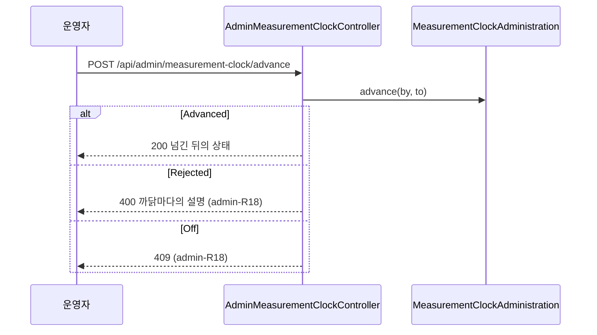
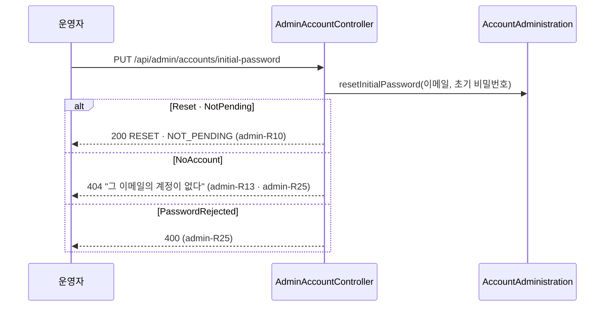

# admin 모듈 Spec

공통 구조와 쓰는 규칙은 [specs/README.md](README.md)에 있다.

## 1. 책임과 범위

`admin` 은 운영자 화면이 부르는 HTTP API 를 낸다. 기능마다 그 지식을 가진 모듈의 공개 API 를 부르고, 결과를 응답으로 옮긴다.

- **소스 · 피드 관리**
  - 프리셋 목록과 프리셋 소스 등록
  - 소스 목록과 숨긴 소스 목록
  - 운영자 원문의 등록 · 조회 · 수정 · 미리보기
  - 소스 · 피드 켜기 · 끄기와 운영자 수집 주기
  - 소스 · 피드 숨기기 · 다시 보이기 · 삭제와 삭제하면 함께 지워질 기사 수
- **수집 현황** — 피드마다 수집 상태와 엔트리 지표, 소스마다 그 합
- **이벤트 발행** — 남겨진 이벤트 발행의 목록 · 다시 처리 · 폐기
- **태그 체계** — 버전 목록과 버전 원문, 운영자 원문의 확인과 활성화(재평가 기간 포함)
- **평가 현황** — 기간을 고른 주제별 보도량, 버전 하나의 평가 품질 지표, 지금의 평가 대기 · 일시 실패를 겪은 대기 · 실패 건수
- **평가 검수** — 버전 · 기간의 평가 목록(태그 · 주제 판정 거르기)과 표본, 평가 하나의 상세. 행과 상세에 기사 정보를 맞붙인다(admin-R6)
- **태그 기준 · 저장 기준** — 지금 값 · 어긋난 상태 · 이력, 바꾸기 전 미리보기, 변경
- **빠진 태그 채움** — 채울 기간(일)의 확인과 요청, 채움 목록과 진행 · 결과
- **사건 묶기 채우기** — 채울 기간(일)에 처음 본, 사건이 없는 기사를 사건 묶기에 넣는 요청
- **스토리라인 잇기 채우기** — 채울 기간(일)에 마지막 기사가 있는 사건을 스토리라인 잇기 대기에 넣는 요청
- **사건 조회** — 기간의 사건 목록과 사건 하나의 상세(사건의 기사, 이 사건으로 합쳐진 사건, 사건이 든 스토리라인)
- **기사 상세** — 기사 하나의 기사 정보, 평가, 사건 소속, 표현의 핵심 말
- **스토리라인 조회** — 기간의 스토리라인 목록과 지금 잇기 · 관계 기준, 스토리라인 하나의 상세(타임라인과 소속 근거, 관계, 물은 쌍, 합쳐진 스토리라인)
- **큰 스토리라인 · 큰 판정 기준** — 기간의 큰 스토리라인, 큰 판정 기준의 지금 값 · 이력 · 미리보기 · 변경
- **판정 기록** — 기간의 사건 소속 판정 원본과 그 지금 결과, 지금 사건 배정 기준(읽기 전용)
- **측정용 시계** — 측정용 시계의 지금 상태와 앞으로 넘기기. 측정용 시계는 측정 profile 의 인스턴스에서만 켜진다([platform Spec](platform.md#앱-시계))
- **계정 · 초대 · 가입 정책** — 공개 가입 켬 · 끔과 그 이력, 초대 발급 · 최근 목록 · 취소, 운영자 계정 생성, 첫 로그인 전 계정의 초기 비밀번호 다시 정하기([account Spec](account.md#첫-운영자와-운영자의-계정-운영))
- **응답 모양** — 모듈의 운영 결과를 판별자 하나의 평평한 응답으로 옮기고, 요청의 문제를 HTTP 오류로 낸다(admin-R1 ~ admin-R3)

하지 않는 것:

- 판정 · 저장 · 조회를 하지 않는다. 그 지식을 가진 모듈의 공개 API(운영 API · 공개 조회)에 맡긴다
- 운영자를 인증하지 않는다. 운영자 경로의 보호는 `account` 의 보안 구성이 한다([account Spec "운영자 접근 통제"](account.md#운영자-접근-통제))
- 사건 배정 기준을 바꾸지 않는다. 그 기준은 설정이고([event-R17](event.md#기준과-재판정)), 판정 기록 응답은 지금 값을 읽기만 한다
- 스토리라인 관계와 잇기 기준 · 관계 기준을 바꾸지 않는다. 관계는 관계 판정만 맺고 기준은 설정이다([ADR-0137](../adr/0137-storyline-relations-are-not-edited-one-by-one-by-operators-and-are-tuned-through-relation-criteria.md)). 스토리라인 응답은 지금 기준을 읽기만 한다

다른 모듈과의 의존과 주고받는 이벤트는 [overview.md §5](../overview.md#5-모듈-지도)에 있다.

## 2. 용어

해당 없음. 이 모듈이 소유한 개념이 없다. 결과 응답의 판별자는 화면용 API 전체가 쓰는 말이라 [overview.md §8](../overview.md#8-용어)이 정의한다.

## 3. 공개 인터페이스

모듈 최상위 패키지 `net.yozmnews.admin` 에 공개 타입이 없다. 다른 모듈이 부르는 공개 API 는 없다.

HTTP 엔드포인트는 모두 운영자 경로다. `ADMIN` 계정 세션이나 스크립트용 운영자 토큰으로 열리고, 거부 응답은 [account Spec "운영자 접근 통제"](account.md#운영자-접근-통제)의 account-R1 · account-R3 이다. 요청 · 응답 형식의 정본은 [`api/openapi.json`](../../api/openapi.json)이다([ADR-0020](../adr/0020-screen-api-contract-from-committed-openapi-spec.md)). 결과 · 오류의 대응은 admin-R1 ~ admin-R3 이고, 엔드포인트마다의 규칙은 표의 규칙 칸이 가리킨다.

**소스 · 피드**

| 메서드 · 경로 | 용도 | 규칙 |
|---|---|---|
| `GET /api/admin/presets` | 프리셋 목록(등록한 소스와 그 소스를 숨겼는지 포함) | — |
| `POST /api/admin/presets/{key}/registration` | 프리셋 소스 등록 | admin-R10 · admin-R13 |
| `GET /api/admin/sources` | 숨기지 않은 소스의 목록(피드와 숨긴 피드를 나눠 싣는다) | source-R51 · source-R57 · admin-R29 |
| `GET /api/admin/sources/hidden` | 숨긴 소스 목록(소스 목록과 같은 모양, 숨긴 시각 순) | admin-R29 |
| `POST /api/admin/sources` | 운영자 원문으로 소스 등록 | admin-R10 |
| `GET /api/admin/sources/{id}/profile` | 운영자 원문 조회 | admin-R13 |
| `PUT /api/admin/sources/{id}/profile` | 운영자 원문 수정 | admin-R10 · admin-R13 |
| `POST /api/admin/profile-previews` | 등록 전 원문의 피드 하나 미리보기 | admin-R10 · admin-R17 · source-R58 |
| `POST /api/admin/sources/{id}/enable` · `/disable` | 소스 켜기 · 끄기 | admin-R10 · admin-R26 |
| `PUT /api/admin/sources/{id}/poll-interval` | 운영자 소스 수집 주기 정하기 | admin-R17 · admin-R26 |
| `POST /api/admin/feeds/{id}/enable` · `/disable` | 피드 켜기 · 끄기 | admin-R10 · admin-R17 · admin-R26 · source-R58 |
| `PUT /api/admin/feeds/{id}/poll-interval` | 운영자 피드 수집 주기 정하기 | admin-R17 · admin-R26 |
| `POST /api/admin/sources/{id}/hide` · `/unhide` | 소스 숨기기 · 다시 보이기 | source-R53 · admin-R26 |
| `DELETE /api/admin/sources/{id}` | 소스 삭제 | source-R55 · admin-R26 |
| `POST /api/admin/feeds/{id}/hide` · `/unhide` | 피드 숨기기 · 다시 보이기 | source-R53 · source-R54 · admin-R10 · admin-R26 |
| `DELETE /api/admin/feeds/{id}` | 피드 삭제 | source-R54 · source-R55 · admin-R10 |
| `GET /api/admin/sources/{id}/deletion-impact` | 소스를 지우면 함께 지워질 기사 수 | article-R15 |
| `GET /api/admin/sources/{sourceId}/feeds/{feedId}/deletion-impact` | 피드를 지우면 함께 지워질 기사 수 | article-R15 |

- 수집 주기 정하기의 본문이 `null` 이면 운영자 수집 주기를 지운다
- 소스 목록에서 프로필을 얻지 못한 소스의 이름은 기록된 출처 이름이다(source-R51 · source-R57)
- 삭제 영향의 기사 수는 지금 기준 그 소스만 가진 기사의 수다. 피드 삭제 영향은 소스를 함께 받고, 그 소스의 그 피드만 가진 기사를 센다(article-R15)
- 소스와 맞지 않는 피드와 없는 대상의 삭제 영향은 404 가 아니라 0 이다

**수집 현황 · 이벤트 발행 · 측정용 시계**

| 메서드 · 경로 | 용도 | 규칙 |
|---|---|---|
| `GET /api/admin/collection-status` | 수집 현황 | admin-R4 |
| `GET /api/admin/event-publications` | 남겨진 이벤트 발행 목록 | platform-R14 · admin-R29 |
| `POST /api/admin/event-publications/resubmission` | 고른 발행 다시 처리 | platform-R14 · admin-R10 · admin-R12 · admin-R19 |
| `POST /api/admin/event-publications/discard` | 고른 발행 폐기 | platform-R15 · admin-R10 · admin-R12 · admin-R19 |
| `GET /api/admin/measurement-clock` | 측정용 시계의 상태(지금의 측정 시각 · 출발 시각 · 시간 순으로 넘긴 기록) | platform-R29 · admin-R18 |
| `POST /api/admin/measurement-clock/advance` | 측정용 시계를 앞으로 넘긴다 | platform-R29 · admin-R18 |

- 이벤트 발행 목록은 `platform` 의 `StrandedPublications` 를 옮기기만 하고 이벤트 내용을 싣지 않는다(platform-R14). 발행 시각 오름차순 앞쪽 최대 상한 건과 전체 건수다
- 넘기기의 본문은 넘길 길이 `by`(ISO-8601 기간, 예 `PT24H`)와 도착 시각 `to` 가운데 하나다. 응답은 넘긴 뒤의 상태다

**태그 체계 · 평가**

| 메서드 · 경로 | 용도 | 규칙 |
|---|---|---|
| `GET /api/admin/tag-sets` | 태그 체계 버전 목록(번호가 큰 것부터) | admin-R29 |
| `GET /api/admin/tag-sets/{id}/text` | 버전의 원문 | [tag-R27](tag.md#체계-변경) · admin-R13 |
| `POST /api/admin/tag-set-reviews` | 운영자 원문의 확인 | admin-R10 · admin-R20 |
| `POST /api/admin/tag-sets` | 운영자 원문으로 새 버전을 만들어 활성으로 바꾼다 | admin-R10 · admin-R20 · admin-R32 |
| `GET /api/admin/topic-coverage` | 주제별 보도량 | [tag-R28](tag.md#평가-현황--주제별-보도량) · tag-R30 · admin-R5 · admin-R21 · admin-R22 |
| `GET /api/admin/evaluation-overview` | 평가 현황 | [tag-R29](tag.md#평가-현황--주제별-보도량) · admin-R5 · admin-R13 · admin-R21 |
| `GET /api/admin/evaluation-queue` | 지금의 평가 대기 · 그 가운데 일시 실패를 겪은 대기 · 실패 건수(`waiting` · `retrying` · `rejected`) | admin-R5 |
| `GET /api/admin/evaluations` | 평가 목록 | [tag-R33](tag.md#평가-검수--기준-미리보기) · admin-R6 · admin-R13 · admin-R21 ~ admin-R23 |
| `GET /api/admin/evaluations/{id}` | 평가 하나의 상세 | admin-R6 · admin-R13 |
| `GET /api/admin/evaluation-samples` | 표본(행 모양은 목록과 같다) | [tag-R34](tag.md#평가-검수--기준-미리보기) · admin-R6 · admin-R13 · admin-R21 · admin-R22 |
| `GET /api/admin/thresholds` | 활성 버전의 태그 기준 · 저장 기준의 상태와 이력 | [tag-R36](tag.md#평가-검수--기준-미리보기) |
| `POST /api/admin/threshold-previews` | 태그 기준 · 저장 기준 미리보기 | [tag-R35](tag.md#평가-검수--기준-미리보기) · admin-R10 · admin-R21 · admin-R24 |
| `PUT /api/admin/thresholds/{kind}` | 활성 버전의 한 태그 종류(`TOPIC` · `REGION`)의 태그 기준 · 저장 기준 변경 | [tag-R11](tag.md#태그-기준--저장-기준) · tag-R12 · admin-R10 · admin-R24 · admin-R32 |
| `POST /api/admin/tag-backfill-reviews` | 빠진 태그 채움의 확인 | [tag-R31](tag.md#빠진-태그-채움--저장-바닥) · admin-R10 · admin-R20 |
| `POST /api/admin/tag-backfills` | 빠진 태그 채움 요청 | admin-R10 · admin-R20 |
| `GET /api/admin/tag-backfills` | 빠진 태그 채움 목록(최근 것부터) | admin-R28 · admin-R29 |

- 기간을 받는 조회는 시작일 `from` · 종료일 `to`(`yyyy-MM-dd`, 끝 포함)와 날짜를 해석할 시간대 `zone` 을 받는다(admin-R21)
- 확인 · 미리보기 요청(태그 체계 확인, 기준 미리보기, 빠진 태그 채움 확인, 큰 판정 기준 미리보기)은 아무것도 쓰지 않는다
- 태그 체계 확인 · 활성화의 본문은 운영자 원문 `text` 와 재평가 기간 `recentDays` 다. `recentDays` 가 없으면 0 이고, 활성화는 재평가하지 않는다
- 주제별 보도량은 선택 `topic` 을 되풀이해 받는다. 없으면 모든 주제다. 응답은 활성 버전 ID 를 함께 싣는다
- 평가 현황 · 평가 목록 · 표본은 질의 `version`(태그 체계 버전 ID)을 받는다
- 평가 대기 건수는 기간과 무관한 지금의 건수다
- 평가 목록의 선택 질의
  - 거를 태그 `tags` 는 `{종류}:{키}` 이고 종류는 `TOPIC` · `REGION` · `FORMAT` 이다. 여러 번 주거나 쉼표로 잇고, 고른 태그가 모두 맞는 평가만 낸다(admin-R22)
  - `topicStatus` 는 주제 판정으로 거른다
  - 쪽 크기 `limit` 은 없으면 20 이다
  - 다음 쪽은 커서 `afterEvaluatedAt` · `afterId` 를 함께 준다(admin-R23)
- 표본의 질의 `size` 가 없으면 `EvaluationReview.DEFAULT_SAMPLE_SIZE` 다. 같은 `seed` 면 같은 표본이다

**사건 · 스토리라인**

| 메서드 · 경로 | 용도 | 규칙 |
|---|---|---|
| `POST /api/admin/event-intake-fills` | 사건 묶기 채우기 | [event-R19](event.md#사건-묶기-대기와-회차) · admin-R10 · admin-R20 |
| `POST /api/admin/storyline-linking-fills` | 스토리라인 잇기 채우기 | [storyline-R15](storyline.md#운영자-채우기) · admin-R10 · admin-R20 |
| `GET /api/admin/events` | 기간의 사건 목록 | [event-R20](event.md#대표-기사--기간-집계) · admin-R7 |
| `GET /api/admin/events/{id}` | 사건 하나의 상세 | admin-R7 · admin-R13 |
| `GET /api/admin/articles/{id}` | 기사 하나의 상세 | admin-R8 · admin-R13 |
| `GET /api/admin/storylines` | 기간의 스토리라인 목록 | [storyline-R22](storyline.md#공개-조회) · admin-R7 |
| `GET /api/admin/storylines/{id}` | 스토리라인 하나의 상세 | [storyline-R34](storyline.md#운영자-조회) · [evaluation-R50](evaluation.md#관계-판정-원본-조회) · admin-R7 · admin-R13 |
| `GET /api/admin/big-storylines` | 기간의 큰 스토리라인 | [storyline-R19](storyline.md#큰-판정) · [storyline-R23](storyline.md#공개-조회) · admin-R7 |
| `GET /api/admin/big-storyline-criteria` | 큰 판정 기준의 지금 값과 이력(최근 것부터) | [storyline-R20](storyline.md#큰-판정) |
| `POST /api/admin/big-storyline-criteria-previews` | 큰 판정 기준 미리보기 | admin-R7 · admin-R24 |
| `PUT /api/admin/big-storyline-criteria` | 큰 판정 기준 변경 | admin-R10 · admin-R24 · admin-R32 |
| `GET /api/admin/event-judgements` | 기간의 판정 기록(판정 시각의 날짜 범위) | [evaluation-R39](evaluation.md#사건-소속-판정) · [event-R22](event.md#판정-원본의-쓰임) · admin-R7 |

- 채우기의 본문은 채울 기간 `days`(일)다. 사건 묶기 채우기는 기간에 처음 본 기사 수와 새로 사건 묶기 대기에 넣은 수를 낸다. 스토리라인 잇기 채우기는 기간에 마지막 기사가 있는 사건 수와 새로 잇기 대기에 넣은 수를 낸다
- 사건 목록 · 스토리라인 목록의 다음 쪽은 커서 `afterLastArticleAt` · `afterId` 를, 판정 기록은 `afterJudgedAt` · `afterId` 를 함께 준다(admin-R23). 한 쪽의 크기는 admin-R41 이다
- 사건 상세는 사건의 기사마다 출처와 점수 · 정한 것 · 시각을 싣는다
- 큰 스토리라인 응답은 지금 큰 판정 기준을 함께 싣는다

**계정 · 초대 · 가입 정책**

| 메서드 · 경로 | 용도 | 규칙 |
|---|---|---|
| `GET /api/admin/sign-up-policy` | 공개 가입이 열렸는가와 그 이력(최근부터) | [account-R25](account.md#가입-정책) |
| `PUT /api/admin/sign-up-policy` | 가입 정책 변경 | admin-R10 · admin-R32 |
| `GET /api/admin/invitations` | 최근 초대 50개(발급 역순) | [account-R24](account.md#초대) |
| `POST /api/admin/invitations` | 초대 발급 | admin-R25 · admin-R31 |
| `POST /api/admin/invitations/{id}/revoke` | 초대 취소 | admin-R10 · admin-R13 |
| `POST /api/admin/accounts` | 계정 생성 | [account-R28](account.md#첫-운영자와-운영자의-계정-운영) · admin-R10 · admin-R25 · admin-R31 |
| `PUT /api/admin/accounts/initial-password` | 첫 로그인 전 계정의 초기 비밀번호 다시 정하기 | account-R28 · admin-R10 · admin-R13 · admin-R25 · admin-R31 |

- 초대 토큰은 발급 응답(`id` · `token` · `expiresAt`)에만 나가고 목록에는 없다. 링크의 꼴은 [web-R6](web.md#로그인과-계정)이다
- 운영자가 만든 계정은 일반 사용자이고, 첫 로그인에서 비밀번호를 바꾼다(account-R28)
- 초기 비밀번호를 다시 정하면 그 계정의 세션이 모두 끝난다(account-R28)

## 4. 내부 구조

### 개관

패키지와 책임:

- (최상위) — 모듈 선언. 의존을 `source` · `article` · `tag` · `evaluation` · `event` · `storyline` · `account` · `platform` 으로 둔다(`package-info`)
- `adapter/in/web` — 운영자 컨트롤러, 결과 · 목록의 응답 레코드, 요청 매개변수 읽기, 없는 대상의 404

`application` · `domain` 이 없다. 판단은 부르는 모듈에 있다.

컨트롤러가 부르는 공개 API 는 아래뿐이다.

| 모듈 | 운영 API | 공개 조회 |
|---|---|---|
| `source` | `SourceAdministration` | `FeedLabels` |
| `article` | `ArticleAdministration` | `ArticleDirectory` |
| `tag` | `TagSetAdministration` · `EvaluationAdministration` · `EvaluationReview` · `TagBackfillAdministration` | `TopicCoverage` |
| `evaluation` | — | `EventJudgementLog` · `RelationJudgementLog` |
| `event` | `EventIntakeAdministration` | `EventDirectory` · `EventReview` |
| `storyline` | `StorylineLinkingAdministration` · `BigStorylineAdministration` | `StorylineDirectory` · 운영자 조회 `StorylineReview` |
| `account` | `AccountAdministration` · `InvitationAdministration` · `SignUpPolicyAdministration` | — |
| `platform` | `EventPublicationAdministration` · `MeasurementClockAdministration` | — |

협력은 과정마다 아래와 같다. 그림이 있는 과정의 호출 순서는 그림에 있다.

- **운영 기능** — 컨트롤러가 요청을 읽어 공개 API 하나를 부르고, 결과를 응답 레코드의 정적 팩토리로 옮긴다(admin-R1). 값의 범위는 공개 API 가 판정한다(admin-R27)
- **오류 응답** — 요청의 문제는 400 · 404 · 409 문제 응답이다(admin-R2 · admin-R3). 문제 응답은 `platform` 의 `ProblemResponses` 로 만든다
- **수집 현황** — `source` 의 소스 목록과 `article` 의 엔트리 집계를 한 번씩 읽어 소스 · 피드 행으로 맞붙인다(admin-R4)
- **측정용 시계 넘기기** — `platform` 의 넘기기 결과를 넘긴 뒤의 상태 · 400 · 409 로 옮긴다(admin-R18, 그림 "측정용 시계 넘기기")
- **평가 목록 · 표본** — 버전 ID · 기간과 목록의 거를 태그 · 커서를 읽은 뒤 `tag` 의 목록 · 표본을 부른다(admin-R14 · admin-R21 ~ admin-R23). 없는 버전은 404, 그 밖의 거부는 400 이고, 행의 기사 정보는 한 번에 맞붙인다(admin-R13 · admin-R22 · admin-R38)
- **평가 상세** — `tag` 의 평가 상세에 상세의 기사 정보를 맞붙인다. 없는 평가는 404 이고, 그새 지운 기사는 기사 정보가 `null` 이다(admin-R13 · admin-R39 · admin-R40)
- **사건 목록 · 사건 상세** — 목록은 `event` 의 사건 목록 한 쪽에 대표 기사의 정보를 맞붙인다(admin-R41 · admin-R42). 상세는 남는 사건의 기사와 대표 기사, 합쳐진 사건, 사건이 든 스토리라인을 읽어 싣고, 없는 사건은 404 다(admin-R13 · admin-R43 ~ admin-R46)
- **기사 상세** — 기사 정보를 먼저 읽고, 있으면 평가 · 배정 · 핵심 말을 맞붙인다. 배정이 있을 때만 사건의 지금 값을, 판정 원본 ID 가 있을 때만 그 원본을 묻는다(admin-R64 ~ admin-R68)
- **스토리라인 목록 · 스토리라인 상세** — 목록은 `storyline` 의 목록 한 쪽에 대표 기사, 소속 없는 사건, 지금 잇기 · 관계 기준을 붙인다(admin-R41 · admin-R48 ~ admin-R51). 상세는 타임라인과 `StorylineReview` 의 소속 근거 · 관계 · 물은 쌍 · 합쳐진 스토리라인을 읽고, 그 판정 원본 ID 를 모아 `evaluation` 의 관계 판정 원본을 나눠 찾는다(admin-R53 ~ admin-R59)
- **큰 스토리라인 · 큰 판정 기준 미리보기** — 큰 스토리라인은 지금 기준과 `StorylineDirectory.bigStorylines` 의 목록에 대표 기사와 소속 없는 사건을 붙인다(admin-R47 · admin-R48 · admin-R50). 미리보기는 제안 기준을 먼저 읽고(admin-R24), 지금 기준의 목록은 `StorylineDirectory.bigStorylines`, 제안 기준의 목록은 `BigStorylineAdministration.preview` 로 얻어 대표 기사를 한 번에 맞붙인다(admin-R52)
- **판정 기록** — `evaluation` 의 판정 원본 한 쪽에 `event` 의 쓰임을 원본 ID 로 맞붙이고, 판정할 기사의 정보와 지금 사건 배정 기준을 붙인다(admin-R38 · admin-R41 · admin-R60 · admin-R63)
- **초기 비밀번호 다시 정하기** — `account` 의 결과를 200 · 404 · 400 으로 옮긴다(admin-R13 · admin-R25, 그림 "초기 비밀번호 다시 정하기")
- **기사 정보 맞붙이기** — 행의 기사는 `AdminArticles`, 상세의 기사는 `AdminArticleDetails`, 스토리라인 응답의 대표 기사는 `AdminRepresentatives` 가 한 응답에 한 번 맞붙인다(admin-R38 · admin-R39 · admin-R48)

역할: 모든 구성 요소가 화면 역할(`@WebRole`)이다(platform-R9).

컨트롤러는 트랜잭션을 열지 않고, 각 공개 API 가 자기 트랜잭션을 연다(admin-R30).

그림 "측정용 시계 넘기기":

그림 "초기 비밀번호 다시 정하기":

### 들어오는 쪽

| 진입점 | 구성 요소 | 계기 | 맡는 일 |
|---|---|---|---|
| 프리셋 | `AdminPresetController` | `GET /api/admin/presets` · `POST …/{key}/registration` | 목록과 등록(admin-R1 · admin-R2) |
| 소스 · 운영자 원문 | `AdminSourceController` | `/api/admin/sources/**` · `POST /api/admin/profile-previews` | 소스 목록과 운영자 원문, 소스 운영(admin-R1 ~ admin-R3) |
| 피드 | `AdminFeedController` | `/api/admin/feeds/**` | 피드 운영(admin-R1 ~ admin-R3) |
| 삭제 영향 | `AdminDeletionImpactController` | `GET …/deletion-impact` 둘 | `article` 의 기사 수를 옮긴다(admin-R2) |
| 수집 현황 | `AdminCollectionController` | `GET /api/admin/collection-status` | 소스 목록과 엔트리 집계를 소스 · 피드 행으로 맞붙인다(admin-R4) |
| 측정용 시계 | `AdminMeasurementClockController` | `GET /api/admin/measurement-clock` · `POST …/advance` | 상태와 넘기기, 그림 "측정용 시계 넘기기"(admin-R3) |
| 이벤트 발행 | `AdminEventPublicationController` | `GET /api/admin/event-publications` · `POST …/resubmission` · `POST …/discard` | 목록과 발행별 결과(admin-R1 · admin-R3) |
| 태그 체계 | `AdminTagSetController` | `GET /api/admin/tag-sets` · `GET …/{id}/text` · `POST /api/admin/tag-set-reviews` · `POST /api/admin/tag-sets` | 버전 목록 · 원문 · 확인 · 활성화(admin-R1 ~ admin-R3) |
| 평가 현황 | `AdminEvaluationController` | `GET /api/admin/topic-coverage` · `GET /api/admin/evaluation-overview` · `GET /api/admin/evaluation-queue` | 보도량 · 평가 현황 · 대기 건수(admin-R2 · admin-R3 · admin-R5) |
| 평가 검수 | `AdminEvaluationReviewController` | `GET /api/admin/evaluations` · `GET …/{id}` · `GET /api/admin/evaluation-samples` | 목록 · 표본 · 상세에 기사 정보를 맞붙인다(admin-R1 ~ admin-R3 · admin-R6) |
| 태그 기준 · 저장 기준 | `AdminThresholdController` | `GET /api/admin/thresholds` · `POST /api/admin/threshold-previews` · `PUT /api/admin/thresholds/{kind}` | 상태 · 미리보기 · 변경(admin-R1 · admin-R3) |
| 사건 조회 | `AdminEventController` | `GET /api/admin/events` · `GET /api/admin/events/{id}` | 사건 목록과 사건 상세(admin-R2 · admin-R3 · admin-R6 · admin-R7) |
| 기사 상세 | `AdminArticleController` | `GET /api/admin/articles/{id}` | 기사 정보에 평가 · 배정 · 핵심 말을 맞붙인다(admin-R2 · admin-R6 · admin-R8) |
| 스토리라인 조회 | `AdminStorylineController` | `GET /api/admin/storylines` · `GET /api/admin/storylines/{id}` | 스토리라인 목록과 스토리라인 상세(admin-R2 · admin-R3 · admin-R6 · admin-R7) |
| 큰 스토리라인 | `AdminBigStorylineController` | `GET /api/admin/big-storylines` · `GET /api/admin/big-storyline-criteria` · `POST /api/admin/big-storyline-criteria-previews` · `PUT /api/admin/big-storyline-criteria` | 큰 스토리라인, 큰 판정 기준의 조회 · 미리보기 · 변경(admin-R1 · admin-R3 · admin-R6 · admin-R7) |
| 판정 기록 | `AdminEventJudgementController` | `GET /api/admin/event-judgements` | 판정 원본과 그 쓰임(admin-R3 · admin-R6 · admin-R7) |
| 사건 묶기 채우기 | `AdminEventIntakeController` | `POST /api/admin/event-intake-fills` | `EventIntakeAdministration.fill` 의 결과를 옮긴다(admin-R1 · admin-R3) |
| 스토리라인 잇기 채우기 | `AdminStorylineLinkingController` | `POST /api/admin/storyline-linking-fills` | `StorylineLinkingAdministration.fill` 의 결과를 옮긴다(admin-R1 · admin-R3) |
| 빠진 태그 채움 | `AdminTagBackfillController` | `POST /api/admin/tag-backfill-reviews` · `POST /api/admin/tag-backfills` · `GET /api/admin/tag-backfills` | 확인 · 요청 · 목록(admin-R1 · admin-R3) |
| 계정 · 초대 · 가입 정책 | `AdminAccountController` · `AdminInvitationController` · `AdminSignUpPolicyController` | `/api/admin/accounts/**` · `/api/admin/invitations/**` · `/api/admin/sign-up-policy` | `account` 의 운영 API 셋의 결과를 옮긴다(admin-R1 ~ admin-R3) |
| 없는 대상 | `AdminExceptionHandling` | 운영자 컨트롤러의 공개 예외 | 없는 소스 · 피드 · 초대의 404(admin-R15) |

- 계기는 모두 운영자의 HTTP 요청이다. 반복 작업 · 이벤트 리스너 · 기동 시 동작이 없다
- 처리기는 상태를 두지 않는다. 쓰기의 멱등성과 다른 요청이 먼저 바꾼 변경의 409 는 부른 모듈이 지킨다(admin-R16)
- 측정용 시계의 처리기는 언제나 등록되고, 앱의 시계가 측정용 시계가 아니면 409 로 거부한다(admin-R18)
- 실패는 admin-R2 · admin-R3 의 문제 응답이다. 트랜잭션은 admin-R30 이다

요청 · 오류의 보조 구성 요소:

| 구성 요소 | 책임 |
|---|---|
| `AdminIds` | 경로 ID 를 읽고 1 미만 · 없는 대상의 404 설명을 낸다(admin-R13 · admin-R14) |
| `AdminPeriods` | 기간 매개변수를 읽어 그 조회의 기간 타입(`EvaluationPeriod` · `JudgementPeriod` · `EventPeriod`)으로 넘기고, 그 400 을 낸다(admin-R21) |
| `AdminCursor` | 목록 커서를 읽고 그 400 을 낸다(admin-R23) |
| `PollIntervals` | 하한 미만 수집 주기의 400(admin-R17) |
| `ReevaluationDays` | 범위 밖 재평가 기간의 400(admin-R20) |
| `BackfillDays` | 범위 밖 채울 기간의 400(admin-R20) |
| `ThresholdValuesProblem` | 범위 밖 태그 기준 · 저장 기준의 400(admin-R24) |
| `BigStorylineCriteriaProblem` | 범위 밖 큰 판정 기준의 400(admin-R24) |
| `AccountProblem` | 계정 운영의 400 · 404 설명(admin-R13 · admin-R25) |

기사 정보의 보조 구성 요소:

| 구성 요소 | 책임 |
|---|---|
| `AdminArticles` | 목록 · 표본 행의 기사 정보 맞붙이기(admin-R38) |
| `AdminArticleDetails` | 평가 상세 · 기사 상세의 기사 정보 맞붙이기(admin-R39) |
| `AdminRepresentatives` | 사건의 대표 기사와 그 정보 맞붙이기(admin-R48) |

응답 · 요청 레코드는 결과를 옮기는 값이다. 판별자와 속성의 조합은 응답 레코드의 정적 팩토리가 만들고(admin-R11), 비밀 값을 담은 레코드의 문자열 표현은 admin-R31 이다.

### `application`

해당 없음.

### `domain`

해당 없음 — 판단과 저장은 그 기능을 가진 모듈(`source` · `article` · `tag` · `evaluation` · `event` · `storyline` · `account` · `platform`)에 있다.

### 나가는 쪽

해당 없음 — 포트가 없다. 부르는 것은 다른 모듈의 공개 API 다.

## 5. 규칙과 불변식

### 결과와 오류의 대응

- **admin-R1** — 운영 기능이 정상으로 내놓는 결과의 응답을 덮는다. 응답의 ID 꼴은 admin-R28 이다.
  - admin-R9 — 200 과 평평한 레코드
  - admin-R10 — 결과마다의 판별자
  - admin-R11 — 판별자와 속성의 조합을 만드는 자리
  - admin-R12 — 여러 발행을 다루는 조작의 항목 목록
- **admin-R2** — 대상이 없을 때의 404 를 덮는다.
  - admin-R13 — 없는 대상과 그 설명
  - admin-R14 — 1 미만의 ID
  - admin-R15 — 공개 예외를 받는 조언
- **admin-R3** — 요청의 문제가 내는 문제 응답과 본문 없는 성공을 덮는다. 소스 목록이 수집 주기의 하한을 함께 싣는 것은 admin-R29 다.
  - admin-R16 — 요청 형식과 동시 변경
  - admin-R17 — 수집 주기와 측정용 시계의 피드 요청
  - admin-R18 — 측정용 시계
  - admin-R19 — 이벤트 발행
  - admin-R20 — 재평가 기간과 채울 기간
  - admin-R21 — 기간 매개변수
  - admin-R22 — 보도량과 평가 검수의 질의
  - admin-R23 — 목록 커서
  - admin-R24 — 기준 값
  - admin-R25 — 계정 운영과 초대
  - admin-R26 — 본문 없는 성공
  - admin-R27 — 범위를 판정하는 자리
- **admin-R9** — 운영 기능이 정상으로 내놓는 결과는 200 응답이다. 응답은 판별자 `result` 하나와, 결과마다 쓰이는 속성을 모두 담은 평평한 레코드다. 그 결과에 쓰이지 않는 속성은 `null` 이거나 빈 목록이다
- **admin-R10** — 운영 기능의 결과와 판별자는 아래처럼 대응한다. 괄호는 그 판별자에 쓰이는 속성이다.

  | 운영 기능 | 판별자 |
  |---|---|
  | 등록 | `REGISTERED`(소스 ID) · `ALREADY_REGISTERED` · `INVALID_PROFILE`(문제) |
  | 원문 수정 | `REVISED`(끈 피드의 식별자 · 소스를 껐는지 · 더한 피드의 식별자) · `INVALID_PROFILE`(문제) |
  | 소스 켜기 | `ENABLED` · `REFUSED`(이유) |
  | 피드 켜기 | `ENABLED`(미리보기, 이미 켜졌으면 `null`) · `REFUSED`(이유) · `BELOW_CRITERIA`(미리보기 · 못 미친 기준) · `UNFETCHED`(실패) · `READING_CHANGED` |
  | 원문 미리보기 | `INVALID_PROFILE`(문제) · `FEED_NOT_IN_PROFILE` · `PASSED`(미리보기) · `BELOW_CRITERIA`(미리보기 · 못 미친 기준) · `UNFETCHED`(실패) |
  | 피드 숨기기 · 삭제 | `REMOVED` · `REFUSED`(이유 `IN_PROFILE` · `PROFILE_UNAVAILABLE`) |
  | 이벤트 발행 다시 처리 | 발행마다 `RESUBMITTED` · `NOT_EXHAUSTED` · `UNREADABLE` · `NOT_FOUND`(platform-R14) |
  | 이벤트 발행 폐기 | 발행마다 `DISCARDED` · `NOT_STRANDED` · `CHANGED` · `NOT_FOUND`(platform-R15) |
  | 태그 체계 확인 | `READY`(변경 목록 · 재평가 기간에 처음 본 기사 수) · `UNCHANGED` · `INVALID_TAG_SET`(문제) |
  | 태그 체계 활성화 | `ACTIVATED`(새 버전 ID · 번호 · 변경 목록 · 재평가 대기에 넣은 수) · `UNCHANGED` · `INVALID_TAG_SET`(문제) |
  | 기준 미리보기 | `PREVIEWED`(아래 목록) · `UNCHANGED`(버전 · 지금 값) |
  | 기준 변경 | `CHANGED`(버전 · 이전 값 · 새 값 · 경고) · `UNCHANGED`(버전 · 지금 값) |
  | 빠진 태그 채움 확인 | `READY`(덮을 범위 · 평가 수 · 버전별 수) |
  | 빠진 태그 채움 요청 | `REQUESTED`(기록한 채움) · `ALREADY_OPEN`(끝나지 않은 채움) |
  | 사건 묶기 채우기 | `FILLED`(기간에 처음 본 기사 수 · 새로 넣은 수) |
  | 스토리라인 잇기 채우기 | `FILLED`(기간에 마지막 기사가 있는 사건 수 · 새로 넣은 수) |
  | 큰 판정 기준 변경 | `CHANGED`(이전 값 · 새 값) · `UNCHANGED`(지금 값) |
  | 가입 정책 변경 | `CHANGED`(앞 값 · 지금 값) · `UNCHANGED`(지금 값) |
  | 초대 취소 | `REVOKED` · `NOT_REVOCABLE`(지금 상태) |
  | 계정 생성 | `CREATED`(사용자 ID) · `EMAIL_TAKEN` |
  | 초기 비밀번호 다시 정하기 | `RESET` · `NOT_PENDING`(계정 주인이 이미 바꿨다) |

  기준 미리보기의 `PREVIEWED` 에 쓰이는 속성:

  - 버전 · 지금 값 · 제안 값
  - 경고
  - 평가 수와 판정이 달라지는 평가 수
  - 두 기준의 평가 현황
- **admin-R11** — 판별자와 속성의 조합은 응답 레코드의 정적 팩토리 하나에서만 만든다
- **admin-R12** — 여러 발행을 한 번에 다루는 조작은 발행마다 판별자 하나를 단 항목(`id` · `result`)의 목록을 낸다
- **admin-R13** — 대상이 없으면 404 문제 응답이다. 설명을 정한 대상은 그 설명을 낸다.

  | 대상 | 404 가 되는 경우 | 설명 |
  |---|---|---|
  | 소스 · 피드 | 없는 소스 · 피드(`source` 의 공개 예외) | — |
  | 프리셋 | 카탈로그에 없는 프리셋 | — |
  | 운영자 원문 | 프리셋 소스의 운영자 원문을 조회 · 수정한다 | — |
  | 태그 체계 버전 | 없는 버전의 원문 · 평가 현황 · 평가 목록 · 표본 | — |
  | 평가 | 없는 평가 | — |
  | 사건 | 없는 사건 | "없는 사건: {ID}" |
  | 스토리라인 | 없는 스토리라인 | "없는 흐름: {ID}" |
  | 기사 | 없는 기사(그새 지운 기사 포함) | "없는 기사: {ID}" |
  | 초대 | 없는 초대 | "없는 초대: {ID}" |
  | 계정 | 초기 비밀번호 다시 정하기의 이메일로 쓰는 계정이 없다 | "그 이메일의 계정이 없다" |
- **admin-R14** — 경로의 ID 가 1 미만이면 그 대상이 없는 것과 같은 404 다. 질의 `version` 의 1 미만도 경로의 ID 와 같다. 사건 · 스토리라인 · 기사 · 초대는 admin-R13 과 같은 설명을 낸다
- **admin-R15** — 없는 소스 · 피드 · 초대의 공개 예외는 이 모듈의 조언이 앱 전체 조언보다 먼저 받아 404 로 낸다. 처리하지 못한 예외(500)가 되지 않는다
- **admin-R16** — 요청 형식의 문제와 동시 변경은 아래 상태다. 운영 기능마다의 문제는 admin-R17 ~ admin-R25 다.

  | 조건 | 상태 |
  |---|---|
  | 본문 형식이 틀렸거나 원문이 없다 | 400 |
  | 질의 매개변수가 없거나 형식이 틀렸다 | 400 |
  | 요청 본문의 정수 칸에 소수가 왔다. 본문 형식으로 본다([platform-R12](platform.md#오류-응답-형식)) | 400 |
  | 다른 요청이 먼저 바꿨다(platform-R12) | 409 |

  - 삭제는 버전 조건이 없어 409 가 없다
- **admin-R17** — 소스 · 피드 운영의 요청 문제는 아래다.

  | 조건 | 상태 | 설명 | 수를 읽는 곳 |
  |---|---|---|---|
  | 수집 주기가 하한 미만이다 | 400 | "수집 주기는 {하한}분 이상이다" | `SourceAdministration.MINIMUM_POLL_INTERVAL_MINUTES` |
  | 측정용 시계에서 실제 피드를 요청하는 피드 켜기 미리보기 · 원문 미리보기 | 409 | `RealTimeRequiredException.MESSAGE`(platform-R30) | — |
- **admin-R18** — 측정용 시계의 상태 · 넘기기의 문제는 아래다.

  | 조건 | 상태 | 설명 |
  |---|---|---|
  | 앱의 시계가 측정용 시계가 아니다 | 409 | "측정용 시계가 켜져 있지 않다 — 이 인스턴스의 시계는 실제 시간이다" |
  | 넘기기에 넘길 길이와 도착 시각을 둘 다 줬다 | 400 | "넘길 길이(by)와 도착 시각(to) 가운데 하나만 준다" |
  | 넘기기에 둘 다 없다 | 400 | "넘길 길이(by)나 도착 시각(to) 가운데 하나를 준다" |
  | 넘길 길이가 0 이하다 | 400 | "넘길 길이는 0 보다 길어야 한다" |
  | 도착 시각이 지금 이하다 | 400 | "도착 시각은 지금보다 뒤여야 한다 — 측정용 시계는 앞으로만 넘긴다" |
- **admin-R19** — 이벤트 발행 다시 처리 · 폐기의 요청 문제는 아래다.

  | 조건 | 상태 | 설명 | 수를 읽는 곳 |
  |---|---|---|---|
  | 발행 ID 의 형식이 틀렸다 | 400 | — | — |
  | `ids` 가 없다 | 400 | — | — |
  | `ids` 에 빈 원소가 있다 | 400 | — | — |
  | 한 번에 받는 발행 수가 상한을 넘었다 | 400 | "한 번에 {상한}건까지 처리한다" | `EventPublicationAdministration.MAX_BATCH` |

  - 빈 `ids` 는 200 빈 결과다
- **admin-R20** — 재평가 기간과 채울 기간의 요청 문제는 아래다. 모두 400 이다.

  | 조건 | 설명 | 수를 읽는 곳 |
  |---|---|---|
  | 태그 체계 확인 · 활성화의 재평가 기간이 범위 밖이다 | "재평가 기간은 0일에서 {상한}일까지다" | `TagSetAdministration.MAX_REEVALUATION_DAYS` |
  | 빠진 태그 채움 확인 · 요청의 채울 기간이 범위 밖이다 | "채울 기간은 1일에서 {상한}일까지다" | `TagBackfillAdministration.MAX_DAYS` |
  | 사건 묶기 채우기 · 스토리라인 잇기 채우기의 채울 기간이 범위 밖이다 | "채울 기간은 1일에서 {상한}일까지다" | `EventIntakeAdministration.MAX_DAYS` · `StorylineLinkingAdministration.MAX_DAYS`(공개 API 가 결과로 함께 낸다) |
  | 빠진 태그 채움 · 사건 묶기 채우기 · 스토리라인 잇기 채우기에 `days` 가 없다 | — | — |
- **admin-R21** — 기간을 받는 조회의 날짜 · 시간대 · 기간 범위의 문제는 400 이다.

  | 조건 | 설명 |
  |---|---|
  | 날짜 형식이 틀렸다 | "날짜는 yyyy-MM-dd 형식이다: {값}" |
  | 없는 시간대다 | "없는 시간대다: {값}" |
  | 기간이 범위 밖이다 | "기간은 1일에서 {상한}일까지다" |

  - 하루가 통째로 없는 날도 기간이 범위 밖인 것이다
  - 상한은 조회마다 그 기간 타입의 상수다

  | 조회 | 상한 |
  |---|---|
  | 평가 현황 · 주제별 보도량 | `EvaluationPeriod.MAX_DAYS` |
  | 평가 목록 · 표본 · 기준 미리보기 | `EvaluationPeriod.MAX_DAYS` |
  | 사건 목록 · 스토리라인 목록 | `EventPeriod.MAX_DAYS` |
  | 큰 스토리라인 · 큰 판정 기준 미리보기 | `EventPeriod.MAX_DAYS` |
  | 판정 기록(판정 시각의 날짜 범위) | `JudgementPeriod.MAX_DAYS` |
- **admin-R22** — 주제별 보도량과 평가 목록 · 표본의 질의 문제는 아래다. 모두 400 이다.

  | 조건 | 설명 | 수를 읽는 곳 |
  |---|---|---|
  | 보도량의 주제가 활성 태그 체계에 없다 | "활성 태그 체계에 없는 주제다: {키, …}" | — |
  | 평가 목록의 거를 태그가 고른 버전에 없다 | "그 태그 체계 버전에 없는 태그다: {종류} {키}, …" | — |
  | 거를 태그의 꼴이 틀렸다 | "거를 태그는 {종류}:{키} 형식이다: {값}" | — |
  | 거를 태그가 상한보다 많다 | "태그는 {상한}개까지 고른다" | `EvaluationReview.MAX_FILTER_TAGS` |
  | 형식 태그가 둘 이상이다 | "형식 태그는 하나만 고른다 — 대표 형식은 평가마다 하나다" | — |
  | 쪽 크기가 범위 밖이다 | "한 번에 {상한}건까지 본다" | `EvaluationReview.MAX_PAGE_SIZE` |
  | 표본 크기가 범위 밖이다 | "표본은 1건에서 {상한}건까지다" | `EvaluationReview.MAX_SAMPLE_SIZE` |
  | 씨앗이 범위 밖이다 | "씨앗은 0에서 {상한}까지다" | `EvaluationReview.MAX_SEED` |

  - 없는 주제의 키는 사전 순으로 잇는다
  - 없는 태그는 모두, 고른 순서로 잇는다
  - 거를 태그는 받은 값마다 쉼표로 나눠 `{종류}:{키}` 로 읽는다. 종류가 `TOPIC` · `REGION` · `FORMAT` 밖이거나 키가 비면 꼴이 틀린 것이다
  - 거를 태그의 수는 같은 태그를 한 번으로 센다
- **admin-R23** — 목록 커서는 시각과 ID 를 함께 받는다. 커서 읽기의 정본은 `AdminCursor` 이고, 아래는 모두 400 이다.

  | 목록 | 하나만 왔다 | ID 가 1 미만이다 |
  |---|---|---|
  | 평가 목록 | "afterEvaluatedAt 과 afterId 는 함께 준다" | "평가 ID 는 1 이상이다: {값}" |
  | 사건 목록 | "afterLastArticleAt 과 afterId 는 함께 준다" | "사건 ID 는 1 이상이다: {값}" |
  | 스토리라인 목록 | "afterLastArticleAt 과 afterId 는 함께 준다" | "흐름 ID 는 1 이상이다: {값}" |
  | 판정 기록 | "afterJudgedAt 과 afterId 는 함께 준다" | "판정 원본 ID 는 1 이상이다: {값}" |

  - 커서 시각의 형식이 틀리면 "시각은 ISO-8601 형식이다: {값}" 이다
- **admin-R24** — 기준 값의 요청 문제는 아래다. 모두 400 이다.

  | 조건 | 설명 | 수를 읽는 곳 |
  |---|---|---|
  | 태그 기준 · 저장 기준이 범위 밖이다 | "태그 기준 · 저장 기준은 0 이상 1 이하, 소수 셋째 자리까지다" | — |
  | 경로의 태그 종류가 `TOPIC` · `REGION` 밖이다 | — | — |
  | 큰 판정 기준이 범위 밖이다 | "큰 화제 기준은 0 보다 크고 {상한} 이하인 소수 {자릿수}자리까지다" | `BigStorylineCriteria.MAX_INTENSITY` · `INTENSITY_SCALE` |
- **admin-R25** — 계정 운영과 초대 발급의 요청 문제는 아래다. 모두 400 이다.

  | 조건 | 설명 | 수를 읽는 곳 |
  |---|---|---|
  | 초대 메모가 상한을 넘었다 | "메모는 {상한}자까지다" | 공개 API 의 결과 |
  | 계정 생성의 이메일 형식이 틀렸다 | "이메일 형식이 아니다" | — |
  | 계정 생성의 표시 이름이 규칙을 어겼다 | "표시 이름은 앞뒤 공백을 빼고 1 ~ {상한}자다" | `AccountAdministration` 의 상수 |
  | 계정 생성 · 초기 비밀번호 다시 정하기의 초기 비밀번호가 규칙을 어겼다 | "초기 비밀번호가 짧다 · 길다 — {최소} ~ {최대}자다" | `AccountAdministration` 의 상수 |

  - 초기 비밀번호 다시 정하기는 이메일 형식이 틀려도 400 이 아니라 없는 계정과 같은 404 다(admin-R13)
- **admin-R26** — 아래 조작은 성공하면 본문 없는 204 다.
  - 소스 · 피드 끄기
  - 소스 · 피드 수집 주기 변경
  - 소스 숨기기 · 다시 보이기
  - 피드 다시 보이기
  - 소스 삭제
- **admin-R27** — 값 · 기간의 범위와 주제 · 태그가 있는지는 공개 API 나 공개 타입이 판정한다. 이 모듈은 그 결과를 400 · 404 로 옮기고, 설명의 상한 · 자릿수는 그 공개 상수에서 읽는다.
  - 공개 타입이 판정하는 것: 기간의 범위(`EvaluationPeriod` · `JudgementPeriod` · `EventPeriod` 의 `ofDays`)와 큰 판정 기준의 범위(`BigStorylineCriteria.of`, 변경은 공개 API 도 판정한다)
  - 이 모듈이 판정하는 것은 요청을 읽는 형식뿐이다. 본문 · 질의의 형식, 날짜 · 시간대, 커서와 거를 태그의 꼴, 경로 ID 의 1 미만이 그렇다
  - 그 밖의 범위와 수(admin-R17 ~ admin-R25 의 상한 · 기준 · 길이, 주제 · 태그가 있는지)는 공개 API 가 판정한다
- **admin-R28** — 운영자 응답은 아래 ID 를 JSON 수로 낸다. 이벤트 발행 ID 만 UUID 문자열이다.
  - 소스 · 피드
  - 태그 체계 버전(활성 버전과 빠진 태그 채움의 버전 포함) · 평가
  - 기사
  - 사건 · 스토리라인 · 판정 원본

  ID 가 없는 값 레코드는 그대로 싣는다
- **admin-R29** — 아래 응답은 요청의 범위를 정하는 한계값을 함께 싣는다. 수집 주기만 하한이고 나머지는 상한이다. 값은 거부를 판정하는 공개 상수에서 읽는다.

  | 응답 | 싣는 값 | 정본 |
  |---|---|---|
  | 소스 목록 · 숨긴 소스 목록 | 수집 주기의 하한 | `SourceAdministration.MINIMUM_POLL_INTERVAL_MINUTES` |
  | 이벤트 발행 목록 | 실을 수 있는 건수 `limit` | `EventPublicationAdministration.MAX_BATCH` |
  | 태그 체계 버전 목록 | 재평가 기간의 상한 | `TagSetAdministration.MAX_REEVALUATION_DAYS` |
  | 주제별 보도량 | 날짜 범위의 상한 `maxDays` | `EvaluationPeriod.MAX_DAYS` |
  | 평가 목록 | 거를 태그 수의 상한 `maxTags` | `EvaluationReview.MAX_FILTER_TAGS` |
  | 빠진 태그 채움 목록 | 채울 기간의 상한 `maxDays` | `TagBackfillAdministration.MAX_DAYS` |
  | 사건 목록 · 스토리라인 목록 · 큰 스토리라인 | 날짜 범위의 상한 `maxDays` | `EventPeriod.MAX_DAYS` |
  | 판정 기록 | 날짜 범위의 상한 `maxDays` | `JudgementPeriod.MAX_DAYS` |
- **admin-R30** — 운영자 컨트롤러는 트랜잭션을 열지 않는다. 트랜잭션은 부른 공개 API 가 연다.
  - 피드를 받는 요청(피드 켜기 · 원문 미리보기)도 같다. 피드를 받는 동안 응답이 기다린다(source-R9)
  - 여러 공개 조회를 엮은 응답은 한 스냅숏이 아니다. 조회 사이에 지운 기사 · 사건 · 판정 원본을 싣는 꼴은 admin-R40 · admin-R48 · admin-R58 · admin-R67 이다
- **admin-R31** — 초대 토큰과 초기 비밀번호를 담은 레코드의 문자열 표현은 그 값을 숨긴다. 초대 발급 응답 `InvitationIssueResponse`, 계정 생성 요청 `AccountCreationRequest`, 초기 비밀번호 다시 정하기 요청 `InitialPasswordResetRequest` 가 그렇다
- **admin-R32** — 운영자의 변경 요청은 행위자 `ChangeActor.OPERATOR` 로 공개 API 를 부른다. 태그 체계 활성화, 태그 기준 · 저장 기준 변경, 큰 판정 기준 변경, 가입 정책 변경이 그렇다

### 수집 현황

- **admin-R4** — 수집 현황 응답이 `source` 의 운영 목록과 `article` 의 엔트리 집계를 다시 계산하지 않고 옮기는 방식을 덮는다.
  - admin-R33 — 싣는 소스 · 피드
  - admin-R34 — 소스 행과 피드 행의 개수
  - admin-R35 — 비율
  - admin-R36 — 피드 상태의 기준값과 단위
  - admin-R37 — 수집 상태와 마지막 실패
- **admin-R33** — 수집 현황은 숨긴 소스 · 숨긴 피드를 싣지 않는다
- **admin-R34** — 소스 행의 개수는 그 소스의 숨기지 않은 피드 전부의 칸별 합(`EntryStatistics.combined`)이다. 꺼진 피드와 프로필에 없는 피드도 든다. 피드 행은 그 피드의 칸별 개수(`EntryStatistics.feed`)다. 칸은 집계 결과의 칸과 같은 순서로 짝짓는다
- **admin-R35** — 비율은 `EntryCounts` 가 낸 값을 옮긴다. 다시 나누지 않고, 엔트리가 없으면 `null` 이다(article-R14)
- **admin-R36** — 피드 상태의 기준값과 재판정 간격은 `SourceAdministration.FEED_STATUS_CRITERIA` 에서 온다. 무소식 기간은 시간 수로, 재판정 간격은 분 수로 낸다
- **admin-R37** — 피드 행의 수집 상태와 마지막 실패는 `FeedHealthView` 를 옮긴다. 마지막 실패(`LastFailureView`)는 ID 가 없는 값이라 그대로 싣는다(admin-R28)

### 평가 현황

- **admin-R5** — 평가 현황 · 주제별 보도량 · 대기 건수 응답은 `tag` 의 결과를 옮기기만 한다. 비율은 공개 결과의 값이라 다시 나누지 않고, 평가가 없으면 `null` 이다(tag-R29). ID 의 꼴은 admin-R28, 날짜 범위의 상한은 admin-R29, 트랜잭션은 admin-R30 이다

### 평가 검수

- **admin-R6** — 운영자 응답이 모듈의 결과에 기사 정보를 맞붙이는 방식을 덮는다. 평가 · 버전 ID 의 꼴과 판정 · 분포의 값 레코드는 admin-R28 이다.
  - admin-R38 — 행의 기사
  - admin-R39 — 상세의 기사
  - admin-R40 — 그새 지운 기사
- **admin-R38** — 행의 기사는 제목과 출처 이름을 싣는다. 쪽 · 표본 · 사건의 기사 ID 를 모아 `article` 의 `ArticleDirectory.headlines` 를 한 번 부르고(출처 이름 엮기는 [article-R17](article.md#헤드라인)), 정본은 `AdminArticles` 다.
  - 평가 목록 · 표본의 행, 사건, 스토리라인 · 큰 스토리라인, 판정 기록의 기사가 그렇다
- **admin-R39** — 상세의 기사는 제목 · 요약문 · 정규 URL · 발행 시각과, 엔트리마다 출처 이름 · 섹션 · RSS 카테고리를 싣는다. 기사 하나의 `ArticleDirectory.findAll` 과 그 엔트리의 피드 ID 로 `source` 의 `FeedLabels.labels` 를 한 번씩 부르고, 정본은 `AdminArticleDetails` 다.
  - 평가 상세와 기사 상세가 그렇다
  - 요약문 원문은 운영자 화면에만 보인다([ADR-0068](../adr/0068-rss-summaries-shown-only-on-operator-screens-and-users-get-processed-information.md))
- **admin-R40** — 그새 지운 기사는 기사 정보가 `null` 이다. 평가 결과는 그대로 싣는다

### 사건 · 스토리라인 · 큰 스토리라인 · 판정 기록

- **admin-R7** — 사건 · 스토리라인 · 큰 스토리라인 · 판정 기록 응답이 `event` · `storyline` · `evaluation` 의 결과를 옮기고 기사 정보를 맞붙이는 방식을 덮는다. 기사 정보는 admin-R38 · admin-R40, ID 의 꼴은 admin-R28, 날짜 범위의 상한은 admin-R29, 트랜잭션과 스냅숏은 admin-R30 이다.
  - admin-R41 — 목록의 쪽 크기
  - admin-R42 — 사건 목록 행
  - admin-R43 — 합쳐진 대상의 상세
  - admin-R44 — 사건 상세의 대표 기사
  - admin-R45 — 사건 상세의 합쳐진 사건
  - admin-R46 — 사건 상세의 스토리라인
  - admin-R47 — 큰 스토리라인 행과 미리보기 행
  - admin-R48 — 대표 기사
  - admin-R49 — 스토리라인 목록 행
  - admin-R50 — 소속 없는 사건
  - admin-R51 — 스토리라인 목록의 지금 기준
  - admin-R52 — 큰 판정 기준 미리보기
  - admin-R53 — 타임라인의 소속 근거
  - admin-R54 — 타임라인 밖 사건의 소속 근거
  - admin-R55 — 스토리라인 상세의 합쳐진 스토리라인
  - admin-R56 — 관계 판정 원본의 꼴
  - admin-R57 — 확률의 방향
  - admin-R58 — 원본이 없을 때
  - admin-R59 — 원본을 나눠 찾기
  - admin-R60 — 판정 기록 행의 쓰임
  - admin-R61 — 판정 당시 값과 조회 시점 값
  - admin-R62 — 판정 원본의 원본 응답
  - admin-R63 — 판정 기록의 사건 배정 기준
- **admin-R41** — 사건 목록 · 스토리라인 목록 · 판정 기록의 한 쪽은 50건이다. 쪽 크기는 질의로 받지 않는다. 그 컨트롤러 상수는 부르는 공개 조회의 상한(`EventDirectory.MAX_PAGE_SIZE` · `StorylineDirectory.MAX_PAGE_SIZE` · `EventJudgementLog.MAX_PAGE_SIZE`) 이하다
- **admin-R42** — 사건 목록 행은 사건 전체의 기사 수, 기간 집계 `EventTally`(기간 안 기사 수 · 소스 수 · 중요도 평균), 대표 기사(admin-R48)를 싣는다
- **admin-R43** — 사건 상세 · 스토리라인 상세는 경로의 ID 를 `requestedId` 로 싣는다. 합쳐진 사건 · 스토리라인의 ID 면 남는 대상을 내고, 그 ID(`id`)는 `requestedId` 와 다르다
- **admin-R44** — 사건 상세는 남는 사건의 대표 기사를 `representativesOfAll` 로 읽어 싣는다. 사건 목록 행과 같은 대표다(admin-R48)
- **admin-R45** — 사건 상세는 이 사건으로 합쳐진 사건을 합친 시각 순으로 싣는다.
  - 합칠 때 남긴 대표 기사(`representativeId`)와 그 제목 · 출처를 싣는다. 남기지 않았으면 `null` 이다
  - 병합 판정 확률이 없으면 `null` 이다
  - 합쳐진 사건의 대표 기사는 사건의 기사와 한 번에 조회해 맞붙인다
- **admin-R46** — 사건 상세는 남는 사건이 든 스토리라인을 `StorylineDirectory.storylinesOf` 로 읽어 싣는다. 직접 든 것과 그 상위이고, 스토리라인 ID 순이다. 행마다 ID · 상태 · 사건 수 · 직접 든 것인지를 싣는다
- **admin-R47** — 큰 스토리라인 응답과 큰 판정 기준 미리보기는 포함 나무마다 한 행을 싣고, 그 아래의 큰 스토리라인을 `branches` 에 같은 꼴로 싣는다([storyline-R23](storyline.md#공개-조회)). 행이 싣는 값은 아래다.
  - 스토리라인 값. 포함의 하위까지 센 닫은 사건 집합의 값이다([storyline-R33](storyline.md#스토리라인-사이-관계))
  - 기간 집계 `EventTally`(기간 안 기사 수 · 소스 수 · 중요도 평균). 소스 수 · 중요도 평균은 판정에 쓰이지 않고 운영자가 스토리라인을 읽는 값이다
  - 보도 강도 `intensity`(소수 둘째 자리)
  - 대표 기사(admin-R48)
- **admin-R48** — 사건의 대표 기사는 `event` 가 사건 기사 전체에서 고른 하나이고([event-R14](event.md#대표-기사--기간-집계)), 사건 목록 · 사건 상세 · 스토리라인 응답이 같은 대표를 싣는다. 스토리라인 응답에서 대표 기사를 맞붙이는 정본은 `AdminRepresentatives` 이고, 큰 스토리라인 · 스토리라인 목록 · 상세 · 타임라인 사건이 한 응답에 한 번 부른다.
  - 스토리라인의 대표 기사는 그 대표 사건(`StorylineView.representativeEvent`)의 대표 기사다
  - 대표 사건이 그새 합쳐졌거나 지워졌으면 `null` 이다
- **admin-R49** — 스토리라인 목록 행은 `StorylineSummary` 를 옮긴다. 스토리라인 값(상위 포함, 닫은 사건 집합의 값), 기간 집계와 보도 강도, 큰 여부를 싣는다. 대표 기사는 admin-R48 이다
- **admin-R50** — 스토리라인 목록과 큰 스토리라인 응답은 그 기간의 소속 없는 사건 수 · 기사 수(`UnlinkedEvents`)를 함께 싣는다
- **admin-R51** — 스토리라인 목록 응답은 지금 잇기 기준과 관계 기준을 함께 싣는다.
  - 잇기 기준은 창(초) · 아래 기준 · 위 기준 · 확률 기준이다
  - 관계 기준은 창(초)과 합치기 확률 기준(`mergeProbability`)을 담는다. 스토리라인 상세가 싣는 관계 기준도 같은 꼴이다
- **admin-R52** — 큰 판정 기준 미리보기는 같은 기간을 지금 기준과 제안 기준으로 판정한 두 목록을 싣는다. 두 목록의 대표 기사는 한 번에 맞붙인다. 들어오고 빠지는 스토리라인은 화면이 가린다([web-R24](web.md#운영자-화면))
- **admin-R53** — 스토리라인 상세의 타임라인은 `StorylineDirectory.events` 의 사건마다 대표 기사와 그 사건의 소속 근거를 싣는다. 소속 근거는 사건을 직접 가진 스토리라인마다 `StorylineReview.memberships` 의 행(`StorylineMembershipView`)을 옮긴다.
  - 정한 것이 `MERGE` 면 점수 · 기준 · 확률이 `null` 이고, 합치기로 옮겨 온 소속은 합쳐진 스토리라인 ID(`mergedFrom`)를 싣는다
  - 띠 안 판정으로 정하지 않았으면 판정 확률 · 원본 ID 가 `null` 이다
  - 잇기 기준의 확률 기준은 띠가 생기기 전의 기준 이력이면 `null` 이다([storyline-R14](storyline.md#잇기-규칙) · [R36](storyline.md#띠-판정))
- **admin-R54** — 타임라인에 없는 사건의 소속 근거는 싣지 않는다
- **admin-R55** — 스토리라인 상세는 이 스토리라인에 합쳐진 스토리라인(`merged`)마다 ID 와 합친 시각을 싣는다. 같은 사안의 조각으로 합쳤으면 그때의 관계 기준과 판정 원본(admin-R56)을 함께 싣는다
- **admin-R56** — 스토리라인 상세의 관계 · 물은 쌍 · 합쳐진 스토리라인은 관계 판정 원본 ID 와 원본(`RelationJudgementLog`)을 싣는다. 원본은 판별자 `reading` 하나의 평평한 값이다.

  | `reading` | 확률 | 문구 |
  |---|---|---|
  | `READ` | 그 원본을 남긴 문구 버전의 답마다 확률과 스토리라인마다 한 사안 확률 | `null` |
  | `NO_EVALUATOR` · `OTHER_EVALUATOR` · `UNREADABLE` | `null` | 있다 |

  - 같은 사안의 조각 `sameMatter` 는 그 답이 없는 문구 버전의 원본이면 `null` 이다
- **admin-R57** — 관계 판정 원본의 확률 방향은 원본의 first · second 스토리라인 ID(`firstId` · `secondId`) 기준이다
- **admin-R58** — 원본 ID 가 있는데 원본이 없으면(지워짐) 원본 칸이 `null` 이다. 물은 쌍의 원본 ID 가 `null` 이면 판정 원본이 남지 않은 결말(`NOTHING_TO_ASK` · `REJECTED`)이다
- **admin-R59** — 관계 판정 원본은 `RelationJudgementLog.MAX_IDS` 개씩 나눠 찾는다. 지워지지 않은 원본이 빠지지 않는다
- **admin-R60** — 판정 기록 행은 판별자 `use` 하나의 평평한 행이다.

  | `use` | 뜻 |
  |---|---|
  | `ASSIGNMENT` | 이 판정을 반영한 배정. 그 기사의 지금 사건과 정한 것을 싣는다 |
  | `MERGE` | 이 판정이 남긴 쌍마다, 지금 같은 사건이면 그 사건 |
  | `UNUSED` | 가리키는 기록이 없다. 셋 다 비어 있다 |
- **admin-R61** — 판정 기록의 후보 사건 ID 는 판정 당시 값이고, 결과는 조회 시점 값이다
- **admin-R62** — 사건 소속 판정 원본을 싣는 응답(판정 기록 · 기사 상세)은 입력 토큰을 싣고 원본 응답은 싣지 않는다
- **admin-R63** — 판정 기록은 지금 사건 배정 기준(창은 초)을 함께 싣는다. 읽기 전용이다

### 기사 상세

기사 상세의 화면 · API 꼴은 [ADR-0301](../adr/0301-the-operator-article-detail-is-one-page-and-one-detail-api-and-article-titles-on-operator-screens-link-to-it.md)이, 싣는 사건 묶기 근거의 범위는 [ADR-0302](../adr/0302-the-article-detail-shows-clustering-evidence-from-the-assignment-its-criteria-stored-candidates-applied-judgement-and-remaining-key-terms.md)가 정했다.

- **admin-R8** — 기사 상세 응답이 상세의 기사 정보(admin-R39)에 `tag` · `event` · `evaluation` 의 결과를 맞붙이는 방식을 덮는다. ID 의 꼴은 admin-R28, 트랜잭션과 스냅숏은 admin-R30, 원본 응답을 싣지 않는 것은 admin-R62 다.
  - admin-R64 — 기사 정보를 먼저 읽기
  - admin-R65 — 평가
  - admin-R66 — 사건 소속
  - admin-R67 — 사건의 지금 값과 판정 원본
  - admin-R68 — 핵심 말
- **admin-R64** — 기사 상세는 기사 정보를 먼저 읽는다. 없는(지운) 기사면 다른 조회를 부르지 않고 404 다(admin-R13). 남은 평가 · 배정 · 표현 · 판정 원본 조각을 싣지 않는다
- **admin-R65** — 평가는 `EvaluationReview.ofArticle` 의 버전마다 한 줄이고 버전 번호 내림차순이다. 행마다 평가 · 버전 ID 와 버전 번호, 평가 시각, 그 버전의 지금 기준으로 한 판정([tag-R15](tag.md#공유-평가))을 싣는다. 평가하지 않은 기사는 빈 목록이다
- **admin-R66** — 사건 소속은 `EventReview.assignmentOf` 의 배정(`ArticleAssignment`)을 옮긴다. 판정에 쓴 기준의 창은 초이고, 저장 후보는 점수 내림차순 · 사건 ID 순이다. 배정이 없으면 `null` 이고 사건 · 판정 원본을 묻지 않는다
- **admin-R67** — 배정에는 그 사건의 지금 값(`EventDirectory.find` 의 상태 · 전체 기사 수 · 첫 · 마지막 기사 시각)과, 판정 원본 ID 가 있으면 그 원본(`EventJudgementLog.find`)을 맞붙인다. 조회 사이에 사라진 사건과 지운 원본(보존 기간)은 `null` 이고, 원본 ID 는 그대로 싣는다
- **admin-R68** — 핵심 말은 `EventReview.keyTermsOf` 의 표현마다 모델 버전 · 핵심 말 · 만든 시각이다. 벡터는 싣지 않는다. 표현이 없으면 빈 목록이다. 아직 만들지 않았거나 사건 정비가 지운 경우다([event-R13](event.md#사건-정리))

## 6. 데이터

해당 없음 — 이 모듈은 자기 테이블이 없다.

## 7. 설정

해당 없음.

## 8. 결정

| ADR | 한 줄 |
|---|---|
| [0043](../adr/0043-admin-functions-guarded-by-env-bearer-token-until-account-roles.md) | 운영자 기능은 계정 인증 전까지 환경 변수의 Bearer 토큰으로 막고, 계정 인증이 생기면 같은 경로의 `ADMIN` 역할 판정으로 바꾼다(토큰으로 막음과 계정 인증 뒤의 전환은 ADR-0183 이 부분 대체) |
| [0044](../adr/0044-screen-api-results-as-flat-discriminated-200-and-rfc9457-problems.md) | 화면 API 는 판정 결과를 판별자 하나의 평평한 200 응답으로, 요청의 문제만 RFC 9457 형식의 자체 오류 레코드로 앱 전체에서 낸다 |
| [0045](../adr/0045-admin-module-serves-operator-api-over-module-public-operation-apis.md) | 운영자 API 는 `admin` 모듈이 내고, 각 모듈은 운영 기능과 결과 타입을 최상위 공개 API 로 낸다 |
| [0050](../adr/0050-operator-resubmits-once-or-discards-stranded-event-publications-read-from-registry.md) | 이벤트를 읽을 수 없는 발행은 재제출 전에 거르고, 상한에 이른 · 읽을 수 없는 발행은 운영자가 즉시 1회 재제출하거나 기록 없이 폐기하며, 목록 · 폐기는 `platform` 이 레지스트리 테이블을 직접 다룬다 |
| [0051](../adr/0051-operator-hides-or-deletes-sources-and-feeds-and-deletion-removes-exclusive-articles.md) | 운영자는 소스 · 피드를 숨기거나 삭제하고, 숨김은 끄고 남기며 삭제는 그 소스 · 피드만 가진 기사까지 지운다 |
| [0062](../adr/0062-tag-set-versions-from-operator-text-activated-forward-with-key-lineage-and-recent-reevaluation.md) | 태그 체계는 운영자 원문으로 새 버전을 만들어 앞으로만 켜고, 키 계보를 원문에 적으며, 켤 때 정한 일수 안에 처음 본 기사를 재평가 대기에 넣는다 |
| [0068](../adr/0068-rss-summaries-shown-only-on-operator-screens-and-users-get-processed-information.md) | RSS 요약문은 운영자 화면에만 보이고, 인스턴스 사용자와 외부 API 에는 가공한 정보만 낸다 |
| [0183](../adr/0183-admin-paths-open-with-admin-account-sessions-and-keep-the-operator-token-as-an-optional-script-bearer-with-csrf-only-for-sessions.md) | 운영자 경로는 `ADMIN` 계정 세션으로 열고, 운영자 토큰은 스크립트용 선택 Bearer 로 남기며, 세션 요청에만 CSRF 를 건다 |
| [0251](../adr/0251-the-measurement-clock-starts-only-with-the-measurement-profile-and-a-clock-row-and-moves-forward-through-the-operator-api.md) | 측정용 시계는 profile `measurement` 와 운영자가 넣는 DB 시계 행이 함께 있을 때만 뜨고, 운영자 API 로 앞으로만 넘긴다 |
| [0301](../adr/0301-the-operator-article-detail-is-one-page-and-one-detail-api-and-article-titles-on-operator-screens-link-to-it.md) | 운영자 기사 상세는 한 페이지 · 상세 API 하나로 기사 · 평가 · 사건 소속을 싣고, 운영자 화면의 기사 제목이 그리로 잇는다 |
| [0302](../adr/0302-the-article-detail-shows-clustering-evidence-from-the-assignment-its-criteria-stored-candidates-applied-judgement-and-remaining-key-terms.md) | 기사 상세의 사건 묶기 근거는 배정 · 판정에 쓴 기준 · 저장 후보 · 반영한 판정 원본과 남아 있는 표현의 핵심 말이다 |
