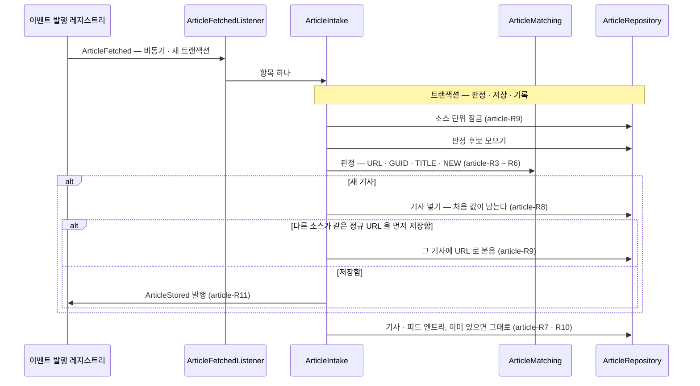

# article 모듈 Spec

공통 구조와 쓰는 규칙은 [specs/README.md](README.md)에 있다.

## 1. 책임과 범위

`article` 은 수집한 항목이 같은 기사인지 판정해 기사를 한 건으로 저장하고, 어느 피드에서 언제 봤는지를 남긴다.

- **같은 기사 판정 · 중복 제거** — 정규 URL 을 주 키로, guid · 제목 비교 키를 보조 키로 판정한다
- **기사 저장** — 새 기사는 처음 받은 값으로 저장하고 `ArticleStored` 를 발행한다
- **피드별 기록** — 같은 기사로 판정한 항목도 버리지 않고 기사 · 피드마다 한 번 기록한다
- **(미구현)** 본문 추출 — 자리만 있고 v1 에서는 하지 않는다(article-R12)

하지 않는 것:

- 피드를 받거나 정규화하지 않는다 — `source` 가 정규화한 기사(`ArticleFetched`)를 받는다
- 다른 소스가 전재한 기사나 같은 사건의 다른 기사를 합치지 않는다 — 그것은 기사를 합치지 않고 사건으로 묶는 일이다(article-R6)
- 기사를 평가하지 않는다. 평가 대기 상태도 갖지 않는다

다른 모듈과의 의존과 이벤트 흐름은 [overview.md §5](../overview.md#5-모듈-지도)에 있다.

## 2. 용어

기사(Article)는 [overview.md §8](../overview.md#8-용어)에 있다.

| 용어 | 뜻 |
|---|---|
| 정규 URL | 기사 링크를 자원을 바꾸지 않는 변환으로만 맞춘 URL(article-R1). 같은 기사 판정의 주 키이고 원문 링크로도 쓴다 |
| 제목 비교 키 | 제목을 NFKC 정규화 · 소문자 · 공백 제거한 값(article-R2). 같은 기사 판정의 보조 키다 |
| 엔트리 | 기사 하나를 피드 하나에서 본 기록(`article_feed_entries` 한 행) |
| 판정 종류 | 엔트리가 기사를 새로 만들었는지(`NEW`), 어떤 판정으로 기존 기사에 붙었는지(`URL` · `GUID` · `TITLE`) |
| L1 · L2 · L3 · L4 | 같은 기사 판정의 단계 — L1 정규 URL · guid, L2 같은 소스의 제목, L3 다른 소스의 전재, L4 같은 사건의 다른 기사. `article` 은 L1 · L2 만 합친다 |

## 3. 공개 인터페이스

모듈 최상위 패키지 `net.yozmnews.article` 의 공개 타입은 아래 둘이다. 다른 모듈이 기사를 조회하는 공개 API 는 아직 없다.

### ArticleId

기사 식별자 — `articles.id` 다.

```java
public record ArticleId(long value) {}
```

| 필드 | 뜻 | 제약 |
|---|---|---|
| `value` | `articles.id` | 1 이상 — 아니면 생성자가 `IllegalArgumentException` 을 던진다 |

관련 규칙: 없음.

### ArticleStored

새 기사를 저장했다(article → evaluation · event).

```java
public record ArticleStored(ArticleId articleId) {}
```

| 필드 | 뜻 | 제약 |
|---|---|---|
| `articleId` | 새로 저장한 기사. 기사 내용은 싣지 않고 기사 ID 만 싣는다 | null 이 아니다 |

- 계약
  - 새 기사를 저장한 트랜잭션 안에서 발행한다(article-R11) — 기사 행과 발행이 함께 커밋된다
  - 기사 하나에 많아야 한 번 나간다. 같은 기사로 판정된 항목, 같은 `ArticleFetched` 를 다시 처리한 경우, 다른 소스가 같은 정규 URL 의 기사를 먼저 저장해 거기에 붙은 경우에는 나가지 않는다
  - 소비 모듈이 생기기 전에 저장된 기사는 이 이벤트를 받지 못한다 — 리스너가 없는 발행은 남지 않는다

관련 규칙: article-R9 · article-R10 · article-R11.

HTTP 엔드포인트: 없음.

## 4. 내부 구조

### 개관

| 패키지 | 책임 |
|---|---|
| `application` | `source` 의 `ArticleFetched` 를 받는 리스너와, 항목 하나를 판정 · 저장 · 기록하는 유스케이스 |
| `domain` | 같은 기사 판정의 키(정규 URL · 제목 비교 키 · 해시)와 판정 규칙, 기사 저장소 |
| `adapter/out/persistence` | 기사 저장소의 JdbcClient 구현 |

협력: `ArticleFetchedListener` 가 받은 이벤트를 `ArticleIntake` 에 넘긴다. `ArticleIntake` 는 `ArticleRepository` 로 소스를 잠그고 후보를 모아 `ArticleMatching` 의 판정에 따라 기사 · 엔트리를 기록하고, 새 기사면 `ArticleStored` 를 발행한다. 판정 키(`CanonicalUrl` · `TitleKey` · `KeyHash`)는 들어온 항목(`IncomingItem`)을 만들 때 계산한다.

#### 항목 하나 처리



### 들어오는 쪽

| 작업 · 리스너 | 구성 요소 | 계기 | 내용 |
|---|---|---|---|
| `ArticleFetched` 리스너 | `ArticleFetchedListener`(`application`) | `source` 의 `ArticleFetched` | 항목 하나를 판정해 저장 · 기록한다(article-R3 ~ R11). 비동기 · 새 트랜잭션이고 이벤트 발행 레지스트리에 기록된다(Spring Modulith `@ApplicationModuleListener`). 처리가 실패한 발행은 `platform` 의 이벤트 재처리 작업([platform Spec 들어오는 쪽](platform.md#들어오는-쪽))이 다시 처리하고, 다시 처리해도 결과가 같다(article-R10) |

컨트롤러 · 반복 작업은 없다.

### `application`

- `ArticleIntake` — 들어온 항목 하나를 한 트랜잭션에서 판정 · 저장 · 기록한다. 같은 소스의 판정은 소스 단위 잠금으로 한 줄로 세우고, 다시 불러도 결과가 같다. 새 기사를 저장했을 때만 그 트랜잭션 안에서 `ArticleStored` 를 발행한다(article-R7 ~ R11)
- `ArticleFetchedListener` — 리스너(들어오는 쪽)

### `domain`

- 저장 단위: aggregate 가 없다. 기사와 엔트리는 삽입 전용 저장소 `ArticleRepository` 가 쓴다 — 소스 잠금 · 후보 조회 · "없으면 넣기"(기사 · 엔트리)와 정규 URL 로 다시 찾기만 있고 갱신은 없다(article-R7 · article-R8 · article-R9)
- `ArticleMatching` — 같은 기사 판정 규칙의 정본(article-R3 ~ article-R6)
- `CanonicalUrl` — 정규 URL(article-R1)
- `TitleKey` — 제목 비교 키(article-R2)
- `KeyHash` — 길이 상한이 없는 키(정규 URL · 제목 비교 키 · guid)의 SHA-256 — 인덱스와 비교에 쓴다
- 그 밖의 값: `IncomingItem` · `MatchCandidates` · `MatchDecision` · `MatchKind` · `TimeRange`

### 나가는 쪽

#### `ContentExtractor`

**(미구현)** 본문 추출(article-R12)의 포트. 아직 코드가 없다. 설계 초안의 시그니처:

```java
public interface ContentExtractor {
    Optional<ExtractedContent> extract(ArticleRef article);
}
```

설계는 v1 구현을 아무것도 추출하지 않는 구현으로 두고, 소스별로 켤 수 있게 한다.

그 밖의 외부 의존은 없다.

#### 저장소 구현

- `JdbcArticleRepository` — `ArticleRepository` 의 PostgreSQL 구현(JdbcClient). 쓰기는 `INSERT … ON CONFLICT` 뿐이고 갱신하지 않는다

#### 신뢰할 수 없는 입력

같은 기사 판정의 입력(`ArticleFetched`)은 `source` 가 정규화한 값이다 — 신뢰할 수 없는 피드 입력의 방어는 [source Spec](source.md#피드-xml-입력)에 있다.

## 5. 규칙과 불변식

### 판정 키

- **article-R1** — 정규 URL 은 자원을 바꾸지 않는 변환만 한다: 스킴과 호스트를 소문자로, 기본 포트(http 80 · https 443) 제거, 빈 경로는 `/`, 프래그먼트 제거, 추적 파라미터 제거, 남은 질의가 비면 `?` 도 없앤다. 추적 파라미터는 이름이 `utm_` 으로 시작하거나 `fbclid` · `gclid` · `dclid` · `gbraid` · `wbraid` · `msclkid` · `yclid` · `igshid` · `mc_cid` · `mc_eid` 인 질의 조각이다(대소문자 무시). 사용자 정보(`user@`) · 경로와 남은 질의 조각의 순서 · 값 · 퍼센트 인코딩(빈 조각 포함)은 그대로 두고, http↔https · `www.` 도 통일하지 않는다 — 서버가 순서 · 대소문자를 구분할 수 있다. 입력은 `FetchedArticle.isWebUrl` 을 만족하는 링크다. 결과는 기사의 `canonical_url` 로 저장되고 화면의 원문 링크로 쓴다
- **article-R2** — 제목 비교 키는 유니코드 NFKC 정규화 → 소문자(로캘 무관) → 공백 문자(ASCII 공백류와 유니코드 구분 문자) 전부 제거다. 섹션 피드마다 공백 · 전각/반각 · 대소문자만 다르게 실린 같은 제목이 같은 키가 된다. 말머리 · 구두점은 지우지 않는다 — `[속보] A` 와 뒤이어 나온 본 기사 `A` 는 별개 기사다. 키가 비면(공백 문자만의 제목) guid · 제목으로 판정하지 않는다 — 모든 공백 제목이 같은 키가 되기 때문이다

### 같은 기사 판정

잘못 합치면 뒤 기사가 평가 · 다이제스트에 들어가지 못하고 되살릴 수 없지만, 잘못 가르면 생긴 중복은 사건 묶기가 같은 사건으로 묶는다. 그래서 정규 URL 이 판정의 주 키이고 guid · 제목은 보조 키다([ADR-0032](../adr/0032-same-article-matching-avoids-false-merges-with-per-feed-entries-under-source-lock.md)).

- **article-R3** — 판정 순서. 처음 맞는 것으로 정한다.
  1. 정규 URL 이 기사의 정규 URL 과 같다 → `URL`
  2. 정규 URL 이 엔트리에 남은 항목 URL 과 같다 → `URL`(여럿이면 기사 ID 가 가장 작은 것). 제목으로 붙은 항목은 그 URL 이 엔트리에만 남으므로, 다시 받아도 처음 붙은 기사에 걸린다
  3. (제목 비교 키가 비지 않을 때) 같은 피드에 guid 가 같은 엔트리가 있고 그 기사와 제목 비교 키도 같다 → `GUID`(여럿이면 기사 ID 가 가장 작은 것)
  4. (제목 비교 키가 비지 않을 때) 같은 소스에서 이 피드에서는 본 적 없는 기사의 제목 비교 키가 같고 발행 시각 차가 48시간 이하(경계 포함)다 → `TITLE`. 여럿이면 발행 시각 차가 가장 작은 것, 같으면 기사 ID 가 가장 작은 것(먼저 저장된 기사)
  5. 그 밖에는 새 기사 → `NEW`
- **article-R4** — guid 는 제목 비교 키도 같을 때만 같은 기사로 본다. 모든 항목에 같은 guid 를 넣거나 번호를 다시 쓰는 피드가 기사를 잃게 하지 않는다. guid 가 같지만 제목이 달라 새 기사로 저장하면 로그를 남긴다 — 데이터에는 같은 피드 · 같은 guid 의 엔트리가 서로 다른 기사에 있고, 뒤 엔트리의 판정 종류가 `NEW` 로 남는다
- **article-R5** — 제목 판정(article-R3 의 4)은 이 피드에서 이미 본 기사를 후보에서 뺀다. 같은 피드에 날마다 같은 제목으로 나오는 정형 기사(`[게시판]` · 시세표 등)를 합치지 않는다
- **article-R6** — L1 · L2(article-R3 의 1~4)만 같은 기사를 한 건으로 합친다. 다른 소스가 같은 기사를 전재한 경우(L3, 통신사 기사 등)와 같은 사건을 다룬 서로 다른 기사(L4)는 합치지 않는다 — 사건 묶기가 기사를 합치지 않고 사건으로 묶는다([overview.md §5](../overview.md#5-모듈-지도), 단계의 설계는 전환 중인 [pipeline.md §8](../pipeline.md#8-사건-묶기))

### 저장과 기록

- **article-R7** — 들어온 항목은 버리지 않는다. 새 기사든 기존 기사에 붙었든 그 기사 · 피드의 엔트리를 남긴다. 엔트리는 기사 · 피드마다 한 행이고, 그 피드에서 처음 본 항목의 항목 URL 해시 · guid · 카테고리 · 발행 시각 추정 여부 · 판정 종류 · 받은 시각을 남긴다. 이미 있으면 아무것도 바꾸지 않는다
- **article-R8** — 기사는 처음 저장한 값이 남는다. 같은 기사의 다른 항목이 와도 제목 · 요약문 · 발행 시각을 고치지 않는다. 처음 발견한 시각은 그 항목을 받은 수집의 시각(`ArticleFetched.fetchedAt`)이다
- **article-R9** — 같은 소스의 판정은 소스 단위 잠금(트랜잭션 범위)으로 줄을 세운다. 다른 소스가 같은 정규 URL 을 동시에 내면 정규 URL 의 고유 제약이 하나만 남기고, 늦은 쪽은 그 기사에 판정 종류 `URL` 로 붙는다
- **article-R10** — 같은 항목을 다시 처리해도 결과가 같다. 다시 온 항목은 처음과 같은 기사에 걸리고(새 기사 · URL 로 붙은 항목은 그 정규 URL, 제목으로 붙은 항목은 자기 엔트리의 항목 URL, guid 로 붙은 항목은 바뀌지 않은 guid 후보), 엔트리는 다시 기록되지 않는다
- **article-R11** — 새 기사를 저장했을 때만, 그 트랜잭션 안에서 `ArticleStored` 를 발행한다

### 본문 추출

- **article-R12** — **(미구현)** 본문 추출(`ContentExtractor` — §4)의 자리만 만들고 v1 은 추출하지 않는다. 켤 때의 원칙:
  - 소스별 허용 목록으로만 켠다. 대상은 이용조건과 robots.txt 의 AI 관련 조항을 확인한 소스로 한정한다
  - 추출한 본문은 다이제스트 생성 입력으로만 쓰고, 짧은 보존 기간 후 삭제한다
  - 화면이나 외부 API 로 본문을 노출하지 않는다

## 6. 데이터

컬럼 타입 · 인덱스 · 제약 문면의 정본은 `backend/src/main/resources/db/migration/V2__articles.sql` 이다. `source_id` · `feed_id` 는 `source` 의 테이블을 가리키지만 FK 를 두지 않는다 — 모듈 사이는 ID 로만 참조한다. 길이 상한이 없는 키(정규 URL · 제목 비교 키 · guid)는 UTF-8 바이트의 SHA-256(32바이트)으로 비교 · 인덱스에 쓴다.

| 테이블 | 주요 컬럼 | 뜻 |
|---|---|---|
| `articles` | id, source_id, canonical_url, url_hash(고유), title, title_key_hash, summary_text, author, published_at, published_at_estimated, image_url, first_seen_at | 중복 제거된 기사. `canonical_url` 은 정규 URL(원문 링크)이고 `url_hash` 는 그 SHA-256 — 고유 제약이 article-R9 의 경합을 가른다. `title_key_hash` 는 제목 비교 키의 SHA-256. `summary_text` 는 RSS 요약문(최대 1,000 코드 포인트), `image_url` 은 썸네일 URL, `first_seen_at` 은 처음 발견한 시각. 처음 저장한 값이 남는다(article-R8). 평가 상태는 평가 쪽이 갖는다 |
| `article_feed_entries` | article_id, feed_id, item_url_hash, guid, guid_hash, feed_categories(목록), published_at_estimated, match_kind(`NEW`/`URL`/`GUID`/`TITLE`), seen_at | 어떤 피드에서 언제 봤는지 — 중복 제거의 근거. (article_id, feed_id) 고유 — 그 피드에서 처음 본 항목의 값이고 다시 보면 바꾸지 않는다(article-R7). `item_url_hash` 는 그 항목의 정규 URL 해시로 article-R3 의 2 가 대조한다. `guid` · `guid_hash` 는 함께 있거나 함께 없다(제약). `published_at_estimated` 는 그 항목의 발행 시각을 추정했는지, `match_kind` 는 판정 종류다 |

보존 기간은 [data-model.md "보존 정책"](../data-model.md#보존-정책-초안)에 있다.

## 7. 설정

해당 없음.

## 8. 결정

| ADR | 한 줄 |
|---|---|
| [0029](../adr/0029-indefinite-summary-retention-with-optional-deletion.md) | RSS 요약문은 기본 무기한 보존하고, 자동 삭제는 운영 설정으로 켠다 |
| [0032](../adr/0032-same-article-matching-avoids-false-merges-with-per-feed-entries-under-source-lock.md) | 같은 기사 판정은 기사를 잃지 않는 쪽으로 좁히고, 피드별 기록은 (기사, 피드)마다 한 행으로 소스 단위 잠금 안에서 쓴다 |
