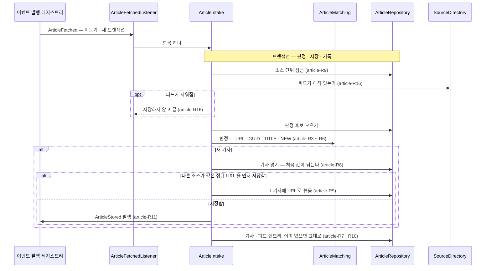

# article 모듈 Spec

공통 구조와 쓰는 규칙은 [specs/README.md](README.md)에 있다.

## 1. 책임과 범위

`article` 은 수집한 항목이 같은 기사인지 판정해 기사를 한 건으로 저장하고, 어느 피드에서 언제 봤는지를 남긴다.

- **같은 기사 판정 · 중복 제거** — 정규 URL 을 주 키로, guid · 제목 비교 키를 보조 키로 판정한다
- **기사 저장** — 새 기사는 처음 받은 값으로 저장하고 `ArticleStored` 를 발행한다
- **피드별 기록** — 같은 기사로 판정한 항목도 버리지 않고 기사 · 피드마다 한 번 기록한다
- **엔트리 집계** — 피드별 기록을 집계 기간 · 칸마다 세어 중복률 · 날짜 추정 비율 · 제목 판정 비율 · guid 재사용을 운영 기능의 공개 API(`ArticleAdministration`)로 낸다
- **지운 소스 · 피드의 기사 삭제** — 운영자가 소스 · 피드를 지우면 그 소스(피드)의 엔트리와, 엔트리가 남지 않은 기사를 지운다. 지우기 전에 함께 지워질 기사 수를 공개 API 로 센다(article-R15). 지운 피드의 늦은 항목은 저장하지 않는다(article-R16)
- **(미구현)** 본문 추출 — 자리만 있고 v1 에서는 하지 않는다(article-R12)

하지 않는 것:

- 피드를 받거나 정규화하지 않는다 — `source` 가 정규화한 기사(`ArticleFetched`)를 받는다
- 다른 소스가 전재한 기사나 같은 사건의 다른 기사를 합치지 않는다 — 그것은 기사를 합치지 않고 사건으로 묶는 일이다(article-R6)
- 기사를 평가하지 않는다. 평가 대기 상태도 갖지 않는다

다른 모듈과의 의존과 이벤트 흐름은 [overview.md §5](../overview.md#5-모듈-지도)에 있다.

## 2. 용어

기사(Article)는 [overview.md §8](../overview.md#8-용어)에 있다.

| 용어 | 뜻 |
|---|---|
| 정규 URL | 기사 링크를 자원을 바꾸지 않는 변환으로만 맞춘 URL(article-R1). 같은 기사 판정의 주 키이고 원문 링크로도 쓴다 |
| 제목 비교 키 | 제목을 NFKC 정규화 · 소문자 · 공백 제거한 값(article-R2). 같은 기사 판정의 보조 키다 |
| 엔트리 | 기사 하나를 피드 하나에서 본 기록(`article_feed_entries` 한 행). 그 피드의 소스를 함께 남긴다 — 기사의 소스는 엔트리들이 가리키는 소스들이다 |
| 판정 종류 | 엔트리가 기사를 새로 만들었는지(`NEW`), 어떤 판정으로 기존 기사에 붙었는지(`URL` · `GUID` · `TITLE`) |
| 집계 기간 · 칸 | 엔트리를 세는 기간(조회 시각에서 거꾸로 잡는다)과 그 기간을 같은 길이로 빈틈없이 나눈 구간. 둘 다 시작 포함, 끝 제외(article-R13) |
| 중복률 | 엔트리 가운데 판정 종류가 `NEW` 가 아닌 것의 비율 — 그 피드가 처음 실은 기사 가운데 이미 다른 피드에서 저장된 기사의 비율(article-R13 · article-R14) |
| 날짜 추정 비율 | 엔트리 가운데 발행 시각을 추정한 것의 비율(article-R13 · article-R14) |
| 제목 판정 비율 | 엔트리 가운데 판정 종류가 `TITLE` 인 것의 비율(article-R13 · article-R14) |
| guid 재사용 | 같은 피드 · 같은 guid 의 엔트리가 다른 기사에 먼저 있는데 새 기사가 된 엔트리(article-R4 · article-R13) |
| L1 · L2 · L3 · L4 | 같은 기사 판정의 단계 — L1 정규 URL · guid, L2 이 소스가 이미 받은 기사와 제목이 같음, L3 다른 소스의 전재, L4 같은 사건의 다른 기사. `article` 은 L1 · L2 만 합친다 |

## 3. 공개 인터페이스

모듈 최상위 패키지 `net.yozmnews.article` 의 공개 타입은 아래와 같다 — 식별자, 새 기사 이벤트, 운영 기능의 공개 API `ArticleAdministration` 과 그 결과 타입. 다른 모듈이 기사를 조회하는 공개 API 는 아직 없다.

받는 이벤트는 `source` 의 `ArticleFetched` · `SourceDeleted` · `FeedDeleted` 이고, `source` 의 공개 조회 `SourceDirectory` 로 피드가 아직 있는지 묻는다([source Spec §3](source.md#3-공개-인터페이스)).

HTTP 엔드포인트: 없음.

### ArticleId

기사 식별자 — `articles.id` 다.

```java
public record ArticleId(long value) {}
```

| 필드 | 뜻 | 제약 |
|---|---|---|
| `value` | `articles.id` | 1 이상 — 아니면 생성자가 `IllegalArgumentException` 을 던진다 |

관련 규칙: 없음.

### ArticleStored

새 기사를 저장했다(article → evaluation · event).

```java
public record ArticleStored(ArticleId articleId) {}
```

| 필드 | 뜻 | 제약 |
|---|---|---|
| `articleId` | 새로 저장한 기사. 기사 내용은 싣지 않고 기사 ID 만 싣는다 | null 이 아니다 |

- 계약
  - 새 기사를 저장한 트랜잭션 안에서 발행한다(article-R11) — 기사 행과 발행이 함께 커밋된다
  - 기사 하나에 많아야 한 번 나간다. 같은 기사로 판정된 항목, 같은 `ArticleFetched` 를 다시 처리한 경우, 다른 소스가 같은 정규 URL 의 기사를 먼저 저장해 거기에 붙은 경우에는 나가지 않는다
  - 소비 모듈이 생기기 전에 저장된 기사는 이 이벤트를 받지 못한다 — 리스너가 없는 발행은 남지 않는다
  - 저장된 기사는 그 기사의 엔트리가 모두 지워지면 — 운영자가 그 기사를 가진 소스 · 피드를 모두 지우면 — 지워진다(article-R15). 지워졌음을 알리는 이벤트는 없다 — 기사를 가리키는 모듈이 그 삭제를 따르는 길은 **(미설계)** 다

관련 규칙: article-R9 · article-R10 · article-R11.

### ArticleAdministration

기사 쪽 운영 기능 — 운영자 화면이 부른다. 구현은 `application` 의 `ArticleAdministrationService` 다.

```java
public interface ArticleAdministration {
    EntryStatistics entryStatistics();
    long exclusiveArticleCount(SourceId sourceId);
    long exclusiveArticleCount(SourceId sourceId, FeedId feedId);
}
```

| 멤버 | 뜻 |
|---|---|
| `entryStatistics()` | 지금 기준 최근 집계 기간의 피드별 · 칸별 엔트리 개수(article-R13) |
| `exclusiveArticleCount(SourceId)` | 지금 기준 그 소스만 가진 기사 수 — 엔트리가 모두 그 소스의 것인 기사. 소스를 지우면 함께 지워진다(article-R15) |
| `exclusiveArticleCount(SourceId, FeedId)` | 지금 기준 그 소스의 그 피드만 가진 기사 수 — 엔트리가 모두 그 피드의 것인 기사. 피드를 지우면 함께 지워진다(article-R15) |

- 계약
  - 질의 하나로 센다 — 트랜잭션을 열지 않고, 기다리지 않는다
  - 기간 안에 엔트리가 없는 피드는 결과에 없다 — `EntryStatistics.feed` 가 빈 칸들로 답한다
  - 기사 수는 센 순간의 값이다 — 수집이 돌면 지우기 전에 바뀔 수 있다. 없는 소스 · 피드, 소스와 맞지 않는 피드는 0 이다

관련 규칙: article-R13 · article-R14 · article-R15.

### EntryStatistics · FeedEntryStatistics · EntryBucket · EntryCounts

엔트리 집계(article-R13)의 값.

```java
public record EntryStatistics(Instant from, Instant to, List<EntryBucket> buckets,
        Map<FeedId, List<EntryCounts>> countsByFeed) {
    public FeedEntryStatistics feed(FeedId feed);
    public FeedEntryStatistics combined(Collection<FeedId> feeds);
}

public record FeedEntryStatistics(List<EntryCounts> buckets) {
    public EntryCounts total();
}

public record EntryBucket(Instant from, Instant to) {}

public record EntryCounts(int entries, int duplicates, int urlMatches, int titleMatches, int estimated,
        int guidReuses) {
    public static final EntryCounts NONE = new EntryCounts(0, 0, 0, 0, 0, 0);
    public EntryCounts plus(EntryCounts other);
    public @Nullable Double duplicateRate();
    public @Nullable Double estimatedRate();
    public @Nullable Double titleMatchRate();
}
```

| 타입 · 멤버 | 뜻 | 제약 |
|---|---|---|
| `EntryStatistics` | 집계 결과 — 기간의 시작(포함) · 끝(제외, 집계한 시각), 칸, 기간 안에 엔트리가 있는 피드의 칸별 개수 | 칸이 시작에서 끝까지 빈틈없이 잇고, 피드마다 칸 수와 같은 길이 · 같은 순서다. 아니면 `IllegalArgumentException` |
| `feed(FeedId)` | 피드 하나의 칸별 개수 — 엔트리가 없으면 모든 칸이 `NONE` | — |
| `combined(Collection<FeedId>)` | 피드 여럿의 칸별 합 — 같은 칸끼리 `plus` | — |
| `FeedEntryStatistics` | 칸별 개수와 기간 전체(`total()` — 칸을 모두 더한 값) | 칸은 `EntryStatistics.buckets` 와 같은 순서 |
| `EntryBucket` | 칸 하나의 범위 — 시작 포함, 끝 제외 | 시작이 끝보다 앞선다 |
| `EntryCounts` | 엔트리 · 중복 · URL 판정 · 제목 판정 · 날짜 추정 · guid 재사용 수와 비율 셋 — 비율 산식의 정본(article-R14) | 모두 0 이상, 중복 · 추정 ≤ 엔트리, URL 판정 + 제목 판정 ≤ 중복(나머지는 `GUID`), guid 재사용 ≤ 엔트리 − 중복. 아니면 `IllegalArgumentException` |

관련 규칙: article-R13 · article-R14.

## 4. 내부 구조

### 개관

| 패키지 | 책임 |
|---|---|
| (최상위) | 공개 API `ArticleAdministration` 과 그 결과 타입, 식별자 · 이벤트 |
| `application` | `source` 의 `ArticleFetched` · `SourceDeleted` · `FeedDeleted` 를 받는 리스너와, 항목 하나를 판정 · 저장 · 기록하는 유스케이스, 지운 소스 · 피드의 기사를 지우는 유스케이스, 공개 운영 API 의 구현 |
| `domain` | 같은 기사 판정의 키(정규 URL · 제목 비교 키 · 해시)와 판정 규칙, 기사 저장소, 엔트리 집계의 기간 · 칸과 집계 조회 |
| `adapter/out/persistence` | 기사 저장소 · 집계 조회의 JdbcClient 구현 |

협력: 엔트리 집계는 `ArticleAdministrationService` 가 `EntryWindow` 로 기간을 잡고 `EntryStatisticsRepository` 로 세어 `EntryWindow.statistics` 로 모은다. 기사 수는 같은 서비스가 `ArticleRepository` 로 센다. 같은 기사 판정은 `ArticleFetchedListener` 가 받은 이벤트를 `ArticleIntake` 에 넘긴다. `ArticleIntake` 는 `ArticleRepository` 로 소스를 잠그고, `source` 의 `SourceDirectory` 로 피드가 있는지 묻고, 후보를 모아 `ArticleMatching` 의 판정에 따라 기사 · 엔트리를 기록하고, 새 기사면 `ArticleStored` 를 발행한다. 판정 키(`CanonicalUrl` · `TitleKey` · `KeyHash`)는 들어온 항목(`IncomingItem`)을 만들 때 계산한다. 지운 소스 · 피드는 `SourceRemovalListener` 가 받은 이벤트를 `ArticleRemoval` 에 넘기고, `ArticleRemoval` 이 같은 소스 잠금 안에서 `ArticleRepository` 로 지운다.

#### 항목 하나 처리



### 들어오는 쪽

| 진입점 | 구성 요소 | 계기 | 내용 |
|---|---|---|---|
| `ArticleFetched` 리스너 | `ArticleFetchedListener`(`application`) | `source` 의 `ArticleFetched` | 항목 하나를 판정해 저장 · 기록한다(article-R3 ~ R11 · article-R16). 비동기 · 새 트랜잭션이고 이벤트 발행 레지스트리에 기록된다(Spring Modulith `@ApplicationModuleListener`). 처리가 실패한 발행은 `platform` 의 이벤트 재처리 작업([platform Spec 들어오는 쪽](platform.md#들어오는-쪽))이 다시 처리하고, 다시 처리해도 결과가 같다(article-R10) |
| 소스 · 피드 삭제 리스너 | `SourceRemovalListener`(`application`) | `source` 의 `SourceDeleted` · `FeedDeleted` | 그 소스(피드)의 엔트리와 엔트리가 남지 않은 기사를 지운다(article-R15). 비동기 · 새 트랜잭션, 이벤트 발행 레지스트리에 기록되고 실패하면 같은 재처리 작업이 다시 처리한다. 다시 처리해도 결과가 같다 |

컨트롤러 · 반복 작업은 없다.

### `application`

- `ArticleIntake` — 들어온 항목 하나를 한 트랜잭션에서 판정 · 저장 · 기록한다. 같은 소스의 판정은 소스 단위 잠금으로 한 줄로 세우고, 잠금 뒤 피드가 지워졌으면 저장하지 않는다. 다시 불러도 결과가 같다. 새 기사를 저장했을 때만 그 트랜잭션 안에서 `ArticleStored` 를 발행한다(article-R7 ~ R11 · article-R16)
- `ArticleRemoval` — 지운 소스 · 피드의 엔트리와 엔트리가 남지 않은 기사를 한 트랜잭션에서 지운다. 같은 소스 단위 잠금 안에서 하고, 지운 엔트리 · 기사 수를 정보 로그로 남긴다(article-R15)

  ```java
  void removeSource(SourceId sourceId)
  void removeFeed(SourceId sourceId, FeedId feedId)
  ```

- `ArticleFetchedListener` · `SourceRemovalListener` — 리스너(들어오는 쪽)
- `ArticleAdministrationService` — 공개 API `ArticleAdministration` 의 구현. 지금 시각으로 기간을 잡아 집계 조회 하나로 세고 결과로 모은다. 기사 수는 저장소의 질의 하나로 센다. 트랜잭션 · 역할 애너테이션이 없다 — 두 역할 공통이다(article-R13 · article-R15)

### `domain`

- 저장 단위: aggregate 가 없다. 기사와 엔트리는 저장소 `ArticleRepository` 가 쓴다 — 소스 잠금 · 후보 조회 · "없으면 넣기"(기사 · 엔트리) · 정규 URL 로 다시 찾기와, 지운 소스 · 피드의 엔트리 · 기사 지우기 · 그 수 세기가 있다. 갱신은 없다(article-R7 ~ article-R9 · article-R15)

  ```java
  public interface ArticleRepository {
      void lockSource(SourceId sourceId);
      MatchCandidates findCandidates(IncomingItem item);
      Optional<ArticleId> insertIfAbsent(IncomingItem item);
      Optional<ArticleId> findByUrlHash(KeyHash urlHash);
      boolean insertEntryIfAbsent(ArticleId articleId, IncomingItem item, MatchKind kind);
      List<ArticleId> deleteEntries(SourceId sourceId);                      // 지운 엔트리의 기사 — 같은 기사가 여럿일 수 있다
      List<ArticleId> deleteEntries(SourceId sourceId, FeedId feedId);
      int deleteArticlesWithoutEntries(Collection<ArticleId> articleIds);    // 엔트리가 남지 않은 기사만 — 지운 기사 수
      long countArticlesOnlyIn(SourceId sourceId);
      long countArticlesOnlyIn(SourceId sourceId, FeedId feedId);
  }
  ```

- `ArticleMatching` — 같은 기사 판정 규칙의 정본(article-R3 ~ article-R6)
- `CanonicalUrl` — 정규 URL(article-R1)
- `TitleKey` — 제목 비교 키(article-R2)
- `KeyHash` — 길이 상한이 없는 키(정규 URL · 제목 비교 키 · guid)의 SHA-256 — 인덱스와 비교에 쓴다
- `EntryWindow` — 엔트리 집계 기간 · 칸 길이의 정본(`LENGTH` 7일 · `BUCKET` 1일). 끝 시각에서 거꾸로 기간을 잡고(끝은 마이크로초로 자른다) 칸을 나누며, 집계 조회의 행을 결과로 모은다 — 칸 번호가 범위 밖이거나 같은 칸이 두 번이면 크게 실패한다(article-R13)
- `EntryStatisticsRepository` — 엔트리 집계 조회 — 기간 안 엔트리를 피드 · 칸마다 센다. 읽기만 한다(article-R13)
- 그 밖의 값: `IncomingItem` · `MatchCandidates` · `MatchDecision` · `MatchKind` · `TimeRange` · `EntryCountRow`(피드 하나의 칸 하나에서 센 개수)

### 나가는 쪽

외부 의존은 본문 추출의 포트 `ContentExtractor` 하나이고, 아직 구현되지 않았다. 그 밖의 외부 의존은 없다.

#### `ContentExtractor`

**(미구현)** 본문 추출(article-R12)의 포트. 아직 코드가 없다. 설계 초안의 시그니처:

```java
public interface ContentExtractor {
    Optional<ExtractedContent> extract(ArticleRef article);
}
```

설계는 v1 구현을 아무것도 추출하지 않는 구현으로 두고, 소스별로 켤 수 있게 한다.

#### 저장소 구현

- `JdbcArticleRepository` — `ArticleRepository` 의 PostgreSQL 구현(JdbcClient). 넣기는 `INSERT … ON CONFLICT`, 지우기는 엔트리를 지운 문장과 엔트리가 남지 않은 기사를 지우는 문장 둘이고(한 문장으로 합치면 같은 스냅숏이 지운 엔트리를 본다), 갱신하지 않는다
- `JdbcEntryStatisticsRepository` — `EntryStatisticsRepository` 의 PostgreSQL 구현(JdbcClient). 질의 하나가 세는 규칙의 정본이다(article-R13)

#### 신뢰할 수 없는 입력

같은 기사 판정의 입력(`ArticleFetched`)은 `source` 가 정규화한 값이다 — 신뢰할 수 없는 피드 입력의 방어는 [source Spec](source.md#피드-xml-입력)에 있다.

## 5. 규칙과 불변식

### 판정 키

- **article-R1** — 정규 URL 은 자원을 바꾸지 않는 변환만 한다: 스킴과 호스트를 소문자로, 기본 포트(http 80 · https 443) 제거, 빈 경로는 `/`, 프래그먼트 제거, 추적 파라미터 제거, 남은 질의가 비면 `?` 도 없앤다. 추적 파라미터는 이름이 `utm_` 으로 시작하거나 `fbclid` · `gclid` · `dclid` · `gbraid` · `wbraid` · `msclkid` · `yclid` · `igshid` · `mc_cid` · `mc_eid` 인 질의 조각이다(대소문자 무시). 사용자 정보(`user@`) · 경로와 남은 질의 조각의 순서 · 값 · 퍼센트 인코딩(빈 조각 포함)은 그대로 두고, http↔https · `www.` 도 통일하지 않는다 — 서버가 순서 · 대소문자를 구분할 수 있다. 입력은 `FetchedArticle.isWebUrl` 을 만족하는 링크다. 결과는 기사의 `canonical_url` 로 저장되고 화면의 원문 링크로 쓴다
- **article-R2** — 제목 비교 키는 유니코드 NFKC 정규화 → 소문자(로캘 무관) → 공백 문자(ASCII 공백류와 유니코드 구분 문자) 전부 제거다. 섹션 피드마다 공백 · 전각/반각 · 대소문자만 다르게 실린 같은 제목이 같은 키가 된다. 말머리 · 구두점은 지우지 않는다 — `[속보] A` 와 뒤이어 나온 본 기사 `A` 는 별개 기사다. 키가 비면(공백 문자만의 제목) guid · 제목으로 판정하지 않는다 — 모든 공백 제목이 같은 키가 되기 때문이다

### 같은 기사 판정

잘못 합치면 뒤 기사가 평가 · 다이제스트에 들어가지 못하고 되살릴 수 없지만, 잘못 가르면 생긴 중복은 사건 묶기가 같은 사건으로 묶는다. 그래서 정규 URL 이 판정의 주 키이고 guid · 제목은 보조 키다([ADR-0032](../adr/0032-same-article-matching-avoids-false-merges-with-per-feed-entries-under-source-lock.md)).

- **article-R3** — 판정 순서. 처음 맞는 것으로 정한다.
  1. 정규 URL 이 기사의 정규 URL 과 같다 → `URL`
  2. 정규 URL 이 엔트리에 남은 항목 URL 과 같다 → `URL`(여럿이면 기사 ID 가 가장 작은 것). 제목으로 붙은 항목은 그 URL 이 엔트리에만 남으므로, 다시 받아도 처음 붙은 기사에 걸린다
  3. (제목 비교 키가 비지 않을 때) 같은 피드에 guid 가 같은 엔트리가 있고 그 기사와 제목 비교 키도 같다 → `GUID`(여럿이면 기사 ID 가 가장 작은 것)
  4. (제목 비교 키가 비지 않을 때) 이 소스의 엔트리가 있는 기사 가운데 이 피드에서는 본 적 없는 기사의 제목 비교 키가 같고 발행 시각 차가 48시간 이하(경계 포함)다 → `TITLE`. 여럿이면 발행 시각 차가 가장 작은 것, 같으면 기사 ID 가 가장 작은 것(먼저 저장된 기사). 다른 소스가 먼저 저장한 기사도 이 소스의 다른 피드가 붙었으면 후보다 — 이 소스의 엔트리는 이 소스의 잠금 안에서만 생기므로(article-R9) 후보 집합이 판정 중에 바뀌지 않는다
  5. 그 밖에는 새 기사 → `NEW`
- **article-R4** — guid 는 제목 비교 키도 같을 때만 같은 기사로 본다. 모든 항목에 같은 guid 를 넣거나 번호를 다시 쓰는 피드가 기사를 잃게 하지 않는다. guid 가 같지만 제목이 달라 새 기사로 저장하면 로그를 남긴다 — 데이터에는 같은 피드 · 같은 guid 의 엔트리가 서로 다른 기사에 있고, 뒤 엔트리의 판정 종류가 `NEW` 로 남는다
- **article-R5** — 제목 판정(article-R3 의 4)은 이 피드에서 이미 본 기사를 후보에서 뺀다. 같은 피드에 날마다 같은 제목으로 나오는 정형 기사(`[게시판]` · 시세표 등)를 합치지 않는다
- **article-R6** — L1 · L2(article-R3 의 1~4)만 같은 기사를 한 건으로 합친다. 다른 소스가 같은 기사를 전재한 경우(L3, 통신사 기사 등)와 같은 사건을 다룬 서로 다른 기사(L4)는 합치지 않는다 — 사건 묶기가 기사를 합치지 않고 사건으로 묶는다([overview.md §5](../overview.md#5-모듈-지도), 단계의 설계는 전환 중인 [pipeline.md §8](../pipeline.md#8-사건-묶기))

### 저장과 기록

- **article-R7** — 들어온 항목은 버리지 않는다(지운 피드의 늦은 항목은 article-R16). 새 기사든 기존 기사에 붙었든 그 기사 · 피드의 엔트리를 남긴다. 엔트리는 기사 · 피드마다 한 행이고, 그 피드의 소스와 그 피드에서 처음 본 항목의 항목 URL 해시 · guid · 카테고리 · 발행 시각 추정 여부 · 판정 종류 · 받은 시각을 남긴다. 이미 있으면 아무것도 바꾸지 않는다
- **article-R8** — 기사는 처음 저장한 값이 남는다. 같은 기사의 다른 항목이 와도 제목 · 요약문 · 발행 시각을 고치지 않는다. 처음 발견한 시각은 그 항목을 받은 수집의 시각(`ArticleFetched.fetchedAt`)이다
- **article-R9** — 같은 소스의 판정은 소스 단위 잠금(트랜잭션 범위)으로 줄을 세운다. 다른 소스가 같은 정규 URL 을 동시에 내면 정규 URL 의 고유 제약이 하나만 남기고, 늦은 쪽은 그 기사에 판정 종류 `URL` 로 붙는다
- **article-R10** — 같은 항목을 다시 처리해도 결과가 같다. 다시 온 항목은 처음과 같은 기사에 걸리고(새 기사 · URL 로 붙은 항목은 그 정규 URL, 제목으로 붙은 항목은 자기 엔트리의 항목 URL, guid 로 붙은 항목은 바뀌지 않은 guid 후보), 엔트리는 다시 기록되지 않는다
- **article-R11** — 새 기사를 저장했을 때만, 그 트랜잭션 안에서 `ArticleStored` 를 발행한다

### 지운 소스 · 피드

- **article-R15** — 운영자가 소스를 지우면(`SourceDeleted`) 그 소스의 엔트리를, 피드를 지우면(`FeedDeleted`) 그 소스의 그 피드의 엔트리를 지우고, 지운 엔트리의 기사 가운데 엔트리가 하나도 남지 않은 기사를 지운다. 다른 소스 · 다른 피드의 엔트리가 남은 기사는 그 엔트리와 함께 남는다 — 기사의 처음 값(article-R8)은 바뀌지 않는다. 한 트랜잭션이고 그 소스의 단위 잠금(article-R9) 안에서 한다. 다시 처리해도 결과가 같다(지울 엔트리가 없으면 0건). 지운 엔트리 · 기사 수를 소스 · 피드 ID 와 함께 정보 로그로 남긴다. 지우는 사이 다른 소스가 같은 기사에 엔트리를 넣으면 기사 FK 로 한쪽이 실패하고, 이벤트 재처리로 수렴한다 — 잠금을 더하지 않는다. 지우기 전에 함께 지워질 기사 수(엔트리가 모두 그 소스 · 그 피드의 것인 기사)를 `ArticleAdministration` 이 센다
- **article-R16** — 소스 단위 잠금 뒤 항목의 피드가 `source` 에 없으면(운영자가 그 피드나 소스를 지웠다) 그 항목을 저장하지 않고, 소스 · 피드 ID 를 담은 정보 로그를 남긴다. 숨긴 피드는 있는 피드다. 잠금 안에서 묻으므로, 피드가 있어 저장한 항목은 뒤이어 같은 잠금을 잡는 삭제 처리(article-R15)가 지운다

### 엔트리 집계

- **article-R13** — 엔트리 집계는 받은 시각(`seen_at`)이 기간의 시작 이상 끝 미만인 엔트리를 피드 · 칸마다 센다. 기간은 조회 시각(마이크로초로 자른다)에서 거꾸로 7일(`EntryWindow.LENGTH`)이라 시간대가 없고, 칸은 기간을 시작부터 1일(`EntryWindow.BUCKET`)씩 나눈 7개다. 세는 것:
  - 엔트리 — 행 하나. 단위는 (기사, 피드)라 같은 피드에 다시 실린 항목 · 같은 피드에서 같은 기사로 판정된 두 번째 항목은 세지 않는다(article-R7)
  - 중복 — 판정 종류가 `NEW` 가 아닌 엔트리(`URL` · `GUID` · `TITLE`). 기록되는 중복 엔트리는 다른 피드가 먼저 실은 기사에 붙은 것이다 — guid 후보는 같은 피드의 엔트리에서만 나오므로 `GUID` 로 붙은 항목은 엔트리를 새로 남기지 않는다
  - URL 판정 — 판정 종류가 `URL` 인 엔트리
  - 제목 판정 — 판정 종류가 `TITLE` 인 엔트리
  - 날짜 추정 — 그 항목의 발행 시각을 추정한 엔트리(엔트리의 값 — 기사의 값이 아니다)
  - guid 재사용 — 판정 종류가 `NEW` 이고, 같은 피드 · 같은 guid 의 엔트리가 다른 기사에 먼저 있는 엔트리(article-R4 의 데이터 모양). 먼저는 (받은 시각, 기사 ID) 순이다 — 한 수집에서 받은 둘은 받은 시각이 같고 같은 소스의 판정은 줄을 서므로(article-R9) 먼저 넣은 기사의 ID 가 작다. 먼저 있는 엔트리는 기간 밖이어도 된다. 제목 비교 키가 빈 항목도 같은 모양이면 센다

  세는 규칙의 정본은 `JdbcEntryStatisticsRepository` 의 질의 하나다
- **article-R14** — 비율은 해당 수 ÷ 엔트리 수다(중복률 · 날짜 추정 비율 · 제목 판정 비율). 엔트리가 없으면 비율이 없다(0 이 아니다). 칸 · 피드를 합칠 때는 개수를 더한 뒤 나눈다 — 비율의 평균을 내지 않는다. 산식의 정본은 `EntryCounts` 하나이고, 소비자는 그 값을 옮길 뿐 다시 계산하지 않는다

### 본문 추출

- **article-R12** — **(미구현)** 본문 추출(`ContentExtractor` — §4)의 자리만 만들고 v1 은 추출하지 않는다. 켤 때의 원칙:
  - 소스별 허용 목록으로만 켠다. 대상은 이용조건과 robots.txt 의 AI 관련 조항을 확인한 소스로 한정한다
  - 추출한 본문은 다이제스트 생성 입력으로만 쓰고, 짧은 보존 기간 후 삭제한다
  - 화면이나 외부 API 로 본문을 노출하지 않는다

## 6. 데이터

컬럼 타입 · 인덱스 · 제약 문면의 정본은 `backend/src/main/resources/db/migration/V2__articles.sql`, 엔트리 집계의 인덱스를 더한 `V5__article_feed_entries_seen_at_index.sql`, 엔트리에 소스를 두고 기사의 소스 열을 뺀 `V6__article_feed_entries_source.sql` 이다. `source_id` · `feed_id` 는 `source` 의 테이블을 가리키지만 FK 를 두지 않는다 — 모듈 사이는 ID 로만 참조한다. 길이 상한이 없는 키(정규 URL · 제목 비교 키 · guid)는 UTF-8 바이트의 SHA-256(32바이트)으로 비교 · 인덱스에 쓴다.

| 테이블 | 주요 컬럼 | 뜻 |
|---|---|---|
| `articles` | id, canonical_url, url_hash(고유), title, title_key_hash, summary_text, author, published_at, published_at_estimated, image_url, first_seen_at | 중복 제거된 기사. 소스는 기사에 두지 않는다 — 엔트리들이 가리킨다. `canonical_url` 은 정규 URL(원문 링크)이고 `url_hash` 는 그 SHA-256 — 고유 제약이 article-R9 의 경합을 가른다. `title_key_hash` 는 제목 비교 키의 SHA-256 이고 (제목 비교 키, 발행 시각) 인덱스가 제목 판정의 후보를 찾는다. `summary_text` 는 RSS 요약문(최대 1,000 코드 포인트), `image_url` 은 썸네일 URL, `first_seen_at` 은 처음 발견한 시각. 처음 저장한 값이 남는다(article-R8). 평가 상태는 평가 쪽이 갖는다 |
| `article_feed_entries` | article_id, feed_id, source_id, item_url_hash, guid, guid_hash, feed_categories(목록), published_at_estimated, match_kind(`NEW`/`URL`/`GUID`/`TITLE`), seen_at | 어떤 소스의 어떤 피드에서 언제 봤는지 — 중복 제거와 기사의 소스의 근거. (article_id, feed_id) 고유 — 그 피드에서 처음 본 항목의 값이고 다시 보면 바꾸지 않는다(article-R7). `source_id` 는 그 피드의 소스이고 (source_id, article_id) 인덱스가 제목 판정의 범위(article-R3 의 4)와 지운 소스의 엔트리(article-R15)를 찾는다. `item_url_hash` 는 그 항목의 정규 URL 해시로 article-R3 의 2 가 대조한다. `guid` · `guid_hash` 는 함께 있거나 함께 없다(제약). `published_at_estimated` 는 그 항목의 발행 시각을 추정했는지, `match_kind` 는 판정 종류다. 엔트리 집계는 `seen_at` 범위로 센다(`seen_at` 인덱스 — article-R13) |

보존 기간은 [data-model.md "보존 정책"](../data-model.md#보존-정책-초안)에 있다.

## 7. 설정

해당 없음.

## 8. 결정

| ADR | 한 줄 |
|---|---|
| [0029](../adr/0029-indefinite-summary-retention-with-optional-deletion.md) | RSS 요약문은 기본 무기한 보존하고, 자동 삭제는 운영 설정으로 켠다 |
| [0032](../adr/0032-same-article-matching-avoids-false-merges-with-per-feed-entries-under-source-lock.md) | 같은 기사 판정은 기사를 잃지 않는 쪽으로 좁히고, 피드별 기록은 (기사, 피드)마다 한 행으로 소스 단위 잠금 안에서 쓴다 |
| [0052](../adr/0052-article-sources-live-in-feed-entries-and-late-items-of-deleted-feeds-are-dropped.md) | 기사의 소스는 피드별 기록이 갖고, 제목 판정은 그 소스의 기록이 있는 기사에서 하며, 지운 피드의 늦은 항목은 버린다 |
