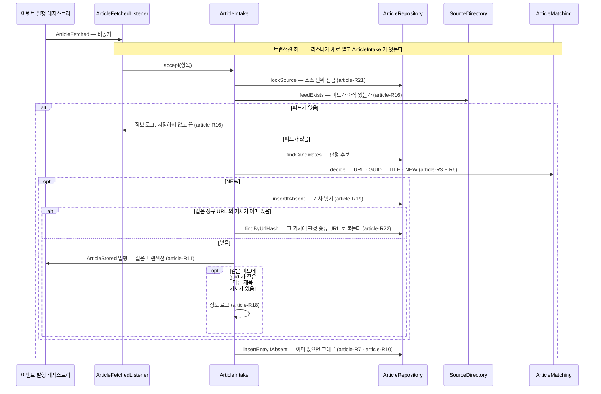
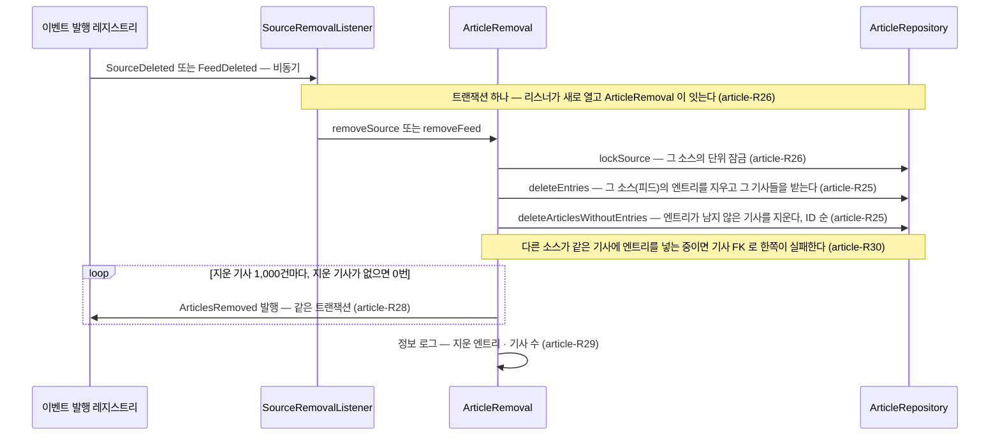

# article 모듈 Spec

공통 구조와 쓰는 규칙은 [specs/README.md](README.md)에 있다.

## 1. 책임과 범위

`article` 은 수집한 항목이 같은 기사인지 판정해 기사를 한 건으로 저장하고, 어느 피드에서 언제 봤는지를 남긴다.

- **같은 기사 판정 · 중복 제거** — 정규 URL 을 주 키로, guid · 제목 비교 키를 보조 키로 판정한다(article-R3)
- **기사 저장** — 새 기사는 처음 받은 값으로 저장하고 `ArticleStored` 를 발행한다(article-R19 · article-R11)
- **피드별 기록** — 같은 기사로 판정한 항목도 버리지 않고 기사 · 피드마다 한 번 기록한다(article-R7)
- **엔트리 집계** — 피드별 기록을 집계 기간 · 칸마다 세어 운영 기능의 공개 API `ArticleAdministration` 으로 낸다(article-R13 · article-R14). 세는 것은 중복률 · 날짜 추정 비율 · 제목 판정 비율 · guid 재사용이다
- **지운 소스 · 피드의 기사 삭제** — 운영자가 소스 · 피드를 지우면 그 소스(피드)의 엔트리와 엔트리가 남지 않은 기사를 지우고, 지운 기사를 `ArticlesRemoved` 로 알린다(article-R15). 삭제 전에 함께 지워질 기사 수를 공개 API 로 센다(article-R31). 지운 피드의 늦은 항목은 저장하지 않는다(article-R16)
- **기사 조회** — 다른 모듈이 기사의 내용과 엔트리를 공개 조회 `ArticleDirectory` 로 읽는다. 화면이 기사 한 줄로 보이는 헤드라인은 엔트리의 출처 이름을 엮어 낸다(article-R17)
- **(미구현)** 본문 추출 — 자리만 있고 v1 에서는 하지 않는다(article-R12)

하지 않는 것:

- 피드를 받거나 정규화하지 않는다. `source` 가 정규화한 기사(`ArticleFetched`)를 받는다
- 다른 소스가 전재한 기사나 같은 사건의 다른 기사를 합치지 않는다(article-R6)
- 기사를 평가하지 않는다. 평가 대기 상태도 갖지 않는다

다른 모듈과의 의존과 주고받는 이벤트는 [overview.md §5](../overview.md#5-모듈-지도)에 있다.

## 2. 용어

기사(Article)는 [overview.md §8](../overview.md#8-용어)에 있다.

| 용어 | 뜻 |
|---|---|
| 정규 URL | 기사 링크를 자원을 바꾸지 않는 변환으로만 맞춘 URL(article-R1). 같은 기사 판정의 주 키이고 원문 링크로도 쓴다 |
| 제목 비교 키 | 같은 기사 판정의 보조 키로 쓰는 제목의 정규형(article-R2) |
| 엔트리 | 기사 하나를 피드 하나에서 본 기록(`article_feed_entries` 한 행). 그 피드의 소스를 함께 남기고, 기사의 소스는 엔트리들이 가리키는 소스들이다(article-R7) |
| 판정 종류 | 엔트리가 기사를 새로 만들었는지(`NEW`), 어떤 판정으로 기존 기사에 붙었는지(`URL` · `GUID` · `TITLE`) |
| 집계 기간 · 칸 | 엔트리를 세는 기간과 그 기간을 같은 길이로 빈틈없이 나눈 구간(article-R32) |
| 중복률 | 엔트리 가운데 중복의 비율(article-R34 · article-R38). 그 피드가 처음 실은 기사 가운데 이미 다른 피드에서 저장된 기사의 비율이다 |
| 날짜 추정 비율 | 엔트리 가운데 발행 시각을 추정한 것의 비율(article-R36 · article-R38) |
| 제목 판정 비율 | 엔트리 가운데 판정 종류가 `TITLE` 인 것의 비율(article-R35 · article-R38) |
| guid 재사용 | 같은 피드 · 같은 guid 의 엔트리가 다른 기사에 먼저 있는데 새 기사가 된 엔트리(article-R18 · article-R37) |
| 헤드라인 | 화면이 기사 한 줄로 보이는 정보(article-R23) |
| L1 · L2 · L3 · L4 | 같은 기사 판정의 단계 — L1 정규 URL · guid, L2 이 소스가 이미 받은 기사와 제목이 같음, L3 다른 소스의 전재, L4 같은 사건의 다른 기사. `article` 은 L1 · L2 만 합친다 |

## 3. 공개 인터페이스

모듈 최상위 패키지 `net.yozmnews.article` 의 공개 타입은 아래와 같다 — 식별자, 새 기사 · 지운 기사 이벤트, 기사 조회의 공개 API `ArticleDirectory` 와 그 값 타입, 운영 기능의 공개 API `ArticleAdministration` 과 그 결과 타입.

받는 이벤트는 `source` 의 `ArticleFetched` · `SourceDeleted` · `FeedDeleted` 이고, `source` 의 공개 조회 `SourceDirectory` 로 피드가 아직 있는지 묻는다([source Spec §3](source.md#3-공개-인터페이스)).

HTTP 엔드포인트: 없음.

### ArticleId

기사 식별자 — `articles.id` 다.

```java
public record ArticleId(long value) {}
```

| 필드 | 뜻 | 제약 |
|---|---|---|
| `value` | `articles.id` | 1 이상 — 아니면 생성자가 `IllegalArgumentException` 을 던진다 |

관련 규칙: 없음.

### ArticleStored

새 기사를 저장했다(article → event · tag).

```java
public record ArticleStored(ArticleId articleId) {}
```

| 필드 | 뜻 | 제약 |
|---|---|---|
| `articleId` | 새로 저장한 기사. 기사 내용은 싣지 않고 기사 ID 만 싣는다 | null 이 아니다 |

- 계약
  - 발행 시점은 article-R11 이다. 기사 행과 발행이 함께 커밋된다
  - 기사 하나에 많아야 한 번 나간다. 아래 경우에는 나가지 않는다
    - 같은 기사로 판정된 항목
    - 같은 `ArticleFetched` 를 다시 처리한 경우(article-R10)
    - 다른 소스가 같은 정규 URL 의 기사를 먼저 저장해 거기에 붙은 경우(article-R22)
  - 소비 모듈이 생기기 전에 저장된 기사는 이 이벤트를 받지 못한다. 리스너가 없는 발행은 남지 않는다
  - 저장된 기사는 운영자가 그 기사를 가진 소스 · 피드를 모두 지워 엔트리가 남지 않으면 지워지고, `ArticlesRemoved` 로 알린다(article-R25 · article-R28)

관련 규칙: article-R9 · article-R10 · article-R11.

### ArticlesRemoved

기사를 지웠다(article → tag · evaluation · event · digest · user). 운영자가 소스 · 피드를 지워 엔트리가 남지 않은 기사다.

```java
public record ArticlesRemoved(List<ArticleId> articleIds) {}
```

| 필드 | 뜻 | 제약 |
|---|---|---|
| `articleIds` | 지운 기사. ID 순이다 | 비어 있지 않고 중복이 없다. 아니면 생성자가 `IllegalArgumentException` 을 던진다 |

- 계약
  - 발행 시점 · 한 이벤트에 싣는 수 · 발행하지 않는 때는 article-R28 이다. 기사 행 삭제와 발행이 함께 커밋된다
  - 다른 소스 · 피드의 엔트리가 남은 기사는 지우지 않으므로 싣지 않는다(article-R25)
  - 기사를 ID 로 가리키는 모듈은 이 이벤트로 자기 행을 지운다([ADR-0060](../adr/0060-article-deletion-announced-by-removed-article-ids-and-followed-by-referencing-modules.md))

관련 규칙: article-R15.

### ArticleDirectory · ArticleContent · ArticleEntryView · ArticleHeadline

기사 조회다. 다른 모듈이 기사의 내용 · 엔트리와 헤드라인을 읽고, 처음 본 시각으로 기사를 찾는다. 구현은 `application` 의 `ArticleDirectoryService` 다.

```java
public interface ArticleDirectory {
    Map<ArticleId, ArticleContent> findAll(Collection<ArticleId> ids);
    Map<ArticleId, ArticleHeadline> headlines(Collection<ArticleId> ids);
    List<ArticleId> firstSeenSince(Instant since);
    Map<ArticleId, Set<SourceId>> sources(Collection<ArticleId> ids);
    Map<ArticleId, Instant> publishedAt(Collection<ArticleId> ids);
}

public record ArticleContent(ArticleId id, String title, @Nullable String summary, URI canonicalUrl,
        Instant publishedAt, List<ArticleEntryView> entries) {}

public record ArticleEntryView(SourceId sourceId, FeedId feedId, List<String> categories) {}

public record ArticleHeadline(ArticleId id, String title, List<String> sources, Instant publishedAt,
        URI canonicalUrl) {}
```

| 타입 · 멤버 | 뜻 |
|---|---|
| `findAll` | 기사들의 내용. 없는(지운) 기사는 결과에 없고, 빈 입력이면 빈 맵이다 |
| `headlines` | 기사들의 헤드라인(article-R23). 없는(지운) 기사는 결과에 없고, 빈 입력이면 빈 맵이다 |
| `ArticleHeadline.sources` | 출처 이름(article-R24). 비어 있을 수 있다 |
| `firstSeenSince` | 처음 본 시각(`first_seen_at`)이 `since` 이상인 기사의 ID. ID 순이다 |
| `publishedAt` | 기사들의 발행 시각. `ArticleContent.publishedAt` 과 같은 값을 내용 전체를 읽지 않고 질의 하나로 읽는다. 없는(지운) 기사는 결과에 없고, 빈 입력이면 빈 맵이다 |
| `sources` | 기사들의 엔트리가 가진 소스. 엔트리가 없는(지운) 기사는 결과에 없고, 빈 입력이면 빈 맵이다 |
| `ArticleContent.summary` | 저장된 RSS 요약문. 없으면 null 이다 |
| `ArticleContent.canonicalUrl` | 기사의 정규 URL(article-R1). 언제나 http · https 다 |
| `ArticleContent.publishedAt` | 기사의 발행 시각. 처음 저장한 값이고(article-R19), 해석하지 못한 항목이면 받은 시각이다(source-R40). 추정했는지는 내지 않는다 |
| `ArticleContent.entries` | 기사의 엔트리. 받은 시각 순이고, 같으면 피드 ID 순이다 |
| `ArticleEntryView.categories` | 그 피드에서 처음 본 항목의 RSS 카테고리. 피드 순서 그대로다 |

- 계약
  - 트랜잭션을 열지 않는다. `firstSeenSince` · `sources` · `publishedAt` 은 질의 하나다
  - `findAll` 은 엔트리 · 기사 두 질의로 읽고, 각 질의는 그 순간의 값이다. 엔트리를 먼저 읽으므로 두 질의 사이에 지운 기사는 결과에서 빠진다
  - `first_seen_at` 에는 인덱스가 없어 `firstSeenSince` 는 표 전체를 읽는다. 드문 운영 연산(체계 변경 · 사건 묶기 채우기)이 부른다
  - `findAll` 은 출처 이름 · 피드 섹션을 담지 않는다. 그것은 `source` 의 공개 조회가 낸다
  - `headlines` 는 `findAll` 한 번과 `source` 의 `FeedLabels.labels` 한 번으로 출처 이름을 엮는다. 두 질의 사이에 지운 기사 · 피드는 결과 · 이름에서 빠진다

부르는 쪽:

- `headlines` — 운영자 화면(`admin`)과 독자 화면(`reader`)이 기사 한 줄을 그리고, 변화 리포트의 재료 조립이 사건 줄의 대표 기사 제목을 읽는다
- `firstSeenSince` — `tag` 가 체계를 바꿀 때 재평가 대상을, `event` 가 사건 묶기 채우기 대상을 고른다
- `publishedAt` — 다이제스트 후보 선별이 발행 시각 하한 · 순위에 쓴다
- `sources` — `event` 가 기간 집계의 서로 다른 소스 수를 센다

관련 규칙: article-R7 · article-R8 · article-R17.

### ArticleAdministration

기사 쪽 운영 기능이다. 운영자 화면이 부르고, 구현은 `application` 의 `ArticleAdministrationService` 다.

```java
public interface ArticleAdministration {
    EntryStatistics entryStatistics();
    long exclusiveArticleCount(SourceId sourceId);
    long exclusiveArticleCount(SourceId sourceId, FeedId feedId);
}
```

| 멤버 | 뜻 |
|---|---|
| `entryStatistics()` | 지금 기준 최근 집계 기간의 피드별 · 칸별 엔트리 개수(article-R13) |
| `exclusiveArticleCount(SourceId)` | 지금 기준 그 소스만 가진 기사 수(article-R31). 소스를 지우면 함께 지워진다 |
| `exclusiveArticleCount(SourceId, FeedId)` | 지금 기준 그 소스의 그 피드만 가진 기사 수(article-R31). 피드를 지우면 함께 지워진다 |

- 계약
  - 질의 하나로 센다. 트랜잭션을 열지 않고, 기다리지 않는다
  - 기간 안에 엔트리가 없는 피드는 결과에 없다. `EntryStatistics.feed` 가 빈 칸들로 답한다
  - 기사 수는 센 순간의 값이라, 수집이 돌면 삭제 전에 바뀔 수 있다. 없는 소스 · 피드, 소스와 맞지 않는 피드는 0 이다

관련 규칙: article-R13 · article-R14 · article-R15.

### EntryStatistics · FeedEntryStatistics · EntryBucket · EntryCounts

엔트리 집계(article-R13)의 값.

```java
public record EntryStatistics(Instant from, Instant to, List<EntryBucket> buckets,
        Map<FeedId, List<EntryCounts>> countsByFeed) {
    public FeedEntryStatistics feed(FeedId feed);
    public FeedEntryStatistics combined(Collection<FeedId> feeds);
}

public record FeedEntryStatistics(List<EntryCounts> buckets) {
    public EntryCounts total();
}

public record EntryBucket(Instant from, Instant to) {}

public record EntryCounts(int entries, int duplicates, int urlMatches, int titleMatches, int estimated,
        int guidReuses) {
    public static final EntryCounts NONE = new EntryCounts(0, 0, 0, 0, 0, 0);
    public EntryCounts plus(EntryCounts other);
    public @Nullable Double duplicateRate();
    public @Nullable Double estimatedRate();
    public @Nullable Double titleMatchRate();
}
```

| 타입 · 멤버 | 뜻 | 제약 |
|---|---|---|
| `EntryStatistics` | 집계 결과. 기간의 시작(포함)과 끝(제외, 집계한 시각), 칸, 기간 안에 엔트리가 있는 피드의 칸별 개수다 | 칸이 시작에서 끝까지 빈틈없이 잇고, 피드마다 칸 수와 같은 길이 · 같은 순서다. 아니면 `IllegalArgumentException` |
| `feed(FeedId)` | 피드 하나의 칸별 개수. 엔트리가 없으면 모든 칸이 `NONE` 이다 | — |
| `combined(Collection<FeedId>)` | 피드 여럿의 칸별 합. 같은 칸끼리 `plus` 한다 | — |
| `FeedEntryStatistics` | 칸별 개수와 기간 전체. `total()` 은 칸을 모두 더한 값이다 | 칸은 `EntryStatistics.buckets` 와 같은 순서 |
| `EntryBucket` | 칸 하나의 범위. 시작 포함, 끝 제외다 | 시작이 끝보다 앞선다 |
| `EntryCounts` | 여섯 수(`entries` · `duplicates` · `urlMatches` · `titleMatches` · `estimated` · `guidReuses`)와 비율 셋이다(article-R33 ~ article-R38). 비율 산식의 정본이다(article-R39) | 아래 목록. 어기면 `IllegalArgumentException` |

`EntryCounts` 의 제약:

- 모두 0 이상이다
- `duplicates` · `estimated` 는 `entries` 이하다
- `urlMatches` + `titleMatches` 는 `duplicates` 이하다. 나머지는 판정 종류 `GUID` 다
- `guidReuses` 는 `entries` − `duplicates` 이하다

관련 규칙: article-R13 · article-R14.

## 4. 내부 구조

### 개관

패키지와 그 책임:

- (최상위) — 공개 API `ArticleDirectory` · `ArticleAdministration` 과 그 값 · 결과 타입, 식별자 · 이벤트
- `application` — 아래 넷
  - `source` 의 `ArticleFetched` · `SourceDeleted` · `FeedDeleted` 를 받는 리스너
  - 항목 하나를 판정 · 저장 · 기록하는 유스케이스
  - 지운 소스 · 피드의 기사를 지우는 유스케이스
  - 공개 조회 · 공개 운영 API 의 구현
- `domain` — 같은 기사 판정의 키와 판정 규칙, 기사 저장소, 엔트리 집계의 기간 · 칸과 집계 조회, 헤드라인의 출처 이름 엮기
- `adapter/out/persistence` — 기사 저장소 · 집계 조회의 JdbcClient 구현

과정마다의 협력:

- **항목 하나 처리** — `ArticleFetchedListener` 가 받은 `ArticleFetched` 를 `ArticleIntake` 가 한 트랜잭션에서 소스 잠금 안에 판정 · 저장 · 기록하고, 새 기사면 `ArticleStored` 를 발행한다(article-R3 ~ R11 · article-R16). 판정 키(`CanonicalUrl` · `TitleKey` · `KeyHash`)는 들어온 항목(`IncomingItem`)을 만들 때 계산한다. 순서는 아래 "항목 하나 처리"다
- **지운 소스 · 피드의 기사 삭제** — `SourceRemovalListener` 가 받은 `SourceDeleted` · `FeedDeleted` 를 `ArticleRemoval` 이 한 트랜잭션에서 같은 소스 잠금 안에 지우고, 지운 기사를 `ArticlesRemoved` 로 발행한다(article-R15). 순서는 아래 "지운 소스 · 피드의 기사 삭제"다
- **엔트리 집계** — `ArticleAdministrationService` 가 `EntryWindow` 로 기간을 잡고 `EntryStatisticsRepository` 로 세어 `EntryWindow.statistics` 로 모은다(article-R13)
- **삭제 전 기사 수** — `ArticleAdministrationService` 가 `ArticleRepository` 의 질의 하나로 센다(article-R31)
- **기사 조회** — `ArticleDirectoryService` 가 `ArticleRepository` 로 읽는다. 헤드라인은 `source` 의 `FeedLabels` 로 읽은 출처 이름을 `HeadlineSources` 로 엮는다(article-R17)

#### 항목 하나 처리



#### 지운 소스 · 피드의 기사 삭제



### 들어오는 쪽

| 진입점 | 계기 | 멱등성 · 겹침 방지 | 실패 처리 |
|---|---|---|---|
| `ArticleFetchedListener`(`application`) | `source` 의 `ArticleFetched` | 다시 처리해도 결과가 같다(article-R10). 같은 소스의 처리는 소스 단위 잠금으로 줄을 선다(article-R21) | 비동기 · 새 트랜잭션이고 이벤트 발행 레지스트리에 기록된다(Spring Modulith `@ApplicationModuleListener`). 처리가 실패한 발행은 `platform` 의 이벤트 재처리 작업([platform Spec 들어오는 쪽](platform.md#들어오는-쪽))이 다시 처리한다 |
| `SourceRemovalListener`(`application`) | `source` 의 `SourceDeleted` · `FeedDeleted` | 다시 처리해도 결과가 같다(article-R27). 같은 소스 단위 잠금 안에서 한다(article-R26) | 위와 같다 |

컨트롤러 · 반복 작업은 없다.

### `application`

- `ArticleIntake` — 들어온 항목 하나를 한 트랜잭션에서 판정 · 저장 · 기록한다(article-R7 ~ R11 · article-R16). 순서는 그림 "항목 하나 처리"다
- `ArticleRemoval` — 지운 소스 · 피드의 엔트리와 엔트리가 남지 않은 기사를 한 트랜잭션에서 지우고 `ArticlesRemoved` 를 발행한다(article-R15). 한 이벤트에 싣는 수의 정본 `MAX_IDS_PER_EVENT` 를 갖는다(article-R28). 순서는 그림 "지운 소스 · 피드의 기사 삭제"다
- `ArticleFetchedListener` · `SourceRemovalListener` — 리스너(들어오는 쪽)
- `ArticleDirectoryService` — 공개 API `ArticleDirectory` 의 구현. 트랜잭션 · 역할 애너테이션이 없어 두 역할 공통이다
- `ArticleAdministrationService` — 공개 API `ArticleAdministration` 의 구현. 트랜잭션 · 역할 애너테이션이 없어 두 역할 공통이다(article-R13 · article-R31)

### `domain`

- 저장 단위: aggregate 가 없다. 기사와 엔트리는 저장소 `ArticleRepository` 가 쓰고 지우고 읽으며, 소스 잠금도 이 저장소가 건다. 갱신은 없다(article-R7 · article-R19 · article-R21 · article-R25)
- `ArticleMatching` — 같은 기사 판정 규칙의 정본(article-R3 ~ article-R6)
- `HeadlineSources` — 헤드라인의 출처 이름 엮기의 정본(article-R24)
- `CanonicalUrl` — 정규 URL(article-R1)
- `TitleKey` — 제목 비교 키(article-R2)
- `KeyHash` — 길이 상한이 없는 키(정규 URL · 제목 비교 키 · guid)의 SHA-256. 인덱스와 비교에 쓴다
- `EntryWindow` — 엔트리 집계 기간 · 칸 길이의 정본(article-R32). 기간을 잡고 칸을 나누며, 집계 조회의 행을 결과로 모은다. 칸 번호가 범위 밖이거나 같은 칸이 두 번이면 크게 실패한다
- `EntryStatisticsRepository` — 엔트리 집계 조회. 기간 안 엔트리를 피드 · 칸마다 세고, 읽기만 한다(article-R13)
- 그 밖의 값: `IncomingItem` · `MatchCandidates` · `MatchDecision` · `MatchKind` · `TimeRange` · `EntryStatisticsRepository.EntryCountRow`(피드 하나의 칸 하나에서 센 개수)

### 나가는 쪽

외부 의존은 본문 추출의 포트 `ContentExtractor` 하나이고, 아직 구현되지 않았다. 그 밖의 외부 의존은 없다.

#### `ContentExtractor`

**(미구현)** 본문 추출(article-R12)의 포트. 아직 코드가 없다. 설계 초안의 시그니처:

```java
public interface ContentExtractor {
    Optional<ExtractedContent> extract(ArticleRef article);
}
```

설계는 v1 구현을 아무것도 추출하지 않는 구현으로 두고, 소스별로 켤 수 있게 한다.

#### 저장소 구현

- `JdbcArticleRepository` — `ArticleRepository` 의 PostgreSQL 구현(JdbcClient). 소스 잠금은 트랜잭션 범위 advisory lock 이다. 삭제는 엔트리를 지우는 질의와 엔트리가 남지 않은 기사를 지우는 질의 둘이고, 지운 기사 ID 를 정렬해 돌려준다. 내용 읽기는 엔트리 · 기사 질의 둘이다. 갱신하지 않는다
- `JdbcEntryStatisticsRepository` — `EntryStatisticsRepository` 의 PostgreSQL 구현(JdbcClient). 질의 하나가 세는 규칙의 정본이다(article-R13)

#### 신뢰할 수 없는 입력

같은 기사 판정의 입력(`ArticleFetched`)은 `source` 가 정규화한 값이다. 신뢰할 수 없는 피드 입력의 방어는 [source Spec](source.md#피드-xml-입력)에 있다.

## 5. 규칙과 불변식

### 판정 키

판단의 이유는 [ADR-0032](../adr/0032-same-article-matching-avoids-false-merges-with-per-feed-entries-under-source-lock.md)에 있다.

- **article-R1** — 정규 URL 은 자원을 바꾸지 않는 변환만 한다. 입력은 `FetchedArticle.isWebUrl` 을 만족하는 링크다.
  - 바꾸는 것
    - 스킴과 호스트를 소문자로 바꾼다
    - 기본 포트(http 80 · https 443)를 지운다
    - 빈 경로는 `/` 로 둔다
    - 프래그먼트를 지운다
    - 추적 파라미터를 지운다
    - 남은 질의가 비면 `?` 도 없앤다
  - 추적 파라미터는 이름이 `utm_` 으로 시작하거나 `fbclid` · `gclid` · `dclid` · `gbraid` · `wbraid` · `msclkid` · `yclid` · `igshid` · `mc_cid` · `mc_eid` 인 질의 조각이다. 이름의 대소문자는 가리지 않는다
  - 그대로 두는 것
    - 사용자 정보(`user@`)
    - 경로
    - 남은 질의 조각의 순서 · 값 · 퍼센트 인코딩(빈 조각 포함)
    - http 와 https, `www.` 의 있고 없음. 서로 맞추지 않는다
- **article-R2** — 제목 비교 키는 제목을 유니코드 NFKC 정규화하고, 소문자(로캘 무관)로 바꾸고, 공백 문자(ASCII 공백류와 유니코드 구분 문자)를 모두 지운 값이다. 공백 · 전각/반각 · 대소문자만 다른 같은 제목은 같은 키가 된다. 말머리 · 구두점은 지우지 않는다. 키가 빈 항목(공백 문자만의 제목)의 판정은 article-R3 의 3 · 4 가 정한다

### 같은 기사 판정

정규 URL 이 판정의 주 키이고 guid · 제목은 보조 키다. 판단의 이유는 [ADR-0032](../adr/0032-same-article-matching-avoids-false-merges-with-per-feed-entries-under-source-lock.md) · [ADR-0052](../adr/0052-article-sources-live-in-feed-entries-and-late-items-of-deleted-feeds-are-dropped.md) · [ADR-0217](../adr/0217-title-matching-takes-an-article-seen-in-the-feed-when-the-item-repeats-its-read-published-time.md)에 있다.

- **article-R3** — 판정 순서. 처음 맞는 것으로 정한다.
  1. 정규 URL 이 기사의 정규 URL 과 같다 → `URL`
  2. 정규 URL 이 엔트리에 남은 항목 URL 과 같다 → `URL`(여럿이면 기사 ID 가 가장 작은 것)
  3. (제목 비교 키가 비지 않을 때) 같은 피드에 guid 가 같은 엔트리가 있고 그 기사와 제목 비교 키도 같다 → `GUID`(여럿이면 기사 ID 가 가장 작은 것)
  4. (제목 비교 키가 비지 않을 때) 이 소스의 엔트리가 있는 기사 가운데 article-R5 가 후보로 두는 기사의 제목 비교 키가 같고 발행 시각 차가 48시간(`ArticleMatching.TITLE_WINDOW`) 이하(경계 포함)다 → `TITLE`. 여럿이면 발행 시각 차가 가장 작은 것, 같으면 기사 ID 가 가장 작은 것(먼저 저장된 기사)이다. 다른 소스가 먼저 저장한 기사도 이 소스의 다른 피드가 붙었으면 후보다
  5. 그 밖에는 새 기사 → `NEW`
- **article-R4** — guid 가 같은 항목의 처분을 덮는다. 같은 기사로 보는 조건(제목 비교 키도 같다)은 article-R3 의 3 에 있다. 하위 규칙: article-R18.
- **article-R5** — 제목 판정(article-R3 의 4)은 이 피드에서 이미 본 기사를 후보에서 뺀다. 다만 항목과 그 기사가 모두 발행 시각을 추정하지 않았고 발행 시각이 같으면 후보로 둔다. 기사 쪽의 발행 시각과 추정 여부는 처음 저장한 값이다(article-R19). 이렇게 붙은 항목은 그 기사 · 피드의 엔트리가 이미 있어 엔트리를 새로 남기지 않는다(article-R7)
- **article-R6** — L1 · L2(article-R3 의 1 ~ 4)만 같은 기사를 한 건으로 합친다. 다른 소스가 같은 기사를 전재한 경우(L3, 통신사 기사 등)와 같은 사건을 다룬 서로 다른 기사(L4)는 합치지 않는다. 그 기사들은 사건 묶기가 사건으로 묶는다([overview.md §5](../overview.md#5-모듈-지도), 단계의 설계는 [event Spec](event.md))
- **article-R18** — 항목의 제목 비교 키가 비지 않고 같은 피드에 guid 가 같은 엔트리가 있는데, 제목 비교 키가 달라 새 기사로 저장하면 정보 로그를 남긴다. 이 항목의 엔트리는 판정 종류 `NEW` 로 남아, 같은 피드 · 같은 guid 의 엔트리가 서로 다른 기사에 있게 된다. 이 모양을 엔트리 집계가 guid 재사용으로 센다(article-R37)

### 저장과 기록

- **article-R7** — 들어온 항목은 버리지 않는다(지운 피드의 늦은 항목은 article-R16). 새 기사든 기존 기사에 붙었든 그 기사 · 피드의 엔트리를 남긴다. 엔트리는 기사 · 피드마다 한 행이고, 이미 있으면 아무것도 바꾸지 않는다. 엔트리는 그 피드의 소스와, 그 피드에서 처음 본 항목의 아래 값을 남긴다.
  - 항목 URL 해시
  - guid
  - 카테고리
  - 발행 시각 추정 여부
  - 판정 종류
  - 받은 시각
- **article-R8** — 기사 행에 남는 값을 덮는다. 하위 규칙: article-R19 · article-R20.
- **article-R9** — 같은 기사 판정이 동시에 돌 때의 차례를 덮는다. 하위 규칙: article-R21 · article-R22.
- **article-R10** — 같은 항목을 다시 처리해도 결과가 같다. 다시 온 항목은 처음과 같은 기사에 걸리고, 엔트리는 다시 기록되지 않는다. 처음과 같은 기사에 거는 것은 아래와 같다.
  - 새 기사 · URL 로 붙은 항목 — 그 정규 URL
  - 제목으로 붙은 항목 — 자기 엔트리의 항목 URL
  - 같은 피드에서 제목으로 붙어 엔트리가 없는 항목(article-R5) — 같은 소스 · 같은 제목 · 같은 발행 시각의 먼저 저장된 후보
  - guid 로 붙은 항목 — 바뀌지 않은 guid 후보
- **article-R11** — 새 기사를 저장했을 때만, 그 트랜잭션 안에서 `ArticleStored` 를 발행한다
- **article-R19** — 기사는 처음 저장한 값이 남는다. 같은 기사의 다른 항목이 와도 제목 · 요약문 · 발행 시각을 고치지 않는다
- **article-R20** — 기사를 처음 발견한 시각(`first_seen_at`)은 그 항목을 받은 수집의 시각(`ArticleFetched.fetchedAt`)이다
- **article-R21** — 같은 소스의 판정은 소스 단위 잠금(트랜잭션 범위)으로 줄을 세운다
- **article-R22** — 다른 소스가 같은 정규 URL 을 동시에 내면 정규 URL 의 고유 제약이 하나만 남기고, 늦은 쪽은 그 기사에 판정 종류 `URL` 로 붙는다

### 헤드라인

- **article-R17** — 헤드라인(`ArticleDirectory.headlines`)의 구성과 출처 이름 엮기를 덮는다. 하위 규칙: article-R23 · article-R24.
- **article-R23** — 헤드라인은 기사의 제목 · 발행 시각 · 정규 URL 과 출처 이름이다. 요약문은 담지 않는다([ADR-0068](../adr/0068-rss-summaries-shown-only-on-operator-screens-and-users-get-processed-information.md))
- **article-R24** — 출처 이름은 기사의 엔트리를 `ArticleContent.entries` 의 순서(받은 시각 순, 같으면 피드 ID 순)로 훑어 그 피드의 출처 이름(`source` 의 `FeedLabels`)을 모은다. 같은 이름은 처음 한 번만 넣고, 이름이 없거나 이름 조회에 없는 피드는 뺀다

### 지운 소스 · 피드

- **article-R15** — 운영자가 소스 · 피드를 지웠을 때 기사 쪽에서 지우는 범위와 그 처리, 삭제 전에 함께 지워질 기사 수를 덮는다. 하위 규칙: article-R25 ~ article-R31.
- **article-R16** — 소스 단위 잠금(article-R21) 뒤 항목의 피드가 `source` 에 없으면(운영자가 그 피드나 소스를 지웠다) 그 항목을 저장하지 않고, 소스 · 피드 ID 를 담은 정보 로그를 남긴다. 숨긴 피드는 있는 피드다. 잠금 안에서 묻으므로, 피드가 있어 저장한 항목은 뒤이어 같은 잠금을 잡는 삭제 처리(article-R26)가 지운다
- **article-R25** — 소스를 지우면(`SourceDeleted`) 그 소스의 엔트리를, 피드를 지우면(`FeedDeleted`) 그 소스의 그 피드의 엔트리를 지운다. 이어서 지운 엔트리의 기사 가운데 엔트리가 하나도 남지 않은 기사를 지운다. 다른 소스 · 다른 피드의 엔트리가 남은 기사는 그 엔트리와 함께 남고, 기사의 처음 값(article-R19)은 바뀌지 않는다
- **article-R26** — 삭제는 한 트랜잭션이고, 그 소스의 단위 잠금(article-R21) 안에서 한다
- **article-R27** — 삭제는 다시 처리해도 결과가 같다. 지울 엔트리가 없으면 0건이다
- **article-R28** — 지운 기사가 있으면 같은 트랜잭션에서 그 ID 를 `ArticlesRemoved` 로 발행한다. 한 이벤트에 1,000건(측정 전)까지 싣고, 넘으면 나눠 여러 번 발행한다. 그 수의 정본은 `ArticleRemoval.MAX_IDS_PER_EVENT` 다. 지운 기사가 없으면 발행하지 않는다
- **article-R29** — 삭제는 지운 엔트리 · 기사 수를 소스 · 피드 ID 와 함께 정보 로그로 남긴다
- **article-R30** — 지우는 사이 다른 소스가 같은 기사에 엔트리를 넣으면 기사 FK 로 한쪽이 실패하고, 이벤트 재처리로 수렴한다. 이 경합에 잠금을 더하지 않는다
- **article-R31** — 삭제 전에 함께 지워질 기사 수는 엔트리가 모두 그 소스(피드를 지울 때는 그 소스의 그 피드)의 것인 기사의 수다. `ArticleAdministration.exclusiveArticleCount` 가 센다

### 엔트리 집계

- **article-R13** — 엔트리 집계의 기간 · 칸과 여섯 수의 세는 법을 덮는다. 세는 규칙의 정본은 §4 의 `JdbcEntryStatisticsRepository` 다. 하위 규칙: article-R32 ~ article-R37.
- **article-R14** — 비율의 산식과 그 정본을 덮는다. 하위 규칙: article-R38 · article-R39.
- **article-R32** — 엔트리 집계는 받은 시각(`seen_at`)이 기간의 시작 이상 끝 미만인 엔트리를 피드 · 칸마다 센다. 기간은 조회 시각(마이크로초로 자른다)에서 거꾸로 7일(`EntryWindow.LENGTH`)이라 시간대가 없다. 칸은 기간을 시작부터 1일(`EntryWindow.BUCKET`)씩 나눈 7개이고, 칸마다 시작 포함 · 끝 제외다
- **article-R33** — 엔트리 수는 행 하나를 하나로 센다. 단위가 (기사, 피드)라, 같은 피드에 다시 실린 항목과 같은 피드에서 같은 기사로 판정된 두 번째 항목은 세지 않는다(article-R7)
- **article-R34** — 중복은 판정 종류가 `NEW` 가 아닌 엔트리(`URL` · `GUID` · `TITLE`)다. 기록되는 중복 엔트리는 다른 피드가 먼저 실은 기사에 붙은 것이다. guid 후보는 같은 피드의 엔트리에서만 나오므로 `GUID` 로 붙은 항목은 엔트리를 새로 남기지 않고, 이 피드에서 본 기사에 제목으로 붙은 항목(article-R5)도 같다
- **article-R35** — URL 판정은 판정 종류가 `URL` 인 엔트리이고, 제목 판정은 판정 종류가 `TITLE` 인 엔트리다
- **article-R36** — 날짜 추정은 그 항목의 발행 시각을 추정한 엔트리다. 기사의 값이 아니라 엔트리의 값으로 센다
- **article-R37** — guid 재사용은 판정 종류가 `NEW` 이고, 같은 피드 · 같은 guid 의 엔트리가 다른 기사에 먼저 있는 엔트리다(article-R18 의 데이터 모양).
  - 먼저는 (받은 시각, 기사 ID) 순이다
  - 먼저 있는 엔트리는 기간 밖이어도 된다
  - 제목 비교 키가 빈 항목도 같은 모양이면 센다
- **article-R38** — 비율은 해당 수 ÷ 엔트리 수다(중복률 · 날짜 추정 비율 · 제목 판정 비율). 엔트리가 없으면 비율이 없다(0 이 아니다). 칸 · 피드를 합칠 때는 개수를 더한 뒤 나누고, 비율의 평균을 내지 않는다
- **article-R39** — 비율 산식의 정본은 `EntryCounts` 하나다. 소비자는 그 값을 옮길 뿐 다시 계산하지 않는다

### 본문 추출

- **article-R12** — **(미구현)** 본문 추출(`ContentExtractor`, §4 나가는 쪽)의 자리만 만들고 v1 은 추출하지 않는다. 켤 때의 원칙:
  - 소스별 허용 목록으로만 켠다. 대상은 이용조건과 robots.txt 의 AI 관련 조항을 확인한 소스로 한정한다
  - 추출한 본문은 다이제스트 생성 입력으로만 쓰고, 짧은 보존 기간 후 삭제한다
  - 화면이나 외부 API 로 본문을 노출하지 않는다

## 6. 데이터

컬럼 타입 · 인덱스 · 제약 문면의 정본은 아래 마이그레이션이다. 둘째 줄부터는 첫 줄과 같은 디렉터리에 있다.

- `backend/src/main/resources/db/migration/V2__articles.sql` — 기사와 엔트리
- `V5__article_feed_entries_seen_at_index.sql` — 엔트리 집계의 인덱스
- `V6__article_feed_entries_source.sql` — 엔트리의 소스. 기사에는 소스 열이 없다

길이 상한이 없는 키(정규 URL · 제목 비교 키 · guid)는 UTF-8 바이트의 SHA-256(32바이트)으로 비교 · 인덱스에 쓴다.

| 테이블 | 주요 컬럼 | 뜻 |
|---|---|---|
| `articles` | id, canonical_url, url_hash(고유), title, title_key_hash, summary_text, author, published_at, published_at_estimated, image_url, first_seen_at | 중복 제거된 기사. 처음 저장한 값이 남는다(article-R19) |
| `article_feed_entries` | article_id, feed_id, source_id, item_url_hash, guid, guid_hash, feed_categories(목록), published_at_estimated, match_kind(`NEW`/`URL`/`GUID`/`TITLE`), seen_at | 어떤 소스의 어떤 피드에서 언제 봤는지. 중복 제거와 기사의 소스의 근거다 |

`articles` 의 컬럼:

- 소스는 기사에 두지 않는다. 엔트리들이 가리킨다
- `canonical_url` 은 정규 URL(원문 링크)이고 `url_hash` 는 그 SHA-256 이다. 고유 제약이 article-R22 의 경합을 가른다
- `title_key_hash` 는 제목 비교 키의 SHA-256 이다. (제목 비교 키, 발행 시각) 인덱스가 제목 판정의 후보를 찾는다
- `summary_text` 는 RSS 요약문(최대 1,000 코드 포인트), `image_url` 은 썸네일 URL, `first_seen_at` 은 처음 발견한 시각(article-R20)이다
- 평가 상태는 평가 쪽이 갖는다

`article_feed_entries` 의 컬럼:

- (article_id, feed_id) 는 고유하다. 그 피드에서 처음 본 항목의 값이고 다시 보면 바꾸지 않는다(article-R7)
- `source_id` 는 그 피드의 소스다. (source_id, article_id) 인덱스가 제목 판정의 범위(article-R3 의 4)와 지운 소스의 엔트리(article-R25)를 찾는다
- `item_url_hash` 는 그 항목의 정규 URL 해시이고, article-R3 의 2 가 대조한다
- `guid` · `guid_hash` 는 함께 있거나 함께 없다(제약)
- `published_at_estimated` 는 그 항목의 발행 시각을 추정했는지, `match_kind` 는 판정 종류다
- 엔트리 집계는 `seen_at` 범위로 센다. `seen_at` 인덱스가 그 범위를 찾는다(article-R32)

`source_id` · `feed_id` 는 `source` 의 테이블을 가리키지만 FK 를 두지 않는다. 모듈 사이는 ID 로만 참조한다.

보존 기간은 [data-model.md "보존 정책"](../data-model.md#보존-정책)에 있다.

## 7. 설정

해당 없음.

## 8. 결정

| ADR | 한 줄 |
|---|---|
| [0029](../adr/0029-indefinite-summary-retention-with-optional-deletion.md) | RSS 요약문은 기본 무기한 보존하고, 자동 삭제는 운영 설정으로 켠다 |
| [0032](../adr/0032-same-article-matching-avoids-false-merges-with-per-feed-entries-under-source-lock.md) | 같은 기사 판정은 기사를 잃지 않는 쪽으로 좁히고, 피드별 기록은 (기사, 피드)마다 한 행으로 소스 단위 잠금 안에서 쓴다 |
| [0052](../adr/0052-article-sources-live-in-feed-entries-and-late-items-of-deleted-feeds-are-dropped.md) | 기사의 소스는 피드별 기록이 갖고, 제목 판정은 그 소스의 기록이 있는 기사에서 하며, 지운 피드의 늦은 항목은 버린다 |
| [0060](../adr/0060-article-deletion-announced-by-removed-article-ids-and-followed-by-referencing-modules.md) | 기사 삭제는 지운 기사 ID 이벤트로 알리고, 기사를 가리키는 모듈이 받아 자기 행을 지운다 |
| [0068](../adr/0068-rss-summaries-shown-only-on-operator-screens-and-users-get-processed-information.md) | RSS 요약문은 운영자 화면에만 보이고, 인스턴스 사용자와 외부 API 에는 가공한 정보만 낸다 |
| [0217](../adr/0217-title-matching-takes-an-article-seen-in-the-feed-when-the-item-repeats-its-read-published-time.md) | 제목 판정은 이 피드에서 본 기사라도 읽은 발행 시각이 같으면 후보로 둔다 |
