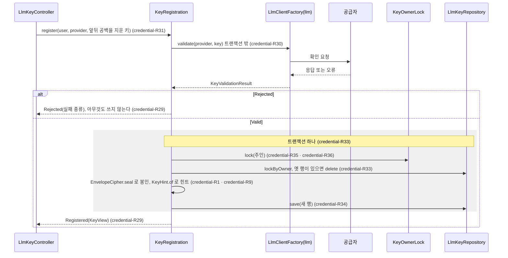
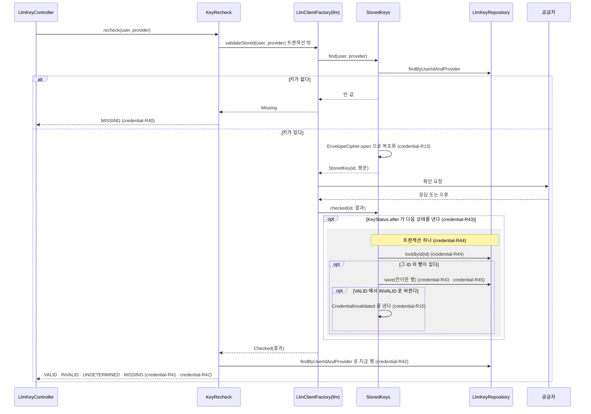
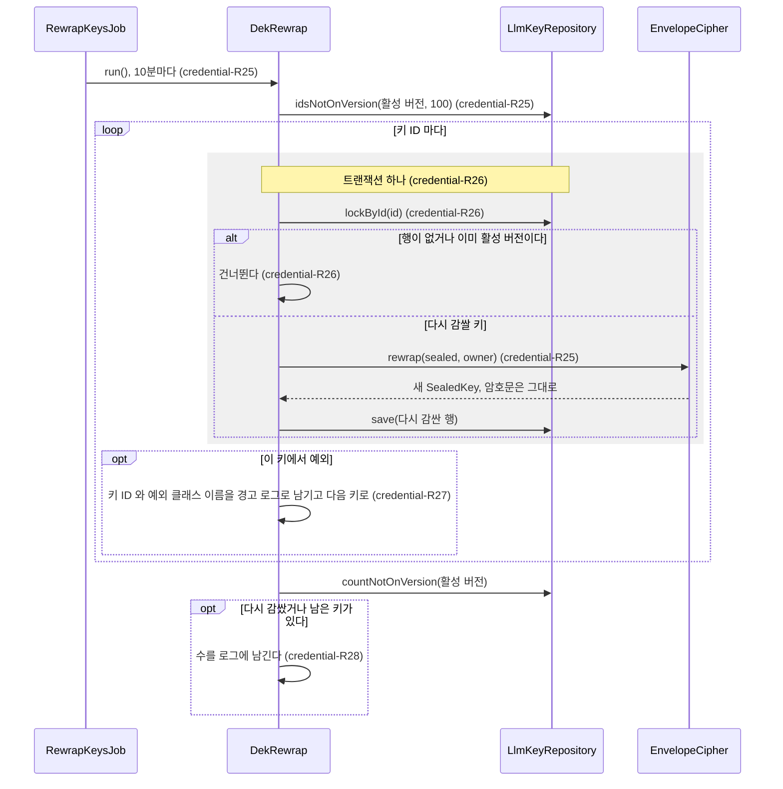
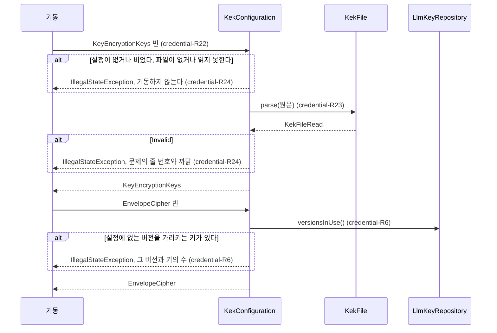

# credential 모듈 Spec

공통 구조와 쓰는 규칙은 [specs/README.md](README.md)에 있다.

## 1. 책임과 범위

`credential` 은 사용자 LLM 키(BYOK)를 암호화해 보관하고, 사용자가 키를 등록 · 다시 검증 · 삭제하게 한다.

- **봉투 암호** — 키마다 무작위 DEK 로 키를 암호화하고, DEK 를 KEK 로 감싸 저장한다. 평문은 저장하지 않는다
- **KEK** — 운영자가 파일로 주는 버전 있는 키. 기동 때 읽어 검사하고, 교체하면 저장된 DEK 를 새 버전으로 다시 감싼다
- **키 등록 · 교체** — `llm` 의 키 검증이 성공할 때만 저장한다. 사용자 × 공급자마다 키 하나다
- **다시 검증** — 저장한 키를 `llm` 의 저장한 키의 길로 확인한다
- **상태와 무효 알림** — 키의 상태(`VALID` · `INVALID`)를 저장한 키로 공급자에 물은 결과(다시 검증 · 생성 호출)로 전이하고, 무효가 되는 전이마다 `CredentialInvalidated` 를 낸다
- **저장한 키의 공급** — `llm` 이 선언한 공급 인터페이스 `StoredKeySource` 를 구현해, `llm` 이 물을 때만 키를 복호화해 건넨다
- **키 유무** — 사용자에게 저장한 키가 있는지, 키가 있는 공급자와 쓸 수 있는(`VALID`) 키의 공급자를 답한다
- **(미구현)** 탈퇴한 사용자의 키 삭제

하지 않는 것:

- 공급자에 요청을 보내지 않는다. 검증과 호출은 `llm` 이 한다
- 복호화한 키를 내놓는 공개 API 를 두지 않는다. 평문은 `StoredKeySource` 의 구현을 거쳐 `llm` 에만 간다(credential-R13)
- 키 없는 사용자의 요청을 막지 않는다. 세션 체인의 관문은 `account` 가 맡고, 이 모듈은 키 유무와 키의 공급자를 답하기만 한다
- 알림을 남기지 않는다. 이벤트를 받은 `user` 가 남긴다
- 키 등록 · 다시 검증 경로의 요청 제한을 세지 않는다. 두 처리기에 `platform` 의 요청 제한 표시(`@RequestLimited(LLM_KEY_CHECK)`)를 달 뿐이고, 세고 거부하는 것은 `account` 의 요청 방어다([account Spec](account.md#요청-방어) account-R30 · R32)

다른 모듈과의 의존과 주고받는 이벤트는 [overview.md §5](../overview.md#5-모듈-지도)에 있다.

## 2. 용어

| 용어 | 뜻 |
|---|---|
| 키 | 사용자가 등록한 LLM 공급자의 API 키 |
| 주인 | 키를 가진 사용자와 그 키의 공급자의 짝. 주인마다 키의 수는 credential-R32 가 정한다 |
| DEK | 키 하나를 암호화하는 무작위 키(AES-256). 키마다 새로 만든다 |
| KEK | DEK 를 감싸는 키(AES-256). 운영자가 파일로 주고 버전을 갖는다 |
| 활성 버전 | 설정된 KEK 버전 가운데 가장 큰 번호. 새 DEK 는 이 버전으로 감싼다 |
| 봉인 | 키를 새 DEK 로 암호화하고 그 DEK 를 활성 버전의 KEK 로 감싸는 것 |
| 재암호화 | 키의 암호문은 그대로 두고 저장된 DEK 만 활성 버전의 KEK 로 다시 감싸는 것(credential-R25) |
| 힌트 | 사용자가 어느 키인지 알아보게 하는 키의 끝 4자 |
| 교체 | 키가 있는 주인이 새 키를 등록하는 것 |

## 3. 공개 인터페이스

모듈 최상위 패키지 `net.yozmnews.credential` 의 공개 타입은 공개 API `LlmKeys` 와 이벤트 `CredentialInvalidated` 둘이다.

HTTP 엔드포인트:

| 경로 | 메서드 | 용도 |
|---|---|---|
| `/api/llm-keys` | `GET` | 세션 사용자의 키 목록(credential-R17 · R37) |
| `/api/llm-keys/{provider}` | `PUT` | 키 등록 · 교체(credential-R10 · R11) |
| `/api/llm-keys/{provider}/checks` | `POST` | 다시 검증(credential-R12) |
| `/api/llm-keys/{provider}` | `DELETE` | 키 삭제(credential-R16) |

- 네 경로 모두 세션이 필요하고 사용자 격리 시험에 등록돼 있다([account Spec](account.md#화면용-api-의-공개와-세션-사용자) account-R6)
- 네 경로 모두 키가 없는 세션 사용자에게도 연다(`@AllowedWithoutLlmKey`, account-R5)
- 등록 · 다시 검증은 요청마다 공급자에 한 번 묻는다. 두 경로는 한도 하나를 함께 쓰고, 한도는 세션 사용자와 클라이언트 주소로 센다. 한도를 넘으면 처리기 앞에서 429 다(account-R30 · R32)
- `{provider}` 는 `llm` 의 `Provider` 이름(`OPENAI` · `ANTHROPIC` · `OPENROUTER`)이고 모르는 값은 400 이다
- 판정 결과는 200 이고, 요청 · 응답 형식은 `api/openapi.json` 에 있다

### LlmKeys

사용자의 키 유무와 키가 있는 공급자를 답한다. 두 역할 공통이고 읽기 전용이다.

```java
public interface LlmKeys {
    boolean present(UserId user);
    Set<Provider> providers(UserId user);
    Set<Provider> usable(UserId user);
}
```

- 계약
  - `present` 는 그 사용자에게 키가 있는지다(credential-R46)
  - `providers` 는 그 사용자의 저장한 키가 있는 공급자다(credential-R46). `user` 의 모델 고르기가 쓴다
  - `usable` 은 그 사용자의 쓸 수 있는 키의 공급자다(credential-R47). `user` 의 쓸 모델 판정이 쓴다([ADR-0178](../adr/0178-the-llm-model-to-use-is-decided-at-query-time-from-the-chosen-model-the-allowed-list-and-key-status.md))
  - 집합은 공급자 선언 순으로 돈다(`EnumSet`). 키가 없으면 빈 집합이다
  - 부르는 쪽의 트랜잭션이 있으면 거기에 들고, 없으면 조회 하나로 끝난다

`Provider` 는 `llm` 의 공개 타입이다. `UserId` 는 `platform` 의 공개 타입이다([platform Spec](platform.md#userid)).

관련 규칙: credential-R18

### CredentialInvalidated

키가 무효가 됐다.

```java
public record CredentialInvalidated(UserId user, Provider provider, long keyId, Instant invalidatedAt) { }
```

| 필드 | 뜻 | 제약 |
|---|---|---|
| `user` | 키의 주인인 사용자 | — |
| `provider` | 그 키의 공급자(`llm` 의 `Provider`) | — |
| `keyId` | 무효가 된 키의 ID | 교체하면 새 키는 다른 ID 를 갖는다 |
| `invalidatedAt` | 무효로 바뀐 시각 | 마이크로초까지 |

- 계약
  - 발행 주체는 `credential` 이다. 시점과 횟수는 credential-R15 다
  - 계기와 무관하다. 다시 검증이든 생성 호출이든 저장한 키로 공급자에 물은 결과가 무효이면 낸다(credential-R43)
  - `keyId` 와 `invalidatedAt` 의 짝이 전이 하나를 가리킨다. 받는 쪽은 거듭 받은 발행을 이 짝으로 알아본다
  - 키 · 힌트 · 암호문을 담지 않는다

관련 규칙: credential-R14 · R15

## 4. 내부 구조

### 개관

| 패키지 | 책임 |
|---|---|
| (최상위) | §3 의 공개 타입 |
| `domain/crypto` | 봉투 암호와 KEK. 값 타입 `KeyOwner` · `SealedKey` · `KekFileRead` |
| `domain/key` | 키의 저장 단위, 주인 잠금, 상태 · 힌트 규칙. 조회 값 `KekVersionUse` |
| `adapter/out/persistence` | 주인 잠금의 PostgreSQL 구현 |
| `application` | 유스케이스, 공급 인터페이스와 공개 API 의 구현, KEK 의 기동 적재와 검사, 설정. 결과 타입 `RegistrationOutcome` · `RecheckOutcome` · `KeyView` · `ProviderKey` · `RewrapResult` |
| `adapter/in/web` | 키 처리기와 요청 · 응답 타입 |
| `adapter/in/job` | 재암호화 반복 작업 |

협력은 과정마다 아래와 같다. 그림이 있는 과정의 호출 순서는 그림에 있다.

- **키 등록 · 교체** — `KeyRegistration` 이 받은 키를 트랜잭션 밖에서 `llm` 으로 검증하고, 성공하면 한 트랜잭션에서 주인을 잠근 뒤 옛 행을 지우고 봉인한 새 행을 넣는다(credential-R10 · R11, 그림 "키 등록 · 교체")
- **다시 검증** — `KeyRecheck` 가 `llm` 의 저장한 키의 길을 부르면 `llm` 이 `StoredKeys` 에서 키를 받아 공급자에 묻고 결과를 알린다. 그 뒤 `KeyRecheck` 가 지금 행을 다시 읽어 응답을 짓는다(credential-R12 ~ R14, 그림 "다시 검증")
- **생성 호출의 결과** — `llm` 의 생성 호출도 같은 `StoredKeys` 의 `find` · `checked` 로 키를 받고 결과를 알린다. 이 모듈 쪽 단계는 그림 "다시 검증"의 `find` · `checked` 와 같다(credential-R13 · R14)
- **삭제** — `KeyRemoval` 이 한 트랜잭션에서 주인의 행을 지운다(credential-R16)
- **키 목록 · 키 유무** — `KeyOverview` · `LlmKeysService` 가 저장소를 읽기만 한다(credential-R17 · R18)
- **재암호화** — 작업 역할의 `RewrapKeysJob` 이 `DekRewrap` 을 부르고, `DekRewrap` 은 키마다 자기 트랜잭션에서 행을 잠가 DEK 를 다시 감싼다(credential-R7, 그림 "재암호화")
- **기동 검사** — `KekConfiguration` 이 KEK 파일을 읽어 검사하고 저장된 키의 버전이 모두 설정에 있는지 본 뒤 `EnvelopeCipher` 를 낸다(credential-R5 · R6, 그림 "기동 검사")

그림 "키 등록 · 교체":



그림 "다시 검증":



그림 "재암호화":



그림 "기동 검사":



### 들어오는 쪽

- 기동 시 동작 — `KekConfiguration`
  - 계기: 두 역할의 기동마다 한 번이다(credential-R22)
  - 실패 처리: KEK 의 설정이나 파일이 credential-R24 의 경우이거나 저장된 키의 버전이 설정에 없으면(credential-R6) 기동하지 않는다
- 컨트롤러 — `LlmKeyController`(화면 역할)
  - 사용자는 세션에서 채운 인자로만 받는다([account Spec](account.md#화면용-api-의-공개와-세션-사용자) account-R6)
  - 겹침 방지: 같은 주인의 등록은 주인 잠금에서 차례로 교체한다(credential-R35)
- 반복 작업 — `RewrapKeysJob`(작업 역할)
  - 계기와 주기: `DekRewrap` 한 회차를 부른다. 주기는 credential-R25 다
  - 멱등성: 여러 번 돌아도 결과가 같다(credential-R26)
  - 실패 처리: 재시도하지 않고 다음 회차가 잇는다. 한 키의 실패는 credential-R27 이다
- 이벤트 리스너는 없다

### `application`

- `KeyRegistration` — 키 등록 · 교체(credential-R10 · R11). 트랜잭션 경계는 credential-R30 · R33 이다
- `KeyRecheck` — 다시 검증. 트랜잭션이 없다(credential-R12)
- `KeyRemoval` — 키 삭제. 트랜잭션 하나다(credential-R16)
- `KeyOverview` — 세션 사용자의 키 목록(credential-R17)
- `StoredKeys` — `llm` 의 공급 인터페이스 `StoredKeySource` 의 구현. 이 모듈에서 그 인터페이스를 아는 유일한 구성 요소다(credential-R13 ~ R15). `find` 는 트랜잭션을 열지 않고, `checked` 의 트랜잭션 경계는 credential-R44 다
- `LlmKeysService` — `LlmKeys` 의 구현(credential-R18)
- `DekRewrap` — 재암호화 한 회차(credential-R7). 트랜잭션 경계는 credential-R26 이다
- `KekConfiguration` — KEK 파일을 읽어 검사하고 `KeyEncryptionKeys` 와 `EnvelopeCipher` 빈을 낸다. 역할 애너테이션이 없어 두 역할 모두 한다(credential-R5 · R6)
- `CredentialProperties` — 설정 `yozmnews.credential`(§7)

### `domain`

- `StoredLlmKey` — 키 aggregate(`llm_credentials`)와 그 전이(검증 결과 반영 · 재암호화). 문자열 표현은 ID · 공급자 · 상태뿐이다
- `LlmKeyRepository` — 키 저장소. 상태 전이 · 재암호화 · 교체는 행을 잠그고 읽는다(credential-R44 · R26 · R33)
- `KeyOwnerLock` — 한 주인의 교체 잠금. 트랜잭션 안에서 잠그고 트랜잭션이 끝나면 풀린다. 구현은 `adapter/out/persistence` 의 `JdbcKeyOwnerLock` 이다(credential-R35 · R36)
- `EnvelopeCipher` — 봉투 암호의 정본. 봉인 · 열기 · 재암호화를 한다(credential-R1 ~ R4). JDK 의 암호 기능만 쓴다
- `KeyEncryptionKeys` — KEK 의 집합. 활성 버전은 가장 큰 번호다. 문자열 표현은 버전 목록뿐이다(credential-R8)
- `KekFile` — KEK 파일 원문의 형식을 판정하는 정본(credential-R23). 문제 문구에 값이 없다(credential-R8)
- `KeyStatus` — 상태 둘과, 검증 결과에서 다음 상태를 정하는 정본(credential-R43)
- `KeyHint` — 힌트 규칙의 정본(credential-R9)

### 나가는 쪽

포트는 없다. 이 모듈은 외부 서비스를 부르지 않고, 공급자에 닿는 일은 `llm` 의 공개 API 로 한다. 주인 잠금(`JdbcKeyOwnerLock`)은 DB 의 트랜잭션 advisory 잠금이다.

`llm` 이 선언한 공급 인터페이스 `StoredKeySource`([llm Spec](llm.md#storedkeysource))는 `StoredKeys` 가 구현한다. 이것은 외부 의존을 가리는 포트가 아니다. `llm` 이 저장한 키를 받으려고 선언하고 이 모듈이 구현하는 모듈 사이의 인터페이스다.

신뢰할 수 없는 입력과 그 방어 규칙:

| 입력 | 규칙 |
|---|---|
| 사용자가 넣은 키 | credential-R10 · R19 |
| KEK 파일 | credential-R5 |
| 저장된 암호문 | credential-R4 |

## 5. 규칙과 불변식

### 봉투 암호

판단의 이유는 [ADR-0003](../adr/0003-byok-personalized-digest.md)에 있다.

- **credential-R1** — 키는 봉인해 저장한다. 평문 키와 평문 DEK 는 저장하지 않는다.
  - DEK 는 키마다 `SecureRandom` 으로 새로 만든 32바이트다
  - 키는 그 DEK 로, DEK 는 활성 버전의 KEK 로 AES-256-GCM 암호화한다
  - 난수는 암호화마다 새로 뽑은 12바이트이고 태그는 128비트다
- **credential-R2** — 추가 인증 데이터(AAD)는 주인을 묶는다. 암호문이나 감싼 DEK 를 다른 사용자나 다른 공급자의 행으로 옮기면 열리지 않는다. AAD 는 아래 문자열의 UTF-8 바이트다. 사용자 ID 는 십진수이고 공급자 키는 `Provider.key()` 다.
  - 키의 AAD: `yozmnews:llm-key:v1:{사용자 ID}:{공급자 키}`
  - DEK 의 AAD: `yozmnews:llm-dek:v1:{사용자 ID}:{공급자 키}:{KEK 버전}`
- **credential-R3** — `ciphertext` 의 저장 꼴은 형식 바이트 `0x01`, 난수 12바이트, GCM 출력(암호문과 태그)을 이은 것이다. `encrypted_dek` 도 같은 꼴이라 61바이트다. 형식 바이트가 `0x01` 이 아니면 열지 않는다
- **credential-R4** — 봉인한 키를 열지 못한 경우를 덮는다. 하위: credential-R20 · R21
- **credential-R20** — 아래 경우에는 열기가 `IllegalStateException` 으로 실패한다.
  - 주인이 다르다
  - 변조됐다
  - 손상됐다
  - 형식 바이트를 모른다
  - 설정에 없는 KEK 버전이다
- **credential-R21** — 열기 실패의 문구는 고정 문구와 예외 클래스 이름, 설정에 없는 KEK 버전의 번호로만 이루어지고 키 · 암호문 · KEK 를 담지 않는다

### KEK

판단의 이유는 [ADR-0161](../adr/0161-the-kek-comes-from-a-file-in-the-configuration-directory.md) · [ADR-0162](../adr/0162-neither-role-starts-without-a-well-formed-kek.md) · [ADR-0163](../adr/0163-the-app-does-not-start-when-stored-keys-point-to-a-kek-version-missing-from-the-configuration.md) · [ADR-0164](../adr/0164-kek-rotation-rewraps-deks-in-a-recurring-job-of-the-worker-role.md)에 있다.

- **credential-R5** — KEK 파일을 읽는 때 · 파일의 형식 · 기동 실패를 덮는다. 실패 문구에 KEK 값이 없는 것은 credential-R8 이다. 하위: credential-R22 ~ R24
- **credential-R6** — 저장된 키가 가리키는 KEK 버전이 설정에 없으면 기동하지 않는다. 두 역할 모두 검사한다. 기동 실패의 문구에 그 버전과 그 버전을 가리키는 키의 수가 있다
- **credential-R7** — KEK 교체 뒤의 재암호화를 덮는다. 하위: credential-R25 ~ R28
- **credential-R8** — KEK 는 비밀 값이다. 로그 · 예외 문구 · 문자열 표현에 남지 않는다
- **credential-R22** — KEK 는 설정 `yozmnews.credential.kek-file` 이 가리키는 파일에서 기동 때 한 번 읽는다. 두 역할 모두 읽는다
- **credential-R23** — KEK 파일은 아래 꼴일 때만 맞다.
  - 한 줄에 `버전:Base64` 하나다
  - 버전은 1 이상의 정수이고 겹치지 않는다
  - 값은 표준 Base64 로 풀어 32바이트다
  - 빈 줄과 `#` 로 시작하는 줄은 건너뛴다
  - `버전:Base64` 줄이 하나 이상 있다
  - 원문은 65,536자까지다(`KekFile.MAX_CHARS`)
- **credential-R24** — 아래 경우에는 기동하지 않는다. 기동 실패의 문구에 설정 이름 · 환경 변수 이름 · 경로 · 문제의 줄 번호와 까닭이 있다.
  - 설정이 없거나 비었다
  - 파일이 없거나 읽지 못한다
  - 형식이 credential-R23 에 맞지 않는다
- **credential-R25** — 작업 역할의 반복 작업이 10분(측정 전)마다 한 회차를 돈다. 한 회차는 KEK 버전이 활성 버전이 아닌 키를 `DekRewrap.BATCH` 100(측정 전)개까지 찾아 DEK 를 활성 버전으로 다시 감싼다. 키의 암호문은 바뀌지 않는다
- **credential-R26** — 재암호화는 키마다 트랜잭션 하나이고 그 행을 잠근 뒤 한다. 찾은 뒤 지워진 키와 이미 활성 버전인 키는 건너뛰므로, 회차를 거듭해도 결과가 같다
- **credential-R27** — 한 키의 재암호화가 실패하면 그 키의 ID 와 예외 클래스 이름만 로그에 남기고 다음 키로 간다
- **credential-R28** — 다시 감쌌거나 남은 키가 있는 회차만 다시 감싼 수 · 실패한 수 · 남은 수를 로그에 남긴다

### 등록과 삭제

판단의 이유는 [ADR-0003](../adr/0003-byok-personalized-digest.md) · [ADR-0154](../adr/0154-key-validation-lists-models-and-failure-kinds-are-sorted-by-one-rule-per-provider-reading-the-error-kind.md)에 있다.

- **credential-R9** — 힌트는 키의 끝 4자다. 키가 20자(`KeyHint.MIN_LENGTH`)보다 짧으면 빈 문자열이다
- **credential-R10** — 등록의 검증과 요청의 키를 덮는다. 하위: credential-R29 ~ R31
- **credential-R11** — 주인마다 키 하나와 교체를 덮는다. 하위: credential-R32 ~ R36
- **credential-R16** — 삭제는 그 주인의 행을 곧바로 지운다(물리 삭제). 없는 키의 삭제도 같은 204 다
- **credential-R17** — 키 목록은 공급자 선언 순(`Provider` 의 순서)으로 공급자마다 한 줄이다. 키가 없는 공급자의 줄은 키가 null 이다
- **credential-R19** — 키가 응답 · 문자열 표현 · 로그로 새지 않게 하는 것을 덮는다. 하위: credential-R37 ~ R39
- **credential-R29** — 등록은 `llm` 의 키 검증(`LlmClientFactory.validate`)이 성공할 때만 저장하고 `REGISTERED` 와 저장한 키를 낸다. 검증이 실패하면 아무것도 쓰지 않고 `REJECTED` 와 실패 종류를 낸다. 이미 있던 키는 그대로다
- **credential-R30** — 등록의 키 검증은 트랜잭션 밖에서 한다
- **credential-R31** — 요청의 키는 앞뒤 공백을 지운 값이다. 비었거나 공백뿐이면 본문 형식 400 이다. 그 밖의 꼴(길이 · 문자)은 이 모듈이 보지 않고 `llm` 이 판정한다([llm Spec](llm.md#키-검증) llm-R10)
- **credential-R32** — 주인마다 키는 많아야 하나다(고유 제약)
- **credential-R33** — 교체는 트랜잭션 하나에서 주인의 옛 행을 지우고 새 행을 넣는다
- **credential-R34** — 등록한 키는 새 ID · 새 DEK 이고 상태는 `VALID` 다. 검증 시각과 만든 시각은 저장한 시각이다
- **credential-R35** — 교체 트랜잭션은 먼저 주인을 잠근다(트랜잭션 advisory 잠금). 같은 주인의 등록이 몇이 겹쳐도 그 잠금에서 줄을 서 차례로 교체하므로, 고유 제약에 지는 등록이 없고 다시 하기도 없다
- **credential-R36** — 주인 잠금의 키는 주인(사용자 ID · 공급자)에서 나와 다른 주인은 다른 잠금이다. 두 주인의 잠금 키가 우연히 겹치면 차례를 설 뿐 교체는 틀리지 않는다
- **credential-R37** — 응답이 담는 것은 아래뿐이다. 키의 평문 · 암호문 · 감싼 DEK 와 `llm` 의 운영 로그용 실패 문구는 내지 않는다.
  - 힌트
  - 상태
  - 검증 시각
  - 만든 시각
  - 판정 결과
  - 실패 종류
- **credential-R38** — 요청 본문 타입의 문자열 표현은 키를 숨긴다
- **credential-R39** — 이 모듈이 남기는 로그와 예외 문구에 키가 없다

### 저장한 키와 상태

판단의 이유는 [ADR-0157](../adr/0157-credential-depends-on-llm-and-stored-keys-reach-llm-through-a-supply-interface-that-llm-declares-and-credential-implements.md) · [ADR-0165](../adr/0165-a-key-is-valid-or-invalid-and-moves-by-validation-results.md) · [ADR-0166](../adr/0166-credential-invalidated-is-published-on-each-transition-to-invalid-and-leaves-one-notice-per-transition.md)에 있다.

- **credential-R12** — 다시 검증의 확인 · 결과 · 응답의 키를 덮는다. 하위: credential-R40 ~ R42
- **credential-R13** — 저장한 키의 평문은 `StoredKeySource.find` 의 반환으로만 이 모듈을 나간다. 그 인터페이스는 `llm` 이 선언하고 `llm` 만 부른다([llm Spec](llm.md#저장한-키의-길) llm-R17 · R18). 복호화는 그 호출 안에서만 한다
- **credential-R14** — 키의 상태와 그 전이, 검증 시각을 덮는다. 하위: credential-R43 ~ R45
- **credential-R15** — 상태가 `VALID` 에서 `INVALID` 로 바뀌는 트랜잭션에서 `CredentialInvalidated` 를 한 번 낸다. 같은 상태로의 전이(`INVALID` → `INVALID`, `VALID` → `VALID`)와 `INVALID` → `VALID` 에는 내지 않는다
- **credential-R18** — 키가 있다는 것과 쓸 수 있는 키를 덮는다. 하위: credential-R46 · R47
- **credential-R40** — 다시 검증은 저장한 키를 `llm` 의 저장한 키의 길(`LlmClientFactory.validateStored`)로 확인한다. 사용자가 키를 다시 넣지 않는다. 키가 없으면 `MISSING` 이다
- **credential-R41** — 다시 검증의 결과는 credential-R43 의 전이가 정한다. 공급자가 정상으로 답했으면 `VALID`, 전이 표의 다음 상태가 `INVALID` 인 실패면 `INVALID`, 상태를 바꾸지 않는 실패면 `UNDETERMINED` 다. 실패한 두 결과는 실패 종류를 싣는다
- **credential-R42** — 다시 검증 응답의 키는 확인 뒤에 다시 읽은 지금 행이다. 묻는 사이 키가 지워졌으면 `MISSING` 이다. 새 키로 바뀌었으면 결과는 옛 키의 것이고 키는 새 키의 지금 상태다
- **credential-R43** — 상태는 `VALID` · `INVALID` 둘이고, 저장한 키로 공급자에 물은 결과로 아래와 같이 전이한다. 무효였던 키도 성공하면 `VALID` 로 돌아온다.

  | 결과 | 다음 상태 |
  |---|---|
  | 성공 | `VALID` |
  | `INVALID_KEY` · `PERMISSION_DENIED` | `INVALID` |
  | `QUOTA_EXHAUSTED` · `TRANSIENT` · `UNEXPECTED` | 바꾸지 않는다 |

  - 결과를 알리는 것은 `llm` 의 저장한 키의 길이다. 다시 검증([llm Spec](llm.md#저장한-키의-길) llm-R17)과 생성 호출([생성 호출](llm.md#생성-호출) llm-R19)이 알린다
  - 생성 호출의 결과는 공급자가 답했으면 성공이고, 답하지 못했으면 그 실패 종류다
- **credential-R44** — 결과는 물은 그 키 ID 의 행을 잠근 뒤 그 행에만 쓴다. 그 사이 지워졌거나 교체돼 그 ID 의 행이 없으면 아무것도 쓰지 않는다
- **credential-R45** — 검증 시각은 이 키로 공급자가 마지막으로 정상으로 답한 시각이다. 등록 · 다시 검증 · 생성 호출의 성공이 지금으로 고친다. 생성 호출에 쓴 시각을 따로 두지 않는다
- **credential-R46** — 키가 있다는 것은 그 사용자의 저장한 키가 하나라도 있다는 것이다. 공급자와 상태는 따지지 않는다. 공급자마다 물을 때(`providers`)도 같은 뜻이다
- **credential-R47** — 쓸 수 있는 키(`usable`)는 상태가 `VALID` 인 키다

## 6. 데이터

컬럼 타입 · 인덱스 · 제약 문면의 정본은 `backend/src/main/resources/db/migration/V41__llm_credentials.sql` · `V51__llm_provider_openrouter.sql` 이다. 뒤의 것이 공급자 제약에 OpenRouter 를 더한다.

| 테이블 | 주요 컬럼 | 뜻 |
|---|---|---|
| `llm_credentials` | id, user_id, provider(`openai`/`anthropic`/`openrouter`), ciphertext, encrypted_dek, kek_version, key_hint, status(`VALID`/`INVALID`), validated_at, created_at | 사용자 LLM 키. 주인(`user_id` · `provider`)마다 하나다(credential-R32) |

`llm_credentials` 의 컬럼:

| 컬럼 | 뜻 |
|---|---|
| `user_id` | `account` 의 사용자 ID. 모듈 사이라 FK 가 없다 |
| `provider` | `Provider` 의 키 |
| `ciphertext` · `encrypted_dek` | 봉인한 키와 감싼 DEK. 꼴은 credential-R3 이다 |
| `kek_version` | DEK 를 감싼 KEK 의 버전(credential-R6 · R7) |
| `key_hint` | 힌트(credential-R9) |
| `status` · `validated_at` | 상태와 검증 시각(credential-R43 · R45) |

## 7. 설정

환경 변수 이름은 [configuration.md](../operations/configuration.md#llm-키-암호화)에 있다.

| 설정 키 | 바꾸는 규칙 |
|---|---|
| `yozmnews.credential.kek-file` | KEK 파일의 경로이고 필수다. 없으면 기동하지 않는다(credential-R24). 값이 `classpath:` 로 시작하면 클래스패스에서 읽는다. 시험이 이 꼴을 쓴다 |

## 8. 결정

| ADR | 한 줄 |
|---|---|
| [0003](../adr/0003-byok-personalized-digest.md) | 사용자 BYOK LLM 으로 개인화 종합 다이제스트를 만들고, 키는 envelope encryption 으로 보관한다 |
| [0060](../adr/0060-article-deletion-announced-by-removed-article-ids-and-followed-by-referencing-modules.md) | 모듈 사이 참조는 ID 로만 하고 FK 를 두지 않는다 |
| [0152](../adr/0152-secret-value-is-a-platform-public-type-that-fails-on-serialization.md) | 비밀 값 평문의 래퍼 `SecretValue` 는 `platform` 의 공개 타입이고, 직렬화하면 실패한다 |
| [0154](../adr/0154-key-validation-lists-models-and-failure-kinds-are-sorted-by-one-rule-per-provider-reading-the-error-kind.md) | 키 검증은 모델 목록 조회이고, 실패 종류는 공급자마다 오류의 종류까지 읽는 정본 하나가 가른다(키 검증의 요청은 ADR-0204 가 부분 대체) |
| [0156](../adr/0156-user-id-is-a-platform-public-type.md) | 사용자 식별자 `UserId` 는 `platform` 의 공개 타입이다 |
| [0157](../adr/0157-credential-depends-on-llm-and-stored-keys-reach-llm-through-a-supply-interface-that-llm-declares-and-credential-implements.md) | `credential` 이 `llm` 에 의존하고, 저장한 키는 `llm` 이 선언한 공급 인터페이스를 `credential` 이 구현해 낸다 |
| [0159](../adr/0159-having-a-key-means-having-any-stored-key-regardless-of-its-status.md) | 키 관문과 화면 이동에서 키가 있다는 것은 저장한 키가 하나라도 있다는 것이다(상태 무관) |
| [0161](../adr/0161-the-kek-comes-from-a-file-in-the-configuration-directory.md) | KEK 는 설정 디렉터리의 파일로 받는다 |
| [0162](../adr/0162-neither-role-starts-without-a-well-formed-kek.md) | KEK 가 없거나 형식이 틀리면 두 역할 모두 기동하지 않는다 |
| [0163](../adr/0163-the-app-does-not-start-when-stored-keys-point-to-a-kek-version-missing-from-the-configuration.md) | 저장된 키가 가리키는 KEK 버전이 설정에 없으면 기동하지 않는다 |
| [0164](../adr/0164-kek-rotation-rewraps-deks-in-a-recurring-job-of-the-worker-role.md) | KEK 교체의 재암호화는 작업 역할의 반복 작업이 한다 |
| [0165](../adr/0165-a-key-is-valid-or-invalid-and-moves-by-validation-results.md) | 키의 상태는 `VALID` · `INVALID` 둘이고 검증 결과로 전이한다 |
| [0166](../adr/0166-credential-invalidated-is-published-on-each-transition-to-invalid-and-leaves-one-notice-per-transition.md) | `CredentialInvalidated` 는 `credential` 이 키가 무효가 되는 전이마다 내고, 키 무효 알림은 전이마다 하나다 |
