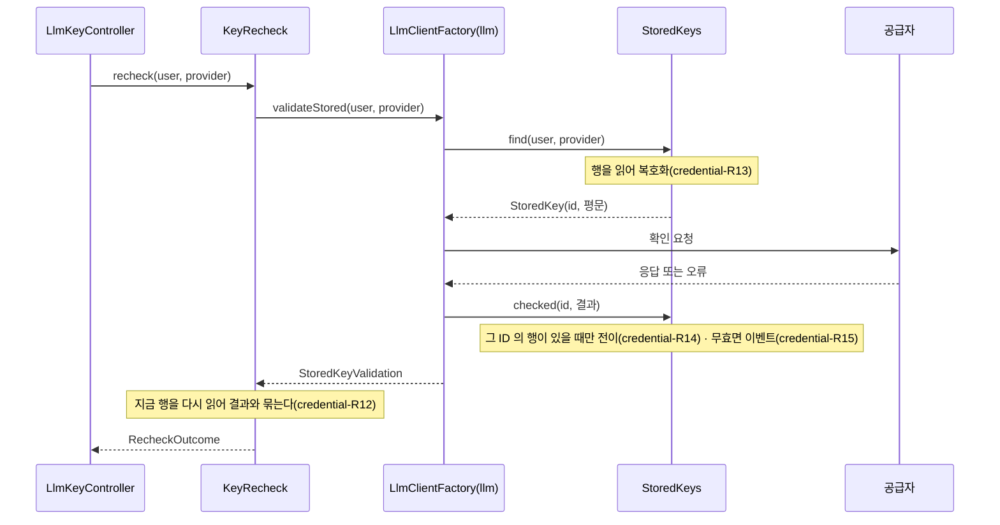

# credential 모듈 Spec

공통 구조와 쓰는 규칙은 [specs/README.md](README.md)에 있다.

## 1. 책임과 범위

`credential` 은 사용자 LLM 키(BYOK)를 암호화해 보관하고, 사용자가 키를 등록 · 다시 검증 · 삭제하게 한다.

- **봉투 암호** — 키마다 무작위 DEK 로 키를 암호화하고, DEK 를 KEK 로 감싸 저장한다. 평문은 저장하지 않는다
- **KEK** — 운영자가 파일로 주는 버전 있는 키. 기동 때 읽어 검사하고, 교체하면 저장된 DEK 를 새 버전으로 다시 감싼다
- **키 등록 · 교체** — `llm` 의 키 검증이 성공할 때만 저장한다. 사용자 × 공급자마다 키 하나다
- **다시 검증** — 저장한 키를 `llm` 의 저장한 키의 길로 확인한다
- **상태와 무효 알림** — 키의 상태(`VALID` · `INVALID`)를 검증 결과로 전이하고, 무효가 되는 전이마다 `CredentialInvalidated` 를 낸다
- **저장한 키의 공급** — `llm` 이 선언한 공급 인터페이스 `StoredKeySource` 를 구현해, `llm` 이 물을 때만 키를 복호화해 건넨다
- **키 유무** — 사용자에게 저장한 키가 있는지 답한다
- **(미구현)** 생성 호출에 쓴 시각의 기록, 탈퇴한 사용자의 키 삭제

하지 않는 것:

- 공급자에 요청을 보내지 않는다 — 검증과 호출은 `llm` 의 것이다
- 복호화한 키를 내놓는 공개 API 를 두지 않는다 — 평문은 `StoredKeySource` 의 구현을 거쳐 `llm` 에만 간다(credential-R13)
- 키 없는 사용자의 요청을 막지 않는다 — 세션 체인의 관문은 `user` 의 것이고, 이 모듈은 키 유무만 답한다
- 알림을 남기지 않는다 — 이벤트를 받은 `user` 가 남긴다
- 키 등록 · 검증 경로의 요청 제한을 걸지 않는다

다른 모듈과의 의존과 이벤트 흐름은 [overview.md §5](../overview.md#5-모듈-지도)에 있다.

## 2. 용어

| 용어 | 뜻 |
|---|---|
| 키 | 사용자가 등록한 LLM 공급자의 API 키 |
| 주인 | 키를 가진 사용자와 그 키의 공급자의 짝 — 주인마다 키는 많아야 하나다 |
| DEK | 키 하나를 암호화하는 무작위 키(AES-256). 키마다 새로 만든다 |
| KEK | DEK 를 감싸는 키(AES-256). 운영자가 파일로 주고 버전을 갖는다 |
| 활성 버전 | 설정된 KEK 버전 가운데 가장 큰 번호 — 새 DEK 는 이 버전으로 감싼다 |
| 봉인 | 키를 새 DEK 로 암호화하고 그 DEK 를 활성 버전의 KEK 로 감싸는 것 |
| 재암호화 | 저장된 DEK 를 활성 버전의 KEK 로 다시 감싸는 것 — 키의 암호문은 그대로다 |
| 힌트 | 사용자가 어느 키인지 알아보게 하는 키의 끝 4자 |
| 교체 | 키가 있는 주인이 새 키를 등록하는 것 |

## 3. 공개 인터페이스

모듈 최상위 패키지 `net.yozmnews.credential` 의 공개 타입은 둘이다 — 공개 API `LlmKeys` 와 이벤트 `CredentialInvalidated`.

HTTP 엔드포인트:

| 경로 | 메서드 | 용도 |
|---|---|---|
| `/api/llm-keys` | `GET` | 세션 사용자의 키 — 공급자마다 키의 힌트 · 상태 · 검증 시각 · 만든 시각, 없으면 null(credential-R17) |
| `/api/llm-keys/{provider}` | `PUT` | 키 등록 · 교체 — `REGISTERED`(+키) · `REJECTED`(+실패 종류)(credential-R10 · R11) |
| `/api/llm-keys/{provider}/checks` | `POST` | 다시 검증 — `VALID` · `INVALID` · `UNDETERMINED`(+실패 종류) · `MISSING`(credential-R12 · R14) |
| `/api/llm-keys/{provider}` | `DELETE` | 키 삭제 — 없어도 204(credential-R16) |

네 경로 모두 세션이 필요하고 사용자 격리 시험에 등록돼 있으며([user Spec](user.md#화면용-api-의-공개와-세션-사용자) user-R6), 키가 없는 세션 사용자에게도 연다(`@AllowedWithoutLlmKey` — user-R5). `{provider}` 는 `llm` 의 `Provider` 이름(`OPENAI` · `ANTHROPIC`)이고 모르는 값은 400 이다. 판정 결과는 200 이고, 요청 · 응답 형식은 `api/openapi.json` 에 있다.

### LlmKeys

사용자의 키 유무 — 두 역할 공통이고 읽기 전용이다.

```java
public interface LlmKeys {
    boolean present(UserId user);
}
```

- 계약
  - `present` 는 그 사용자의 저장한 키가 하나라도 있으면 참이다 — 공급자 · 상태와 무관하다(credential-R18)
  - 부르는 쪽의 트랜잭션이 있으면 거기에 들고, 없으면 조회 하나로 끝난다

`UserId` 는 `platform` 의 공개 타입이다([platform Spec](platform.md#userid)).

관련 규칙: credential-R18

### CredentialInvalidated

키가 무효가 됐다.

```java
public record CredentialInvalidated(UserId user, Provider provider, long keyId, Instant invalidatedAt) { }
```

| 필드 | 뜻 | 제약 |
|---|---|---|
| `user` | 키의 주인인 사용자 | — |
| `provider` | 그 키의 공급자(`llm` 의 `Provider`) | — |
| `keyId` | 무효가 된 키의 ID | 교체하면 새 키는 다른 ID 를 갖는다 |
| `invalidatedAt` | 무효로 바뀐 시각 | 마이크로초까지 |

- 계약
  - 발행 주체는 `credential` 이다. 키의 상태를 `VALID` 에서 `INVALID` 로 바꾸는 트랜잭션에서 그 전이마다 한 번 낸다 — 이미 `INVALID` 인 키의 거듭된 실패에는 내지 않는다(credential-R15)
  - 계기와 무관하다 — 저장한 키로 공급자에 물은 결과가 무효이면 낸다
  - `keyId` 와 `invalidatedAt` 의 짝이 전이 하나를 가리킨다. 받는 쪽은 거듭 받은 발행을 이 짝으로 알아본다
  - 키 · 힌트 · 암호문을 담지 않는다

관련 규칙: credential-R14 · R15

## 4. 내부 구조

### 개관

| 패키지 | 책임 |
|---|---|
| (최상위) | 공개 타입 둘 |
| `domain/crypto` | 봉투 암호(`EnvelopeCipher`), KEK 의 집합(`KeyEncryptionKeys`)과 KEK 파일 형식의 정본(`KekFile`), 값 타입(`KeyOwner` · `SealedKey` · `KekFileRead`) |
| `domain/key` | 키 aggregate(`StoredLlmKey`)와 저장소(`LlmKeyRepository`), 상태와 전이의 정본(`KeyStatus`), 힌트 규칙(`KeyHint`), 조회 값(`KekVersionUse`) |
| `application` | 유스케이스(등록 · 다시 검증 · 삭제 · 조회 · 재암호화), 공급 인터페이스의 구현, 공개 API 의 구현, KEK 의 기동 적재와 검사, 설정, 결과 타입(`RegistrationOutcome` · `RecheckOutcome` · `KeyView` · `ProviderKey` · `RewrapResult`) |
| `adapter/in/web` | 키 처리기와 요청 · 응답 타입 |
| `adapter/in/job` | 재암호화 반복 작업 |

협력 — 다시 검증 한 번:



### 들어오는 쪽

- 기동 시 동작 — `KekConfiguration` 이 KEK 파일을 읽어 검사하고(credential-R5), 저장된 키가 가리키는 버전이 모두 설정에 있는지 본다(credential-R6). 어기면 기동하지 않는다. 두 역할 모두 한다
- 컨트롤러 — `LlmKeyController`(화면 역할). 사용자를 세션에서 채운 인자로만 받는다
- 반복 작업 — `RewrapKeysJob`(작업 역할, 10분마다, 실패해도 재시도하지 않는다 — 다음 회차가 잇는다). `DekRewrap` 을 부른다. 여러 번 돌아도 결과가 같다(credential-R7)
- 이벤트 리스너는 없다

### `application`

- `KeyRegistration` — 키 등록 · 교체. 트랜잭션 밖에서 `llm` 의 키 검증을 부르고, 성공하면 트랜잭션 하나에서 주인의 옛 행을 지우고 새 행을 넣는다(credential-R10 · R11)
- `KeyRecheck` — 다시 검증. `llm` 의 저장한 키의 길을 부르고, 그 뒤 지금 행을 읽어 결과와 묶는다(credential-R12). 트랜잭션이 없다
- `KeyRemoval` — 키 삭제. 트랜잭션 하나(credential-R16)
- `KeyOverview` — 세션 사용자의 키 목록(credential-R17)
- `StoredKeys` — `llm` 의 공급 인터페이스 `StoredKeySource` 의 구현이고, 이 모듈에서 그 인터페이스를 아는 유일한 구성 요소다. `find` 는 읽기 트랜잭션에서 행을 읽어 복호화하고, `checked` 는 트랜잭션 하나에서 행을 잠가 상태를 전이하고 이벤트를 낸다(credential-R13 ~ R15)
- `LlmKeysService` — `LlmKeys` 의 구현
- `DekRewrap` — 재암호화. 대상 키마다 자기 트랜잭션이다(credential-R7)
- `KekConfiguration` — KEK 파일을 읽어 `KeyEncryptionKeys` 와 `EnvelopeCipher` 빈으로 낸다. 역할 애너테이션이 없다
- `CredentialProperties` — 설정 `yozmnews.credential`(§7)

### `domain`

- `StoredLlmKey` — 키 aggregate(`llm_credentials`). 주인 · 암호문 · 감싼 DEK · KEK 버전 · 힌트 · 상태 · 검증 시각 · 만든 시각과 그 전이(검증 결과 반영 · 재암호화). 문자열 표현은 ID · 공급자 · 상태뿐이다
- `LlmKeyRepository` — 저장소. 주인으로 찾기 · 사용자의 키 · 사용자의 키 유무, 갱신용 잠금(ID · 주인), 활성 버전이 아닌 키의 ID, 버전마다의 키 수
- `EnvelopeCipher` — 봉투 암호의 정본 — 봉인 · 열기 · 재암호화(credential-R1 ~ R4). JDK 의 암호 기능만 쓴다
- `KeyEncryptionKeys` — KEK 의 집합. 활성 버전은 가장 큰 번호다. 문자열 표현은 버전 목록뿐이다
- `KekFile` — KEK 파일 원문의 형식을 판정하는 정본(credential-R5). 문제 문구에 값이 없다
- `KeyStatus` — 상태 둘과, 검증 결과에서 다음 상태를 정하는 정본(credential-R14)
- `KeyHint` — 힌트 규칙의 정본(credential-R9)

### 나가는 쪽

포트는 없다 — 이 모듈은 외부 서비스를 부르지 않는다. 공급자에 닿는 일은 `llm` 의 공개 API 로 한다.

`llm` 이 선언한 공급 인터페이스 `StoredKeySource`([llm Spec](llm.md#storedkeysource))를 `StoredKeys` 가 구현한다 — 외부 의존을 가리는 포트가 아니라, `llm` 이 저장한 키를 받으려고 선언하고 이 모듈이 구현하는 모듈 사이의 인터페이스다.

신뢰할 수 없는 입력: 사용자가 넣은 키(credential-R10 · R19), KEK 파일(credential-R5), 저장된 암호문(credential-R4).

## 5. 규칙과 불변식

### 봉투 암호

판단의 이유는 [ADR-0003](../adr/0003-byok-personalized-digest.md)에 있다.

- **credential-R1** — 키는 봉인해 저장한다. 키마다 `SecureRandom` 으로 32바이트 DEK 를 새로 만들어 키를 AES-256-GCM 으로 암호화하고, 그 DEK 를 활성 버전의 KEK 로 AES-256-GCM 으로 감싼다. 난수는 암호화마다 새로 뽑은 12바이트이고 태그는 128비트다. 평문 키와 평문 DEK 는 저장하지 않는다
- **credential-R2** — 추가 인증 데이터(AAD)는 주인을 묶는다. 키의 AAD 는 `yozmnews:llm-key:v1:{사용자 ID}:{공급자 키}`, DEK 의 AAD 는 `yozmnews:llm-dek:v1:{사용자 ID}:{공급자 키}:{KEK 버전}` 의 UTF-8 바이트다(사용자 ID 는 십진수, 공급자 키는 `Provider.key()`). 암호문이나 감싼 DEK 를 다른 사용자 · 다른 공급자의 행으로 옮기면 열리지 않는다
- **credential-R3** — 저장 꼴: `ciphertext` 는 판 바이트 `0x01` · 난수 12바이트 · GCM 출력(암호문과 태그)을 이은 것이고, `encrypted_dek` 도 같은 꼴이라 61바이트다. 판 바이트가 `0x01` 이 아니면 열지 않는다
- **credential-R4** — 열기에 실패하면(주인이 다르다 · 변조 · 손상 · 모르는 판 · 설정에 없는 KEK 버전) `IllegalStateException` 이다. 문구는 고정 문구이고 키 · 암호문 · KEK 를 담지 않는다

### KEK

판단의 이유는 [ADR-0161](../adr/0161-the-kek-comes-from-a-file-in-the-configuration-directory.md) · [ADR-0162](../adr/0162-neither-role-starts-without-a-well-formed-kek.md) · [ADR-0163](../adr/0163-the-app-does-not-start-when-stored-keys-point-to-a-kek-version-missing-from-the-configuration.md) · [ADR-0164](../adr/0164-kek-rotation-rewraps-deks-in-a-recurring-job-of-the-worker-role.md)에 있다.

- **credential-R5** — KEK 는 설정 `yozmnews.credential.kek-file` 이 가리키는 파일에서 기동 때 한 번 읽는다. 파일은 한 줄에 `버전:Base64` 하나다 — 버전은 1 이상의 정수이고 겹치지 않으며, 값은 표준 Base64 로 풀어 32바이트다. 빈 줄과 `#` 로 시작하는 줄은 건너뛴다. 줄이 하나 이상 있어야 하고 원문은 65,536자까지다(`KekFile.MAX_CHARS`). 설정이 없거나 비었거나, 파일이 없거나 읽지 못하거나, 형식이 틀리면 기동하지 않는다 — 문구에 설정 이름 · 환경 변수 이름 · 경로 · 문제의 줄 번호와 까닭이 있고 값은 없다. 두 역할 모두 읽는다
- **credential-R6** — 저장된 키가 가리키는 KEK 버전이 설정에 없으면 기동하지 않는다 — 문구에 그 버전과 그 버전을 가리키는 키의 수가 있다. 두 역할 모두 검사한다
- **credential-R7** — 재암호화: 작업 역할의 반복 작업이 10분마다, KEK 버전이 활성 버전이 아닌 키를 한 회차에 100개까지(`DekRewrap.BATCH`) 찾아 DEK 를 활성 버전으로 다시 감싼다. 키마다 트랜잭션 하나이고 그 행을 잠근 뒤 한다 — 그 사이 지워진 키와 이미 활성 버전인 키는 건너뛴다. 키의 암호문은 바뀌지 않는다. 한 키가 실패하면 키 ID 와 예외 클래스 이름을 남기고 다음 키로 간다. 다시 감쌌거나 남은 키가 있는 회차만 "다시 감쌈 · 실패 · 남음" 수를 로그에 남긴다
- **credential-R8** — KEK 는 비밀 값이다. 로그 · 예외 문구 · 문자열 표현에 남지 않는다

### 등록과 삭제

판단의 이유는 [ADR-0003](../adr/0003-byok-personalized-digest.md) · [ADR-0154](../adr/0154-key-validation-lists-models-and-failure-kinds-are-sorted-by-one-rule-per-provider-reading-the-error-kind.md)에 있다.

- **credential-R9** — 힌트는 키의 끝 4자다. 키가 20자(`KeyHint.MIN_LENGTH`)보다 짧으면 빈 문자열이다 — 짧은 값의 큰 부분을 저장하지 않는다
- **credential-R10** — 등록은 `llm` 의 키 검증(`LlmClientFactory.validate`)이 성공할 때만 저장한다. 검증은 트랜잭션 밖에서 한다. 실패하면 아무것도 쓰지 않고 `REJECTED` 와 실패 종류를 낸다 — 이미 있던 키는 그대로다. 요청의 키는 앞뒤 공백을 지운 값이고, 비었거나 공백뿐이면 본문 형식 400 이다. 키의 꼴(길이 · 문자)은 `llm` 이 판정한다([llm Spec](llm.md#키-검증) llm-R10)
- **credential-R11** — 주인마다 키는 많아야 하나다(고유 제약). 교체는 트랜잭션 하나에서 주인의 옛 행을 지우고 새 행을 넣는다 — 새 키는 새 ID · 새 DEK 이고 상태 `VALID`, 검증 시각과 만든 시각은 저장한 시각이다. 같은 주인의 등록 둘이 겹쳐 고유 제약이 깨지면 트랜잭션 바깥에서 한 번 다시 한다
- **credential-R16** — 삭제는 그 주인의 행을 곧바로 지운다(물리 삭제). 없는 키의 삭제도 같은 204 다
- **credential-R17** — 키 목록은 공급자 선언 순(`Provider` 의 순서)으로 공급자마다 하나다 — 키가 없는 공급자는 키가 null 이다
- **credential-R19** — 응답은 키의 힌트 · 상태 · 검증 시각 · 만든 시각과 판정 결과 · 실패 종류뿐이다. 키의 평문 · 암호문 · 감싼 DEK · `llm` 의 운영 로그용 실패 문구를 내지 않는다. 요청 본문 타입의 문자열 표현은 키를 숨기고, 이 모듈이 남기는 로그와 예외 문구에 키가 없다

### 저장한 키와 상태

판단의 이유는 [ADR-0157](../adr/0157-credential-depends-on-llm-and-stored-keys-reach-llm-through-a-supply-interface-that-llm-declares-and-credential-implements.md) · [ADR-0165](../adr/0165-a-key-is-valid-or-invalid-and-moves-by-validation-results.md) · [ADR-0166](../adr/0166-credential-invalidated-is-published-on-each-transition-to-invalid-and-leaves-one-notice-per-transition.md)에 있다.

- **credential-R12** — 다시 검증은 저장한 키를 `llm` 의 저장한 키의 길(`LlmClientFactory.validateStored`)로 확인한다 — 사용자가 키를 다시 넣지 않는다. 키가 없으면 `MISSING` 이다. 결과의 갈래(`VALID` · `INVALID` · `UNDETERMINED`)는 credential-R14 의 전이가 정하고, 응답의 키는 확인 뒤에 다시 읽은 지금 행이다 — 묻는 사이 키가 지워졌으면 `MISSING` 이고, 새 키로 바뀌었으면 결과는 옛 키의 것이고 키는 새 키의 지금 상태다
- **credential-R13** — 저장한 키의 평문은 `StoredKeySource.find` 의 반환으로만 이 모듈을 나간다. 그 인터페이스는 `llm` 이 선언하고 `llm` 만 부른다([llm Spec](llm.md#저장한-키의-길) llm-R17 · R18). 복호화는 그 호출 안에서만 한다
- **credential-R14** — 상태는 `VALID` · `INVALID` 둘이고, 저장한 키로 공급자에 물은 결과로 전이한다:

  | 결과 | 다음 상태 |
  |---|---|
  | 성공 | `VALID` — 검증 시각을 지금으로 |
  | `INVALID_KEY` · `PERMISSION_DENIED` | `INVALID` |
  | `QUOTA_EXHAUSTED` · `TRANSIENT` · `UNEXPECTED` | 바꾸지 않는다 |

  결과는 물은 그 키 ID 의 행에만 쓴다 — 그 사이 지워졌거나 교체돼 그 ID 의 행이 없으면 아무것도 쓰지 않는다. 행을 잠근 뒤 쓴다. 무효였던 키가 성공하면 `VALID` 로 돌아온다
- **credential-R15** — 상태가 `VALID` 에서 `INVALID` 로 바뀌는 트랜잭션에서 `CredentialInvalidated` 를 한 번 낸다. 같은 상태로의 전이(`INVALID` → `INVALID`, `VALID` → `VALID`)와 `INVALID` → `VALID` 에는 내지 않는다
- **credential-R18** — 키가 있다는 것은 그 사용자의 저장한 키가 하나라도 있다는 것이다 — 공급자 · 상태와 무관하다

## 6. 데이터

컬럼 타입 · 인덱스 · 제약 문면의 정본은 `backend/src/main/resources/db/migration/V41__llm_credentials.sql` 이다.

| 테이블 | 주요 컬럼 | 뜻 |
|---|---|---|
| `llm_credentials` | id, user_id, provider(`openai`/`anthropic`), ciphertext, encrypted_dek, kek_version, key_hint, status(`VALID`/`INVALID`), validated_at, created_at | 사용자 LLM 키 — 주인(`user_id` · `provider`)마다 하나(credential-R11). `user_id` 는 `user` 의 사용자 ID 를 가리킨다 — 모듈 사이라 FK 가 없다. `provider` 는 `Provider` 의 키다. `ciphertext` · `encrypted_dek` 의 꼴은 credential-R3, `kek_version` 은 DEK 를 감싼 KEK 의 버전(credential-R6 · R7), `key_hint` 는 credential-R9, `status` · `validated_at` 은 credential-R14 |

## 7. 설정

| 설정 키 | 바꾸는 규칙 |
|---|---|
| `yozmnews.credential.kek-file`(환경 변수 `YOZMNEWS_CREDENTIAL_KEK_FILE`) | KEK 파일의 경로. 필수 — 없으면 기동하지 않는다(credential-R5). `classpath:` 로 시작하면 클래스패스에서 읽는다(시험용) |

## 8. 결정

| ADR | 한 줄 |
|---|---|
| [0003](../adr/0003-byok-personalized-digest.md) | 사용자 BYOK LLM 으로 개인화 종합 다이제스트를 만들고, 키는 envelope encryption 으로 보관한다 |
| [0060](../adr/0060-article-deletion-announced-by-removed-article-ids-and-followed-by-referencing-modules.md) | 모듈 사이 참조는 ID 로만 하고 FK 를 두지 않는다 |
| [0152](../adr/0152-secret-value-is-a-platform-public-type-that-fails-on-serialization.md) | 비밀 값 평문의 래퍼 `SecretValue` 는 `platform` 의 공개 타입이고, 직렬화하면 실패한다 |
| [0156](../adr/0156-user-id-is-a-platform-public-type.md) | 사용자 식별자 `UserId` 는 `platform` 의 공개 타입이다 |
| [0157](../adr/0157-credential-depends-on-llm-and-stored-keys-reach-llm-through-a-supply-interface-that-llm-declares-and-credential-implements.md) | `credential` 이 `llm` 에 의존하고, 저장한 키는 `llm` 이 선언한 공급 인터페이스를 `credential` 이 구현해 낸다 |
| [0159](../adr/0159-having-a-key-means-having-any-stored-key-regardless-of-its-status.md) | 키 관문과 화면 이동에서 키가 있다는 것은 저장한 키가 하나라도 있다는 것이다(상태 무관) |
| [0161](../adr/0161-the-kek-comes-from-a-file-in-the-configuration-directory.md) | KEK 는 설정 디렉터리의 파일로 받는다 |
| [0162](../adr/0162-neither-role-starts-without-a-well-formed-kek.md) | KEK 가 없거나 형식이 틀리면 두 역할 모두 기동하지 않는다 |
| [0163](../adr/0163-the-app-does-not-start-when-stored-keys-point-to-a-kek-version-missing-from-the-configuration.md) | 저장된 키가 가리키는 KEK 버전이 설정에 없으면 기동하지 않는다 |
| [0164](../adr/0164-kek-rotation-rewraps-deks-in-a-recurring-job-of-the-worker-role.md) | KEK 교체의 재암호화는 작업 역할의 반복 작업이 한다 |
| [0165](../adr/0165-a-key-is-valid-or-invalid-and-moves-by-validation-results.md) | 키의 상태는 `VALID` · `INVALID` 둘이고 검증 결과로 전이한다 |
| [0166](../adr/0166-credential-invalidated-is-published-on-each-transition-to-invalid-and-leaves-one-notice-per-transition.md) | `CredentialInvalidated` 는 `credential` 이 키가 무효가 되는 전이마다 내고, 키 무효 알림은 전이마다 하나다 |
