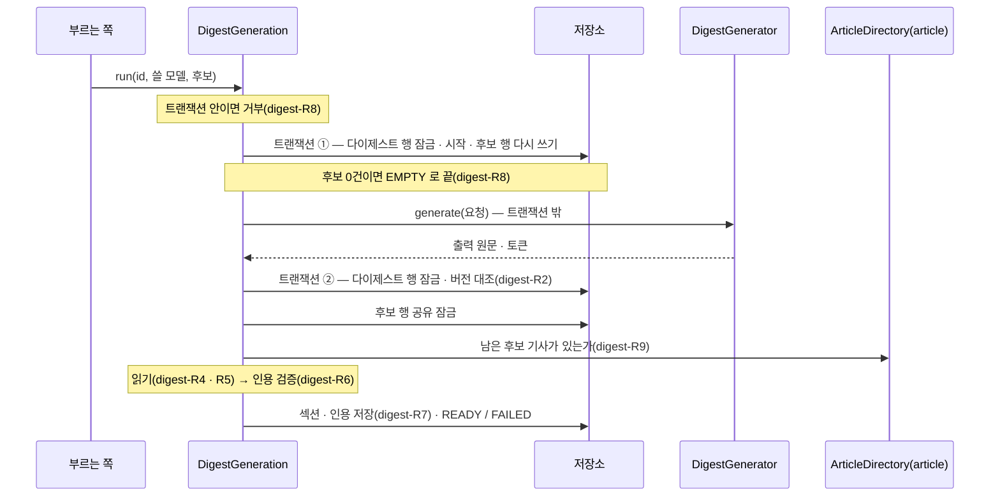

# digest 모듈 Spec

공통 구조와 쓰는 규칙은 [specs/README.md](README.md)에 있다.

## 1. 책임과 범위

`digest` 는 사용자마다 다이제스트를 만들고 저장한다 — 고른 후보를 생성기에 넘겨 출력을 받고, 출력을 데이터로 읽어 검증한 뒤 섹션과 인용(노출 기록)으로 저장한다.

- **다이제스트 상태** — 생성을 기다림 · 생성 중 · 끝(인용 있음 · 후보 없음 · 실패)의 전이와, 쓸 모델 · 토큰 · 소요 시간 · 실패 코드의 기록
- **생성 흐름** — 후보에 별칭을 매기고, 생성기를 트랜잭션 밖에서 부르고, 출력을 읽어 인용을 검증한 뒤 저장한다. 끝난 다이제스트는 건드리지 않고, 멈춘 생성은 처음부터 다시 한다
- **출력 읽기 · 검증** — 출력 구조의 서술 하나에서 읽기 규칙과 생성에 넘길 JSON Schema 문서가 함께 나온다. 상한을 넘은 것 · 후보에 없는 별칭 · 겹친 인용을 처분하고, 인용이 하나도 남지 않으면 실패로 끝낸다
- **생성기 포트와 로컬 대체물** — 생성기 포트(`DigestGenerator`)와 profile `local` 의 고정 규칙 대체물(`FakeDigestGenerator`)
- **지운 기사 따르기** — 운영자가 지운 기사의 후보 · 인용 행과, 인용이 남지 않게 된 섹션을 지운다
- **후보 행 보존** — 만든 지 30일이 지난 다이제스트의 후보 행을 지운다
- **받은 소식** — 사용자가 날짜별로 보이는 다이제스트에서 받은 기사와 받은 날짜를 공개 조회(`ReceivedArticles`)로 낸다 — 독자 화면이 스토리라인 타임라인에 단다(digest-R13, [ADR-0193](../adr/0193-the-per-user-storyline-information-is-the-received-news-counted-from-the-digest-shown-for-each-date.md))
- **(미구현)** 후보 선별(구독 필터 · 큰 스토리라인 슬롯 · 사건 단위 중복 제거 · 상한 · 선정 이유)
- **(미구현)** 프롬프트 구성과 실제 생성기(사용자 키로 `llm` 의 생성 호출 `LlmClientFactory.generateStored` 를 부르는 생성기) · 파싱 실패의 다시 묻기
- **(미구현)** 일정 기반 생성과 수동 재생성, 독자 화면(`reader`)이 쓸 다이제스트 조회 — 화면은 날짜별로 보이는 다이제스트(digest-R13)를 보인다. 화면용 API 는 `reader` 가 낸다([ADR-0192](../adr/0192-reader-screens-are-composed-by-the-reader-module-over-module-public-queries.md))
- **(미구현)** 관심도 산식과 관심사 히스토리 조회

하지 않는 것:

- 기사를 평가하지 않는다 — 태그 · 중요도는 `tag` 의 공유 평가를 읽는다
- 공급자 · Spring AI 를 모르고 키를 다루지 않는다 — LLM 호출과 키 복호화는 `llm` 관문의 것이다([ADR-0151](../adr/0151-spring-ai-and-sdk-types-stay-inside-llm-and-the-gateway-exposes-only-its-own-types.md))
- 출력의 링크 · 출처 · 발행 시각을 쓰지 않는다 — 인용은 기사 ID 로만 저장하고, 화면은 기사 정보를 `article` 에서 읽는다

다른 모듈과의 의존과 이벤트 흐름은 [overview.md §5](../overview.md#5-모듈-지도)에 있다.

## 2. 용어

| 용어 | 뜻 |
|---|---|
| 후보 | 이번 생성에 넘기는 기사와 그 선정 이유(`SUBSCRIBED` · `INTEREST` · `MAJOR_STORYLINE`) |
| 별칭 | 이번 생성에서만 쓰는 후보의 짧은 이름(`A1` …). 출력은 기사를 별칭으로만 인용한다 |
| 출력 | 생성기가 돌려준 원문(JSON 텍스트) |
| 서술 | 출력 구조(속성 · 필수 · 타입 · 상한 · 처분)를 적은 정본 — 읽기와 JSON Schema 문서가 함께 따른다 |
| 섹션 | 저장한 다이제스트의 한 덩어리 — 개요(`OVERVIEW`) · 주요 뉴스(`TOP_STORY`) · 추가 헤드라인 묶음(`MORE_HEADLINES`) |
| 인용 섹션 | 기사를 인용하는 섹션 — 주요 뉴스 · 추가 헤드라인 묶음 |
| 인용 | 섹션이 인용한 기사 한 줄과 그 선정 이유. 노출 기록이다 |
| 상한으로 버린 수 | 읽기가 상한 때문에 버린 원소 · 읽지 않은 배열 꼬리 원소 · 지운 값의 수 |

## 3. 공개 인터페이스

모듈 최상위 패키지 `net.yozmnews.digest` 의 공개 타입은 받은 소식의 공개 조회 `ReceivedArticles` 하나다. HTTP 엔드포인트는 없다 — 화면용 API 는 `reader` 가 낸다. 받는 이벤트는 `article` 의 `ArticlesRemoved` 다(§4 들어오는 쪽).

### ReceivedArticles

받은 소식 — 사용자가 날짜별로 보이는 다이제스트에서 받은 기사와 받은 날짜(digest-R13). `reader` 가 스토리라인 타임라인의 사건마다 받은 날짜를 단다. 구현은 `application` 의 `ReceivedArticlesService` 다.

```java
public interface ReceivedArticles {
    int MAX_ARTICLES = 1000;                                  // 한 번에 묻는 기사 수의 상한 — 정본. 측정 전 목표
    Map<ArticleId, LocalDate> receivedAmong(UserId user, Collection<ArticleId> articles);
}
```

| 멤버 | 뜻 |
|---|---|
| `receivedAmong` | 주어진 기사 가운데 그 사용자가 받은 기사 → 받은 날짜(그 다이제스트의 날짜 가운데 가장 이른 것). 받지 않은 기사는 빠진다. 같은 기사가 두 번 와도 한 번. 빈 입력이면 빈 맵. 서로 다른 기사가 `MAX_ARTICLES` 개를 넘으면 `IllegalArgumentException` |

- 계약
  - 읽기 전용 트랜잭션 하나 · 질의 하나다. 역할 애너테이션이 없다(두 역할 공통)
  - 다른 사용자의 다이제스트는 보지 않는다 — 사용자는 부르는 쪽이 세션에서 받은 `UserId` 다

## 4. 내부 구조

### 개관

| 패키지 | 책임 |
|---|---|
| `domain/digest` | 상태 aggregate(`Digest`)와 저장소(`DigestRepository`), 전이의 값(`Completion` · `DigestStatus` · `DigestTrigger` · `DigestFailure` · `DigestPeriod` · `DigestId`) |
| `domain/candidate` | 후보와 별칭의 정본(`CandidateSet`), 후보 행 저장소(`DigestCandidateRepository`), 보존 기한의 정본(`CandidateRetention`), 값(`DigestCandidate` · `AliasedCandidate` · `SelectionReason`) |
| `domain/output` | 출력 서술 · 상한의 정본(`DigestOutputSchema` — 서술 마디 `OutputShape` · 처분 `OverLimit` · `OnBlank`), 읽기의 정본(`DigestOutputReader`), 인용 검증의 정본(`CitationCheck`), 값(`OutputRead` · `DigestDraft` · `StoryDraft` · `HeadlineDraft` · `CitationResult` · `CitedDigest` · `CitedStory` · `CitedHeadline` · `CitationDrops`) |
| `domain/generator` | 생성기 포트(`DigestGenerator`)와 그 요청 · 결과 |
| `domain/content` | 내용 aggregate(`DigestSection` — 인용 `DigestItem` 을 자식으로)와 저장소(`DigestSectionRepository`), 섹션 종류(`SectionKind`) |
| `domain/removal` | 지운 기사 따르기의 판단(`RemovalFollowUp`), 내용 행 정리 저장소(`DigestContentCleanup`), 값(`SectionCitations`) |
| `domain/receipt` | 받은 소식 저장소(`ReceiptRepository` — 계약이 digest-R13 의 정본) |
| `application` | 생성 유스케이스(`DigestGeneration`), 지운 기사 따르기(`DigestArticleRemoval`)와 그 리스너, 후보 행 보존 정리(`CandidateCleanup`), 받은 소식 공개 조회의 구현(`ReceivedArticlesService`) |
| `adapter/out/persistence` | 후보 행 · 내용 행 정리 · 받은 소식 저장소의 JdbcClient 구현 |
| `adapter/out/fake` | 생성기의 로컬 대체물과 그 결선 |
| `adapter/in/job` | 후보 행 보존 정리의 반복 작업 |

저장은 셋으로 나뉜다 — 여러 번 저장되는 상태(`Digest`), 끝날 때 한 번 쓰는 내용(`DigestSection`), 대량으로 쓰고 지우는 후보 행(JdbcClient). 두 aggregate 는 ID 로 잇는다([ADR-0014](../adr/0014-spring-data-jdbc.md)).

협력 — 생성 한 번:



### 들어오는 쪽

- 이벤트 리스너 — `DigestArticleRemovalListener` 가 `article` 의 `ArticlesRemoved` 를 받아 `DigestArticleRemoval` 을 부른다. 비동기 · 새 트랜잭션이고 이벤트 발행 레지스트리에 기록된다(Spring Modulith `@ApplicationModuleListener`). 한 소스를 지울 때 여러 이벤트로 나뉘어 동시에 처리될 수 있다 — 다시 처리하거나 동시에 처리해도 결과가 같다(digest-R10)
- 반복 작업 — `CandidateCleanupJob`(작업 역할, 하루마다 — ID `digest-candidate-cleanup`, 실패해도 재시도하지 않는다 — 다음 회차가 잇는다). `CandidateCleanup` 을 부른다(digest-R11)
- 컨트롤러 · 생성을 부르는 작업은 없다 — 생성 유스케이스를 부르는 쪽은 아직 없다

### `application`

- `DigestGeneration` — 다이제스트 예약(`schedule`)과 생성(`run`). 생성은 트랜잭션 ①(시작) · 생성기 호출(트랜잭션 밖) · 트랜잭션 ②(읽기 · 검증 · 저장)로 나뉘고, 두 트랜잭션은 다이제스트 행을 먼저 잠근다(digest-R2 · R8 · R9). 생성기는 부를 때 찾는다(`ObjectProvider`). 실패 메시지는 이 클래스의 상수가 정본이다
- `DigestArticleRemoval` — 지운 기사 따르기. 트랜잭션 하나(digest-R10)
- `DigestArticleRemovalListener` — `ArticlesRemoved` 리스너
- `CandidateCleanup` — 후보 행 보존 정리. 트랜잭션 하나(digest-R11)
- `ReceivedArticlesService` — 공개 조회 `ReceivedArticles` 의 구현. 상한을 확인하고 저장소에 맡긴다. 읽기 전용 트랜잭션 하나, 역할 애너테이션 없음(digest-R13)

### `domain`

- `Digest` — 상태 aggregate(`digests`) — 상태 전이의 정본(digest-R1). 바꾸는 메서드는 새 값을 돌려준다. 버전(`@Version`)을 갖는다
- `DigestRepository` — 상태 저장소. 다이제스트 행 잠금(`lock`)
- `CandidateSet` — 후보와 별칭의 정본(digest-R3)
- `DigestCandidateRepository` — 후보 행 저장소 — 다시 쓰기 · 공유 잠금 읽기 · 지우기(생성 중 지운 기사 · 지운 기사 따르기 · 보존 정리)(digest-R9 ~ R11)
- `CandidateRetention` — 후보 행 보존 기한의 정본(digest-R11)
- `DigestOutputSchema` — 출력 구조의 서술 `ROOT` · 상한 · 속성 이름의 정본, 서술을 JSON Schema 문서로 그리기(`json()`)(digest-R4 · R5)
- `DigestOutputReader` — 출력 읽기의 정본 — 서술을 따라 걷는다(digest-R4 · R5)
- `CitationCheck` — 인용 검증의 정본(digest-R6)
- `DigestSection` — 내용 aggregate(`digest_sections`, 인용 `digest_items`). 인용을 검증한 출력에서 섹션을 만드는 규칙(digest-R7)
- `DigestSectionRepository` — 내용 저장소
- `RemovalFollowUp` — 지운 기사 따르기에서 지울 섹션의 판단(digest-R10)
- `DigestContentCleanup` — 내용 행 정리 저장소 — 다이제스트 행 잠금 · 섹션과 인용 읽기 · 인용 · 섹션 지우기(digest-R10)
- `ReceiptRepository` — 받은 소식 저장소 — 계약이 "날짜별로 보이는 다이제스트 · 받은 날짜"의 정본이다(digest-R13)

  ```java
  public interface ReceiptRepository {
      Map<ArticleId, LocalDate> firstShownDates(UserId user, Collection<ArticleId> articles);  // 받은 기사 → 가장 이른 받은 날짜
  }
  ```

### 나가는 쪽

#### DigestGenerator

다이제스트 생성기 포트 — 외부 의존(LLM)의 경계다([ADR-0013](../adr/0013-architecture-patterns.md)).

```java
public interface DigestGenerator {
    GeneratedOutput generate(DigestRequest request);
}

public record DigestRequest(UserId userId, LlmModel model, CandidateSet candidates) { }
public record GeneratedOutput(String text, TokenUsage usage) { }
public record TokenUsage(int inputTokens, int outputTokens) { }
```

| 타입 · 필드 | 뜻 | 제약 |
|---|---|---|
| `DigestRequest.userId` | 다이제스트의 사용자 | — |
| `DigestRequest.model` | 쓸 모델(`llm` 의 `LlmModel`) | — |
| `DigestRequest.candidates` | 별칭을 매긴 후보 | 비어 있지 않다 |
| `GeneratedOutput.text` | 출력 원문 | 읽기 · 검증은 부르는 쪽(digest-R4 ~ R6) |
| `TokenUsage` | 생성 한 번의 입력 · 출력 토큰 수 | 0 이상 |

- 계약
  - 생성기는 출력을 파싱 · 검증하지 않고 원문을 돌려준다 — 모든 구현의 출력이 같은 읽기 · 검증을 지난다
  - 트랜잭션 밖에서 불린다
  - 예외는 그대로 부르는 쪽으로 간다 — 다이제스트는 생성 중으로 남는다(digest-R8)
- 구현
  - **(미구현)** 사용자 키로 `llm` 의 생성 호출([llm Spec](llm.md#생성-호출))을 부르는 실제 생성기 — `local` 밖에서 등록된다
  - `FakeDigestGenerator`(`adapter/out/fake`) — 로컬 대체물. 고정 규칙(digest-R12)
  - `FakeDigestGeneratorConfiguration`(`adapter/out/fake`) — 대체물의 결선. `@LocalDevelopment` — profile `local` 에서 조건 없이 등록한다([platform-R18](platform.md#로컬-개발) · digest-R12). 역할 애너테이션이 없다
- 생성기가 하나도 없는 프로세스도 기동한다 — 생성할 때 찾고, 없으면 그 다이제스트를 실패로 끝낸다(digest-R8)

`LlmModel` 은 `llm` 의 공개 타입이고([llm Spec](llm.md#llmmodel)), `UserId` 는 `platform` 의 공개 타입이다([platform Spec](platform.md#userid)).

#### 저장소 구현

- `JdbcDigestCandidateRepository` — `DigestCandidateRepository` 의 JdbcClient 구현. 후보 행은 넣고 지우기만 한다
- `JdbcDigestContentCleanup` — `DigestContentCleanup` 의 JdbcClient 구현
- `JdbcReceiptRepository` — `ReceiptRepository` 의 JdbcClient 구현 — 인용 · 섹션 · 다이제스트를 잇는 질의 하나(digest-R13)
- 상태 · 내용 저장소는 Spring Data JDBC 다

다른 모듈의 공개 조회: 생성 중 지운 기사를 거를 때 `article` 의 `ArticleDirectory.findAll` 로 기사가 있는지 본다([article Spec](article.md#articledirectory--articlecontent--articleentryview--articleheadline)).

신뢰할 수 없는 입력: 생성기의 출력(digest-R4 ~ R6). 출력 원문은 로그 · 실패 메시지에 남기지 않는다(digest-R4 · R8).

## 5. 규칙과 불변식

### 다이제스트 상태

판단의 이유는 [ADR-0186](../adr/0186-digests-follow-removed-articles-by-deleting-their-rows-and-show-no-summary-without-any-citation.md)에 있다.

- **digest-R1** — 상태는 `SCHEDULED`(생성을 기다림) · `RUNNING`(생성 중) · `READY`(인용이 있는 다이제스트) · `EMPTY`(후보 없음) · `FAILED`(실패)다. 끝난 상태는 `READY` · `EMPTY` · `FAILED` 다
  - 예약은 `SCHEDULED` 로 만든다 — 사용자 · 다이제스트 날짜 · 기간(끝이 시작보다 뒤) · 계기(`SCHEDULED` · `MANUAL`) · 만든 시각
  - 시작은 `SCHEDULED` · `RUNNING` 에서 `RUNNING` 으로 간다. 쓸 모델의 공급자 키(`Provider.key()`) · 모델 ID · 후보 수 · 시작 시각을 적고, 앞 시도의 결과 칸(토큰 · 소요 시간 · 실패)을 비운다. 끝난 다이제스트는 시작하지 못한다
  - 끝내기는 `RUNNING` 에서만 한다 — `READY` 는 토큰 · 소요 시간(밀리초), `EMPTY` 는 결과 칸 없음, `FAILED` 는 실패 코드(`DigestFailure`) · 메시지(앞 500 코드 포인트까지 자름 — `Digest.MAX_ERROR_MESSAGE`, `platform` 의 `CodePoints`)와 생성기를 불렀으면 토큰 · 소요 시간이다. 끝낸 시각을 적는다
  - 기록하는 공급자 · 모델은 요청의 쓸 모델이다 — 로컬 대체물이 만든 다이제스트도 요청한 모델을 적고 토큰은 0 이다
  - 테이블이 지킨다: 공급자와 모델은 함께 있거나 함께 없다, 끝난 상태 ⇔ 끝낸 시각이 있다, `FAILED` ⇔ 실패 코드가 있다
- **digest-R2** — 생성(`run`)은 다이제스트 행을 잠근 뒤 상태를 본다. 끝난 다이제스트면 아무것도 하지 않고 그 상태를 돌려준다. `RUNNING` 이면 처음부터 다시 한다 — 후보 행을 새 후보로 다시 쓴다(후보가 없어도 앞 시도의 행을 지운다). 트랜잭션 ② 는 다이제스트 행을 다시 잠가, 이미 끝났거나 버전이 트랜잭션 ① 뒤의 값과 다르면(다른 실행이 다시 시작했거나 끝냈다) 아무것도 쓰지 않고 지금 상태를 돌려준다

### 후보와 별칭

- **digest-R3** — 후보에 입력 순서대로 별칭 `A1`, `A2` … 를 매긴다(접두 `CandidateSet.ALIAS_PREFIX`). 별칭 대조는 대소문자를 가린다. 같은 기사가 두 번 있으면 아무것도 쓰기 전에 거부한다(`IllegalArgumentException`). 후보를 지금 있는 기사로 좁혀도 남은 후보의 별칭은 그대로다

### 출력 읽기

- **digest-R4** — 출력 원문은 이렇게 읽는다(`DigestOutputReader`):
  - 앞뒤 공백을 지운 원문이 코드 펜스(```` ``` ```` 또는 ```` ```json ```` 로 시작하는 첫 줄과 ```` ``` ```` 로 끝남)로 감싸여 있으면 한 겹만 벗긴다
  - JSON 객체 하나여야 한다 — 객체 뒤에 다른 내용이 있거나 한 객체 안에 같은 키가 두 번 있으면 읽지 못한 것이다
  - 서술(`DigestOutputSchema.ROOT`)을 따라 걷는다 — `overview`(문자열) · `top_stories`(배열 — 원소는 `title` · `summary` · `refs`(문자열 배열)) · `more_headlines`(배열 — 원소는 `ref` 와 선택 `note`)가 있어야 한다. 서술에 없는 속성은 무시한다. 타입이 다르면 읽지 못한 것이다(숫자를 문자열로 바꾸지 않는다). `null` 은 `note` 에만 받는다
  - 문자열은 앞뒤 공백을 지운 값이다. 비었을 때: `overview` · `title` · `summary` 는 읽지 못한 것이고, `note` 는 없음이며, 별칭(`refs` 의 원소 · `ref`)은 빈 문자열 그대로 받는다 — 인용 검증이 모르는 별칭으로 처분한다(digest-R6)
  - 한 원소 안에서 읽지 못할 속성과 버릴 속성(digest-R5)이 함께 있으면 읽지 못한 것이다 — 속성의 순서와 무관하다
  - 읽지 못하면 짧은 진단(어느 속성이 왜)을 낸다. 출력 원문을 싣지 않는다
  - 생성에 넘기는 JSON Schema(draft 2020-12) 문서는 같은 서술을 그린 것이다(`DigestOutputSchema.json()`) — 객체는 서술의 속성만 허용하고(`additionalProperties: false`) 필수 속성을 적는다, 비었을 때 없음으로 받지 않는 문자열은 `minLength` 1, 문자열은 `maxLength`, 배열은 `maxItems`, `note` 는 타입에 `null` 을 더한다. 이 문서는 읽기보다 엄격하다(모르는 속성 · 빈 별칭)
- **digest-R5** — 상한은 측정 전 목표이고 정본은 `DigestOutputSchema` 의 상수다. 문자열은 코드 포인트로 잰다

  | 대상 | 상한 | 넘을 때 |
  |---|---|---|
  | `overview` | 1,000 | 출력 전체를 읽지 못한 것으로 |
  | 주요 뉴스 `title` | 200 | 그 주요 뉴스를 버린다 |
  | 주요 뉴스 `summary` | 2,000 | 그 주요 뉴스를 버린다 |
  | 별칭 | 16 | 그 별칭(주요 뉴스의 인용 하나) · 그 추가 헤드라인을 버린다 |
  | 추가 헤드라인 `note` | 300 | 그 값만 지운다 |
  | `top_stories` | 20 개 | 앞 20 개만 읽는다 |
  | 한 주요 뉴스의 `refs` | 20 개 | 앞 20 개만 읽는다 |
  | `more_headlines` | 60 개 | 앞 60 개만 읽는다 |

  배열은 원소 위치로 자른다 — 읽지 않은 꼬리 원소는 검사하지 않고, 앞부분에서 버린 원소를 꼬리로 채우지 않는다. 버린 원소 · 읽지 않은 원소 · 지운 값의 수를 센다(상한으로 버린 수)

### 인용 검증

판단의 이유는 [ADR-0186](../adr/0186-digests-follow-removed-articles-by-deleting-their-rows-and-show-no-summary-without-any-citation.md)에 있다.

- **digest-R6** — 읽은 출력의 별칭을 후보와 대조한다(`CitationCheck`):
  1. 주요 뉴스의 `refs` 에서 후보에 없는 별칭을 지운다
  2. 한 주요 뉴스 안에서 같은 별칭은 처음 것만 남긴다
  3. 주요 뉴스끼리 같은 기사를 인용해도 둔다
  4. 추가 헤드라인은 주요 뉴스가 인용한 기사이거나 앞 추가 헤드라인의 기사면 버린다
  5. `refs` 가 빈 주요 뉴스와, 별칭이 후보에 없는 추가 헤드라인은 버린다
  6. 남은 주요 뉴스 · 추가 헤드라인이 하나도 없으면 인용 없음이다 — 그 다이제스트는 `FAILED`(`NO_CITATION`)로 끝난다(digest-R8)

  지운 별칭 수(1 · 2)와 버린 항목 수(4 · 5)를 센다

### 내용 저장 꼴

- **digest-R7** — 인용을 검증한 출력은 섹션으로 저장한다 — 개요(위치 0, 본문 `overview`, 인용 없음), 주요 뉴스마다 하나(위치 1 … k, 제목 · 본문 `summary`, 인용은 `refs` 순서), 추가 헤드라인이 있으면 묶음 하나(위치 k + 1, 인용은 헤드라인 순서와 `note`). 인용마다 기사 ID 와 그 후보의 선정 이유를 적는다. 위치는 순서만 뜻한다 — 섹션을 지우면 빈 번호가 생긴다(digest-R10)

### 생성 흐름

판단의 이유는 [ADR-0186](../adr/0186-digests-follow-removed-articles-by-deleting-their-rows-and-show-no-summary-without-any-citation.md) · [ADR-0115](../adr/0115-embedding-api-in-both-roles-looks-up-the-embedder-on-call-and-a-worker-startup-check-requires-one.md)(생성기를 부를 때 찾는 결선)에 있다.

- **digest-R8** — 생성(`run`):
  - 트랜잭션 안에서 부르면 아무것도 쓰기 전에 거부한다(`IllegalStateException`) — 생성기 호출은 트랜잭션 밖이어야 한다
  - 후보가 없으면 생성기를 부르지 않고 `EMPTY` 로 끝낸다
  - 생성기는 부를 때 찾는다. 없으면 `FAILED`(`NO_GENERATOR`, 메시지 `DigestGeneration.NO_GENERATOR`)로 끝낸다 — 토큰 · 소요 시간이 없다
  - 생성기는 트랜잭션 밖에서 부르고, 그 호출의 소요 시간을 잰다. 생성기가 예외를 던지면 그대로 올라가고 다이제스트는 `RUNNING` 으로 남는다 — 다시 `run` 하면 처음부터 다시 한다(digest-R2)
  - 출력을 읽지 못하면 `FAILED`(`UNREADABLE_OUTPUT`, 메시지는 읽기의 진단), 인용이 없으면 `FAILED`(`NO_CITATION`, 메시지 `DigestGeneration.NO_CITATION`), 인용이 있으면 섹션 · 인용을 저장하고 `READY` 로 끝낸다. 실패에도 토큰 · 소요 시간을 적는다
  - 읽기 · 인용 검증이 지운 것이 있으면(지운 별칭 · 버린 항목 · 상한으로 버린 수) 정보 로그를 남긴다 — 다이제스트 ID 와 수만, 출력 원문은 없다
- **digest-R9** — 생성 중에 지워진 기사는 인용하지 않는다. 후보 행이 그 기사를 인용해도 되는지의 표시다:
  - 트랜잭션 ② 는 다이제스트 행을 잠근 뒤 그 다이제스트의 후보 행을 별칭 순으로 공유 잠금하고 읽는다 — 지운 기사 따르기가 먼저 지운 후보 행은 없다
  - 남은 후보 가운데 `article` 에 지금 없는 기사의 후보 행을 지우고, 남은 기사의 후보로만 인용을 검증한다
  - 지운 기사 따르기는 그 다이제스트 행을 잠그므로, 트랜잭션 ② 가 먼저 잠그면 그 커밋을 기다린 뒤 방금 저장된 인용을 지운다(digest-R10)
  - 잠금 순서: 후보 행을 쓰거나 지우는 쪽(생성 · 지운 기사 따르기 · 보존 정리)은 모두 그 다이제스트 행을 먼저 잠근다 — 여러 다이제스트면 ID 순이다

### 지운 기사 따르기

판단의 이유는 [ADR-0186](../adr/0186-digests-follow-removed-articles-by-deleting-their-rows-and-show-no-summary-without-any-citation.md) · [ADR-0060](../adr/0060-article-deletion-announced-by-removed-article-ids-and-followed-by-referencing-modules.md)에 있다.

- **digest-R10** — `ArticlesRemoved` 를 받으면 한 트랜잭션에서:
  1. 지운 기사를 후보 행이나 인용으로 가진 다이제스트 행을 ID 순으로 잠근다 — 같은 다이제스트를 다루는 생성 · 다른 지운 기사 따르기 · 보존 정리의 커밋을 기다린다
  2. 지운 기사의 후보 행을 지운다
  3. 지운 기사를 인용한 다이제스트마다 지울 섹션을 정한다 — 인용이 모두 지운 기사인 인용 섹션, 그리고 그 뒤 인용 섹션이 하나도 남지 않는 다이제스트의 개요
  4. 지운 기사의 인용 행을 지운다
  5. 3 에서 정한 섹션을 지운다

  다이제스트 행(상태 · 기간 · 공급자 · 모델 · 토큰 · 소요 시간)은 남긴다 — 인용 섹션이 모두 지워진 다이제스트는 내용 없는 `READY` 다. 지운 기사를 인용하지 않은 다이제스트는 건드리지 않는다. 다시 처리하거나 나뉘어 발행된 이벤트가 동시에 처리되어도 결과가 같다

### 후보 행 보존

- **digest-R11** — 만든 시각이 지금 − 30일(`CandidateRetention.KEEP`)보다 앞선 다이제스트의 후보 행을 지운다 — 다이제스트 · 섹션 · 인용은 남는다. 작업 역할의 반복 작업이 하루마다 한다. 후보 행이 남은 그 다이제스트 행을 ID 순으로 잠근 뒤 지운다. 지운 행이 있으면 그 수와 기준 시각을 정보 로그로 남긴다

### 받은 소식

판단의 이유는 [ADR-0193](../adr/0193-the-per-user-storyline-information-is-the-received-news-counted-from-the-digest-shown-for-each-date.md)에 있다.

- **digest-R13** — 사용자가 받은 기사는 그 사용자의 **날짜별로 보이는 다이제스트**의 인용이다 — 날짜마다 그 날짜의 `READY` 다이제스트 가운데 ID 가 가장 큰 것이다. 같은 날짜의 더 큰 ID 가 `SCHEDULED` · `RUNNING` · `EMPTY` · `FAILED` 여도 앞선 `READY` 가 보인다. 같은 날짜의 덮인 `READY` · `EMPTY` · `FAILED` 의 인용은 세지 않는다
  - 받은 날짜는 그 기사를 인용한, 날짜별로 보이는 다이제스트들의 날짜 가운데 가장 이른 것이다
  - 지운 기사는 인용이 지워져(digest-R10) 받은 기사가 아니다
  - 화면이 날짜별로 다이제스트를 보일 때도 이 정의를 쓴다 — 다이제스트 조회가 생기면 "보이는 다이제스트" 조건을 이 규칙 하나에서 가져온다

### 로컬 대체물

판단의 이유는 [ADR-0187](../adr/0187-the-digest-generators-local-substitute-always-stands-in-the-local-profile-and-real-generators-register-only-outside-it.md) · [ADR-0057](../adr/0057-local-substitutes-registered-only-in-local-profile-without-operator-switch.md)에 있다.

- **digest-R12** — 로컬 대체물(`FakeDigestGenerator`)은 profile `local` 에서 언제나 생성기다 — 사용자의 키(실제 키 · `llm` 의 가짜 키)와 무관하다. 그 밖의 profile 에서는 등록되지 않는다. 출력 규칙: 후보가 n 건이면
  - `overview` 는 "로컬 대체물이 만든 다이제스트다. 후보 n건."
  - 앞 3 후보(`FakeDigestGenerator.STORIES`)는 주요 뉴스 하나씩 — k 번째의 `title` 은 "로컬 주요 뉴스 k", `summary` 는 "로컬 대체물이 만든 요약이다.", `refs` 는 그 후보의 별칭 하나
  - 나머지 후보는 추가 헤드라인 하나씩(`note` 없음)
  - 토큰은 0 · 0

  출력은 실제 생성기의 출력과 같은 읽기 · 검증을 지난다. 후보가 64건 이상이면 추가 헤드라인이 상한(60)을 넘어 꼬리를 읽지 않는다

## 6. 데이터

컬럼 타입 · 인덱스 · 제약 문면의 정본은 `backend/src/main/resources/db/migration/V46__digests.sql` 이다.

| 테이블 | 주요 컬럼 | 뜻 |
|---|---|---|
| `digests` | id, user_id, digest_date, period_start, period_end, status(`SCHEDULED`/`RUNNING`/`READY`/`EMPTY`/`FAILED`), trigger(`SCHEDULED`/`MANUAL`), provider(`openai`/`anthropic`), model, candidate_count, input_tokens, output_tokens, duration_ms, error_code, error_message, created_at, started_at, completed_at, version | 다이제스트 상태(digest-R1). `user_id` 는 `user` 의 사용자 ID 를 가리킨다 — 모듈 사이라 FK 가 없다. 같은 날 여러 생성은 행이 여럿이다 — 날짜별 최신은 `id` 가 가장 큰 행이다(화면에 보이는 다이제스트는 [digest-R13](#받은-소식)). `version` 은 낙관적 잠금이다 |
| `digest_sections` | id, digest_id, kind(`OVERVIEW`/`TOP_STORY`/`MORE_HEADLINES`), position, title, body | 다이제스트의 섹션(digest-R7) — 다이제스트마다 위치가 겹치지 않는다. 다이제스트를 지우면 함께 지워진다 |
| `digest_items` | digest_section_id, position, article_id, note, selection_reason(`SUBSCRIBED`/`INTEREST`/`MAJOR_STORYLINE`) | 섹션이 인용한 기사와 선정 이유 — 노출 기록. `article_id` 는 `article` 의 기사 ID 다 — FK 가 없고 지운 기사는 digest-R10 이 따른다. 섹션을 지우면 함께 지워진다 |
| `digest_candidates` | digest_id, alias, article_id | 생성에 넘긴 후보와 별칭(digest-R3) — 다이제스트마다 별칭 · 기사가 겹치지 않는다. 생성 중 지운 기사의 표시(digest-R9), 30일 보존(digest-R11) |

문자열 칸의 길이 상한은 칸이 아니라 코드가 갖는다(`DigestOutputSchema` · `Digest.MAX_ERROR_MESSAGE`).

## 7. 설정

| 설정 | 바꾸는 규칙 |
|---|---|
| profile `local` | 로컬 대체물 `FakeDigestGenerator` 를 생성기로 등록한다(digest-R12). 로컬 대체물을 켜는 설정 키는 없다 |

## 8. 결정

| ADR | 한 줄 |
|---|---|
| [0003](../adr/0003-byok-personalized-digest.md) | 사용자 BYOK LLM 으로 개인화 종합 다이제스트를 만든다 |
| [0012](../adr/0012-swappable-external-dependencies.md) | 외부 의존성은 교체 가능하게, 개발 환경에는 로컬 대체물을 둔다 |
| [0013](../adr/0013-architecture-patterns.md) | 실용적 헥사고날 — 포트는 외부 의존성에만 |
| [0014](../adr/0014-spring-data-jdbc.md) | 쓰기는 aggregate, 대량 처리는 JdbcClient, aggregate 사이는 ID 참조 |
| [0057](../adr/0057-local-substitutes-registered-only-in-local-profile-without-operator-switch.md) | 로컬 대체물은 `local` profile 에서만 등록하고, 운영 설정으로 켜는 스위치를 두지 않는다 |
| [0060](../adr/0060-article-deletion-announced-by-removed-article-ids-and-followed-by-referencing-modules.md) | 기사 삭제는 지운 기사 ID 이벤트로 알리고, 기사를 가리키는 모듈이 받아 자기 행을 지운다 |
| [0115](../adr/0115-embedding-api-in-both-roles-looks-up-the-embedder-on-call-and-a-worker-startup-check-requires-one.md) | 외부 구현은 부를 때 찾는다(생성기의 결선이 같은 꼴) |
| [0151](../adr/0151-spring-ai-and-sdk-types-stay-inside-llm-and-the-gateway-exposes-only-its-own-types.md) | Spring AI · SDK 타입은 `llm` 안에만 — 생성기는 공급자를 모른다 |
| [0186](../adr/0186-digests-follow-removed-articles-by-deleting-their-rows-and-show-no-summary-without-any-citation.md) | 다이제스트는 지운 기사의 행을 따라 지우고, 인용이 하나도 없는 종합문은 생성 때도 기사 삭제 뒤에도 보이지 않는다 |
| [0187](../adr/0187-the-digest-generators-local-substitute-always-stands-in-the-local-profile-and-real-generators-register-only-outside-it.md) | 다이제스트 생성기의 로컬 대체물은 `local` 에서 언제나 서고, 실제 생성기는 `local` 밖에서만 등록된다 |
| [0192](../adr/0192-reader-screens-are-composed-by-the-reader-module-over-module-public-queries.md) | 독자 화면의 응답은 `reader` 가 엮는다 — 다이제스트의 화면용 API 는 `reader` 가 내고 이 모듈은 공개 조회를 낸다 |
| [0193](../adr/0193-the-per-user-storyline-information-is-the-received-news-counted-from-the-digest-shown-for-each-date.md) | 사용자마다 달라지는 스토리라인 정보는 받은 소식 하나 — 날짜별로 보이는 다이제스트의 인용으로 센다 |
