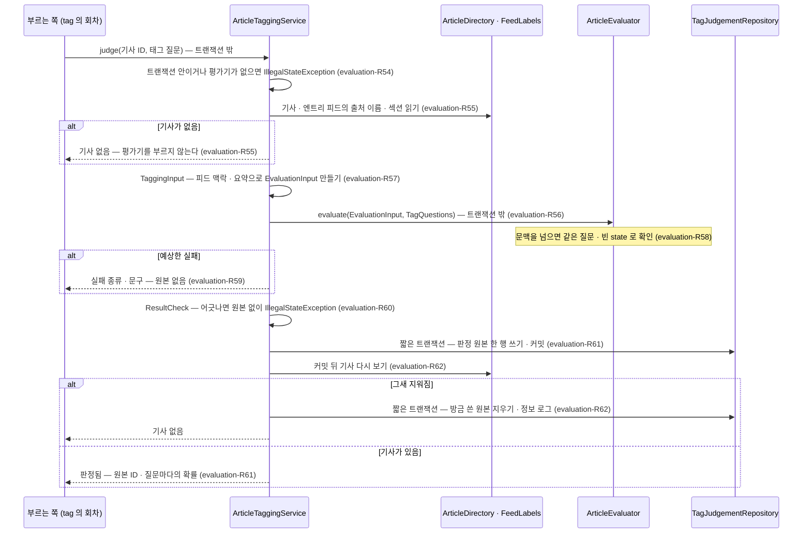
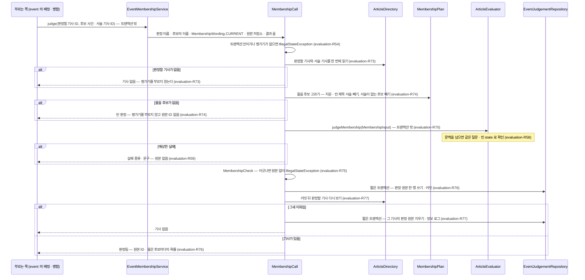
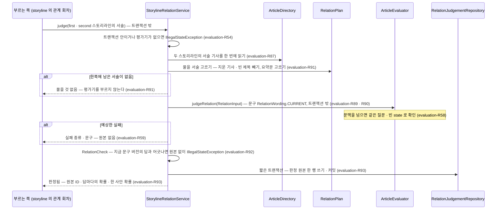
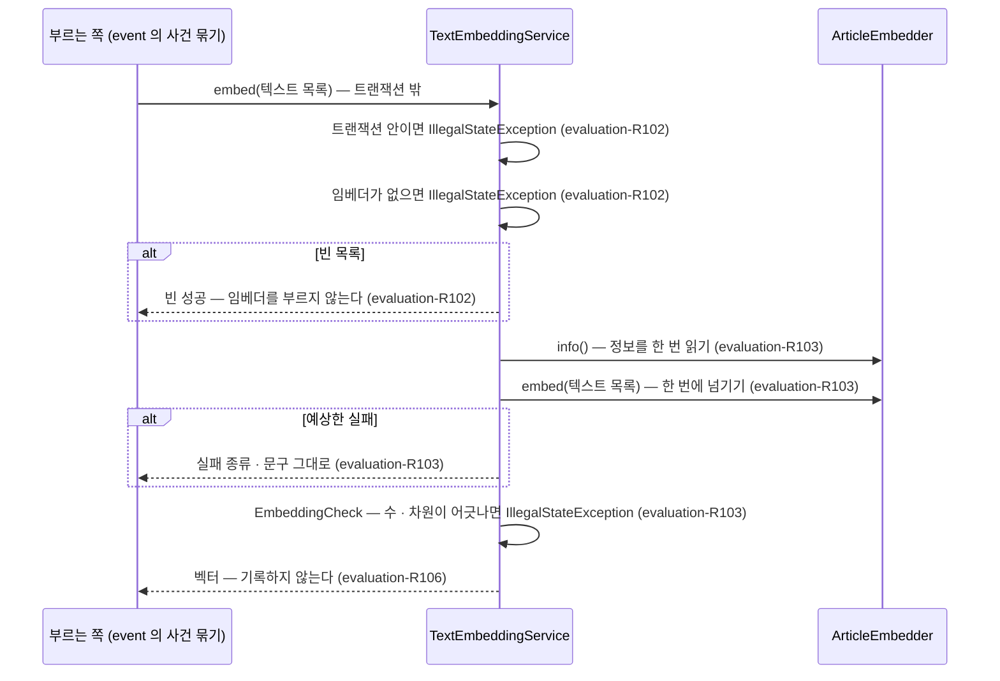
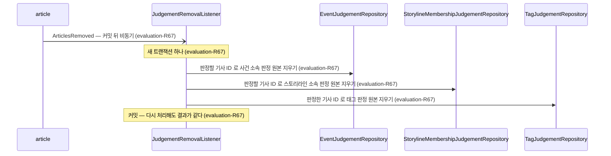

# evaluation 모듈 Spec

공통 구조와 쓰는 규칙은 [specs/README.md](README.md)에 있다.

## 1. 책임과 범위

`evaluation` 은 기사를 운영자 비용의 모델로 평가하는 관문이다. 판정마다 공개 API 하나를 두고, 그 판정의 모델 요청을 조립해 부르고, 결과를 대조하고, 판정 원본을 기록한다. 기사 임베딩도 이 관문의 연산이다. 임베딩은 결과를 확인하지만 기록하지 않는다. 판정 · 임베딩 결과를 받아들이고 쌓는 일은 부르는 모듈이 한다.

- **관문** — 모델을 부르는 포트 `ArticleEvaluator` 를 둔다. Jev 를 부르는 포트는 이것 하나다. 운영 구현은 `JevArticleEvaluator`, 로컬 대체물은 `FakeArticleEvaluator` 다. 작업 역할은 평가기 없이 운영하지 않는다(evaluation-R43)
- **태그 판정** — 기사 하나를 넘긴 태그 질문(주제 · 지역 · 형식 · 중요도)으로 평가하는 공개 API `ArticleTagging` 을 `tag` 에 낸다. 기사 ID 로 기사 내용과 피드 맥락을 읽어 요청을 만들고, 결과를 태그 질문과 대조해 판정 원본을 남기고, 그 ID 와 분포를 돌려준다. 남긴 원본을 태그 질문으로 다시 읽고(빠진 태그 채움), 원본의 평가기 · 모델 버전 · 입력 토큰을 낸다(evaluation-R17 · R40 ~ R42)
- **사건 소속 판정** — 기사 하나가 후보 사건마다 그 사건을 다루는지 평가기에 묻는 공개 API `EventMembership` 을 사건 묶기에 낸다. 판정할 기사와 후보 사건의 서술 기사를 ID 로 받아 질문을 만들고, 성공한 판정의 원본을 남겨 그 ID 를 결과에 싣는다(evaluation-R37 · R38)
- **스토리라인 소속 판정** — 기사 하나가 후보마다 같은 사안의 전개인지 평가기에 묻는 공개 API `StorylineMembership` 을 `storyline` 의 잇기에 낸다. 요청 · 결과의 꼴은 사건 소속 판정과 같고, 문구와 판정 원본이 다르다(evaluation-R51 · R52)
- **관계 판정** — 두 스토리라인이 어떤 관계인지 평가기에 묻는 공개 API `StorylineRelation` 을 `storyline` 에 낸다. 스토리라인 ID 와 서술 사건의 대표 기사 ID · 시각을 받아 제목 · 요약문으로 요청을 만들고, 성공한 판정의 원본을 남겨 그 ID 와 답마다의 확률을 돌려준다. 답에는 같은 사안의 조각이 있다(evaluation-R48 · R49)
- **기사 임베딩** — 텍스트 목록을 벡터로 바꾸는 공개 API `TextEmbedding` 을 사건 묶기에 낸다. 텍스트는 부르는 쪽이 만들어 넘긴다. 관문은 결과의 수 · 차원을 확인해 돌려주고, 결과를 기록하지 않는다(evaluation-R45)
- **임베더** — 임베더 포트 `ArticleEmbedder` 를 둔다. 운영 구현은 앱 안 로컬 모델(기본)과 OpenAI 호환 외부 API 이고, 로컬 대체물은 `FakeArticleEmbedder` 다. 작업 역할은 임베더 없이 운영하지 않는다(evaluation-R46 · R47)
- **판정 원본 조회** — 운영자 화면에 공개 조회로 낸다(evaluation-R39 · R50)
  - 사건 소속 판정 원본(`EventJudgementLog`) — 판정 시각이 기간 안인 것과 ID 로 찾는 것. 판정의 쓰임과 결과는 `event` 가 낸다
  - 관계 판정 원본(`RelationJudgementLog`) — ID 로 찾는다. 원본 응답을 평가기가 다시 읽어 답마다의 확률을 낸다
- **지운 기사 따르기** — `article` 이 기사를 지우면 그 기사의 판정 원본(사건 소속 · 스토리라인 소속 · 태그)을 지운다(evaluation-R44)
- **평가기 시간** — 평가기 요청 하나의 마감, 판정 한 번이 평가기를 기다리는 가장 긴 시간, 일시 실패 뒤 다시 묻기까지의 간격을 공개 상수 · 함수(`EvaluatorTiming`)로 낸다. 판정을 부르는 모듈은 점유 기간과 다시 물을 시각을 이 값에서 정한다(evaluation-R53)

질문 문장의 소유는 판정마다 다르다.

- 태그 질문 문장은 `tag` 의 체계 데이터로 넘어온다. 운영자가 바꾸는 질문 틀과 설명이다
- 사건 소속 · 스토리라인 소속 질문 문구와 관계 판정의 문구는 이 모듈의 코드 상수다(evaluation-R72 · R82 · R90)

판정 원본은 판정마다 이 모듈이 남긴다. 임베딩의 입력 텍스트는 부르는 쪽이 만들고, 벡터와 그 모델 버전은 부르는 쪽이 저장한다(evaluation-R101 · R106).

하지 않는 것:

- 사용자를 모른다. 판정은 공유 판정이다
- 태그 체계 · 태그 기준 · 저장 기준과 판정의 해석(저장 기준 거르기 · 대표값 · 조회 시점 판정)을 모른다. 이것은 `tag` 가 한다. 이 모듈은 넘겨받은 태그 질문으로 묻고 분포를 돌려줄 뿐이다
- 사건과 사건 묶기 기준을 모른다. 확률을 받아들일지는 `event` 가 정한다
- 스토리라인과 잇기 · 관계 기준을 모른다. 어느 후보 · 쌍을 물을지, 서술 사건을 어떻게 고를지, 확률 · 답을 받아들일지는 `storyline` 이 정한다
- 표현 텍스트를 만들거나 벡터를 저장 · 비교하지 않는다. 이것은 `event` 가 한다
- 기사를 수집하거나 저장하지 않는다. 기사 내용과 출처 이름 · 피드 섹션은 `article` · `source` 의 공개 조회로 읽는다
- 인증을 모른다. 운영자 요청인지는 부르는 쪽(`admin`)이 정해 넘긴다

다른 모듈과의 의존과 주고받는 이벤트는 [overview.md §5](../overview.md#5-모듈-지도)에 있다.

## 2. 용어

| 용어 | 뜻 |
|---|---|
| 관문 | 운영자 비용의 모델로 기사를 평가하는 모든 판정과 임베딩이 거치는 이 모듈. 공개 API 는 판정마다 하나와 임베딩 하나이고, 모델 포트는 판정의 `ArticleEvaluator` 와 임베딩의 `ArticleEmbedder` 다 |
| 태그 판정 | 기사 하나를 넘긴 태그 질문으로 평가하는 것. 결과는 질문마다의 확률 분포이고, 질문마다의 형식은 evaluation-R56 의 표에 있다. `tag` 가 저장된 확률을 지금 기준으로 가르는 조회 시점 판정과 다르다 |
| 태그 질문 | 태그 판정이 묻는 것(`TagQuestions`). 주제 대분류와 그 중분류 · 지역 · 형식 선택지 · 중요도 수준과 각 질문 문장이다. `tag` 의 체계 한 버전에서 온다 |
| 피드 맥락 | 태그 판정 입력에서 기사가 실린 피드 하나의 값. 출처 이름 · 피드 섹션(수집 프로필) · 그 피드 항목의 RSS 카테고리이고, 기사가 실린 피드(엔트리)마다 하나다(evaluation-R17 · R57) |
| 실패 종류 | 평가기가 예상한 실패의 종류(`EvaluatorFailureKind`). 일시 · 기사 거부 · 평가기 사용 불가 셋이다. 종류를 부르는 쪽에 돌려주고, 종류마다 무엇을 할지는 부르는 쪽이 정한다([ADR-0058](../adr/0058-evaluator-failures-in-three-kinds-and-unavailable-evaluator-skips-article-retries.md)) |
| 사건 소속 판정 | 기사 하나가 후보 사건마다 그 사건을 다루는지 평가기에 묻는 것. 후보마다 Yes/No 확률 하나를 얻고, 받아들일지는 부르는 쪽(사건 묶기)이 정한다(evaluation-R37 · R38) |
| 후보 사건 · 서술 기사 | 사건 소속 판정에서 묻는 사건(사건 ID)과 그 사건을 설명하는 기사. 부르는 쪽이 사건 중심에 가까운 기사를 고르고, 질문에는 그 제목이 실린다(evaluation-R70) |
| 문구 버전 | 사건 소속 · 스토리라인 소속 질문 문구와 관계 판정 문구의 버전 문자열(`wordingVersion`). 문구나 질문 조립 모양을 바꾸면 올리고, 판정 원본마다 남는다(evaluation-R72 · R82 · R90) |
| 스토리라인 소속 판정 | 기사 하나가 후보마다 같은 사안의 전개인지 평가기에 묻는 것. 후보마다 Yes/No 확률 하나를 얻고, 받아들일지는 부르는 쪽(`storyline`)이 정한다(evaluation-R51 · R52) |
| 관계 판정 | 두 스토리라인의 관계를 평가기에 묻는 것. 지금 문구 버전의 답(`RelationAnswer`)마다의 확률과, 스토리라인마다 한 사안의 전개일 확률을 얻는다. 받아들일지는 부르는 쪽(`storyline`)이 정한다(evaluation-R48 · R49) |
| 스토리라인 · 서술 사건 | 관계 판정에서 견주는 사건 집합(`storyline` 의 스토리라인, 스토리라인 ID 로 가리킨다)과 그 스토리라인을 설명하는 사건. 부르는 쪽이 고르고, 요청에는 사건마다 대표 기사의 제목과 날짜가 실린다. 일부 사건은 요약문도 실린다(evaluation-R87) |
| 판정 원본 | 성공한 판정 한 번의 기록. 판정마다 남기는 값과 ID 타입은 evaluation-R61 · R76 · R84 · R93 에 있다. 판정을 반영한 쪽의 기록이 그 ID 를 가리킨다 |
| 임베더 | 텍스트를 벡터로 바꾸는 외부 의존(포트 `ArticleEmbedder`). 이름 · 모델 버전 · 차원을 밝힌다. 운영 구현은 앱 안 로컬 모델(기본)과 OpenAI 호환 외부 API 둘이고, provider 설정으로 고른다(evaluation-R45 · R46) |
| 임베딩 모델 버전 | 임베더가 밝히는 모델을 가리키는 값. 다른 모델과 겹치지 않는다. 부르는 쪽이 벡터와 함께 남겨, 같은 모델 버전의 벡터끼리만 비교한다(evaluation-R105) |
| 임베딩 실패 종류 | 임베더가 예상한 실패의 종류(`EmbedderFailureKind`). 일시 · 입력 거부 · 임베더 사용 불가 셋이다. 종류마다 무엇을 할지는 부르는 쪽이 정한다([ADR-0092](../adr/0092-embedder-failures-in-three-kinds-with-rejected-articles-isolated-and-dropped-after-a-limit.md)) |
| 다시 읽기 | 판정 원본의 원본 응답을 그 원본을 남긴 평가기의 형식으로 다시 읽는 것. 모델을 부르지 않는다. 태그 판정 원본은 넘긴 태그 질문으로 읽고(evaluation-R64), 관계 판정 원본은 그 원본을 남긴 문구 버전의 답과 한 사안 확률로 읽는다(evaluation-R96) |

## 3. 공개 인터페이스

모듈 최상위 패키지 `net.yozmnews.evaluation` 의 공개 타입은 아래 표다. 값 · 결과 타입의 선언은 각 하위 절에 있다. 이벤트는 내지 않는다.

| 연산 | 공개 API | 그 밖의 공개 타입 |
|---|---|---|
| 태그 판정 | `ArticleTagging` | 태그 질문 `TagQuestions` 과 그 값 타입(`TopicCategory` · `AskedTag` · `FormatChoice` · `FormatOption` · `ImportanceScale` · `ImportanceLevel`), 값 · 결과 타입 |
| 사건 소속 판정 | `EventMembership` | 값 · 결과 타입, 평가기 실패 종류 `EvaluatorFailureKind` |
| 스토리라인 소속 판정 | `StorylineMembership` | `StorylineMembershipQuery` · `StorylineCandidate` · `StorylineMembershipJudgement` · `StorylineMembershipJudgementId` |
| 관계 판정 | `StorylineRelation` | 값 · 결과 타입 |
| 판정 원본 조회 | `EventJudgementLog` · `RelationJudgementLog` | 조회 기간 `JudgementPeriod`, 값 · 결과 타입 |
| 평가기 시간 | `EvaluatorTiming` | — |
| 기사 임베딩 | `TextEmbedding` | `EmbedderInfo` · `Embedding` · `EmbeddingResult` · `Embeddings` · `EmbeddingFailure`, 임베딩 실패 종류 `EmbedderFailureKind` |

받는 이벤트는 `article` 의 `ArticlesRemoved` 이고, 판정의 입력은 `article` 의 공개 조회 `ArticleDirectory.findAll` 과 `source` 의 공개 조회 `FeedLabels` 로 읽는다([article Spec §3](article.md#3-공개-인터페이스) · [source Spec §3](source.md#3-공개-인터페이스)).

HTTP 엔드포인트는 없다. 운영자 HTTP API 는 `admin` 이 이 모듈의 공개 조회를 불러 낸다([ADR-0045](../adr/0045-admin-module-serves-operator-api-over-module-public-operation-apis.md)).

### TagQuestions · TopicCategory · AskedTag · FormatChoice · FormatOption · ImportanceScale · ImportanceLevel

태그 판정의 태그 질문. `tag` 의 `TagSetView` 가 이 타입으로 체계 내용을 담고 `questions()` 로 태그 질문을 낸다([tag Spec §3](tag.md#3-공개-인터페이스)).

```java
public record TagQuestions(List<TopicCategory> topics, List<AskedTag> regions, FormatChoice format,
        ImportanceScale importance) {}

public record TopicCategory(String key, String name, String description, List<AskedTag> subtopics) {}

public record AskedTag(String key, String name, String description, String question) {}

public record FormatChoice(String question, List<FormatOption> options) {}

public record FormatOption(String key, String name, String description, boolean excludedByDefault) {}

public record ImportanceScale(String question, List<ImportanceLevel> levels) {
    public static final int MIN_LEVEL = 1;      // 정본(tag-R7) — 가장 낮은 수준
    public static final int MAX_LEVEL = 5;      // 정본(tag-R7) — 가장 높을 수 있는 수준. 체계마다 몇 수준을 쓰는지는 tag-R7
}

public record ImportanceLevel(int level, String description) {}
```

| 타입 · 필드 | 뜻 | 제약 |
|---|---|---|
| `TagQuestions` | 태그 질문. 넘긴 질문 문장으로 묻고, 이 모듈은 문장을 만들지 않는다 | 검증된 체계에서 온 값이다. 구성 규칙은 `tag` 가 검증하고([tag-R7](tag.md#체계-파일-형식과-검증)), 이 타입은 구성을 다시 검사하지 않는다 |
| `TopicCategory` | 주제 대분류의 키 · 이름 · 설명과 그 중분류. 대분류는 묻지 않는다 | — |
| `AskedTag` | 묻는 태그(주제 중분류 · 지역)의 키 · 이름 · 설명과 질문 문장. 중분류의 키는 전체 키다 | `question` 은 `tag` 가 질문 틀에 설명을 끼운 문장이다([tag-R9](tag.md#체계-파일-형식과-검증)) |
| `FormatChoice` | 형식 Choice 질문과 그 선택지 | — |
| `FormatOption.excludedByDefault` | 기본 제외 형식인가. 이 모듈은 쓰지 않는 `tag` 의 값이고, `user` 가 계정을 만들 때와 그 형식이 새로 생긴 버전을 켤 때 사용자의 제외로 넣는다 | — |
| `ImportanceScale` | 중요도 Score 질문과 수준 순의 수준별 기준. `MIN_LEVEL` · `MAX_LEVEL` 은 가장 낮은 수준과 가장 높을 수 있는 수준의 정본이다. `tag` 의 체계 검증이 이 범위를 쓰고, 체계마다 수준 수는 다를 수 있다([tag-R7](tag.md#체계-파일-형식과-검증)) | — |

관련 규칙: evaluation-R40.

### ArticleTagging · TaggingQuery · TaggingJudgement · TagAnswers · TagReread · TagJudgementId · TagJudgementView

태그 판정. `tag` 의 평가 회차 · 빠진 태그 채움 · 평가 현황 · 검수가 부른다. 구현은 `application` 의 `ArticleTaggingService` 다.

```java
public interface ArticleTagging {
    TaggingJudgement judge(TaggingQuery query);
    TagReread reread(TagJudgementId judgement, TagQuestions questions);
    Map<TagJudgementId, TagJudgementView> find(Collection<TagJudgementId> judgements);
}

public record TaggingQuery(ArticleId articleId, TagQuestions questions) {}

public sealed interface TaggingJudgement {
    record Judged(TagJudgementId judgement, TagAnswers answers) implements TaggingJudgement {}
    record Failed(EvaluatorFailureKind kind, String message) implements TaggingJudgement {}
    record ArticleMissing() implements TaggingJudgement {}
}

public record TagAnswers(Map<String, Double> topics, Map<String, Double> regions, Map<String, Double> formats,
        Map<Integer, Double> importance) {}

public sealed interface TagReread {
    record Read(TagAnswers answers) implements TagReread {}
    record Unread(Reason reason, String message) implements TagReread {
        public enum Reason { OTHER_EVALUATOR, UNREADABLE }
    }
}

public record TagJudgementId(long value) {}                  // 1 이상 — 아니면 IllegalArgumentException

public record TagJudgementView(TagJudgementId id, ArticleId articleId, String evaluator, String modelVersion,
        int inputTokens, Instant judgedAt) {}
```

| 타입 · 멤버 | 뜻 | 제약 |
|---|---|---|
| `judge` | 기사 하나를 태그 질문으로 판정한다(evaluation-R40 · R41) | — |
| `reread` | 판정 원본의 원본 응답을 넘긴 태그 질문으로 다시 읽는다. 모델을 부르지 않는다(evaluation-R64) | — |
| `find` | 판정 원본 ID 마다 원본의 평가기 · 모델 버전 · 입력 토큰 · 판정 시각을 낸다(evaluation-R66) | — |
| `Judged.judgement` | 남긴 판정 원본의 ID. 판정을 반영한 쪽이 자기 기록에 남긴다 | — |
| `TagAnswers` | 태그 질문의 키마다 확률. 키는 주제 중분류 전체 키 · 지역 키 · 형식 키와 중요도 수준이다. 태그 질문의 키마다 하나씩 있고 다른 키는 없다(evaluation-R60) | 확률은 0 이상 1 이하의 유한값 |
| `Failed` | 평가기의 예상한 실패의 종류와 운영자용 문구. 판정 원본을 남기지 않았다(evaluation-R59) | 문구는 공백뿐이 아니고 비밀 값을 담지 않는다 |
| `ArticleMissing` | 판정할 기사가 없다. 부르기 전에 지워졌거나 판정 중에 지워졌고, 판정 원본은 남지 않는다(evaluation-R55 · R62) | — |
| `Unread.Reason` | 다시 읽지 못한 까닭. 값마다의 뜻은 evaluation-R64 다 | — |
| `Unread.message` | 운영자용 문구 | 공백뿐이 아니고 비밀 값 · 원본 응답 원문을 담지 않는다 |
| `TagJudgementView` | 판정 원본 하나의 평가기 · 모델 버전 · 입력 토큰 · 판정 시각과 판정한 기사 | — |

- 계약
  - `judge` 는 외부 호출이라 부르는 자리가 정해져 있다(evaluation-R54). 어기면 `IllegalStateException` 이고 부르는 쪽 결함이다
  - `judge` 의 결과가 태그 질문과 어긋나거나 원본 응답을 저장할 수 없으면 원본을 남기지 않고 `IllegalStateException` 이다(evaluation-R60). 평가기의 예상 못한 예외는 그대로 던진다(evaluation-R59)
  - `reread` 는 외부를 부르지 않아 부르는 쪽 트랜잭션 안에서 불러도 된다(evaluation-R65). 평가기의 예상 못한 예외는 그대로 던진다
  - `find` 는 평가기 없이 두 역할에서 동작한다. 부르는 쪽 트랜잭션이 있으면 그 안에서 같은 스냅숏으로 읽는다
  - 사용자 정보를 받지 않는다. 공유 판정이다

관련 규칙: evaluation-R17 · evaluation-R40 ~ evaluation-R42 · evaluation-R44.

### EventMembership · MembershipQuery · EventDescriptor · MembershipJudgement · EvaluatorFailureKind

사건 소속 판정. 사건 묶기가 기사 하나를 후보 사건마다 그 사건을 다루는지 평가기로 판정한다. 구현은 `application` 의 `EventMembershipService` 다.

```java
public interface EventMembership {
    MembershipJudgement judge(MembershipQuery query);
}

public record MembershipQuery(ArticleId articleId, List<EventDescriptor> candidates) {
    public static final int MAX_CANDIDATES = 10;
}

public record EventDescriptor(long eventId, List<ArticleId> articleIds) {
    public static final int MAX_ARTICLES = 5;
}

public sealed interface MembershipJudgement {
    record Judged(@Nullable EventJudgementId judgement, Map<Long, Double> probabilities) implements MembershipJudgement {}
    record Failed(EvaluatorFailureKind kind, String message) implements MembershipJudgement {}
    record ArticleMissing() implements MembershipJudgement {}
}

public enum EvaluatorFailureKind { TRANSIENT, ARTICLE_REJECTED, EVALUATOR_UNAVAILABLE }
```

| 타입 · 멤버 | 뜻 | 제약 |
|---|---|---|
| `judge` | 판정할 기사가 후보 사건마다 그 사건을 다루는지 판정한다(evaluation-R37 · R38) | — |
| `MembershipQuery.articleId` | 판정할 기사 | 어느 후보의 서술 기사도 아니다 |
| `MembershipQuery.candidates` | 후보 사건. 이 순서로 묻는다 | 1 ~ `MAX_CANDIDATES`(10)개, 사건 ID 가 겹치지 않는다 |
| `EventDescriptor.eventId` | 후보 사건 ID. 부르는 쪽(`event`)의 사건이다 | 1 이상 |
| `EventDescriptor.articleIds` | 서술 기사. 사건 중심에 가까운 기사를 부르는 쪽이 고르고, 이 순서로 제목을 질문에 싣는다 | 1 ~ `MAX_ARTICLES`(5)개, 겹치지 않는다 |
| `Judged.judgement` | 남긴 판정 원본의 ID. 평가기를 부르지 않았으면(확률이 빈 맵) null 이다. 판정을 반영한 쪽이 자기 기록에 남긴다(evaluation-R76) | 원본이 없는 것과 확률이 빈 맵인 것은 함께 성립한다. 어기면 `IllegalArgumentException` |
| `Judged.probabilities` | 물은 후보의 사건 ID 마다 그 사건에 속할 확률. 서술 기사가 모두 지워진 후보는 묻지 않아 없고, 그런 후보뿐이면 빈 맵이다(evaluation-R74) | 사건 ID 는 1 이상, 확률은 0 ~ 1 의 유한값 |
| `Failed` | 평가기의 예상한 실패의 종류와 운영자용 문구. 판정 원본을 남기지 않았다(evaluation-R59) | 문구는 공백뿐이 아니고 비밀 값을 담지 않는다 |
| `ArticleMissing` | 판정할 기사가 없다. 부르기 전에 지워졌거나 판정 중에 지워졌고, 판정 원본은 남지 않는다(evaluation-R73 · R77) | — |
| `EvaluatorFailureKind` | 평가기 실패 종류. 값마다의 뜻은 아래 목록이다 | — |

- 계약
  - 판정은 외부 호출이라 부르는 자리가 정해져 있다(evaluation-R54). 어기면 `IllegalStateException` 이고 부르는 쪽 결함이다
  - 요청 값이 제약을 어기면 생성자가 `IllegalArgumentException` 을 던진다(evaluation-R69)
  - 확률을 받아들일지(기준 · 최댓값)는 부르는 쪽이 정한다. 같은 요청도 확률이 흔들릴 수 있다([ADR-0063](../adr/0063-jev-called-through-one-system-one-schema-context-overflow-probed-with-empty-state-latest-model-alias-by-default.md))
  - 판정에 성공하면 판정 원본을 남긴다(evaluation-R76). 평가기의 예상 못한 예외와 결과가 물은 후보와 어긋남(`IllegalStateException`)은 그대로 던지고 원본을 남기지 않는다(evaluation-R59 · R75)
  - 사용자 정보를 받지 않는다. 공유 판정이다

`EvaluatorFailureKind` 의 값:

- `TRANSIENT` — 시간이 지나면 풀릴 수 있다. 마감 초과 · 연결 실패 · 서버 오류 · 요청 제한이 그렇다
- `ARTICLE_REJECTED` — 그 기사 때문이라 다시 보내도 같다. 입력 거부이고, 기사가 평가기의 입력 한도를 넘는 경우를 포함한다
- `EVALUATOR_UNAVAILABLE` — 평가기 자체를 쓸 수 없다. 키 무효 · 한도 소진 · 설정 오류 · 응답을 읽을 수 없음이 그렇다

종류마다 무엇을 할지는 부르는 쪽이 정한다.

- 태그 평가 작업: [tag-R20](tag.md#평가-대기와-평가-작업)
- 사건 배정: [event-R16](event.md#사건-배정)
- 사건 병합: [event-R13](event.md#사건-정리)

관련 규칙: evaluation-R37 · evaluation-R38 · evaluation-R44.

### StorylineMembership · StorylineMembershipQuery · StorylineCandidate · StorylineMembershipJudgement · StorylineMembershipJudgementId

스토리라인 소속 판정. `storyline` 의 잇기가 판정할 사건의 대표 기사 하나를 두고, 그 기사가 후보마다 같은 사안의 전개인지 평가기로 판정한다([ADR-0194](../adr/0194-storyline-linking-asks-jev-only-for-band-candidates-and-reuses-recorded-probabilities-until-either-side-doubles.md)). 구현은 `application` 의 `StorylineMembershipService` 다. 요청 · 결과의 꼴과 실패 종류는 사건 소속 판정과 같고, 질문 문구와 판정 원본이 다르다.

```java
public interface StorylineMembership {
    StorylineMembershipJudgement judge(StorylineMembershipQuery query);
}

public record StorylineMembershipQuery(ArticleId articleId, List<StorylineCandidate> candidates) {}

public record StorylineCandidate(long candidateId, List<ArticleId> articleIds) {}

public sealed interface StorylineMembershipJudgement {
    record Judged(@Nullable StorylineMembershipJudgementId judgement, Map<Long, Double> probabilities)
            implements StorylineMembershipJudgement {}
    record Failed(EvaluatorFailureKind kind, String message) implements StorylineMembershipJudgement {}
    record ArticleMissing() implements StorylineMembershipJudgement {}
}

public record StorylineMembershipJudgementId(long value) {}
```

| 타입 · 멤버 | 뜻 | 제약 |
|---|---|---|
| `judge` | 판정할 기사가 후보마다 같은 사안의 전개인지 판정한다(evaluation-R51 · R52) | — |
| `StorylineMembershipQuery.articleId` | 판정할 기사. 부르는 쪽이 판정할 사건의 대표 기사를 고른다 | 어느 후보의 서술 기사도 아니다 |
| `StorylineMembershipQuery.candidates` | 후보. 이 순서로 묻는다 | 1 ~ `MembershipQuery.MAX_CANDIDATES`(10)개, 후보 ID 가 겹치지 않는다 |
| `StorylineCandidate.candidateId` | 후보 ID. 부르는 쪽(`storyline` 의 잇기)의 스토리라인(붙이기)이나 이웃 사건(짝)을 가리킨다. 판정 원본의 물은 후보에 키 `candidateId` 로 남는다 | 1 이상 |
| `StorylineCandidate.articleIds` | 서술 기사. 후보를 설명하는 기사를 부르는 쪽이 고르고, 이 순서로 제목을 질문에 싣는다 | 1 ~ `EventDescriptor.MAX_ARTICLES`(5)개, 겹치지 않는다 |
| `Judged.judgement` | 남긴 판정 원본의 ID. 평가기를 부르지 않았으면(확률이 빈 맵) null 이다. 판정을 반영한 쪽이 자기 기록에 남긴다(evaluation-R84) | 원본이 없는 것과 확률이 빈 맵인 것은 함께 성립한다. 어기면 `IllegalArgumentException` |
| `Judged.probabilities` | 물은 후보의 후보 ID 마다 같은 사안의 전개일 확률. 서술 기사가 모두 지워진 후보는 묻지 않아 없고, 그런 후보뿐이면 빈 맵이다(evaluation-R83) | 후보 ID 는 1 이상, 확률은 0 ~ 1 의 유한값 |
| `Failed` · `ArticleMissing` | 사건 소속 판정과 같다. 판정 원본을 남기지 않았다 | 문구는 공백뿐이 아니고 비밀 값을 담지 않는다 |
| `StorylineMembershipJudgementId` | 스토리라인 소속 판정 원본의 ID(`storyline_membership_judgements.id`). 사건 소속 판정 원본 ID 와 다른 수 공간이다 | 1 이상 |

- 계약
  - `EventMembership` 의 계약과 같다(evaluation-R81 · R83). 요청 값의 검사는 사건 소속 판정의 요청과 같은 규칙 하나를 쓴다(패키지 비공개 `MembershipChecks`). 후보 목록의 수 · 겹침은 포트 입력과 같은 정본(`MembershipCandidate.requireCandidates`)이다

관련 규칙: evaluation-R51 · evaluation-R52 · evaluation-R44.

### StorylineRelation · RelationQuery · StorylineDescriptor · StorylineHappening · RelationAnswer · RelationJudgement · RelationJudgementId

관계 판정. `storyline` 이 두 스토리라인의 관계를 평가기로 판정한다. 구현은 `application` 의 `StorylineRelationService` 다.

```java
public interface StorylineRelation {
    RelationJudgement judge(RelationQuery query);
}

public record RelationQuery(StorylineDescriptor first, StorylineDescriptor second) {}

public record StorylineDescriptor(long storylineId, int happenings, Instant firstAt, Instant lastAt, List<StorylineHappening> described) {
    public static final int MAX_DESCRIBED = 10;
    public static final int MAX_SUMMARIZED = 3;
}

public record StorylineHappening(ArticleId articleId, Instant at, boolean summarized) {}

public enum RelationAnswer { NONE, SAME_MATTER, SECOND_PART_OF_FIRST, FIRST_PART_OF_SECOND, FIRST_LED_TO_SECOND,
        SECOND_LED_TO_FIRST }

public sealed interface RelationJudgement {
    record Judged(RelationJudgementId judgement, Map<RelationAnswer, Double> probabilities,
            double firstOneMatter, double secondOneMatter) implements RelationJudgement {}
    record Failed(EvaluatorFailureKind kind, String message) implements RelationJudgement {}
    record NothingToAsk() implements RelationJudgement {}
}

public record RelationJudgementId(long value) {}             // 1 이상 — 아니면 IllegalArgumentException
```

| 타입 · 멤버 | 뜻 | 제약 |
|---|---|---|
| `judge` | 두 스토리라인의 관계를 판정한다(evaluation-R48 · R49) | — |
| `RelationQuery.first` · `second` | 견줄 두 스토리라인. 요청에는 first 가 A, second 가 B 로 실린다. 순서는 부르는 쪽이 정하고 이 모듈은 바꾸지 않는다 | 두 스토리라인 ID 가 다르다 |
| `StorylineDescriptor.storylineId` | 스토리라인 ID. 부르는 쪽(`storyline`)의 스토리라인이다 | 1 이상 |
| `StorylineDescriptor.happenings` | 스토리라인 전체의 사건 수. 서술 사건 수가 아니다 | 1 이상 |
| `StorylineDescriptor.firstAt` · `lastAt` | 스토리라인의 첫 · 마지막 기사 시각 | `firstAt ≤ lastAt` |
| `StorylineDescriptor.described` | 서술 사건. 이 순서로 요청에 싣는다 | 1 ~ `MAX_DESCRIBED`(10)개, 기사 ID 가 겹치지 않는다. `summarized` 인 것은 `MAX_SUMMARIZED`(3)개까지 |
| `StorylineHappening.articleId` | 그 사건의 대표 기사. 제목과 요약문을 읽는다 | 두 스토리라인에 걸쳐 같은 기사가 있어도 된다(두 스토리라인이 함께 가진 사건) |
| `StorylineHappening.at` | 그 사건의 시각. 요청에 날짜로 싣는다 | — |
| `StorylineHappening.summarized` | 요약문을 싣는가. 요약문이 없는 기사면 싣지 않는다 | — |
| `RelationAnswer` | 답. 값마다의 뜻은 아래 목록이다. 선언 순서는 부르는 쪽이 확률이 같을 때 쓰는 순서다. 옛 문구 버전(`relation-1`)에는 조각이 없다 | — |
| `Judged.judgement` | 남긴 판정 원본의 ID. 판정을 반영한 쪽이 자기 기록에 남긴다(evaluation-R93) | — |
| `Judged.probabilities` | 답 모두의 확률. 판정은 언제나 지금 문구 버전으로 묻고, 그 문구 버전의 답은 `RelationAnswer` 모두다 | 모든 답이 있고 0 ~ 1 의 유한값이다. 합은 계약하지 않는다 |
| `Judged.firstOneMatter` · `secondOneMatter` | 그 스토리라인이 한 사안의 전개일 확률. 비슷한 종류의 일을 모은 것이면 낮다 | 0 ~ 1 의 유한값 |
| `Failed` | 평가기의 예상한 실패의 종류와 운영자용 문구. 판정 원본을 남기지 않았다(evaluation-R59) | 문구는 공백뿐이 아니고 비밀 값을 담지 않는다 |
| `NothingToAsk` | 한쪽 스토리라인의 서술이 하나도 남지 않았다(서술 기사가 모두 지워졌거나 제목이 비었다). 평가기를 부르지 않았고 판정 원본이 없다(evaluation-R91) | — |

- 계약
  - 판정은 외부 호출이라 부르는 자리가 정해져 있다(evaluation-R54). 어기면 `IllegalStateException` 이다
  - 요청 값이 제약을 어기면 생성자가 `IllegalArgumentException` 을 던진다(evaluation-R86)
  - 답을 받아들일지(확률 기준 · 한 사안 기준 · 구조 제약)는 부르는 쪽이 정한다. 같은 요청도 확률이 흔들릴 수 있고, 두 스토리라인의 순서를 바꾸면 답이 달라질 수 있다
  - 판정에 성공하면 판정 원본을 남긴다(evaluation-R93). 평가기의 예상 못한 예외와 결과가 지금 문구 버전의 답과 어긋남(`IllegalStateException`)은 그대로 던지고 원본을 남기지 않는다(evaluation-R59 · R92)
  - 사용자 정보를 받지 않는다. 공유 판정이다
  - 판정 원본은 `RelationJudgementLog` 가 원본 ID 로 찾아 낸다(evaluation-R50)

`RelationAnswer` 의 값:

- `NONE` — 해당 없음
- `SAME_MATTER` — 같은 사안의 조각. 두 스토리라인이 둘로 기록된 하나의 같은 스토리라인이다
- `SECOND_PART_OF_FIRST` — second 가 first 의 부분
- `FIRST_PART_OF_SECOND` — first 가 second 의 부분
- `FIRST_LED_TO_SECOND` — first 가 second 를 낳음
- `SECOND_LED_TO_FIRST` — second 가 first 를 낳음

관련 규칙: evaluation-R48 · evaluation-R49.

### EventJudgementLog · EventJudgementId · EventJudgementView · JudgedEvent · EventJudgementCursor · EventJudgementPage

사건 소속 판정 원본 조회. 운영자 화면이 기간의 판정 원본을 훑고, 배정이 가리키는 판정 원본을 ID 로 찾는다. 구현은 `application` 의 `EventJudgementLogService` 다.

```java
public interface EventJudgementLog {
    int MAX_PAGE_SIZE = 100;                                 // 한 쪽의 상한 — 정본. 측정 전 목표
    EventJudgementPage list(JudgementPeriod period, @Nullable EventJudgementCursor after, int size);
    Optional<EventJudgementView> find(EventJudgementId id);
}

public record EventJudgementId(long value) {}                // 1 이상 — 아니면 IllegalArgumentException
public record EventJudgementView(EventJudgementId id, ArticleId articleId, List<JudgedEvent> candidates,
        String evaluator, String modelVersion, String wordingVersion, int inputTokens, Instant judgedAt) {}
public record JudgedEvent(long eventId, List<ArticleId> describedArticles, double probability) {}
public record EventJudgementCursor(Instant judgedAt, EventJudgementId id) {}
public record EventJudgementPage(List<EventJudgementView> judgements, @Nullable EventJudgementCursor next) {}
```

| 타입 · 멤버 | 뜻 |
|---|---|
| `list` | 판정 시각이 기간 안인 판정 원본. (판정 시각, ID) 내림차순이고, `size` 가 1 ~ `MAX_PAGE_SIZE` 밖이면 `IllegalArgumentException` 이다(evaluation-R78) |
| `find` | 판정 원본 하나를 목록과 같은 값으로 낸다. 없는(지운) 원본이면 빈 값이다(evaluation-R80) |
| `EventJudgementView.candidates` | 물은 후보. 요청 순서다 |
| `EventJudgementView.inputTokens` | 판정 요청의 입력 토큰. 출력 토큰은 남기지 않는다([ADR-0002](../adr/0002-shared-evaluation-with-jev.md)) |
| `JudgedEvent.eventId` | 판정 당시의 후보 사건 ID. 부르는 쪽(`event`)의 사건이고, 그 뒤 합쳐졌거나 지워졌을 수 있다 |
| `JudgedEvent.describedArticles` | 질문에 제목을 쓴 서술 기사. 요청 순서다 |
| `JudgedEvent` 생성자 | 사건 ID 1 미만 · 서술 기사 없음 · 확률이 0 ~ 1 의 유한값이 아니면 `IllegalArgumentException` |
| `EventJudgementPage.next` | 다음 쪽의 커서. 더 없으면 null 이다 |

- 계약
  - 트랜잭션 · 역할 애너테이션이 없어 두 역할에서 동작한다. 연산마다 질의 하나다
  - 원본 응답은 내지 않는다(evaluation-R79). 판정의 쓰임(배정 · 병합)과 결과는 `event` 의 `EventReview.judgementUses` 가 원본 ID 로 낸다([event Spec §3](event.md#3-공개-인터페이스))
  - 사용자 정보를 받지 않는다

관련 규칙: evaluation-R38 · evaluation-R39.

### RelationJudgementLog · RelationJudgementView · RelationReading

관계 판정 원본 조회. 운영자 화면이 관계 · 물은 기록이 가리키는 판정 원본을 ID 로 찾는다. 구현은 `application` 의 `RelationJudgementLogService` 다.

```java
public interface RelationJudgementLog {
    int MAX_IDS = 500;                                       // 한 번에 찾는 원본 수의 상한 — 정본. 측정 전 목표
    Map<RelationJudgementId, RelationJudgementView> findAll(Collection<RelationJudgementId> ids);
}

public record RelationJudgementView(RelationJudgementId id, long firstStorylineId, long secondStorylineId, String evaluator,
        String modelVersion, String wordingVersion, int inputTokens, Instant judgedAt, RelationReading reading) {}

public sealed interface RelationReading {
    record Read(Map<RelationAnswer, Double> probabilities, double firstOneMatter, double secondOneMatter)
            implements RelationReading {}
    record Unread(Reason reason, String message) implements RelationReading {
        public enum Reason { NO_EVALUATOR, OTHER_EVALUATOR, UNREADABLE }
    }
}
```

| 타입 · 멤버 | 뜻 |
|---|---|
| `findAll` | 주어진 ID 의 판정 원본. 없는(지운) ID 는 결과에 없고, 수가 `MAX_IDS` 를 넘으면 `IllegalArgumentException` 이다(evaluation-R95) |
| `RelationJudgementView.firstStorylineId` · `secondStorylineId` | 그 판정 요청의 first · second 스토리라인 ID. 확률의 방향(`RelationAnswer`)은 이 둘을 기준으로 한다. 판정 뒤 스토리라인이 합쳐졌으면 합쳐진 쪽의 ID 일 수 있다 |
| `RelationJudgementView.inputTokens` | 판정 요청의 입력 토큰 |
| `RelationJudgementView.reading` | 원본 응답을 다시 읽은 결과(evaluation-R96 · R97) |
| `Read.probabilities` | 그 원본을 남긴 문구 버전의 답 모두의 확률. 답의 집합이 알려진 문구 버전(`RelationWording.KNOWN`) 하나의 답과 같고 확률은 0 ~ 1 의 유한값이다. 아니면 생성자가 `IllegalArgumentException` 이다. `relation-1` 의 원본에는 조각이 없다 |
| `Read.firstOneMatter` · `secondOneMatter` | 스토리라인마다 한 사안의 전개일 확률. 0 ~ 1 의 유한값이다 |
| `Unread.reason` | 다시 읽지 못한 까닭. 값마다의 뜻은 evaluation-R97 이다 |
| `Unread.message` | 운영자용 문구. 공백뿐이 아니고 원본 응답 원문을 담지 않는다 |

- 계약
  - 모델을 부르지 않는다. 저장된 원본 응답을 그 원본을 남긴 평가기의 형식으로 읽는다(evaluation-R96)
  - 트랜잭션 · 역할 애너테이션이 없어 두 역할에서 동작한다. 읽기 질의 하나다
  - 원본 응답 · 서술은 내지 않는다. 그 판정을 반영했는지와 결과는 `storyline` 이 원본 ID 로 낸다([storyline Spec §3](storyline.md#3-공개-인터페이스))
  - 사용자 정보를 받지 않는다

관련 규칙: evaluation-R50.

### JudgementPeriod

판정 원본 조회 기간. `EventJudgementLog` 가 받는다.

```java
public record JudgementPeriod(Instant from, Instant to) {
    public static final int MAX_DAYS = 31;
    public static final Duration MAX_LENGTH = DayRange.maxLength(MAX_DAYS);
    public static Optional<JudgementPeriod> of(Instant from, Instant to);
    public static Optional<JudgementPeriod> ofDays(LocalDate first, LocalDate last, ZoneId zone);
}
```

| 멤버 | 뜻 |
|---|---|
| `from` · `to` | `[from, to)`. 시작 포함 · 끝 제외이고 시간대가 없다 |
| `MAX_DAYS` | 날짜 범위의 상한(일). 이 모듈의 판정 원본 조회 상한의 정본이다(evaluation-R78) |
| `MAX_LENGTH` | 시각 범위의 상한. 날짜 `MAX_DAYS` 일 범위의 시각 길이 상한이다(`platform` 의 `DayRange.maxLength`) |
| 생성자 | `from < to` 이고 길이가 `MAX_LENGTH` 이하가 아니면 `IllegalArgumentException` 이다. 범위 밖 기간은 만들어지지 않는다 |
| `of` | 시각 범위. 범위 밖이면 빈 값이다 |
| `ofDays` | 날짜 범위 `[first 의 그 시간대 자정, last 다음 날의 그 시간대 자정)`. 변환은 `platform` 의 `DayRange.of` 다([platform Spec §3](platform.md#3-공개-인터페이스)). 날짜 수가 1 ~ `MAX_DAYS` 가 아니거나 만든 시각 범위가 `of` 의 규칙을 어기면 빈 값 |

관련 규칙: evaluation-R39.

### EvaluatorTiming

평가기 시간. 판정을 부르는 모듈이 점유 기간과 일시 실패 뒤 다시 물을 시각을 정하는 값이다.

```java
public final class EvaluatorTiming {
    public static final Duration REQUEST_DEADLINE = Duration.ofSeconds(15);
    public static final Duration LONGEST_JUDGEMENT;   // REQUEST_DEADLINE × 판정 한 번의 요청 수 상한(2)
    public static final Duration FIRST_RETRY = Duration.ofMinutes(1);
    public static final Duration MAX_RETRY = Duration.ofHours(1);
    public static Duration retryDelay(int transientFailures);
}
```

| 멤버 | 뜻 |
|---|---|
| `REQUEST_DEADLINE` | 평가기 요청 하나(헤더 · 본문 전부)의 마감. Jev 구현이 쓴다(evaluation-R98) |
| `LONGEST_JUDGEMENT` | 판정 공개 API 한 번이 평가기를 기다리는 가장 긴 시간. 판정을 부르는 회차는 이 값으로 점유 기간을 계산한다(evaluation-R98 · R99) |
| `FIRST_RETRY` · `MAX_RETRY` | 일시 실패 뒤 간격의 첫 값과 상한(evaluation-R100) |
| `retryDelay` | 일시 실패(`EvaluatorFailureKind.TRANSIENT`) 뒤 다시 묻기까지의 간격(evaluation-R100). `transientFailures` 는 이번 실패를 센 뒤의 일시 실패 수이고, 1 미만이면 `IllegalArgumentException` 이다 |

관련 규칙: evaluation-R53.

### TextEmbedding · EmbedderInfo · Embedding · EmbeddingResult · Embeddings · EmbeddingFailure · EmbedderFailureKind

기사 임베딩. 사건 묶기가 표현 텍스트 목록을 벡터로 바꾸고, 지금 임베더의 모델 버전을 묻는다. 구현은 `application` 의 `TextEmbeddingService` 다.

```java
public interface TextEmbedding {
    EmbedderInfo info();                          // 이름 · 모델 버전 · 차원
    EmbeddingResult embed(List<String> texts);    // 텍스트마다 벡터 하나 — 예상한 실패는 결과 값
}

public record EmbedderInfo(String name, String modelVersion, int dimensions) {
    public static final int MAX_DIMENSIONS = 4000;
}

public final class Embedding {
    public static Embedding of(float[] values);          // 값을 복사해 받는다
    public static Embedding normalized(float[] values);  // L2 길이 1 로 나눠 받는다
    public int dimensions();
    public float[] values();                             // 복사해 낸다
}

public sealed interface EmbeddingResult permits Embeddings, EmbeddingFailure {}

public record Embeddings(List<Embedding> vectors) implements EmbeddingResult {}                  // 넘긴 순서 · 같은 수
public record EmbeddingFailure(EmbedderFailureKind kind, String message) implements EmbeddingResult {}

public enum EmbedderFailureKind { TRANSIENT, INPUT_REJECTED, EMBEDDER_UNAVAILABLE }
```

| 타입 · 멤버 | 뜻 | 제약 |
|---|---|---|
| `info` | 지금 임베더의 정보. 부를 때마다 같은 값이다 | — |
| `embed` | 텍스트마다 벡터 하나를 넘긴 순서로 낸다(evaluation-R103) | 텍스트 목록은 null 이 아니다 |
| `EmbedderInfo.name` | 임베더 이름(로그용) | 비어 있지 않다 |
| `EmbedderInfo.modelVersion` | 모델을 가리키는 값. 다른 모델과 겹치지 않고, 부르는 쪽이 벡터와 함께 남기는 모델 버전이다(evaluation-R105) | 비어 있지 않다 |
| `EmbedderInfo.dimensions` | 벡터 차원 | 1 이상 · `MAX_DIMENSIONS`(4,000) 이하. 이 상한은 관문이 내는 벡터의 차원 상한이고, 부르는 쪽의 장기 검색 인덱스 `halfvec` HNSW 가 받는 최대 차원이다(evaluation-R104) |
| `Embedding` | 벡터 하나. 같은 값이면 같다(`equals`). `normalized` 는 L2 정규화의 정본이고, 합 · 나눗셈은 `double`, 결과는 `float` 이다 | 길이 1 이상, 값은 모두 유한한 `float`. 어기면 `IllegalArgumentException`(`normalized` 는 영벡터도) |
| `Embeddings.vectors` | 넘긴 텍스트마다 벡터 하나. `embed` 의 성공은 넘긴 텍스트 수만큼의 `info().dimensions()` 차원 벡터다 | 복사해 받는다, null 원소 없음 |
| `EmbeddingFailure.message` | 운영자용 문구 | 비어 있지 않다. 비밀 값 · 응답 본문 · 입력 텍스트를 담지 않는다 |
| `EmbedderFailureKind` | 임베딩 실패 종류. 값마다의 뜻은 아래 목록이다. 종류마다 무엇을 할지는 부르는 쪽이 정하고, 사건 묶기는 [event-R6](event.md#사건-묶기-대기와-회차) 이다 | — |

- 계약
  - 임베딩은 외부 호출이라 부르는 자리가 정해져 있다(evaluation-R102). 어기면 `IllegalStateException` 이고 부르는 쪽 결함이다([ADR-0115](../adr/0115-embedding-api-in-both-roles-looks-up-the-embedder-on-call-and-a-worker-startup-check-requires-one.md))
  - 예상한 실패는 `EmbeddingFailure` 로 돌려준다. 임베더 결과의 수 · 차원이 어긋나면 `IllegalStateException` 이다. 임베더의 예상 못한 예외는 그대로 던진다(evaluation-R103)
  - 빈 목록이면 임베더를 부르지 않고 빈 성공을 낸다(evaluation-R102)
  - 결과를 기록하지 않는다. 벡터와 모델 버전은 부르는 쪽이 저장한다(evaluation-R106, [ADR-0114](../adr/0114-article-embedding-is-a-gateway-operation-of-evaluation-taking-callers-texts-checking-results-and-recording-nothing.md))
  - 사용자 정보를 받지 않는다

`EmbedderFailureKind` 의 값:

- `TRANSIENT` — 시간이 지나면 풀릴 수 있다. 연결 · 마감 · 요청 제한 · 서버 오류가 그렇다
- `INPUT_REJECTED` — 넘긴 입력 때문이라 같은 입력을 다시 보내도 같다
- `EMBEDDER_UNAVAILABLE` — 임베더 자체를 쓸 수 없다. 키 무효 · 모델 없음 · 읽을 수 없는 응답 · 추론 오류가 그렇다

관련 규칙: evaluation-R45 · evaluation-R46.

## 4. 내부 구조

### 개관

패키지와 그 책임:

- (최상위) — 공개 API 와 그 값 · 결과 타입, 실패 종류 `EvaluatorFailureKind` · `EmbedderFailureKind`(§3)
- `domain/evaluator` — 판정의 모델 포트와 그 판단
  - 모델 포트와 그 입력 · 결과 · 실패
  - 피드 맥락의 카테고리 상한과 서술 제목 상한
  - 소속 판정(사건 · 스토리라인)의 질문 문구
  - 관계 판정의 문구와 서술
  - 결과와 질문의 대조
- `domain/jev` — Jev 요청 본문 · 응답 읽기 · 오류 종류 · 키 형식의 판정
- `domain/embedder` — 임베더 포트와 임베더 결과 확인
- `domain/openai` — OpenAI 호환 외부 임베딩의 판단(아래 `domain/openai`)
- `domain/tagging` — 태그 판정의 입력 만들기와 저장할 판정 원본, 태그 판정 원본 저장소
- `domain/membership` — 소속 판정(사건 · 스토리라인)의 물을 후보 고르기 · 결과 대조 · 저장할 판정 원본, 두 판정 원본 저장소
- `domain/relation` — 관계 판정의 물을 서술 고르기 · 결과 대조 · 저장할 판정 원본, 관계 판정 원본 저장소와 읽은 원본
- `application` — 공개 API 의 구현, 지운 기사 리스너, 임베딩 provider 설정과 결선 조건, 작업 역할의 임베더 기동 검사
- `adapter/out/persistence` — 판정 원본 저장소 넷의 JdbcClient 구현
- `adapter/out/jev` — 모델 포트의 운영 구현(Jev)과 그 결선 · 설정, 키가 있는가의 조건, 작업 역할의 키 기동 검사
- `adapter/out/onnx` — 임베더 포트의 로컬 모델 구현. 모델 파일 정보 · 토크나이저 · ONNX Runtime 추론과 결선을 둔다
- `adapter/out/openai` — 임베더 포트의 OpenAI 호환 외부 구현. HTTP 연결 · 설정과 결선을 둔다
- `adapter/out/fake` — 모델 포트와 임베더 포트의 로컬 대체물과 그 결선

과정마다의 협력:

- **태그 판정** — `tag` 의 회차가 `ArticleTagging.judge` 를 부르면 `ArticleTaggingService` 가 기사와 피드 맥락을 읽어 포트에 묻고, 태그 질문과 대조한 판정 원본을 짧은 트랜잭션으로 쓴다(evaluation-R40 · R41). 순서는 아래 "태그 판정의 순서"다
- **태그 판정 다시 읽기** — `tag` 의 빠진 태그 채움이 `ArticleTagging.reread` 를 부르면 `ArticleTaggingService` 가 저장된 원본을 읽고, 포트로 다시 읽어 태그 질문과 대조한다. 포트가 모델을 부르지 않아 `reread` 는 부르는 쪽 트랜잭션 안에서도 부를 수 있다. 원본이 없거나 읽지 못하면 읽지 못한 까닭을 돌려준다(evaluation-R42 · R64 · R65). 원본 조회 `find` 는 저장소를 한 번 읽는다
- **사건 소속 · 스토리라인 소속 판정** — 두 서비스가 패키지 비공개 `MembershipCall` 하나로 판정한다. 판정마다 다른 값만 바꿔 넘기고(그 값은 아래 그림 밑에 있다), 포트 메서드는 같은 `ArticleEvaluator.judgeMembership` 이다(evaluation-R37 · R38 · R51 · R52). 순서는 아래 "사건 소속 판정의 순서"다
- **사건 소속 판정 원본 조회** — `EventJudgementLogService` 가 쪽 크기를 판정하고 한 건 더 읽어 다음 쪽 커서를 만든다(evaluation-R39). ID 로 찾기는 저장소에 맡긴다
- **관계 판정** — `storyline` 이 `StorylineRelation.judge` 를 부르면 `StorylineRelationService` 가 두 스토리라인의 서술 기사를 읽어 포트에 묻고, 지금 문구 버전의 답과 대조한 판정 원본을 짧은 트랜잭션으로 쓴다(evaluation-R48 · R49). 판정할 기사가 따로 없어 커밋 뒤에 다시 보지 않는다. 순서는 아래 "관계 판정의 순서"다
- **관계 판정 원본 조회** — `RelationJudgementLogService` 가 원본을 한 번에 읽고, 원본마다 그 문구 버전으로 포트를 불러 다시 읽는다. 포트는 모델을 부르지 않는다. 다시 읽지 못한 원본은 읽지 못한 까닭과 나머지 값을 낸다(evaluation-R50 · R95 ~ R97)
- **임베딩** — `TextEmbeddingService` 가 포트 `ArticleEmbedder` 에 텍스트 목록을 한 번에 넘기고 수 · 차원을 확인해 돌려준다(evaluation-R45). 저장소를 쓰지 않는다. 순서는 아래 "임베딩의 순서"다
- **지운 기사 따르기** — `JudgementRemovalListener` 가 `ArticlesRemoved` 를 받아 한 트랜잭션에서 그 기사의 판정 원본을 지운다(evaluation-R44). 순서는 아래 "지운 기사 따르기의 순서"다

포트에 구현을 등록하는 결선은 아래와 같다. 설정 값은 §7 에 있다.

| 포트 | 조건 | 등록하는 결선 |
|---|---|---|
| `ArticleEvaluator` | Jev 키가 있다(`JevKeyCondition`) | `JevArticleEvaluatorConfiguration` 이 `JevArticleEvaluator` 를 |
| `ArticleEvaluator` | `local` 이고 Jev 키가 없다 | `FakeArticleEvaluatorConfiguration` 이 `FakeArticleEvaluator` 를 |
| `ArticleEmbedder` | 작업 역할, `local` 밖, provider `onnx`(기본) | `OnnxArticleEmbedderConfiguration` |
| `ArticleEmbedder` | 작업 역할, provider `openai-compatible` | `OpenAiCompatibleEmbedderConfiguration` |
| `ArticleEmbedder` | `local`, provider `onnx`(기본) | `FakeArticleEmbedderConfiguration` |

provider 설정은 `EmbeddingProperties` 이고, 임베더 결선 조건의 정본은 `EmbeddingProviderCondition` 이다. `JevArticleEvaluator` 는 요청 본문을 `JevRequest` 로, 결과를 `JevResponse` 로, 오류 종류와 문구를 `JevErrors` 로 만든다.

#### 태그 판정의 순서



#### 사건 소속 판정의 순서



스토리라인 소속 판정도 같은 순서다. `StorylineMembershipService` 가 `MembershipCall` 에 넘기는 문구는 `MembershipWording.SAME_MATTER`, 원본 저장소는 `StorylineMembershipJudgementRepository`, 결과 꼴은 `StorylineMembershipJudgement` 다(evaluation-R81 · R83 · R84).

#### 관계 판정의 순서



#### 임베딩의 순서



#### 지운 기사 따르기의 순서



### 들어오는 쪽

| 진입점 | 구성 요소 | 계기 | 내용 |
|---|---|---|---|
| `ArticlesRemoved` 리스너 | `JudgementRemovalListener`(`application`) | `article` 의 `ArticlesRemoved` | 지운 기사의 판정 원본을 한 트랜잭션에서 지운다(evaluation-R67). 비동기 · 새 트랜잭션이고 이벤트 발행 레지스트리에 기록된다(Spring Modulith `@ApplicationModuleListener`). 다시 처리해도 결과가 같다 |
| 작업 역할 키 기동 검사 | `JevKeyRequirement`(`adapter/out/jev`, 작업 역할) | 컨텍스트를 만들 때 | `local` 이 아닌데 Jev 키가 없으면 기동하지 않는다(evaluation-R43) |
| 작업 역할 임베더 기동 검사 | `EmbedderRequirement`(`application`, 작업 역할) | 컨텍스트를 만들 때 | 임베더 빈이 없으면 기동하지 않는다(evaluation-R107) |

컨트롤러 · 작업은 없다.

### `application`

공개 API 를 구현하는 아래 서비스 일곱은 트랜잭션 · 역할 애너테이션이 없어 두 역할 공통이다. 평가기 · 임베더는 `ObjectProvider` 로 부를 때 찾고, 생성자에서 요구하지 않아 평가기 · 임베더가 없는 화면 역할도 뜬다. 판정을 부르는 자리의 검사는 evaluation-R54, 임베딩은 evaluation-R102 다. 판정 원본의 판정 시각은 `platform` 의 앱 시계(`InstantSource`, platform-R26)에서 얻는다.

- `ArticleTaggingService` — 공개 API `ArticleTagging` 의 구현(evaluation-R40 ~ R42). 원본 쓰기와 다시 본 뒤의 지우기는 각각 `TransactionTemplate` 의 짧은 트랜잭션이다. `reread` · `find` 는 부르는 쪽 트랜잭션 안에서 읽는다
- `MembershipCall` — 소속 판정 한 번의 과정의 정본. 사건 소속 · 스토리라인 소속이 판정마다 다른 값(이름 · 문구 · 원본 쓰기 · 결과 꼴)을 넘겨 함께 쓴다. 원본 쓰기와 다시 본 뒤의 지우기는 각각 `TransactionTemplate` 의 짧은 트랜잭션이다. 패키지 비공개
- `EventMembershipService` — 공개 API `EventMembership` 의 구현(evaluation-R37 · R38). `MembershipCall` 에 사건 소속의 값을 넘긴다
- `StorylineMembershipService` — 공개 API `StorylineMembership` 의 구현(evaluation-R51 · R52). `MembershipCall` 에 스토리라인 소속의 값을 넘긴다
- `StorylineRelationService` — 공개 API `StorylineRelation` 의 구현(evaluation-R48 · R49). 원본 쓰기는 `TransactionTemplate` 의 짧은 트랜잭션이다
- `EventJudgementLogService` — 공개 조회 `EventJudgementLog` 의 구현(evaluation-R39)
- `RelationJudgementLogService` — 공개 조회 `RelationJudgementLog` 의 구현(evaluation-R50). 평가기 없는 화면 역할에서도 원본의 나머지 값을 낸다. 다시 읽은 결과 분기는 `default` 없는 `switch` 식이다
- `TextEmbeddingService` — 공개 API `TextEmbedding` 의 구현(evaluation-R45). 결과 분기는 `default` 없는 `switch` 식이다
- `JudgementRemovalListener` — 리스너(들어오는 쪽). 리스너마다 새 트랜잭션이고, 사건 소속 판정 원본 · 스토리라인 소속 판정 원본 · 태그 판정 원본 순으로 지운다(evaluation-R67)
- `EmbedderRequirement` — 작업 역할의 기동 검사(evaluation-R107). `@WorkerRole` 이고, 임베더 빈이 없으면 `IllegalStateException` 이다
- `EmbeddingProperties` — provider 설정(`yozmnews.embedding`). 기본값의 정본은 레코드의 `@DefaultValue`(`onnx`)다
- `EmbeddingProviderCondition` — 임베더 결선 조건의 정본. 설정을 레코드로 묶어 읽어, 틀린 값이면 조건 평가의 바인딩 오류로 기동하지 않는다

### `domain`

판정 원본에는 aggregate 가 없다. 판정 원본은 넣기 한 번이고 갱신하지 않는다. 저장소는 판정마다 하나이고 아래 패키지마다 적는다.

#### `domain/evaluator`

- 포트 `ArticleEvaluator`(나가는 쪽)와 그 값 · 결과 타입. 선언은 나가는 쪽에 있다
- `FeedContext.limited` — 피드 맥락의 카테고리 상한을 적용하는 정본(evaluation-R17)
- `MembershipCandidate.limited` — 서술 제목 상한을 적용하는 정본(evaluation-R71). 카테고리 · 서술 제목의 자르기는 `platform` 의 `CodePoints` 다
- `MembershipCandidate.requireCandidates` — 소속 판정의 후보 목록(1 ~ `MembershipQuery.MAX_CANDIDATES`개 · 후보 ID 겹침 없음) 검사의 정본. 공개 요청(`MembershipChecks`)과 포트 입력(`MembershipInput`)이 함께 쓴다
- 확률 값(`Evaluation` · `Membership` · `Relation` 과 공개 결과 · 판정 원본 값)의 범위 검사는 `platform` 의 `ProbabilityRange` 다. 실패 문구는 값의 이름(`타입.칸`)을 싣는다
- `EvaluationInput.presentSummary` — 공백뿐인 요약은 없는 요약이라는 규칙의 정본. 태그 판정 · 사건 소속 판정 · 관계 판정이 함께 쓴다
- `ResultCheck` — 결과와 질문의 대조의 정본(evaluation-R60 · R64)
  - `mismatch` — 태그 판정의 결과 · 다시 읽은 결과와 태그 질문의 키 집합
  - `rawResponseProblem` — 원본 응답의 `jsonb` 저장 가능성. 관계 판정의 `RelationCheck` 도 쓴다
  - `keyDifference` — 키 차이 문구. 사건 소속 판정의 `MembershipCheck` 도 쓴다
- `MembershipWording` — 소속 판정의 질문 문구 · 문구 버전과 질문 문장 조립(`question`)의 정본(evaluation-R72 · R82). 사건 소속은 `CURRENT`, 스토리라인 소속은 `SAME_MATTER` 다
- `RelationWording` — 관계 판정의 문구 · 문구 버전(`CURRENT` · 알려진 문구 버전 `KNOWN`) · 선택지 순서와 state 조립(`state`)의 정본(evaluation-R90)
- `HappeningText.limited` — 서술 사건의 제목 · 요약문 상한을 적용하는 정본(evaluation-R88)

#### `domain/jev`

- `JevRequest` — Jev 요청 본문의 정본(evaluation-R56 · R70)
  - 질문 이름은 태그 종류 접두에 키를 붙인다. 주제 `topic.{전체 키}`, 지역 `region.{키}`, 형식 `format`, 중요도 `importance` 다
  - 질문 문장은 `instructions` 다. 형식 선택지는 태그 질문 순서의 `criteria`(키 → 설명), 중요도는 수준 순의 `criteria`(설명 배열)다
  - state 문자열(나가는 쪽)과 문맥 초과 확인 요청(같은 질문 · 빈 state)도 만든다
  - 소속 판정은 후보마다 `event.{후보 ID}` Yes/No 질문이고, 문장은 넘긴 문구로 만든다. state 는 제목 · 요약 줄이고, 제목 · 요약 줄은 태그 판정 state 와 함께 쓴다
- `JevResponse` — 200 응답을 포트 결과로 옮긴다
  - 평가기 이름은 `jev`, 모델 버전은 응답의 `model`, 입력 토큰은 `usage.input_tokens`, 원본 응답은 본문이다
  - 중요도는 수준 위치(`"0"` 부터)를 태그 질문의 수준 순서로 되찾는다
  - 질문마다 기대한 종류의 답과 0 ~ 1 의 유한 확률이 없으면 평가기 사용 불가다
  - 소속 판정 응답은 물은 후보마다 Yes/No 답을 읽고, 묻지 않은 답은 읽지 않는다
  - 관계 판정 응답은 `relation` 의 그 문구 버전 선택지마다 확률과 `a_one_matter` · `b_one_matter` 의 Yes/No 확률을 읽는다
  - 모델 · 토큰 · 답 읽기는 세 응답이 함께 쓴다
- `JevErrors` · `JevOutcome` — 200 이 아닌 응답의 종류(나가는 쪽의 Jev 대응표)와 운영자용 문구
- `JevApiKey` — Jev 키. 형식은 `platform` 의 `HeaderValueShape` 가 정하고([platform-R23](platform.md#비밀-값)), 1 ~ 512자의 공백 없는 출력 가능한 ASCII 다. 값은 `Authorization` 헤더로만 내보내고 문구 · `toString` 에 담지 않는다

#### `domain/tagging`

- `TaggingInput` — 태그 판정의 포트 입력 만들기의 정본(evaluation-R57)
- `TagJudgementRecord` — 저장할 태그 판정 원본(`of`)
- `TagJudgementRepository` — 태그 판정 원본 저장소. 넣기와 넣은 행의 ID, 다시 읽기의 원본 읽기, 조회, 판정 중 기사가 지워진 원본 지우기, 지운 기사 따르기를 맡는다
- 그 밖의 값: `StoredTagJudgement`(평가기 이름 · 원본 응답)

#### `domain/membership`

- `MembershipPlan` — 물을 후보 고르기의 정본(evaluation-R74 · R83). 후보 ID 에서 서술 기사로 가는 맵, 판정할 기사 내용, 읽은 기사, 문구를 받는다
- `MembershipCheck` — 판정 결과와 물은 후보의 대조의 정본(evaluation-R75 · R83). 후보 ID 집합은 `ResultCheck.keyDifference` 로, 원본 응답의 저장 가능성은 `ResultCheck.rawResponseProblem` 으로 본다. 문구에 후보의 이름을 싣는다
- `MembershipRecord` — 저장할 판정 원본(`of`)의 정본. 사건 소속 · 스토리라인 소속이 함께 쓴다(evaluation-R76 · R84)
- `RecordedCandidate` — 판정 원본의 물은 후보 하나(후보 ID · 서술 기사 · 확률). 후보 ID 1 미만 · 서술 기사 없음 · 확률이 0 ~ 1 의 유한값이 아니면 `IllegalArgumentException` 이다. 이 검사의 정본은 `RecordedCandidate.checked` 이고, 원본을 읽을 때의 공개 값 `JudgedEvent` 도 부른다(ID 의 이름만 사건이다)
- `EventJudgementRepository` — 사건 소속 판정 원본 저장소. 넣기와 넣은 행의 ID, 기간 쪽 읽기, ID 로 찾기, 지운 기사 따르기를 맡는다
- `StorylineMembershipJudgementRepository` — 스토리라인 소속 판정 원본 저장소. 넣기와 넣은 행의 ID, 지운 기사 따르기를 맡는다

#### `domain/relation`

- `RelationPlan` — 물을 서술 고르기의 정본(evaluation-R91)
- `RelationCheck` — 판정 결과와 문구 버전의 답의 대조의 정본(evaluation-R92 · R97). 답의 집합과 원본 응답의 저장 가능성(`ResultCheck.rawResponseProblem`)을 보고, 판정 때와 다시 읽을 때 함께 쓴다
- `RelationRecord` — 저장할 판정 원본(`of`)(evaluation-R93)
- `RelationJudgementRepository` — 관계 판정 원본 저장소. 넣기와 넣은 행의 ID, ID 로 여럿 찾기를 맡는다
- 그 밖의 값: `StoredRelationJudgement`(원본 응답을 포함한 읽은 원본)

#### `domain/embedder`

- `ArticleEmbedder` — 임베더 포트(나가는 쪽)
- `EmbeddingCheck` — 임베더 결과 확인의 정본(evaluation-R103). 어긋나면 그 문구를 낸다

#### `domain/openai`

OpenAI 호환 외부 임베딩의 판단이다. 스프링 없이 단위 시험하고, `adapter/out/openai` 가 쓴다([ADR-0090](../adr/0090-article-embedding-defaults-to-an-in-app-local-model-with-an-openai-compatible-api-by-setting.md)).

- `OpenAiEmbeddingRequest.body(모델, 입력, 차원 또는 없음)` — 요청 본문 JSON 의 정본. `model` · `input`(입력 앞 문자열을 붙인 텍스트)이고, 차원을 넘기면 `dimensions` 를 담는다. `encoding_format` 은 넣지 않는다
- `OpenAiEmbeddingResponse.read(본문, 기대 수)` — 2xx 본문 읽기의 정본. `data[]` 를 `index` 로 정렬하고 수를 확인해 `Embedding.normalized` 로 정규화한 `Embeddings` 를 낸다. 아래는 `EmbeddingFailure`(`EMBEDDER_UNAVAILABLE`)다. 문구에 본문 조각을 싣지 않는다
  - 읽을 수 없는 JSON
  - 수 불일치
  - 빠지거나 겹친 `index`
  - 수 배열이 아닌 `embedding`
  - 유한하지 않은 값과 영벡터
- `OpenAiEmbeddingErrors.classify(상태 코드)` — 2xx 가 아닌 상태의 종류 정본

  | 상태 | 종류 |
  |---|---|
  | 400 · 413 · 422 | `INPUT_REJECTED` |
  | 401 · 403 · 404 | `EMBEDDER_UNAVAILABLE` |
  | 408 · 409 · 429 · 5xx | `TRANSIENT` |
  | 그 밖의 3xx · 4xx | `EMBEDDER_UNAVAILABLE` |

- `EmbeddingApiKey` — 외부 임베딩 키. 형식은 `platform` 의 `HeaderValueShape` 가 정한다([platform-R23](platform.md#비밀-값)). 비어 있지 않고, 공백 · 제어 문자 · ASCII 밖 문자가 없으며, 512자 이하다. `authorization()` 은 `Bearer {키}` 이고 `toString()` 은 값을 숨긴다. 형식 오류 문구에 값이 없다
- `OpenAiModelVersion.of(모델, 차원, 주소, 입력 앞 문자열, 차원 요청 여부)` — 외부 모델 버전 규칙의 정본(evaluation-R105). 값은 `openai-compatible:{모델}:{차원}:` 뒤에 SHA-256(`{끝의 / 를 뗀 주소}\n{입력 앞 문자열}\n{차원 요청 여부}`)의 앞 12 hex 를 붙인 것이다

### 나가는 쪽

외부 의존은 판정의 모델 포트 `ArticleEvaluator` 와 임베딩의 포트 `ArticleEmbedder` 둘이다.

#### `ArticleEvaluator`

태그 판정 · 사건 소속 판정 · 스토리라인 소속 판정 · 관계 판정의 포트다. Jev 를 부르는 유일한 포트이고, 사용자 정보를 받지 않는다. 패키지는 `domain/evaluator` 다.

```java
public interface ArticleEvaluator {
    EvaluationResult evaluate(EvaluationInput input, TagQuestions questions);
    RereadResult reread(String evaluator, String rawResponse, TagQuestions questions);
    MembershipResult judgeMembership(MembershipInput input);
    RelationResult judgeRelation(RelationInput input);
    RelationRereadResult rereadRelation(String evaluator, String rawResponse, RelationWording wording);
}

public record EvaluationInput(String title, @Nullable String summary, List<FeedContext> feeds) {}

public record FeedContext(@Nullable String sourceName, @Nullable String section, List<String> categories) {
    public static final int MAX_CATEGORIES = 5;
    public static final int MAX_CATEGORY_CODE_POINTS = 40;
    public static FeedContext limited(@Nullable String sourceName, @Nullable String section, List<String> categories);
}

public sealed interface EvaluationResult permits Evaluation, EvaluationFailure {}

public record Evaluation(Map<String, Double> topics, Map<String, Double> regions, Map<String, Double> formats,
        Map<Integer, Double> importance, String evaluator, String modelVersion, int inputTokens, String rawResponse)
        implements EvaluationResult, RereadResult {}

public record EvaluationFailure(EvaluatorFailureKind kind, String message) implements EvaluationResult, MembershipResult, RelationResult {}

public sealed interface RereadResult permits Evaluation, RereadFailure {}
public sealed interface RelationRereadResult permits Relation, RereadFailure {}

public record RereadFailure(Kind kind, String message) implements RereadResult, RelationRereadResult {
    public enum Kind { OTHER_EVALUATOR, UNREADABLE }
}

public record MembershipInput(String title, @Nullable String summary, List<MembershipCandidate> candidates,
        MembershipWording wording) {}

public record MembershipCandidate(long candidateId, List<String> titles) {
    public static final int MAX_TITLE_CODE_POINTS = 200;
    public static Optional<MembershipCandidate> limited(long candidateId, List<String> titles);
    public static <T> void requireCandidates(List<T> candidates, ToLongFunction<T> id);
}

public record MembershipWording(String version, String text) {
    public static final MembershipWording CURRENT;      // 사건 소속
    public static final MembershipWording SAME_MATTER;  // 스토리라인 소속
    public String question(List<String> titles);
}

public sealed interface MembershipResult permits Membership, EvaluationFailure {}

public record Membership(Map<Long, Double> probabilities, String evaluator, String modelVersion, int inputTokens,
        String rawResponse) implements MembershipResult {}

public record RelationInput(StorylineText first, StorylineText second, RelationWording wording) {}

public record StorylineText(int happenings, Instant firstAt, Instant lastAt, List<HappeningText> described) {}

public record HappeningText(Instant at, String title, @Nullable String summary) {
    public static final int MAX_SUMMARY_CODE_POINTS = 160;
    public static Optional<HappeningText> limited(Instant at, String title, @Nullable String summary);
}

public record RelationWording(String version, String question, Map<RelationAnswer, String> options,
        List<RelationAnswer> order, String oneMatter) {
    public static final RelationWording RELATION_1;
    public static final RelationWording RELATION_2;
    public static final RelationWording CURRENT;                 // RELATION_2
    public static final List<RelationWording> KNOWN;             // RELATION_1 · RELATION_2
    public static Optional<RelationWording> ofVersion(String version);
    public Set<RelationAnswer> answers();
    public static final String FLOW_NAME = "{flow}";
    public static final String FIRST_NAME = "A";
    public static final String SECOND_NAME = "B";
    public String state(StorylineText first, StorylineText second);
    public String oneMatterQuestion(String storylineName);
}

public sealed interface RelationResult permits Relation, EvaluationFailure {}

public record Relation(Map<RelationAnswer, Double> probabilities, double firstOneMatter, double secondOneMatter,
        String evaluator, String modelVersion, int inputTokens, String rawResponse) implements RelationResult, RelationRereadResult {}
```

| 타입 · 멤버 | 뜻 | 제약 |
|---|---|---|
| `evaluate` | 기사 하나를 넘긴 태그 질문으로 평가한다 | — |
| `reread` | 저장된 원본 응답을 넘긴 태그 질문(그 평가의 버전)으로 다시 읽는다. 외부를 부르지 않는다. `evaluator` 는 그 원본을 남긴 평가기 이름이다 | — |
| `EvaluationInput.title` | 기사 제목 | 공백뿐이 아니다 |
| `EvaluationInput.summary` | RSS 요약문. 없으면 null 이다 | 공백뿐이 아니다. 길이 상한은 수집이 정한다(`FetchedArticle.SUMMARY_MAX_CODE_POINTS`, [source Spec](source.md)) |
| `EvaluationInput.feeds` | 기사가 실린 피드의 맥락. 넘긴 순서 그대로다 | 비어 있을 수 있다 |
| `FeedContext.sourceName` · `section` | 출처 이름 · 피드 섹션(수집 프로필). 없으면 null 이다 | 공백뿐이 아니다 |
| `FeedContext.categories` | 그 피드 항목의 RSS 카테고리. 피드 순서다 | 공백뿐인 원소가 없고 상한 안이다(evaluation-R17). 상한을 모르는 값은 `limited` 로 만든다 |
| `Evaluation.topics` · `regions` · `formats` | 주제 중분류 전체 키 · 지역 키 · 형식 키마다의 확률 | 키가 공백뿐이 아니고, 확률은 0 이상 1 이하의 유한값이다 |
| `Evaluation.importance` | 중요도 수준마다의 확률 | 확률 제약은 같다 |
| `Evaluation.evaluator` · `modelVersion` | 평가기 이름 · 모델 버전 | 공백뿐이 아니다 |
| `Evaluation.inputTokens` | 입력 토큰 수 | 0 이상 |
| `Evaluation.rawResponse` | 원본 응답(JSON 텍스트) | — |
| `EvaluationFailure.kind` | 실패 종류 `EvaluatorFailureKind`(§3). 태그 평가 작업의 종류별 처리는 [tag-R20](tag.md#평가-대기와-평가-작업) 이다 | — |
| `EvaluationFailure.message` | 운영자용 문구 | 공백뿐이 아니고 비밀 값을 담지 않는다 |
| `RereadFailure.Kind` | 다시 읽기의 실패 종류. 값마다의 뜻은 아래 목록이다 | — |
| `RereadFailure.message` | 운영자용 문구 | 공백뿐이 아니고 비밀 값 · 원본 응답 원문을 담지 않는다 |
| `judgeMembership` | 판정할 기사가 후보마다 넘긴 문구의 질문에 맞는지 묻는다. 사건 소속은 그 사건을 다루는가, 스토리라인 소속은 같은 사안의 전개인가이고, 후보마다 Yes/No 확률 하나다 | — |
| `MembershipInput.title` · `summary` | 판정할 기사의 제목 · RSS 요약문(없으면 null) | 제목 · 요약은 공백뿐이 아니다 |
| `MembershipInput.candidates` | 물을 후보. 넘긴 순서로 묻는다. 후보 ID 는 사건 ID 또는 스토리라인 소속의 후보 ID 다 | 1 ~ `MembershipQuery.MAX_CANDIDATES`개, 후보 ID 가 겹치지 않는다 |
| `MembershipInput.wording` | 질문 문구. 구현은 이것으로 질문 문장을 만든다 | — |
| `MembershipCandidate.candidateId` | 후보 ID. 사건 소속 판정이면 사건 ID, 스토리라인 소속 판정이면 부르는 쪽이 정한 후보 ID 다 | 1 이상 |
| `MembershipCandidate.titles` | 서술 기사의 제목. 서술 순서다 | 1 ~ `EventDescriptor.MAX_ARTICLES`개, 공백뿐이 아니고 하나에 `MAX_TITLE_CODE_POINTS` 코드 포인트 이하. 상한을 모르는 값은 `limited` 로 만든다 |
| `MembershipWording` | 문구 버전과 문구. `question(titles)` 는 문구 뒤에 제목을 한 줄씩 `- ` 로 붙인 질문 문장이다 | 문구 버전 · 문구는 공백뿐이 아니다 |
| `Membership.probabilities` | 후보 ID 마다의 확률 | 0 이상 1 이하의 유한값 |
| `Membership.evaluator` · `modelVersion` · `inputTokens` · `rawResponse` | 평가기 이름 · 모델 버전 · 입력 토큰 · 원본 응답(JSON 텍스트) | `Evaluation` 의 같은 값과 같다 |
| `judgeRelation` | 두 스토리라인의 관계를 묻는다. 넘긴 문구 버전의 답마다 확률과 스토리라인마다 한 사안일 확률을 얻는다 | — |
| `rereadRelation` | 저장된 관계 판정 원본 응답을 그 원본을 남긴 문구 버전(`wording`)의 답으로 다시 읽는다. 외부를 부르지 않는다. `evaluator` 는 그 원본을 남긴 평가기 이름이고, 읽은 `Relation` 의 입력 토큰은 원본 응답에 없으면 0 이다 | — |
| `RelationInput.first` · `second` | 두 스토리라인의 서술. first 가 요청의 A, second 가 B 다 | 스토리라인마다 서술이 하나 이상이다 |
| `StorylineText.happenings` · `firstAt` · `lastAt` | 스토리라인의 사건 수 · 첫 · 마지막 기사 시각 | `StorylineDescriptor` 의 같은 값과 같다 |
| `HappeningText.title` · `summary` | 서술 사건의 대표 기사 제목 · 요약문(싣지 않으면 null) | 제목은 공백뿐이 아니고 `MembershipCandidate.MAX_TITLE_CODE_POINTS` 코드 포인트 이하다. 요약문은 공백뿐이 아니고 `MAX_SUMMARY_CODE_POINTS`(160) 코드 포인트 이하다. 상한을 모르는 값은 `limited` 로 만든다 |
| `RelationWording` | 관계 판정의 문구 하나. 멤버의 뜻과 생성 제약은 아래 목록이다 | 생성 제약을 어기면 `IllegalArgumentException` |
| `Relation.probabilities` | 답마다의 확률 | 0 이상 1 이하의 유한값 |
| `Relation.firstOneMatter` · `secondOneMatter` | 스토리라인마다 한 사안일 확률 | 0 이상 1 이하의 유한값 |

`RereadFailure.Kind` 의 값:

- `OTHER_EVALUATOR` — 다른 평가기가 남긴 원본 응답이라 그 형식을 모른다
- `UNREADABLE` — 이 평가기의 형식이 아니다. 태그 판정이면 넘긴 태그 질문의 답이 없고, 관계 판정이면 그 문구 버전의 답 · 한 사안 확률이 없다

`RelationWording` 의 멤버:

- `version` · `question` · `options` — 문구 버전, 관계 질문, 답마다 선택지의 문장
- `order` — 요청에 선택지를 싣는 순서. 답의 선언 순서와는 다른 지식이다
- `oneMatter` — 한 사안 질문의 틀
- `answers` — 그 문구 버전의 답
- `CURRENT` · `KNOWN` · `ofVersion` — 판정은 언제나 `CURRENT` 로 묻는다. 옛 문구 버전은 그 버전으로 남긴 원본을 다시 읽을 때 쓰고, `ofVersion` 이 버전 이름으로 알려진 문구 버전(`KNOWN`)을 찾는다
- `state` — 두 스토리라인의 서술
- `oneMatterQuestion` — 한 사안 질문의 틀에서 `FLOW_NAME` 자리에 스토리라인 이름을 넣은 질문 문장. 이름은 요청에서 first · second 를 부르는 `FIRST_NAME` · `SECOND_NAME` 이다
- 생성 제약 — 문구 버전 · 문장은 공백뿐이 아니고, 선택지에 해당 없음이 있다. 순서는 선택지의 답을 한 번씩 담고, 한 사안 질문의 틀에는 `FLOW_NAME` 자리가 있다

- 계약
  - 질문 · 태그는 넘긴 태그 질문에서, 소속 판정(사건 · 스토리라인)의 질문 문구는 넘긴 입력(`MembershipWording`)에서 읽는다. 구현은 문구를 갖지 않는다(evaluation-R56 · R72)
  - 원본 응답의 형식은 그 응답을 낸 구현만 안다. 다시 읽기는 외부를 부르지 않아 트랜잭션 안에서 불러도 된다. 예상한 실패는 `RereadFailure` 로 돌려주고, 예상 못한 런타임 예외는 구현 결함이다. 되찾은 평가가 태그 질문과 맞는지는 `ArticleTaggingService` 가 `ResultCheck` 로, 되찾은 관계 판정이 그 문구 버전의 답과 맞는지는 `RelationJudgementLogService` 가 `RelationCheck` 로 본다(evaluation-R64 · R97)
  - 성공이면 넘긴 태그 질문의 주제 중분류 · 지역 · 형식 선택지 · 중요도 수준마다 확률이 하나씩 있고, 다른 키는 없다. 분포의 합은 계약하지 않는다. 결과 레코드는 값 하나하나만 검사하고, 태그 질문과 맞는지는 `ArticleTaggingService` 가 `ResultCheck` 로 본다(evaluation-R60)
  - 예상한 실패는 `EvaluationFailure` 로 돌려주고 예외를 던지지 않는다. 예상 못한 런타임 예외는 구현 결함이다([ADR-0058](../adr/0058-evaluator-failures-in-three-kinds-and-unavailable-evaluator-skips-article-retries.md))
  - 판정 성공이면 넘긴 후보마다 확률이 하나씩 있고 다른 사건은 없다. 결과 레코드는 값 하나하나만 검사하고, 물은 후보와 맞는지는 부르는 쪽이 `MembershipCheck` 로 본다
  - 관계 판정의 문구는 넘긴 입력(`RelationWording`)에서 읽고, 구현은 문구를 갖지 않는다. 성공이면 넘긴 문구 버전의 답마다 확률과 두 스토리라인의 한 사안 확률이 있다. 그 문구 버전의 답과 맞는지는 `StorylineRelationService` 가 `RelationCheck` 로 본다(evaluation-R90 · R92)
  - 외부 호출을 하므로 부르는 쪽은 DB 트랜잭션 밖에서 부른다. 구현은 트랜잭션을 열지 않는다
  - 형식 · 중요도는 분포만 돌려준다. 대표값 고르기 · 저장 기준 거르기 · `low_confidence` 는 `tag` 의 규칙이다([tag-R15](tag.md#공유-평가))

포트 입력 · 결과는 내부 타입이고, 부르는 모듈은 공개 API(§3)를 거친다. `tag` 는 `ArticleTagging`, `event` 는 `EventMembership`, `storyline` 은 `StorylineMembership` · `StorylineRelation` 을 부른다. 사건 소속 판정의 공개 값은 사건 ID · 기사 ID · 확률 · 실패 종류와 판정 원본 ID 를 담는다. 원본 응답 · 모델 버전 · 입력 토큰은 판정 결과가 아니라 판정 원본 조회 `EventJudgementLog` 가 낸다([ADR-0094](../adr/0094-event-membership-judgements-identified-by-id-read-by-operators-and-referenced-by-the-records-that-apply-them.md)). 인자 · 반환 타입은 `evaluation` 이 소유한다([ADR-0026](../adr/0026-event-clustering-with-local-embeddings-and-jev.md) · [ADR-0071](../adr/0071-event-membership-judged-from-article-ids-with-questions-built-in-evaluation.md)).

요청의 state 와 질문 꼴은 판정마다 아래다.

- 태그 판정의 입력(state)은 기사마다 한 번 보낸다. 피드 맥락마다 출처 줄 하나이고, 없는 값과 요약이 없을 때의 요약 줄은 뺀다. 값이 하나도 없는 피드는 줄을 내지 않고, 카테고리는 `, ` 로 잇는다:

  ```
  출처: {출처 이름} / 피드 섹션: {피드 섹션} / 카테고리: {RSS 항목 카테고리}
  제목: {제목}
  요약: {RSS 요약문}
  ```

- 소속 판정(사건 · 스토리라인)의 state 는 판정할 기사의 제목 줄과 (있으면) 요약 줄이고, 피드 맥락 줄은 없다. 질문은 후보마다 Yes/No 하나이고 이름은 `event.{후보 ID}` 다. 후보 ID 는 사건 ID 또는 스토리라인 소속의 후보 ID 다. 문장은 문구 뒤에 서술 제목을 한 줄씩 붙인 것이다:

  ```
  {문구}
  - {서술 제목}
  - {서술 제목}
  ```

- 관계 판정의 state 는 두 스토리라인의 서술이고 사이에 빈 줄을 둔다. 스토리라인마다 머리 줄 하나와 서술 사건마다 제목 줄이 있고, 요약문을 실으면 그 다음 줄이다. 날짜는 UTC 의 월-일이다:

  ```
  Flow A ({사건 수} happenings, {MM-DD} to {MM-DD}):
  - [{MM-DD}] {제목}
    summary: {요약문}
  - [{MM-DD}] {제목}

  Flow B ({사건 수} happenings, {MM-DD} to {MM-DD}):
  - [{MM-DD}] {제목}
  ```

- 관계 판정의 질문은 셋이다. `relation` 은 Choice 이고 `a_one_matter` · `b_one_matter` 는 Yes/No 다. `relation` 의 선택지는 문구 버전의 순서 `RelationWording.order` 로 싣는다. 지금 문구 버전의 순서와 선택지 키가 옮겨지는 `RelationAnswer` 는 아래 표다. 키의 정본은 `JevRequest` 의 키 상수다

  | 순서 | 선택지 키 | `RelationAnswer` |
  |---|---|---|
  | 1 | `b_part_of_a` | `SECOND_PART_OF_FIRST` |
  | 2 | `a_part_of_b` | `FIRST_PART_OF_SECOND` |
  | 3 | `a_led_to_b` | `FIRST_LED_TO_SECOND` |
  | 4 | `b_led_to_a` | `SECOND_LED_TO_FIRST` |
  | 5 | `same` | `SAME_MATTER` |
  | 6 | `none` | `NONE` |

태그 평가 작업(대기 · 회차)은 `tag` 가 갖고 `ArticleTagging` 을 부른다. 그 동시성과 재시도는 [tag Spec](tag.md) tag-R18 ~ R20 이다.

#### 구현과 로컬 대체물

- `JevArticleEvaluator`(`adapter/out/jev`) — v1 구현. TypeSafe System One API(`POST {기본 주소}/v1/systemone`)를 JDK `HttpClient` 로 부른다. 기본 주소 · 모델 · 키는 설정(§7)이다. 같은 스키마를 내는 경로(OpenRouter 의 호환 경로 등)는 기본 주소와 모델 이름을 바꿔 쓰고, 다른 스키마로 옮기는 변환은 없다([ADR-0063](../adr/0063-jev-called-through-one-system-one-schema-context-overflow-probed-with-empty-state-latest-model-alias-by-default.md))
  - 평가 · 판정 모두 기사 하나에 요청 하나다. 문맥 초과의 확인 요청은 evaluation-R58 이다. 전송 · 결말 분기 · 확인 요청은 평가와 판정이 함께 쓴다
  - 연결 마감은 5초이고, 요청 하나(헤더 · 본문 전부)의 마감은 `EvaluatorTiming.REQUEST_DEADLINE`(evaluation-R98)이다. 요청 객체의 시간 제한은 응답 헤더까지만 덮고, 본문까지는 응답 전체를 기다리는 마감이 덮는다
  - 응답 본문은 1 MiB 까지 받는다(본문 수신자는 `platform` 의 `CappedBody`). 리다이렉트를 따르지 않고 시스템 프록시를 읽지 않는다
  - 요청을 다시 보내지 않는다. 재시도는 부르는 쪽(평가 대기 · 판정을 부른 작업)이 한다
  - Jev 대응표(정본 `JevErrors` · `JevArticleEvaluator`)는 아래다. 응답 본문이 상한을 넘으면 상태와 무관하게 평가기 사용 불가다

    | 응답 | 종류 |
    |---|---|
    | 200 | 결과. 읽을 수 없으면 평가기 사용 불가다. 응답의 모양은 기사와 무관하므로 기사 거부가 아니다 |
    | 400 `max_tokens_exceeded` | 확인 요청을 보낸다. 확인 요청이 받아들여지면 기사 거부, 그것도 문맥을 넘으면 평가기 사용 불가, 그 밖은 확인 요청 응답의 종류다 |
    | 408 · 429 · 5xx | 일시 |
    | 그 밖의 상태 | 평가기 사용 불가 |
    | 연결 실패 · 마감 초과 · 입출력 오류 | 일시 |

  - 실패 문구는 500 코드 포인트 이하이고 아래를 담는다. 요청 · 응답 본문 원문은 담지 않는다(검증 실패 응답은 요청 본문을 되돌려준다). 확인 요청이 받아들여지지 않은 실패는 확인 요청의 응답으로 쓴다
    - 무엇이 일어났는지
    - 상태와 `error_type`
    - Jev 설명 앞 200 코드 포인트
    - `Retry-After`
    - 요청 ID(응답 헤더 `x-typesafe-request-id`)
  - 키는 `Authorization` 헤더로만 나간다
  - 다시 읽기 — 평가기 이름이 `jev` 가 아니면 `OTHER_EVALUATOR` 이고, 맞으면 요청을 보내지 않고 `JevResponse` 로 읽는다. 읽을 수 없으면 `UNREADABLE` 이고 문구는 `JevResponse` 의 것이다
  - 관계 판정 — 요청 하나에 질문 셋이다. 문맥 초과 확인과 실패 종류는 다른 판정과 같다. 응답의 선택지 키는 위 관계 판정 질문의 표대로 `RelationAnswer` 로 옮긴다
  - 관계 판정 다시 읽기 — 평가기 이름이 `jev` 가 아니면 `OTHER_EVALUATOR` 이다. 맞으면 요청을 보내지 않고 `JevResponse.readRelation` 으로 넘긴 문구 버전의 선택지 키를 읽는다. 판정 때와 같은 읽기다. 읽을 수 없으면 `UNREADABLE` 이고 문구는 `JevResponse` 의 것이다
- `FakeArticleEvaluator`(`adapter/out/fake`) — 로컬 대체물. 외부 호출 없이 고정 규칙으로 같은 입력 · 같은 체계에 같은 결과를 낸다. `local` 이면서 Jev 키가 없을 때만 등록되고(§7 · [platform-R18](platform.md#로컬-개발)), 시험은 직접 만들어 쓴다([ADR-0057](../adr/0057-local-substitutes-registered-only-in-local-profile-without-operator-switch.md)). 개발 · 확인용 인스턴스가 기대는 조종 계약은 아래다
  - 실패 표지 — 제목에 `[fake:transient]` · `[fake:article-rejected]` · `[fake:evaluator-unavailable]` 가 있으면 그 종류로 실패한다. 표지는 제목에서만 본다. 여럿이면 종류 선언 순서(일시 → 기사 거부 → 평가기 사용 불가)로 처음 것이다
  - 이름 일치 — 태그 · 대분류 이름을 `·` 로 나눈 조각이 제목 · 피드 섹션 · 카테고리에 들어 있으면 그 태그의 확률을 높인다. 요약 · 출처 이름은 보지 않는다. 일치가 없으면 주제는 고정 규칙으로 하나를, 지역 · 형식은 체계 순서의 첫 항목을 고른다. 수치와 고르는 규칙은 클래스 Javadoc 이 정본이다
  - 평가기 이름은 `fake`, 모델 버전은 `fake-rules-3` 이다. 규칙을 바꾸면 버전을 올린다. 입력 토큰은 실제 토큰 수가 아니다
  - 소속 판정 — 사건 소속 · 스토리라인 소속 모두 문구와 무관하게 같다. 실패 표지는 평가와 같고 판정할 기사 제목에서 본다. 확률은 판정할 기사 제목과 후보 서술 제목의 조각(문자 · 숫자 덩어리) 겹침으로 정하고, 겹침이 없으면 0.05 다. 원본 응답은 평가기 이름 · 버전과 사건 ID 별 확률이다. 수치와 계산 순서는 클래스 Javadoc 이 정본이다
  - 관계 판정 — 실패 표지는 first 의 첫 서술 제목에서 본다. 확률은 두 스토리라인 서술 제목의 조각(문자 · 숫자 덩어리) 겹침으로 정하고, 답은 넘긴 문구 버전의 답이다. 수치와 계산 순서는 클래스 Javadoc 이 정본이다
    - 겹침이 없으면 해당 없음이 가장 높다
    - 겹치면 서술 사건이 적은 스토리라인이 많은 스토리라인의 부분이다
    - 서술 사건 수가 같으면 같은 사안의 조각이다. 조각 답이 없는 문구 버전이면 second 가 first 의 부분이다
    - 고른 답의 확률은 겹침이 클수록 높다. 지금 합치기 확률 기준의 기본값(0.65, [storyline Spec §7](storyline.md#7-설정))에서는 겹침이 작은 조각 쌍은 합쳐지지 않고 큰 쌍은 합쳐진다
    - 한 사안 확률은 그 스토리라인 서술 제목끼리의 조각 겹침이다
  - 다시 읽기 — 평가기 이름이 `fake` 가 아니면 `OTHER_EVALUATOR` 이고, 맞으면 자기 원본 응답에서 넘긴 태그 질문의 키마다 확률을 읽는다(중요도 키는 수준의 문자열). 모델 버전은 원본의 값이고, 입력 토큰은 원본에 없어 0 이다. 키가 없거나 확률이 0 ~ 1 유한값이 아니면 `UNREADABLE` 이다
  - 관계 판정 다시 읽기 — 평가기 이름이 `fake` 가 아니면 `OTHER_EVALUATOR` 이고, 맞으면 자기가 쓴 원본 응답에서 넘긴 문구 버전의 답 이름마다 확률과 한 사안 확률 둘을 읽는다. 쓰기와 읽기가 같은 키 상수를 쓴다. 모델 버전은 원본의 값이고 입력 토큰은 0 이다. 키가 없거나 확률이 0 ~ 1 유한값이 아니면 `UNREADABLE` 이다

#### `ArticleEmbedder`

임베딩의 포트다. 텍스트를 벡터로 바꾸는 외부 의존(임베딩 모델 · 외부 API)을 감추고, 사용자 정보를 받지 않는다. 패키지는 `domain/embedder` 이고, 정보 · 결과 타입은 공개 타입이다(§3).

```java
public interface ArticleEmbedder {
    EmbedderInfo info();                          // 이름 · 모델 버전 · 차원 — 부를 때마다 같은 값
    EmbeddingResult embed(List<String> texts);    // 텍스트마다 벡터 하나 — 예상한 실패는 결과 값
}
```

- 계약
  - `embed` 는 예상한 실패를 `EmbeddingFailure` 로 돌려준다. 오류 원인을 종류에 대응시키는 것은 구현이 한다. 예상 못한 예외는 구현 결함이고, 구현은 예외 문구에 비밀 값 · 응답 본문 · 입력 텍스트를 싣지 않는다
  - 결과의 수 · 차원은 `TextEmbeddingService` 가 `EmbeddingCheck` 로 확인한다(evaluation-R103)
- v1 운영 구현은 로컬 모델(기본)과 OpenAI 호환 외부 API 이고, 설정으로 고른다([ADR-0090](../adr/0090-article-embedding-defaults-to-an-in-app-local-model-with-an-openai-compatible-api-by-setting.md) · [ADR-0091](../adr/0091-local-embedding-model-is-multilingual-e5-small-int8-fetched-at-build-into-the-image-with-onnx-telemetry-off.md)). 작업 역할에서만 만든다(evaluation-R108)

#### 임베더 구현과 로컬 대체물

- `FakeArticleEmbedder`(`adapter/out/fake`) — 로컬 대체물. 문자 2-그램 특징 해싱이다(evaluation-R110). 이름은 `fake`, 모델 버전은 `fake-char-bigram-256-1`, 차원은 256 이다. 같은 텍스트면 같은 벡터이고, 겹치는 2-그램이 많을수록 코사인이 크다. 의미가 아니라 표면 겹침이라 운영 모델과 분포가 다르므로, 사건 배정의 기준을 이 유사도로 정하지 않는다
- `FakeArticleEmbedderConfiguration`(`adapter/out/fake`) — 대체물의 결선. `@LocalDevelopment` 라 profile `local` 에서만, provider 가 `onnx`(기본)일 때 등록한다(evaluation-R109 · platform-R18). 역할 애너테이션이 없어 `local` 의 화면 역할에도 등록된다. `local` 에서 provider 를 `openai-compatible` 로 주면 외부 구현만 등록된다
- `OnnxArticleEmbedder`(`adapter/out/onnx`) — 로컬 모델 구현([ADR-0091](../adr/0091-local-embedding-model-is-multilingual-e5-small-int8-fetched-at-build-into-the-image-with-onnx-telemetry-off.md)). `multilingual-e5-small` int8 을 DJL 토크나이저(최대 512 토큰에서 자름)와 ONNX Runtime 으로 돌린다
  - 입력마다 접두사(`query: `)를 붙인다
  - 텍스트 하나씩 추론해 마지막 은닉 상태를 평균 풀링한 뒤 `Embedding.normalized` 로 정규화한다
  - 연산 스레드는 가용 CPU 와 4 가운데 작은 값이다
  - 이름은 `onnx` 이고, 모델 버전 · 차원(384) · 접두사는 모델 정보를 따른다
  - 추론 · 토크나이저 예외는 `EMBEDDER_UNAVAILABLE`(문구는 예외 클래스 이름)이고, `INPUT_REJECTED` 는 내지 않는다
  - 생성자는 ONNX Runtime 을 올리기 전에 환경 변수 `ORT_DISABLE_TELEMETRY` 가 `1` 인지 보고, 아니면 `IllegalStateException` 이다
- `EmbeddingModel`(`adapter/out/onnx`) — 모델 정보 읽기. classpath `embedding-model/model.properties` 와 같은 자리의 모델 · 토크나이저 파일을 `Path` 로 찾고 sha256 을 확인한다. 파일이 아니거나(`jar:`) 해시가 다르면 `IllegalStateException` 이다. 파일은 빌드가 고정 리비전 · 해시로 받아 넣는다. 원본 `backend/embedding-model.properties` 가 아래 값의 정본이다
  - 저장소 · 리비전
  - 파일과 sha256
  - 모델 버전 · 차원
  - 접두사
- `OnnxArticleEmbedderConfiguration`(`adapter/out/onnx`) — 로컬 모델 구현의 결선. `@WorkerRole` 이고, profile `local` 밖에서 provider 가 `onnx`(기본)일 때 등록한다. 모델을 열지 못하면 `IllegalStateException` 이다
- `OpenAiCompatibleEmbedder`(`adapter/out/openai`) — OpenAI 호환 외부 구현([ADR-0090](../adr/0090-article-embedding-defaults-to-an-in-app-local-model-with-an-openai-compatible-api-by-setting.md)). 판단은 `domain/openai` 가 한다
  - JDK `HttpClient` 로 부른다. 연결 마감 5초, 요청 하나의 마감 30초, 응답 본문 상한 32 MiB(본문 수신자는 `platform` 의 `CappedBody`)이고, 리다이렉트를 따르지 않고 시스템 프록시를 읽지 않는다
  - `POST {주소}/embeddings` 를 한 요청의 입력 수로 나눠 차례로 보내고, 한 요청이라도 실패하면 그 실패가 전체 결과다
  - 키가 있으면 `Authorization` 을 보낸다
  - 연결 · 마감 · 입출력 실패는 `TRANSIENT`, 본문 상한 초과는 `EMBEDDER_UNAVAILABLE` 로 스스로 바꾼다
  - 실패 문구는 고정 문구 · 상태 코드 · 예외 클래스 이름만이다
  - 이름은 `openai-compatible`, 모델 버전은 `OpenAiModelVersion`, 차원은 설정이다
- `OpenAiCompatibleEmbedderConfiguration`(`adapter/out/openai`) — 외부 구현의 결선. `@WorkerRole` 이고, 모든 profile 에서 provider 가 `openai-compatible` 일 때 등록한다. 설정은 `OpenAiCompatibleProperties`(`yozmnews.embedding.openai-compatible`)이고, 기본값의 정본은 레코드 컴포넌트의 `@DefaultValue` 다. 필수 값 · 형식이 틀리면 `IllegalStateException` 이고, 문구에 설정 이름 · 환경 변수 이름만 있고 키 값은 없다. 설정 레코드의 `toString` 은 키를 숨긴다

#### 저장소 구현

판정 원본 저장소 넷은 PostgreSQL 구현(JdbcClient)이다. 원본 응답은 `jsonb` 로 쓰고, 넣기는 넣은 행의 ID 를 낸다.

- `JdbcEventJudgementRepository` — `EventJudgementRepository` 의 구현. 물은 후보도 `jsonb` 로 쓰고, 물은 후보의 쓰기 · 읽기는 저장 모양 레코드 하나(`eventId` · `articleIds` · `probability`)를 함께 쓴다. 기간 읽기는 판정 시각 · ID 인덱스를 거꾸로 훑는다. 지운 기사 따르기는 한 문장으로 지우고, 이 행을 잠그는 다른 쓰기가 없어 잠금 순서가 필요 없다(evaluation-R67)
- `JdbcStorylineMembershipJudgementRepository` — `StorylineMembershipJudgementRepository` 의 구현. 넣기와 지운 기사 따르기는 사건 소속 판정 원본과 같은 문장을 `MembershipJudgementRows` 로 함께 쓰고, 테이블 이름만 다르다
- `JdbcRelationJudgementRepository` — `RelationJudgementRepository` 의 구현. 서술도 `jsonb` 로 쓴다. ID 로 여럿 찾기는 한 문장이고, 원본 응답은 텍스트로 꺼내며 서술은 읽지 않는다
- `JdbcTagJudgementRepository` — `TagJudgementRepository` 의 구현. 다시 읽기는 원본 응답을 텍스트로 꺼낸다. 꺼낸 텍스트의 공백 · 키 순서는 원문과 다르고, 수치는 자릿수를 지킨다. 조회와 지운 기사 따르기는 각각 한 문장이다(evaluation-R67)

#### 신뢰할 수 없는 입력

| 입력 | 방어 |
|---|---|
| RSS 항목 카테고리(평가 입력) | 피드가 개수 · 길이를 정하는 값이라 평가 입력에 넣기 전에 줄인다(evaluation-R17) |
| Jev 응답 | 본문은 1 MiB 까지 받는다. 200 은 질문마다(판정은 물은 후보마다) 기대한 종류의 답과 0 ~ 1 의 유한 확률이 있어야 하고, 없으면 평가기 사용 불가다. 오류 응답의 설명 · 요청 ID · `Retry-After` 는 실패 문구에 넣기 전에 제어 문자를 공백으로, 짝 없는 서로게이트를 U+FFFD 로 바꾸고 길이를 자른다. 오류 본문 원문은 문구에 넣지 않는다 |
| 다시 읽는 판정 원본(관계 판정) | 평가기가 자기 형식과 그 원본의 문구 버전으로만 다시 읽고, 되찾은 결과를 그 문구 버전의 답과 대조한다. 문구에 원본 응답 원문을 넣지 않는다(evaluation-R97) |
| 다시 읽는 판정 원본(태그 판정) | 평가기가 자기 형식으로만 다시 읽고, 되찾은 결과를 태그 질문과 대조한다(evaluation-R64) |
| 평가기 결과 · 원본 응답(태그 판정) | 기록 전에 태그 질문과 대조한다(evaluation-R60) |
| 서술 기사 제목(소속 판정 입력) | 피드가 길이를 정하는 값이라 질문에 넣기 전에 줄인다. 서술 기사 수는 요청 값이 거부하고(evaluation-R69), 제목은 자른다(evaluation-R71) |
| 서술 사건의 제목 · 요약문(관계 판정 입력) | 피드가 길이를 정하는 값이라 요청에 넣기 전에 줄인다. 서술 수는 요청 값이 거부하고(evaluation-R86), 제목 · 요약문은 자른다(evaluation-R88). 제목 · 요약문은 평가기의 입력(state)일 뿐 지시가 아니고, 평가기의 답은 정해진 선택지의 확률뿐이다 |
| 관계 판정 결과 · 원본 응답 | 기록 전에 지금 문구 버전의 답과 대조한다(evaluation-R92) |
| 임베더 결과 | 돌려주기 전에 수 · 차원을 확인하고(evaluation-R103), 벡터 값은 유한해야 한다(evaluation-R104) |
| 외부 임베딩 응답 | 본문은 32 MiB 까지만 읽고, 읽을 수 없거나 모양이 어긋나면 `EMBEDDER_UNAVAILABLE` 이다. 본문 · 키 · 입력 텍스트를 로그 · 실패 문구에 싣지 않는다 |
| 판정 결과 · 원본 응답(소속 판정) | 기록 전에 물은 후보와 대조한다(evaluation-R75) |

## 5. 규칙과 불변식

### 태그 판정

판단의 이유는 아래 ADR 에 있다.

- [ADR-0002](../adr/0002-shared-evaluation-with-jev.md)
- [ADR-0058](../adr/0058-evaluator-failures-in-three-kinds-and-unavailable-evaluator-skips-article-retries.md)
- [ADR-0061](../adr/0061-worker-role-does-not-run-without-an-evaluator.md)
- [ADR-0063](../adr/0063-jev-called-through-one-system-one-schema-context-overflow-probed-with-empty-state-latest-model-alias-by-default.md)
- [ADR-0073](../adr/0073-event-membership-api-in-both-roles-looks-up-the-evaluator-on-call-and-fails-without-one.md)
- [ADR-0112](../adr/0112-tags-split-into-a-tag-module-and-evaluation-is-the-model-gateway-that-assembles-calls-and-records-each-judgement.md)

evaluation-R54 · R58 · R59 는 태그 판정만이 아니라 모든 판정(태그 · 사건 소속 · 스토리라인 소속 · 관계)의 규칙이다.

- **evaluation-R17** — 평가 입력의 RSS 항목 카테고리는 피드 맥락마다 5개(`FeedContext.MAX_CATEGORIES`), 하나에 40 코드 포인트(`FeedContext.MAX_CATEGORY_CODE_POINTS`)까지다. 정본은 `FeedContext.limited` 다
  - 카테고리마다 앞 40 코드 포인트로 자르고(서로게이트 쌍을 가르지 않는다) 끝 공백을 지운다
  - 그 뒤 공백뿐인 것을 버리고, 남은 것의 앞 5개를 담는다
- **evaluation-R40** — 태그 판정의 요청과 질문. 하위 규칙: evaluation-R54 · R55 · R56 · R57 · R58
- **evaluation-R41** — 태그 판정의 결과와 판정 원본. 하위 규칙: evaluation-R59 · R60 · R61 · R62 · R63
- **evaluation-R42** — 태그 판정 원본의 다시 읽기와 조회. 하위 규칙: evaluation-R64 · R65 · R66
- **evaluation-R43** — 작업 역할은 평가기 없이 운영하지 않는다. `local` 이 아닌 작업 역할은 Jev 키 없이 기동하지 않는다(`JevKeyRequirement`)
  - 화면 역할만 띄운 프로세스는 키를 요구하지 않는다
  - 키가 맞는지는 판정 때 평가기 사용 불가로 드러난다
- **evaluation-R44** — 지운 기사 따르기. `article` 이 기사를 지우면 그 기사의 판정 원본을 지운다. 하위 규칙: evaluation-R67 · R68
- **evaluation-R54** — 판정은 작업 역할의 작업에서 DB 트랜잭션 밖에서 부른다. 트랜잭션 안이거나 평가기가 없는 프로세스면 `IllegalStateException` 이다
  - 판정은 `ArticleTagging.judge` · `EventMembership` · `StorylineMembership` · `StorylineRelation` 이다
  - 평가기는 부를 때 찾는다. 평가기가 없는 프로세스의 예는 키 없는 화면 역할이다
- **evaluation-R55** — 태그 판정은 기사 ID 와 태그 질문을 받아, 기사의 제목 · 요약 · 엔트리와 엔트리 피드의 출처 이름 · 섹션을 읽는다. 기사가 없으면(지워짐) 평가기를 부르지 않고 "기사 없음"이다
- **evaluation-R56** — 태그 판정은 모든 질문을 기사당 요청 하나에 묶고 state 는 한 번 보낸다. 질문은 태그 질문에서 읽고, 코드에 태그 질문 문구를 두지 않는다(사건 소속 질문은 evaluation-R72). 질문마다의 꼴은 아래 표다

  | 항목 | 질문 | 형식 | 다중 |
  |---|---|---|---|
  | 주제 | 중분류마다 그 질문 문장 | Yes/No | 다중 |
  | 지역 | 지역마다 그 질문 문장 | Yes/No | 다중 |
  | 형식 | 형식 질문과 선택지 | Choice | 단일 |
  | 중요도 | 중요도 질문과 수준별 기준 | Score | 단일 값 |

- **evaluation-R57** — 태그 판정 state 의 피드 맥락은 기사의 엔트리마다 하나이고, 받은 시각 순(같으면 피드 ID 순)이다. 정본은 `TaggingInput` 이다
  - 이름 · 섹션이 없는 피드(그새 지운 피드 포함)는 비운다
  - 카테고리는 evaluation-R17 로 줄인다
  - 공백뿐인 요약은 없는 요약이다
- **evaluation-R58** — 판정 요청이 평가기의 문맥을 넘으면 같은 질문 · 빈 state 로 한 번 더 묻는다(확인 요청). 확인 요청이 받아들여지면 기사 거부, 그것도 문맥을 넘으면 평가기 사용 불가다
  - 확인 요청은 결과가 아니고 그 답은 쓰지 않는다
- **evaluation-R59** — 평가기의 예상한 실패는 실패 종류와 문구로 돌려주고 판정 원본을 남기지 않는다. 평가기의 예상 못한 예외는 그대로 던진다
- **evaluation-R60** — 성공한 태그 판정의 결과는 태그 질문과 대조한다. 어긋나면 원본을 남기지 않고 `IllegalStateException` 이다. 정본은 `ResultCheck` 다
  - 주제 중분류 · 지역 · 형식 선택지 · 중요도 수준의 키 집합이 태그 질문과 정확히 같아야 한다
  - 원본 응답은 JSON 이고, 문자열 값 · 키 어디에도 문자 U+0000 · 짝 없는 서로게이트가 없어야 한다. PostgreSQL `jsonb` 가 받지 않는 문자다
- **evaluation-R61** — 대조를 지난 태그 판정은 짧은 트랜잭션 하나로 판정 원본 한 행을 쓰고, 결과에 그 ID(`TagJudgementId`)와 질문마다의 확률을 싣는다
  - 남기는 값
    - 판정한 기사
    - 평가기 · 모델 버전
    - 원본 응답 · 입력 토큰 · 판정 시각
- **evaluation-R62** — 태그 판정은 원본을 커밋한 뒤 기사를 다시 본다. 그새 지워졌으면 방금 쓴 원본을 지우고 "기사 없음"이며, 정보 로그를 남긴다(evaluation-R68)
- **evaluation-R63** — 태그 판정 결과를 반영할지는 부르는 쪽이 정한다. 판정 원본은 판정이 일어났다는 기록이다
  - 반영하지 않은 판정(점유를 잃음 · 체계가 바뀜 등)의 원본도 남는다
  - 같은 기사를 다시 판정하면 원본이 하나 더 생긴다
- **evaluation-R64** — 태그 판정 원본의 다시 읽기는 판정 원본 ID 와 태그 질문을 받아, 원본 응답을 그 원본을 남긴 평가기의 형식으로 읽는다. 모델을 부르지 않는다. 읽지 못하는 경우는 아래다
  - 원본이 없으면 `UNREADABLE`
  - 원본의 평가기 이름이 이 평가기와 다르면 `OTHER_EVALUATOR`
  - 이 평가기의 형식이 아니거나 태그 질문의 답이 없으면 `UNREADABLE`
  - 읽은 결과가 태그 질문과 어긋나면(`ResultCheck`) `UNREADABLE`
- **evaluation-R65** — 태그 판정 원본의 다시 읽기는 외부를 부르지 않아 부르는 쪽 트랜잭션 안에서 부를 수 있다. 평가기가 없는 프로세스면 원본을 읽기 전에 `IllegalStateException` 이다
  - 구현은 트랜잭션 애너테이션을 두지 않고 부르는 쪽 트랜잭션 안에서 읽는다
- **evaluation-R66** — 태그 판정 원본 조회는 판정 원본 ID 마다 그 원본의 `TagJudgementView`(§3)를 낸다. 없는 ID 는 빠지고, 원본 응답은 내지 않는다. 평가기 없이 동작한다
- **evaluation-R67** — `article` 이 기사를 지우면(`ArticlesRemoved`) 한 트랜잭션에서 그 기사들의 판정 원본을 지운다. 다시 처리해도 결과가 같다
  - 사건 소속 · 스토리라인 소속 판정 원본은 판정할 기사 ID 로, 태그 판정 원본은 판정한 기사 ID 로 지운다
  - 소속 판정 원본은 판정할 기사 ID 로 지우므로, 서술 기사로만 쓰인 기사를 지워도 다른 기사의 판정 원본은 남는다. 원본에는 서술 기사의 ID 만 있다(evaluation-R76)
  - `tag` 가 평가 행을 지우는 것은 다른 모듈의 다른 트랜잭션이다. 그 사이 평가 행이 원본 없이 보일 수 있다([tag-R21](tag.md#평가-대기와-평가-작업))
- **evaluation-R68** — 지운 기사의 판정 원본은 어느 순서에서도 남지 않는다. 판정은 원본을 커밋한 뒤 기사를 다시 보아 그새 지워졌으면 그 원본을 지운다(evaluation-R62 · R77). 기사 삭제의 커밋이 다시 보기보다 앞서면 다시 보기가 지우고, 뒤면 삭제 커밋 뒤에 도는 리스너(evaluation-R67)가 지운다

### 사건 소속 판정

판단의 이유는 아래 ADR 에 있다.

- [ADR-0026](../adr/0026-event-clustering-with-local-embeddings-and-jev.md)
- [ADR-0071](../adr/0071-event-membership-judged-from-article-ids-with-questions-built-in-evaluation.md)
- [ADR-0072](../adr/0072-event-membership-question-wording-as-one-code-constant-with-its-version-in-raw-records.md)
- [ADR-0073](../adr/0073-event-membership-api-in-both-roles-looks-up-the-evaluator-on-call-and-fails-without-one.md)
- [ADR-0094](../adr/0094-event-membership-judgements-identified-by-id-read-by-operators-and-referenced-by-the-records-that-apply-them.md)
- [ADR-0102](../adr/0102-an-event-is-the-reports-of-one-happening-narrowed-by-the-event-membership-question-wording.md)

묶음 머리가 가리키는 evaluation-R54 · R58 · R59 는 "태그 판정" 절에 있다.

- **evaluation-R37** — 사건 소속 판정의 요청과 질문. 하위 규칙: evaluation-R54 · R58 · R69 · R70 · R71 · R72 · R73
- **evaluation-R38** — 사건 소속 판정의 결과와 판정 원본. 하위 규칙: evaluation-R59 · R73 · R74 · R75 · R76 · R77
- **evaluation-R39** — 사건 소속 판정 원본 조회. 하위 규칙: evaluation-R78 · R79 · R80
- **evaluation-R69** — 사건 소속 판정은 판정할 기사(ID)와 후보 사건(사건 ID 와 서술 기사 ID)을 받는다. 요청 값이 아래를 어기면 `IllegalArgumentException` 이다
  - 후보는 1 ~ 10개(측정 전)이고, 상수는 `MembershipQuery.MAX_CANDIDATES` 다
  - 후보마다 서술 기사는 1 ~ 5개(측정 전)이고, 상수는 `EventDescriptor.MAX_ARTICLES` 다
  - 후보의 사건 ID 는 겹치지 않고, 한 후보의 서술 기사도 겹치지 않는다
  - 판정할 기사는 서술 기사가 아니다
- **evaluation-R70** — 사건 소속 판정은 모든 후보를 한 요청에 묶는다. 질문은 후보마다 Yes/No 하나이고, 이름은 `event.{사건 ID}` 다
  - 질문 문장은 문구 뒤에 서술 제목을 요청 순서로 한 줄씩(`- `) 붙인 것이다
  - state 는 판정할 기사의 제목 줄과 요약 줄이다. 공백뿐인 요약은 없는 요약이고, 피드 맥락 줄은 넣지 않는다
- **evaluation-R71** — 서술 제목은 하나에 200 코드 포인트(`MembershipCandidate.MAX_TITLE_CODE_POINTS`)까지로 자르고(서로게이트 쌍을 가르지 않는다) 끝 공백을 지운다. 정본은 `MembershipCandidate.limited` 다
- **evaluation-R72** — 사건 소속 판정의 문구는 코드 상수 하나(`MembershipWording.CURRENT`)이고, 문구 버전 `membership-2` 의 영어 문장이다. 문구나 질문 조립 모양을 바꾸면 문구 버전을 올린다. 문구가 묻는 것은 아래다
  - 판정할 기사가 후보 사건의 기사들이 이미 보도한 일 밖의 새 일을 전하지 않는가. "예"가 같은 사건이다
  - 일은 한 번 일어난 행위 · 사건 · 발언 · 결정 하나다
  - 다른 주체의 반응 · 같은 사안의 다른 행위 · 다른 곳에서 일어난 비슷한 일은 새 일이다
  - 특정한 일을 다루지 않는 기사끼리는 같은 경향이면 같은 사건이다
- **evaluation-R73** — 사건 소속 판정은 판정할 기사와 서술 기사를 한 번에 읽는다. 판정할 기사가 없으면(지워짐) 평가기를 부르지 않고 "기사 없음"이다
- **evaluation-R74** — 사건 소속 판정은 지워진 서술 기사와 자른 뒤 공백뿐인 제목의 서술 기사를 빼고 묻는다. 정본은 `MembershipPlan` 이다
  - 남은 서술이 없는 후보는 묻지 않는다. 결과에 없는 후보는 판정하지 않은 것이다
  - 모든 후보가 빠지면 평가기를 부르지 않고 빈 판정이다
- **evaluation-R75** — 성공한 사건 소속 판정의 결과는 물은 후보마다의 확률이고, 물은 후보와 대조한다. 어긋나면 원본을 남기지 않고 `IllegalStateException` 이다. 정본은 `MembershipCheck` 다
  - 사건 ID 집합이 물은 후보와 같아야 한다
  - 원본 응답을 `jsonb` 로 저장할 수 있어야 한다
  - 확률을 받아들일지는 부르는 쪽이 정한다
- **evaluation-R76** — 대조를 지난 사건 소속 판정은 짧은 트랜잭션 하나로 판정 원본 한 행을 쓰고, 판정 결과에 그 ID(`EventJudgementId`)를 싣는다
  - 남기는 값
    - 판정할 기사
    - 물은 후보마다 사건 ID · 질문에 제목을 쓴 서술 기사 ID · 확률(요청 순서)
    - 평가기 · 모델 버전 · 문구 버전
    - 원본 응답 · 입력 토큰 · 판정 시각
  - 서술 제목 텍스트는 남기지 않는다
  - 같은 기사의 판정이 여러 번이면 행도 여러 개다
  - 평가기를 부르지 않은 빈 판정은 ID 가 없다
  - 무엇을 위해 물었는지(배정 · 병합)와 그 판정을 반영했는지는 부르는 쪽이 원본 ID 로 기록한다([event-R22](event.md#판정-원본의-쓰임))
- **evaluation-R77** — 사건 소속 판정은 원본을 커밋한 뒤 판정할 기사를 다시 본다. 그새 지워졌으면 그 기사의 판정 원본을 지우고 "기사 없음"이며, 정보 로그를 남긴다(evaluation-R68)
- **evaluation-R78** — 사건 소속 판정 원본의 기간 조회는 판정 시각이 기간(`JudgementPeriod`, 시작 포함 · 끝 제외) 안인 원본을 (판정 시각, ID) 내림차순으로 낸다. 한 쪽은 100건(측정 전)까지이고, 상수는 `EventJudgementLog.MAX_PAGE_SIZE` 다
  - 커서는 앞 쪽 마지막 원본의 (판정 시각, ID)이고, 그보다 작은 것부터 잇는다
  - 기간의 길이 상한은 `JudgementPeriod.MAX_DAYS` 다
- **evaluation-R79** — 사건 소속 판정 원본 조회는 원본마다 아래 값을 내고, 원본 응답은 내지 않는다
  - ID · 판정할 기사
  - 물은 후보(판정 당시 사건 ID · 서술 기사 ID · 확률, 요청 순서)
  - 평가기 · 모델 버전 · 문구 버전
  - 입력 토큰 · 판정 시각
- **evaluation-R80** — 사건 소속 판정 원본을 ID 로 찾는 조회는 원본 하나를 목록과 같은 값으로 낸다. 운영자 화면이 배정이 가리키는 원본(event-R22)을 찾는다
  - 지운 원본(evaluation-R67)은 목록에 나오지 않고, ID 로 찾으면 빈 값이다
  - 판정 원본의 보존 기간은 [data-model 보존 정책](../data-model.md#보존-정책)에 있다

### 스토리라인 소속 판정

판단의 이유는 [ADR-0194](../adr/0194-storyline-linking-asks-jev-only-for-band-candidates-and-reuses-recorded-probabilities-until-either-side-doubles.md)에 있다. 요청 · 결과 · 원본의 꼴은 사건 소속 판정(evaluation-R37 · R38)과 같고, 다른 것만 적는다.

- **evaluation-R51** — 스토리라인 소속 판정의 요청과 질문. 하위 규칙: evaluation-R81 · R82
- **evaluation-R52** — 스토리라인 소속 판정의 결과와 판정 원본. 하위 규칙: evaluation-R83 · R84 · R85
- **evaluation-R81** — 스토리라인 소속 판정의 요청과 질문은 사건 소속 판정과 같은 규칙을 따르고, 사건 ID 자리에 후보 ID 가 든다. 검사와 조립은 사건 소속 판정과 같은 정본(`MembershipChecks` · `MembershipPlan` · `JevRequest`)을 쓴다
  - 같은 규칙
    - 요청 값의 상한 · 겹침 · 판정할 기사의 제약: evaluation-R69
    - 부르는 자리와 평가기 확인: evaluation-R54
    - 질문 이름(`event.{후보 ID}`) · 문장 조립 · state: evaluation-R70
    - 서술 제목 자르기: evaluation-R71
    - 문맥 초과 확인: evaluation-R58
  - 평가기 포트의 메서드는 사건 소속 판정과 같은 `judgeMembership` 이고, 문구만 다르다
- **evaluation-R82** — 스토리라인 소속 판정의 문구는 코드 상수 하나(`MembershipWording.SAME_MATTER`)이고, 문구 버전 `matter-1` 의 영어 문장이다. 판정할 기사와 서술 기사들이 비슷한 종류의 따로 일어난 일들이 아니라 한 사안의 전개를 다루는지 묻는다. "예"가 같은 스토리라인에 든다는 답이다
  - 문구는 분야 예시를 들지 않고 일반 원리로 쓴다
  - 문구나 질문 조립 모양을 바꾸면 문구 버전을 올린다. 문구 버전을 바꾸는 변경은 `storyline` 의 잇기 물은 기록을 비운다(storyline-R36)
- **evaluation-R83** — 스토리라인 소속 판정의 결과 처리는 사건 소속 판정과 같다. 대조 문구는 후보의 이름을 "후보"로 싣는다
  - 같은 규칙
    - 기사 없음: evaluation-R73
    - 빼고 묻기 · 빈 판정: evaluation-R74
    - 실패 종류: evaluation-R59
    - 결과 대조: evaluation-R75
    - 커밋 뒤 다시 보기: evaluation-R77
- **evaluation-R84** — 스토리라인 소속 판정 원본은 스토리라인 소속 판정 원본 표(`storyline_membership_judgements`)에 한 행이고, 판정 결과에 그 ID(`StorylineMembershipJudgementId`)를 싣는다. 사건 소속 판정 원본과 ID 가 섞이지 않는다
  - 남기는 값
    - 판정할 기사
    - 물은 후보마다 후보 ID(키 `candidateId`) · 서술 기사 ID · 확률(요청 순서)
    - 평가기 · 모델 버전 · 문구 버전
    - 원본 응답 · 입력 토큰 · 판정 시각
  - 후보 ID 는 부르는 쪽이 정한 스토리라인이나 이웃 사건의 ID 다
  - 무엇을 위해 물었는지와 그 판정을 반영했는지는 부르는 쪽이 원본 ID 로 기록한다([storyline-R14 · R36](storyline.md#띠-판정))
- **evaluation-R85** — 스토리라인 소속 판정 원본의 조회 API 는 없다. 운영자 화면은 `storyline` 의 운영자 조회가 내는 확률 · 원본 ID 를 보인다

### 관계 판정

판단의 이유는 [ADR-0132](../adr/0132-storyline-relations-are-judged-by-jev-on-candidate-pairs-and-linked-only-above-a-probability-threshold.md) · [ADR-0071](../adr/0071-event-membership-judged-from-article-ids-with-questions-built-in-evaluation.md) · [ADR-0072](../adr/0072-event-membership-question-wording-as-one-code-constant-with-its-version-in-raw-records.md) · [ADR-0234](../adr/0234-fragments-of-one-matter-are-recognised-by-the-relation-judgement-and-merged-above-a-merge-probability-without-a-way-back.md)에 있다.

- **evaluation-R48** — 관계 판정의 요청과 질문. 하위 규칙: evaluation-R54 · R58 · R86 · R87 · R88 · R89 · R90
- **evaluation-R49** — 관계 판정의 결과와 판정 원본. 하위 규칙: evaluation-R59 · R91 · R92 · R93 · R94
- **evaluation-R86** — 관계 판정은 두 스토리라인(`StorylineDescriptor`)을 받는다. 요청 값이 아래를 어기면 `IllegalArgumentException` 이다
  - 스토리라인마다 서술 사건은 1 ~ 10개(측정 전)이고, 상수는 `StorylineDescriptor.MAX_DESCRIBED` 다
  - 그 가운데 요약문을 싣는 것은 3개(측정 전)까지이고, 상수는 `MAX_SUMMARIZED` 다
  - 두 스토리라인 ID 는 다르다
  - 한 스토리라인 안의 서술 기사는 겹치지 않는다
- **evaluation-R87** — 관계 판정은 두 스토리라인의 서술 기사를 한 번에 읽는다. state 는 두 스토리라인의 서술이고(§4 나가는 쪽), first 가 `Flow A`, second 가 `Flow B` 다. 날짜는 UTC 의 월-일이다
- **evaluation-R88** — 관계 판정 서술의 제목은 하나에 200 코드 포인트(`MembershipCandidate.MAX_TITLE_CODE_POINTS`), 요약문은 160 코드 포인트(`HappeningText.MAX_SUMMARY_CODE_POINTS`)까지로 자르고(서로게이트 쌍을 가르지 않는다) 끝 공백을 지운다. 정본은 `HappeningText.limited` 다
- **evaluation-R89** — 관계 판정의 질문은 셋이고 한 요청에 묶는다. 관계(Choice, 선택지 여섯)와 스토리라인마다 한 사안인가(Yes/No)다
- **evaluation-R90** — 관계 판정의 문구는 코드 상수(`RelationWording.CURRENT`)이고, 문구 버전 `relation-2` 의 영어 문장이다. 분야의 예를 들지 않는다
  - 문구나 state · 질문의 조립 모양을 바꾸면 문구 버전을 올린다
  - 옛 문구 버전 `relation-1` 은 그 문구 버전으로 남긴 원본을 다시 읽으려고 남긴다(`RelationWording.KNOWN`). `relation-1` 은 선택지가 다섯이고, 같은 사안 전체를 다루는 쌍은 해당 없음이다
  - 선택지는 부분 둘 · 낳음 둘 · 조각 · 해당 없음 순으로 싣는다(`RelationWording.order`)
  - 문구가 묻는 것
    - 관계 질문 — 두 스토리라인의 관계가 무엇인가
    - 부분 — 한쪽이 다른 쪽보다 좁고 그 안에 든다. 다른 쪽에 대한 반응 하나, 다른 쪽의 한 단계, 다른 쪽의 한 가닥이고, 여전히 다른 쪽의 사안에 관한 것이다
    - 낳음 — 한쪽이 다른 쪽과 다른 사안이다. 자기 주체와 자기 경로를 갖고 다른 쪽이 끝나도 이어지지만, 다른 쪽에서 일어난 일 때문에 생겼다
    - 조각 — 두 스토리라인이 둘로 기록된 하나의 같은 스토리라인이다. 같은 주체와 같은 경로로 같은 사안을 따르고, 한 스토리라인으로 읽힌다
    - 해당 없음 — 두 스토리라인이 별개의 사안이거나, 한쪽이 한 사안이 아니라 따로 일어난 일들의 모음이다. 종류가 비슷하거나, 같은 분야나 되풀이되는 같은 일정에 속하거나, 같은 사람이 나오거나 원인이 같아도, 어느 쪽도 다른 쪽 안에 들지 않고 다른 쪽에서 비롯되지 않았다
    - 한 사안 질문 — 그 스토리라인이 종류만 비슷한 따로 일어난 일들의 모음이 아니라 한 사안의 전개인가
- **evaluation-R91** — 관계 판정은 지워진 서술 기사와 자른 뒤 공백뿐인 제목의 서술을 빼고 묻는다. 정본은 `RelationPlan` 이다
  - 요약문은 표시된(`summarized`) 사건의 공백뿐이 아닌 요약문만 싣는다(`EvaluationInput.presentSummary`)
  - 한쪽 스토리라인에 남은 서술이 없으면 평가기를 부르지 않고 "물을 것 없음"(`NothingToAsk`)이다
- **evaluation-R92** — 성공한 관계 판정의 결과는 답 여섯의 확률과 스토리라인마다 한 사안일 확률이고, 지금 문구 버전의 답과 대조한다. 어긋나면 원본을 남기지 않고 `IllegalStateException` 이다. 정본은 `RelationCheck` 다
  - 답의 집합이 지금 문구 버전의 답과 같아야 한다
  - 원본 응답을 `jsonb` 로 저장할 수 있어야 한다
  - 받아들일지와 조각을 합칠지는 부르는 쪽이 정한다
- **evaluation-R93** — 대조를 지난 관계 판정은 짧은 트랜잭션 하나로 판정 원본 한 행을 쓰고, 판정 결과에 그 ID(`RelationJudgementId`)를 싣는다
  - 남기는 값
    - 두 스토리라인 ID
    - 스토리라인마다 실은 서술 기사 ID 와 요약문을 실었는가(요청 순서)
    - 평가기 · 모델 버전 · 문구 버전
    - 원본 응답 · 입력 토큰 · 판정 시각
  - 제목 · 요약문 텍스트는 남기지 않는다
  - 같은 쌍의 판정이 여러 번이면 행도 여러 개다
  - 그 판정을 반영했는지는 부르는 쪽이 원본 ID 로 기록한다([storyline-R29 · R30](storyline.md#스토리라인-사이-관계))
- **evaluation-R94** — 관계 판정 원본은 판정할 기사가 없어 지운 기사를 따르지 않는다. 원본에는 서술 기사의 ID 만 있다(evaluation-R67 의 서술 기사와 같다). 보존 기간은 [data-model 보존 정책](../data-model.md#보존-정책)에 있다

### 관계 판정 원본 조회

판단의 이유는 [ADR-0138](../adr/0138-relation-judgement-probabilities-are-read-for-operators-by-the-evaluator-rereading-stored-raw-responses.md)에 있다.

- **evaluation-R50** — 관계 판정 원본 조회와 다시 읽기. 하위 규칙: evaluation-R95 · R96 · R97
- **evaluation-R95** — 관계 판정 원본 조회는 원본 ID 목록을 받아 있는 원본만 낸다. 지운(보존 기간이 지난) 원본은 결과에 없다
  - 한 번에 500개(측정 전)까지 받고, 넘으면 `IllegalArgumentException` 이다. 상수는 `RelationJudgementLog.MAX_IDS` 다
- **evaluation-R96** — 관계 판정 원본 조회는 원본마다 원본의 값과 다시 읽은 확률을 낸다. 다시 읽기는 원본 응답을 그 원본을 남긴 평가기의 형식과 그 원본의 문구 버전으로 읽고, 모델을 부르지 않는다
  - 원본의 값은 평가기 · 모델 버전 · 문구 버전, 입력 토큰 · 판정 시각, 두 스토리라인 ID 다
  - 다시 읽은 확률은 그 문구 버전의 답마다 확률과 스토리라인마다의 한 사안 확률이다. 문구 버전마다 답이 다르고, `relation-1` 의 원본에는 조각이 없다
  - 확률의 방향은 원본의 first · second 스토리라인 기준이다
  - 원본 응답 · 서술은 내지 않는다
- **evaluation-R97** — 관계 판정 원본을 다시 읽지 못하면 그 원본은 읽지 못함이고, 나머지 값은 그대로 낸다. 읽지 못함의 까닭(`RelationReading.Unread.Reason`)은 아래다
  - `NO_EVALUATOR` — 그 프로세스에 평가기가 없다
  - `OTHER_EVALUATOR` — 다른 평가기가 남긴 원본이라 그 형식을 모른다
  - `UNREADABLE` — 모르는 문구 버전의 원본이거나, 형식이 아니거나, 읽은 결과가 그 문구 버전의 답과 어긋난다(`RelationCheck`)

### 평가기 시간

판단의 이유는 [ADR-0259](../adr/0259-evaluator-timing-is-owned-by-one-evaluation-type-and-judging-queues-derive-their-leases-from-the-longest-judgement.md)에 있다.

- **evaluation-R53** — 평가기 시간의 정본은 `EvaluatorTiming` 이다. 하위 규칙: evaluation-R98 · R99 · R100
- **evaluation-R98** — 평가기 요청 하나의 마감은 15초(측정 전)이고, 상수는 `REQUEST_DEADLINE` 이다. 판정 한 번은 요청을 많아야 둘(본 요청 · 문맥 초과의 확인 요청) 보내고 다시 보내지 않으므로, 판정 한 번이 평가기를 기다리는 가장 긴 시간은 30초(측정 전)이고, 상수는 `LONGEST_JUDGEMENT` 다
- **evaluation-R99** — 판정을 부르는 회차는 점유 기간을 `LONGEST_JUDGEMENT` × 묶음 크기 × 항목마다 판정 수 + 여유로 계산한다. 그런 회차는 아래다
  - 평가 대기: [tag-R19](tag.md#평가-대기와-평가-작업)
  - 사건 배정: [event-R16](event.md#사건-배정)
  - 스토리라인 잇기: [storyline-R3](storyline.md#잇기-대기와-회차)
  - 관계: [storyline-R31](storyline.md#스토리라인-사이-관계)
- **evaluation-R100** — 판정이 일시 실패로 끝나 다시 묻는 쪽은 그 대상의 일시 실패 수로 `retryDelay` 뒤에 묻는다. 간격은 `min(FIRST_RETRY × 2^(transientFailures − 1), MAX_RETRY)` 이고, 1분(측정 전)부터 두 배씩 늘어 1시간(측정 전)에서 멈춘다
  - 상한에 이르면 더 곱하지 않아 수가 커도 넘치지 않는다
  - 다시 물을지와 상한을 둘지는 부르는 쪽이 정한다(`EvaluatorFailureKind`)

### 기사 임베딩

판단의 이유는 아래 ADR 에 있다.

- [ADR-0114](../adr/0114-article-embedding-is-a-gateway-operation-of-evaluation-taking-callers-texts-checking-results-and-recording-nothing.md)
- [ADR-0115](../adr/0115-embedding-api-in-both-roles-looks-up-the-embedder-on-call-and-a-worker-startup-check-requires-one.md)
- [ADR-0090](../adr/0090-article-embedding-defaults-to-an-in-app-local-model-with-an-openai-compatible-api-by-setting.md)
- [ADR-0092](../adr/0092-embedder-failures-in-three-kinds-with-rejected-articles-isolated-and-dropped-after-a-limit.md)
- [ADR-0093](../adr/0093-worker-role-does-not-run-without-an-embedder-built-only-in-the-worker-role.md)

임베딩 실패 종류의 값은 §3 `EmbedderFailureKind` 에 있다.

- **evaluation-R45** — 임베딩 관문. 하위 규칙: evaluation-R101 · R102 · R103 · R104 · R105 · R106
- **evaluation-R46** — 작업 역할의 임베더. 하위 규칙: evaluation-R107 · R108
- **evaluation-R47** — 임베더의 로컬 대체물 `FakeArticleEmbedder`. 하위 규칙: evaluation-R109 · R110
- **evaluation-R101** — 임베딩의 입력은 부르는 쪽이 만든 텍스트 목록이다. 관문은 기사를 읽지 않는다
- **evaluation-R102** — 임베딩은 작업 역할의 작업에서 DB 트랜잭션 밖에서 부른다. 트랜잭션 안이면 임베더를 부르지 않고 `IllegalStateException` 이다
  - 임베더가 없는 프로세스(화면 역할)에서 부르면 `IllegalStateException` 이다. `info` 도 같다
  - 빈 목록이면 임베더를 부르지 않고 빈 성공이다
- **evaluation-R103** — 임베딩은 임베더의 정보(이름 · 모델 버전 · 차원)를 한 번 읽고 텍스트 목록을 한 번에 넘긴다. 성공이면 결과를 확인하고, 어긋나면 `IllegalStateException` 이다. 정본은 `EmbeddingCheck` 다
  - 벡터 수가 넘긴 텍스트 수와 같아야 한다
  - 모든 벡터의 차원이 임베더가 밝힌 차원과 같아야 한다
  - 예상한 실패는 종류(`EmbedderFailureKind`)와 문구로 그대로 돌려주고, 임베더의 예상 못한 예외는 그대로 던진다
- **evaluation-R104** — 임베더의 차원은 1 ~ 4,000(`EmbedderInfo.MAX_DIMENSIONS`)이다. 벡터 값은 유한해야 한다(`Embedding`)
- **evaluation-R105** — 임베딩 모델 버전은 임베더가 밝힌 값이고, 다른 모델과 겹치지 않는다
  - 같은 모델 이름이라도 결과 벡터가 달라지는 설정이 다르면 다른 버전이다. 그 설정은 외부 방식의 주소 · 입력 앞 문자열 · 차원 · 차원 요청 여부이고, 정본은 `OpenAiModelVersion` 이다
  - 로컬 모델의 모델 버전 · 차원 · 접두사는 `backend/embedding-model.properties` 가 정본이다. 파일 · 접두사를 바꾸면 모델 버전도 바꾼다
- **evaluation-R106** — 임베딩은 결과를 기록하지 않는다. 벡터와 모델 버전은 부르는 쪽이 저장한다
- **evaluation-R107** — 작업 역할은 임베더 없이 뜨지 않는다. `EmbedderRequirement` 가 기동 때 임베더 빈을 본다
  - provider · 외부 설정이 틀리거나 로컬 모델을 열지 못하면 기동하지 않는다
- **evaluation-R108** — 운영 임베더(로컬 모델 · 외부)는 작업 역할에서만 만든다. 화면 역할만 띄운 프로세스는 임베더를 요구하지 않고 모델을 올리지 않는다
  - 공개 API 빈은 두 역할 공통이다
- **evaluation-R109** — 임베더의 로컬 대체물(`FakeArticleEmbedder`)은 profile `local` 에서 provider 가 기본(`onnx`)일 때만 등록한다(platform-R18)
- **evaluation-R110** — 임베더 로컬 대체물의 벡터는 문자 2-그램 특징 해싱이다. 이름 · 모델 버전 · 차원은 `FakeArticleEmbedder.NAME` · `MODEL_VERSION` · `DIMENSIONS` 가 정본이다
  - 텍스트를 공백(`Character.isWhitespace`)으로 나눈 낱말마다, 코드 포인트 둘씩 겹쳐 이은 2-그램을 만든다. 낱말이 한 코드 포인트면 그 하나다
  - 2-그램을 `Locale.ROOT` 소문자로 바꾸고, `String.hashCode()` 를 256 으로 나눈 나머지(`Math.floorMod`) 칸을 1 늘린다
  - 마지막에 L2 길이 1 로 나눈다
  - 2-그램이 하나도 없으면(공백뿐) 거부한다

### 폐지한 규칙

아래 규칙의 지금 자리는 [tag Spec §5](tag.md#5-규칙과-불변식)의 같은 번호다. 관문 몫이 함께 있던 규칙은 관문 규칙(evaluation-R40 ~ R44)도 함께 가리킨다.

- **evaluation-R1** — (폐지 — [tag-R1](tag.md#5-규칙과-불변식))
- **evaluation-R2** — (폐지 — [tag-R2](tag.md#5-규칙과-불변식))
- **evaluation-R3** — (폐지 — [tag-R3](tag.md#5-규칙과-불변식))
- **evaluation-R4** — (폐지 — [tag-R4](tag.md#5-규칙과-불변식))
- **evaluation-R5** — (폐지 — [tag-R5](tag.md#5-규칙과-불변식))
- **evaluation-R6** — (폐지 — [tag-R6](tag.md#5-규칙과-불변식))
- **evaluation-R7** — (폐지 — [tag-R7](tag.md#5-규칙과-불변식))
- **evaluation-R8** — (폐지 — [tag-R8](tag.md#5-규칙과-불변식))
- **evaluation-R9** — (폐지 — [tag-R9](tag.md#5-규칙과-불변식))
- **evaluation-R10** — (폐지 — [tag-R10](tag.md#5-규칙과-불변식))
- **evaluation-R11** — (폐지 — [tag-R11](tag.md#5-규칙과-불변식))
- **evaluation-R12** — (폐지 — [tag-R12](tag.md#5-규칙과-불변식))
- **evaluation-R13** — (폐지 — [tag-R13](tag.md#5-규칙과-불변식))
- **evaluation-R14** — (폐지 — [tag-R14](tag.md#5-규칙과-불변식) · [evaluation-R40](#태그-판정))
- **evaluation-R15** — (폐지 — [tag-R15](tag.md#5-규칙과-불변식) · [evaluation-R41](#태그-판정))
- **evaluation-R16** — (폐지 — [tag-R16](tag.md#5-규칙과-불변식))
- **evaluation-R18** — (폐지 — [tag-R18](tag.md#5-규칙과-불변식))
- **evaluation-R19** — (폐지 — [tag-R19](tag.md#5-규칙과-불변식) · [evaluation-R40](#태그-판정))
- **evaluation-R20** — (폐지 — [tag-R20](tag.md#5-규칙과-불변식) · [evaluation-R41](#태그-판정) · [evaluation-R43](#태그-판정))
- **evaluation-R21** — (폐지 — [tag-R21](tag.md#5-규칙과-불변식) · [evaluation-R44](#태그-판정))
- **evaluation-R22** — (폐지 — [tag-R22](tag.md#5-규칙과-불변식))
- **evaluation-R23** — (폐지 — [tag-R23](tag.md#5-규칙과-불변식))
- **evaluation-R24** — (폐지 — [tag-R24](tag.md#5-규칙과-불변식))
- **evaluation-R25** — (폐지 — [tag-R25](tag.md#5-규칙과-불변식))
- **evaluation-R26** — (폐지 — [tag-R26](tag.md#5-규칙과-불변식))
- **evaluation-R27** — (폐지 — [tag-R27](tag.md#5-규칙과-불변식))
- **evaluation-R28** — (폐지 — [tag-R28](tag.md#5-규칙과-불변식))
- **evaluation-R29** — (폐지 — [tag-R29](tag.md#5-규칙과-불변식))
- **evaluation-R30** — (폐지 — [tag-R30](tag.md#5-규칙과-불변식))
- **evaluation-R31** — (폐지 — [tag-R31](tag.md#5-규칙과-불변식) · [evaluation-R42](#태그-판정))
- **evaluation-R32** — (폐지 — [tag-R32](tag.md#5-규칙과-불변식))
- **evaluation-R33** — (폐지 — [tag-R33](tag.md#5-규칙과-불변식))
- **evaluation-R34** — (폐지 — [tag-R34](tag.md#5-규칙과-불변식))
- **evaluation-R35** — (폐지 — [tag-R35](tag.md#5-규칙과-불변식))
- **evaluation-R36** — (폐지 — [tag-R36](tag.md#5-규칙과-불변식))

## 6. 데이터

컬럼 타입 · 인덱스 · 제약 문면의 정본은 아래 마이그레이션이다. 둘째 줄부터는 첫 줄과 같은 디렉터리에 있다.

- `backend/src/main/resources/db/migration/V15__article_event_judgements.sql` — 사건 소속 판정 원본
- `V20__article_event_judgements_judged_index.sql` — 사건 소속 판정 원본의 기간 조회 인덱스
- `V26__article_tag_judgements.sql` — 태그 판정 원본
- `V34__flow_relation_judgements.sql` — 관계 판정 원본
- `V48__flow_membership_judgements.sql` — 스토리라인 소속 판정 원본
- `V89__storyline_judgement_names.sql` — 스토리라인 소속 · 관계 판정 원본 표의 지금 이름(칸 · 제약 · 인덱스 · 시퀀스 이름 포함)과 물은 후보 키 `candidateId`

| 테이블 | 주요 컬럼 | 뜻 |
|---|---|---|
| `article_event_judgements` | id, article_id, evaluator, model_version, wording_version, candidates(jsonb, 물은 후보마다 사건 ID · 서술 기사 ID · 확률을 요청 순서로), raw_response(jsonb), input_tokens, judged_at | 사건 소속 판정 원본. 성공한 판정마다 한 행이고 고유 제약이 없다(evaluation-R76) |
| `article_tag_judgements` | id, article_id, evaluator, model_version, raw_response(jsonb), input_tokens, judged_at | 태그 판정 원본. 성공한 판정마다 한 행이고 고유 제약이 없다(evaluation-R61 · R63) |
| `storyline_membership_judgements` | id, article_id, evaluator, model_version, wording_version, candidates(jsonb, 물은 후보마다 후보 ID `candidateId` · 서술 기사 ID `articleIds` · 확률 `probability` 를 요청 순서로), raw_response(jsonb), input_tokens(0 이상), judged_at | 스토리라인 소속 판정 원본. 성공한 판정마다 한 행이고 고유 제약이 없다(evaluation-R84) |
| `storyline_relation_judgements` | id, first_storyline_id, second_storyline_id, described(jsonb, 스토리라인마다 실은 서술 기사 ID 와 요약문을 실었는가를 요청 순서로), evaluator, model_version, wording_version, raw_response(jsonb), input_tokens, judged_at | 관계 판정 원본. 성공한 판정마다 한 행이고 고유 제약이 없다(evaluation-R93). 두 스토리라인 ID 는 서로 다르다는 제약이 있다 |

다른 모듈을 가리키는 ID 에는 FK 를 두지 않는다. 모듈 사이는 ID 로만 참조한다.

- `article_id` 는 `article` 의 기사를 가리킨다. 그 기사를 지우면 행을 함께 지운다(evaluation-R67)
- `article_event_judgements` 의 사건 ID 는 `event` 의 사건을 가리킨다. 배정 결과는 `event` 가 갖는다
- `article_tag_judgements` 의 행은 `tag` 의 평가 행(`article_evaluations.judgement_id`)이 ID 로 가리킨다. 이 테이블이 생기기 전에 있던 평가는 평가 ID 와 같은 ID 의 원본을 갖는다
- `storyline_membership_judgements` 의 행은 `storyline` 의 소속(`storyline_members.judgement_id`) · 잇기 물은 기록이 ID 로 가리킨다
- `storyline_relation_judgements` 의 스토리라인 ID 는 `storyline` 의 스토리라인을 가리킨다. 반영한 관계 · 물은 기록은 `storyline` 이 갖는다

기사 임베딩은 테이블이 없다. 결과를 기록하지 않는다(evaluation-R106). 보존 기간은 [data-model.md "보존 정책"](../data-model.md#보존-정책)에 있다.

## 7. 설정

| 설정 | 바꾸는 규칙 |
|---|---|
| `yozmnews.jev.api-key`(환경 변수 `YOZMNEWS_JEV_API_KEY`) | Jev API 키이고 비밀 값이다. 비어 있지 않으면 모든 profile 에서 `JevArticleEvaluator` 를 `ArticleEvaluator` 로 등록한다. 1 ~ 512자의 공백 없는 출력 가능한 ASCII 가 아니면 기동하지 않는다. 없거나 비면 `local` 이 아닌 작업 역할이 기동하지 않는다(evaluation-R43) |
| `yozmnews.jev.model`(환경 변수 `YOZMNEWS_JEV_MODEL`) | 모델. 기본은 `jev-latest`(최신 별칭)이고, 버전 ID(예: `jev-1.14.0`)로 고정할 수 있다. 비면 기동하지 않는다([ADR-0063](../adr/0063-jev-called-through-one-system-one-schema-context-overflow-probed-with-empty-state-latest-model-alias-by-default.md)) |
| `yozmnews.jev.base-url`(환경 변수 `YOZMNEWS_JEV_BASE_URL`) | 기본 주소. 기본은 `https://api.typesafe.ai` 이고, 그 뒤에 `/v1/systemone` 을 붙인다. 호스트가 있고 질의 · 조각이 없는 http · https 주소가 아니면 기동하지 않는다 |
| profile `local` | Jev 키가 없으면 로컬 대체물 `FakeArticleEvaluator` 를 `ArticleEvaluator` 로 등록하고, 키가 있으면 Jev 를 쓴다(platform-R18) |
| profile `local`(임베더) | provider 가 `onnx`(기본)이면 로컬 대체물 `FakeArticleEmbedder` 를 `ArticleEmbedder` 로 등록하고, 로컬 모델 구현은 등록하지 않는다(evaluation-R109 · platform-R18) |
| `yozmnews.embedding.provider` | 임베더. `onnx`(기본, 앱 안 로컬 모델)와 `openai-compatible`(외부 API) 가운데 하나이고, 그 밖의 값이면 기동하지 않는다(evaluation-R107) |
| `yozmnews.embedding.openai-compatible.base-url` | 외부 API 의 주소. 그 뒤에 `/embeddings` 를 붙인다. 외부 방식에서 필수이고, 호스트가 있고 질의 · 조각이 없는 http · https 주소다 |
| `yozmnews.embedding.openai-compatible.model` | 외부 모델 이름. 외부 방식에서 필수다 |
| `yozmnews.embedding.openai-compatible.api-key` | 외부 API 키이고 비밀 값이다. 비면 `Authorization` 을 보내지 않는다 |
| `yozmnews.embedding.openai-compatible.dimensions` | 외부 모델의 벡터 차원. 외부 방식에서 필수이고 1 ~ 4,000 이다(evaluation-R104) |
| `yozmnews.embedding.openai-compatible.send-dimensions` | `true` 면 요청에 `dimensions` 를 담는다. 기본은 `false` 다 |
| `yozmnews.embedding.openai-compatible.input-prefix` | 텍스트마다 앞에 붙일 문자열. 기본은 없다 |
| `yozmnews.embedding.openai-compatible.batch-size` | 한 요청의 입력 수. 1 ~ 256 이고 기본은 32 다 |
| 환경 변수 `ORT_DISABLE_TELEMETRY` | `1` 이 아니면 로컬 모델 구현이 ONNX Runtime 을 올리지 않는다. 배포 이미지가 이 값을 갖는다([ADR-0091](../adr/0091-local-embedding-model-is-multilingual-e5-small-int8-fetched-at-build-into-the-image-with-onnx-telemetry-off.md)) |

`local` 밖의 profile 에서는 평가기 · 임베더의 로컬 대체물이 등록되지 않는다. 로컬 대체물을 켜는 설정 키는 없다([ADR-0057](../adr/0057-local-substitutes-registered-only-in-local-profile-without-operator-switch.md)).

임베딩 설정의 기본값은 `EmbeddingProperties` · `OpenAiCompatibleProperties` 의 `@DefaultValue` 가 정본이다. 아래 설정을 바꾸면 모델 버전이 바뀐다(evaluation-R105).

- 방식(provider)
- 외부 모델
- 주소 · 입력 앞 문자열
- 차원 · 차원 요청 여부

모델 버전이 바뀐 뒤를 부르는 쪽(사건 묶기)이 어떻게 다루는지는 [event Spec §7](event.md#7-설정)에 있다.

## 8. 결정

| ADR | 한 줄 |
|---|---|
| [0002](../adr/0002-shared-evaluation-with-jev.md) | Jev는 사용자 무관 공유 평가에만 사용 |
| [0013](../adr/0013-architecture-patterns.md) | 아키텍처 패턴: 모듈러 모놀리스 + 실용적 헥사고날 |
| [0014](../adr/0014-spring-data-jdbc.md) | 데이터 접근은 Spring Data JDBC + JdbcClient |
| [0026](../adr/0026-event-clustering-with-local-embeddings-and-jev.md) | 사건 묶기는 로컬 임베딩과 고유명사 산식으로 하고, 애매한 구간만 Jev 로 판정한다 |
| [0057](../adr/0057-local-substitutes-registered-only-in-local-profile-without-operator-switch.md) | 로컬 대체물은 `local` profile 에서만 등록하고, 운영 설정으로 켜는 스위치를 두지 않는다 |
| [0058](../adr/0058-evaluator-failures-in-three-kinds-and-unavailable-evaluator-skips-article-retries.md) | 평가기 실패는 일시 · 기사 거부 · 평가기 사용 불가 셋으로 나누고, 평가기 사용 불가는 기사 재시도를 쓰지 않는다 |
| [0060](../adr/0060-article-deletion-announced-by-removed-article-ids-and-followed-by-referencing-modules.md) | 기사 삭제는 지운 기사 ID 이벤트로 알리고, 기사를 가리키는 모듈이 받아 자기 행을 지운다 |
| [0061](../adr/0061-worker-role-does-not-run-without-an-evaluator.md) | 작업 역할은 평가기 없이 운영하지 않고, 그 기동 검사는 운영 평가기의 설정과 함께 둔다 |
| [0063](../adr/0063-jev-called-through-one-system-one-schema-context-overflow-probed-with-empty-state-latest-model-alias-by-default.md) | Jev 는 System One 스키마 하나로 부르고, 문맥 초과는 빈 state 로 다시 물어 원인을 가리며, 모델 기본값은 최신 별칭이다 |
| [0071](../adr/0071-event-membership-judged-from-article-ids-with-questions-built-in-evaluation.md) | 사건 소속 판정은 판정할 기사와 후보 사건의 서술 기사를 ID 로 받아 `evaluation` 이 질문을 만들고, 판정 원본에는 ID 만 남긴다 |
| [0072](../adr/0072-event-membership-question-wording-as-one-code-constant-with-its-version-in-raw-records.md) | 사건 소속 질문 문구는 코드 상수 하나로 두고 판정 원본에 문구 버전을 남긴다 |
| [0073](../adr/0073-event-membership-api-in-both-roles-looks-up-the-evaluator-on-call-and-fails-without-one.md) | 사건 소속 판정 공개 API 는 두 역할 공통 빈으로 두고, 평가기는 부를 때 찾아 없으면 예외로 드러낸다 |
| [0090](../adr/0090-article-embedding-defaults-to-an-in-app-local-model-with-an-openai-compatible-api-by-setting.md) | 기사 임베딩의 기본은 앱 안 로컬 모델이고, OpenAI 호환 외부 API 를 설정으로 고르며, 외부 방식의 차원은 운영자가 정한다 |
| [0091](../adr/0091-local-embedding-model-is-multilingual-e5-small-int8-fetched-at-build-into-the-image-with-onnx-telemetry-off.md) | 기본 로컬 모델은 multilingual-e5-small int8 을 DJL 토크나이저로 돌리고, 고정 리비전 · 해시로 빌드 때 받아 이미지에 담으며, ONNX Runtime 텔레메트리를 끄는 환경 변수가 없으면 모델을 열지 않는다 |
| [0092](../adr/0092-embedder-failures-in-three-kinds-with-rejected-articles-isolated-and-dropped-after-a-limit.md) | 임베더 실패는 일시 · 입력 거부 · 사용 불가 셋으로 나누고, 입력 거부는 기사 하나씩 다시 불러 가린 뒤 거부 수가 상한에 이르면 사건 묶기 대기에서 뺀다 |
| [0093](../adr/0093-worker-role-does-not-run-without-an-embedder-built-only-in-the-worker-role.md) | 작업 역할은 임베더 없이 운영하지 않는다 — 운영 임베더는 작업 역할에서만 만들고, 반복 작업이 생성자로 받는다(반복 작업이 임베더를 생성자로 받는 것은 ADR-0115 가 부분 대체) |
| [0094](../adr/0094-event-membership-judgements-identified-by-id-read-by-operators-and-referenced-by-the-records-that-apply-them.md) | 사건 소속 판정 원본은 ID 로 식별되어 운영자 조회로 읽히고, 판정을 반영한 `event` 기록이 그 ID 를 가리켜 판정의 쓰임과 결과를 잇는다 |
| [0102](../adr/0102-an-event-is-the-reports-of-one-happening-narrowed-by-the-event-membership-question-wording.md) | 사건은 한 번 일어난 일을 다룬 보도들이고, 시스템의 사건 범위는 사건 소속 질문 문구로 좁힌다 |
| [0132](../adr/0132-storyline-relations-are-judged-by-jev-on-candidate-pairs-and-linked-only-above-a-probability-threshold.md) | 스토리라인 관계는 후보 쌍을 Jev 에 물어 종류와 방향을 정하고 확률이 높은 것만 맺는다 |
| [0234](../adr/0234-fragments-of-one-matter-are-recognised-by-the-relation-judgement-and-merged-above-a-merge-probability-without-a-way-back.md) | 같은 사안의 조각은 관계 판정의 조각 답으로 알아보고 합치기 확률 기준 이상이면 합치며 되돌리는 길은 두지 않는다 |
| [0138](../adr/0138-relation-judgement-probabilities-are-read-for-operators-by-the-evaluator-rereading-stored-raw-responses.md) | 관계 판정의 확률은 평가기가 저장된 원본 응답을 다시 읽어 운영자에게 낸다 |
| [0112](../adr/0112-tags-split-into-a-tag-module-and-evaluation-is-the-model-gateway-that-assembles-calls-and-records-each-judgement.md) | 태그는 `tag` 모듈로 떼고, `evaluation` 은 판정마다 요청 조립 · 모델 호출 · 판정 원본 기록을 맡는 관문으로 둔다 |
| [0113](../adr/0113-moving-listeners-or-jobs-between-modules-migrates-pending-publication-listener-ids-and-drops-pending-jobs-of-the-old-class.md) | 모듈 사이로 리스너 · 반복 작업을 옮기면 미완료 발행의 리스너 ID 를 마이그레이션으로 옮기고, 옛 클래스의 남은 예약 작업을 지운다 |
| [0114](../adr/0114-article-embedding-is-a-gateway-operation-of-evaluation-taking-callers-texts-checking-results-and-recording-nothing.md) | 기사 임베딩은 `evaluation` 관문의 연산으로 두고, 텍스트는 부르는 쪽이 넘기며, 결과는 관문이 확인하고 기록하지 않는다 |
| [0115](../adr/0115-embedding-api-in-both-roles-looks-up-the-embedder-on-call-and-a-worker-startup-check-requires-one.md) | 기사 임베딩 공개 API 는 두 역할 공통 빈으로 두고 임베더는 부를 때 찾으며, 작업 역할의 임베더 요구는 `evaluation` 의 기동 검사가 맡는다 |
| [0194](../adr/0194-storyline-linking-asks-jev-only-for-band-candidates-and-reuses-recorded-probabilities-until-either-side-doubles.md) | 스토리라인 잇기는 띠 안 후보만 Jev 에 같은 사안의 전개인지 묻고, 물은 확률을 쌍마다 기록해 크기가 두 배가 될 때까지 다시 쓴다 |
| [0259](../adr/0259-evaluator-timing-is-owned-by-one-evaluation-type-and-judging-queues-derive-their-leases-from-the-longest-judgement.md) | 평가기 요청 마감 · 판정 한 번의 가장 긴 시간 · 일시 실패 뒤 간격은 `evaluation` 의 공개 타입 하나가 정본이고, 판정을 부르는 대기의 점유 기간은 판정 한 번의 가장 긴 시간에서 계산한다 |
| [0326](../adr/0326-development-names-call-a-shared-storyline-storyline-a-user-storyline-user-storyline-and-a-judgement-candidate-of-unknown-kind-candidate.md) | 개발 이름은 공유 스토리라인을 `Storyline`, 사용자 스토리라인을 `UserStoryline` 으로 부르고, 종류를 모르는 판정 후보는 `Candidate` 로 부른다 |
