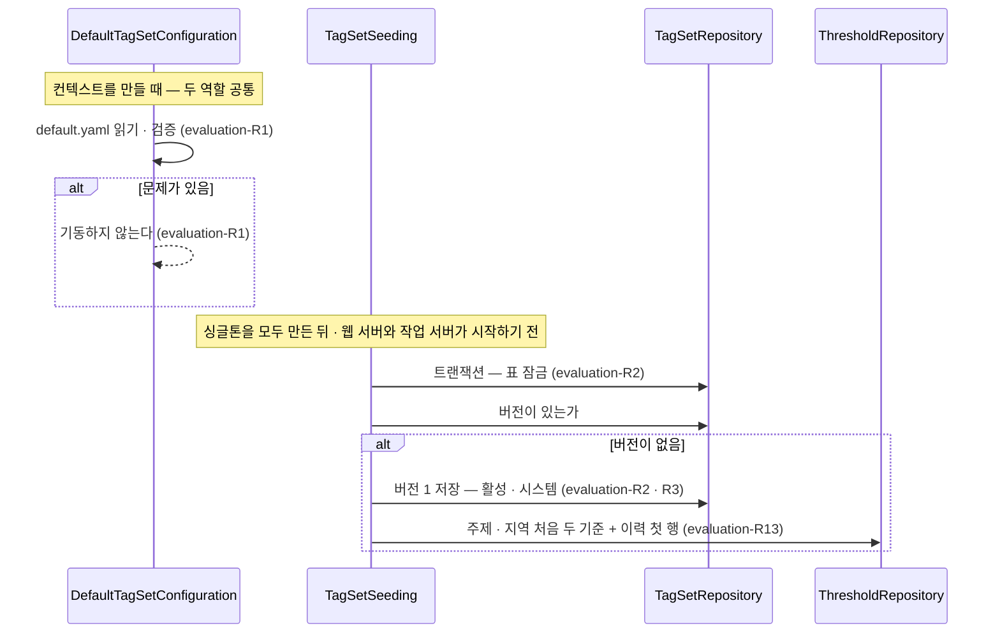

# evaluation 모듈 Spec

공통 구조와 쓰는 규칙은 [specs/README.md](README.md)에 있다.

## 1. 책임과 범위

`evaluation` 은 기사에 붙일 태그의 체계(태그 체계)를 갖고, 사용자와 무관하게 기사마다 한 번 Jev 로 평가한다.

- **태그 체계** — 주제(대분류 · 중분류) · 지역 · 형식 태그와 중요도 기준, 질문 문구를 버전으로 저장한다. 버전 내용은 만든 뒤 바꾸지 않는다(evaluation-R4)
- **첫 기동 적재** — 저장소의 기본 체계 파일을 기동 때 검증하고, 버전이 하나도 없으면 버전 1 로 들인다(evaluation-R1 · R2)
- **태그 기준 · 저장 기준** — 주제 · 지역마다 두 기준을 두고, 운영자의 변경을 이력과 함께 받는다. 앱은 두 기준을 막지 않고, 이전 기사와 어긋날 수 있는 변경에 경고한다(evaluation-R10 ~ R13)
- **활성 체계 조회** — 평가 · 후보 선별이 쓰는 활성 버전과 두 기준을 공개 API(`TagSetDirectory`)로 낸다
- **(미구현)** 공유 평가 — 평가 대기 기사를 묶어 Jev 로 태그 · 형식 · 중요도를 묻고 결과를 저장한다(`ArticleEvaluator` — Jev 를 부르는 유일한 포트, evaluation-R14 · R15)
- **(미구현)** 체계 변경과 태그 키 계보 — 새 버전 작성 · 활성 전환 · 최근 기사 재평가, 키 이름 변경 · 분할 · 병합의 기록(evaluation-R16)
- **(미구현)** 사건 소속 판정 — 사건 묶기의 애매한 구간을 Jev 로 판정한다([ADR-0026](../adr/0026-event-clustering-with-local-embeddings-and-jev.md))

하지 않는 것:

- 사용자를 모른다. 사용자 태그 선호 · 구독은 `user` 가, 후보 선별은 `digest` 가 한다. 두 기준의 변경을 기록할 때도 행위자 종류(시스템 · 운영자)만 남기고 사용자를 가리키지 않는다(evaluation-R13)
- 인증을 모른다. 운영자 요청인지는 부르는 쪽(`admin`)이 정해 넘긴다
- 기사를 수집하거나 같은 기사를 판정하지 않는다 — `source` · `article` 이 한다

다른 모듈과의 의존과 이벤트 흐름은 [overview.md §5](../overview.md#5-모듈-지도)에 있다.

## 2. 용어

태그 체계 · 태그 종류 · 태그 기준 · 주제 · 공유 평가는 [overview.md §8](../overview.md#8-용어)에 있다.

| 용어 | 뜻 |
|---|---|
| 버전 | 태그 체계 한 벌(`tag_sets` 한 행과 그 태그 · 기준). 번호는 1 부터 늘고, 활성 버전은 언제나 하나다 |
| 대분류 · 중분류 | 주제 태그의 두 단계. 대분류는 Jev 에 묻지 않고, 중분류가 붙으면 그 대분류도 붙은 것으로 본다 |
| 태그 키 | 태그를 가리키는 값. 대분류 · 지역 · 형식은 조각 하나(`politics` · `domestic` · `straight`), 중분류는 대분류 키를 붙인 전체 키(`politics.executive`)다(evaluation-R6). 사용자 선호와 평가 결과가 이 키로 태그를 가리킨다 |
| 질문 틀 | 주제 · 지역의 Yes/No 질문 문장의 틀. 자리표시자 `{description}` 에 태그 설명을 끼워 태그마다 질문을 만든다(evaluation-R9) |
| 저장 기준 | 평가 때 태그 확률을 저장할지 가르는 값. 이 값 이상인 확률만 저장한다(evaluation-R15) |
| 기본 제외 | 형식 태그의 속성. 사용자가 따로 정하지 않으면 그 형식의 기사를 후보에서 뺀다 |
| 기본 체계 파일 | 저장소의 `backend/src/main/resources/tag-sets/default.yaml`. 첫 기동에 버전 1 로 들어간다(evaluation-R1 · R2). 첫 체계는 [조사 초안](../research/2026-10-news-categories.md) 3.2 를 바탕으로 한다 |
| 첫 기동 적재 | 버전이 하나도 없을 때 기본 체계 파일을 버전 1 로 저장하는 기동 시 동작(evaluation-R2) |
| 행위자 | 두 기준을 정한 주체의 종류 — 시스템(첫 기동 적재) · 운영자(공개 운영 API) |

## 3. 공개 인터페이스

모듈 최상위 패키지 `net.yozmnews.evaluation` 의 공개 타입은 활성 체계 조회 `TagSetDirectory`, 두 기준의 운영 API `TagSetAdministration`, 그 값 · 결과 타입이다. 이벤트는 내지 않는다.

HTTP 엔드포인트: 없음 — 운영자 HTTP API 는 `admin` 이 이 모듈의 공개 운영 API 를 불러 낸다([ADR-0045](../adr/0045-admin-module-serves-operator-api-over-module-public-operation-apis.md)).

### TagSetDirectory

활성 체계 조회 — 평가 · 후보 선별이 쓴다. 구현은 `application` 의 `TagSetDirectoryService` 다.

```java
public interface TagSetDirectory {
    TagSetView activeTagSet();
    TagSetThresholds activeThresholds();
}
```

| 멤버 | 뜻 |
|---|---|
| `activeTagSet()` | 활성 버전의 내용 — 태그 · 질문 문장 · 중요도 기준 |
| `activeThresholds()` | 활성 버전의 주제 · 지역 두 기준 |

- 계약
  - 활성 버전은 언제나 하나다. 없으면(첫 기동 적재의 불변식이 깨짐) `IllegalStateException` 이다(evaluation-R3)
  - 내용과 두 기준은 다른 조회다 — 내용은 바뀌지 않고 두 기준은 바뀐다. 둘 다 버전 ID 를 싣는다
  - 트랜잭션을 열지 않는다. 각 조회는 그 순간의 값이다

관련 규칙: evaluation-R3 · evaluation-R4 · evaluation-R9 · evaluation-R10.

### TagSetView · TopicCategory · AskedTag · FormatChoice · FormatOption · ImportanceScale · ImportanceLevel · TagSetId

활성 체계의 내용.

```java
public record TagSetId(long value) {}

public record TagSetView(TagSetId id, int number, List<TopicCategory> topics, List<AskedTag> regions,
        FormatChoice format, ImportanceScale importance) {}

public record TopicCategory(String key, String name, String description, List<AskedTag> subtopics) {}

public record AskedTag(String key, String name, String description, String question) {}

public record FormatChoice(String question, List<FormatOption> options) {}

public record FormatOption(String key, String name, String description, boolean excludedByDefault) {}

public record ImportanceScale(String question, List<ImportanceLevel> levels) {}

public record ImportanceLevel(int level, String description) {}
```

| 타입 · 필드 | 뜻 | 제약 |
|---|---|---|
| `TagSetId` | `tag_sets.id` | 1 이상 |
| `TagSetView.number` | 버전 번호 | 1 이상 |
| `TagSetView.topics` | 주제 대분류와 그 중분류 — 파일에 적힌 순서 | 대분류 1개 이상, 대분류마다 중분류 1개 이상(evaluation-R7) |
| `TopicCategory` | 대분류 — 키 · 이름 · 설명. 질문이 없다(Jev 에 묻지 않는다) | — |
| `AskedTag` | Jev 에 묻는 태그(주제 중분류 · 지역) — 키 · 이름 · 설명과 질문 문장. 중분류의 키는 전체 키다 | `question` 은 질문 틀에 설명을 끼운 문장이다(evaluation-R9) |
| `TagSetView.regions` | 지역 태그 — 파일에 적힌 순서 | 1개 이상(evaluation-R7) |
| `FormatChoice` | 형식 Choice 질문과 그 선택지 — 파일에 적힌 순서 | 선택지 2개 이상(evaluation-R7) |
| `FormatOption.excludedByDefault` | 기본 제외 형식인가 | — |
| `ImportanceScale` | 중요도 Score 질문과 수준별 기준 — 수준 순 | 수준 1 ~ 5 가 하나씩(evaluation-R7) |

관련 규칙: evaluation-R6 ~ evaluation-R9.

### MultiTagKind · TagThresholds · TagSetThresholds

두 기준의 값.

```java
public enum MultiTagKind { TOPIC, REGION }

public record TagThresholds(MultiTagKind kind, BigDecimal tagThreshold, BigDecimal storeThreshold) {}

public record TagSetThresholds(TagSetId versionId, TagThresholds topic, TagThresholds region) {}
```

| 타입 · 필드 | 뜻 | 제약 |
|---|---|---|
| `MultiTagKind` | 두 기준이 있는 태그 종류 — 여러 태그가 붙는 주제 · 지역. 형식은 하나를 고르므로 없다 | — |
| `TagThresholds.tagThreshold` | 태그 기준 — 저장된 확률이 이 값 이상이면 태그가 붙는다 | 0 이상 1 이하, 소수 셋째 자리까지(evaluation-R10) |
| `TagThresholds.storeThreshold` | 저장 기준 — 평가 때 이 값 이상인 확률만 저장한다 | 같음 |
| `TagSetThresholds` | 한 버전의 주제 · 지역 두 기준 | — |

관련 규칙: evaluation-R10.

### TagSetAdministration

두 기준의 운영 — `admin` 이 운영자 요청으로 부른다. 구현은 `application` 의 `TagSetAdministrationService` 다.

```java
public interface TagSetAdministration {
    ThresholdChangeResult changeThresholds(MultiTagKind kind, BigDecimal tagThreshold, BigDecimal storeThreshold,
            ChangeActor actor);
    List<ThresholdChangeView> thresholdChanges();
}
```

| 멤버 | 뜻 |
|---|---|
| `changeThresholds` | 활성 버전의 한 태그 종류 두 기준을 바꾼다(evaluation-R11 · R12) |
| `thresholdChanges()` | 활성 버전의 두 기준 이력 — 최근 것부터(evaluation-R13) |

- 계약
  - 한 트랜잭션이다. 같은 태그 종류의 변경은 줄을 서므로, 이력의 이전 값이 바로 앞 변경의 새 값이다(evaluation-R11)
  - 값이 범위 밖이면 `OutOfRange`, 지금 값과 같으면 `Unchanged` 이고 둘 다 아무것도 쓰지 않는다
  - 경고는 변경을 막지 않는다 — `Changed` 에 실린다(evaluation-R12)
  - 운영자 요청은 `ChangeActor.OPERATOR` 로 부른다. `SYSTEM` 은 첫 기동 적재가 쓴다
  - 활성 버전이 없으면 `IllegalStateException`(evaluation-R3)

관련 규칙: evaluation-R10 ~ evaluation-R13.

### ThresholdChangeResult · ThresholdWarning · ChangeActor · ThresholdChangeView

```java
public sealed interface ThresholdChangeResult {
    record Changed(TagThresholds previous, TagThresholds current, Set<ThresholdWarning> warnings)
            implements ThresholdChangeResult {}
    record Unchanged(TagThresholds current) implements ThresholdChangeResult {}
    record OutOfRange() implements ThresholdChangeResult {}
}

public enum ThresholdWarning { STORE_THRESHOLD_LOWERED, TAG_BELOW_PAST_STORE, TAG_BELOW_STORE }

public enum ChangeActor { SYSTEM, OPERATOR }

public record ThresholdChangeView(MultiTagKind kind, @Nullable BigDecimal previousTagThreshold,
        @Nullable BigDecimal previousStoreThreshold, BigDecimal tagThreshold, BigDecimal storeThreshold,
        ChangeActor actor, Instant changedAt) {}
```

| 타입 · 값 | 뜻 |
|---|---|
| `Changed` | 바꿨다 — 이전 값 · 새 값과 경고(없으면 빈 집합) |
| `Unchanged` | 지금 값과 같아 바꾸지 않았다 |
| `OutOfRange` | 값이 0 ~ 1 · 소수 셋째 자리 밖이라 바꾸지 않았다 |
| `STORE_THRESHOLD_LOWERED` | 저장 기준을 지금 값보다 낮췄다 — 이전 기사에는 낮춘 구간의 확률이 없다 |
| `TAG_BELOW_PAST_STORE` | 태그 기준을 내렸고 새 값이 그 버전에서 써 온 저장 기준의 최댓값보다 낮다 — 그 저장 기준으로 평가된 기사에는 그 구간 태그가 붙지 않는다 |
| `TAG_BELOW_STORE` | 이번 변경으로 태그 기준이 저장 기준보다 낮아졌다 — 그 구간 확률은 저장되지 않아 붙지 않는다 |
| `ChangeActor` | 행위자 — 시스템 · 운영자 |
| `ThresholdChangeView` | 이력 한 행 — 이전 값(처음 값이면 null) · 새 값 · 행위자 · 시각 |

관련 규칙: evaluation-R11 ~ evaluation-R13.

## 4. 내부 구조

### 개관

| 패키지 | 책임 |
|---|---|
| (최상위) | 공개 API `TagSetDirectory` · `TagSetAdministration` 과 그 값 · 결과 타입(§3) |
| `domain/tagset` | 태그 체계 정의와 그 읽기 · 검증, 질문 틀, 버전 aggregate 와 그 저장소 |
| `domain/threshold` | 두 기준의 값 규칙과 변경 판정, 두 기준 저장소 |
| `application` | 기본 체계 파일의 기동 검증, 첫 기동 적재, 공개 API 의 구현 |
| `adapter/out/persistence` | 두 기준 저장소의 JdbcClient 구현 |

협력: `DefaultTagSetConfiguration` 이 기본 체계 파일을 `TagSetParser`(`platform` 의 `YamlTextReader` → `TagSetBinder` → `TagSetValidator`)로 읽어 `TagSetDefinition` 을 만든다. `TagSetSeeding` 이 그 정의로 `TagSetRepository` 에 버전 1 을, `ThresholdRepository` 에 처음 두 기준을 쓴다. `TagSetDirectoryService` 는 `TagSetRepository` 로 활성 버전을 읽어 질문 문장(`QuestionTemplate`)을 만들어 공개 타입으로 옮기고, 두 기준은 `ThresholdRepository` 로 읽는다. `TagSetAdministrationService` 는 활성 버전의 두 기준을 `ThresholdRepository` 로 잠가 `ThresholdRule` 로 판정하고 같은 저장소로 쓴다.

#### 첫 기동



### 들어오는 쪽

| 진입점 | 구성 요소 | 계기 | 내용 |
|---|---|---|---|
| 기본 체계 파일 기동 검증 | `DefaultTagSetConfiguration`(`application`) | 컨텍스트를 만들 때(두 역할 공통) | 기본 체계 파일을 읽어 검증하고 정의를 빈으로 둔다. 실패하면 기동하지 않는다(evaluation-R1) |
| 첫 기동 적재 | `TagSetSeeding`(`application`) | 싱글톤을 모두 만든 뒤(`SmartInitializingSingleton`) — 웹 서버 · 작업 서버가 시작하기 전. 두 역할 공통 | 버전이 하나도 없을 때만 버전 1 을 적재한다. 여러 프로세스가 동시에 떠도 하나만 적재하고, 다시 기동해도 결과가 같다(evaluation-R2) |

컨트롤러 · 이벤트 리스너 · 반복 작업은 없다.

### `application`

- `DefaultTagSetConfiguration` — 기본 체계 파일의 기동 검증(들어오는 쪽). 읽기 · 판정은 정적 `load(Resource, TagSetParser)` 에 있고 실패하면 파일의 문제를 모두 담은 예외로 기동을 멈춘다(evaluation-R1)
- `TagSetSeeding` — 첫 기동 적재(들어오는 쪽). `seedIfEmpty()` 가 한 트랜잭션에서 표를 잠그고 버전이 없을 때만 버전 1 과 처음 두 기준을 쓴다. 적재하면 정보 로그 `기본 태그 체계를 버전 1로 적재했다` 를 남긴다(evaluation-R2)
- `TagSetDirectoryService` — 공개 API `TagSetDirectory` 의 구현. 트랜잭션 · 역할 애너테이션이 없다(evaluation-R3)
- `TagSetAdministrationService` — 공개 API `TagSetAdministration` 의 구현. 변경은 한 트랜잭션에서 활성 버전 조회 → 두 기준 행 잠금 → 지난 저장 기준 최댓값 → 판정 → 쓰기다. 시각은 `InstantSource` 에서 얻는다(evaluation-R11 ~ R13)

### `domain`

#### `domain/tagset`

- 저장 단위: aggregate `TagSet`(`tag_sets` — 버전 하나)과 그 자식 행(태그 `TagRow` · 중요도 기준 `ImportanceRubricRow`). 버전 내용을 바꾸는 메서드가 없다 — 만들 때 한 번 쓴다(evaluation-R4). `TagSet.first` 가 번호 1 · 활성 버전을 만든다

  ```java
  public interface TagSetRepository extends CrudRepository<TagSet, Long> {
      boolean anyExists();
      void lockForSeeding();                 // 표 잠금 — 자기 자신과 충돌하는 모드. 트랜잭션 안에서 부른다
      Optional<TagSet> findByActiveTrue();
  }
  ```

- `TagSetParser` — 원문 → 정의. 원문 상한(`MAX_CHARS` 65,536 — evaluation-R5 의 정본)의 `YamlTextReader` → `TagSetBinder` → `TagSetValidator` 를 지나고, 입력 오류는 예외가 아니라 문제 목록으로 돌려준다
- `TagSetBinder` — 트리 → 초안. 파일 형식의 키 목록이 이 클래스에 있다. 공통 거부는 `platform` 의 `StrictYamlBinding` 이 한다(evaluation-R5)
- `TagSetValidator` — 초안 → 정의. 키 · 구성 · 문구 · 두 기준 규칙의 정본이다(evaluation-R6 ~ R8 · R10)
- `QuestionTemplate` — 질문 틀과 질문 문장 만들기의 정본(evaluation-R8 · R9)
- `TagKey` — 태그 키 형식(evaluation-R6)
- `TagKind` — 태그 종류 `TOPIC` · `REGION` · `FORMAT` — 태그 행의 종류
- 그 밖의 값: `TagSetContent` · `TagSetDefinition` · `TopicCategoryDef` · `TagDef` · `FormatDef` · `ImportanceLevelDef` · `TagSetDraft` · `TagSetParse` · `TagSetProblem` · `TagSetProblemCode`

#### `domain/threshold`

- `ThresholdRule` — 두 기준 변경 판정과 경고의 정본(evaluation-R11 · R12)
- `ThresholdValues` — 두 기준 한 쌍과 값 규칙(evaluation-R10)
- 저장 단위: aggregate 가 없다 — 두 기준은 상태 전이가 아니라 값 갱신과 이력 추가이고, 판정은 `ThresholdRule` 이 한다. 저장소 `ThresholdRepository` 가 쓴다

  ```java
  public interface ThresholdRepository {
      void insertInitial(TagSetId version, MultiTagKind kind, ThresholdValues values, ChangeActor actor, Instant at);
      Optional<ThresholdValues> lockCurrent(TagSetId version, MultiTagKind kind);   // 행 잠금 — 트랜잭션 안에서
      BigDecimal maxStoreThreshold(TagSetId version, MultiTagKind kind);            // 이력 전체의 저장 기준 최댓값
      void apply(TagSetId version, MultiTagKind kind, ThresholdValues previous, ThresholdValues next,
              ChangeActor actor, Instant at);                                      // 현재 행 갱신 + 이력 행 추가
      List<ThresholdChangeView> changes(TagSetId version);                          // 최근 것부터
      TagSetThresholds current(TagSetId version);
  }
  ```

- 그 밖의 값: `ThresholdDecision`

### 나가는 쪽

외부 의존은 공유 평가의 포트 `ArticleEvaluator` 하나이고, 아직 구현되지 않았다.

#### `ArticleEvaluator`

**(미구현)** 공유 평가의 포트 — Jev 를 부르는 유일한 포트다. 사용자 정보를 받지 않는다. 설계 초안의 시그니처:

```java
public interface ArticleEvaluator {
    EvaluatorInfo info();                                        // 이름, 모델 버전
    List<Evaluation> evaluate(List<EvaluationInput> inputs, TagSetView tagSet);
    List<MembershipJudgement> judgeEventMembership(EvaluationInput article, List<EventDescriptor> candidates); // 애매한 구간의 사건 소속 판정
}
```

- v1 구현체는 `JevArticleEvaluator` 이고 Jev 호출 경로(직접 API 또는 AI Gateway)는 설정으로 바꾼다. 개발 · 시험은 고정 규칙 로컬 대체물(`FakeArticleEvaluator`)을 쓴다([ADR-0012](../adr/0012-swappable-external-dependencies.md))
- 사건 소속 판정의 인자 · 반환 타입(`EventDescriptor` · `MembershipJudgement`)은 `evaluation` 이 소유한다 — `event` 의 타입을 받으면 모듈 순환이 된다. `event` 는 `evaluation` 의 공개 API 를 거쳐 판정을 요청한다([ADR-0026](../adr/0026-event-clustering-with-local-embeddings-and-jev.md))
- 입력(state)은 기사마다 한 번 보낸다:

  ```
  출처: {소스 이름} / 피드 섹션: {피드 카테고리}
  제목: {제목}
  요약: {RSS 요약문, 최대 1,000자}
  ```

- 비용과 처리량 추정(측정 전): 피드 20개, 하루 약 4,000건, 질문 55개(주제 중분류 46 · 지역 7 · 형식 1 · 중요도 1). 기사당 입력 약 1,700토큰(state 약 300 + 질문 · 설명 약 1,400). 하루 약 6.8M 토큰 → 보도된 단가($0.042 / 1M 입력 토큰, 출력 무료) 기준 하루 약 $0.29, 월 약 $9 — 사용자 수와 무관하다. Jev 응답 지연은 보도 기준 요청당 70–500ms 이고 질문은 병렬로 평가된다. 재시도는 JobRunr 작업 단위로 건다. JobRunr OSS 에는 작업 종류별 동시성 제한이 없어, 동시성은 작업 설계(묶음 처리 · 반복 작업의 회차 비중첩)와 worker 수로 제한한다([ADR-0023](../adr/0023-jobrunr-oss-framework-schema-and-event-resubmission.md)). 태그 설명이 길어지면 모든 요청의 입력이 늘어나므로 설명은 짧게 두고(evaluation-R8), 운영자 화면에 요청당 평균 토큰 수를 보인다

**(미구현)** 평가 작업 `EvaluatePendingArticles` — 1분마다 + `ArticleStored` 를 계기로 평가 대기 기사를 묶어 `ArticleEvaluator` 로 평가한다.

#### 저장소 구현

- `JdbcThresholdRepository` — `ThresholdRepository` 의 PostgreSQL 구현(JdbcClient). 잠금은 `SELECT … FOR UPDATE`, 갱신과 이력 추가는 같은 트랜잭션의 두 문장이다
- `TagSetRepository` 는 Spring Data JDBC 저장소다. 표 잠금은 `LOCK TABLE tag_sets IN SHARE ROW EXCLUSIVE MODE` 다

#### 신뢰할 수 없는 입력

| 입력 | 방어 |
|---|---|
| 기본 체계 파일 | 저장소 파일이라 PR 로 리뷰되지만 읽기는 엄격하다 — YAML 공통 거부([platform Spec YAML 원문 읽기](platform.md#yaml-원문-읽기)) · evaluation-R5 ~ R8 · R10 |

## 5. 규칙과 불변식

### 기본 체계와 첫 기동

판단의 이유는 [ADR-0054](../adr/0054-tag-set-seeded-from-default-yaml-on-first-start-with-immutable-versions-and-question-templates.md)에 있다.

- **evaluation-R1** — 기본 체계는 `backend/src/main/resources/tag-sets/default.yaml` 하나다. 기동 때 두 역할 모두 이 파일을 읽어 검증한다. 파일이 없거나 읽을 수 없거나 검증에 걸리면 문제를 경로 · 줄:열과 함께 모두 담아 기동하지 않는다
- **evaluation-R2** — 첫 기동 적재: 버전이 하나도 없을 때만 기본 체계를 번호 1 · 활성 · 행위자 시스템의 버전으로 저장하고, 주제 · 지역의 처음 두 기준과 그 이력 첫 행을 함께 쓴다. 한 트랜잭션이고 `tag_sets` 표 잠금(자기 자신과 충돌하는 모드) 안에서 한다 — 여러 프로세스가 동시에 떠도 하나만 적재하고, 다시 기동해도 결과가 같다. 버전이 이미 있으면 파일이 바뀌어도 적재하지 않는다 — 파일의 개정은 새 인스턴스의 시작점일 뿐이고, 이미 적재한 인스턴스는 체계 변경(evaluation-R16)으로 새 버전을 들인다. 두 역할 모두 적재하고, 싱글톤을 모두 만든 뒤 웹 서버 · 작업 서버가 시작하기 전에 한다 — 어느 역할의 프로세스도 활성 버전 없이 요청 · 작업을 받지 않는다. 적재하면 정보 로그 `기본 태그 체계를 버전 1로 적재했다` 를 남긴다
- **evaluation-R3** — 활성 버전은 언제나 정확히 하나다 — DB 제약(활성 행 하나)이 지킨다. 활성 버전이 없으면 조회 · 변경이 `IllegalStateException` 으로 실패한다(첫 기동 적재의 불변식이 깨진 것이다)
- **evaluation-R4** — 버전 내용(질문 틀 · 질문 · 태그 · 이름 · 설명 · 중요도 기준 · 기본 제외)은 만든 뒤 바뀌지 않는다. 문구 하나를 바꿔도 새 버전이다. 두 기준만 버전의 설정으로 바뀐다(evaluation-R11)

### 체계 파일 형식과 검증

- **evaluation-R5** — 파일은 65,536자까지다(`TagSetParser.MAX_CHARS`). YAML 공통 거부(문서 하나 · 최상위 매핑 · 앵커 · 별칭 · 명시 태그 · 같은 매핑 안 중복 키 · 알 수 없는 키 · 빈 값 · 형 오류)는 [platform-R17](platform.md#yaml-원문-읽기)이다. 최상위 키는 `questions`(`topic` · `region` · `format` · `importance`) · `thresholds`(`topic` · `region`, 각각 `tagThreshold` · `storeThreshold`) · `topics`(항목마다 `key` · `name` · `description` · `subtopics` — 중분류마다 `key` · `name` · `description`) · `regions`(`key` · `name` · `description`) · `formats`(`key` · `name` · `description`, 선택 `excludedByDefault`) · `importance`(`level` · `description`)이고 모두 필수다. 선택 키는 `excludedByDefault` 하나이고 없으면 거짓이다. 순서는 파일에 적힌 순서다. 문제는 경로 · 줄:열과 함께 한 번에 모두 돌려준다
- **evaluation-R6** — 키의 조각은 영문 소문자 · 숫자를 하이픈 하나로 이은 40자 이하다. 중분류는 짧은 조각만 적고 저장 키는 대분류 키를 점으로 붙인 전체 키(`politics.executive`)다. 키는 태그 종류 안에서 겹치지 않는다 — 대분류끼리, 같은 대분류의 중분류끼리, 지역끼리, 형식끼리. 다른 대분류의 같은 조각(`world.politics` · `economy.politics`)은 전체 키가 달라 겹치지 않는다
- **evaluation-R7** — 태그 종류 구성: 주제 대분류 1개 이상, 대분류마다 중분류 1개 이상, 지역 1개 이상, 형식 2개 이상(Choice 선택지), 중요도 수준은 1 ~ 5 가 하나씩. 대분류는 Jev 에 묻지 않고, 중분류가 붙으면 그 대분류도 붙은 것으로 본다. 코드 · 설정은 특정 태그 키를 알지 않는다 — 어느 형식이 기본 제외인지도 체계 데이터다
- **evaluation-R8** — 문구는 공백만이 아니고 한 줄이다(줄바꿈 없음). 이름은 40자, 설명 · 중요도 기준은 120자, 질문(틀 포함)은 200자까지다(문자 수). 주제 · 지역 질문 틀은 자리표시자 `{description}` 을 정확히 하나 갖고, 형식 · 중요도 질문은 자리표시자를 갖지 않는다
- **evaluation-R9** — 주제 중분류 · 지역 태그의 질문 문장은 그 태그 종류의 질문 틀에서 `{description}` 을 태그 설명으로 바꾼 것이다. 설명은 틀에 끼울 수 있는 명사구로 쓴다

### 태그 기준 · 저장 기준

판단의 이유는 [ADR-0055](../adr/0055-tag-and-store-thresholds-change-with-history-and-warn-instead-of-blocking.md)에 있다.

- **evaluation-R10** — 두 기준은 주제 · 지역에만 있다 — 형식은 Choice 의 단일 결과, 중요도는 분포로 저장한다. 값은 0 이상 1 이하이고 소수 셋째 자리까지다 — 끝의 0 은 세지 않는다(0.1000 은 0.1). 같은 값인지는 크기로 비교한다(0.5 와 0.50 은 같다). 첫 기동 적재의 처음 값은 기본 체계 파일이 정한다
- **evaluation-R11** — 두 기준의 변경은 활성 버전의 한 태그 종류에 한다. 값이 범위 밖이면 바꾸지 않는다. 지금 값과 같으면 바꾸지 않고 이력도 남기지 않는다. 그 밖에는 바꾸고 이력을 남긴다 — 앱은 저장 기준 · 태그 기준의 관계를 막지 않는다. 한 트랜잭션이고 그 태그 종류의 현재 행을 잠근 뒤 한다 — 같은 태그 종류의 동시 변경은 줄을 서서, 뒤 변경의 이전 값이 앞 변경의 새 값이다
- **evaluation-R12** — 이번 변경이 이전 기사와 어긋남을 만들 때만 경고를 결과에 담는다. 이미 어긋난 상태에서 다른 값만 바꾸는 변경에는 다시 알리지 않는다:
  - `STORE_THRESHOLD_LOWERED` — 새 저장 기준 < 지금 저장 기준
  - `TAG_BELOW_PAST_STORE` — 새 태그 기준 < 지금 태그 기준 이고, 새 태그 기준 < 그 버전 · 그 태그 종류의 지난 저장 기준 최댓값(이 변경 전까지의 이력 — 처음 값 포함)
  - `TAG_BELOW_STORE` — 새 태그 기준 < 새 저장 기준 이고, 지금 태그 기준 ≥ 지금 저장 기준

  판정의 정본은 `ThresholdRule` 하나다. 빠진 태그를 채우는 길은 **(미설계)** 다
- **evaluation-R13** — 두 기준의 이력은 추가만 한다. 행마다 버전 · 태그 종류 · 이전 값 · 새 값 · 행위자 · 시각을 남기고, 처음 값이 첫 행(이전 값 없음 · 행위자 시스템)이다. 행위자는 시스템(첫 기동 적재) · 운영자(공개 운영 API) 둘이다 — 지금 운영자는 토큰 하나라 사람을 구별하지 않는다([ADR-0043](../adr/0043-admin-functions-guarded-by-env-bearer-token-until-account-roles.md)). 이력은 무기한 보존한다

### 공유 평가

- **evaluation-R14** — **(미구현)** 기사마다 사용자 정보 없이 한 번 평가하고, 결과는 모든 사용자의 후보 선별에 공통으로 쓴다. 모든 질문을 기사당 요청 하나에 묶고 state 는 한 번 보낸다. 질문은 활성 버전에서 읽는다 — 코드에 문구를 두지 않는다:

  | 태그 종류 · 항목 | 질문 | 형식 | 다중 |
  |---|---|---|---|
  | 주제 | 중분류마다 그 질문 문장(evaluation-R9) | Yes/No | 다중 |
  | 지역 | 지역마다 그 질문 문장 | Yes/No | 다중 |
  | 형식 | 형식 질문과 선택지 | Choice | 단일 |
  | 중요도 | 중요도 질문과 1 ~ 5 기준 | Score | 단일 값 |

- **evaluation-R15** — **(미구현)** 결과 해석:
  - 응답 원본, 평가기 이름 · 모델 버전, 태그 체계 버전을 저장한다
  - 주제 · 지역 태그는 확률이 저장 기준 이상이면 확률과 함께 저장한다
  - 태그가 붙었는지는 조회 시점에 그 태그 종류의 태그 기준으로 판단한다 — 태그 기준을 바꿔도 다시 평가하거나 데이터를 다시 쓰지 않는다
  - 주제 태그가 태그 기준을 하나도 넘지 못하면 최고 확률 태그를 하나 붙이고 `low_confidence` 로 표시한다 — 후보 선별 때 중요도 가중치를 낮춘다. 그 확률마저 저장 기준 미만이면 미분류다
  - LLM 재평가는 운영자 비용이 드므로 v1 에서는 하지 않는다

### 체계 변경

- **evaluation-R16** — **(미구현)** 체계를 바꾸면(태그 추가 · 삭제 · 설명 변경 · 키 이름 변경 · 분할 · 병합) 새 버전을 만든다.
  - 최근 N일(기본 7일)의 기사만 새 버전으로 재평가한다. 그보다 오래된 기사는 이전 버전 결과를 유지한다. 새 주제 태그의 과거 보도량이 필요하면 운영자가 정한 기간의 과거 기사에 그 태그 질문만 다시 물을 수 있다(운영자 비용). 요약문이 남은 기사만 대상이다
  - 키 이름을 바꾸거나 태그를 나누거나 합치면, 이전 키와 새 키의 관계(태그 키 계보)를 버전과 함께 기록한다. 사용자 선호와 주제별 시계열(보도량 · 관심도)은 계보를 따라 새 키로 이어진다
  - 사용자 선호는 태그 키로 연결하므로, 키가 유지되거나 계보로 이어지는 한 영향이 없다. 계보 없이 지운 태그의 선호는 해제하고 사용자에게 알린다

## 6. 데이터

컬럼 타입 · 인덱스 · 제약 문면의 정본은 `backend/src/main/resources/db/migration/V9__tag_sets.sql` 이다. 태그 종류 · 행위자 값은 대문자 상수 이름(`TOPIC` · `REGION` · `FORMAT` · `SYSTEM` · `OPERATOR`)으로 저장한다.

| 테이블 | 주요 컬럼 | 뜻 |
|---|---|---|
| `tag_sets` | id, number(고유), active, topic_template, region_template, format_question, importance_question, created_by(`SYSTEM`/`OPERATOR`), created_at | 태그 체계 버전 하나. 활성 행은 하나다(부분 고유 인덱스 — evaluation-R3). 주제 · 지역 질문 틀과 형식 · 중요도 질문을 갖는다(evaluation-R8). 만든 뒤 바뀌지 않는다(evaluation-R4) |
| `tags` | tag_set_id, kind(`TOPIC`/`REGION`/`FORMAT`), key, parent_key, name, description, excluded_by_default, sort_order | 버전의 태그. (tag_set_id, kind, key) 고유(evaluation-R6). 주제 대분류는 `parent_key` 가 없고 Jev 에 묻지 않는 행이다 — 부모는 같은 버전 · 같은 태그 종류의 행이다(커밋 때 확인하는 FK). `parent_key` 는 주제에만, `excluded_by_default` 는 형식에만 쓴다(제약). `sort_order` 는 파일에 적힌 순서 |
| `importance_rubrics` | tag_set_id, level(1~5), description | 중요도 Score 기준. (tag_set_id, level) 고유 |
| `tag_set_thresholds` | tag_set_id, tag_kind(`TOPIC`/`REGION`), tag_threshold, store_threshold | 버전 · 태그 종류마다 지금 두 기준(evaluation-R10). 값은 0 ~ 1, 소수 셋째 자리 |
| `tag_set_threshold_changes` | id, tag_set_id, tag_kind, previous_tag_threshold, previous_store_threshold, tag_threshold, store_threshold, actor(`SYSTEM`/`OPERATOR`), changed_at | 두 기준의 이력 — 추가만 한다(evaluation-R13). 이전 값 둘은 함께 있거나 함께 없다(처음 값) |
| `article_evaluations` | id, article_id, tag_set_id, evaluator, model_version, format_key, format_probability, importance, importance_distribution(jsonb), low_confidence, raw_response(jsonb), input_tokens, evaluated_at | **(미구현)** 기사당 평가 1회. 원본 응답까지 저장한다 |
| `article_tags` | article_id, evaluation_id, tag_kind, tag_key, probability | **(미구현)** 주제 · 지역 태그. 저장 기준 이상인 태그를 확률과 함께 저장한다. 붙었는지는 조회 때 태그 기준과 비교한다. 대분류는 저장하지 않고 조회 때 `parent_key` 로 펼친다 |
| `tag_key_lineage` | tag_set_id, tag_kind, from_key, to_key, kind(`RENAME`/`SPLIT`/`MERGE`) | **(미구현)** 태그 키 계보. 이 버전에서 이전 키가 어느 새 키로 이어지는지. 사용자 선호와 주제별 시계열이 따라간다 |
| `article_event_judgements` | id, article_id, evaluator, model_version, candidates(jsonb — 후보 사건 ID와 확률), raw_response(jsonb), input_tokens, judged_at | **(미구현)** 사건 소속 판정 원본(애매한 구간만). 배정 결과는 `event_articles` |

`article_id` 는 `article` 의 기사를 가리키지만 FK 를 두지 않는다 — 모듈 사이는 ID 로만 참조한다. 보존 기간은 [data-model.md "보존 정책"](../data-model.md#보존-정책-초안)에 있다.

## 7. 설정

해당 없음.

## 8. 결정

| ADR | 한 줄 |
|---|---|
| [0002](../adr/0002-shared-evaluation-with-jev.md) | Jev는 사용자 무관 공유 평가에만 사용 |
| [0010](../adr/0010-tag-taxonomy.md) | 태그 체계: 축 분리 + 통제 어휘 다중 태그 |
| [0013](../adr/0013-architecture-patterns.md) | 아키텍처 패턴: 모듈러 모놀리스 + 실용적 헥사고날 |
| [0014](../adr/0014-spring-data-jdbc.md) | 데이터 접근은 Spring Data JDBC + JdbcClient |
| [0026](../adr/0026-event-clustering-with-local-embeddings-and-jev.md) | 사건 묶기는 로컬 임베딩과 고유명사 산식으로 하고, 애매한 구간만 Jev 로 판정한다 |
| [0054](../adr/0054-tag-set-seeded-from-default-yaml-on-first-start-with-immutable-versions-and-question-templates.md) | 태그 체계는 기본 YAML 파일을 첫 기동에 버전 1로 들이고, 버전 내용은 바꾸지 않으며, 질문은 태그 종류마다 둔 틀에 태그 설명을 끼워 만든다 |
| [0055](../adr/0055-tag-and-store-thresholds-change-with-history-and-warn-instead-of-blocking.md) | 태그 기준 · 저장 기준은 버전의 설정으로 이력과 함께 바꾸고, 앱은 두 기준을 막지 않고 이번 변경이 어긋남을 만들 때 경고한다 |
| [0056](../adr/0056-platform-reads-yaml-text-and-applies-common-rejection.md) | YAML 원문 읽기와 공통 거부는 `platform` 이 맡고, 문서별 형식 · 검증은 각 모듈의 `domain` 이 한다 |
