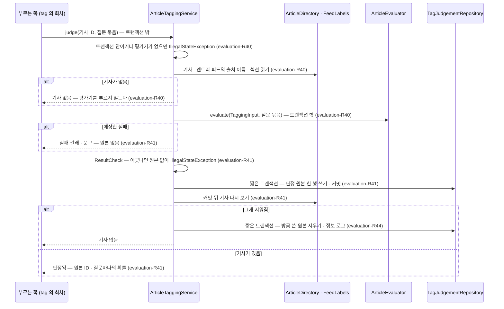
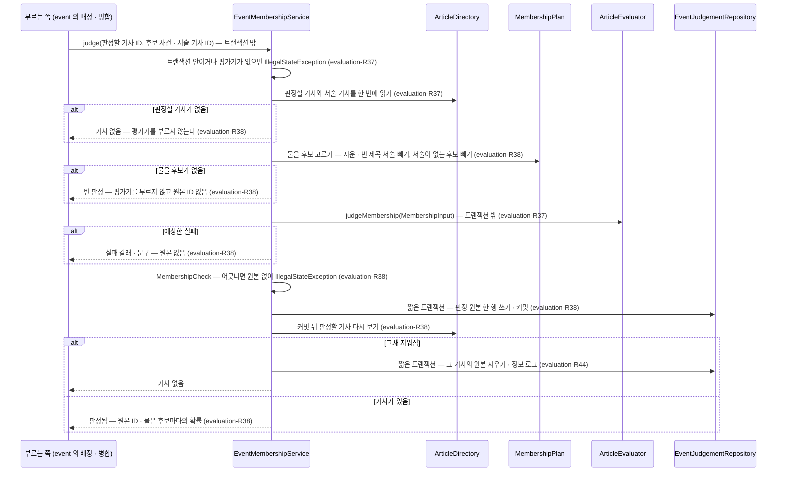

# evaluation 모듈 Spec

공통 구조와 쓰는 규칙은 [specs/README.md](README.md)에 있다.

## 1. 책임과 범위

`evaluation` 은 기사를 운영자 비용의 모델로 평가하는 관문이다. 판정마다 공개 API 하나를 두고, 그 판정의 모델 요청을 조립해 부르고, 결과를 대조하고, 판정 원본을 기록한다. 기사 임베딩도 이 관문의 연산이다 — 결과를 확인하지만 기록하지 않는다. 판정 · 임베딩 결과를 받아들이고 쌓는 일은 부르는 모듈이 한다.

- **관문** — 모델을 부르는 포트(`ArticleEvaluator` — Jev 를 부르는 유일한 포트)와 운영 구현(`JevArticleEvaluator`) · 로컬 대체물(`FakeArticleEvaluator`)을 둔다. 작업 역할은 평가기 없이 운영하지 않는다(evaluation-R43)
- **태그 판정** — 기사 하나를 넘긴 질문 묶음(주제 · 지역 · 형식 · 중요도)으로 평가하는 공개 API(`ArticleTagging`)를 `tag` 에 낸다. 기사 ID 로 기사 내용 · 피드 맥락을 읽어 요청을 만들고, 결과를 질문 묶음과 대조해 판정 원본을 남기고, 그 ID 와 분포를 돌려준다. 남긴 원본을 질문 묶음으로 다시 읽고(빠진 태그 채움), 원본의 평가기 · 모델 버전 · 입력 토큰을 낸다(evaluation-R17 · R40 ~ R42)
- **사건 소속 판정** — 기사 하나가 후보 사건마다 그 사건을 다루는지 평가기에 묻는 공개 API(`EventMembership`)를 사건 묶기에 낸다. 판정할 기사와 후보 사건의 서술 기사를 ID 로 받아 질문을 만들고, 성공한 판정의 원본을 남겨 그 ID 를 결과에 싣는다(evaluation-R37 · R38, [ADR-0026](../adr/0026-event-clustering-with-local-embeddings-and-jev.md) · [ADR-0071](../adr/0071-event-membership-judged-from-article-ids-with-questions-built-in-evaluation.md) · [ADR-0094](../adr/0094-event-membership-judgements-identified-by-id-read-by-operators-and-referenced-by-the-records-that-apply-them.md))
- **관계 판정** — 두 흐름(사건들의 묶음 둘)이 어떤 관계인지 평가기에 묻는 공개 API(`FlowRelation`)를 `storyline` 에 낸다. 흐름 ID 와 서술 사건의 대표 기사 ID · 시각을 받아 제목 · 요약문으로 요청을 만들고, 성공한 판정의 원본을 남겨 그 ID 와 답마다의 확률을 돌려준다(evaluation-R48 · R49, [ADR-0132](../adr/0132-storyline-relations-are-judged-by-jev-on-candidate-pairs-and-linked-only-above-a-probability-threshold.md))
- **기사 임베딩** — 텍스트 묶음을 벡터로 바꾸는 공개 API(`TextEmbedding`)를 사건 묶기에 낸다. 텍스트는 부르는 쪽이 만들어 넘기고, 결과의 수 · 차원을 확인해 돌려주며, 결과를 기록하지 않는다. 임베더 포트(`ArticleEmbedder`)와 운영 구현(앱 안 로컬 모델 — 기본, OpenAI 호환 외부 API) · 로컬 대체물(`FakeArticleEmbedder`)을 둔다. 작업 역할은 임베더 없이 운영하지 않는다(evaluation-R45 ~ R47, [ADR-0114](../adr/0114-article-embedding-is-a-gateway-operation-of-evaluation-taking-callers-texts-checking-results-and-recording-nothing.md) · [ADR-0115](../adr/0115-embedding-api-in-both-roles-looks-up-the-embedder-on-call-and-a-worker-startup-check-requires-one.md) · [ADR-0090](../adr/0090-article-embedding-defaults-to-an-in-app-local-model-with-an-openai-compatible-api-by-setting.md) · [ADR-0091](../adr/0091-local-embedding-model-is-multilingual-e5-small-int8-fetched-at-build-into-the-image-with-onnx-telemetry-off.md))
- **판정 원본 조회** — 운영자 화면에 공개 조회로 낸다. 판정 시각이 기간 안인 사건 소속 판정 원본(`EventJudgementLog` — 판정의 쓰임 · 결과는 `event` 가 낸다)과, ID 로 찾는 관계 판정 원본(`RelationJudgementLog` — 원본 응답을 평가기가 다시 읽어 답마다의 확률을 낸다)이다(evaluation-R39 · R50, [ADR-0138](../adr/0138-relation-judgement-probabilities-are-read-for-operators-by-the-evaluator-rereading-stored-raw-responses.md))
- **지운 기사 따르기** — `article` 이 기사를 지우면 그 기사의 판정 원본(사건 소속 · 태그)을 지운다(evaluation-R44)

질문 문장과 판정 원본의 소유는 판정마다 다르다 — 태그 질문 문장은 `tag` 의 체계 데이터로 넘어오고(운영자가 바꾸는 질문 틀 · 설명), 사건 소속 질문 문구와 관계 판정의 문구는 이 모듈의 코드 상수다(evaluation-R37 · R48). 판정 원본은 판정마다 이 모듈이 남긴다. 임베딩의 입력 텍스트는 부르는 쪽이 만들고, 벡터와 그 모델 버전은 부르는 쪽이 저장한다(evaluation-R45).

하지 않는 것:

- 사용자를 모른다. 판정은 공유 판정이다
- 태그 체계 · 태그 기준 · 저장 기준 · 판정의 해석(저장 기준 거르기 · 대표값 · 조회 시점 판정)을 모른다 — `tag` 가 한다. 넘겨받은 질문 묶음으로 묻고 분포를 돌려줄 뿐이다
- 사건 · 사건 묶기 기준을 모른다 — 확률을 받아들일지는 `event` 가 정한다
- 스토리라인 · 관계 기준을 모른다 — 흐름 ID 는 뜻을 모르는 값이고, 어느 쌍을 물을지 · 서술 사건을 어떻게 고를지 · 답을 받아들일지는 `storyline` 이 정한다
- 표현 텍스트를 만들거나 벡터를 저장 · 비교하지 않는다 — `event` 가 한다
- 기사를 수집하거나 저장하지 않는다. 기사 내용과 출처 이름 · 피드 섹션은 `article` · `source` 의 공개 조회로 읽는다
- 인증을 모른다. 운영자 요청인지는 부르는 쪽(`admin`)이 정해 넘긴다

다른 모듈과의 의존과 이벤트 흐름은 [overview.md §5](../overview.md#5-모듈-지도)에 있다.

## 2. 용어

| 용어 | 뜻 |
|---|---|
| 관문 | 운영자 비용의 모델로 기사를 평가하는 모든 판정 · 임베딩이 거치는 이 모듈 — 공개 API 는 판정마다 하나와 임베딩 하나, 모델 포트는 판정의 `ArticleEvaluator` 와 임베딩의 `ArticleEmbedder` 다 |
| 태그 판정 | 기사 하나를 넘긴 질문 묶음으로 평가하는 것 — 주제 중분류 · 지역은 Yes/No, 형식은 Choice, 중요도는 Score. 결과는 질문마다의 확률 분포다(evaluation-R40). `tag` 가 저장된 확률을 지금 기준으로 가르는 조회 시점 판정과 다르다 |
| 질문 묶음 | 태그 판정이 묻는 것(`TagQuestions`) — 주제 대분류와 그 중분류 · 지역 · 형식 선택지 · 중요도 수준과 각 질문 문장. `tag` 의 체계 한 버전에서 온다 |
| 피드 맥락 | 태그 판정 입력에서 기사가 실린 피드 하나의 값 — 출처 이름 · 피드 섹션(수집 프로필) · 그 피드 항목의 RSS 카테고리. 기사가 실린 피드(엔트리)마다 하나다(evaluation-R17 · R40) |
| 실패 갈래 | 평가기가 예상한 실패의 종류(`EvaluatorFailureKind`) — 일시 · 기사 거부 · 평가기 사용 불가. 갈래를 부르는 쪽에 돌려주고, 갈래마다 무엇을 할지는 부르는 쪽이 정한다([ADR-0058](../adr/0058-evaluator-failures-in-three-kinds-and-unavailable-evaluator-skips-article-retries.md)) |
| 사건 소속 판정 | 기사 하나가 후보 사건마다 그 사건을 다루는지 평가기에 묻는 것 — 후보마다 Yes/No 확률 하나. 받아들일지는 부르는 쪽(사건 묶기)이 정한다(evaluation-R37 · R38) |
| 후보 사건 · 서술 기사 | 판정에서 묻는 사건(사건 ID)과 그 사건을 설명하는 기사. 부르는 쪽이 사건 중심에 가까운 기사를 고르고, 질문에는 그 제목이 실린다(evaluation-R37) |
| 문구 판 | 사건 소속 질문 문구 · 관계 판정 문구의 버전 문자열. 문구나 질문 조립 모양을 바꾸면 올리고, 판정 원본마다 남는다(evaluation-R37 · R48) |
| 관계 판정 | 두 흐름의 관계를 평가기에 묻는 것 — 답 다섯(해당 없음 · 한쪽이 다른 쪽의 부분 두 방향 · 한쪽이 다른 쪽을 낳음 두 방향)의 확률과, 흐름마다 한 사안의 전개일 확률. 받아들일지는 부르는 쪽(`storyline`)이 정한다(evaluation-R48 · R49) |
| 흐름 · 서술 사건 | 관계 판정에서 견주는 사건 묶음(흐름 ID — `storyline` 의 스토리라인을 가리키지만 이 모듈은 그 뜻을 모른다)과, 그 흐름을 설명하는 사건. 부르는 쪽이 고르고, 요청에는 사건마다 대표 기사의 제목(일부는 요약문)과 날짜가 실린다(evaluation-R48) |
| 판정 원본 | 성공한 판정 한 번의 기록 — 원본 응답 · 평가기 · 모델 버전 · 입력 토큰 · 판정 시각과 판정할 기사. 사건 소속 판정은 물은 후보(사건 ID · 서술 기사 ID · 확률)와 문구 판을 더 남기고 `EventJudgementId` 로, 태그 판정은 `TagJudgementId` 로 식별된다. 관계 판정의 원본은 판정할 기사가 없고 두 흐름 ID 와 서술 기사 ID · 문구 판을 남기며 `RelationJudgementId` 로 식별된다(evaluation-R49). 판정을 반영한 쪽의 기록이 그 ID 를 가리킨다(evaluation-R38 · R41) |
| 임베더 | 텍스트를 벡터로 바꾸는 외부 의존 — 포트 `ArticleEmbedder`. 이름 · 모델 버전 · 차원을 밝힌다. 운영 구현은 앱 안 로컬 모델(기본)과 OpenAI 호환 외부 API 둘이고, provider 설정으로 고른다(evaluation-R45 · R46) |
| 임베딩 모델 버전 | 임베더가 밝히는 모델을 가리키는 값 — 다른 모델과 겹치지 않는다. 부르는 쪽이 벡터와 함께 남겨, 같은 모델 버전의 벡터끼리만 비교한다(evaluation-R45) |
| 임베딩 실패 갈래 | 임베더가 예상한 실패의 종류(`EmbedderFailureKind`) — 일시 · 입력 거부 · 임베더 사용 불가. 갈래마다 무엇을 할지는 부르는 쪽이 정한다([ADR-0092](../adr/0092-embedder-failures-in-three-kinds-with-rejected-articles-isolated-and-dropped-after-a-limit.md)) |
| 다시 읽기 | 판정 원본의 원본 응답을 그 원본을 남긴 평가기의 형식으로 다시 읽는 것 — 모델을 부르지 않는다. 태그 판정 원본은 넘긴 질문 묶음으로(evaluation-R42), 관계 판정 원본은 답 다섯과 한 사안 확률로(evaluation-R50) 읽는다 |

## 3. 공개 인터페이스

모듈 최상위 패키지 `net.yozmnews.evaluation` 의 공개 타입은 태그 판정 `ArticleTagging` 과 그 질문 묶음 `TagQuestions` · 값 타입(`TopicCategory` · `AskedTag` · `FormatChoice` · `FormatOption` · `ImportanceScale` · `ImportanceLevel`) · 결과 타입, 사건 소속 판정 `EventMembership`, 관계 판정 `FlowRelation`, 판정 원본 조회 `EventJudgementLog` · `RelationJudgementLog`, 판정 원본 조회 기간 `JudgementPeriod`, 그 값 · 결과 타입과 평가기 실패 갈래 `EvaluatorFailureKind`, 기사 임베딩 `TextEmbedding` 과 그 값 · 결과 타입(`EmbedderInfo` · `Embedding` · `EmbeddingResult` · `Embeddings` · `EmbeddingFailure`)과 임베딩 실패 갈래 `EmbedderFailureKind` 다. 이벤트는 내지 않는다.

받는 이벤트는 `article` 의 `ArticlesRemoved` 이고, 판정의 입력은 `article` 의 공개 조회 `ArticleDirectory.findAll` 과 `source` 의 공개 조회 `FeedLabels` 로 읽는다([article Spec §3](article.md#3-공개-인터페이스) · [source Spec §3](source.md#3-공개-인터페이스)).

HTTP 엔드포인트: 없음 — 운영자 HTTP API 는 `admin` 이 이 모듈의 공개 조회를 불러 낸다([ADR-0045](../adr/0045-admin-module-serves-operator-api-over-module-public-operation-apis.md)).

### TagQuestions · TopicCategory · AskedTag · FormatChoice · FormatOption · ImportanceScale · ImportanceLevel

태그 판정의 질문 묶음. `tag` 의 `TagSetView` 가 이 타입으로 체계 내용을 담고 `questions()` 로 묶음을 낸다([tag Spec §3](tag.md#3-공개-인터페이스)).

```java
public record TagQuestions(List<TopicCategory> topics, List<AskedTag> regions, FormatChoice format,
        ImportanceScale importance) {}

public record TopicCategory(String key, String name, String description, List<AskedTag> subtopics) {}

public record AskedTag(String key, String name, String description, String question) {}

public record FormatChoice(String question, List<FormatOption> options) {}

public record FormatOption(String key, String name, String description, boolean excludedByDefault) {}

public record ImportanceScale(String question, List<ImportanceLevel> levels) {
    public static final int MIN_LEVEL = 1;      // 정본(tag-R7)
    public static final int MAX_LEVEL = 5;
}

public record ImportanceLevel(int level, String description) {}
```

| 타입 · 필드 | 뜻 | 제약 |
|---|---|---|
| `TagQuestions` | 질문 묶음 — 넘긴 질문 문장으로 묻는다. 이 모듈은 문장을 만들지 않는다 | 검증된 체계에서 온 값이다 — 구성 규칙은 `tag` 가 검증한다([tag-R7](tag.md#체계-파일-형식과-검증)). 이 타입은 구성을 다시 검사하지 않는다 |
| `TopicCategory` | 주제 대분류 — 키 · 이름 · 설명과 그 중분류. 대분류는 묻지 않는다 | — |
| `AskedTag` | 묻는 태그(주제 중분류 · 지역) — 키 · 이름 · 설명과 질문 문장. 중분류의 키는 전체 키다 | `question` 은 `tag` 가 질문 틀에 설명을 끼운 문장이다([tag-R9](tag.md#체계-파일-형식과-검증)) |
| `FormatChoice` | 형식 Choice 질문과 그 선택지 | — |
| `FormatOption.excludedByDefault` | 기본 제외 형식인가 — 이 모듈은 쓰지 않는다(`tag` · 후보 선별의 값) | — |
| `ImportanceScale` | 중요도 Score 질문과 수준별 기준 — 수준 순. `MIN_LEVEL` · `MAX_LEVEL` 은 수준 범위의 정본 — `tag` 의 체계 검증과 `storyline` 의 큰 판정 중요도 기준이 이 범위를 쓴다 | — |

관련 규칙: evaluation-R40.

### ArticleTagging · TaggingQuery · TaggingJudgement · TagAnswers · TagReread · TagJudgementId · TagJudgementView

태그 판정 — `tag` 의 평가 회차 · 빠진 태그 채움 · 평가 현황 · 검수가 부른다. 구현은 `application` 의 `ArticleTaggingService` 다.

```java
public interface ArticleTagging {
    TaggingJudgement judge(TaggingQuery query);
    TagReread reread(TagJudgementId judgement, TagQuestions questions);
    Map<TagJudgementId, TagJudgementView> find(Collection<TagJudgementId> judgements);
}

public record TaggingQuery(ArticleId articleId, TagQuestions questions) {}

public sealed interface TaggingJudgement {
    record Judged(TagJudgementId judgement, TagAnswers answers) implements TaggingJudgement {}
    record Failed(EvaluatorFailureKind kind, String message) implements TaggingJudgement {}
    record ArticleMissing() implements TaggingJudgement {}
}

public record TagAnswers(Map<String, Double> topics, Map<String, Double> regions, Map<String, Double> formats,
        Map<Integer, Double> importance) {}

public sealed interface TagReread {
    record Read(TagAnswers answers) implements TagReread {}
    record Unread(Reason reason, String message) implements TagReread {
        public enum Reason { OTHER_EVALUATOR, UNREADABLE }
    }
}

public record TagJudgementId(long value) {}                  // 1 이상 — 아니면 IllegalArgumentException

public record TagJudgementView(TagJudgementId id, ArticleId articleId, String evaluator, String modelVersion,
        int inputTokens, Instant judgedAt) {}
```

| 타입 · 멤버 | 뜻 | 제약 |
|---|---|---|
| `judge` | 기사 하나를 질문 묶음으로 판정한다(evaluation-R40 · R41) | — |
| `reread` | 판정 원본의 원본 응답을 넘긴 질문 묶음으로 다시 읽는다 — 모델을 부르지 않는다(evaluation-R42) | — |
| `find` | 판정 원본 ID → 원본의 평가기 · 모델 버전 · 입력 토큰 · 판정 시각. 없는 ID 는 빠진다. 원본 응답은 내지 않는다(evaluation-R42) | — |
| `Judged.judgement` | 남긴 판정 원본의 ID — 판정을 반영한 쪽이 자기 기록에 남긴다 | — |
| `TagAnswers` | 질문 묶음의 주제 중분류 전체 키 · 지역 키 · 형식 키 → 확률, 중요도 수준 → 확률. 질문 묶음의 키마다 하나씩 있고 다른 키는 없다(대조됨) | 확률은 0 이상 1 이하의 유한값 |
| `Failed` | 평가기의 예상한 실패 — 갈래와 운영자용 문구. 판정 원본을 남기지 않았다 | 문구는 공백뿐이 아니고 비밀 값을 담지 않는다 |
| `ArticleMissing` | 판정할 기사가 없다 — 부르기 전에 지워졌거나 판정 중에 지워졌다. 판정 원본은 남지 않는다 | — |
| `Unread.Reason` | `OTHER_EVALUATOR`(다른 평가기가 남긴 원본 — 그 형식을 모른다) · `UNREADABLE`(이 평가기의 형식이 아니거나 질문 묶음의 답이 없거나 질문 묶음과 어긋나거나, 판정 원본이 없다) | — |
| `Unread.message` | 운영자용 문구 | 공백뿐이 아니고 비밀 값 · 원본 응답 원문을 담지 않는다 |
| `TagJudgementView` | 판정 원본 하나의 평가기 · 모델 버전 · 입력 토큰 · 판정 시각과 판정한 기사 | — |

- 계약
  - `judge` 는 외부 호출이라 작업 역할의 작업에서, DB 트랜잭션 밖에서 부른다. 트랜잭션 안에서 부르거나 평가기가 없는 프로세스(키 없는 화면 역할)에서 부르면 `IllegalStateException` 이다 — 부르는 쪽 결함이다. 평가기는 부를 때 찾는다([ADR-0073](../adr/0073-event-membership-api-in-both-roles-looks-up-the-evaluator-on-call-and-fails-without-one.md)과 같다)
  - `judge` 의 결과가 질문 묶음과 어긋나거나 원본 응답을 저장할 수 없으면 원본을 남기지 않고 `IllegalStateException` 이다. 평가기의 예상 못한 예외는 그대로 던진다
  - `reread` 는 외부를 부르지 않아 트랜잭션 안에서 불러도 된다 — 부르는 쪽 트랜잭션 안에서 읽고, 트랜잭션 애너테이션을 두지 않는다(평가기 예외가 부르는 쪽 트랜잭션을 롤백 전용으로 만들지 않게). 평가기가 없는 프로세스면 원본을 읽기 전에 `IllegalStateException` 이다. 평가기의 예상 못한 예외는 그대로 던진다
  - `find` 는 평가기 없이 동작한다(두 역할 공통) — 부르는 쪽 트랜잭션이 있으면 그 안에서 같은 스냅숏으로 읽는다
  - 사용자 정보를 받지 않는다 — 공유 판정이다

관련 규칙: evaluation-R17 · evaluation-R40 ~ evaluation-R42 · evaluation-R44.

### EventMembership · MembershipQuery · EventDescriptor · MembershipJudgement · EvaluatorFailureKind

사건 소속 판정 — 사건 묶기가 기사 하나를 후보 사건마다 그 사건을 다루는지 평가기로 판정한다. 구현은 `application` 의 `EventMembershipService` 다.

```java
public interface EventMembership {
    MembershipJudgement judge(MembershipQuery query);
}

public record MembershipQuery(ArticleId articleId, List<EventDescriptor> candidates) {
    public static final int MAX_CANDIDATES = 10;
}

public record EventDescriptor(long eventId, List<ArticleId> articleIds) {
    public static final int MAX_ARTICLES = 5;
}

public sealed interface MembershipJudgement {
    record Judged(@Nullable EventJudgementId judgement, Map<Long, Double> probabilities) implements MembershipJudgement {}
    record Failed(EvaluatorFailureKind kind, String message) implements MembershipJudgement {}
    record ArticleMissing() implements MembershipJudgement {}
}

public enum EvaluatorFailureKind { TRANSIENT, ARTICLE_REJECTED, EVALUATOR_UNAVAILABLE }
```

| 타입 · 멤버 | 뜻 | 제약 |
|---|---|---|
| `judge` | 판정할 기사가 후보 사건마다 그 사건을 다루는지 판정한다(evaluation-R37 · R38) | — |
| `MembershipQuery.articleId` | 판정할 기사 | 어느 후보의 서술 기사도 아니다 |
| `MembershipQuery.candidates` | 후보 사건 — 이 순서로 묻는다 | 1 ~ `MAX_CANDIDATES`(10)개, 사건 ID 가 겹치지 않는다 |
| `EventDescriptor.eventId` | 후보 사건 ID — `event` 의 사건을 가리키는 값이고 `evaluation` 은 그 뜻을 모른다 | 1 이상 |
| `EventDescriptor.articleIds` | 서술 기사 — 사건 중심에 가까운 기사(부르는 쪽이 고른다). 이 순서로 제목을 질문에 싣는다 | 1 ~ `MAX_ARTICLES`(5)개, 겹치지 않는다 |
| `Judged.judgement` | 남긴 판정 원본의 ID — 평가기를 부르지 않았으면(확률이 빈 맵) null. 판정을 반영한 쪽이 자기 기록에 남긴다(evaluation-R38) | 원본이 없는 것 ⇔ 확률이 빈 맵 — 어기면 `IllegalArgumentException` |
| `Judged.probabilities` | 물은 후보의 사건 ID → 그 사건에 속할 확률. 서술 기사가 모두 지워진 후보는 묻지 않아 없다 — 그런 후보뿐이면 빈 맵이고 평가기를 부르지 않았다 | 사건 ID 는 1 이상, 확률은 0 ~ 1 의 유한값 |
| `Failed` | 평가기의 예상한 실패 — 갈래와 운영자용 문구. 판정 원본을 남기지 않았다 | 문구는 공백뿐이 아니고 비밀 값을 담지 않는다 |
| `ArticleMissing` | 판정할 기사가 없다 — 부르기 전에 지워졌거나 판정 중에 지워졌다. 판정 원본은 남지 않는다 | — |
| `EvaluatorFailureKind` | 평가기 실패 갈래 — `TRANSIENT`(시간이 지나면 풀릴 수 있다 — 마감 초과 · 연결 실패 · 서버 오류 · 요청 제한) · `ARTICLE_REJECTED`(그 기사 때문이라 다시 보내도 같다 — 입력 거부, 기사가 평가기의 입력 한도를 넘는 경우 포함) · `EVALUATOR_UNAVAILABLE`(평가기 자체를 쓸 수 없다 — 키 무효 · 한도 소진 · 설정 오류 · 응답을 읽을 수 없음). 갈래마다 무엇을 할지는 부르는 쪽이 정한다 — 태그 평가 작업은 [tag-R20](tag.md#평가-대기와-평가-작업), 사건 배정은 [event-R16](event.md#사건-배정), 사건 병합은 [event-R13](event.md#사건-정리) | — |

- 계약
  - 판정은 외부 호출이라 작업 역할의 작업에서, DB 트랜잭션 밖에서 부른다. 트랜잭션 안에서 부르거나 평가기가 없는 프로세스(키 없는 화면 역할)에서 부르면 `IllegalStateException` 이다 — 부르는 쪽 결함이다([ADR-0073](../adr/0073-event-membership-api-in-both-roles-looks-up-the-evaluator-on-call-and-fails-without-one.md))
  - 요청 값이 제약을 어기면 생성자가 `IllegalArgumentException` 을 던진다
  - 확률을 받아들일지(기준 · 최댓값)는 부르는 쪽이 정한다. 같은 요청도 확률이 흔들릴 수 있다(ADR-0063)
  - 판정에 성공하면 판정 원본을 남긴다(evaluation-R38). 평가기의 예상 못한 예외와 결과가 물은 후보와 어긋남(`IllegalStateException`)은 그대로 던지고 원본을 남기지 않는다
  - 사용자 정보를 받지 않는다 — 공유 판정이다

관련 규칙: evaluation-R37 · evaluation-R38 · evaluation-R44.

### FlowRelation · RelationQuery · FlowDescriptor · FlowHappening · RelationAnswer · RelationJudgement · RelationJudgementId

관계 판정 — `storyline` 이 두 흐름의 관계를 평가기로 판정한다. 구현은 `application` 의 `FlowRelationService` 다.

```java
public interface FlowRelation {
    RelationJudgement judge(RelationQuery query);
}

public record RelationQuery(FlowDescriptor first, FlowDescriptor second) {}

public record FlowDescriptor(long flowId, int happenings, Instant firstAt, Instant lastAt, List<FlowHappening> described) {
    public static final int MAX_DESCRIBED = 10;
    public static final int MAX_SUMMARIZED = 3;
}

public record FlowHappening(ArticleId articleId, Instant at, boolean summarized) {}

public enum RelationAnswer { NONE, SECOND_PART_OF_FIRST, FIRST_PART_OF_SECOND, FIRST_LED_TO_SECOND, SECOND_LED_TO_FIRST }

public sealed interface RelationJudgement {
    record Judged(RelationJudgementId judgement, Map<RelationAnswer, Double> probabilities,
            double firstOneMatter, double secondOneMatter) implements RelationJudgement {}
    record Failed(EvaluatorFailureKind kind, String message) implements RelationJudgement {}
    record NothingToAsk() implements RelationJudgement {}
}

public record RelationJudgementId(long value) {}             // 1 이상 — 아니면 IllegalArgumentException
```

| 타입 · 멤버 | 뜻 | 제약 |
|---|---|---|
| `judge` | 두 흐름의 관계를 판정한다(evaluation-R48 · R49) | — |
| `RelationQuery.first` · `second` | 견줄 두 흐름 — 요청에는 first 가 A, second 가 B 로 실린다. 순서는 부르는 쪽이 정하고 이 모듈은 바꾸지 않는다 | 두 흐름 ID 가 다르다 |
| `FlowDescriptor.flowId` | 흐름 ID — `storyline` 의 스토리라인을 가리키는 값이고 `evaluation` 은 그 뜻을 모른다 | 1 이상 |
| `FlowDescriptor.happenings` | 흐름의 사건 수 — 서술 사건 수가 아니라 흐름 전체의 수 | 1 이상 |
| `FlowDescriptor.firstAt` · `lastAt` | 흐름의 첫 · 마지막 기사 시각 | `firstAt ≤ lastAt` |
| `FlowDescriptor.described` | 서술 사건 — 이 순서로 요청에 싣는다 | 1 ~ `MAX_DESCRIBED`(10)개, 기사 ID 가 겹치지 않는다. `summarized` 인 것은 `MAX_SUMMARIZED`(3)개까지 |
| `FlowHappening.articleId` | 그 사건의 대표 기사 — 제목(과 요약문)을 읽는다 | 두 흐름에 걸쳐 같은 기사가 있어도 된다(두 흐름이 함께 가진 사건) |
| `FlowHappening.at` | 그 사건의 시각 — 요청에 날짜로 싣는다 | — |
| `FlowHappening.summarized` | 요약문을 싣는가 — 요약문이 없는 기사면 싣지 않는다 | — |
| `RelationAnswer` | 답 — 해당 없음, second 가 first 의 부분, first 가 second 의 부분, first 가 second 를 낳음, second 가 first 를 낳음. 선언 순서는 부르는 쪽이 확률이 같을 때 쓰는 순서다 | — |
| `Judged.judgement` | 남긴 판정 원본의 ID. 판정을 반영한 쪽이 자기 기록에 남긴다(evaluation-R49) | — |
| `Judged.probabilities` | 답 다섯 모두의 확률 | 다섯 답이 모두 있고 0 ~ 1 의 유한값이다. 합은 계약하지 않는다 |
| `Judged.firstOneMatter` · `secondOneMatter` | 그 흐름이 한 사안의 전개일 확률 — 비슷한 종류의 일을 모은 묶음이면 낮다 | 0 ~ 1 의 유한값 |
| `Failed` | 평가기의 예상한 실패 — 갈래와 운영자용 문구. 판정 원본을 남기지 않았다 | 문구는 공백뿐이 아니고 비밀 값을 담지 않는다 |
| `NothingToAsk` | 한쪽 흐름의 서술이 하나도 남지 않았다(서술 기사가 모두 지워졌거나 제목이 비었다) — 평가기를 부르지 않았고 판정 원본이 없다 | — |

- 계약
  - 판정은 외부 호출이라 작업 역할의 작업에서, DB 트랜잭션 밖에서 부른다. 트랜잭션 안에서 부르거나 평가기가 없는 프로세스에서 부르면 `IllegalStateException` 이다
  - 요청 값이 제약을 어기면 생성자가 `IllegalArgumentException` 을 던진다
  - 답을 받아들일지(확률 기준 · 한 사안 기준 · 구조 제약)는 부르는 쪽이 정한다. 같은 요청도 확률이 흔들릴 수 있고, 두 흐름의 순서를 바꾸면 답이 달라질 수 있다
  - 판정에 성공하면 판정 원본을 남긴다(evaluation-R49). 평가기의 예상 못한 예외와 결과가 답 다섯과 어긋남(`IllegalStateException`)은 그대로 던지고 원본을 남기지 않는다
  - 사용자 정보를 받지 않는다 — 공유 판정이다
  - 판정 원본은 `RelationJudgementLog` 가 원본 ID 로 찾아 낸다(evaluation-R50)

관련 규칙: evaluation-R48 · evaluation-R49.

### EventJudgementLog · EventJudgementId · EventJudgementView · JudgedEvent · EventJudgementCursor · EventJudgementPage

판정 원본 조회 — 운영자 화면이 기간의 판정 원본을 훑는다. 구현은 `application` 의 `EventJudgementLogService` 다.

```java
public interface EventJudgementLog {
    int MAX_PAGE_SIZE = 100;                                 // 한 쪽의 상한 — 정본. 측정 전 목표
    EventJudgementPage list(JudgementPeriod period, @Nullable EventJudgementCursor after, int size);
}

public record EventJudgementId(long value) {}                // 1 이상 — 아니면 IllegalArgumentException
public record EventJudgementView(EventJudgementId id, ArticleId articleId, List<JudgedEvent> candidates,
        String evaluator, String modelVersion, String wordingVersion, int inputTokens, Instant judgedAt) {}
public record JudgedEvent(long eventId, List<ArticleId> describedArticles, double probability) {}
public record EventJudgementCursor(Instant judgedAt, EventJudgementId id) {}
public record EventJudgementPage(List<EventJudgementView> judgements, @Nullable EventJudgementCursor next) {}
```

| 타입 · 멤버 | 뜻 |
|---|---|
| `list` | 판정 시각이 기간 안인 판정 원본 — (판정 시각, ID) 내림차순. `size` 가 1 ~ `MAX_PAGE_SIZE` 밖이면 `IllegalArgumentException`(evaluation-R39) |
| `EventJudgementView.candidates` | 물은 후보 — 요청 순서 |
| `EventJudgementView.inputTokens` | 판정 요청의 입력 토큰 — 출력 토큰은 남기지 않는다(Jev 는 출력이 무료 — [ADR-0002](../adr/0002-shared-evaluation-with-jev.md)) |
| `JudgedEvent.eventId` | 판정 당시의 후보 사건 ID — `event` 의 사건을 가리키는 값이고 `evaluation` 은 그 뜻을 모른다. 그 뒤 합쳐졌거나 지워졌을 수 있다 |
| `JudgedEvent.describedArticles` | 질문에 제목을 쓴 서술 기사 — 요청 순서 |
| `JudgedEvent` 생성자 | 사건 ID 1 미만 · 서술 기사 없음 · 확률이 0 ~ 1 의 유한값이 아니면 `IllegalArgumentException` — 저장할 판정 원본(`MembershipRecord`)도 이 값으로 후보를 담는다 |
| `EventJudgementPage.next` | 다음 쪽의 커서 — 더 없으면 null |

- 계약
  - 트랜잭션 · 역할 애너테이션이 없다(두 역할 공통) — 질의 하나다
  - 원본 응답은 내지 않는다. 판정의 쓰임(배정 · 병합)과 결과는 `event` 의 `EventReview.judgementUses` 가 원본 ID 로 낸다([event Spec §3](event.md#3-공개-인터페이스))
  - 사용자 정보를 받지 않는다

관련 규칙: evaluation-R38 · evaluation-R39.

### RelationJudgementLog · RelationJudgementView · RelationReading

관계 판정 원본 조회 — 운영자 화면이 관계 · 물은 기록이 가리키는 판정 원본을 ID 로 찾는다. 구현은 `application` 의 `RelationJudgementLogService` 다.

```java
public interface RelationJudgementLog {
    int MAX_IDS = 500;                                       // 한 번에 찾는 원본 수의 상한 — 정본. 측정 전 목표
    Map<RelationJudgementId, RelationJudgementView> findAll(Collection<RelationJudgementId> ids);
}

public record RelationJudgementView(RelationJudgementId id, long firstFlowId, long secondFlowId, String evaluator,
        String modelVersion, String wordingVersion, int inputTokens, Instant judgedAt, RelationReading reading) {}

public sealed interface RelationReading {
    record Read(Map<RelationAnswer, Double> probabilities, double firstOneMatter, double secondOneMatter)
            implements RelationReading {}
    record Unread(Reason reason, String message) implements RelationReading {
        public enum Reason { NO_EVALUATOR, OTHER_EVALUATOR, UNREADABLE }
    }
}
```

| 타입 · 멤버 | 뜻 |
|---|---|
| `findAll` | 주어진 ID 의 판정 원본 — 없는(지운) ID 는 결과에 없다. 수가 `MAX_IDS` 를 넘으면 `IllegalArgumentException`(evaluation-R50) |
| `RelationJudgementView.firstFlowId` · `secondFlowId` | 그 판정 요청의 first · second 흐름 ID — 확률의 방향(`RelationAnswer`)은 이 둘을 기준으로 한다. 판정 뒤 흐름이 합쳐졌으면 합쳐진 쪽의 ID 일 수 있다 |
| `RelationJudgementView.inputTokens` | 판정 요청의 입력 토큰 |
| `RelationJudgementView.reading` | 원본 응답을 다시 읽은 결과 |
| `Read.probabilities` | 답 다섯 모두의 확률 — 다섯 답이 모두 있고 0 ~ 1 의 유한값이다. 아니면 생성자가 `IllegalArgumentException` |
| `Read.firstOneMatter` · `secondOneMatter` | 흐름마다 한 사안의 전개일 확률 — 0 ~ 1 의 유한값 |
| `Unread.reason` | `NO_EVALUATOR`(이 프로세스에 평가기가 없다) · `OTHER_EVALUATOR`(다른 평가기가 남긴 원본 — 그 형식을 모른다) · `UNREADABLE`(형식이 아니거나 답 다섯과 어긋난다) |
| `Unread.message` | 운영자용 문구 — 공백뿐이 아니고 원본 응답 원문을 담지 않는다 |

- 계약
  - 모델을 부르지 않는다 — 저장된 원본 응답을 그 원본을 남긴 평가기의 형식으로 읽는다. 평가기는 부를 때 찾고, 없으면 원본마다 `NO_EVALUATOR` 다
  - 트랜잭션 · 역할 애너테이션이 없다(두 역할 공통) — 읽기 질의 하나다
  - 원본 응답 · 서술은 내지 않는다. 그 판정을 반영했는지와 결과는 `storyline` 이 원본 ID 로 낸다([storyline Spec §3](storyline.md#3-공개-인터페이스))
  - 사용자 정보를 받지 않는다

관련 규칙: evaluation-R50.

### JudgementPeriod

판정 원본 조회 기간 — `EventJudgementLog` 가 받는다.

```java
public record JudgementPeriod(Instant from, Instant to) {
    public static final int MAX_DAYS = 31;
    public static final Duration MAX_LENGTH = DayRange.maxLength(MAX_DAYS);
    public static Optional<JudgementPeriod> of(Instant from, Instant to);
    public static Optional<JudgementPeriod> ofDays(LocalDate first, LocalDate last, ZoneId zone);
}
```

| 멤버 | 뜻 |
|---|---|
| `from` · `to` | `[from, to)` — 시작 포함 · 끝 제외, 시간대 없음 |
| `MAX_DAYS` | 날짜 범위의 상한(일) — 이 모듈의 판정 원본 조회 상한의 정본(evaluation-R39) |
| `MAX_LENGTH` | 시각 범위의 상한 — 날짜 `MAX_DAYS` 일 범위의 시각 길이 상한(`platform` 의 `DayRange.maxLength`) |
| 생성자 | `from < to` 이고 길이가 `MAX_LENGTH` 이하가 아니면 `IllegalArgumentException` — 범위 밖 기간은 만들어지지 않는다 |
| `of` | 시각 범위 — 범위 밖이면 빈 값 |
| `ofDays` | 날짜 범위 `[first 의 그 시간대 자정, last 다음 날의 그 시간대 자정)` — 변환은 `platform` 의 `DayRange.of` 다([platform Spec §3](platform.md#3-공개-인터페이스)). 날짜 수가 1 ~ `MAX_DAYS` 가 아니거나 만든 시각 범위가 `of` 의 규칙을 어기면 빈 값 |

관련 규칙: evaluation-R39.

### TextEmbedding · EmbedderInfo · Embedding · EmbeddingResult · Embeddings · EmbeddingFailure · EmbedderFailureKind

기사 임베딩 — 사건 묶기가 표현 텍스트 묶음을 벡터로 바꾸고, 지금 임베더의 모델 버전을 묻는다. 구현은 `application` 의 `TextEmbeddingService` 다.

```java
public interface TextEmbedding {
    EmbedderInfo info();                          // 이름 · 모델 버전 · 차원
    EmbeddingResult embed(List<String> texts);    // 텍스트마다 벡터 하나 — 예상한 실패는 결과 값
}

public record EmbedderInfo(String name, String modelVersion, int dimensions) {
    public static final int MAX_DIMENSIONS = 4000;
}

public final class Embedding {
    public static Embedding of(float[] values);          // 값을 복사해 받는다
    public static Embedding normalized(float[] values);  // L2 길이 1 로 나눠 받는다
    public int dimensions();
    public float[] values();                             // 복사해 낸다
}

public sealed interface EmbeddingResult permits Embeddings, EmbeddingFailure {}

public record Embeddings(List<Embedding> vectors) implements EmbeddingResult {}                  // 넘긴 순서 · 같은 수
public record EmbeddingFailure(EmbedderFailureKind kind, String message) implements EmbeddingResult {}

public enum EmbedderFailureKind { TRANSIENT, INPUT_REJECTED, EMBEDDER_UNAVAILABLE }
```

| 타입 · 멤버 | 뜻 | 제약 |
|---|---|---|
| `info` | 지금 임베더의 정보 — 부를 때마다 같은 값 | — |
| `embed` | 텍스트마다 벡터 하나를 넘긴 순서로 낸다(evaluation-R45) | 텍스트 목록은 null 이 아니다 |
| `EmbedderInfo.name` | 임베더 이름(로그용) | 비어 있지 않다 |
| `EmbedderInfo.modelVersion` | 모델을 가리키는 값 — 다른 모델과 겹치지 않는다. 부르는 쪽이 벡터와 함께 남기는 모델 버전이다 | 비어 있지 않다 |
| `EmbedderInfo.dimensions` | 벡터 차원 | 1 이상 · `MAX_DIMENSIONS`(4,000) 이하 — 관문이 내는 벡터의 차원 상한이다(부르는 쪽의 장기 검색 인덱스 `halfvec` HNSW 가 받는 최대 차원) |
| `Embedding` | 벡터 하나. 같은 값이면 같다(`equals`). `normalized` 는 L2 정규화의 정본이다 — 합 · 나눗셈은 `double`, 결과는 `float` | 길이 1 이상, 값은 모두 유한한 `float`. 어기면 `IllegalArgumentException`(`normalized` 는 영벡터도) |
| `Embeddings.vectors` | 넘긴 텍스트마다 벡터 하나 — `embed` 의 성공은 넘긴 텍스트 수만큼, `info().dimensions()` 차원의 벡터다 | 복사해 받는다, null 원소 없음 |
| `EmbeddingFailure.message` | 운영자용 문구 | 비어 있지 않다. 비밀 값 · 응답 본문 · 입력 텍스트를 담지 않는다 |
| `EmbedderFailureKind` | `TRANSIENT` — 시간이 지나면 풀릴 수 있다(연결 · 마감 · 요청 제한 · 서버 오류). `INPUT_REJECTED` — 넘긴 입력 때문이라 같은 입력을 다시 보내도 같다. `EMBEDDER_UNAVAILABLE` — 임베더 자체를 쓸 수 없다(키 무효 · 모델 없음 · 읽을 수 없는 응답 · 추론 오류). 갈래마다 무엇을 할지는 부르는 쪽이 정한다 — 사건 묶기는 [event-R6](event.md#사건-묶기-대기와-회차) | — |

- 계약
  - 임베딩은 외부 호출이라 작업 역할의 작업에서, DB 트랜잭션 밖에서 부른다. 트랜잭션 안에서 `embed` 를 부르거나 임베더가 없는 프로세스(화면 역할)에서 `info` · `embed` 를 부르면 `IllegalStateException` 이다 — 부르는 쪽 결함이다([ADR-0115](../adr/0115-embedding-api-in-both-roles-looks-up-the-embedder-on-call-and-a-worker-startup-check-requires-one.md))
  - 예상한 실패는 `EmbeddingFailure` 로 돌려준다. 임베더 결과의 수 · 차원이 어긋나면 `IllegalStateException` 이다. 임베더의 예상 못한 예외는 그대로 던진다
  - 빈 목록이면 임베더를 부르지 않고 빈 성공을 낸다
  - 결과를 기록하지 않는다 — 벡터와 모델 버전은 부르는 쪽이 저장한다([ADR-0114](../adr/0114-article-embedding-is-a-gateway-operation-of-evaluation-taking-callers-texts-checking-results-and-recording-nothing.md))
  - 사용자 정보를 받지 않는다

관련 규칙: evaluation-R45 · evaluation-R46.

## 4. 내부 구조

### 개관

| 패키지 | 책임 |
|---|---|
| (최상위) | 공개 API `ArticleTagging` · `EventMembership` · `FlowRelation` · `EventJudgementLog` · `RelationJudgementLog` · `TextEmbedding` 과 질문 묶음 `TagQuestions` · 조회 기간 `JudgementPeriod`, 그 값 · 결과 타입과 실패 갈래 `EvaluatorFailureKind` · `EmbedderFailureKind`(§3) |
| `domain/evaluator` | 모델 포트와 그 입력 · 결과 · 실패, 피드 맥락의 카테고리 상한 · 서술 제목 상한, 사건 소속 질문 문구, 관계 판정의 문구와 서술, 결과와 질문의 대조 |
| `domain/jev` | Jev 요청 본문 · 응답 읽기 · 오류 갈래 · 키 형식의 판정 |
| `domain/embedder` | 임베더 포트, 임베더 결과 확인 |
| `domain/openai` | OpenAI 호환 외부 임베딩의 판단 — 요청 본문, 응답 읽기, 상태 코드 갈래, 키 형식, 모델 버전 규칙 |
| `domain/tagging` | 태그 판정의 입력 만들기 · 저장할 판정 원본, 태그 판정 원본 저장소 |
| `domain/membership` | 사건 소속 판정의 물을 후보 고르기 · 결과 대조 · 저장할 판정 원본, 사건 소속 판정 원본 저장소 |
| `domain/relation` | 관계 판정의 물을 서술 고르기 · 결과 대조 · 저장할 판정 원본, 관계 판정 원본 저장소와 읽은 원본 |
| `application` | 공개 API 의 구현(태그 판정 · 사건 소속 판정 · 관계 판정 · 판정 원본 조회 · 임베딩), 지운 기사 리스너, 임베딩 provider 설정과 결선 조건, 작업 역할의 임베더 기동 검사 |
| `adapter/out/persistence` | 판정 원본 저장소 셋의 JdbcClient 구현 |
| `adapter/out/jev` | 모델 포트의 운영 구현(Jev)과 그 결선 · 설정, 키가 있는가의 조건, 작업 역할의 키 기동 검사 |
| `adapter/out/onnx` | 임베더 포트의 로컬 모델 구현 — 모델 파일 정보 · 토크나이저 · ONNX Runtime 추론 · 결선(작업 역할, `local` 밖) |
| `adapter/out/openai` | 임베더 포트의 OpenAI 호환 외부 구현 — HTTP 연결 · 설정 · 결선(작업 역할) |
| `adapter/out/fake` | 모델 포트의 로컬 대체물과 그 결선(`local` 이면서 Jev 키가 없을 때만), 임베더 포트의 로컬 대체물과 그 결선(`local` 이면서 provider 가 기본일 때만) |

태그 판정: `ArticleTaggingService.judge` 는 트랜잭션 밖인지 · 평가기가 있는지(`ObjectProvider` 로 부를 때 찾는다) 본 뒤, `article` 의 `ArticleDirectory.findAll` 로 기사를, `source` 의 `FeedLabels` 로 그 엔트리 피드의 출처 이름 · 섹션을 읽는다. `TaggingInput` 이 포트 입력(`EvaluationInput` — 피드 맥락은 `FeedContext.limited`, 요약은 `EvaluationInput.presentSummary`)을 만들고 포트 `ArticleEvaluator.evaluate` 를 부른다. 성공이면 `ResultCheck` 로 질문 묶음과 대조하고 `TagJudgementRecord` 로 저장할 모양을 만들어 `TagJudgementRepository` 에 쓰고(넣은 행의 ID 를 결과에 싣는다), 커밋 뒤 `findAll` 로 기사를 다시 본다. 다시 읽기는 `TagJudgementRepository.find` 로 원본을 읽어 포트 `ArticleEvaluator.reread` 를 부르고 `ResultCheck` 로 대조한다. 원본 조회는 `TagJudgementRepository.views` 다.

사건 소속 판정: `EventMembershipService` 는 트랜잭션 밖인지 · 평가기가 있는지 본 뒤, `article` 의 `ArticleDirectory.findAll` 로 판정할 기사와 서술 기사를 한 번에 읽는다. `MembershipPlan` 이 물을 후보와 포트 입력(`MembershipInput` — 서술 제목은 `CandidateEvent.limited`, 문구는 `MembershipWording.CURRENT`)을 만들고 포트 `ArticleEvaluator.judgeMembership` 을 부른다. 성공이면 `MembershipCheck` 로 물은 후보와 대조하고 `MembershipRecord` 로 저장할 모양을 만들어 `EventJudgementRepository` 에 쓰고(넣은 행의 ID 를 결과에 싣는다), 커밋 뒤 `findAll` 로 기사를 다시 본다. 판정 원본 조회는 `EventJudgementLogService` 가 `EventJudgementRepository.page` 를 부른다.

관계 판정: `FlowRelationService` 는 트랜잭션 밖인지 · 평가기가 있는지 본 뒤, `article` 의 `ArticleDirectory.findAll` 로 두 흐름의 서술 기사를 한 번에 읽는다. `RelationPlan` 이 물을 서술과 포트 입력(`RelationInput` — 제목 · 요약문은 `HappeningText.limited`, 문구는 `RelationWording.CURRENT`)을 만들고 포트 `ArticleEvaluator.judgeRelation` 을 부른다. 성공이면 `RelationCheck` 로 답 다섯과 대조하고 `RelationRecord` 로 저장할 모양을 만들어 `RelationJudgementRepository` 에 쓴다(넣은 행의 ID 를 결과에 싣는다). 판정할 기사가 따로 없어 커밋 뒤에 다시 보지 않는다. 관계 판정 원본 조회는 `RelationJudgementLogService` 가 `RelationJudgementRepository.findAll` 로 원본을 읽고, 평가기가 있으면(`ObjectProvider` 로 부를 때 찾는다) 원본마다 포트 `ArticleEvaluator.rereadRelation` 으로 다시 읽어 `RelationCheck` 로 답 다섯과 대조한다.

임베딩: `TextEmbeddingService.embed` 는 트랜잭션 밖인지 · 임베더가 있는지(`ObjectProvider` 로 부를 때 찾는다) 본 뒤, 포트 `ArticleEmbedder` 의 정보를 한 번 읽고 텍스트 묶음을 한 번에 넘긴다. 성공이면 `EmbeddingCheck` 로 수 · 차원을 확인해 그대로 돌려주고, 실패는 그대로 넘긴다. 저장소를 쓰지 않는다. 임베더는 provider 설정(`EmbeddingProperties` — 결선 조건은 `EmbeddingProviderCondition`)에 따라 작업 역할에서 `OnnxArticleEmbedderConfiguration`(기본, `local` 밖) 또는 `OpenAiCompatibleEmbedderConfiguration` 이, `local` 에서 provider 가 기본이면 `FakeArticleEmbedderConfiguration` 이 포트로 등록한다. 작업 역할에서는 `EmbedderRequirement` 가 임베더 빈이 있는지 기동 때 본다.

모델: 평가기는 Jev 키가 있으면 `JevArticleEvaluatorConfiguration` 이 `JevArticleEvaluator` 를, `local` 이면서 키가 없으면 `FakeArticleEvaluatorConfiguration` 이 `FakeArticleEvaluator` 를 포트로 등록한다 — 키가 있는가는 `JevKeyCondition` 이 정한다. `JevArticleEvaluator` 는 `JevRequest` 로 요청 본문을(태그 판정은 `body` · `probeBody`, 사건 소속 판정은 `membershipBody` · `membershipProbeBody`, 관계 판정은 `relationBody` · `relationProbeBody`), `JevResponse` 로 결과를(`read` · `readMembership` · `readRelation`), `JevErrors` 로 오류 갈래 · 문구를 만든다.

지운 기사: `JudgementRemovalListener` 가 `ArticlesRemoved` 로 그 기사의 사건 소속 · 태그 판정 원본을 지운다.

#### 태그 판정의 흐름



#### 사건 소속 판정의 흐름



### 들어오는 쪽

| 진입점 | 구성 요소 | 계기 | 내용 |
|---|---|---|---|
| `ArticlesRemoved` 리스너 | `JudgementRemovalListener`(`application`) | `article` 의 `ArticlesRemoved` | 지운 기사의 판정 원본(사건 소속 · 태그)을 한 트랜잭션에서 지운다(evaluation-R44). 비동기 · 새 트랜잭션이고 이벤트 발행 레지스트리에 기록된다(Spring Modulith `@ApplicationModuleListener`). 다시 처리해도 결과가 같다 |
| 작업 역할 키 기동 검사 | `JevKeyRequirement`(`adapter/out/jev`, 작업 역할) | 컨텍스트를 만들 때 | `local` 이 아닌데 Jev 키가 없으면 기동하지 않는다(evaluation-R43) |
| 작업 역할 임베더 기동 검사 | `EmbedderRequirement`(`application`, 작업 역할) | 컨텍스트를 만들 때 | 임베더 빈이 없으면 기동하지 않는다(evaluation-R46) |

컨트롤러 · 작업은 없다.

### `application`

- `ArticleTaggingService` — 공개 API `ArticleTagging` 의 구현(evaluation-R40 ~ R42). `judge` 는 트랜잭션 안에서 부르면 `IllegalStateException`. 평가기는 `ObjectProvider` 로 부를 때 찾고 없으면 `IllegalStateException` — 생성자에서 요구하지 않아 평가기 없는 화면 역할도 뜬다. 원본 쓰기와 다시 본 뒤의 지우기는 각각 `TransactionTemplate` 의 짧은 트랜잭션이다. `reread` · `find` 는 트랜잭션 애너테이션이 없다 — 부르는 쪽 트랜잭션 안에서 읽는다. 시각은 `InstantSource` 에서 얻는다. 로그: `태그 판정 중 기사가 지워져 판정 원본을 지웠다 — 기사 {ID}`(정보)
- `EventMembershipService` — 공개 API `EventMembership` 의 구현(evaluation-R37 · R38). 트랜잭션 안에서 부르면 `IllegalStateException`. 평가기는 `ObjectProvider` 로 부를 때 찾고 없으면 `IllegalStateException`. 원본 쓰기와 다시 본 뒤의 지우기는 각각 `TransactionTemplate` 의 짧은 트랜잭션이다. 시각은 `InstantSource` 에서 얻는다. 로그: `판정 중 기사가 지워져 판정 원본을 지웠다 — 기사 {ID}`(정보)
- `FlowRelationService` — 공개 API `FlowRelation` 의 구현(evaluation-R48 · R49). 트랜잭션 안에서 부르면 `IllegalStateException`. 평가기는 `ObjectProvider` 로 부를 때 찾고 없으면 `IllegalStateException`. 원본 쓰기는 `TransactionTemplate` 의 짧은 트랜잭션이다. 시각은 `InstantSource` 에서 얻는다
- `EventJudgementLogService` — 공개 조회 `EventJudgementLog` 의 구현(evaluation-R39). 쪽 크기를 판정하고 한 건 더 읽어 다음 쪽 커서를 만든다
- `RelationJudgementLogService` — 공개 조회 `RelationJudgementLog` 의 구현(evaluation-R50). ID 수를 판정하고 원본을 한 번에 읽는다. 평가기는 `ObjectProvider` 로 부를 때 찾고 없으면 원본마다 `Unread(NO_EVALUATOR)` 다 — 평가기 없는 화면 역할에서도 원본의 나머지 값을 낸다. 다시 읽은 결과 분기는 `default` 없는 `switch` 식이다
- `JudgementRemovalListener` — 리스너(들어오는 쪽). 한 트랜잭션에서 사건 소속 판정 원본, 태그 판정 원본 순으로 지운다(evaluation-R44)
- `TextEmbeddingService` — 공개 API `TextEmbedding` 의 구현(evaluation-R45). `embed` 는 트랜잭션 안에서 부르면 `IllegalStateException`. 임베더는 `ObjectProvider` 로 부를 때 찾고 없으면 `IllegalStateException`(`info` 도). 결과 분기는 `default` 없는 `switch` 식이고, 어긋남 예외 문구는 `임베더 결과가 어긋났다 — {EmbeddingCheck 의 문구}` 다
- `EmbedderRequirement` — 작업 역할의 기동 검사(evaluation-R46). `@WorkerRole`, 임베더 빈이 없으면 `IllegalStateException`(`임베더가 없어 작업 역할을 띄울 수 없다 — yozmnews.embedding.provider 를 확인한다`)
- `EmbeddingProperties` — provider 설정(`yozmnews.embedding`), 기본값의 정본은 레코드의 `@DefaultValue`(`onnx`). `EmbeddingProviderCondition` — 결선 조건의 정본. 설정을 레코드로 묶어 읽어, 틀린 값이면 조건 평가의 바인딩 오류로 기동하지 않는다
- `ArticleTaggingService` · `EventMembershipService` · `FlowRelationService` · `EventJudgementLogService` · `RelationJudgementLogService` · `TextEmbeddingService` 는 트랜잭션 · 역할 애너테이션이 없다 — 두 역할 공통이다. `JudgementRemovalListener` 는 리스너마다 새 트랜잭션이다

### `domain`

#### `domain/evaluator`

- 포트 `ArticleEvaluator`(나가는 쪽)와 그 값 · 결과: `EvaluationInput` · `FeedContext` · `EvaluationResult` · `Evaluation` · `EvaluationFailure` · `RereadResult` · `RereadFailure` · `MembershipInput` · `CandidateEvent` · `MembershipWording` · `MembershipResult` · `Membership` · `RelationInput` · `FlowText` · `HappeningText` · `RelationWording` · `RelationResult` · `RelationRereadResult` · `Relation`
- `FeedContext.limited` — 피드 맥락의 카테고리 상한을 적용하는 정본(evaluation-R17)
- `CandidateEvent.limited` — 서술 제목 상한을 적용하는 정본(evaluation-R37). 카테고리 · 서술 제목의 자르기는 `platform` 의 `CodePoints` 다
- `EvaluationInput.presentSummary` — 공백뿐인 요약은 없는 요약이라는 규칙의 정본 — 태그 판정 · 사건 소속 판정 · 관계 판정이 함께 쓴다
- `ResultCheck` — 결과와 질문의 대조의 정본 — 태그 판정의 결과 · 다시 읽은 결과와 질문 묶음의 키 집합(`mismatch`), 원본 응답의 `jsonb` 저장 가능성(`rawResponseProblem` — 관계 판정의 `RelationCheck` 도 쓴다), 키 차이 문구(`keyDifference` — 사건 소속 판정의 `MembershipCheck` 도 쓴다)(evaluation-R41 · R42)
- `MembershipWording` — 사건 소속 질문 문구 · 판(`CURRENT`)과 질문 문장 조립(`question`)의 정본(evaluation-R37)
- `RelationWording` — 관계 판정의 문구 · 판(`CURRENT`)과 state 조립(`state`)의 정본(evaluation-R48)
- `HappeningText.limited` — 서술 사건의 제목 · 요약문 상한을 적용하는 정본(evaluation-R48)

#### `domain/jev`

- `JevRequest` — Jev 요청 본문의 정본. 질문 이름은 태그 종류 접두에 키를 붙인다 — 주제 `topic.{전체 키}`, 지역 `region.{키}`, 형식 `format`, 중요도 `importance`. 질문 문장은 `instructions`, 형식 선택지는 질문 묶음 순서의 `criteria`(키 → 설명), 중요도는 수준 순의 `criteria`(설명 배열)다. state 문자열(§4 나가는 쪽)과 문맥 초과 확인 요청(같은 질문 · 빈 state)도 만든다. 사건 소속 판정은 후보마다 `event.{사건 ID}` Yes/No 질문(문장은 넘긴 문구로 만든다)이고 state 는 제목 · 요약 줄이다 — 제목 · 요약 줄은 태그 판정 state 와 함께 쓴다(evaluation-R37 · R40)
- `JevResponse` — 200 응답을 포트 결과로 옮긴다. 평가기 이름 `jev`, 모델 버전은 응답의 `model`, 입력 토큰은 `usage.input_tokens`, 원본 응답은 본문이다. 중요도는 수준 위치(`"0"` 부터)를 질문 묶음의 수준 순서로 되찾는다. 질문마다 기대한 종류의 답과 0 ~ 1 의 유한 확률이 없으면 평가기 사용 불가다. 판정 응답은 물은 후보마다 Yes/No 답을 읽고, 묻지 않은 답은 읽지 않는다. 관계 판정 응답은 `relation` 의 선택지 다섯의 확률과 `a_one_matter` · `b_one_matter` 의 Yes/No 확률을 읽는다. 모델 · 토큰 · 답 묶음 읽기는 세 응답이 함께 쓴다
- `JevErrors` · `JevOutcome` — 200 이 아닌 응답의 갈래(Jev 대응표 — 나가는 쪽)와 운영자용 문구
- `JevApiKey` — 키 형식(1 ~ 512자, 공백 없는 출력 가능한 ASCII — U+0021 ~ U+007E). 값은 `Authorization` 헤더로만 내보내고 문구 · `toString` 에 담지 않는다

#### `domain/tagging`

- `TaggingInput` — 태그 판정의 포트 입력 만들기의 정본(evaluation-R40) — 기사의 엔트리마다 피드 맥락 하나(받은 시각 순, 같으면 피드 ID 순), 이름 · 섹션이 없는 피드는 비움, 카테고리는 `FeedContext.limited`, 요약은 `EvaluationInput.presentSummary`
- `TagJudgementRecord` — 저장할 태그 판정 원본(`of` — 기사 · 평가기 · 모델 버전 · 원본 응답 · 입력 토큰 · 판정 시각)
- 저장 단위: aggregate 가 없다 — 판정 원본은 넣기 한 번이고 갱신하지 않는다

  ```java
  public interface TagJudgementRepository {
      TagJudgementId insert(TagJudgementRecord record);                       // 한 행 — 넣은 행의 ID
      Optional<StoredTagJudgement> find(TagJudgementId id);                   // 다시 읽기 — 평가기 · 원본 응답
      Map<TagJudgementId, TagJudgementView> views(Collection<TagJudgementId> ids); // 없는 ID 는 빠진다
      void delete(TagJudgementId id);                                          // 판정 중 기사가 지워졌을 때
      void deleteByArticles(Collection<ArticleId> articleIds);                // 지운 기사 따르기
  }
  ```

- 그 밖의 값: `StoredTagJudgement`(평가기 이름 · 원본 응답)

#### `domain/membership`

- `MembershipPlan` — 물을 후보 고르기의 정본(evaluation-R38). 후보마다 서술 기사 가운데 아직 있는 것의 제목을 요청 순서로 자르고, 지워진 서술 기사와 자른 뒤 공백뿐인 제목의 서술 기사는 질문 · 기록에서 뺀다. 남은 제목이 없는 후보는 묻지 않는다 — 모두 빠지면 `NothingToAsk`
- `MembershipCheck` — 판정 결과와 물은 후보의 대조의 정본(evaluation-R38) — 사건 ID 집합(`ResultCheck.keyDifference`)과 원본 응답의 저장 가능성(`ResultCheck.rawResponseProblem`)
- `MembershipRecord` — 저장할 판정 원본(`of` — 후보는 물은 순서, 확률은 판정 결과에서). 후보는 공개 값 `JudgedEvent` 로 담는다(§3)
- 저장 단위: aggregate 가 없다 — 판정 원본은 넣기 한 번이고 갱신하지 않는다

  ```java
  public interface EventJudgementRepository {
      EventJudgementId insert(MembershipRecord record);        // 한 행 — 같은 기사의 판정이 여러 번이면 행도 여러 개. 넣은 행의 ID
      List<EventJudgementView> page(Instant from, Instant to, @Nullable Instant afterJudgedAt,
              @Nullable Long afterId, int limit);              // 판정 시각 [from, to), (판정 시각, ID) 내림차순, 커서 미만
      void deleteByArticles(Collection<ArticleId> articleIds); // 지운 기사 따르기 — 판정할 기사 ID 로 지운다
  }
  ```

#### `domain/relation`

- `RelationPlan` — 물을 서술 고르기의 정본(evaluation-R49). 흐름마다 서술 사건 가운데 기사가 아직 있는 것의 제목을 요청 순서로 자르고, 지워진 기사와 자른 뒤 공백뿐인 제목의 서술은 요청 · 기록에서 뺀다. 요약문은 `summarized` 이고 공백뿐이 아닐 때만 싣는다(`EvaluationInput.presentSummary`). 한쪽이라도 남은 서술이 없으면 `NothingToAsk`
- `RelationCheck` — 판정 결과와 답 다섯의 대조의 정본(evaluation-R49 · R50) — 답의 집합과 원본 응답의 저장 가능성(`ResultCheck.rawResponseProblem`). 판정 때와 다시 읽을 때 함께 쓴다
- `RelationRecord` — 저장할 판정 원본(`of` — 두 흐름 ID, 흐름마다 실은 서술 기사 ID 와 요약문을 실었는가, 요청 순서)
- 저장 단위: aggregate 가 없다 — 판정 원본은 넣기 한 번이고 갱신하지 않는다

  ```java
  public interface RelationJudgementRepository {
      RelationJudgementId insert(RelationRecord record);       // 한 행 — 같은 쌍의 판정이 여러 번이면 행도 여러 개. 넣은 행의 ID
      List<StoredRelationJudgement> findAll(Collection<RelationJudgementId> ids);  // 주어진 ID 의 원본 — 없는 ID 는 빠진다, ID 순
  }

  public record StoredRelationJudgement(RelationJudgementId id, long firstFlowId, long secondFlowId, String evaluator,
          String modelVersion, String wordingVersion, int inputTokens, String rawResponse, Instant judgedAt) {}
  ```

#### `domain/embedder`

- `ArticleEmbedder` — 임베더 포트(나가는 쪽)
- `EmbeddingCheck` — 임베더 결과 확인의 정본(evaluation-R45) — 벡터 수가 넘긴 텍스트 수와 같고, 모든 벡터의 차원이 임베더가 밝힌 차원과 같은지. 어긋나면 그 문구(`벡터 수가 텍스트 수와 다르다 — 텍스트 {n}개, 벡터 {m}개` · `벡터 차원이 임베더가 밝힌 차원과 다르다 — {i}번째 {d}, 밝힌 차원 {D}`)를 낸다

#### `domain/openai`

OpenAI 호환 외부 임베딩의 판단이다. 스프링 없이 단위 시험하고, `adapter/out/openai` 가 쓴다([ADR-0090](../adr/0090-article-embedding-defaults-to-an-in-app-local-model-with-an-openai-compatible-api-by-setting.md)).

- `OpenAiEmbeddingRequest.body(모델, 입력, 차원 또는 없음)` — 요청 본문 JSON 의 정본. `model` · `input`(입력 앞 문자열을 붙인 텍스트), 차원을 넘기면 `dimensions`. `encoding_format` 은 넣지 않는다
- `OpenAiEmbeddingResponse.read(본문, 기대 수)` — 2xx 본문 읽기의 정본. `data[]` 를 `index` 로 정렬하고 수를 확인해 `Embedding.normalized` 로 정규화한 `Embeddings` 를 낸다. 읽을 수 없는 JSON · 수 불일치 · 빠지거나 겹친 `index` · 수 배열이 아닌 `embedding` · 유한하지 않은 값 · 영벡터는 `EmbeddingFailure`(`EMBEDDER_UNAVAILABLE`)다. 문구에 본문 조각을 싣지 않는다
- `OpenAiEmbeddingErrors.classify(상태 코드)` — 2xx 가 아닌 상태의 갈래 정본: 400 · 413 · 422 → `INPUT_REJECTED`, 401 · 403 · 404 → `EMBEDDER_UNAVAILABLE`, 408 · 409 · 429 · 5xx → `TRANSIENT`, 그 밖의 3xx · 4xx → `EMBEDDER_UNAVAILABLE`
- `EmbeddingApiKey` — 키 형식(비어 있지 않음, 공백 · 제어 문자 · ASCII 밖 문자 없음, 512자 이하)의 정본. `authorization()` 은 `Bearer {키}`, `toString()` 은 값을 숨긴다. 형식 오류 문구에 값이 없다
- `OpenAiModelVersion.of(모델, 차원, 주소, 입력 앞 문자열, 차원 요청 여부)` — 외부 모델 버전 규칙의 정본: `openai-compatible:{모델}:{차원}:` + SHA-256(`{끝의 / 를 뗀 주소}\n{입력 앞 문자열}\n{차원 요청 여부}`) 앞 12 hex. 같은 모델 이름이라도 주소 · 입력 앞 문자열 · 차원 · 차원 요청 여부가 다르면 다른 버전이다

### 나가는 쪽

외부 의존은 판정의 모델 포트 `ArticleEvaluator` 와 임베딩의 포트 `ArticleEmbedder` 둘이다.

#### `ArticleEvaluator`

태그 판정 · 사건 소속 판정 · 관계 판정의 포트 — Jev 를 부르는 유일한 포트다. 사용자 정보를 받지 않는다. 패키지는 `domain/evaluator` 다.

```java
public interface ArticleEvaluator {
    EvaluationResult evaluate(EvaluationInput input, TagQuestions questions);
    RereadResult reread(String evaluator, String rawResponse, TagQuestions questions);
    MembershipResult judgeMembership(MembershipInput input);
    RelationResult judgeRelation(RelationInput input);
    RelationRereadResult rereadRelation(String evaluator, String rawResponse);
}

public record EvaluationInput(String title, @Nullable String summary, List<FeedContext> feeds) {}

public record FeedContext(@Nullable String sourceName, @Nullable String section, List<String> categories) {
    public static final int MAX_CATEGORIES = 5;
    public static final int MAX_CATEGORY_CODE_POINTS = 40;
    public static FeedContext limited(@Nullable String sourceName, @Nullable String section, List<String> categories);
}

public sealed interface EvaluationResult permits Evaluation, EvaluationFailure {}

public record Evaluation(Map<String, Double> topics, Map<String, Double> regions, Map<String, Double> formats,
        Map<Integer, Double> importance, String evaluator, String modelVersion, int inputTokens, String rawResponse)
        implements EvaluationResult, RereadResult {}

public record EvaluationFailure(EvaluatorFailureKind kind, String message) implements EvaluationResult, MembershipResult, RelationResult {}

public sealed interface RereadResult permits Evaluation, RereadFailure {}
public sealed interface RelationRereadResult permits Relation, RereadFailure {}

public record RereadFailure(Kind kind, String message) implements RereadResult, RelationRereadResult {
    public enum Kind { OTHER_EVALUATOR, UNREADABLE }
}

public record MembershipInput(String title, @Nullable String summary, List<CandidateEvent> candidates,
        MembershipWording wording) {}

public record CandidateEvent(long eventId, List<String> titles) {
    public static final int MAX_TITLE_CODE_POINTS = 200;
    public static Optional<CandidateEvent> limited(long eventId, List<String> titles);
}

public record MembershipWording(String version, String text) {
    public static final MembershipWording CURRENT;
    public String question(List<String> titles);
}

public sealed interface MembershipResult permits Membership, EvaluationFailure {}

public record Membership(Map<Long, Double> probabilities, String evaluator, String modelVersion, int inputTokens,
        String rawResponse) implements MembershipResult {}

public record RelationInput(FlowText first, FlowText second, RelationWording wording) {}

public record FlowText(int happenings, Instant firstAt, Instant lastAt, List<HappeningText> described) {}

public record HappeningText(Instant at, String title, @Nullable String summary) {
    public static final int MAX_SUMMARY_CODE_POINTS = 160;
    public static Optional<HappeningText> limited(Instant at, String title, @Nullable String summary);
}

public record RelationWording(String version, String question, Map<RelationAnswer, String> options, String oneMatter) {
    public static final RelationWording CURRENT;
    public static final String FLOW_NAME = "{flow}";
    public static final String FIRST_NAME = "A";
    public static final String SECOND_NAME = "B";
    public String state(FlowText first, FlowText second);
    public String oneMatterQuestion(String flowName);
}

public sealed interface RelationResult permits Relation, EvaluationFailure {}

public record Relation(Map<RelationAnswer, Double> probabilities, double firstOneMatter, double secondOneMatter,
        String evaluator, String modelVersion, int inputTokens, String rawResponse) implements RelationResult, RelationRereadResult {}
```

| 타입 · 멤버 | 뜻 | 제약 |
|---|---|---|
| `evaluate` | 기사 하나를 넘긴 질문 묶음으로 평가한다 | — |
| `reread` | 저장된 원본 응답을 넘긴 질문 묶음(그 평가의 버전)으로 다시 읽는다 — 외부를 부르지 않는다. `evaluator` 는 그 원본을 남긴 평가기 이름이다 | — |
| `EvaluationInput.title` | 기사 제목 | 공백뿐이 아니다 |
| `EvaluationInput.summary` | RSS 요약문 — 없으면 null | 공백뿐이 아니다. 길이 상한은 수집이 정한다(`FetchedArticle.SUMMARY_MAX_CODE_POINTS` — [source Spec](source.md)) |
| `EvaluationInput.feeds` | 기사가 실린 피드의 맥락 — 넘긴 순서 그대로 | 비어 있을 수 있다 |
| `FeedContext.sourceName` · `section` | 출처 이름 · 피드 섹션(수집 프로필) — 없으면 null | 공백뿐이 아니다 |
| `FeedContext.categories` | 그 피드 항목의 RSS 카테고리 — 피드 순서 | 공백뿐인 원소가 없고 상한 안이다(evaluation-R17). 상한을 모르는 값은 `limited` 로 만든다 |
| `Evaluation.topics` · `regions` · `formats` | 주제 중분류 전체 키 · 지역 키 · 형식 키 → 확률 | 키가 공백뿐이 아니고, 확률은 0 이상 1 이하의 유한값이다 |
| `Evaluation.importance` | 중요도 수준 → 확률 | 확률 제약은 같다 |
| `Evaluation.evaluator` · `modelVersion` | 평가기 이름 · 모델 버전 | 공백뿐이 아니다 |
| `Evaluation.inputTokens` | 입력 토큰 수 | 0 이상 |
| `Evaluation.rawResponse` | 원본 응답 — JSON 텍스트 | — |
| `EvaluationFailure.kind` | 실패 갈래 — `EvaluatorFailureKind`(§3). 태그 평가 작업의 갈래별 처리는 [tag-R20](tag.md#평가-대기와-평가-작업) | — |
| `EvaluationFailure.message` | 운영자용 문구 | 공백뿐이 아니고 비밀 값을 담지 않는다 |
| `RereadFailure.Kind` | 다시 읽기의 실패 갈래 — `OTHER_EVALUATOR`(다른 평가기가 남긴 원본 응답 — 그 형식을 모른다) · `UNREADABLE`(이 평가기의 형식이 아니거나, 태그 판정이면 넘긴 질문 묶음의 답이 없고 관계 판정이면 답 다섯 · 한 사안 확률이 없다) | — |
| `RereadFailure.message` | 운영자용 문구 | 공백뿐이 아니고 비밀 값 · 원본 응답 원문을 담지 않는다 |
| `judgeMembership` | 판정할 기사가 후보 사건마다 그 사건을 다루는지 묻는다 — 후보마다 Yes/No 확률 하나 | — |
| `MembershipInput.title` · `summary` | 판정할 기사의 제목 · RSS 요약문(없으면 null) | 제목 · 요약은 공백뿐이 아니다 |
| `MembershipInput.candidates` | 물을 후보 — 넘긴 순서로 묻는다 | 1 ~ `MembershipQuery.MAX_CANDIDATES`개, 사건 ID 가 겹치지 않는다 |
| `MembershipInput.wording` | 질문 문구 — 구현은 이것으로 질문 문장을 만든다 | — |
| `CandidateEvent.titles` | 서술 기사의 제목 — 서술 순서 | 1 ~ `EventDescriptor.MAX_ARTICLES`개, 공백뿐이 아니고 하나에 `MAX_TITLE_CODE_POINTS` 코드 포인트 이하. 상한을 모르는 값은 `limited` 로 만든다 |
| `MembershipWording` | 문구 판 · 문구. `question(titles)` 는 문구 뒤에 제목을 한 줄씩 `- ` 로 붙인 질문 문장이다 | 판 · 문구는 공백뿐이 아니다 |
| `Membership.probabilities` | 후보 사건 ID → 확률 | 0 이상 1 이하의 유한값 |
| `Membership.evaluator` · `modelVersion` · `inputTokens` · `rawResponse` | 평가기 이름 · 모델 버전 · 입력 토큰 · 원본 응답(JSON 텍스트) | `Evaluation` 의 같은 값과 같다 |
| `judgeRelation` | 두 흐름의 관계를 묻는다 — 답 다섯의 확률과 흐름마다 한 사안일 확률 | — |
| `rereadRelation` | 저장된 관계 판정 원본 응답을 다시 읽는다 — 외부를 부르지 않는다. `evaluator` 는 그 원본을 남긴 평가기 이름이다. 읽은 `Relation` 의 입력 토큰은 원본 응답에 없으면 0 이다 | — |
| `RelationInput.first` · `second` | 두 흐름의 서술 — first 가 요청의 A, second 가 B | 흐름마다 서술이 하나 이상이다 |
| `FlowText.happenings` · `firstAt` · `lastAt` | 흐름의 사건 수 · 첫 · 마지막 기사 시각 | `FlowDescriptor` 의 같은 값과 같다 |
| `HappeningText.title` · `summary` | 서술 사건의 대표 기사 제목 · 요약문(싣지 않으면 null) | 제목은 공백뿐이 아니고 `CandidateEvent.MAX_TITLE_CODE_POINTS` 코드 포인트 이하, 요약문은 공백뿐이 아니고 `MAX_SUMMARY_CODE_POINTS`(160) 코드 포인트 이하. 상한을 모르는 값은 `limited` 로 만든다 |
| `RelationWording` | 문구 판 · 관계 질문 · 선택지 다섯의 문장 · 한 사안 질문의 틀. `state` 는 두 흐름의 서술, `oneMatterQuestion` 은 한 사안 질문의 틀에서 `FLOW_NAME` 자리에 흐름 이름(`FIRST_NAME` · `SECOND_NAME` — 요청에서 first · second 를 부르는 이름)을 넣은 질문 문장 | 판 · 문장은 공백뿐이 아니고 선택지는 답 다섯 모두이며 한 사안 질문의 틀에 `FLOW_NAME` 자리가 있다 |
| `Relation.probabilities` | 답 → 확률 | 0 이상 1 이하의 유한값 |
| `Relation.firstOneMatter` · `secondOneMatter` | 흐름마다 한 사안일 확률 | 0 이상 1 이하의 유한값 |

- 계약
  - 질문 · 태그는 넘긴 질문 묶음에서, 사건 소속 질문 문구는 넘긴 입력(`MembershipWording`)에서 읽는다 — 구현은 문구를 갖지 않는다(evaluation-R37 · R40)
  - 원본 응답의 형식은 그 응답을 낸 구현만 안다 — 다시 읽기는 외부를 부르지 않아 트랜잭션 안에서 불러도 된다. 예상한 실패는 `RereadFailure` 로 돌려주고, 예상 못한 런타임 예외는 구현 결함이다. 되찾은 평가가 질문 묶음과 맞는지는 `ArticleTaggingService` 가 `ResultCheck` 로, 되찾은 관계 판정이 답 다섯과 맞는지는 `RelationJudgementLogService` 가 `RelationCheck` 로 본다(evaluation-R42 · R50)
  - 성공이면 넘긴 질문 묶음의 주제 중분류 · 지역 · 형식 선택지 · 중요도 수준마다 확률이 하나씩 있고, 다른 키는 없다. 분포의 합은 계약하지 않는다. 결과 레코드는 값 하나하나만 검사하고, 질문 묶음과 맞는지는 `ArticleTaggingService` 가 `ResultCheck` 로 본다(evaluation-R41)
  - 예상한 실패는 `EvaluationFailure` 로 돌려준다 — 예외를 던지지 않는다. 예상 못한 런타임 예외는 구현 결함이다([ADR-0058](../adr/0058-evaluator-failures-in-three-kinds-and-unavailable-evaluator-skips-article-retries.md))
  - 판정 성공이면 넘긴 후보마다 확률이 하나씩 있고 다른 사건은 없다. 결과 레코드는 값 하나하나만 검사하고, 물은 후보와 맞는지는 부르는 쪽이 `MembershipCheck` 로 본다
  - 관계 판정의 문구는 넘긴 입력(`RelationWording`)에서 읽는다 — 구현은 문구를 갖지 않는다. 성공이면 답 다섯의 확률과 두 흐름의 한 사안 확률이 있고, 답 다섯과 맞는지는 `FlowRelationService` 가 `RelationCheck` 로 본다(evaluation-R48 · R49)
  - 외부 호출을 하므로 부르는 쪽은 DB 트랜잭션 밖에서 부른다. 구현은 트랜잭션을 열지 않는다
  - 형식 · 중요도는 분포만 돌려준다. 대표값 고르기 · 저장 기준 거르기 · `low_confidence` 는 `tag` 의 규칙이다([tag-R15](tag.md#공유-평가))
- 포트 입력 · 결과는 내부 타입이다 — `tag` 는 공개 API `ArticleTagging` 을, `event` 는 공개 API `EventMembership` 을 거친다(§3). 사건 소속 판정의 공개 값은 사건 ID · 기사 ID · 확률 · 실패 갈래와 판정 원본 ID 를 담는다(원본 응답 · 모델 버전 · 입력 토큰은 판정 결과가 아니라 판정 원본 조회 `EventJudgementLog` 가 낸다 — [ADR-0094](../adr/0094-event-membership-judgements-identified-by-id-read-by-operators-and-referenced-by-the-records-that-apply-them.md)). 인자 · 반환 타입은 `evaluation` 이 소유한다 — `event` 의 타입을 받으면 모듈 순환이 된다([ADR-0026](../adr/0026-event-clustering-with-local-embeddings-and-jev.md) · [ADR-0071](../adr/0071-event-membership-judged-from-article-ids-with-questions-built-in-evaluation.md))
- 입력(state)은 기사마다 한 번 보낸다. 피드 맥락마다 출처 줄 하나이고, 없는 값과 요약이 없을 때의 요약 줄은 뺀다. 값이 하나도 없는 피드는 줄을 내지 않고, 카테고리는 `, ` 로 잇는다:

  ```
  출처: {출처 이름} / 피드 섹션: {피드 섹션} / 카테고리: {RSS 항목 카테고리}
  제목: {제목}
  요약: {RSS 요약문}
  ```

- 사건 소속 판정의 state 는 판정할 기사의 제목 줄과 (있으면) 요약 줄이고 피드 맥락 줄은 없다. 질문은 후보마다 하나(`event.{사건 ID}`, Yes/No)이고 문장은 문구 뒤에 서술 제목을 한 줄씩 붙인 것이다:

  ```
  {문구}
  - {서술 제목}
  - {서술 제목}
  ```

- 관계 판정의 state 는 두 흐름의 서술이고 사이에 빈 줄을 둔다. 흐름마다 머리 줄 하나와 서술 사건마다 제목 줄, 요약문을 실으면 그 다음 줄이다. 날짜는 UTC 의 월-일이다. 질문은 셋이다 — `relation`(Choice — 선택지는 `b_part_of_a` · `a_part_of_b` · `a_led_to_b` · `b_led_to_a` · `none` 순), `a_one_matter` · `b_one_matter`(Yes/No):

  ```
  Flow A ({사건 수} happenings, {MM-DD} to {MM-DD}):
  - [{MM-DD}] {제목}
    summary: {요약문}
  - [{MM-DD}] {제목}

  Flow B ({사건 수} happenings, {MM-DD} to {MM-DD}):
  - [{MM-DD}] {제목}
  ```

- 비용과 처리량: 기본 체계(질문 57개 — 주제 중분류 48 · 지역 7 · 형식 1 · 중요도 1)로 실제 기사를 평가한 측정에서 기사당 입력은 평균 약 3,500토큰이다(대부분 질문 몫이고, 요약이 긴 기사일수록 는다 — 요약은 1,000자까지). 공식 단가는 입력 100만 토큰당 $0.042 이고 출력은 무료다. 하루 약 4,000건(피드 20개 — 측정 전 목표)이면 하루 약 14M 토큰, 하루 약 $0.59, 월 약 $18 — 사용자 수와 무관하다. 응답 지연은 측정에서 요청당 0.2 ~ 0.42초이고 질문은 병렬로 평가된다. 재시도는 JobRunr 작업이 아니라 대기 행의 상태(시도 수 · 평가 가능 시각)로 한다. JobRunr OSS 에는 작업 종류별 동시성 제한이 없어, 동시성은 반복 작업 하나 안의 묶음 점유와 순차 호출로 제한한다 — 태그 평가는 작업 서버 worker 가운데 많아야 하나를 쓴다([tag-R19](tag.md#평가-대기와-평가-작업), [ADR-0059](../adr/0059-evaluation-job-limits-concurrency-and-retries-with-db-leases-on-queue-rows.md)). 태그 설명이 길어지면 모든 요청의 입력이 늘어나므로 설명은 짧게 두고([tag-R8](tag.md#체계-파일-형식과-검증)), 운영자 화면에 요청당 평균 토큰 수를 보인다. 사건 소속 판정은 사건 묶기가 애매한 구간에서 부를 때만 든다 — 판 `membership-2` 문구로 잰 요청 하나(후보 3 · 서술 제목 4건)의 입력은 800토큰이었고, 요약 줄을 빼면 705토큰이었다 — 문구는 후보마다 질문에 들어가므로 요청 입력은 후보 수에 따라 는다. 한국어 서술 제목은 제목당 약 100토큰으로 보여, 상한(후보 10 × 서술 5 × 200 코드 포인트)에서도 질문 하나는 문맥 한도 32k 토큰, 요청 전체는 64k 토큰 안이다 — 측정 전 추정이다

#### 구현과 로컬 대체물

- `JevArticleEvaluator`(`adapter/out/jev`) — v1 구현. TypeSafe System One API(`POST {기본 주소}/v1/systemone`)를 JDK `HttpClient` 로 부른다. 기본 주소 · 모델 · 키는 설정(§7)이고, 같은 스키마를 내는 경로(OpenRouter 의 호환 경로 등)는 기본 주소와 모델 이름을 바꿔 쓴다 — 다른 스키마로 옮기는 변환은 없다([ADR-0063](../adr/0063-jev-called-through-one-system-one-schema-context-overflow-probed-with-empty-state-latest-model-alias-by-default.md))
  - 평가 · 판정 모두 기사 하나에 요청 하나다. 문맥 초과(400 `max_tokens_exceeded`)면 같은 질문을 빈 state 로 한 번 더 묻는다 — 확인 요청은 결과가 아니고 그 답은 쓰지 않는다. 태그 판정 요청은 여전히 기사당 하나 · state 한 번이다(evaluation-R40). 판정의 확인 요청도 같은 질문(서술) · 빈 state 다 — 판정은 질문(서술)도 요청마다 다르지만 서술 상한(evaluation-R37)으로 질문 쪽 초과를 막는다
  - 연결 마감 5초, 요청 하나(헤더 · 본문 전부)의 마감 15초 — 요청 객체의 시간 제한은 응답 헤더까지만 덮고, 본문까지는 응답 전체를 기다리는 마감이 덮는다. 회차 한 묶음 × 기사당 요청 둘 × 요청 마감이 점유 기간 안에 든다. 응답 본문은 1 MiB 까지 받는다(본문 수신자는 `platform` 의 `CappedBody`). 리다이렉트를 따르지 않고 시스템 프록시를 읽지 않으며, 요청을 다시 보내지 않는다 — 재시도는 부르는 쪽(평가 대기 · 판정을 부른 작업)이 한다. 전송 · 결말 분기 · 확인 요청은 평가와 판정이 함께 쓴다
  - Jev 대응표(정본 `JevErrors` · `JevArticleEvaluator`) — 응답 본문이 상한을 넘으면 상태와 무관하게 평가기 사용 불가다. 그 밖에는:

    | 응답 | 갈래 |
    |---|---|
    | 200 | 결과. 읽을 수 없으면 평가기 사용 불가 — 응답의 모양은 기사와 무관하므로 기사 거부가 아니다 |
    | 400 `max_tokens_exceeded` | 확인 요청 — 받으면 기사 거부, 그것도 문맥을 넘으면 평가기 사용 불가, 그 밖은 확인 요청 응답의 갈래 |
    | 408 · 429 · 5xx | 일시 |
    | 그 밖의 상태 | 평가기 사용 불가 |
    | 연결 실패 · 마감 초과 · 입출력 오류 | 일시 |

  - 실패 문구 — 무엇이 일어났는지와 상태 · `error_type` · Jev 설명 앞 200 코드 포인트 · `Retry-After` · 요청 ID(응답 헤더 `x-typesafe-request-id`)를 담고 500 코드 포인트 이하다. 요청 · 응답 본문 원문(검증 실패 응답은 요청 본문을 되돌려준다)은 담지 않는다. 확인 요청이 받아들여지지 않은 실패는 확인 요청의 응답으로 쓴다
  - 키는 `Authorization` 헤더로만 나간다
  - 다시 읽기 — 평가기 이름이 `jev` 가 아니면 `OTHER_EVALUATOR`, 맞으면 `JevResponse` 로 읽는다(요청을 보내지 않는다). 읽을 수 없으면 `UNREADABLE` 이고 문구는 `JevResponse` 의 것이다
- `JevArticleEvaluator` 의 관계 판정 다시 읽기 — 평가기 이름이 `jev` 가 아니면 `OTHER_EVALUATOR`, 맞으면 `JevResponse.readRelation` 으로 읽는다(요청을 보내지 않는다 — 판정 때와 같은 읽기). 읽을 수 없으면 `UNREADABLE` 이고 문구는 `JevResponse` 의 것이다
- `JevArticleEvaluator` 의 관계 판정 — 요청 하나에 질문 셋이고, 문맥 초과 확인(같은 질문 · 빈 state)과 실패 갈래는 다른 판정과 같다. 응답의 선택지 키를 `RelationAnswer` 로 옮긴다 — `none` → `NONE`, `b_part_of_a` → `SECOND_PART_OF_FIRST`, `a_part_of_b` → `FIRST_PART_OF_SECOND`, `a_led_to_b` → `FIRST_LED_TO_SECOND`, `b_led_to_a` → `SECOND_LED_TO_FIRST`(정본 `JevRequest` 의 키 상수)
- `FakeArticleEvaluator`(`adapter/out/fake`) — 로컬 대체물. 외부 호출 없이 고정 규칙으로 같은 입력 · 같은 체계에 같은 결과를 낸다. `local` 이면서 Jev 키가 없을 때만 등록되고(§7 · [platform-R18](platform.md#로컬-개발)), 시험은 직접 만들어 쓴다([ADR-0057](../adr/0057-local-substitutes-registered-only-in-local-profile-without-operator-switch.md)). 개발 · 확인용 인스턴스가 기대는 조종 계약:
  - 실패 표지 — 제목에 `[fake:transient]` · `[fake:article-rejected]` · `[fake:evaluator-unavailable]` 가 있으면 그 갈래로 실패한다. 표지는 제목에서만 본다. 여럿이면 갈래 선언 순서(일시 → 기사 거부 → 평가기 사용 불가)로 처음 것이다
  - 이름 일치 — 태그 · 대분류 이름을 `·` 로 나눈 조각이 제목 · 피드 섹션 · 카테고리에 들어 있으면 그 태그의 확률을 높인다. 요약 · 출처 이름은 보지 않는다. 일치가 없으면 주제는 고정 규칙으로 하나를, 지역 · 형식은 체계 순서의 첫 항목을 고른다. 수치와 고르는 규칙은 클래스 Javadoc 이 정본이다
  - 평가기 이름 `fake`, 모델 버전 `fake-rules-2` — 규칙을 바꾸면 버전을 올린다. 입력 토큰은 실제 토큰 수가 아니다
  - 사건 소속 판정 — 실패 표지는 평가와 같다(판정할 기사 제목에서 본다). 확률은 판정할 기사 제목과 후보 서술 제목의 조각(문자 · 숫자 덩어리) 겹침으로 정하고, 겹침이 없으면 0.05 다. 원본 응답은 평가기 이름 · 버전과 사건 ID 별 확률이다. 수치와 계산 순서는 클래스 Javadoc 이 정본이다
  - 관계 판정 — 실패 표지는 first 의 첫 서술 제목에서 본다. 확률은 두 흐름 서술 제목의 조각(문자 · 숫자 덩어리) 겹침으로 정한다 — 겹침이 없으면 해당 없음이 가장 높고, 겹치면 서술 사건이 적은 흐름이 많은 흐름의 부분이다(같으면 second 가 first 의 부분). 한 사안 확률은 그 흐름 서술 제목끼리의 조각 겹침이다. 수치와 계산 순서는 클래스 Javadoc 이 정본이다
  - 다시 읽기 — 평가기 이름이 `fake` 가 아니면 `OTHER_EVALUATOR`, 맞으면 자기 원본 응답에서 넘긴 질문 묶음의 키마다 확률을 읽는다(중요도 키는 수준의 문자열). 모델 버전은 원본의 값, 입력 토큰은 원본에 없어 0 이다. 키가 없거나 확률이 0 ~ 1 유한값이 아니면 `UNREADABLE`
  - 관계 판정 다시 읽기 — 평가기 이름이 `fake` 가 아니면 `OTHER_EVALUATOR`, 맞으면 자기가 쓴 원본 응답의 답 이름마다 확률과 한 사안 확률 둘을 읽는다 — 쓰기와 읽기가 같은 키 상수를 쓴다. 모델 버전은 원본의 값, 입력 토큰은 0 이다. 키가 없거나 확률이 0 ~ 1 유한값이 아니면 `UNREADABLE`

태그 평가 작업(대기 · 회차)은 `tag` 가 갖고 `ArticleTagging` 을 부른다 — [tag Spec](tag.md) tag-R18 ~ R20.

#### `ArticleEmbedder`

임베딩의 포트 — 텍스트를 벡터로 바꾸는 외부 의존(임베딩 모델 · 외부 API)을 감춘다. 사용자 정보를 받지 않는다. 패키지는 `domain/embedder` 다. 정보 · 결과 타입은 공개 타입이다(§3).

```java
public interface ArticleEmbedder {
    EmbedderInfo info();                          // 이름 · 모델 버전 · 차원 — 부를 때마다 같은 값
    EmbeddingResult embed(List<String> texts);    // 텍스트마다 벡터 하나 — 예상한 실패는 결과 값
}
```

- 계약
  - `embed` 는 예상한 실패를 `EmbeddingFailure` 로 돌려준다. 오류 원인을 갈래에 대응시키는 것은 구현이 한다. 예상 못한 예외는 구현 결함이고, 구현은 예외 문구에 비밀 값 · 응답 본문 · 입력 텍스트를 싣지 않는다
  - 결과의 수 · 차원은 `TextEmbeddingService` 가 `EmbeddingCheck` 로 확인한다(evaluation-R45)
- v1 운영 구현: 로컬 모델(기본)과 OpenAI 호환 외부 API — 설정으로 고른다([ADR-0090](../adr/0090-article-embedding-defaults-to-an-in-app-local-model-with-an-openai-compatible-api-by-setting.md) · [ADR-0091](../adr/0091-local-embedding-model-is-multilingual-e5-small-int8-fetched-at-build-into-the-image-with-onnx-telemetry-off.md)). 작업 역할에서만 만든다(evaluation-R46)

#### 임베더 구현과 로컬 대체물

- `FakeArticleEmbedder`(`adapter/out/fake`) — 로컬 대체물. 문자 2-그램 특징 해싱(evaluation-R47). 이름 `fake` · 모델 버전 `fake-char-bigram-256-1` · 차원 256. 같은 텍스트면 같은 벡터, 겹치는 2-그램이 많을수록 코사인이 크다 — 의미가 아니라 표면 겹침이라 운영 모델과 분포가 다르다. 사건 배정의 기준을 이 유사도로 정하지 않는다
- `FakeArticleEmbedderConfiguration`(`adapter/out/fake`) — 대체물의 결선. `@LocalDevelopment` — profile `local` 에서만, provider 가 `onnx`(기본)일 때 등록한다(platform-R18). 역할 애너테이션이 없어 `local` 의 화면 역할에도 등록된다. `local` 에서 provider 를 `openai-compatible` 로 주면 외부 구현만 등록된다
- `OnnxArticleEmbedder`(`adapter/out/onnx`) — 로컬 모델 구현([ADR-0091](../adr/0091-local-embedding-model-is-multilingual-e5-small-int8-fetched-at-build-into-the-image-with-onnx-telemetry-off.md)). `multilingual-e5-small` int8 을 DJL 토크나이저(최대 512 토큰에서 자름)와 ONNX Runtime 으로 돌린다 — 입력마다 접두사(`query: `)를 붙이고, 텍스트 하나씩 추론해 마지막 은닉 상태를 평균 풀링한 뒤 `Embedding.normalized` 로 정규화한다 — 여러 텍스트를 한 번에 추론하면 int8 동적 양자화의 척도가 묶음 전체로 정해져 같은 텍스트의 벡터가 함께 넘긴 텍스트에 따라 달라진다. 연산 스레드는 가용 CPU 와 4 가운데 작은 값이다. 이름 `onnx`, 모델 버전 · 차원(384) · 접두사는 모델 정보를 따른다. 추론 · 토크나이저 예외는 `EMBEDDER_UNAVAILABLE`(문구는 예외 클래스 이름)이고 `INPUT_REJECTED` 는 내지 않는다. 생성자는 ONNX Runtime 을 올리기 전에 환경 변수 `ORT_DISABLE_TELEMETRY` 가 `1` 인지 보고, 아니면 `IllegalStateException` 이다
- `EmbeddingModel`(`adapter/out/onnx`) — 모델 정보 읽기. classpath `embedding-model/model.properties`(원본 `backend/embedding-model.properties` — 저장소 · 리비전 · 파일과 sha256 · 모델 버전 · 차원 · 접두사의 정본)와 같은 자리의 모델 · 토크나이저 파일을 `Path` 로 찾고 sha256 을 확인한다. 파일이 아니거나(`jar:`) 해시가 다르면 `IllegalStateException`. 파일은 빌드가 고정 리비전 · 해시로 받아 넣는다
- `OnnxArticleEmbedderConfiguration`(`adapter/out/onnx`) — 로컬 모델 구현의 결선. `@WorkerRole`, profile `local` 밖, provider 가 `onnx`(기본)일 때. 열지 못하면 `IllegalStateException`(`임베딩 모델을 읽지 못해 작업 역할을 띄울 수 없다 — {예외 클래스}`)
- `OpenAiCompatibleEmbedder`(`adapter/out/openai`) — OpenAI 호환 외부 구현([ADR-0090](../adr/0090-article-embedding-defaults-to-an-in-app-local-model-with-an-openai-compatible-api-by-setting.md)). JDK `HttpClient` — 연결 마감 5초 · 요청 하나의 마감 30초 · 응답 본문 상한 32 MiB(본문 수신자는 `platform` 의 `CappedBody`) · 리다이렉트를 따르지 않고 시스템 프록시를 읽지 않는다. `POST {주소}/embeddings` 를 한 요청의 입력 수로 나눠 차례로 보내고, 한 요청이라도 실패하면 그 실패가 전체 결과다. 키가 있으면 `Authorization` 을 보낸다. 판단은 `domain/openai` 가 하고, 연결 · 마감 · 입출력 실패는 `TRANSIENT`, 본문 상한 초과는 `EMBEDDER_UNAVAILABLE` 로 스스로 바꾼다. 실패 문구는 고정 문구 · 상태 코드 · 예외 클래스 이름만이다. 이름 `openai-compatible`, 모델 버전은 `OpenAiModelVersion`, 차원은 설정
- `OpenAiCompatibleEmbedderConfiguration`(`adapter/out/openai`) — 외부 구현의 결선. `@WorkerRole`, provider 가 `openai-compatible` 일 때(모든 profile). 설정은 `OpenAiCompatibleProperties`(`yozmnews.embedding.openai-compatible`, 기본값의 정본은 레코드 컴포넌트의 `@DefaultValue`)다. 필수 값 · 형식이 틀리면 `IllegalStateException` — 문구에 설정 이름 · 환경 변수 이름만 있고 키 값은 없다. 설정 레코드의 `toString` 은 키를 숨긴다

#### 저장소 구현

- `JdbcEventJudgementRepository` — `EventJudgementRepository` 의 PostgreSQL 구현(JdbcClient). 물은 후보 · 원본 응답은 `jsonb` 로 쓰고 넣은 행의 ID 를 `returning id` 로 낸다. 물은 후보의 쓰기 · 읽기는 저장 모양 레코드 하나(`eventId` · `articleIds` · `probability`)를 함께 쓴다. 기간 읽기는 `(judged_at, id)` 인덱스를 거꾸로 훑는다. 지우기는 `DELETE … WHERE article_id = any(…)` 한 문장이다 — 이 행을 잠그는 다른 쓰기가 없어 잠금 순서가 필요 없다(evaluation-R44)
- `JdbcRelationJudgementRepository` — `RelationJudgementRepository` 의 PostgreSQL 구현(JdbcClient). 서술 · 원본 응답은 `jsonb` 로 쓰고 넣은 행의 ID 를 `returning id` 로 낸다. `findAll` 은 `id = any(…)` 한 문장이고 원본 응답은 `raw_response::text` 로 꺼낸다 — 서술은 읽지 않는다
- `JdbcTagJudgementRepository` — `TagJudgementRepository` 의 PostgreSQL 구현(JdbcClient). 원본 응답은 `jsonb` 로 쓰고 넣은 행의 ID 를 `returning id` 로 낸다. 다시 읽기는 `raw_response::text` 로 꺼낸다 — 공백 · 키 순서는 원문과 다르고 수치는 자릿수를 지킨다. `views` 는 `id = any(…)` 한 문장이다. 지우기는 `DELETE … WHERE article_id = any(…)` 한 문장이다(evaluation-R44)

#### 신뢰할 수 없는 입력

| 입력 | 방어 |
|---|---|
| RSS 항목 카테고리(평가 입력) | 피드가 개수 · 길이를 정하는 값이라 평가 입력에 넣기 전에 줄인다 — evaluation-R17 |
| Jev 응답 | 본문은 1 MiB 까지 받는다. 200 은 질문마다 기대한 종류의 답과 0 ~ 1 의 유한 확률이 있어야 하고(판정은 물은 후보마다), 없으면 평가기 사용 불가다. 오류 응답의 설명 · 요청 ID · `Retry-After` 는 실패 문구에 넣기 전에 제어 문자를 공백으로, 짝 없는 서로게이트를 U+FFFD 로 바꾸고 길이를 자른다 — 문구는 대기 행에 저장되고 PostgreSQL `text` 는 U+0000 을 받지 않는다. 오류 본문 원문은 문구에 넣지 않는다 |
| 다시 읽는 판정 원본(관계 판정) | 평가기가 자기 형식으로만 다시 읽고, 답 다섯 · 한 사안 확률이 없으면 읽을 수 없음이다. 되찾은 결과는 `RelationCheck` 로 답 다섯과 대조한다 — 어긋나면 읽을 수 없음으로 돌려준다. 문구에 원본 응답 원문을 넣지 않는다(evaluation-R50) |
| 다시 읽는 판정 원본(태그 판정) | 평가기가 자기 형식으로만 다시 읽고, 넘긴 질문 묶음의 답이 없으면 읽을 수 없음이다. 되찾은 결과는 `ResultCheck` 로 질문 묶음과 대조한다 — 어긋나면 읽을 수 없음으로 돌려준다(evaluation-R42) |
| 평가기 결과 · 원본 응답(태그 판정) | 기록 전에 질문 묶음과 대조한다 — 키 집합이 질문 묶음과 같고, 원본 응답은 JSON 이고 문자 U+0000 · 짝 없는 서로게이트가 없어야 한다(PostgreSQL `jsonb` 가 받지 않는다). 어긋나면 기록하지 않고 `IllegalStateException` 이다(evaluation-R41) |
| 서술 기사 제목(사건 소속 판정 입력) | 피드가 길이를 정하는 값이라 질문에 넣기 전에 후보마다 5건, 하나에 200 코드 포인트까지로 줄인다 — 서술 기사 수는 요청 값이 거부하고, 제목은 자른다(evaluation-R37) |
| 서술 사건의 제목 · 요약문(관계 판정 입력) | 피드가 길이를 정하는 값이라 요청에 넣기 전에 흐름마다 10건, 제목은 200 코드 포인트 · 요약문은 160 코드 포인트까지로 줄인다 — 서술 수는 요청 값이 거부하고, 제목 · 요약문은 자른다(evaluation-R48). 제목 · 요약문은 평가기의 입력(state)일 뿐 지시가 아니다 — 평가기의 답은 정해진 선택지의 확률뿐이다 |
| 관계 판정 결과 · 원본 응답 | 기록 전에 답 다섯과 대조한다 — 답의 집합이 같고, 원본 응답은 JSON 이고 문자 U+0000 · 짝 없는 서로게이트가 없어야 한다. 어긋나면 기록하지 않고 `IllegalStateException` 이다(evaluation-R49) |
| 임베더 결과 | 돌려주기 전에 수 · 차원을 확인한다 — 어긋나면 `IllegalStateException`. 벡터 값은 유한해야 한다(`Embedding`) — evaluation-R45 |
| 외부 임베딩 응답 | 본문은 32 MiB 까지만 읽고, 읽을 수 없거나 모양이 어긋나면 `EMBEDDER_UNAVAILABLE` 이다. 본문 · 키 · 입력 텍스트를 로그 · 실패 문구에 싣지 않는다 |
| 판정 결과 · 원본 응답 | 기록 전에 물은 후보와 대조한다 — 사건 ID 집합이 같고, 원본 응답은 JSON 이고 문자 U+0000 · 짝 없는 서로게이트가 없어야 한다. 어긋나면 기록하지 않고 `IllegalStateException` 이다(evaluation-R38) |

## 5. 규칙과 불변식

### 옮긴 규칙

태그 체계 · 태그 기준 · 저장 기준 · 평가 대기 · 평가 결과 · 채움 · 집계 · 검수의 규칙은 [tag Spec §5](tag.md#5-규칙과-불변식)에 같은 번호로 있다. 관문 몫이 함께 있던 규칙은 관문 규칙(evaluation-R40 ~ R44)도 함께 가리킨다.

- **evaluation-R1** — (폐지 — [tag-R1](tag.md#5-규칙과-불변식))
- **evaluation-R2** — (폐지 — [tag-R2](tag.md#5-규칙과-불변식))
- **evaluation-R3** — (폐지 — [tag-R3](tag.md#5-규칙과-불변식))
- **evaluation-R4** — (폐지 — [tag-R4](tag.md#5-규칙과-불변식))
- **evaluation-R5** — (폐지 — [tag-R5](tag.md#5-규칙과-불변식))
- **evaluation-R6** — (폐지 — [tag-R6](tag.md#5-규칙과-불변식))
- **evaluation-R7** — (폐지 — [tag-R7](tag.md#5-규칙과-불변식))
- **evaluation-R8** — (폐지 — [tag-R8](tag.md#5-규칙과-불변식))
- **evaluation-R9** — (폐지 — [tag-R9](tag.md#5-규칙과-불변식))
- **evaluation-R10** — (폐지 — [tag-R10](tag.md#5-규칙과-불변식))
- **evaluation-R11** — (폐지 — [tag-R11](tag.md#5-규칙과-불변식))
- **evaluation-R12** — (폐지 — [tag-R12](tag.md#5-규칙과-불변식))
- **evaluation-R13** — (폐지 — [tag-R13](tag.md#5-규칙과-불변식))
- **evaluation-R14** — (폐지 — [tag-R14](tag.md#5-규칙과-불변식) · [evaluation-R40](#태그-판정))
- **evaluation-R15** — (폐지 — [tag-R15](tag.md#5-규칙과-불변식) · [evaluation-R41](#태그-판정))
- **evaluation-R16** — (폐지 — [tag-R16](tag.md#5-규칙과-불변식))
- **evaluation-R18** — (폐지 — [tag-R18](tag.md#5-규칙과-불변식))
- **evaluation-R19** — (폐지 — [tag-R19](tag.md#5-규칙과-불변식) · [evaluation-R40](#태그-판정))
- **evaluation-R20** — (폐지 — [tag-R20](tag.md#5-규칙과-불변식) · [evaluation-R41](#태그-판정) · [evaluation-R43](#태그-판정))
- **evaluation-R21** — (폐지 — [tag-R21](tag.md#5-규칙과-불변식) · [evaluation-R44](#태그-판정))
- **evaluation-R22** — (폐지 — [tag-R22](tag.md#5-규칙과-불변식))
- **evaluation-R23** — (폐지 — [tag-R23](tag.md#5-규칙과-불변식))
- **evaluation-R24** — (폐지 — [tag-R24](tag.md#5-규칙과-불변식))
- **evaluation-R25** — (폐지 — [tag-R25](tag.md#5-규칙과-불변식))
- **evaluation-R26** — (폐지 — [tag-R26](tag.md#5-규칙과-불변식))
- **evaluation-R27** — (폐지 — [tag-R27](tag.md#5-규칙과-불변식))
- **evaluation-R28** — (폐지 — [tag-R28](tag.md#5-규칙과-불변식))
- **evaluation-R29** — (폐지 — [tag-R29](tag.md#5-규칙과-불변식))
- **evaluation-R30** — (폐지 — [tag-R30](tag.md#5-규칙과-불변식))
- **evaluation-R31** — (폐지 — [tag-R31](tag.md#5-규칙과-불변식) · [evaluation-R42](#태그-판정))
- **evaluation-R32** — (폐지 — [tag-R32](tag.md#5-규칙과-불변식))
- **evaluation-R33** — (폐지 — [tag-R33](tag.md#5-규칙과-불변식))
- **evaluation-R34** — (폐지 — [tag-R34](tag.md#5-규칙과-불변식))
- **evaluation-R35** — (폐지 — [tag-R35](tag.md#5-규칙과-불변식))
- **evaluation-R36** — (폐지 — [tag-R36](tag.md#5-규칙과-불변식))

### 태그 판정

판단의 이유는 [ADR-0002](../adr/0002-shared-evaluation-with-jev.md) · [ADR-0058](../adr/0058-evaluator-failures-in-three-kinds-and-unavailable-evaluator-skips-article-retries.md) · [ADR-0061](../adr/0061-worker-role-does-not-run-without-an-evaluator.md) · [ADR-0063](../adr/0063-jev-called-through-one-system-one-schema-context-overflow-probed-with-empty-state-latest-model-alias-by-default.md) · [ADR-0112](../adr/0112-tags-split-into-a-tag-module-and-evaluation-is-the-model-gateway-that-assembles-calls-and-records-each-judgement.md) 에 있다.

- **evaluation-R17** — 평가 입력의 RSS 항목 카테고리는 피드 맥락마다 5개(`FeedContext.MAX_CATEGORIES`), 하나에 40 코드 포인트(`FeedContext.MAX_CATEGORY_CODE_POINTS`)까지다. 줄이는 순서는 카테고리마다 앞 40 코드 포인트로 자르고(서로게이트 쌍을 가르지 않는다) 끝 공백을 지운 뒤, 공백뿐인 것을 버리고 남은 것의 앞 5개를 담는 것이다. 정본은 `FeedContext.limited` 다 — 카테고리는 모든 요청의 state 에 들어가므로 피드 값이 요청 크기를 늘리지 않게 한다
- **evaluation-R40** — 태그 판정 요청과 질문:
  - 기사 ID 와 질문 묶음을 받는다. 작업 역할의 작업에서 DB 트랜잭션 밖에서 부른다. 트랜잭션 안이거나 평가기가 없는 프로세스면 `IllegalStateException` 이다 — 평가기는 부를 때 찾는다
  - 기사의 제목 · 요약 · 엔트리와 엔트리 피드의 출처 이름 · 섹션을 읽는다. 기사가 없으면(지워짐) 평가기를 부르지 않고 "기사 없음"이다
  - 모든 질문을 기사당 요청 하나에 묶고 state 는 한 번 보낸다. 질문은 질문 묶음에서 읽는다 — 코드에 태그 질문 문구를 두지 않는다(사건 소속 질문은 evaluation-R37):

    | 항목 | 질문 | 형식 | 다중 |
    |---|---|---|---|
    | 주제 | 중분류마다 그 질문 문장 | Yes/No | 다중 |
    | 지역 | 지역마다 그 질문 문장 | Yes/No | 다중 |
    | 형식 | 형식 질문과 선택지 | Choice | 단일 |
    | 중요도 | 중요도 질문과 수준별 기준 | Score | 단일 값 |

  - state 의 피드 맥락은 기사의 엔트리마다 하나이고 받은 시각 순(같으면 피드 ID 순)이다. 이름 · 섹션이 없는 피드(그새 지운 피드 포함)는 비우고, 카테고리는 evaluation-R17 로 줄이고, 공백뿐인 요약은 없는 요약이다. 정본은 `TaggingInput` 이다
  - 문맥을 넘으면 같은 질문 · 빈 state 로 확인한다 — 받으면 기사 거부, 그것도 넘으면 평가기 사용 불가다
- **evaluation-R41** — 태그 판정 결과와 판정 원본:
  - 평가기의 예상한 실패는 갈래와 문구로 돌려주고 원본을 남기지 않는다. 평가기의 예상 못한 예외는 그대로 던진다
  - 성공이면 결과를 질문 묶음과 대조한다 — 주제 중분류 · 지역 · 형식 선택지 · 중요도 수준의 키 집합이 질문 묶음과 정확히 같고, 원본 응답이 JSON 이고 문자열 값 · 키 어디에도 문자 U+0000 · 짝 없는 서로게이트가 없어야 한다(PostgreSQL `jsonb` 가 받지 않는다). 정본은 `ResultCheck` 다. 어긋나면 원본을 남기지 않고 `IllegalStateException` 이다
  - 맞으면 짧은 트랜잭션 하나로 판정 원본 한 행을 쓴다 — 판정한 기사, 평가기 · 모델 버전 · 원본 응답 · 입력 토큰 · 판정 시각. 결과에 그 ID 와 질문마다의 확률을 싣는다
  - 커밋 뒤 기사를 다시 본다 — 그새 지워졌으면 그 원본을 지우고 "기사 없음"이다(정보 로그)
  - 결과를 반영할지는 부르는 쪽이 정한다 — 반영하지 않은 판정(점유를 잃음 · 체계가 바뀜 등)의 원본도 남는다. 원본은 판정이 일어났다는 기록이고, 같은 기사를 다시 판정하면 원본이 하나 더 생긴다
- **evaluation-R42** — 태그 판정 원본의 다시 읽기와 조회:
  - 다시 읽기는 판정 원본 ID 와 질문 묶음을 받아 원본 응답을 그 원본을 남긴 평가기의 형식으로 읽는다 — 모델을 부르지 않는다. 원본이 없으면 읽을 수 없음, 평가기 이름이 이 평가기와 다르면 다른 평가기, 형식이 아니거나 질문 묶음의 답이 없거나 읽은 결과가 질문 묶음과 어긋나면(`ResultCheck`) 읽을 수 없음이다
  - 다시 읽기는 부르는 쪽 트랜잭션 안에서 부를 수 있고, 평가기가 없는 프로세스면 원본을 읽기 전에 `IllegalStateException` 이다
  - 조회는 판정 원본 ID 마다 평가기 · 모델 버전 · 입력 토큰 · 판정 시각과 판정한 기사를 낸다. 없는 ID 는 빠진다. 원본 응답은 내지 않는다. 평가기 없이 동작한다
- **evaluation-R43** — 작업 역할은 평가기 없이 운영하지 않는다 — `local` 이 아닌 작업 역할은 Jev 키 없이 기동하지 않는다(`JevKeyRequirement`). 화면 역할만 띄운 프로세스는 키를 요구하지 않는다. 키가 맞는지는 판정 때 드러난다(평가기 사용 불가)
- **evaluation-R44** — 지운 기사 따르기: `article` 이 기사를 지우면(`ArticlesRemoved`) 한 트랜잭션에서 그 기사들의 사건 소속 판정 원본(판정할 기사 ID 로)과 태그 판정 원본(판정한 기사 ID 로)을 지운다. 사건 소속 판정 원본은 판정할 기사 ID 로 지우므로, 서술 기사로만 쓰인 기사를 지워도 다른 기사의 판정 원본은 남는다(원본에는 서술 기사 ID 만 있다 — evaluation-R38). 판정은 원본을 커밋한 뒤 기사를 다시 보아 그새 지워졌으면 그 원본을 지운다(evaluation-R38 · R41) — 기사 삭제의 커밋이 다시 보기보다 앞서면 다시 보기가, 뒤면 삭제 커밋 뒤에 도는 이 리스너가 지워, 어느 순서에서도 지운 기사의 판정 원본이 남지 않는다. 다시 처리해도 결과가 같다. `tag` 가 평가 행을 지우는 것은 다른 모듈의 다른 트랜잭션이다 — 그 사이 평가 행이 원본 없이 보일 수 있다([tag-R21](tag.md#평가-대기와-평가-작업))

### 사건 소속 판정

판단의 이유는 [ADR-0026](../adr/0026-event-clustering-with-local-embeddings-and-jev.md) · [ADR-0071](../adr/0071-event-membership-judged-from-article-ids-with-questions-built-in-evaluation.md) · [ADR-0072](../adr/0072-event-membership-question-wording-as-one-code-constant-with-its-version-in-raw-records.md) · [ADR-0073](../adr/0073-event-membership-api-in-both-roles-looks-up-the-evaluator-on-call-and-fails-without-one.md) · [ADR-0094](../adr/0094-event-membership-judgements-identified-by-id-read-by-operators-and-referenced-by-the-records-that-apply-them.md) · [ADR-0102](../adr/0102-an-event-is-the-reports-of-one-happening-narrowed-by-the-event-membership-question-wording.md)에 있다.

- **evaluation-R37** — 판정 요청과 질문:
  - 판정할 기사(ID)와 후보 사건(사건 ID와 서술 기사 ID)을 받는다. 후보는 1 ~ 10개(`MembershipQuery.MAX_CANDIDATES`), 후보마다 서술 기사 1 ~ 5개(`EventDescriptor.MAX_ARTICLES`)다. 사건 ID · 서술 기사는 겹치지 않고, 판정할 기사는 서술 기사가 아니다 — 어기면 `IllegalArgumentException` 이다. 상한은 측정 전 목표다
  - 작업 역할의 작업에서 DB 트랜잭션 밖에서 부른다. 트랜잭션 안이거나 평가기가 없는 프로세스면 `IllegalStateException` 이다 — 평가기는 부를 때 찾는다
  - 판정할 기사와 서술 기사를 한 번에 읽는다. 질문은 후보마다 Yes/No 하나이고 이름은 `event.{사건 ID}`, 문장은 문구 뒤에 서술 제목을 요청 순서로 한 줄씩(`- `) 붙인 것이다. 모든 후보를 한 요청에 묶는다. state 는 판정할 기사의 제목 줄과 요약 줄이다 — 공백뿐인 요약은 없는 요약이고, 피드 맥락 줄은 넣지 않는다
  - 서술 제목은 하나에 200 코드 포인트(`CandidateEvent.MAX_TITLE_CODE_POINTS`)까지로 자르고(서로게이트 쌍을 가르지 않는다) 끝 공백을 지운다. 정본은 `CandidateEvent.limited` 다
  - 문구는 코드 상수 하나(`MembershipWording.CURRENT`)이고 판 `membership-2` 의 영어 문장이다. 판정할 기사가 후보 사건의 기사들이 이미 보도한 일 밖의 새 일을 전하지 않는지 묻는다 — "예"가 같은 사건이다. 일은 한 번 일어난 행위 · 사건 · 발언 · 결정 하나이고, 다른 주체의 반응 · 같은 사안의 다른 행위 · 다른 곳에서 일어난 비슷한 일은 새 일이다. 특정한 일을 다루지 않는 기사끼리는 같은 경향이면 같은 사건이다. 문구나 질문 조립 모양을 바꾸면 판을 올린다
  - 문맥을 넘으면 같은 질문 · 빈 state 로 확인한다 — 받으면 기사 거부, 그것도 넘으면 평가기 사용 불가다(evaluation-R40 의 확인 요청과 같다)
- **evaluation-R38** — 판정 결과와 판정 원본:
  - 판정할 기사가 없으면(지워짐) 평가기를 부르지 않고 "기사 없음"이다. 지워진 서술 기사와 자른 뒤 공백뿐인 제목의 서술 기사는 빼고 묻고, 남은 서술이 없는 후보는 묻지 않는다 — 결과에 없는 후보는 판정하지 않은 것이다. 모든 후보가 빠지면 평가기를 부르지 않고 빈 판정이다. 정본은 `MembershipPlan` 이다
  - 성공이면 물은 후보마다 확률이다. 받아들일지는 부르는 쪽이 정한다
  - 평가기의 예상한 실패는 갈래와 문구로 돌려주고 원본을 남기지 않는다. 평가기의 예상 못한 예외는 그대로 던진다
  - 성공이면 결과를 물은 후보와 대조한다 — 사건 ID 집합이 같고, 원본 응답을 `jsonb` 로 저장할 수 있어야 한다(정본 `MembershipCheck`). 어긋나면 원본을 남기지 않고 `IllegalStateException` 이다
  - 맞으면 짧은 트랜잭션 하나로 판정 원본 한 행을 쓴다 — 판정할 기사, 물은 후보마다 사건 ID · 질문에 제목을 쓴 서술 기사 ID · 확률(요청 순서), 평가기 · 모델 버전 · 문구 판 · 원본 응답 · 입력 토큰 · 판정 시각. 서술 제목 텍스트는 남기지 않는다. 같은 기사의 판정이 여러 번이면 행도 여러 개다
  - 판정 결과에 남긴 판정 원본의 ID 를 싣는다 — 평가기를 부르지 않은 빈 판정은 ID 가 없다. 무엇을 위해 물었는지(배정 · 병합)와 그 판정을 반영했는지는 부르는 쪽이 원본 ID 로 기록한다([event-R22](event.md#판정-원본의-쓰임))
  - 커밋 뒤 판정할 기사를 다시 본다 — 그새 지워졌으면 그 기사의 판정 원본을 지우고 "기사 없음"이다(정보 로그, evaluation-R44)
- **evaluation-R39** — 판정 원본 조회:
  - 판정 시각이 기간(`JudgementPeriod` — 시작 포함 · 끝 제외) 안인 판정 원본을 (판정 시각, ID) 내림차순으로 한 쪽 100건(`EventJudgementLog.MAX_PAGE_SIZE`)까지 낸다. 커서는 앞 쪽 마지막 원본의 (판정 시각, ID)이고 그보다 작은 것부터 잇는다
  - 원본마다 ID · 판정할 기사 · 물은 후보(판정 당시 사건 ID · 서술 기사 ID · 확률, 요청 순서) · 평가기 · 모델 버전 · 문구 판 · 입력 토큰 · 판정 시각을 낸다. 원본 응답은 내지 않는다
  - 지운 원본(지운 기사 따르기 — evaluation-R44)은 나오지 않는다. 판정 원본의 보존 기간은 [data-model 보존 정책](../data-model.md#보존-정책-초안)에 있다

### 관계 판정

판단의 이유는 [ADR-0132](../adr/0132-storyline-relations-are-judged-by-jev-on-candidate-pairs-and-linked-only-above-a-probability-threshold.md) · [ADR-0071](../adr/0071-event-membership-judged-from-article-ids-with-questions-built-in-evaluation.md) · [ADR-0072](../adr/0072-event-membership-question-wording-as-one-code-constant-with-its-version-in-raw-records.md)에 있다.

- **evaluation-R48** — 관계 판정 요청과 질문:
  - 두 흐름(`FlowDescriptor`)을 받는다. 흐름마다 서술 사건은 1 ~ 10개(`FlowDescriptor.MAX_DESCRIBED`), 그 가운데 요약문을 싣는 것은 3개(`MAX_SUMMARIZED`)까지다. 두 흐름 ID 는 다르고, 한 흐름 안의 서술 기사는 겹치지 않는다 — 어기면 `IllegalArgumentException` 이다. 상한은 측정 전 목표다
  - 작업 역할의 작업에서 DB 트랜잭션 밖에서 부른다. 트랜잭션 안이거나 평가기가 없는 프로세스면 `IllegalStateException` 이다 — 평가기는 부를 때 찾는다
  - 두 흐름의 서술 기사를 한 번에 읽는다. state 는 두 흐름의 서술이다(§4 나가는 쪽) — first 가 `Flow A`, second 가 `Flow B` 다. 날짜는 UTC 의 월-일이다
  - 제목은 하나에 200 코드 포인트(`CandidateEvent.MAX_TITLE_CODE_POINTS`), 요약문은 160 코드 포인트(`HappeningText.MAX_SUMMARY_CODE_POINTS`)까지로 자르고(서로게이트 쌍을 가르지 않는다) 끝 공백을 지운다. 정본은 `HappeningText.limited` 다
  - 질문은 셋이고 한 요청에 묶는다 — 관계(Choice, 선택지 다섯)와 흐름마다 한 사안인가(Yes/No)
  - 문구는 코드 상수 하나(`RelationWording.CURRENT`)이고 판 `relation-1` 의 영어 문장이다. 분야의 예를 들지 않는다. 문구나 state · 질문의 조립 모양을 바꾸면 판을 올린다
    - 관계 질문 — 두 흐름의 관계가 무엇인가
    - 부분 — 한쪽이 다른 쪽보다 좁고 그 안에 든다: 다른 쪽에 대한 반응 하나, 다른 쪽의 한 단계, 다른 쪽의 한 갈래이고 여전히 다른 쪽의 사안에 관한 것이다
    - 낳음 — 한쪽이 다른 쪽과 다른 사안이다: 자기 주체와 자기 경로를 갖고 다른 쪽이 끝나도 이어지지만 다른 쪽에서 일어난 일 때문에 생겼다
    - 해당 없음 — 두 흐름이 별개의 사안이거나, 같은 사안 전체를 다루거나, 한쪽이 한 사안이 아니라 따로 일어난 일들의 모음이다. 종류가 비슷하거나 같은 사람이 나오거나 원인이 같아도, 어느 쪽도 다른 쪽 안에 들지 않고 다른 쪽에서 비롯되지 않았다
    - 한 사안 질문 — 그 흐름이 종류만 비슷한 따로 일어난 일들의 모음이 아니라 한 사안의 전개인가
  - 문맥을 넘으면 같은 질문 · 빈 state 로 확인한다 — 받으면 기사 거부, 그것도 넘으면 평가기 사용 불가다(evaluation-R40 의 확인 요청과 같다)
- **evaluation-R49** — 관계 판정 결과와 판정 원본:
  - 지워진 서술 기사와 자른 뒤 공백뿐인 제목의 서술은 빼고 묻는다. 요약문은 표시된 사건의 공백뿐이 아닌 요약문만 싣는다. 한쪽 흐름에 남은 서술이 없으면 평가기를 부르지 않고 "물을 것 없음"이다. 정본은 `RelationPlan` 이다
  - 성공이면 답 다섯의 확률과 흐름마다 한 사안일 확률이다. 받아들일지는 부르는 쪽이 정한다
  - 평가기의 예상한 실패는 갈래와 문구로 돌려주고 원본을 남기지 않는다. 평가기의 예상 못한 예외는 그대로 던진다
  - 성공이면 결과를 대조한다 — 답의 집합이 `RelationAnswer` 다섯과 같고, 원본 응답을 `jsonb` 로 저장할 수 있어야 한다(정본 `RelationCheck`). 어긋나면 원본을 남기지 않고 `IllegalStateException` 이다
  - 맞으면 짧은 트랜잭션 하나로 판정 원본 한 행을 쓴다 — 두 흐름 ID, 흐름마다 실은 서술 기사 ID 와 요약문을 실었는가(요청 순서), 평가기 · 모델 버전 · 문구 판 · 원본 응답 · 입력 토큰 · 판정 시각. 제목 · 요약문 텍스트는 남기지 않는다. 같은 쌍의 판정이 여러 번이면 행도 여러 개다
  - 판정 결과에 남긴 판정 원본의 ID 를 싣는다. 그 판정을 반영했는지는 부르는 쪽이 원본 ID 로 기록한다([storyline-R29 · R30](storyline.md#스토리라인-사이-관계))
  - 판정할 기사가 없는 판정이라 지운 기사를 따르지 않는다 — 원본에는 서술 기사의 ID 만 있다(evaluation-R44 의 서술 기사와 같다). 보존 기간은 [data-model 보존 정책](../data-model.md#보존-정책-초안)에 있다

### 관계 판정 원본 조회

판단의 이유는 [ADR-0138](../adr/0138-relation-judgement-probabilities-are-read-for-operators-by-the-evaluator-rereading-stored-raw-responses.md)에 있다.

- **evaluation-R50** — 관계 판정 원본 조회와 다시 읽기:
  - 원본 ID 묶음을 받아 있는 원본만 낸다 — 지운(보존 기간이 지난) 원본은 결과에 없다. 한 번에 `RelationJudgementLog.MAX_IDS`(500)개까지 받고, 넘으면 `IllegalArgumentException` 이다. 상한은 측정 전 목표다
  - 원본마다 평가기 · 모델 버전 · 문구 판 · 입력 토큰 · 판정 시각 · 두 흐름 ID 를 내고, 원본 응답을 그 원본을 남긴 평가기의 형식으로 다시 읽어 답 다섯의 확률과 흐름마다의 한 사안 확률을 낸다 — 모델을 부르지 않는다. 확률의 방향은 원본의 first · second 흐름 기준이다
  - 그 프로세스에 평가기가 없으면 원본마다 읽지 못함(평가기 없음)이다. 다른 평가기가 남긴 원본이면 읽지 못함(다른 평가기), 형식이 아니거나 읽은 결과가 답 다섯과 어긋나면(`RelationCheck`) 읽지 못함(읽을 수 없음)이다 — 나머지 값은 그대로 낸다
  - 원본 응답 · 서술은 내지 않는다

### 기사 임베딩

판단의 이유는 [ADR-0114](../adr/0114-article-embedding-is-a-gateway-operation-of-evaluation-taking-callers-texts-checking-results-and-recording-nothing.md) · [ADR-0115](../adr/0115-embedding-api-in-both-roles-looks-up-the-embedder-on-call-and-a-worker-startup-check-requires-one.md) · [ADR-0090](../adr/0090-article-embedding-defaults-to-an-in-app-local-model-with-an-openai-compatible-api-by-setting.md) · [ADR-0092](../adr/0092-embedder-failures-in-three-kinds-with-rejected-articles-isolated-and-dropped-after-a-limit.md) · [ADR-0093](../adr/0093-worker-role-does-not-run-without-an-embedder-built-only-in-the-worker-role.md)에 있다.

- **evaluation-R45** — 임베딩 관문:
  - 입력은 부르는 쪽이 만든 텍스트 목록이다. 관문은 기사를 읽지 않는다
  - DB 트랜잭션 밖에서 부른다 — 트랜잭션 안이면 임베더를 부르지 않고 `IllegalStateException` 이다. 임베더가 없는 프로세스에서 부르면 `IllegalStateException` 이다(`info` 도). 빈 목록이면 임베더를 부르지 않고 빈 성공이다
  - 임베더의 정보(이름 · 모델 버전 · 차원)를 한 번 읽고 텍스트 묶음을 한 번에 넘긴다. 성공이면 벡터 수가 넘긴 텍스트 수와 같고 모든 벡터의 차원이 밝힌 차원과 같아야 한다(`EmbeddingCheck` — 정본). 어긋나면 `IllegalStateException`(`임베더 결과가 어긋났다 — {문구}`)이다. 예상한 실패는 갈래(`EmbedderFailureKind` — 일시 · 입력 거부 · 임베더 사용 불가)와 문구로 그대로 돌려주고, 임베더의 예상 못한 예외는 그대로 던진다
  - 임베더의 차원은 1 ~ 4,000(`EmbedderInfo.MAX_DIMENSIONS`)이다. 벡터 값은 유한해야 한다(`Embedding`)
  - 모델 버전은 임베더가 밝힌 값이고 다른 모델과 겹치지 않는다 — 같은 모델 이름이라도 결과 벡터가 달라지는 설정(외부 방식의 주소 · 입력 앞 문자열 · 차원 · 차원 요청 여부)이 다르면 다른 버전이다(`OpenAiModelVersion` — 정본). 로컬 모델의 모델 버전 · 차원 · 접두사는 `backend/embedding-model.properties` 가 정본이다 — 파일 · 접두사를 바꾸면 모델 버전도 바꾼다
  - 결과를 기록하지 않는다. 벡터와 모델 버전은 부르는 쪽이 저장한다
- **evaluation-R46** — 작업 역할의 임베더([ADR-0115](../adr/0115-embedding-api-in-both-roles-looks-up-the-embedder-on-call-and-a-worker-startup-check-requires-one.md) · [ADR-0093](../adr/0093-worker-role-does-not-run-without-an-embedder-built-only-in-the-worker-role.md)): 작업 역할은 임베더 없이 뜨지 않는다 — `EmbedderRequirement` 가 기동 때 임베더 빈을 본다. 운영 임베더(로컬 모델 · 외부)는 작업 역할에서만 만들고, provider · 외부 설정이 틀리거나 로컬 모델을 열지 못하면 기동하지 않는다. 화면 역할만 띄운 프로세스는 임베더를 요구하지 않고 모델을 올리지 않는다 — 공개 API 빈은 두 역할 공통이다
- **evaluation-R47** — 로컬 대체물(`FakeArticleEmbedder`)은 profile `local` 에서 provider 가 기본(`onnx`)일 때만 등록한다(platform-R18). 벡터 규칙: 텍스트를 공백(`Character.isWhitespace`)으로 나눈 낱말마다 코드 포인트 둘씩 겹쳐 이은 2-그램(낱말이 한 코드 포인트면 그 하나)을 `Locale.ROOT` 소문자로 바꾸고, `String.hashCode()` 를 256 으로 나눈 나머지(`Math.floorMod`) 칸을 1 늘린 뒤 L2 길이 1 로 나눈다. 2-그램이 하나도 없으면(공백뿐) 거부한다. 이름 · 모델 버전 · 차원은 `FakeArticleEmbedder.NAME` · `MODEL_VERSION` · `DIMENSIONS` 가 정본이다

## 6. 데이터

컬럼 타입 · 인덱스 · 제약 문면의 정본은 `backend/src/main/resources/db/migration/V15__article_event_judgements.sql`(사건 소속 판정 원본), `V20__article_event_judgements_judged_index.sql`(판정 원본의 기간 조회 인덱스), `V26__article_tag_judgements.sql`(태그 판정 원본 — 그 전의 평가 행에서 옮겼다), `V34__flow_relation_judgements.sql`(관계 판정 원본)이다.

| 테이블 | 주요 컬럼 | 뜻 |
|---|---|---|
| `article_event_judgements` | id, article_id, evaluator, model_version, wording_version, candidates(jsonb — 물은 후보마다 사건 ID · 서술 기사 ID · 확률, 요청 순서), raw_response(jsonb), input_tokens, judged_at | 사건 소속 판정 원본 — 성공한 판정마다 한 행이고 고유 제약이 없다(evaluation-R38). `article_id` 인덱스, 기간 조회의 `(judged_at, id)` 인덱스(evaluation-R39). 사건 ID 는 `event` 의 사건을 가리키지만 FK 가 없다. 지운 기사(판정한 기사)의 행은 함께 지운다(evaluation-R44). 배정 결과는 `event` 가 갖는다 |
| `article_tag_judgements` | id, article_id, evaluator, model_version, raw_response(jsonb), input_tokens, judged_at | 태그 판정 원본 — 성공한 판정마다 한 행이고 고유 제약이 없다(evaluation-R41). `article_id` 인덱스. `tag` 의 평가 행(`article_evaluations.judgement_id`)이 ID 로 가리키지만 FK 가 없다. 지운 기사(판정한 기사)의 행은 함께 지운다(evaluation-R44). 이 테이블이 생기기 전의 평가는 평가 ID 와 같은 ID 의 원본으로 옮겨졌다 |

| `flow_relation_judgements` | id, first_flow_id, second_flow_id, described(jsonb — 흐름마다 실은 서술 기사 ID 와 요약문을 실었는가, 요청 순서), evaluator, model_version, wording_version, raw_response(jsonb), input_tokens, judged_at | 관계 판정 원본 — 성공한 판정마다 한 행이고 고유 제약이 없다(evaluation-R49). 두 흐름 ID 는 서로 다르다(제약). 흐름 ID 는 `storyline` 의 스토리라인을 가리키지만 FK 가 없다. 판정 시각 인덱스(보존 정리). 반영한 관계 · 물은 기록은 `storyline` 이 갖는다 |

`article_id` 는 `article` 의 기사를 가리키지만 FK 를 두지 않는다 — 모듈 사이는 ID 로만 참조한다. 기사 임베딩은 테이블이 없다 — 결과를 기록하지 않는다(evaluation-R45). 보존 기간은 [data-model.md "보존 정책"](../data-model.md#보존-정책-초안)에 있다.

## 7. 설정

| 설정 | 바꾸는 규칙 |
|---|---|
| `yozmnews.jev.api-key`(환경 변수 `YOZMNEWS_JEV_API_KEY`) | Jev API 키 — 비밀 값. 비어 있지 않으면 모든 profile 에서 `JevArticleEvaluator` 를 `ArticleEvaluator` 로 등록한다. 1 ~ 512자의 공백 없는 출력 가능한 ASCII 가 아니면 기동하지 않는다. 없거나 비면 `local` 이 아닌 작업 역할이 기동하지 않는다(evaluation-R43) |
| `yozmnews.jev.model`(환경 변수 `YOZMNEWS_JEV_MODEL`) | 모델 — 기본 `jev-latest`(최신 별칭). 버전 ID(예: `jev-1.14.0`)로 고정할 수 있다. 비면 기동하지 않는다([ADR-0063](../adr/0063-jev-called-through-one-system-one-schema-context-overflow-probed-with-empty-state-latest-model-alias-by-default.md)) |
| `yozmnews.jev.base-url`(환경 변수 `YOZMNEWS_JEV_BASE_URL`) | 기본 주소 — 기본 `https://api.typesafe.ai`. 그 뒤에 `/v1/systemone` 을 붙인다. 호스트가 있고 질의 · 조각이 없는 http · https 주소가 아니면 기동하지 않는다 |
| profile `local` | Jev 키가 없으면 로컬 대체물 `FakeArticleEvaluator` 를 `ArticleEvaluator` 로 등록하고, 키가 있으면 Jev 를 쓴다(platform-R18). 그 밖의 profile 에서는 대체물이 등록되지 않는다. 로컬 대체물을 켜는 설정 키는 없다([ADR-0057](../adr/0057-local-substitutes-registered-only-in-local-profile-without-operator-switch.md)) |
| profile `local`(임베더) | provider 가 `onnx`(기본)이면 로컬 대체물 `FakeArticleEmbedder` 를 `ArticleEmbedder` 로 등록하고, 로컬 모델 구현은 등록하지 않는다(evaluation-R47 · platform-R18). 그 밖의 profile 에서는 대체물이 등록되지 않는다. 로컬 대체물을 켜는 설정 키는 없다([ADR-0057](../adr/0057-local-substitutes-registered-only-in-local-profile-without-operator-switch.md)) |
| `yozmnews.embedding.provider` | 임베더 — `onnx`(기본, 앱 안 로컬 모델) · `openai-compatible`(외부 API). 그 밖의 값이면 기동하지 않는다(evaluation-R46) |
| `yozmnews.embedding.openai-compatible.base-url` | 외부 API 의 주소 — `/embeddings` 를 그 뒤에 붙인다. 외부 방식에서 필수, 호스트가 있고 질의 · 조각이 없는 http · https |
| `yozmnews.embedding.openai-compatible.model` | 외부 모델 이름. 외부 방식에서 필수 |
| `yozmnews.embedding.openai-compatible.api-key` | 외부 API 키 — 비밀 값. 비면 `Authorization` 을 보내지 않는다 |
| `yozmnews.embedding.openai-compatible.dimensions` | 외부 모델의 벡터 차원 — 외부 방식에서 필수, 1 ~ 4,000(evaluation-R45) |
| `yozmnews.embedding.openai-compatible.send-dimensions` | `true` 면 요청에 `dimensions` 를 담는다. 기본 `false` |
| `yozmnews.embedding.openai-compatible.input-prefix` | 텍스트마다 앞에 붙일 문자열. 기본 없음 |
| `yozmnews.embedding.openai-compatible.batch-size` | 한 요청의 입력 수 — 1 ~ 256, 기본 32 |
| 환경 변수 `ORT_DISABLE_TELEMETRY` | `1` 이 아니면 로컬 모델 구현이 ONNX Runtime 을 올리지 않는다 — 배포 이미지가 갖는다([ADR-0091](../adr/0091-local-embedding-model-is-multilingual-e5-small-int8-fetched-at-build-into-the-image-with-onnx-telemetry-off.md)) |

임베딩 설정의 기본값은 `EmbeddingProperties` · `OpenAiCompatibleProperties` 의 `@DefaultValue` 가 정본이다. 방식 · 외부 모델 · 주소 · 입력 앞 문자열 · 차원 · 차원 요청 여부를 바꾸면 모델 버전이 바뀐다(evaluation-R45) — 부르는 쪽(사건 묶기)이 그 뒤를 어떻게 다루는지는 [event Spec §7](event.md#7-설정)에 있다.

## 8. 결정

| ADR | 한 줄 |
|---|---|
| [0002](../adr/0002-shared-evaluation-with-jev.md) | Jev는 사용자 무관 공유 평가에만 사용 |
| [0013](../adr/0013-architecture-patterns.md) | 아키텍처 패턴: 모듈러 모놀리스 + 실용적 헥사고날 |
| [0014](../adr/0014-spring-data-jdbc.md) | 데이터 접근은 Spring Data JDBC + JdbcClient |
| [0026](../adr/0026-event-clustering-with-local-embeddings-and-jev.md) | 사건 묶기는 로컬 임베딩과 고유명사 산식으로 하고, 애매한 구간만 Jev 로 판정한다 |
| [0057](../adr/0057-local-substitutes-registered-only-in-local-profile-without-operator-switch.md) | 로컬 대체물은 `local` profile 에서만 등록하고, 운영 설정으로 켜는 스위치를 두지 않는다 |
| [0058](../adr/0058-evaluator-failures-in-three-kinds-and-unavailable-evaluator-skips-article-retries.md) | 평가기 실패는 일시 · 기사 거부 · 평가기 사용 불가 셋으로 나누고, 평가기 사용 불가는 기사 재시도를 쓰지 않는다 |
| [0060](../adr/0060-article-deletion-announced-by-removed-article-ids-and-followed-by-referencing-modules.md) | 기사 삭제는 지운 기사 ID 이벤트로 알리고, 기사를 가리키는 모듈이 받아 자기 행을 지운다 |
| [0061](../adr/0061-worker-role-does-not-run-without-an-evaluator.md) | 작업 역할은 평가기 없이 운영하지 않고, 그 기동 검사는 운영 평가기의 설정과 함께 둔다 |
| [0063](../adr/0063-jev-called-through-one-system-one-schema-context-overflow-probed-with-empty-state-latest-model-alias-by-default.md) | Jev 는 System One 스키마 하나로 부르고, 문맥 초과는 빈 state 로 다시 물어 원인을 가리며, 모델 기본값은 최신 별칭이다 |
| [0071](../adr/0071-event-membership-judged-from-article-ids-with-questions-built-in-evaluation.md) | 사건 소속 판정은 판정할 기사와 후보 사건의 서술 기사를 ID 로 받아 `evaluation` 이 질문을 만들고, 판정 원본에는 ID 만 남긴다 |
| [0072](../adr/0072-event-membership-question-wording-as-one-code-constant-with-its-version-in-raw-records.md) | 사건 소속 질문 문구는 코드 상수 하나로 두고 판정 원본에 문구 판을 남긴다 |
| [0073](../adr/0073-event-membership-api-in-both-roles-looks-up-the-evaluator-on-call-and-fails-without-one.md) | 사건 소속 판정 공개 API 는 두 역할 공통 빈으로 두고, 평가기는 부를 때 찾아 없으면 예외로 드러낸다 |
| [0090](../adr/0090-article-embedding-defaults-to-an-in-app-local-model-with-an-openai-compatible-api-by-setting.md) | 기사 임베딩의 기본은 앱 안 로컬 모델이고, OpenAI 호환 외부 API 를 설정으로 고르며, 외부 방식의 차원은 운영자가 정한다 |
| [0091](../adr/0091-local-embedding-model-is-multilingual-e5-small-int8-fetched-at-build-into-the-image-with-onnx-telemetry-off.md) | 기본 로컬 모델은 multilingual-e5-small int8 을 DJL 토크나이저로 돌리고, 고정 리비전 · 해시로 빌드 때 받아 이미지에 담으며, ONNX Runtime 텔레메트리를 끄는 환경 변수가 없으면 모델을 열지 않는다 |
| [0092](../adr/0092-embedder-failures-in-three-kinds-with-rejected-articles-isolated-and-dropped-after-a-limit.md) | 임베더 실패는 일시 · 입력 거부 · 사용 불가 셋으로 나누고, 입력 거부는 기사 하나씩 다시 불러 가린 뒤 거부 수가 상한에 이르면 사건 묶기 대기에서 뺀다 |
| [0093](../adr/0093-worker-role-does-not-run-without-an-embedder-built-only-in-the-worker-role.md) | 작업 역할은 임베더 없이 운영하지 않는다 — 운영 임베더는 작업 역할에서만 만들고, 반복 작업이 생성자로 받는다 |
| [0094](../adr/0094-event-membership-judgements-identified-by-id-read-by-operators-and-referenced-by-the-records-that-apply-them.md) | 사건 소속 판정 원본은 ID 로 식별되어 운영자 조회로 읽히고, 판정을 반영한 `event` 기록이 그 ID 를 가리켜 판정의 쓰임과 결과를 잇는다 |
| [0102](../adr/0102-an-event-is-the-reports-of-one-happening-narrowed-by-the-event-membership-question-wording.md) | 사건은 한 번 일어난 일을 다룬 보도들이고, 시스템의 사건 범위는 사건 소속 질문 문구로 좁힌다 |
| [0132](../adr/0132-storyline-relations-are-judged-by-jev-on-candidate-pairs-and-linked-only-above-a-probability-threshold.md) | 스토리라인 관계는 후보 쌍을 Jev 에 물어 종류와 방향을 정하고 확률이 높은 것만 맺는다 |
| [0138](../adr/0138-relation-judgement-probabilities-are-read-for-operators-by-the-evaluator-rereading-stored-raw-responses.md) | 관계 판정의 확률은 평가기가 저장된 원본 응답을 다시 읽어 운영자에게 낸다 |
| [0112](../adr/0112-tags-split-into-a-tag-module-and-evaluation-is-the-model-gateway-that-assembles-calls-and-records-each-judgement.md) | 태그는 `tag` 모듈로 떼고, `evaluation` 은 판정마다 요청 조립 · 모델 호출 · 판정 원본 기록을 맡는 관문으로 둔다 |
| [0113](../adr/0113-moving-listeners-or-jobs-between-modules-migrates-pending-publication-listener-ids-and-drops-pending-jobs-of-the-old-class.md) | 모듈 사이로 리스너 · 반복 작업을 옮기면 미완료 발행의 리스너 ID 를 마이그레이션으로 옮기고, 옛 클래스의 남은 예약 작업을 지운다 |
| [0114](../adr/0114-article-embedding-is-a-gateway-operation-of-evaluation-taking-callers-texts-checking-results-and-recording-nothing.md) | 기사 임베딩은 `evaluation` 관문의 연산으로 두고, 텍스트는 부르는 쪽이 넘기며, 결과는 관문이 확인하고 기록하지 않는다 |
| [0115](../adr/0115-embedding-api-in-both-roles-looks-up-the-embedder-on-call-and-a-worker-startup-check-requires-one.md) | 기사 임베딩 공개 API 는 두 역할 공통 빈으로 두고 임베더는 부를 때 찾으며, 작업 역할의 임베더 요구는 `evaluation` 의 기동 검사가 맡는다 |
