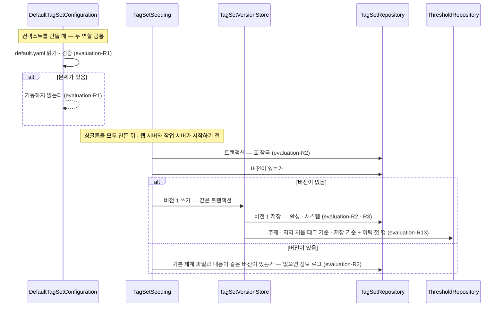
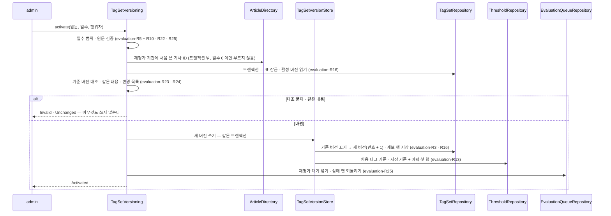
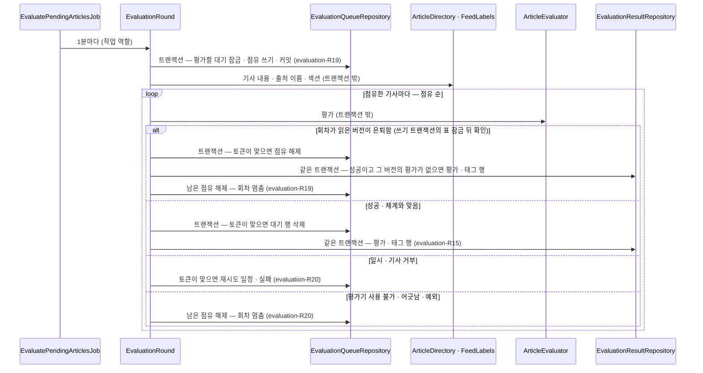
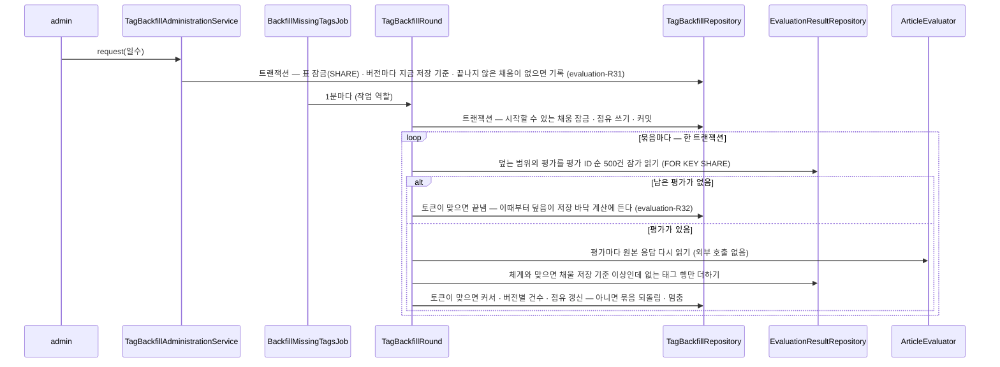

# evaluation 모듈 Spec

공통 구조와 쓰는 규칙은 [specs/README.md](README.md)에 있다.

## 1. 책임과 범위

`evaluation` 은 기사에 붙일 태그의 체계(태그 체계)를 갖고, 사용자와 무관하게 기사마다 한 번 Jev 로 평가한다.

- **태그 체계** — 주제(대분류 · 중분류) · 지역 · 형식 태그와 중요도 기준, 질문 문구를 버전으로 저장한다. 버전 내용은 만든 뒤 바꾸지 않는다(evaluation-R4)
- **첫 기동 적재** — 저장소의 기본 체계 파일을 기동 때 검증하고, 버전이 하나도 없으면 버전 1 로 들인다(evaluation-R1 · R2)
- **태그 기준 · 저장 기준** — 주제 · 지역마다 태그 기준 · 저장 기준을 두고, 운영자의 변경을 이력과 함께 받는다. 앱은 태그 기준 · 저장 기준을 막지 않고, 이전 기사와 어긋날 수 있는 변경에 경고한다. 바꾸기 전에 고른 기간의 평가로 미리 보이고, 지금 값의 어긋난 상태를 낸다(evaluation-R10 ~ R13 · R35 · R36)
- **활성 체계 조회** — 평가 · 후보 선별이 쓰는 활성 버전과 태그 기준 · 저장 기준을 공개 API(`TagSetDirectory`)로 낸다
- **공유 평가** — 기사 하나를 넘긴 체계의 질문으로 평가하고 사건 소속을 판정하는 포트(`ArticleEvaluator` — Jev 를 부르는 유일한 포트)와 운영 구현(`JevArticleEvaluator`) · 로컬 대체물(`FakeArticleEvaluator`)을 둔다. 새 기사를 평가 대기에 넣고, 1분마다 대기를 묶어 평가기로 태그 · 형식 · 중요도를 묻고 결과를 저장한다(evaluation-R14 · R15 · R17 ~ R20)
- **평가 결과 조회** — 기사의 붙은 태그 · 형식 · 중요도를 조회 시점의 태그 기준 · 저장 기준으로 판정해 공개 API(`ArticleEvaluations`)로 낸다. 대기 · 실패 건수를 공개 운영 API(`EvaluationAdministration`)로 낸다(evaluation-R15 · R20)
- **평가 검수** — 버전 하나의 평가 가운데 평가 시각이 기간 안인 것을 태그 · 주제 판정으로 걸러 최근 것부터 내고, 씨앗으로 같은 표본을 다시 뽑으며, 평가 하나의 저장 행 전부와 분포 · 모델 · 토큰을 공개 운영 API(`EvaluationReview`)로 낸다(evaluation-R33 · R34)
- **평가 현황** — 버전 하나의 평가 가운데 평가 시각이 집계 기간 안인 것의 주제 판정 · 태그 분포 · 붙은 태그 수 · 확률 분포 · 중요도 · 입력 토큰을 공개 운영 API(`EvaluationAdministration.overview`)로 낸다(evaluation-R28 · R29)
- **주제별 보도량** — 첫 평가 시각이 집계 기간 안인 기사를 최신 평가의 조회 시점 판정과 태그 키 계보로 활성 버전의 주제마다 세어 공개 조회(`TopicCoverage`)로 낸다(evaluation-R28 · R30)
- **지운 기사 따르기** — `article` 이 기사를 지우면 그 기사의 대기 · 평가 · 태그 행과 사건 소속 판정 원본을 지운다(evaluation-R21)
- **빠진 태그 채움** — 저장 기준을 낮추기 전에 평가된 평가에는 낮춘 구간의 태그 행이 없다. 운영자가 정한 기간에 평가된 평가의 저장된 원본 응답을 평가기가 다시 읽어, 지금 저장 기준 이상인데 없는 태그 행만 더한다. Jev 를 부르지 않는다. 확인 · 요청 · 목록을 공개 운영 API(`TagBackfillAdministration`)로 내고, 작업 역할의 반복 작업이 실행한다(evaluation-R31)
- **저장 바닥** — 이력과 끝난 채움으로 평가 시각마다 어느 확률까지 저장돼 있는지를 계산해, 태그 기준 · 저장 기준의 경고(지난 저장 기준 최댓값)와 평가 현황의 "저장 기준이 섞였다" 표시를 낸다(evaluation-R12 · R29 · R32)
- **체계 변경** — 운영자 원문을 지금 활성 버전과 대조해 확인하거나, 새 버전으로 저장해 곧바로 활성으로 바꾼다. 버전은 앞으로만 켠다. 활성으로 바꿀 때 운영자가 정한 일수 안에 처음 본 기사를 재평가 대기에 넣는다. 버전 목록과 버전의 원문을 공개 운영 API(`TagSetAdministration`)로 낸다(evaluation-R16 · R22 ~ R25 · R27)
- **태그 키 계보** — 키 이름 변경 · 분할 · 병합을 새 버전과 함께 기록하고, 옛 버전의 키를 활성 버전의 키로 푸는 표를 공개 API(`TagKeyLineage`)로 낸다(evaluation-R22 · R23 · R26)
- **사건 소속 판정** — 기사 하나가 후보 사건마다 그 사건을 다루는지 평가기에 묻는 공개 API(`EventMembership`)를 사건 묶기에 낸다. 판정할 기사와 후보 사건의 서술 기사를 ID 로 받아 질문을 만들고, 성공한 판정의 원본을 남겨 그 ID 를 결과에 싣는다(evaluation-R37 · R38, [ADR-0026](../adr/0026-event-clustering-with-local-embeddings-and-jev.md) · [ADR-0071](../adr/0071-event-membership-judged-from-article-ids-with-questions-built-in-evaluation.md) · [ADR-0094](../adr/0094-event-membership-judgements-identified-by-id-read-by-operators-and-referenced-by-the-records-that-apply-them.md))
- **판정 원본 조회** — 판정 시각이 기간 안인 판정 원본을 운영자 화면에 공개 조회(`EventJudgementLog`)로 낸다 — 판정의 쓰임 · 결과는 `event` 가 낸다(evaluation-R39)

하지 않는 것:

- 사용자를 모른다. 사용자 태그 선호 · 구독은 `user` 가, 후보 선별은 `digest` 가 한다. 태그 기준 · 저장 기준의 변경을 기록할 때도 행위자 종류(시스템 · 운영자)만 남기고 사용자를 가리키지 않는다(evaluation-R13)
- 인증을 모른다. 운영자 요청인지는 부르는 쪽(`admin`)이 정해 넘긴다
- 기사를 수집하거나 같은 기사를 판정하지 않는다 — `source` · `article` 이 한다. 기사 내용과 출처 이름 · 피드 섹션은 갖지 않고 `article` · `source` 의 공개 조회로 읽는다

다른 모듈과의 의존과 이벤트 흐름은 [overview.md §5](../overview.md#5-모듈-지도)에 있다.

## 2. 용어

태그 체계 · 태그 종류 · 태그 기준 · 주제 · 공유 평가는 [overview.md §8](../overview.md#8-용어)에 있다.

| 용어 | 뜻 |
|---|---|
| 버전 | 태그 체계 한 벌(`tag_sets` 한 행과 그 태그 · 기준). 번호는 1 부터 늘고, 활성 버전은 언제나 하나다 |
| 대분류 · 중분류 | 주제 태그의 두 단계. 대분류는 Jev 에 묻지 않고, 중분류가 붙으면 그 대분류도 붙은 것으로 본다 |
| 태그 키 | 태그를 가리키는 값. 대분류 · 지역 · 형식은 조각 하나(`politics` · `domestic` · `straight`), 중분류는 대분류 키를 붙인 전체 키(`politics.executive`)다(evaluation-R6). 사용자 선호와 평가 결과가 이 키로 태그를 가리킨다 |
| 질문 틀 | 주제 · 지역의 Yes/No 질문 문장의 틀. 자리표시자 `{description}` 에 태그 설명을 끼워 태그마다 질문을 만든다(evaluation-R9) |
| 저장 기준 | 평가 때 태그 확률을 저장할지 가르는 값. 이 값 이상인 확률만 저장한다(evaluation-R15) |
| 빠진 태그 채움 | 운영자가 정한 기간에 평가된 평가의 원본 응답을 다시 읽어, 그 버전의 채울 저장 기준 이상인데 없는 태그 행을 더하는 것(evaluation-R31). 체계 변경 때의 재평가(evaluation-R25 — 새 버전으로 Jev 를 다시 부른다)와 다르다 |
| 덮는 범위 | 채움 하나가 다루는 평가 시각 `[요청 시각 − 일수 × 24시간, 요청 시각)`(evaluation-R31) |
| 채울 저장 기준 | 채움을 요청한 순간 버전마다의 지금 저장 기준 — 요청이 기록하고 실행은 이 값까지 채운다(evaluation-R31) |
| 저장 바닥 | 평가 시각 t 의 평가에 저장돼 있다고 볼 수 있는 확률의 하한 — 그때 쓰였을 수 있는 저장 기준과 t 를 덮은 끝난 채움의 채울 저장 기준 가운데 작은 것(evaluation-R32) |
| 기본 제외 | 형식 태그의 속성. 사용자가 따로 정하지 않으면 그 형식의 기사를 후보에서 뺀다 |
| 기본 체계 파일 | 저장소의 `backend/src/main/resources/tag-sets/default.yaml`. 첫 기동에 버전 1 로 들어간다(evaluation-R1 · R2). 첫 체계는 [조사 초안](../research/2026-10-news-categories.md) 3.2 를 바탕으로 한다 |
| 첫 기동 적재 | 버전이 하나도 없을 때 기본 체계 파일을 버전 1 로 저장하는 기동 시 동작(evaluation-R2) |
| 행위자 | 태그 기준 · 저장 기준을 정하거나 버전을 만든 주체의 종류 — 시스템(첫 기동 적재) · 운영자(공개 운영 API) |
| 기준 버전 | 새 버전을 대조하는 버전 — 확인 · 활성화 때의 활성 버전이다. 버전은 만들 때 바로 활성이 되므로 버전 n 의 기준 버전은 n − 1 이다(evaluation-R16) |
| 태그 키 계보 | 기준 버전의 키가 새 버전의 어느 키로 이어지는지의 기록 — 이름 변경(`rename`, 하나 → 하나) · 분할(`split`, 하나 → 여럿) · 병합(`merge`, 여럿 → 하나). 운영자 원문의 `lineage` 절에 적고 새 버전과 함께 저장한다(evaluation-R22 · R23) |
| 계보 없이 지운 키 | 기준 버전에 있고 새 버전에 없으며 어느 계보 항목의 이전 키도 아닌 키. 사용자 선호의 해제 대상이다(evaluation-R24) |
| 확인 | 운영자 원문을 검증하고 기준 버전과 대조해 변경 목록과 재평가 대상 기사 수를 돌려주는 연산 — 아무것도 쓰지 않는다(evaluation-R16) |
| 활성화 | 운영자 원문을 확인과 같은 판정으로 대조해 새 버전으로 저장하고 활성으로 바꾸는 연산(evaluation-R16) |
| 재평가 기간 | 활성화 요청이 정하는 일수(0 ~ 30, 기본 0). 활성화 시각에서 그 일수 안에 처음 본 기사를 재평가 대기에 넣는다(evaluation-R25) |
| 피드 맥락 | 평가 입력에서 기사가 실린 피드 하나의 값 — 출처 이름 · 피드 섹션(수집 프로필) · 그 피드 항목의 RSS 카테고리. 기사가 실린 피드(엔트리)마다 하나다(evaluation-R17) |
| 실패 갈래 | 평가기가 예상한 실패의 종류(`EvaluatorFailureKind`) — 일시 · 기사 거부 · 평가기 사용 불가. 평가 작업의 재시도가 이 갈래로 나뉘고, 사건 소속 판정은 갈래를 부르는 쪽에 돌려준다([ADR-0058](../adr/0058-evaluator-failures-in-three-kinds-and-unavailable-evaluator-skips-article-retries.md)) |
| 평가 대기 | 평가할 기사의 목록(`evaluation_queue` — 기사마다 한 행). 평가 가능 시각 · 일시 실패 수 · 점유 · 실패 까닭을 갖는다(evaluation-R18) |
| 정착 시간 | 대기에 넣은 뒤 평가할 수 있기까지의 시간(30분). 같은 기사의 다른 피드 엔트리가 붙을 시간이다(evaluation-R18) |
| 회차 | 반복 작업 한 번 — 대기를 묶어 점유하고 차례로 평가한다(evaluation-R19) |
| 점유 | 회차가 대기 행을 가져갔다는 표시(토큰 · 만료). 결과는 토큰이 맞을 때만 반영한다(evaluation-R19) |
| 회차 멈춤 | 평가기 사용 불가 · 결과가 체계와 어긋남 · 평가기의 예상 못한 예외에서, 그 기사부터 남은 점유를 풀고 회차를 끝내는 것. 기사는 대기에 그대로 남는다(evaluation-R20) |
| `low_confidence` | 주제 태그가 태그 기준을 하나도 넘지 못해, 저장 기준 이상인 가장 높은 확률의 주제 태그 하나를 붙인 판정. 조회 때 정한다(evaluation-R15) |
| 미분류 | 저장 기준 이상인 주제 태그가 없는 판정. 조회 때 정한다(evaluation-R15) |
| 대표 형식 · 중요도 기대값 | 형식 분포에서 확률이 가장 큰 선택지, 중요도 분포의 확률 가중 평균. 분포와 함께 저장한다(evaluation-R15) |
| 집계 기간 | 평가 현황 · 주제별 보도량이 세는 시각 범위 `[from, to)` — 시간대가 없다. 날짜 범위는 부르는 쪽 시간대의 자정으로 옮긴다(evaluation-R28) |
| 첫 평가 시각 | 기사의 평가 행 가운데 가장 이른 평가 시각. 평가 행은 갱신하지 않고 버전 단위로 지우지 않으므로 기사가 남아 있는 한 바뀌지 않는다(evaluation-R30) |
| 평가 현황 | 버전 하나 · 집계 기간 하나의 평가 품질 지표 — 주제 판정 · 태그 분포 · 붙은 태그 수 · 확률 분포 · 중요도 기대값 · 입력 토큰(evaluation-R29) |
| 주제별 보도량 | 첫 평가 시각이 집계 기간 안인 기사를 활성 버전의 대분류 · 중분류마다 센 수(evaluation-R30) |
| 평가 목록 | 버전 하나의 평가 가운데 평가 시각이 집계 기간 안이고 거르기에 맞는 것 — 평가 시각 · 평가 ID 내림차순, 커서로 이어 받는다(evaluation-R33) |
| 거르기 | 평가 목록의 조건 — 태그 하나(주제 대분류 · 중분류 · 지역 · 대표 형식)와 주제 판정. 둘 다 있으면 둘 다 맞아야 한다. 조회 시점 판정으로 본다(evaluation-R33) |
| 커서 | 평가 목록에서 이어 받을 자리 — 마지막으로 받은 평가의 평가 시각과 평가 ID(evaluation-R33) |
| 표본 · 씨앗 | 표본은 버전 하나 · 집계 기간의 평가에서 씨앗으로 고른 일정 수의 평가다. 같은 씨앗이면 같은 평가를 같은 순서로 고른다(evaluation-R34) |
| 기준 미리보기 | 한 태그 종류의 태그 기준 · 저장 기준을 바꾸면 고른 기간의 활성 버전 평가에서 판정이 어떻게 달라지는지 — 아무것도 쓰지 않는다(evaluation-R35) |
| 사건 소속 판정 | 기사 하나가 후보 사건마다 그 사건을 다루는지 평가기에 묻는 것 — 후보마다 Yes/No 확률 하나. 받아들일지는 부르는 쪽(사건 묶기)이 정한다(evaluation-R37 · R38) |
| 후보 사건 · 서술 기사 | 판정에서 묻는 사건(사건 ID)과 그 사건을 설명하는 기사. 부르는 쪽이 사건 중심에 가까운 기사를 고르고, 질문에는 그 제목이 실린다(evaluation-R37) |
| 문구 판 | 사건 소속 질문 문구의 버전 문자열. 문구나 질문 조립 모양을 바꾸면 올리고, 판정 원본마다 남는다(evaluation-R37) |
| 판정 원본 | 성공한 판정 한 번의 기록 — 물은 후보마다 사건 ID · 서술 기사 ID · 확률, 원본 응답 · 모델 버전 · 문구 판 · 입력 토큰. 판정 원본 ID(`EventJudgementId`)로 식별되고, 판정을 반영한 사건 묶기 기록이 그 ID 를 가리킨다(evaluation-R38) |
| 어긋난 상태 | 지금 태그 기준 · 저장 기준과 그 이력 · 끝난 채움 때문에 태그 기준을 넘는 확률이 저장되지 않아 태그가 붙지 않을 수 있는 상태 — 경고(evaluation-R12)는 변경할 때 한 번 나오고, 상태는 남아 있는 동안 나온다(evaluation-R36) |

## 3. 공개 인터페이스

모듈 최상위 패키지 `net.yozmnews.evaluation` 의 공개 타입은 활성 체계 조회 `TagSetDirectory`, 태그 체계의 운영 API `TagSetAdministration`(태그 기준 · 저장 기준 · 버전), 태그 키 계보 조회 `TagKeyLineage`, 평가 결과 조회 `ArticleEvaluations`, 평가 대기 · 평가 현황의 운영 API `EvaluationAdministration`, 평가 검수의 운영 API `EvaluationReview`, 빠진 태그 채움의 운영 API `TagBackfillAdministration`, 주제별 보도량 조회 `TopicCoverage`, 사건 소속 판정 `EventMembership`, 판정 원본 조회 `EventJudgementLog`, 집계 기간 `EvaluationPeriod`, 그 값 · 결과 타입과 평가기 실패 갈래 `EvaluatorFailureKind` 다. 이벤트는 내지 않는다 — 활성 전환을 알리는 이벤트는 받는 모듈(사용자 선호)의 작업이 정한다.

받는 이벤트는 `article` 의 `ArticleStored` · `ArticlesRemoved` 이고, 평가 · 사건 소속 판정의 입력과 재평가 대상은 `article` 의 공개 조회 `ArticleDirectory`(`findAll` · `firstSeenSince`) 와 `source` 의 공개 조회 `FeedLabels` 로 읽는다([article Spec §3](article.md#3-공개-인터페이스) · [source Spec §3](source.md#3-공개-인터페이스)).

HTTP 엔드포인트: 없음 — 운영자 HTTP API 는 `admin` 이 이 모듈의 공개 운영 API 를 불러 낸다([ADR-0045](../adr/0045-admin-module-serves-operator-api-over-module-public-operation-apis.md)).

### TagSetDirectory

활성 체계 조회 — 평가 · 후보 선별이 쓴다. 구현은 `application` 의 `TagSetDirectoryService` 다.

```java
public interface TagSetDirectory {
    TagSetView activeTagSet();
    TagSetThresholds activeThresholds();
}
```

| 멤버 | 뜻 |
|---|---|
| `activeTagSet()` | 활성 버전의 내용 — 태그 · 질문 문장 · 중요도 기준 |
| `activeThresholds()` | 활성 버전의 주제 · 지역의 태그 기준 · 저장 기준 |

- 계약
  - 활성 버전은 언제나 하나다. 없으면(첫 기동 적재의 불변식이 깨짐) `IllegalStateException` 이다(evaluation-R3)
  - 내용과 태그 기준 · 저장 기준은 다른 조회다 — 내용은 바뀌지 않고 태그 기준 · 저장 기준은 바뀐다. 둘 다 버전 ID 를 싣는다. 두 조회를 이어 부르면 그 사이 활성 전환으로 버전이 갈릴 수 있다 — 버전 ID 로 맞춘다
  - 트랜잭션을 열지 않는다. 각 조회는 그 순간의 값이다

관련 규칙: evaluation-R3 · evaluation-R4 · evaluation-R9 · evaluation-R10.

### TagSetView · TopicCategory · AskedTag · FormatChoice · FormatOption · ImportanceScale · ImportanceLevel · TagSetId

활성 체계의 내용.

```java
public record TagSetId(long value) {}

public record TagSetView(TagSetId id, int number, List<TopicCategory> topics, List<AskedTag> regions,
        FormatChoice format, ImportanceScale importance) {}

public record TopicCategory(String key, String name, String description, List<AskedTag> subtopics) {}

public record AskedTag(String key, String name, String description, String question) {}

public record FormatChoice(String question, List<FormatOption> options) {}

public record FormatOption(String key, String name, String description, boolean excludedByDefault) {}

public record ImportanceScale(String question, List<ImportanceLevel> levels) {
    public static final int MIN_LEVEL = 1;      // 정본(evaluation-R7)
    public static final int MAX_LEVEL = 5;
}

public record ImportanceLevel(int level, String description) {}
```

| 타입 · 필드 | 뜻 | 제약 |
|---|---|---|
| `TagSetId` | `tag_sets.id` | 1 이상 |
| `TagSetView.number` | 버전 번호 | 1 이상 |
| `TagSetView.topics` | 주제 대분류와 그 중분류 — 파일에 적힌 순서 | 대분류 1개 이상, 대분류마다 중분류 1개 이상(evaluation-R7) |
| `TopicCategory` | 대분류 — 키 · 이름 · 설명. 질문이 없다(Jev 에 묻지 않는다) | — |
| `AskedTag` | Jev 에 묻는 태그(주제 중분류 · 지역) — 키 · 이름 · 설명과 질문 문장. 중분류의 키는 전체 키다 | `question` 은 질문 틀에 설명을 끼운 문장이다(evaluation-R9) |
| `TagSetView.regions` | 지역 태그 — 파일에 적힌 순서 | 1개 이상(evaluation-R7) |
| `FormatChoice` | 형식 Choice 질문과 그 선택지 — 파일에 적힌 순서 | 선택지 2개 이상(evaluation-R7) |
| `FormatOption.excludedByDefault` | 기본 제외 형식인가 | — |
| `ImportanceScale` | 중요도 Score 질문과 수준별 기준 — 수준 순. `MIN_LEVEL` · `MAX_LEVEL` 은 수준 범위의 정본 — `event` 의 큰 사건 중요도 기준도 이 범위를 쓴다 | 수준 `MIN_LEVEL` ~ `MAX_LEVEL`(1 ~ 5)이 하나씩(evaluation-R7) |

관련 규칙: evaluation-R6 ~ evaluation-R9.

### MultiTagKind · TagThresholds · TagSetThresholds

태그 기준 · 저장 기준의 값.

```java
public enum MultiTagKind { TOPIC, REGION }

public record TagThresholds(MultiTagKind kind, BigDecimal tagThreshold, BigDecimal storeThreshold) {}

public record TagSetThresholds(TagSetId versionId, TagThresholds topic, TagThresholds region) {}
```

| 타입 · 필드 | 뜻 | 제약 |
|---|---|---|
| `MultiTagKind` | 태그 기준 · 저장 기준이 있는 태그 종류 — 여러 태그가 붙는 주제 · 지역. 형식은 하나를 고르므로 없다 | — |
| `TagThresholds.tagThreshold` | 태그 기준 — 저장된 확률이 이 값 이상이면 태그가 붙는다 | 0 이상 1 이하, 소수 셋째 자리까지(evaluation-R10) |
| `TagThresholds.storeThreshold` | 저장 기준 — 평가 때 이 값 이상인 확률만 저장한다 | 같음 |
| `TagSetThresholds` | 한 버전의 주제 · 지역의 태그 기준 · 저장 기준 | — |

관련 규칙: evaluation-R10.

### TagSetAdministration

태그 체계의 운영 — 태그 기준 · 저장 기준과 버전. `admin` 이 운영자 요청으로 부른다. 구현은 `application` 의 `TagSetAdministrationService` 다(버전 연산은 `TagSetVersioning` 에 맡긴다).

```java
public interface TagSetAdministration {
    int MAX_REEVALUATION_DAYS = 30;

    ThresholdChangeResult changeThresholds(MultiTagKind kind, BigDecimal tagThreshold, BigDecimal storeThreshold,
            ChangeActor actor);
    List<ThresholdChangeView> thresholdChanges();
    ThresholdStatusView thresholdStatus();
    ThresholdPreviewResult previewThresholds(MultiTagKind kind, BigDecimal tagThreshold, BigDecimal storeThreshold,
            EvaluationPeriod period);
    List<TagSetVersionView> versions();
    Optional<String> versionText(TagSetId id);
    TagSetReviewResult review(String text, int recentDays);
    TagSetActivationResult activate(String text, int recentDays, ChangeActor actor);
}
```

| 멤버 | 뜻 |
|---|---|
| `MAX_REEVALUATION_DAYS` | 재평가 기간의 상한(일) — 정본이다(evaluation-R25) |
| `changeThresholds` | 활성 버전의 한 태그 종류의 태그 기준 · 저장 기준을 바꾼다(evaluation-R11 · R12) |
| `thresholdChanges()` | 활성 버전의 태그 기준 · 저장 기준 이력 — 최근 것부터(evaluation-R13) |
| `thresholdStatus()` | 활성 버전의 지금 태그 기준 · 저장 기준, 태그 종류마다 지난 저장 기준 최댓값과 어긋난 상태, 이력(evaluation-R36) |
| `previewThresholds` | 기준 미리보기 — 활성 버전 · 한 태그 종류의 제안 값으로 기간 안 평가의 판정이 어떻게 달라지는지. 아무것도 쓰지 않는다(evaluation-R35) |
| `versions()` | 버전 목록 — 번호가 큰 것부터 |
| `versionText` | 버전의 원문 — 그 버전의 내용과 지금 태그 기준 · 저장 기준으로 만든다. 없는 버전이면 빈 값(evaluation-R27) |
| `review` | 확인 — 원문을 검증하고 기준 버전과 대조한다. 아무것도 쓰지 않는다(evaluation-R16 · R22 ~ R25) |
| `activate` | 활성화 — 확인과 같은 판정 뒤 새 버전을 저장해 활성으로 바꾸고 재평가 대기에 넣는다(evaluation-R16 · R25) |

- 계약
  - `changeThresholds` 는 한 트랜잭션이다. 같은 태그 종류의 변경은 줄을 서므로, 이력의 이전 값이 바로 앞 변경의 새 값이다. 활성 전환과도 줄을 선다(evaluation-R11)
  - 값이 범위 밖이면 `OutOfRange`, 지금 값과 같으면 `Unchanged` 이고 둘 다 아무것도 쓰지 않는다
  - 경고는 변경을 막지 않는다 — `Changed` 에 실린다(evaluation-R12). `Changed` · `Unchanged` 는 변경을 판정한 활성 버전을 싣는다 — 미리보기 뒤 활성 전환이 끼었으면 부르는 쪽이 버전으로 안다
  - `thresholdStatus` 는 읽기 전용 `REPEATABLE READ` 트랜잭션 하나(한 스냅숏)에서 읽는다. `previewThresholds` 는 읽기 전용 `REPEATABLE READ` 트랜잭션 하나에서 읽고 잠그지 않는다 — 저장의 결과가 정본이다. 값의 범위 · 같은 값 판정은 `changeThresholds` 와 같다(`OutOfRange` · `Unchanged`)
  - 운영자 요청은 `ChangeActor.OPERATOR` 로 부른다. `SYSTEM` 은 첫 기동 적재가 쓴다. `activate` 의 행위자는 새 버전과 그 처음 태그 기준 · 저장 기준 이력 행의 행위자다
  - `review` · `activate` 는 `recentDays` 가 0 ~ `MAX_REEVALUATION_DAYS` 밖이면 `DaysOutOfRange` 이고 아무것도 하지 않는다. 원문 문제는 `Invalid` 다 — 파서 문제가 있으면 그것만, 없으면 기준 버전 대조 문제다. 대조 문제가 없고 내용이 기준 버전과 같으면 `Unchanged` 다 — 원문의 태그 기준 · 저장 기준만 다르면 `Unchanged` 이고, 그 변경은 `changeThresholds` 로 한다
  - `review` 는 트랜잭션을 열지 않고 그 순간의 활성 버전과 대조한다. `activate` 는 재평가 대상 기사를 트랜잭션 밖에서 읽은 뒤, 한 트랜잭션에서 표를 잠그고 그 순간의 활성 버전과 다시 대조해 쓴다 — 확인 결과가 낡았어도 틀린 버전을 켜지 않는다
  - `versions` · `versionText` 는 트랜잭션을 열지 않는다
  - 활성 버전이 없으면 `IllegalStateException`(evaluation-R3)

관련 규칙: evaluation-R10 ~ evaluation-R13 · evaluation-R16 · evaluation-R22 ~ evaluation-R25 · evaluation-R27 · evaluation-R35 · evaluation-R36.

### ThresholdChangeResult · ThresholdWarning · ChangeActor · ThresholdChangeView

```java
public sealed interface ThresholdChangeResult {
    record Changed(TagSetId version, TagThresholds previous, TagThresholds current, Set<ThresholdWarning> warnings)
            implements ThresholdChangeResult {}
    record Unchanged(TagSetId version, TagThresholds current) implements ThresholdChangeResult {}
    record OutOfRange() implements ThresholdChangeResult {}
}

public enum ThresholdWarning { STORE_THRESHOLD_LOWERED, TAG_BELOW_PAST_STORE, TAG_BELOW_STORE }

public enum ChangeActor { SYSTEM, OPERATOR }

public record ThresholdChangeView(MultiTagKind kind, @Nullable BigDecimal previousTagThreshold,
        @Nullable BigDecimal previousStoreThreshold, BigDecimal tagThreshold, BigDecimal storeThreshold,
        ChangeActor actor, Instant changedAt) {}
```

| 타입 · 값 | 뜻 |
|---|---|
| `Changed` | 바꿨다 — 그 활성 버전, 이전 값 · 새 값과 경고(없으면 빈 집합) |
| `Unchanged` | 지금 값과 같아 바꾸지 않았다 — 그 활성 버전과 지금 값 |
| `OutOfRange` | 값이 0 ~ 1 · 소수 셋째 자리 밖이라 바꾸지 않았다 |
| `STORE_THRESHOLD_LOWERED` | 저장 기준을 지금 값보다 낮췄다 — 이전 기사에는 낮춘 구간의 확률이 없다 |
| `TAG_BELOW_PAST_STORE` | 태그 기준을 내렸고 새 값이 지난 저장 기준 최댓값(evaluation-R32)보다 낮다 — 그보다 높은 저장 기준으로 저장된 평가에는 그 구간 태그가 붙지 않는다 |
| `TAG_BELOW_STORE` | 이번 변경으로 태그 기준이 저장 기준보다 낮아졌다 — 그 구간 확률은 저장되지 않아 붙지 않는다 |
| `ChangeActor` | 운영 설정을 정한 행위자 — 시스템 · 운영자. 태그 기준 · 저장 기준과 `event` 의 큰 사건 기준(event-R21)이 이력에 남긴다 |
| `ThresholdChangeView` | 이력 한 행 — 이전 값(처음 값이면 null) · 새 값 · 행위자 · 시각 |

관련 규칙: evaluation-R11 ~ evaluation-R13.

### ThresholdStatusView · ThresholdKindStatus · ThresholdCondition

```java
public record ThresholdStatusView(TagSetId version, int versionNumber, ThresholdKindStatus topic,
        ThresholdKindStatus region, List<ThresholdChangeView> changes) {}

public record ThresholdKindStatus(TagThresholds current, BigDecimal pastMaxStoreThreshold,
        Set<ThresholdCondition> conditions) {}

public enum ThresholdCondition { TAG_BELOW_STORE, TAG_BELOW_PAST_STORE, STORE_THRESHOLD_CHANGED }
```

| 타입 · 값 | 뜻 |
|---|---|
| `ThresholdStatusView` | 활성 버전 하나의 기준 상태 — 버전 ID · 번호, 태그 종류마다 상태, 이력(최근 것부터) |
| `pastMaxStoreThreshold` | 지난 저장 기준 최댓값 — 이력과 끝난 빠진 태그 채움으로 계산한 저장 바닥의 최댓값(evaluation-R32) |
| `TAG_BELOW_STORE` | 태그 기준이 저장 기준보다 낮다 — 그 구간 확률은 저장되지 않아 붙지 않는다 |
| `TAG_BELOW_PAST_STORE` | 태그 기준이 지난 저장 기준 최댓값(evaluation-R32)보다 낮고, 그 최댓값이 지금 저장 기준보다 높다 — 그보다 높은 저장 기준으로 저장된 평가에는 그 구간 태그가 없다 |
| `STORE_THRESHOLD_CHANGED` | 버전 전체에서 저장 바닥이 둘 이상이다 — 평가마다 저장된 확률 범위가 다르다(evaluation-R32 · R36) |

관련 규칙: evaluation-R36.

### ThresholdPreviewResult

```java
public sealed interface ThresholdPreviewResult {
    record Previewed(TagSetId version, TagThresholds current, TagThresholds proposed,
            Set<ThresholdWarning> warnings, long evaluations, long changed, EvaluationOverview before,
            EvaluationOverview after) implements ThresholdPreviewResult {}
    record Unchanged(TagSetId version, TagThresholds current) implements ThresholdPreviewResult {}
    record OutOfRange() implements ThresholdPreviewResult {}
}
```

| 타입 · 필드 | 뜻 |
|---|---|
| `Previewed` | 제안 값이 지금 값과 다르다 — 그 활성 버전, 지금 값 · 제안 값, 그 변경이 낼 경고(evaluation-R12), 기간 안 평가 수, 그 태그 종류의 판정이 달라지는 평가 수(`changed`), 지금 기준 · 제안 기준의 평가 현황(`before` · `after`) |
| `after` | 그 태그 종류만 제안 값으로 바꾼 기준의 평가 현황. 확률 분포 칸의 저장 범위는 제안 저장 기준으로 정하고, `storeThresholdChanged` 는 지금 저장 바닥 그대로다 — 제안을 이력에 더하지 않는다 |
| `Unchanged` | 제안 값이 지금 값과 같다 |
| `OutOfRange` | 제안 값이 0 ~ 1 · 소수 셋째 자리 밖이다 |

관련 규칙: evaluation-R35.

### TagSetReviewResult · TagSetActivationResult

```java
public sealed interface TagSetReviewResult {
    record Ready(TagSetChanges changes, long recentArticles) implements TagSetReviewResult {}
    record Unchanged() implements TagSetReviewResult {}
    record Invalid(List<TagSetProblemView> problems) implements TagSetReviewResult {}
    record DaysOutOfRange() implements TagSetReviewResult {}
}

public sealed interface TagSetActivationResult {
    record Activated(TagSetVersionView version, TagSetChanges changes, long requeued)
            implements TagSetActivationResult {}
    record Unchanged() implements TagSetActivationResult {}
    record Invalid(List<TagSetProblemView> problems) implements TagSetActivationResult {}
    record DaysOutOfRange() implements TagSetActivationResult {}
}
```

| 타입 · 값 | 뜻 |
|---|---|
| `Ready` | 활성화할 수 있다 — 변경 목록과 재평가 기간에 처음 본 기사 수(`recentArticles`) |
| `Activated` | 새 버전을 활성으로 바꿨다 — 새 버전, 변경 목록, 재평가 대기에 넣거나 되돌린 행 수(`requeued` — 이미 대기 중 · 점유 중인 행은 세지 않는다) |
| `Unchanged` | 내용이 기준 버전과 같아 아무것도 하지 않았다 |
| `Invalid` | 원문 문제 · 기준 버전 대조 문제가 있어 아무것도 하지 않았다 — 찾은 순서대로 모두 |
| `DaysOutOfRange` | 재평가 기간이 0 ~ `MAX_REEVALUATION_DAYS` 밖이라 아무것도 하지 않았다 |

관련 규칙: evaluation-R16 · evaluation-R22 ~ evaluation-R25.

### TagKind · LineageKind · TagRef · TagLineageView · ThresholdDifference · TagSetChanges · TagSetProblemView · TagSetVersionView

```java
public enum TagKind { TOPIC, REGION, FORMAT }

public enum LineageKind { RENAME, SPLIT, MERGE }

public record TagRef(TagKind kind, String key) {}

public record TagLineageView(TagKind kind, LineageKind change, List<String> from, List<String> to) {}

public record ThresholdDifference(TagThresholds current, TagThresholds proposed) {}

public record TagSetChanges(List<TagRef> added, List<TagRef> removed, List<TagRef> revised,
        List<TagLineageView> lineage, boolean questionsRevised, boolean importanceRevised,
        List<ThresholdDifference> thresholds) {}

public record TagSetProblemView(String path, String code, String message, @Nullable Integer line,
        @Nullable Integer column) {}

public record TagSetVersionView(TagSetId id, int number, boolean active, ChangeActor createdBy,
        Instant createdAt) {}
```

| 타입 · 필드 | 뜻 |
|---|---|
| `TagKind` | 태그 종류 — 주제(대분류 · 중분류) · 지역 · 형식. 태그 행 · 계보 행의 종류다 |
| `LineageKind` | 계보 종류 — 이름 변경 · 분할 · 병합(evaluation-R22) |
| `TagRef` | 태그 하나 — 태그 종류와 키(중분류는 전체 키) |
| `TagLineageView` | 계보 항목 하나 — 이전 키 · 새 키 목록 |
| `ThresholdDifference` | 원문의 태그 기준 · 저장 기준(`proposed`)이 기준 버전의 지금 값(`current`)과 크기가 다른 태그 종류 하나 |
| `TagSetChanges` | 기준 버전 대비 변경 목록(evaluation-R24) |
| `TagSetProblemView` | 원문의 문제 — 경로(최상위는 빈 문자열) · 문제 종류 이름 · 운영자용 문구 · 줄 · 열(모르면 null) |
| `TagSetVersionView` | 버전 하나 — 번호 · 활성인가 · 만든 행위자 · 시각 |

관련 규칙: evaluation-R22 ~ evaluation-R24.

### ArticleEvaluations

평가 결과 조회 — 다른 모듈이 기사의 붙은 태그 · 형식 · 중요도를 읽는다. 구현은 `application` 의 `ArticleEvaluationsService` 다.

```java
public interface ArticleEvaluations {
    Optional<ArticleEvaluationView> find(ArticleId articleId);
    Map<ArticleId, Double> importances(Collection<ArticleId> articleIds);
}
```

| 멤버 | 뜻 |
|---|---|
| `find` | 기사의 평가 — 평가하지 않은 기사면 빈 값. 평가가 여러 버전이면 버전 번호가 가장 큰 것 — 버전은 앞으로만 켜므로 기사를 평가한 버전 가운데 가장 최근에 활성이던 것이다(evaluation-R16). 태그 키는 그 평가 버전의 키다 — 활성 버전의 키로 풀려면 `TagKeyLineage` |
| `importances` | 기사들의 중요도 기대값(1 ~ 5) — `find` 와 같은 평가(버전 번호가 가장 큰 것)의 값. 평가하지 않았거나 그 평가의 중요도가 없으면 빠진다 — 이전 버전의 값으로 내려가지 않는다. 빈 입력이면 빈 맵. `event` 가 큰 사건의 중요도 평균을 센다(질의 하나) |

- 계약
  - 붙었는지는 조회할 때 그 평가의 체계 버전과 그 버전의 지금 태그 기준 · 저장 기준으로 판정한다 — 태그 기준 · 저장 기준을 바꿔도 다시 평가하거나 데이터를 다시 쓰지 않는다(evaluation-R15)
  - 트랜잭션을 열지 않는다. 사용자 정보를 받지 않는다 — 공유 평가다

관련 규칙: evaluation-R15.

### ArticleEvaluationView · TopicStatus · TagProbability

```java
public record ArticleEvaluationView(ArticleId articleId, TagSetId tagSetId, TopicStatus topicStatus,
        List<TagProbability> topics, List<String> topicCategories, List<TagProbability> regions, String format,
        @Nullable Double importance) {}

public enum TopicStatus { TAGGED, LOW_CONFIDENCE, UNCLASSIFIED }

public record TagProbability(String key, double probability) {}
```

| 타입 · 필드 | 뜻 |
|---|---|
| `tagSetId` | 평가한 태그 체계 버전 |
| `topicStatus` | 주제 판정 — `TAGGED`(태그 기준을 넘은 주제가 있다) · `LOW_CONFIDENCE`(없어서 저장 기준 이상인 최고 확률 하나를 붙였다) · `UNCLASSIFIED`(저장 기준 이상인 주제가 없다) |
| `topics` | 붙은 주제 중분류(전체 키)와 확률 — 체계 순서. `LOW_CONFIDENCE` 면 하나, `UNCLASSIFIED` 면 빈 목록 |
| `topicCategories` | 붙은 중분류의 대분류 키 — 체계 순서, 중복 없음 |
| `regions` | 붙은 지역과 확률 — 체계 순서 |
| `format` | 대표 형식 키 |
| `importance` | 중요도 기대값(1 ~ 5) — 확률 합이 0 이었으면 null |

관련 규칙: evaluation-R15.

### EvaluationPeriod

집계 기간 — 평가 현황 · 주제별 보도량이 받는다.

```java
public record EvaluationPeriod(Instant from, Instant to) {
    public static final int MAX_DAYS = 31;
    public static final Duration MAX_LENGTH = DayRange.maxLength(MAX_DAYS);
    public static Optional<EvaluationPeriod> of(Instant from, Instant to);
    public static Optional<EvaluationPeriod> ofDays(LocalDate first, LocalDate last, ZoneId zone);
}
```

| 멤버 | 뜻 |
|---|---|
| `from` · `to` | `[from, to)` — 시작 포함 · 끝 제외, 시간대 없음 |
| `MAX_DAYS` | 날짜 범위의 상한(일) — 정본(evaluation-R28) |
| `MAX_LENGTH` | 시각 범위의 상한 — 날짜 `MAX_DAYS` 일 범위의 시각 길이 상한(`platform` 의 `DayRange.maxLength` — 시간대 전환 여유로 하루를 더한다) |
| 생성자 | `from < to` 이고 길이가 `MAX_LENGTH` 이하가 아니면 `IllegalArgumentException` — 범위 밖 기간은 만들어지지 않는다 |
| `of` | 시각 범위 — 범위 밖이면 빈 값 |
| `ofDays` | 날짜 범위 `[first 의 그 시간대 자정, last 다음 날의 그 시간대 자정)` — 변환은 `platform` 의 `DayRange.of` 다([platform Spec §3](platform.md#3-공개-인터페이스)). 날짜 수가 1 ~ `MAX_DAYS` 가 아니거나, 만든 시각 범위가 `of` 의 규칙을 어기면(하루가 통째로 없는 날) 빈 값. 시간대는 결과에 남지 않는다 |

관련 규칙: evaluation-R28.

### EvaluationAdministration · EvaluationQueueCounts

평가 대기 · 평가 현황의 운영 — 운영자 화면이 부른다. 구현은 `application` 의 `EvaluationAdministrationService` 다.

```java
public interface EvaluationAdministration {
    EvaluationQueueCounts queueCounts();
    Optional<EvaluationOverview> overview(TagSetId version, EvaluationPeriod period);
}

public record EvaluationQueueCounts(long waiting, long rejected, long exhausted) {}
```

| 멤버 · 필드 | 뜻 |
|---|---|
| `queueCounts()` | 지금의 대기 · 실패 건수 — 질의 하나로 센다. 트랜잭션을 열지 않는다 |
| `overview` | 그 버전의 평가 가운데 평가 시각이 기간 안인 것의 평가 현황 — 없는 버전이면 빈 값. 읽기 전용 `REPEATABLE READ` 트랜잭션 하나(한 스냅숏)에서 센다(evaluation-R29) |
| `waiting` | 실패로 남지 않은 대기 — 점유 중 포함 |
| `rejected` | 기사 거부로 실패로 남은 대기 |
| `exhausted` | 일시 실패가 시도 상한에 이르러 실패로 남은 대기 |

관련 규칙: evaluation-R18 · evaluation-R20 · evaluation-R29.

### EvaluationOverview · TopicStatusCounts · Share · TagShare · CountBucket · ProbabilityHistogram · ProbabilityBucket · StoredRange · ValueBucket · TokenSummary · TokenBucket

```java
public record EvaluationOverview(TagSetId version, Instant from, Instant to, long evaluations,
        TopicStatusCounts topicStatus, List<TagShare> topics, List<TagShare> topicCategories, List<TagShare> regions,
        List<TagShare> formats, List<CountBucket> topicsPerArticle, List<CountBucket> regionsPerArticle,
        ProbabilityHistogram topicProbabilities, ProbabilityHistogram regionProbabilities,
        ProbabilityHistogram formatProbabilities, List<ValueBucket> importance, long importanceMissing,
        TokenSummary inputTokens) {}

public record TopicStatusCounts(Share tagged, Share lowConfidence, Share unclassified) {}
public record Share(long count, @Nullable Double ratio) {}
public record TagShare(String key, String name, Share share) {}
public record CountBucket(int tags, boolean orMore, Share share) {}
public record ProbabilityHistogram(@Nullable BigDecimal storeThreshold, boolean storeThresholdChanged,
        List<ProbabilityBucket> buckets) {}
public record ProbabilityBucket(BigDecimal lower, BigDecimal upper, boolean upperInclusive, long count,
        StoredRange stored) {}
public enum StoredRange { ALL, PART, NONE }
public record ValueBucket(BigDecimal lower, BigDecimal upper, boolean upperInclusive, Share share) {}
public record TokenSummary(@Nullable Double mean, @Nullable Integer min, @Nullable Integer max,
        List<TokenBucket> buckets) {}
public record TokenBucket(int lower, int upper, long count) {}
```

| 타입 · 필드 | 뜻 |
|---|---|
| `evaluations` | 그 버전의 평가 가운데 평가 시각이 기간 안인 것의 수 — 비율의 분모 |
| `topicStatus` | 주제 판정(`TopicStatus`)마다 평가 수 |
| `Share` | 수와 비율(수 ÷ 평가 수) — 평가가 0 이면 비율 null |
| `topics` · `topicCategories` · `regions` | 그 버전의 중분류 · 대분류 · 지역마다(체계 순서, 0 인 키 포함) 판정이 그 태그를 붙인 평가 수 |
| `formats` | 그 버전의 형식마다 대표 형식이 그것인 평가 수 |
| `topicsPerArticle` · `regionsPerArticle` | 판정이 붙인 태그 수 0 ~ 4 와 마지막 칸 "5 이상"(`orMore`)의 평가 수. 주제의 0 은 미분류, `low_confidence` 는 1 |
| `ProbabilityHistogram` | 확률 0.1 폭 10칸 — 주제 · 지역은 저장된 태그 행 전부, 형식은 대표 형식의 확률. `storeThreshold` 는 지금 저장 기준(형식은 null), `storeThresholdChanged` 는 집계 기간 안 평가 시각의 저장 바닥이 둘 이상인가(evaluation-R32 — 형식은 거짓) |
| `ProbabilityBucket` | `[lower, upper)`, 마지막 칸만 `[lower, upper]`(`upperInclusive`). `stored` 는 그 칸이 지금 저장 기준 이상인가 — 전부(`ALL`) · 일부(`PART`) · 아님(`NONE`) |
| `importance` · `importanceMissing` | 중요도 기대값의 0.5 폭 8칸(`[1, 1.5)` … `[4.5, 5]`)과 기대값이 없는 평가 수 |
| `TokenSummary` | 요청 하나의 입력 토큰 — 평균 · 최소 · 최대(평가 0 이면 null)와 칸 `[lower, upper)` |

관련 규칙: evaluation-R29.

### EvaluationReview

평가 검수 — 운영자 화면이 평가 결과를 한 건씩 보고 표본을 검수한다. 구현은 `application` 의 `EvaluationReviewService` 다.

```java
public interface EvaluationReview {
    int MAX_PAGE_SIZE = 50;
    int DEFAULT_SAMPLE_SIZE = 100;
    int MAX_SAMPLE_SIZE = 200;
    long MAX_SEED = (1L << 53) - 1;

    EvaluationListResult list(TagSetId version, EvaluationPeriod period, EvaluationFilter filter,
            @Nullable EvaluationCursor after, int limit);
    EvaluationSampleResult sample(TagSetId version, EvaluationPeriod period, long seed, int size);
    Optional<EvaluationDetailView> detail(EvaluationId id);
}
```

| 멤버 | 뜻 |
|---|---|
| `MAX_PAGE_SIZE` | 목록 한 번에 받는 평가 수의 상한 — 정본 |
| `DEFAULT_SAMPLE_SIZE` · `MAX_SAMPLE_SIZE` | 표본 크기의 기본값 · 상한 — 정본 |
| `MAX_SEED` | 씨앗의 상한 — 화면(JavaScript 수)이 정확히 나타내는 2^53 − 1. 정본 |
| `list` | 평가 목록 — `after` 다음부터 거르기에 맞는 것 `limit` 건(evaluation-R33) |
| `sample` | 표본 — 씨앗으로 고른 `size` 건(evaluation-R34) |
| `detail` | 평가 하나 — 저장 행 전부와 그 버전의 지금 기준으로 붙었는지, 분포 · 모델 · 토큰. 없는 평가면 빈 값 |

- 계약
  - 세 연산 모두 읽기 전용 `REPEATABLE READ` 트랜잭션 하나에서 읽는다. 사용자 정보를 받지 않는다
  - 판정은 그 평가 버전의 지금 태그 기준 · 저장 기준으로 조회 때 한다(evaluation-R15). 태그 키 · 이름 · 순서는 그 평가 버전의 것이다
  - 기사 내용 · 출처 이름은 싣지 않는다 — 부르는 쪽이 `article` · `source` 의 공개 조회로 맞붙인다

관련 규칙: evaluation-R33 · evaluation-R34.

### EvaluationId · EvaluationCursor · EvaluationFilter · EvaluationListResult · EvaluationSampleResult · EvaluationListing · EvaluationSampleView · EvaluationRow · NamedTag · TagName · EvaluationDetailView · StoredTagView · DistributionShare

```java
public record EvaluationId(long value) {}

public record EvaluationCursor(Instant evaluatedAt, EvaluationId id) {}

public record EvaluationFilter(@Nullable TagRef tag, @Nullable TopicStatus topicStatus) {
    public static final EvaluationFilter NONE = new EvaluationFilter(null, null);
}

public sealed interface EvaluationListResult {
    record Listed(EvaluationListing listing) implements EvaluationListResult {}
    record UnknownVersion() implements EvaluationListResult {}
    record UnknownTag(TagRef tag) implements EvaluationListResult {}
    record LimitOutOfRange() implements EvaluationListResult {}
}

public sealed interface EvaluationSampleResult {
    record Sampled(EvaluationSampleView sample) implements EvaluationSampleResult {}
    record UnknownVersion() implements EvaluationSampleResult {}
    record SizeOutOfRange() implements EvaluationSampleResult {}
    record SeedOutOfRange() implements EvaluationSampleResult {}
}

public record EvaluationListing(TagSetId version, Instant from, Instant to, List<EvaluationRow> rows,
        @Nullable EvaluationCursor next) {}

public record EvaluationSampleView(TagSetId version, Instant from, Instant to, long seed, long population,
        List<EvaluationRow> rows) {}

public record EvaluationRow(EvaluationId id, ArticleId articleId, Instant evaluatedAt, TopicStatus topicStatus,
        List<NamedTag> topics, List<TagName> topicCategories, List<NamedTag> regions, NamedTag format,
        @Nullable Double importance) {}

public record NamedTag(String key, String name, double probability) {}

public record TagName(String key, String name) {}

public record EvaluationDetailView(EvaluationId id, ArticleId articleId, TagSetId version, int versionNumber,
        String evaluator, String modelVersion, Instant evaluatedAt, int inputTokens, TagSetThresholds thresholds,
        TopicStatus topicStatus, List<StoredTagView> topics, List<TagName> topicCategories,
        List<StoredTagView> regions, List<DistributionShare> formats, String format,
        List<DistributionShare> importanceLevels, @Nullable Double importance) {}

public record StoredTagView(String key, String name, double probability, boolean attached) {}

public record DistributionShare(String key, String name, double probability) {}
```

| 타입 · 필드 | 뜻 | 제약 |
|---|---|---|
| `EvaluationId` | `article_evaluations.id` | 1 이상 |
| `EvaluationCursor` | 마지막으로 받은 평가의 평가 시각 · ID | — |
| `EvaluationFilter.tag` | 거를 태그 하나 — 주제는 대분류 키 · 중분류 전체 키, 지역 키, 형식(대표 형식) 키. 없으면 거르지 않는다 | — |
| `EvaluationFilter.topicStatus` | 거를 주제 판정. 없으면 거르지 않는다 | — |
| `UnknownTag` | 거를 태그가 그 버전의 그 태그 종류에 없다 — 아무것도 읽지 않았다 | — |
| `LimitOutOfRange` | `limit` 이 1 ~ `MAX_PAGE_SIZE` 밖이다 | — |
| `SizeOutOfRange` · `SeedOutOfRange` | `size` 가 1 ~ `MAX_SAMPLE_SIZE` 밖이다 · `seed` 가 0 ~ `MAX_SEED` 밖이다 | — |
| `UnknownVersion` | 없는 버전이다 | — |
| `EvaluationListing.next` | 더 있으면 마지막 행의 커서, 없으면 null | — |
| `EvaluationSampleView.population` | 표본을 고른 평가의 수(버전 · 기간) | — |
| `EvaluationRow` | 평가 한 건의 판정 — 붙은 주제 중분류 · 대분류 · 지역(체계 순), 대표 형식과 그 확률, 중요도 기대값 | — |
| `TagName` | 대분류 — Jev 에 묻지 않아 확률이 없다 | — |
| `EvaluationDetailView` | 평가 하나 — 평가기 이름 · 모델 버전 · 평가 시각 · 입력 토큰, 그 버전의 지금 기준, 주제 판정, 저장 행 전부(체계 순)와 붙었는지, 붙은 대분류, 형식 분포(체계 순)와 대표 형식, 중요도 분포(수준 순)와 기대값 | — |
| `DistributionShare` | 분포의 선택지 하나 — 형식은 키 · 이름, 중요도는 수준 · 수준 기준 | — |

관련 규칙: evaluation-R33 · evaluation-R34.

### TagBackfillAdministration · TagBackfillReviewResult · TagBackfillRequestResult

빠진 태그 채움의 운영 — 운영자 요청으로 `admin` 이 부른다. 구현은 `application` 의 `TagBackfillAdministrationService` 다. 실행은 작업 역할의 반복 작업이 한다(§4 들어오는 쪽).

```java
public interface TagBackfillAdministration {
    int MAX_DAYS = 180;

    TagBackfillReviewResult review(int days);
    TagBackfillRequestResult request(int days);
    List<TagBackfillRunView> runs();
}

public sealed interface TagBackfillReviewResult {
    record Ready(Instant from, Instant to, long evaluations, List<TagBackfillVersionCount> versions)
            implements TagBackfillReviewResult {}
    record DaysOutOfRange() implements TagBackfillReviewResult {}
}

public sealed interface TagBackfillRequestResult {
    record Requested(TagBackfillRunView run) implements TagBackfillRequestResult {}
    record AlreadyOpen(TagBackfillRunView run) implements TagBackfillRequestResult {}
    record DaysOutOfRange() implements TagBackfillRequestResult {}
}
```

| 멤버 · 값 | 뜻 |
|---|---|
| `MAX_DAYS` | 채울 기간의 상한(일) — 정본이다(evaluation-R31) |
| `review` | 확인 — 덮을 범위 `[지금 − 일수 × 24시간, 지금)` 의 평가 수를 버전별로 센다. 아무것도 쓰지 않는다 |
| `request` | 요청 — 채움 하나와 모든 버전의 채울 저장 기준을 기록한다. 실행은 시작 가능 시각(요청 + 1분) 뒤 작업 역할이 한다 |
| `runs` | 채움 목록 — 최근 것부터 모두 |
| `Ready` | 덮을 범위(`from` 포함 · `to` 제외, `to` 는 확인한 시각), 그 범위의 평가 수, 평가가 있는 버전마다 수(버전 번호 순) |
| `Requested` · `AlreadyOpen` | 기록한 채움 · 끝나지 않은 채움이 있어 아무것도 쓰지 않았다 — 그 채움 |
| `DaysOutOfRange` | 일수가 1 ~ `MAX_DAYS` 밖이라 아무것도 하지 않았다 |

- 계약
  - `request` 는 한 트랜잭션이다. 끝나지 않은 채움은 하나뿐이다 — 동시 요청은 앞 요청의 커밋을 기다린 뒤 `AlreadyOpen` 이다(evaluation-R31)
  - `review` · `runs` 는 트랜잭션을 열지 않는다. 사용자 정보를 받지 않는다

관련 규칙: evaluation-R31.

### TagBackfillRunView · TagBackfillVersionView · TagBackfillVersionCount · TagBackfillState

```java
public record TagBackfillRunView(long id, int days, Instant from, Instant to, Instant requestedAt,
        TagBackfillState state, @Nullable Instant startedAt, @Nullable Instant finishedAt, long evaluations,
        long processed, long tagsAdded, long skippedOtherEvaluator, long skippedUnreadable,
        List<TagBackfillVersionView> versions) {}

public record TagBackfillVersionView(TagSetId version, int number, BigDecimal topicStoreThreshold,
        BigDecimal regionStoreThreshold, long evaluations, long processed, long tagsAdded, long skippedOtherEvaluator,
        long skippedUnreadable) {}

public record TagBackfillVersionCount(TagSetId version, int number, long evaluations) {}

public enum TagBackfillState { WAITING, RUNNING, DONE }
```

| 타입 · 필드 | 뜻 |
|---|---|
| `TagBackfillRunView` | 채움 하나 — 덮는 범위(`to` = `requestedAt`), 상태, 시작 · 끝 시각(없으면 null), 버전별 건수의 합과 버전마다(버전 번호 순) |
| `evaluations` | 요청 때 센 대상 평가 수 |
| `processed` | 처리한 평가 수 — 건너뛴 평가 포함 |
| `tagsAdded` | 더한 태그 행 수 |
| `skippedOtherEvaluator` · `skippedUnreadable` | 평가기가 달라 · 원본 응답을 읽을 수 없거나 체계와 어긋나 건너뛴 평가 수 |
| `TagBackfillVersionView` | 버전 하나 — 채울 저장 기준(주제 · 지역)과 건수 |
| `TagBackfillState` | `WAITING`(시작 전) · `RUNNING`(시작했고 끝나지 않음) · `DONE`(끝남 — 그 버전에서 건너뛴 평가가 없으면 덮는 범위가 저장 바닥 계산에 든다, evaluation-R32) |

관련 규칙: evaluation-R31 · evaluation-R32.

### TopicCoverage · TopicCoverageResult · TopicCoverageView · CategoryCoverage · SubtopicCoverage

주제별 보도량 — 운영자 화면이 먼저 쓰고, 변화 리포트 · 관심사 히스토리가 쓴다. 구현은 `application` 의 `TopicCoverageService` 다.

```java
public interface TopicCoverage {
    TopicCoverageResult count(EvaluationPeriod period, Set<String> topics);
}

public sealed interface TopicCoverageResult {
    record Counted(TopicCoverageView view) implements TopicCoverageResult {}
    record UnknownTopics(Set<String> keys) implements TopicCoverageResult {}
}

public record TopicCoverageView(TagSetId activeVersion, Instant from, Instant to, long articles,
        long withoutActiveTopic, List<CategoryCoverage> categories) {}
public record CategoryCoverage(String key, String name, long articles, List<SubtopicCoverage> subtopics) {}
public record SubtopicCoverage(String key, String name, long articles) {}
```

| 멤버 · 필드 | 뜻 |
|---|---|
| `count` | 기간의 보도량. `topics` 는 활성 버전의 대분류 · 중분류(전체 키) 키 — 빈 집합이면 모든 주제 |
| `UnknownTopics.keys` | 고른 키 가운데 활성 버전에 없는 것 — 사전 순, 비어 있지 않다. 아무것도 세지 않았다 |
| `activeVersion` | 키 · 이름 · 순서를 정한 활성 버전 |
| `articles` | 첫 평가 시각이 기간 안인 기사 수 |
| `withoutActiveTopic` | 그 가운데 활성 주제에 하나도 이어지지 않은 기사 수 — 미분류이거나 붙은 주제가 모두 계보 없이 지워졌다 |
| `categories` | 고른 주제 — 체계 순서, 0 인 주제 포함. 대분류 키는 그 대분류와 하위 중분류 전부, 중분류 키만 고르면 그 대분류 항목에 고른 중분류만. 대분류 키가 그 하위 중분류 키보다 이긴다 |
| `CategoryCoverage.articles` | 하위 중분류 어느 것이든 붙은 기사 수 — 하위의 합이 아니다. 중분류만 골라도 대분류 전체의 수다 |

- 계약
  - 읽기 전용 `REPEATABLE READ` 트랜잭션 하나(한 스냅숏)에서 센다. 사용자 정보를 받지 않는다
  - 계보 표의 기준 버전이 그 스냅숏의 활성 버전과 다르거나 표가 활성 중분류가 아닌 키로 이으면 `IllegalStateException` 이다 — 불변식이 깨진 것이다

관련 규칙: evaluation-R28 · evaluation-R30.

### TagKeyLineage · TagKeyMapping

태그 키 계보 조회 — 옛 버전의 키를 활성 버전의 키로 푼다. 후보 선별 · 주제별 시계열 · 사용자 선호가 쓴다. 구현은 `application` 의 `TagKeyLineageService` 다.

```java
public interface TagKeyLineage {
    TagKeyMapping toActive(TagSetId from);
}

public record TagKeyMapping(TagSetId from, TagSetId to, Map<TagKind, Map<String, Set<String>>> keys) {
    public Set<String> resolve(TagKind kind, String key);
}
```

| 멤버 · 필드 | 뜻 |
|---|---|
| `toActive` | `from` 버전의 모든 키를 활성 버전 키의 집합으로 옮긴 표 — 태그 종류마다, 대분류 · 중분류 · 지역 · 형식 키 전부(evaluation-R26) |
| `TagKeyMapping.to` | 표가 기준으로 삼은 활성 버전 |
| `TagKeyMapping.keys` | 태그 종류 → `from` 버전의 키 → 활성 버전의 키 집합. 계보 없이 지운 키는 빈 집합, 그대로인 키는 자기 하나 |
| `resolve` | 키 하나를 푼다 — `from` 버전의 그 태그 종류에 없는 키면 `IllegalArgumentException` |

- 계약
  - 없는 버전이면 `IllegalArgumentException` 이다. `from` 이 활성 버전이면 항등 표다
  - 트랜잭션을 열지 않는다. 표를 만든 뒤 활성 전환이 커밋되면 `to` 가 방금 은퇴한 버전일 수 있다 — 소비자는 `to` 로 안다
  - 버전 단위로 한 번에 받는다 — 여러 기사를 이을 때 호출은 버전 수만큼이다

관련 규칙: evaluation-R26.

### EventMembership · MembershipQuery · EventDescriptor · MembershipJudgement · EvaluatorFailureKind

사건 소속 판정 — 사건 묶기가 기사 하나를 후보 사건마다 그 사건을 다루는지 평가기로 판정한다. 구현은 `application` 의 `EventMembershipService` 다.

```java
public interface EventMembership {
    MembershipJudgement judge(MembershipQuery query);
}

public record MembershipQuery(ArticleId articleId, List<EventDescriptor> candidates) {
    public static final int MAX_CANDIDATES = 10;
}

public record EventDescriptor(long eventId, List<ArticleId> articleIds) {
    public static final int MAX_ARTICLES = 5;
}

public sealed interface MembershipJudgement {
    record Judged(@Nullable EventJudgementId judgement, Map<Long, Double> probabilities) implements MembershipJudgement {}
    record Failed(EvaluatorFailureKind kind, String message) implements MembershipJudgement {}
    record ArticleMissing() implements MembershipJudgement {}
}

public enum EvaluatorFailureKind { TRANSIENT, ARTICLE_REJECTED, EVALUATOR_UNAVAILABLE }
```

| 타입 · 멤버 | 뜻 | 제약 |
|---|---|---|
| `judge` | 판정할 기사가 후보 사건마다 그 사건을 다루는지 판정한다(evaluation-R37 · R38) | — |
| `MembershipQuery.articleId` | 판정할 기사 | 어느 후보의 서술 기사도 아니다 |
| `MembershipQuery.candidates` | 후보 사건 — 이 순서로 묻는다 | 1 ~ `MAX_CANDIDATES`(10)개, 사건 ID 가 겹치지 않는다 |
| `EventDescriptor.eventId` | 후보 사건 ID — `event` 의 사건을 가리키는 값이고 `evaluation` 은 그 뜻을 모른다 | 1 이상 |
| `EventDescriptor.articleIds` | 서술 기사 — 사건 중심에 가까운 기사(부르는 쪽이 고른다). 이 순서로 제목을 질문에 싣는다 | 1 ~ `MAX_ARTICLES`(5)개, 겹치지 않는다 |
| `Judged.judgement` | 남긴 판정 원본의 ID — 평가기를 부르지 않았으면(확률이 빈 맵) null. 판정을 반영한 쪽이 자기 기록에 남긴다(evaluation-R38) | 원본이 없는 것 ⇔ 확률이 빈 맵 — 어기면 `IllegalArgumentException` |
| `Judged.probabilities` | 물은 후보의 사건 ID → 그 사건에 속할 확률. 서술 기사가 모두 지워진 후보는 묻지 않아 없다 — 그런 후보뿐이면 빈 맵이고 평가기를 부르지 않았다 | 사건 ID 는 1 이상, 확률은 0 ~ 1 의 유한값 |
| `Failed` | 평가기의 예상한 실패 — 갈래와 운영자용 문구. 판정 원본을 남기지 않았다 | 문구는 공백뿐이 아니고 비밀 값을 담지 않는다 |
| `ArticleMissing` | 판정할 기사가 없다 — 부르기 전에 지워졌거나 판정 중에 지워졌다. 판정 원본은 남지 않는다 | — |
| `EvaluatorFailureKind` | 평가기 실패 갈래 — `TRANSIENT`(시간이 지나면 풀릴 수 있다 — 마감 초과 · 연결 실패 · 서버 오류 · 요청 제한) · `ARTICLE_REJECTED`(그 기사 때문이라 다시 보내도 같다 — 입력 거부, 기사가 평가기의 입력 한도를 넘는 경우 포함) · `EVALUATOR_UNAVAILABLE`(평가기 자체를 쓸 수 없다 — 키 무효 · 한도 소진 · 설정 오류 · 응답을 읽을 수 없음). 갈래마다 무엇을 할지는 부르는 쪽이 정한다 — 평가 작업은 evaluation-R20, 사건 배정은 [event-R16](event.md#사건-배정), 사건 병합은 [event-R13](event.md#사건-정리) | — |

- 계약
  - 판정은 외부 호출이라 작업 역할의 작업에서, DB 트랜잭션 밖에서 부른다. 트랜잭션 안에서 부르거나 평가기가 없는 프로세스(키 없는 화면 역할)에서 부르면 `IllegalStateException` 이다 — 부르는 쪽 결함이다([ADR-0073](../adr/0073-event-membership-api-in-both-roles-looks-up-the-evaluator-on-call-and-fails-without-one.md))
  - 요청 값이 제약을 어기면 생성자가 `IllegalArgumentException` 을 던진다
  - 확률을 받아들일지(기준 · 최댓값)는 부르는 쪽이 정한다. 같은 요청도 확률이 흔들릴 수 있다(ADR-0063)
  - 판정에 성공하면 판정 원본을 남긴다(evaluation-R38). 평가기의 예상 못한 예외와 결과가 물은 후보와 어긋남(`IllegalStateException`)은 그대로 던지고 원본을 남기지 않는다
  - 사용자 정보를 받지 않는다 — 공유 판정이다

관련 규칙: evaluation-R21 · evaluation-R37 · evaluation-R38.

### EventJudgementLog · EventJudgementId · EventJudgementView · JudgedEvent · EventJudgementCursor · EventJudgementPage

판정 원본 조회 — 운영자 화면이 기간의 판정 원본을 훑는다. 구현은 `application` 의 `EventJudgementLogService` 다.

```java
public interface EventJudgementLog {
    int MAX_PAGE_SIZE = 100;                                 // 한 쪽의 상한 — 정본. 측정 전 목표
    EventJudgementPage list(EvaluationPeriod period, @Nullable EventJudgementCursor after, int size);
}

public record EventJudgementId(long value) {}                // 1 이상 — 아니면 IllegalArgumentException
public record EventJudgementView(EventJudgementId id, ArticleId articleId, List<JudgedEvent> candidates,
        String evaluator, String modelVersion, String wordingVersion, int inputTokens, Instant judgedAt) {}
public record JudgedEvent(long eventId, List<ArticleId> describedArticles, double probability) {}
public record EventJudgementCursor(Instant judgedAt, EventJudgementId id) {}
public record EventJudgementPage(List<EventJudgementView> judgements, @Nullable EventJudgementCursor next) {}
```

| 타입 · 멤버 | 뜻 |
|---|---|
| `list` | 판정 시각이 기간 안인 판정 원본 — (판정 시각, ID) 내림차순. `size` 가 1 ~ `MAX_PAGE_SIZE` 밖이면 `IllegalArgumentException`(evaluation-R39) |
| `EventJudgementView.candidates` | 물은 후보 — 요청 순서 |
| `EventJudgementView.inputTokens` | 판정 요청의 입력 토큰 — 출력 토큰은 남기지 않는다(Jev 는 출력이 무료 — [ADR-0002](../adr/0002-shared-evaluation-with-jev.md)) |
| `JudgedEvent.eventId` | 판정 당시의 후보 사건 ID — `event` 의 사건을 가리키는 값이고 `evaluation` 은 그 뜻을 모른다. 그 뒤 합쳐졌거나 지워졌을 수 있다 |
| `JudgedEvent.describedArticles` | 질문에 제목을 쓴 서술 기사 — 요청 순서 |
| `JudgedEvent` 생성자 | 사건 ID 1 미만 · 서술 기사 없음 · 확률이 0 ~ 1 의 유한값이 아니면 `IllegalArgumentException` — 저장할 판정 원본(`MembershipRecord`)도 이 값으로 후보를 담는다 |
| `EventJudgementPage.next` | 다음 쪽의 커서 — 더 없으면 null |

- 계약
  - 트랜잭션 · 역할 애너테이션이 없다(두 역할 공통) — 질의 하나다
  - 원본 응답은 내지 않는다. 판정의 쓰임(배정 · 병합)과 결과는 `event` 의 `EventReview.judgementUses` 가 원본 ID 로 낸다([event Spec §3](event.md#3-공개-인터페이스))
  - 사용자 정보를 받지 않는다

관련 규칙: evaluation-R38 · evaluation-R39.

## 4. 내부 구조

### 개관

| 패키지 | 책임 |
|---|---|
| (최상위) | 공개 API `TagSetDirectory` · `TagSetAdministration` · `TagKeyLineage` · `ArticleEvaluations` · `EvaluationAdministration` · `EvaluationReview` · `TagBackfillAdministration` · `TopicCoverage` · `EventMembership` · `EventJudgementLog` 와 집계 기간 `EvaluationPeriod`, 그 값 · 결과 타입과 실패 갈래 `EvaluatorFailureKind`(§3) |
| `domain/tagset` | 태그 체계 정의와 그 읽기 · 검증 · 원문 쓰기, 질문 틀, 기준 버전 대조, 태그 키 계보 해석, 버전 aggregate 와 그 저장소 |
| `domain/threshold` | 태그 기준 · 저장 기준의 값 규칙과 변경 판정, 저장 바닥 계산, 어긋난 상태 판정, 태그 기준 · 저장 기준 저장소 |
| `domain/backfill` | 빠진 태그 채움 행과 그 점유 · 일정, 채움 저장소 |
| `domain/evaluator` | 공유 평가 · 사건 소속 판정의 포트와 그 입력 · 결과 · 실패, 피드 맥락의 카테고리 상한 · 서술 제목 상한, 사건 소속 질문 문구 |
| `domain/jev` | Jev 요청 본문 · 응답 읽기 · 오류 갈래 · 키 형식의 판정 |
| `domain/queue` | 평가 대기의 일정(정착 · 점유 · 재시도)과 대기 행의 전이, 대기 저장소 |
| `domain/result` | 결과와 체계의 일치 검사, 결과 해석(저장 기준 거르기 · 대표값), 조회 시점 판정, 결과 저장소(채움의 잠금 읽기 · 태그 더하기 포함) |
| `domain/overview` | 평가 현황 · 주제별 보도량의 집계 판단 — 판정 · 계보 풀기를 불러 세기, 칸 규칙, 비율 |
| `domain/membership` | 사건 소속 판정의 물을 후보 고르기 · 결과 대조 · 저장할 판정 원본, 판정 원본 저장소 |
| `domain/review` | 평가 검수 · 기준 미리보기의 판단 — 거르기, 표집, 두 기준의 판정 비교 |
| `application` | 기본 체계 파일의 기동 검증, 첫 기동 적재, 확인 · 활성화, 기사 이벤트 리스너, 대기 점유와 평가 회차, 채움 회차, 공개 API 의 구현(집계 · 검수 · 미리보기의 읽기 전용 트랜잭션 · 사건 소속 판정 포함) |
| `adapter/in/job` | 평가 반복 작업 · 채움 반복 작업(작업 역할) |
| `adapter/out/persistence` | 태그 기준 · 저장 기준 · 대기 · 결과 · 채움 · 판정 원본 저장소의 JdbcClient 구현 |
| `adapter/out/jev` | 평가기 포트의 운영 구현(Jev)과 그 결선 · 설정, 키가 있는가의 조건, 작업 역할의 키 기동 검사 |
| `adapter/out/fake` | 평가기 포트의 로컬 대체물과 그 결선(`local` 이면서 Jev 키가 없을 때만) |

협력: `DefaultTagSetConfiguration` 이 기본 체계 파일을 `TagSetParser`(`platform` 의 `YamlTextReader` → `TagSetBinder` → `TagSetValidator`)로 읽어 `TagSetDefinition` 을 만든다. `TagSetSeeding` 이 그 정의로 `TagSetVersionStore` 를 불러 버전 1 을 쓴다 — `TagSetVersionStore` 는 `TagSetRepository` 에 버전을, `ThresholdRepository` 에 처음 태그 기준 · 저장 기준을 쓰는 새 버전 쓰기의 정본이다. `TagSetDirectoryService` 는 `TagSetRepository` 로 활성 버전을 읽어 `TagSetViews` 로 공개 타입(질문 문장은 `QuestionTemplate`)으로 옮기고, 태그 기준 · 저장 기준은 `ThresholdRepository` 로 읽는다. `TagSetAdministrationService` 는 활성 버전의 태그 기준 · 저장 기준을 `ThresholdRepository` 로 잠그고, 그 버전의 이력으로 `StoreFloorsReader` 에서 `StoreFloors` 를 얻어 지난 저장 기준 최댓값을 얻은 뒤 `ThresholdRule` 로 판정하고 같은 저장소로 쓴다. 버전 연산은 `TagSetVersioning` 에 맡긴다 — 원문을 `TagSetParser` 로 읽고, 재평가 대상을 `article` 의 `ArticleDirectory.firstSeenSince` 로 얻고, `TagSetRepository` 로 표를 잠가 활성 버전을 읽어 `TagSetRevision` 으로 대조한다. 활성화면 `TagSetVersionStore` 로 이전 버전을 끄고 `TagSet.next` 와 처음 태그 기준 · 저장 기준을 쓰고, `EvaluationQueueRepository.requeue` 로 재평가 대기를 쓴다. 원문 내보내기는 `TagSetWriter` 가 한다. `TagKeyLineageService` 는 `TagSetRepository` 로 버전을 번호 순으로 읽어 `KeyLineage` 로 해석한다.

평가: `ArticleEventsListener` 가 `ArticleStored` 로 기사를 `EvaluationQueueRepository` 에 넣고, `ArticlesRemoved` 로 대기 · 결과 행과 판정 원본을 지운다. 작업 역할의 `EvaluatePendingArticlesJob` 이 1분마다 `EvaluationRound` 를 돌린다. 회차는 `PendingEvaluations` 로 대기를 점유하고(`PendingEvaluation` 의 전이 · `EvaluationSchedule` 의 일정), `TagSetDirectory` · `ThresholdRepository` 로 활성 체계와 그 버전의 태그 기준 · 저장 기준을, `article` 의 `ArticleDirectory` 와 `source` 의 `FeedLabels` 로 입력을 읽어 포트 `ArticleEvaluator` 를 부른다. 결과는 `ResultCheck` 로 체계와 대조하고 `EvaluationRecord` 로 저장할 모양을 만들어 `EvaluationResultRepository` 에 쓰고, 실패는 대기 행의 전이로 쓴다. 쓰기마다 `TagSetRepository` 로 표를 잠가 회차가 읽은 버전이 아직 활성인지 본다(evaluation-R19). `ArticleEvaluationsService` 는 `EvaluationResultRepository` 로 평가를 읽어 `TagSetViews` · `ThresholdRepository` 로 그 버전의 체계와 태그 기준 · 저장 기준을 얻고 `TagJudgement` 로 판정한다. 채움: `TagBackfillAdministrationService` 가 `EvaluationResultRepository.countByVersion` 으로 범위의 평가 수를 세고, 요청이면 `TagSetRepository` 로 표를 잠가 모든 버전의 `ThresholdRepository.current` 저장 기준을 채울 기준으로 `TagBackfillRepository` 에 기록한다. 작업 역할의 `BackfillMissingTagsJob` 이 1분마다 `TagBackfillRound` 를 돌린다. 회차는 `TagBackfillRepository` 로 채움을 점유하고(`TagBackfill.claim` · `BackfillSchedule` 의 일정), 버전마다 `TagSetViews` 와 채울 기준을 한 번 읽은 뒤, 묶음마다 `EvaluationResultRepository.lockResponses` 로 평가를 잠가 읽어 포트 `ArticleEvaluator.reread` 로 원본 응답을 다시 읽고, `ResultCheck` 로 대조한 결과를 `EvaluationRecord.storedTags` 로 걸러 `addMissingTags` 로 더한다. 진행은 `TagBackfillRepository.advance` 로 점유 토큰이 맞을 때만 쓴다. 평가기는 Jev 키가 있으면 `JevArticleEvaluatorConfiguration` 이 `JevArticleEvaluator` 를, `local` 이면서 키가 없으면 `FakeArticleEvaluatorConfiguration` 이 `FakeArticleEvaluator` 를 포트로 등록한다 — 키가 있는가는 `JevKeyCondition` 이 정한다. `JevArticleEvaluator` 는 `JevRequest` 로 요청 본문을, `JevResponse` 로 결과를, `JevErrors` 로 오류 갈래 · 문구를 만든다.

판정: `EventMembershipService` 는 트랜잭션 밖인지 · 평가기가 있는지(`ObjectProvider` 로 부를 때 찾는다) 본 뒤, `article` 의 `ArticleDirectory.findAll` 로 판정할 기사와 서술 기사를 한 번에 읽는다. `MembershipPlan` 이 물을 후보와 포트 입력(`MembershipInput` — 서술 제목은 `CandidateEvent.limited`, 문구는 `MembershipWording.CURRENT`)을 만들고 포트 `ArticleEvaluator.judgeMembership` 을 부른다. 성공이면 `MembershipCheck` 로 물은 후보와 대조하고 `MembershipRecord` 로 저장할 모양을 만들어 `EventJudgementRepository` 에 쓰고(넣은 행의 ID 를 결과에 싣는다), 커밋 뒤 `findAll` 로 기사를 다시 본다. 판정 원본 조회는 `EventJudgementLogService` 가 `EventJudgementRepository.page` 를 부른다. Jev 구현은 `JevRequest.membershipBody` · `membershipProbeBody` 로 요청 본문을, `JevResponse.readMembership` 으로 결과를 만든다.

집계: `EvaluationAdministrationService.overview` 와 `TopicCoverageService` 는 각자 읽기 전용 `REPEATABLE READ` 트랜잭션 하나(`TransactionTemplate`)를 연다. 평가 현황은 `TagSetRepository.existsById` 로 버전을 보고, `TagSetViews` · `ThresholdRepository`(`current` · `changes`)와 `StoreFloorsReader` 가 낸 태그 종류별 `StoreFloors` 로 `OverviewTally` 를 만들어 `EvaluationResultRepository.streamVersionPeriod` 의 평가를 하나씩 넣는다 — 판정은 `TagJudgement` 가 한다. 보도량은 `TagSetDirectory` 로 활성 버전을 읽고 `CoverageTally.unknownTopics` 로 고른 키를 본 뒤, `streamFirstEvaluatedIn` 의 기사마다 그 평가 버전의 `TagSetViews` · `ThresholdRepository.current` · `TagKeyLineage.toActive` 를(버전마다 한 번) 얻어 `TagJudgement` 의 판정과 계보 표를 `CoverageTally` 에 넣는다. 결과 저장소는 평가 행을 fetch size 커서로 나눠 받는다.

검수 · 미리보기: `EvaluationReviewService` 는 같은 모양의 트랜잭션에서 `TagSetRepository.existsById` 로 버전을 보고 `TagSetViews` · `ThresholdRepository.current` 로 그 버전의 체계 · 기준을 얻는다. 목록은 `ReviewFilter` 로 거를 키와 저장소가 좁힐 조건(저장 행 필요조건 · 대표 형식)을 보고 `EvaluationResultRepository.scanNewestFirst` 의 평가를 `TagJudgement` 로 판정해 `ReviewFilter.matches` 로 거르며, 쪽이 차면 흘려 받기를 멈춘다. 표본은 `streamIds` 로 `EvaluationSampler` 를 채우고 고른 평가를 `findListed` 로 읽는다. 상세는 `findDetail` 이다. 공개 값으로 옮기기는 `EvaluationReviewViews` 가 한다. `TagSetAdministrationService` 는 기준 상태를 `ThresholdRepository`(`current` · `changes`)와 `StoreFloorsReader` 가 낸 태그 종류별 `StoreFloors` 를 `ThresholdStanding` 에 넘겨 내고, 미리보기는 `ThresholdPreviews` 에 맡긴다 — 활성 버전 · 기준 · 이력을 읽어 `StoreFloorsReader` 로 태그 종류별 `StoreFloors` 를 얻고 `ThresholdRule.decide` 로 판정하고, `ThresholdImpactTally` 에 `streamVersionPeriod` 의 평가를 넣는다.

#### 첫 기동



#### 활성화



#### 평가 회차



#### 빠진 태그 채움



### 들어오는 쪽

| 진입점 | 구성 요소 | 계기 | 내용 |
|---|---|---|---|
| 기본 체계 파일 기동 검증 | `DefaultTagSetConfiguration`(`application`) | 컨텍스트를 만들 때(두 역할 공통) | 기본 체계 파일을 읽어 검증하고 정의를 빈으로 둔다. 실패하면 기동하지 않는다(evaluation-R1) |
| 첫 기동 적재 | `TagSetSeeding`(`application`) | 싱글톤을 모두 만든 뒤(`SmartInitializingSingleton`) — 웹 서버 · 작업 서버가 시작하기 전. 두 역할 공통 | 버전이 하나도 없을 때만 버전 1 을 적재한다. 여러 프로세스가 동시에 떠도 하나만 적재하고, 다시 기동해도 결과가 같다(evaluation-R2) |
| `ArticleStored` · `ArticlesRemoved` 리스너 | `ArticleEventsListener`(`application`) | `article` 의 `ArticleStored` · `ArticlesRemoved` | 새 기사를 평가 대기에 넣고(evaluation-R18), 지운 기사의 대기 · 평가 · 태그 행과 사건 소속 판정 원본을 지운다(evaluation-R21). 비동기 · 새 트랜잭션이고 이벤트 발행 레지스트리에 기록된다(Spring Modulith `@ApplicationModuleListener`). 실패한 발행은 `platform` 의 이벤트 재처리 작업이 다시 처리하고, 다시 처리해도 결과가 같다 |
| 평가 반복 작업 | `EvaluatePendingArticlesJob`(`adapter/in/job`, 작업 역할) | JobRunr 반복 작업 `evaluate-pending-articles` — 1분마다, 재시도 없음 | 평가기를 필수로 주입받아 `EvaluationRound` 에 넘겨 돌린다(evaluation-R19 · R20). 이전 실행이 대기 · 처리 중이면 그 회차는 건너뛴다 |
| 채움 반복 작업 | `BackfillMissingTagsJob`(`adapter/in/job`, 작업 역할) | JobRunr 반복 작업 `backfill-missing-tags` — 1분마다, 재시도 없음 | 평가기를 필수로 주입받아 `TagBackfillRound` 에 넘겨 돌린다(evaluation-R31). 이전 실행이 대기 · 처리 중이면 그 회차는 건너뛴다 |
| 작업 역할 키 기동 검사 | `JevKeyRequirement`(`adapter/out/jev`, 작업 역할) | 컨텍스트를 만들 때 | `local` 이 아닌데 Jev 키가 없으면 기동하지 않는다(evaluation-R20) |

컨트롤러는 없다.

### `application`

- `DefaultTagSetConfiguration` — 기본 체계 파일의 기동 검증(들어오는 쪽). 읽기 · 판정은 정적 `load(Resource, TagSetParser)` 에 있고 실패하면 파일의 문제를 모두 담은 예외로 기동을 멈춘다(evaluation-R1)
- `TagSetSeeding` — 첫 기동 적재(들어오는 쪽). `seedIfEmpty()` 가 한 트랜잭션에서 표를 잠그고 버전이 없을 때만 버전 1 과 처음 태그 기준 · 저장 기준을 쓴다. 적재하면 정보 로그 `기본 태그 체계를 버전 1로 적재했다` 를, 적재하지 않았고 기본 체계 파일과 내용이 같은 버전이 없으면 정보 로그 `기본 체계 파일과 내용이 같은 태그 체계 버전이 없다 — 파일의 개정을 들이려면 체계 변경으로 새 버전을 만든다` 를 남긴다(evaluation-R2)
- `TagSetDirectoryService` — 공개 API `TagSetDirectory` 의 구현. 트랜잭션 · 역할 애너테이션이 없다(evaluation-R3)
- `TagSetViews` — 체계 버전을 공개 타입(`TagSetView`)으로 옮기는 정본. 활성 버전 조회와 평가 결과의 버전 조회(`of(TagSetId)` — 없는 버전이면 `IllegalStateException`)가 함께 쓴다(evaluation-R9)
- `ArticleEventsListener` — 리스너(들어오는 쪽). 넣기는 시각을 `InstantSource` 에서 얻는다. 지우기는 한 트랜잭션에서 대기 행을 먼저, 평가 · 태그 행을 나중에, 판정 원본을 끝에 지운다(evaluation-R21)
- `PendingEvaluations` — 대기 점유. `claimDue(now)` 가 한 트랜잭션에서 평가할 수 있는 대기를 `CLAIM_BATCH`(50 — 측정 전 목표, 정본)까지 잠그고 점유를 써 커밋한다(evaluation-R19)
- `EvaluationRound` — 평가 회차 하나(evaluation-R19 · R20). 평가기는 `run(ArticleEvaluator)` 의 인자로 받는다 — 작업 진입점이 넘긴다. 시각은 `InstantSource` 에서 얻는다. 로그: `평가 대기 기사가 지워져 대기에서 뺐다 — 기사 {ID}` · `활성 태그 체계가 바뀌어 회차를 멈췄다 — 기사 {ID}`(정보), `평가기를 쓸 수 없어 회차를 멈췄다 — 기사 {ID}: {문구}`(경고), `평가 결과가 체계와 맞지 않아 회차를 멈췄다 — 기사 {ID}: {어긋남}` · `평가기가 예상 못한 예외를 던져 회차를 멈췄다 — 기사 {ID}`(오류)
- `ArticleEvaluationsService` — 공개 API `ArticleEvaluations` 의 구현(evaluation-R15)
- `EventJudgementLogService` — 공개 조회 `EventJudgementLog` 의 구현(evaluation-R39). 쪽 크기를 판정하고 한 건 더 읽어 다음 쪽 커서를 만든다
- `EventMembershipService` — 공개 API `EventMembership` 의 구현(evaluation-R37 · R38). 트랜잭션 안에서 부르면 `IllegalStateException`. 평가기는 `ObjectProvider` 로 부를 때 찾고 없으면 `IllegalStateException` — 생성자에서 요구하지 않아 평가기 없는 화면 역할도 뜬다. 원본 쓰기와 다시 본 뒤의 지우기는 각각 `TransactionTemplate` 의 짧은 트랜잭션이다. 시각은 `InstantSource` 에서 얻는다. 로그: `판정 중 기사가 지워져 판정 원본을 지웠다 — 기사 {ID}`(정보)
- `EvaluationAdministrationService` — 공개 운영 API `EvaluationAdministration` 의 구현. `overview` 는 `PlatformTransactionManager` 로 만든 읽기 전용 `REPEATABLE READ` `TransactionTemplate` 안에서 센다 — 저장 바닥은 `StoreFloorsReader` 에서 얻는다(evaluation-R29)
- `TopicCoverageService` — 공개 조회 `TopicCoverage` 의 구현. 같은 모양의 트랜잭션 안에서 센다 — 평가에 나온 버전마다 체계 · 지금 기준 · 계보 표를 한 번씩 읽는다(호출 하나 안). 역할 애너테이션이 없다(evaluation-R30)
- `TagBackfillAdministrationService` — 공개 운영 API `TagBackfillAdministration` 의 구현(evaluation-R31). 요청은 한 트랜잭션에서 `tag_sets` 표를 `SHARE` 로 잠근 뒤 모든 버전의 지금 저장 기준과 범위의 평가 수로 버전별 계획을 만들어 기록한다. 기록하지 못하면 끝나지 않은 채움을 읽어 `AlreadyOpen` 으로 — 그 사이 끝나 읽기가 비면 기록을 한 번 더 한다. 시각은 `InstantSource` 에서 얻는다
- `TagBackfillRound` — 채움 회차 하나(evaluation-R31). 평가기는 `run(ArticleEvaluator)` 의 인자로 받는다. 점유를 커밋한 뒤 버전마다 체계와 채울 기준(저장 기준은 계획의 값, 태그 기준은 거르기에 쓰이지 않아 지금 값)을 한 번 읽고, 묶음마다 한 트랜잭션에서 잠가 읽기 → 다시 읽기 → 대조 → 더하기 → 진행 쓰기를 한다. 멈춤 갈래는 셋이다 — 남은 평가가 없으면 끝냄, 진행 쓰기에서 토큰이 맞지 않으면 그 묶음을 되돌리고 멈춤(점유를 다른 회차가 가져갔다), 그 밖의 예외(계획에 없는 버전의 평가 · DB 오류)면 그 묶음을 되돌리고 점유를 풀고 멈춤. 다시 읽기의 예상 못한 예외는 그 평가를 읽을 수 없음으로 세고 이어 간다. 로그: `빠진 태그 채움 {ID} 을 끝냈다 — 평가 {n}건, 더한 태그 {m}건, 건너뜀 {k}건` · `빠진 태그 채움 {ID} 의 점유를 다른 회차가 가져가 멈췄다`(정보), `빠진 태그 채움 {ID} 에서 평가기가 원본 응답을 다시 읽다 예상 못한 예외를 던졌다 — 평가 {ID}` · `빠진 태그 채움 {ID} 을 멈췄다 — 다음 회차가 이어서 한다`(오류)
- `TagSetViews` · `PendingEvaluations` · `EvaluationRound` · `ArticleEvaluationsService` · `EvaluationAdministrationService` · `TagBackfillAdministrationService` · `TagBackfillRound` · `TopicCoverageService` · `EventMembershipService` · `EventJudgementLogService` 는 트랜잭션 · 역할 애너테이션이 없다 — 두 역할 공통이고, 점유 · 회차 · 집계 · 채움 요청 · 판정 원본 쓰기는 `TransactionTemplate` 으로 트랜잭션을 연다. `ArticleEventsListener` 는 리스너마다 새 트랜잭션이다
- `TagSetAdministrationService` — 공개 API `TagSetAdministration` 의 구현. 태그 기준 · 저장 기준 변경은 한 트랜잭션에서 표 잠금(활성 전환과 줄 서기) → 활성 버전 조회 → 태그 기준 · 저장 기준 행 잠금 → 지난 저장 기준 최댓값(`StoreFloorsReader` 의 `StoreFloors.pastMax` — 이력과 끝난 채움) → 판정 → 쓰기다. 시각은 `InstantSource` 에서 얻는다(evaluation-R11 ~ R13). 버전 연산은 `TagSetVersioning` 에 맡긴다
- `TagSetVersioning` — 버전 목록 · 원문 내보내기 · 확인 · 활성화(evaluation-R16 · R22 ~ R25 · R27). 활성화는 재평가 대상 기사를 트랜잭션 밖에서 읽은 뒤 한 트랜잭션(`TransactionTemplate`)에서 표 잠금 → 대조 → 쓰기다. 시각은 `InstantSource` 에서 얻는다. 활성화하면 정보 로그 `태그 체계 버전 {번호}를 활성으로 바꿨다 — 재평가 대기 {건}건` 을 남긴다
- `TagSetVersionStore` — 새 버전 쓰기(버전 행과 그 버전의 처음 태그 기준 · 저장 기준 · 이력 첫 행)의 정본(evaluation-R2 · R3 · R13 · R16). 첫 적재(`TagSetSeeding`)는 버전 1 을, 활성화(`TagSetVersioning`)는 기준 버전을 끈 뒤 다음 버전을 쓴다. 트랜잭션을 열지 않는다 — 부르는 쪽의 트랜잭션 · 표 잠금 안에서 쓴다. 빈이 아니다
- `TagKeyLineageService` — 공개 API `TagKeyLineage` 의 구현(evaluation-R26). 트랜잭션 · 역할 애너테이션이 없다
- `EvaluationReviewService` — 공개 운영 API `EvaluationReview` 의 구현(evaluation-R33 · R34). 읽기 전용 `REPEATABLE READ` `TransactionTemplate` 안에서 읽는다. 역할 애너테이션이 없다
- `EvaluationReviewViews` — 저장된 평가와 판정을 검수의 공개 값(`EvaluationRow` · `EvaluationDetailView`)으로 옮기는 정본
- `ThresholdPreviews` — 기준 미리보기(evaluation-R35). 읽기 전용 `REPEATABLE READ` `TransactionTemplate` 안에서 읽는다 — 저장 바닥은 `StoreFloorsReader` 에서 얻는다. `TagSetAdministrationService` 가 맡긴다
- `StoreFloorsReader` — 저장 바닥 결선(evaluation-R32). 그 버전 · 태그 종류의 이력(부르는 쪽이 같은 트랜잭션에서 읽어 넘긴다)과 `TagBackfillRepository.coverages` 로 `StoreFloors` 를 만든다. 트랜잭션을 열지 않는다 — 부르는 쪽의 트랜잭션 안에서 읽는다. 역할 애너테이션이 없다(두 역할 공통). 기준 변경 · 기준 상태 · 기준 미리보기 · 평가 현황이 쓴다

### `domain`

#### `domain/tagset`

- 저장 단위: aggregate `TagSet`(`tag_sets` — 버전 하나)과 그 자식 행(태그 `TagRow` · 중요도 기준 `ImportanceRubricRow` · 계보 `LineageRow`). 버전 내용과 계보를 바꾸는 메서드가 없다 — 만들 때 한 번 쓴다(evaluation-R4). `TagSet.first` 가 번호 1 · 활성 버전을, `TagSet.next(base, definition, actor, now)` 가 번호 `base` + 1 · 활성 · 계보 행을 가진 버전을 만든다. 활성 표시는 aggregate 를 다시 저장하지 않고 `deactivate` 질의로 끈다 — 이미 있는 aggregate 를 저장하면 자식 행을 지우고 다시 넣기 때문이다

  ```java
  public interface TagSetRepository extends CrudRepository<TagSet, Long> {
      boolean anyExists();
      void lockForChange();        // 표 잠금 SHARE ROW EXCLUSIVE — 첫 기동 적재 · 활성화. 자기 자신 · SHARE 와 충돌한다
      void lockAgainstChange();    // 표 잠금 SHARE — 회차의 결과 쓰기 · 태그 기준 · 저장 기준 변경. 서로는 막지 않는다
      Optional<TagSet> findByActiveTrue();
      boolean isActive(long id);
      boolean deactivate(long id); // 활성인 그 행을 끈다 — 껐으면 참
      List<TagSet> findAllByOrderByNumberDesc();
      List<TagSet> findByNumberGreaterThanEqualOrderByNumber(int number);
  }
  ```

- `TagSetParser` — 원문 → 정의. 원문 상한(`MAX_CHARS` 65,536 — evaluation-R5 의 정본)의 `YamlTextReader` → `TagSetBinder` → `TagSetValidator` 를 지나고, 입력 오류는 예외가 아니라 문제 목록으로 돌려준다
- `TagSetBinder` — 트리 → 초안. 파일 형식의 키 목록이 이 클래스에 있다. 공통 거부는 `platform` 의 `StrictYamlBinding` 이 한다(evaluation-R5)
- `TagSetValidator` — 초안 → 정의. 키 · 구성 · 문구 · 태그 기준 · 저장 기준 · 원문 안 계보 규칙의 정본이다(evaluation-R6 ~ R8 · R10 · R22)
- `TagSetDefinition.lineageProblemForDefault()` — 기본 체계 파일의 계보 거부(evaluation-R1)
- `TagSetRevision` — 기준 버전 대조 · 같은 내용 판정 · 변경 목록의 정본(evaluation-R23 · R24)
- `KeyLineage` — 태그 키 계보 해석의 정본(evaluation-R26). 입력은 번호 순의 `KeyLineage.Version`(버전 ID · 내용 · 계보)이다
- `TagSetWriter` — 원문 쓰기의 정본(evaluation-R27). 형식의 키 이름은 `TagSetBinder` 의 것을 쓴다
- `TagSetContent.keys(TagKind)` — 태그 종류별 키 집합의 정본(주제는 대분류 키와 중분류 전체 키) — 대조 · 해석 · 개정 로그가 쓴다
- `QuestionTemplate` — 질문 틀과 질문 문장 만들기의 정본(evaluation-R8 · R9)
- `TagKey` — 태그 키 형식(evaluation-R6)
- 그 밖의 값: `TagSetContent` · `TagSetDefinition` · `TopicCategoryDef` · `TagDef` · `FormatDef` · `ImportanceLevelDef` · `LineageDef` · `LineageRow` · `TagSetDraft` · `TagSetParse` · `TagSetProblem` · `TagSetProblemCode`. 태그 종류 `TagKind` 와 계보 종류 `LineageKind` 는 공개 타입이다(§3)

#### `domain/evaluator`

- 포트 `ArticleEvaluator`(나가는 쪽)와 그 값 · 결과: `EvaluationInput` · `FeedContext` · `EvaluationResult` · `Evaluation` · `EvaluationFailure` · `RereadResult` · `RereadFailure` · `MembershipInput` · `CandidateEvent` · `MembershipWording` · `MembershipResult` · `Membership`
- `FeedContext.limited` — 피드 맥락의 카테고리 상한을 적용하는 정본(evaluation-R17)
- `CandidateEvent.limited` — 서술 제목 상한을 적용하는 정본(evaluation-R37). 카테고리 · 서술 제목의 자르기는 `platform` 의 `CodePoints` 다
- `EvaluationInput.presentSummary` — 공백뿐인 요약은 없는 요약이라는 규칙의 정본 — 평가 회차 · 판정이 함께 쓴다
- `MembershipWording` — 사건 소속 질문 문구 · 판(`CURRENT`)과 질문 문장 조립(`question`)의 정본(evaluation-R37)

#### `domain/jev`

- `JevRequest` — Jev 요청 본문의 정본. 질문 이름은 태그 종류 접두에 키를 붙인다 — 주제 `topic.{전체 키}`, 지역 `region.{키}`, 형식 `format`, 중요도 `importance`. 질문 문장은 `instructions`, 형식 선택지는 체계 순서의 `criteria`(키 → 설명), 중요도는 수준 순의 `criteria`(설명 배열)다. state 문자열(§4 나가는 쪽)과 문맥 초과 확인 요청(같은 질문 · 빈 state)도 만든다. 사건 소속 판정은 후보마다 `event.{사건 ID}` Yes/No 질문(문장은 넘긴 문구로 만든다)이고 state 는 제목 · 요약 줄이다 — 제목 · 요약 줄은 평가 state 와 함께 쓴다(evaluation-R37)
- `JevResponse` — 200 응답을 포트 결과로 옮긴다. 평가기 이름 `jev`, 모델 버전은 응답의 `model`, 입력 토큰은 `usage.input_tokens`, 원본 응답은 본문이다. 중요도는 수준 위치(`"0"` 부터)를 체계의 수준 순서로 되찾는다. 질문마다 기대한 종류의 답과 0 ~ 1 의 유한 확률이 없으면 평가기 사용 불가다. 판정 응답은 물은 후보마다 Yes/No 답을 읽고, 묻지 않은 답은 읽지 않는다. 모델 · 토큰 · 답 묶음 읽기는 두 응답이 함께 쓴다
- `JevErrors` · `JevOutcome` — 200 이 아닌 응답의 갈래(Jev 대응표 — 나가는 쪽)와 운영자용 문구
- `JevApiKey` — 키 형식(1 ~ 512자, 공백 없는 출력 가능한 ASCII — U+0021 ~ U+007E). 값은 `Authorization` 헤더로만 내보내고 문구 · `toString` 에 담지 않는다

#### `domain/threshold`

- `ThresholdRule` — 태그 기준 · 저장 기준 변경 판정과 경고의 정본(evaluation-R11 · R12)
- `StoreFloors` — 저장 바닥 계산의 정본(evaluation-R32). 이력(저장소 순서 그대로)과 끝난 채움의 덮음(`StoreCoverage` — 덮은 범위와 채운 저장 기준)으로 지난 저장 기준 최댓값(`pastMax`)과 기간 안 바닥이 섞였는지(`mixed(from, to)`), 버전 전체의 바닥이 섞였는지(`mixed()`)를 낸다. 표본점의 바닥 모으기는 세 연산이 함께 쓴다 — 크기로 견줘 scale 만 다른 값은 하나다. 읽기 지연은 세 인자 `of` 가 `EvaluationSchedule.LEASE` 로 정한다 — 경고 · 평가 현황 · 기준 상태 · 기준 미리보기는 모두 `StoreFloorsReader` 를 거쳐 이것을 부른다
- `ThresholdValues` — 태그 기준 · 저장 기준 한 쌍과 값 규칙(evaluation-R10). 공개 값 `TagThresholds` 로 옮기는 것도 이것이 한다
- `ThresholdStanding` — 어긋난 상태 판정의 정본(`of` — 지금 값과 그 태그 종류의 `StoreFloors` 를 받는다, evaluation-R36)
- 저장 단위: aggregate 가 없다 — 태그 기준 · 저장 기준은 상태 전이가 아니라 값 갱신과 이력 추가이고, 판정은 `ThresholdRule` 이 한다. 저장소 `ThresholdRepository` 가 쓴다

  ```java
  public interface ThresholdRepository {
      void insertInitial(TagSetId version, MultiTagKind kind, ThresholdValues values, ChangeActor actor, Instant at);
      Optional<ThresholdValues> lockCurrent(TagSetId version, MultiTagKind kind);   // 행 잠금 — 트랜잭션 안에서
      void apply(TagSetId version, MultiTagKind kind, ThresholdValues previous, ThresholdValues next,
              ChangeActor actor, Instant at);                                      // 현재 행 갱신 + 이력 행 추가
      List<ThresholdChangeView> changes(TagSetId version);                          // 최근 것부터
      TagSetThresholds current(TagSetId version);
  }
  ```

- 그 밖의 값: `ThresholdDecision`

#### `domain/backfill`

- `TagBackfill` — 채움 행 하나와 그 점유. `claim(token, now)` 이 점유(만료 = 지금 + `BackfillSchedule.LEASE`)와 처음 점유의 시작 시각을 쓰고, `state()` 가 시작 · 끝 시각으로 상태를 정한다. 끝난 채움은 점유가 없다. 진행 · 끝냄은 점유 토큰을 조건으로 한 SQL 갱신이다(evaluation-R31)
- `BackfillSchedule` — 시작 지연(`START_DELAY` 1분 — 평가 시각을 찍은 결과가 커밋되기까지의 여유) · 점유 기간(`LEASE` 10분 — 묶음마다 갱신) · 묶음 크기(`BATCH` 500)의 정본. 값은 목표다 — 묶음 하나의 측정은 evaluation-R31
- 저장 단위: aggregate 가 없다 — 채움 행은 요청이 넣고 회차가 토큰 조건 갱신으로 진행을 쓴다(평가 대기와 같은 모양). 저장소 `TagBackfillRepository` 가 쓴다

  ```java
  public interface TagBackfillRepository {
      Optional<Long> insertIfNoneOpen(int days, Instant from, Instant to, Instant eligibleAt,
              List<BackfillVersionPlan> versions);                      // 끝나지 않은 채움이 없으면 넣고 그 ID — 있으면 빈 값
      Optional<TagBackfill> findOpen();
      Optional<TagBackfill> lockDue(Instant now);                       // 시작할 수 있고 점유가 없거나 만료된 채움 — 잡힌 행은 건너뛴다
      void saveLocked(TagBackfill claimed);                             // lockDue 로 잠근 채움의 점유
      boolean advance(long id, UUID token, long cursor, Map<TagSetId, BackfillCounts> counts,
              Instant leaseExpiresAt);                                  // 토큰이 맞을 때만 커서 · 버전별 건수 · 점유 갱신
      boolean finish(long id, UUID token, Instant now);                 // 토큰이 맞을 때만 끝냄 — 점유를 푼다
      boolean release(long id, UUID token);                             // 토큰이 맞을 때만 점유를 푼다
      Map<TagSetId, BackfillVersionPlan> versions(long id);
      Optional<TagBackfillRunView> run(long id);
      List<TagBackfillRunView> runs();                                  // 최근 것부터
      List<StoreCoverage> coverages(TagSetId version, MultiTagKind kind); // 끝났고 그 버전에서 건너뛴 평가가 없는 채움 — 요청 순
  }
  ```

  점유 갱신은 진행 쓰기(`advance`)가 함께 한다 — 따로 갱신하는 연산이 없다. 끝난 채움을 지우는 연산은 없다 — 저장 바닥 계산의 입력이다

- 그 밖의 값: `BackfillVersionPlan`(버전 · 채울 저장 기준 둘 · 요청 때 센 평가 수) · `BackfillCounts`(묶음의 버전별 처리 · 더한 태그 · 건너뜀 둘)

#### `domain/queue`

- `EvaluationSchedule` — 정착 시간(`SETTLE_DELAY` 30분 — 재평가로 넣은 행에는 없다, `eligibleAfterRequeue`) · 점유 기간(`LEASE` 30분) · 일시 실패의 시도 상한(`MAX_ATTEMPTS` 5) · 재시도 간격(`FIRST_RETRY` 1분부터 두 배씩, `MAX_RETRY` 1시간에서 멈춤)의 정본. 값은 측정 전 목표다(evaluation-R18 ~ R20)
- `PendingEvaluation` — 대기 행 하나와 그 전이 `claim` · `afterTransient` · `afterRejected` · `released`. 실패로 남은 행은 점유가 없고 다시 전이하지 않는다(evaluation-R19 · R20)
- 저장 단위: aggregate 가 없다 — 대기 행의 전이는 `PendingEvaluation` 이 계산하고, 점유 토큰을 조건으로 한 SQL 갱신 · 삭제로 쓴다(수집 상태와 같은 모양 — [ADR-0033](../adr/0033-feed-polling-db-lease-per-feed-new-items-and-per-source-request-spacing.md)). 저장소 `EvaluationQueueRepository` 가 쓴다

  ```java
  public interface EvaluationQueueRepository {
      void enqueue(ArticleId articleId, Instant now);                  // 없으면 넣기 — 평가 가능 시각은 정착 시간 뒤. 있으면 그대로
      int requeue(Collection<ArticleId> articleIds, Instant now);     // 재평가 — 없으면 넣고 실패 행은 되돌린다. 평가 가능 시각은 now. 넣거나 되돌린 행 수
      List<PendingEvaluation> lockDue(Instant now, int limit);        // 평가할 수 있는 행 — 평가 가능 시각, 기사 ID 순. 잡힌 행은 건너뛴다
      void saveLocked(PendingEvaluation next);                         // lockDue 로 잠근 행 갱신
      boolean replaceIfLeased(UUID token, PendingEvaluation next);    // 토큰이 맞을 때만 갱신
      boolean deleteIfLeased(ArticleId articleId, UUID token);        // 토큰이 맞을 때만 삭제
      void delete(Collection<ArticleId> articleIds);                   // 지운 기사 따르기
      EvaluationQueueCounts counts();
  }
  ```

- 그 밖의 값: `EvaluationLease` · `QueueFailure`(`ARTICLE_REJECTED` · `RETRIES_EXHAUSTED`)

#### `domain/result`

- `ResultCheck` — 결과와 체계의 일치 검사의 정본(evaluation-R20). 키 차이 문구(`keyDifference`)와 원본 응답의 `jsonb` 저장 가능성(`rawResponseProblem`)은 사건 소속 판정의 대조(`MembershipCheck`)도 쓴다
- `EvaluationRecord` — 저장할 평가 한 건과 결과 해석(`of` — 저장 기준 거르기 · 대표 형식 · 중요도 기대값)의 정본(evaluation-R15). 저장 기준 거르기는 `storedTags` 로 꺼내 빠진 태그 채움도 쓴다(evaluation-R31)
- `ImportanceScore` — 중요도 기대값의 정본(evaluation-R15)
- `TagJudgement` — 조회 시점 판정의 정본(evaluation-R15). 저장 행을 그 버전의 체계 순으로 늘어놓기(`ordered`)도 이것이 하고, 판정과 검수 상세(`EvaluationReviewViews`)가 함께 쓴다
- `VersionMatch` — 태그 기준 · 저장 기준과 체계의 버전이 같다는 사전 조건의 정본 — `EvaluationRecord` · `TagJudgement` · `OverviewTally` 가 쓴다(그래서 공개 클래스다)
- `Probabilities` — 확률 ≥ 기준 비교의 정본 — 저장 거르기와 판정이 함께 쓴다(evaluation-R15)
- 저장 단위: aggregate 가 없다 — 평가 · 태그 행은 넣기 한 번이고 갱신하지 않는다. 저장소 `EvaluationResultRepository` 가 쓴다

  ```java
  public interface EvaluationResultRepository {
      boolean exists(ArticleId articleId, TagSetId tagSetId);
      void insert(EvaluationRecord record);                            // 평가 행 + 태그 행 — 기사 · 버전마다 하나
      Optional<StoredEvaluation> findLatest(ArticleId articleId);      // 버전 번호가 가장 큰 평가와 그 태그 행
      Map<ArticleId, Double> findLatestImportances(Collection<ArticleId> articleIds);  // 기사마다 버전 번호가 가장 큰 평가의 중요도 — 없거나 null 이면 빠진다
      void streamVersionPeriod(TagSetId version, Instant from, Instant to,
              Consumer<EvaluationSample> sink);                         // 그 버전 · 평가 시각 [from, to) — 평가 ID 순
      void streamFirstEvaluatedIn(Instant from, Instant to,
              Consumer<StoredEvaluation> sink);                         // 첫 평가 시각 [from, to) 인 기사의 최신 평가와 주제 태그 행 — 기사 ID 순
      void scanNewestFirst(TagSetId version, Instant from, Instant to, @Nullable EvaluationCursor after,
              @Nullable StoredKeys required, @Nullable String formatKey,
              Predicate<ListedEvaluation> sink); // 그 버전 · [from, to) · 커서 뒤 — 평가 시각 · ID 내림차순, sink 가 거짓이면 멈춘다
      void streamIds(TagSetId version, Instant from, Instant to, LongConsumer sink); // 그 버전 · [from, to) 의 평가 ID
      List<ListedEvaluation> findListed(Collection<EvaluationId> ids);  // 없는 ID 는 빠진다
      Optional<StoredEvaluationDetail> findDetail(EvaluationId id);
      List<StoredResponse> lockResponses(Instant from, Instant to, long afterId,
              int limit);                                              // 채움 — 평가 시각 [from, to) · ID 가 afterId 뒤 · ID 순 limit 건, 키 공유 잠금
      int addMissingTags(long evaluationId, ArticleId articleId,
              List<StoredTag> tags);                                   // 채움 — 없는 태그 행만 더한다. 더한 행 수
      Map<TagSetId, Long> countByVersion(Instant from, Instant to);    // 채움 확인 · 요청 — 평가 시각 [from, to) 의 평가 수
      void deleteByArticles(Collection<ArticleId> articleIds);         // 지운 기사 따르기 — 평가 행을 ID 순으로 먼저 잠근다
  }
  ```

  흘려 받기(`streamVersionPeriod` · `streamFirstEvaluatedIn` · `scanNewestFirst` · `streamIds`)는 결과를 담아 두지 않고 커서로 나눠 받으므로 트랜잭션 안에서 부른다 — 밖이면 `IllegalStateException`(evaluation-R29 · R30 · R33 · R34). `scanNewestFirst` 의 `required` 는 거르기의 필요조건(그 태그 종류의 그 키들 가운데 하나의 저장 행이 있다)이고 `formatKey` 는 저장된 대표 형식이 그것인 평가만이다 — 붙었는지는 판정이 정한다(evaluation-R33)

- 그 밖의 값: `StoredTag` · `StoredEvaluation` · `ListedEvaluation`(평가 ID · 평가 시각 · `EvaluationSample`) · `StoredEvaluationDetail`(평가 ID · 평가 시각 · 평가기 · 모델 버전 · 입력 토큰 · 형식 분포 · 중요도 분포 · `StoredEvaluation`) · `StoredResponse`(채움이 다시 읽을 평가 — 평가 ID · 기사 · 버전 · 평가기 이름 · 원본 응답)

#### `domain/membership`

- `MembershipPlan` — 물을 후보 고르기의 정본(evaluation-R38). 후보마다 서술 기사 가운데 아직 있는 것의 제목을 요청 순서로 자르고, 지워진 서술 기사와 자른 뒤 공백뿐인 제목의 서술 기사는 질문 · 기록에서 뺀다. 남은 제목이 없는 후보는 묻지 않는다 — 모두 빠지면 `NothingToAsk`
- `MembershipCheck` — 판정 결과와 물은 후보의 대조의 정본(evaluation-R38) — 사건 ID 집합(`ResultCheck.keyDifference`)과 원본 응답의 저장 가능성(`ResultCheck.rawResponseProblem`)
- `MembershipRecord` — 저장할 판정 원본(`of` — 후보는 물은 순서, 확률은 판정 결과에서). 후보는 공개 값 `JudgedEvent` 로 담는다(§3)
- 저장 단위: aggregate 가 없다 — 판정 원본은 넣기 한 번이고 갱신하지 않는다

  ```java
  public interface EventJudgementRepository {
      EventJudgementId insert(MembershipRecord record);        // 한 행 — 같은 기사의 판정이 여러 번이면 행도 여러 개. 넣은 행의 ID
      List<EventJudgementView> page(Instant from, Instant to, @Nullable Instant afterJudgedAt,
              @Nullable Long afterId, int limit);              // 판정 시각 [from, to), (판정 시각, ID) 내림차순, 커서 미만
      void deleteByArticles(Collection<ArticleId> articleIds); // 지운 기사 따르기 — 판정할 기사 ID 로 지운다
  }
  ```

#### `domain/overview`

집계 판단 — 스프링 없이 평가를 하나씩 받아 센다. 메모리는 평가 수에 비례하지 않는다.

- `OverviewTally` — 평가 현황 집계(evaluation-R29). 입력은 버전의 `TagSetView` · 지금 기준 · 태그 종류별 `StoreFloors` · 기간이고, `add(EvaluationSample)` 마다 `TagJudgement` 로 판정해 세고 그 판정을 돌려준다 — 기준 미리보기가 두 집계의 판정을 견준다. 붙은 태그 수 칸의 상한 `TAGS_PER_ARTICLE_CAP`(5)의 정본이다. 저장 기준이 섞였는지는 `StoreFloors.mixed`(기간)가 낸다(evaluation-R32)
- `CoverageTally` — 주제별 보도량 집계(evaluation-R30). `add(Judged, TagKeyMapping)` 마다 판정이 붙인 주제를 계보 표로 활성 중분류 집합에 잇고, 고른 주제 거르기 · 활성 버전에 없는 키(`unknownTopics`) · 계보 표의 기준 버전 불변식의 정본이다
- `ProbabilityBins` — 확률 칸(0.1 폭 10칸)의 칸 고르기 · 저장된 범위 판정의 정본 — 칸 고르기는 `Probabilities.atLeast` 로 한다
- `ImportanceBins` — 중요도 기대값 칸(0.5 폭 8칸)의 정본
- `TokenHistogram` — 입력 토큰 칸 폭 사다리(`WIDTHS`)와 칸 수 상한(`MAX_BUCKETS`)의 정본 — 폭이 정해지기 전에는 모든 폭의 약수 50 눈금으로 센다
- `Shares` — 비율(수 ÷ 평가 수, 평가 0 이면 없음)의 정본
- 그 밖의 값: `EvaluationSample`(저장된 평가 · 대표 형식의 확률 · 입력 토큰)
- 패키지 의존: `domain/overview` 는 `domain/result` 의 판정 · 비교 · 저장 값을 쓰고, `domain/result` 의 결과 저장소는 흘려 받기의 값 `EvaluationSample` 을 쓴다 — 두 패키지가 서로를 가리킨다

#### `domain/review`

검수 · 미리보기의 판단 — 스프링 없이 평가를 하나씩 받는다.

- `ReviewFilter` — 거르기의 정본(evaluation-R33). `unknown`(그 버전에 없는 키), `storedKeys`(SQL 필요조건 `StoredKeys` — 주제 대분류는 하위 중분류 전체 키, 중분류 · 지역은 그 키, 형식 · 주제 판정만은 없음), `formatKey`(형식 태그로 거를 때 저장소가 좁힐 대표 형식 — 저장된 값이라 판정과 무관하다), `matches`(판정 · 대표 형식이 거르기에 맞는가 — 대분류인지 중분류인지는 체계로 가른다)
- `EvaluationSampler` — 표집의 정본(evaluation-R34). 씨앗과 평가 ID 의 해시(SplitMix64 마무리 함수)가 작은 `size` 건을 고른다 — 메모리는 `size` 에 비례한다
- `ThresholdImpactTally` — 기준 미리보기 집계의 정본(evaluation-R35). 지금 기준 · 제안 기준의 `OverviewTally` 둘에 평가를 넣고, 두 `TagJudgement` 판정의 그 태그 종류 결과가 다른 평가를 센다
- 그 밖의 값: `StoredKeys`
- 패키지 의존: `domain/review` 는 `domain/result` 의 판정 · 비교 · 저장 값과 `domain/overview` 의 `OverviewTally` · `EvaluationSample` 을 쓰고, `domain/result` 의 결과 저장소는 거르기의 필요조건 `StoredKeys` 를 쓴다 — 두 패키지(`domain/review` · `domain/result`)가 서로를 가리킨다

### 나가는 쪽

외부 의존은 공유 평가의 포트 `ArticleEvaluator` 하나다.

#### `ArticleEvaluator`

공유 평가 · 사건 소속 판정의 포트 — Jev 를 부르는 유일한 포트다. 사용자 정보를 받지 않는다. 패키지는 `domain/evaluator` 다.

```java
public interface ArticleEvaluator {
    EvaluationResult evaluate(EvaluationInput input, TagSetView tagSet);
    RereadResult reread(String evaluator, String rawResponse, TagSetView tagSet);
    MembershipResult judgeMembership(MembershipInput input);
}

public record EvaluationInput(String title, @Nullable String summary, List<FeedContext> feeds) {}

public record FeedContext(@Nullable String sourceName, @Nullable String section, List<String> categories) {
    public static final int MAX_CATEGORIES = 5;
    public static final int MAX_CATEGORY_CODE_POINTS = 40;
    public static FeedContext limited(@Nullable String sourceName, @Nullable String section, List<String> categories);
}

public sealed interface EvaluationResult permits Evaluation, EvaluationFailure {}

public record Evaluation(Map<String, Double> topics, Map<String, Double> regions, Map<String, Double> formats,
        Map<Integer, Double> importance, String evaluator, String modelVersion, int inputTokens, String rawResponse)
        implements EvaluationResult, RereadResult {}

public record EvaluationFailure(EvaluatorFailureKind kind, String message) implements EvaluationResult, MembershipResult {}

public sealed interface RereadResult permits Evaluation, RereadFailure {}

public record RereadFailure(Kind kind, String message) implements RereadResult {
    public enum Kind { OTHER_EVALUATOR, UNREADABLE }
}

public record MembershipInput(String title, @Nullable String summary, List<CandidateEvent> candidates,
        MembershipWording wording) {}

public record CandidateEvent(long eventId, List<String> titles) {
    public static final int MAX_TITLE_CODE_POINTS = 200;
    public static Optional<CandidateEvent> limited(long eventId, List<String> titles);
}

public record MembershipWording(String version, String text) {
    public static final MembershipWording CURRENT;
    public String question(List<String> titles);
}

public sealed interface MembershipResult permits Membership, EvaluationFailure {}

public record Membership(Map<Long, Double> probabilities, String evaluator, String modelVersion, int inputTokens,
        String rawResponse) implements MembershipResult {}
```

| 타입 · 멤버 | 뜻 | 제약 |
|---|---|---|
| `evaluate` | 기사 하나를 넘긴 체계의 질문으로 평가한다 | — |
| `reread` | 저장된 원본 응답을 넘긴 체계(그 평가의 버전)로 다시 읽는다 — 외부를 부르지 않는다. `evaluator` 는 그 평가를 남긴 평가기 이름이다 | — |
| `EvaluationInput.title` | 기사 제목 | 공백뿐이 아니다 |
| `EvaluationInput.summary` | RSS 요약문 — 없으면 null | 공백뿐이 아니다. 길이 상한은 수집이 정한다(`FetchedArticle.SUMMARY_MAX_CODE_POINTS` — [source Spec](source.md)) |
| `EvaluationInput.feeds` | 기사가 실린 피드의 맥락 — 넘긴 순서 그대로 | 비어 있을 수 있다 |
| `FeedContext.sourceName` · `section` | 출처 이름 · 피드 섹션(수집 프로필) — 없으면 null | 공백뿐이 아니다 |
| `FeedContext.categories` | 그 피드 항목의 RSS 카테고리 — 피드 순서 | 공백뿐인 원소가 없고 상한 안이다(evaluation-R17). 상한을 모르는 값은 `limited` 로 만든다 |
| `Evaluation.topics` · `regions` · `formats` | 주제 중분류 전체 키 · 지역 키 · 형식 키 → 확률 | 키가 공백뿐이 아니고, 확률은 0 이상 1 이하의 유한값이다 |
| `Evaluation.importance` | 중요도 수준 → 확률 | 확률 제약은 같다 |
| `Evaluation.evaluator` · `modelVersion` | 평가기 이름 · 모델 버전 | 공백뿐이 아니다 |
| `Evaluation.inputTokens` | 입력 토큰 수 | 0 이상 |
| `Evaluation.rawResponse` | 원본 응답 — JSON 텍스트 | — |
| `EvaluationFailure.kind` | 실패 갈래 — `EvaluatorFailureKind`(§3). 평가 작업의 갈래별 처리는 evaluation-R20 | — |
| `EvaluationFailure.message` | 운영자용 문구 | 공백뿐이 아니고 비밀 값을 담지 않는다 |
| `RereadFailure.Kind` | 다시 읽기의 실패 갈래 — `OTHER_EVALUATOR`(다른 평가기가 남긴 원본 응답 — 그 형식을 모른다) · `UNREADABLE`(이 평가기의 형식이 아니거나 넘긴 체계의 답이 없다) | — |
| `RereadFailure.message` | 운영자용 문구 | 공백뿐이 아니고 비밀 값 · 원본 응답 원문을 담지 않는다 |
| `judgeMembership` | 판정할 기사가 후보 사건마다 그 사건을 다루는지 묻는다 — 후보마다 Yes/No 확률 하나 | — |
| `MembershipInput.title` · `summary` | 판정할 기사의 제목 · RSS 요약문(없으면 null) | 제목 · 요약은 공백뿐이 아니다 |
| `MembershipInput.candidates` | 물을 후보 — 넘긴 순서로 묻는다 | 1 ~ `MembershipQuery.MAX_CANDIDATES`개, 사건 ID 가 겹치지 않는다 |
| `MembershipInput.wording` | 질문 문구 — 구현은 이것으로 질문 문장을 만든다 | — |
| `CandidateEvent.titles` | 서술 기사의 제목 — 서술 순서 | 1 ~ `EventDescriptor.MAX_ARTICLES`개, 공백뿐이 아니고 하나에 `MAX_TITLE_CODE_POINTS` 코드 포인트 이하. 상한을 모르는 값은 `limited` 로 만든다 |
| `MembershipWording` | 문구 판 · 문구. `question(titles)` 는 문구 뒤에 제목을 한 줄씩 `- ` 로 붙인 질문 문장이다 | 판 · 문구는 공백뿐이 아니다 |
| `Membership.probabilities` | 후보 사건 ID → 확률 | 0 이상 1 이하의 유한값 |
| `Membership.evaluator` · `modelVersion` · `inputTokens` · `rawResponse` | 평가기 이름 · 모델 버전 · 입력 토큰 · 원본 응답(JSON 텍스트) | `Evaluation` 의 같은 값과 같다 |

- 계약
  - 질문 · 태그는 넘긴 체계에서, 사건 소속 질문 문구는 넘긴 입력(`MembershipWording`)에서 읽는다 — 구현은 문구를 갖지 않는다(evaluation-R14 · R37)
  - 원본 응답의 형식은 그 응답을 낸 구현만 안다 — 다시 읽기는 외부를 부르지 않아 트랜잭션 안에서 불러도 된다. 예상한 실패는 `RereadFailure` 로 돌려주고, 예상 못한 런타임 예외는 구현 결함이다. 되찾은 평가가 체계와 맞는지는 부르는 쪽이 `ResultCheck` 로 본다(evaluation-R31)
  - 성공이면 넘긴 체계의 주제 중분류 · 지역 · 형식 선택지 · 중요도 수준마다 확률이 하나씩 있고, 다른 키는 없다. 분포의 합은 계약하지 않는다. 결과 레코드는 값 하나하나만 검사하고, 체계와 맞는지는 부르는 쪽이 본다
  - 예상한 실패는 `EvaluationFailure` 로 돌려준다 — 예외를 던지지 않는다. 예상 못한 런타임 예외는 구현 결함이다([ADR-0058](../adr/0058-evaluator-failures-in-three-kinds-and-unavailable-evaluator-skips-article-retries.md))
  - 판정 성공이면 넘긴 후보마다 확률이 하나씩 있고 다른 사건은 없다. 결과 레코드는 값 하나하나만 검사하고, 물은 후보와 맞는지는 부르는 쪽이 `MembershipCheck` 로 본다
  - 외부 호출을 하므로 부르는 쪽은 DB 트랜잭션 밖에서 부른다. 구현은 트랜잭션을 열지 않는다
  - 형식 · 중요도는 분포만 돌려준다. 대표값 고르기 · 저장 기준 거르기 · `low_confidence` 는 저장 쪽 규칙이다(evaluation-R15)
- 사건 소속 판정의 포트 입력 · 결과는 내부 타입이고, `event` 는 공개 API `EventMembership` 을 거친다(§3) — 공개 값은 사건 ID · 기사 ID · 확률 · 실패 갈래와 판정 원본 ID 를 담는다(원본 응답 · 모델 버전 · 입력 토큰은 판정 결과가 아니라 판정 원본 조회 `EventJudgementLog` 가 낸다 — [ADR-0094](../adr/0094-event-membership-judgements-identified-by-id-read-by-operators-and-referenced-by-the-records-that-apply-them.md)). 인자 · 반환 타입은 `evaluation` 이 소유한다 — `event` 의 타입을 받으면 모듈 순환이 된다([ADR-0026](../adr/0026-event-clustering-with-local-embeddings-and-jev.md) · [ADR-0071](../adr/0071-event-membership-judged-from-article-ids-with-questions-built-in-evaluation.md))
- 입력(state)은 기사마다 한 번 보낸다. 피드 맥락마다 출처 줄 하나이고, 없는 값과 요약이 없을 때의 요약 줄은 뺀다. 값이 하나도 없는 피드는 줄을 내지 않고, 카테고리는 `, ` 로 잇는다:

  ```
  출처: {출처 이름} / 피드 섹션: {피드 섹션} / 카테고리: {RSS 항목 카테고리}
  제목: {제목}
  요약: {RSS 요약문}
  ```

- 사건 소속 판정의 state 는 판정할 기사의 제목 줄과 (있으면) 요약 줄이고 피드 맥락 줄은 없다. 질문은 후보마다 하나(`event.{사건 ID}`, Yes/No)이고 문장은 문구 뒤에 서술 제목을 한 줄씩 붙인 것이다:

  ```
  {문구}
  - {서술 제목}
  - {서술 제목}
  ```

- 비용과 처리량: 기본 체계(질문 55개 — 주제 중분류 46 · 지역 7 · 형식 1 · 중요도 1)로 실제 기사를 평가한 측정에서 기사당 입력은 약 3,000 ~ 4,100토큰이다(질문 약 3,000 + state — 요약 1,000자 기사가 최대). 공식 단가는 입력 100만 토큰당 $0.042 이고 출력은 무료다. 하루 약 4,000건(피드 20개 — 측정 전 목표)이면 하루 약 12M ~ 16M 토큰, 하루 약 $0.50 ~ $0.69, 월 약 $15 ~ $21 — 사용자 수와 무관하다. 응답 지연은 측정에서 요청당 0.2 ~ 0.42초이고 질문은 병렬로 평가된다. 재시도는 JobRunr 작업이 아니라 대기 행의 상태(시도 수 · 평가 가능 시각)로 한다. JobRunr OSS 에는 작업 종류별 동시성 제한이 없어, 동시성은 반복 작업 하나 안의 묶음 점유와 순차 호출로 제한한다 — 평가는 작업 서버 worker 가운데 많아야 하나를 쓴다(evaluation-R19, [ADR-0059](../adr/0059-evaluation-job-limits-concurrency-and-retries-with-db-leases-on-queue-rows.md)). 태그 설명이 길어지면 모든 요청의 입력이 늘어나므로 설명은 짧게 두고(evaluation-R8), 운영자 화면에 요청당 평균 토큰 수를 보인다. 사건 소속 판정은 사건 묶기가 애매한 구간에서 부를 때만 든다 — 실측 표본(후보 3, 후보당 서술 제목 1 ~ 2건, 요청 10건)에서 요청당 입력은 약 540 ~ 700토큰이었고, 질문 쪽은 후보 3 · 서술 제목 4건에 약 485토큰(state 몇 토큰 포함)이었다. 한국어 서술 제목은 제목당 약 100토큰으로 보여, 상한(후보 10 × 서술 5 × 200 코드 포인트)에서도 질문 하나는 문맥 한도 32k 토큰, 요청 전체는 64k 토큰 안이다 — 측정 전 추정이다

#### 구현과 로컬 대체물

- `JevArticleEvaluator`(`adapter/out/jev`) — v1 구현. TypeSafe System One API(`POST {기본 주소}/v1/systemone`)를 JDK `HttpClient` 로 부른다. 기본 주소 · 모델 · 키는 설정(§7)이고, 같은 스키마를 내는 경로(OpenRouter 의 호환 경로 등)는 기본 주소와 모델 이름을 바꿔 쓴다 — 다른 스키마로 옮기는 변환은 없다([ADR-0063](../adr/0063-jev-called-through-one-system-one-schema-context-overflow-probed-with-empty-state-latest-model-alias-by-default.md))
  - 평가 · 판정 모두 기사 하나에 요청 하나다. 문맥 초과(400 `max_tokens_exceeded`)면 같은 질문을 빈 state 로 한 번 더 묻는다 — 확인 요청은 결과가 아니고 그 답은 쓰지 않는다. 평가 요청은 여전히 기사당 하나 · state 한 번이다(evaluation-R14). 판정의 확인 요청도 같은 질문(서술) · 빈 state 다 — 판정은 질문(서술)도 요청마다 다르지만 서술 상한(evaluation-R37)으로 질문 쪽 초과를 막는다
  - 연결 마감 5초, 요청 하나(헤더 · 본문 전부)의 마감 15초 — 요청 객체의 시간 제한은 응답 헤더까지만 덮고, 본문까지는 응답 전체를 기다리는 마감이 덮는다. 회차 한 묶음 × 기사당 요청 둘 × 요청 마감이 점유 기간 안에 든다. 응답 본문은 1 MiB 까지 받는다. 리다이렉트를 따르지 않고 시스템 프록시를 읽지 않으며, 요청을 다시 보내지 않는다 — 재시도는 부르는 쪽(평가 대기 · 판정을 부른 작업)이 한다. 전송 · 결말 분기 · 확인 요청은 평가와 판정이 함께 쓴다
  - Jev 대응표(정본 `JevErrors` · `JevArticleEvaluator`) — 응답 본문이 상한을 넘으면 상태와 무관하게 평가기 사용 불가다. 그 밖에는:

    | 응답 | 갈래 |
    |---|---|
    | 200 | 결과. 읽을 수 없으면 평가기 사용 불가 — 응답의 모양은 기사와 무관하므로 기사 거부가 아니다 |
    | 400 `max_tokens_exceeded` | 확인 요청 — 받으면 기사 거부, 그것도 문맥을 넘으면 평가기 사용 불가, 그 밖은 확인 요청 응답의 갈래 |
    | 408 · 429 · 5xx | 일시 |
    | 그 밖의 상태 | 평가기 사용 불가 |
    | 연결 실패 · 마감 초과 · 입출력 오류 | 일시 |

  - 실패 문구 — 무엇이 일어났는지와 상태 · `error_type` · Jev 설명 앞 200 코드 포인트 · `Retry-After` · 요청 ID(응답 헤더 `x-typesafe-request-id`)를 담고 500 코드 포인트 이하다. 요청 · 응답 본문 원문(검증 실패 응답은 요청 본문을 되돌려준다)은 담지 않는다. 확인 요청이 받아들여지지 않은 실패는 확인 요청의 응답으로 쓴다
  - 키는 `Authorization` 헤더로만 나간다
  - 다시 읽기 — 평가기 이름이 `jev` 가 아니면 `OTHER_EVALUATOR`, 맞으면 `JevResponse` 로 읽는다(요청을 보내지 않는다). 읽을 수 없으면 `UNREADABLE` 이고 문구는 `JevResponse` 의 것이다
- `FakeArticleEvaluator`(`adapter/out/fake`) — 로컬 대체물. 외부 호출 없이 고정 규칙으로 같은 입력 · 같은 체계에 같은 결과를 낸다. `local` 이면서 Jev 키가 없을 때만 등록되고(§7 · [platform-R18](platform.md#로컬-개발)), 시험은 직접 만들어 쓴다([ADR-0057](../adr/0057-local-substitutes-registered-only-in-local-profile-without-operator-switch.md)). 개발 · 확인용 인스턴스가 기대는 조종 계약:
  - 실패 표지 — 제목에 `[fake:transient]` · `[fake:article-rejected]` · `[fake:evaluator-unavailable]` 가 있으면 그 갈래로 실패한다. 표지는 제목에서만 본다. 여럿이면 갈래 선언 순서(일시 → 기사 거부 → 평가기 사용 불가)로 처음 것이다
  - 이름 일치 — 태그 · 대분류 이름을 `·` 로 나눈 조각이 제목 · 피드 섹션 · 카테고리에 들어 있으면 그 태그의 확률을 높인다. 요약 · 출처 이름은 보지 않는다. 일치가 없으면 주제는 고정 규칙으로 하나를, 지역 · 형식은 체계 순서의 첫 항목을 고른다. 수치와 고르는 규칙은 클래스 Javadoc 이 정본이다
  - 평가기 이름 `fake`, 모델 버전 `fake-rules-2` — 규칙을 바꾸면 버전을 올린다. 입력 토큰은 실제 토큰 수가 아니다
  - 사건 소속 판정 — 실패 표지는 평가와 같다(판정할 기사 제목에서 본다). 확률은 판정할 기사 제목과 후보 서술 제목의 조각(문자 · 숫자 덩어리) 겹침으로 정하고, 겹침이 없으면 0.05 다. 원본 응답은 평가기 이름 · 버전과 사건 ID 별 확률이다. 수치와 계산 순서는 클래스 Javadoc 이 정본이다
  - 다시 읽기 — 평가기 이름이 `fake` 가 아니면 `OTHER_EVALUATOR`, 맞으면 자기 원본 응답에서 넘긴 체계의 키마다 확률을 읽는다(중요도 키는 수준의 문자열). 모델 버전은 원본의 값, 입력 토큰은 원본에 없어 0 이다. 키가 없거나 확률이 0 ~ 1 유한값이 아니면 `UNREADABLE`

평가 작업은 `ArticleStored` 로 대기에 들어간 기사를 1분마다 묶어 `ArticleEvaluator` 로 평가한다 — §4 들어오는 쪽 · evaluation-R18 ~ R20.

#### 저장소 구현

- `JdbcThresholdRepository` — `ThresholdRepository` 의 PostgreSQL 구현(JdbcClient). 잠금은 `SELECT … FOR UPDATE`, 갱신과 이력 추가는 같은 트랜잭션의 두 문장이다
- `TagSetRepository` 는 Spring Data JDBC 저장소다. 표 잠금은 `LOCK TABLE tag_sets IN SHARE ROW EXCLUSIVE MODE`(`lockForChange`) · `IN SHARE MODE`(`lockAgainstChange`) 다. 행 잠금(`FOR SHARE`)을 쓰지 않는 것은, READ COMMITTED 에서 전환을 기다린 문장이 다시 평가할 때 끈 옛 행만 보고 새 활성 행은 보지 못하기 때문이다. `deactivate` 는 조건부 갱신(`… where id = :id and active`)이다
- `JdbcTagBackfillRepository` — `TagBackfillRepository` 의 PostgreSQL 구현(JdbcClient). 넣기는 끝나지 않은 행의 부분 고유 인덱스에 `INSERT … ON CONFLICT DO NOTHING RETURNING id` 로 판정한다 — 위반 예외는 트랜잭션을 깨므로 쓰지 않는다. 잠금은 `FOR UPDATE SKIP LOCKED`, 회차의 쓰기는 점유 토큰을 조건으로 한 갱신이다. 덮음은 끝났고 그 버전에서 건너뛴 평가가 없는 채움만 읽는다
- `JdbcEvaluationQueueRepository` — `EvaluationQueueRepository` 의 PostgreSQL 구현(JdbcClient). 넣기는 `INSERT … ON CONFLICT DO NOTHING`, 재평가는 `INSERT … SELECT unnest(…) ON CONFLICT … DO UPDATE … WHERE failure IS NOT NULL` 한 문장, 잠금은 `FOR UPDATE SKIP LOCKED`, 회차의 반영은 점유 토큰을 조건으로 한 갱신 · 삭제다. 평가 가능 시각의 정착 시간은 `EvaluationSchedule` 이 정한다 — SQL 에 값을 두지 않는다
- `JdbcEvaluationResultRepository` — `EvaluationResultRepository` 의 PostgreSQL 구현(JdbcClient). 분포 · 원본 응답은 `jsonb` 로 쓰고, 지우기는 평가 행을 평가 ID 순으로 `FOR UPDATE` 로 잠근 뒤 태그 행 → 평가 행 순이다(evaluation-R21). 채움의 잠금 읽기는 `ORDER BY id LIMIT … FOR KEY SHARE`, 태그 더하기는 `INSERT … ON CONFLICT (evaluation_id, tag_kind, tag_key) DO NOTHING` 이다. 잠금 읽기의 묶음은 그새 지워진 평가 때문에 비지 않는다 — PostgreSQL 의 잠금 절은 "If a LIMIT is used, locking stops once enough rows have been returned to satisfy the limit"이고, 다시 평가해 돌려주지 않는 행은 그 수에 들지 않는다([PostgreSQL 18 SELECT — The Locking Clause](https://www.postgresql.org/docs/18/sql-select.html#SQL-FOR-UPDATE-SHARE)). 원본 응답은 `raw_response::text` 로 꺼낸다 — 공백 · 키 순서는 원문과 다르고 수치는 자릿수를 지킨다. 흘려 받기 둘은 SQL 한 문장을 `STREAM_FETCH_SIZE`(1,000행) 커서로 받아 평가마다 태그 행을 묶는 보조 하나를 함께 쓴다 — PgJDBC 는 트랜잭션 안(autocommit 꺼짐)에서 fetch size 가 있을 때만 나눠 받는다. 최신 평가 고르기의 정렬(`LATEST_VERSION_FIRST` — 버전 번호 내림차순)은 `findLatest` · `findLatestImportances`(`distinct on` 으로 기사마다 하나를 고른 뒤 null 을 거른다)와 첫 평가 흘려 받기가 함께 쓴다
- `JdbcEventJudgementRepository` — `EventJudgementRepository` 의 PostgreSQL 구현(JdbcClient). 물은 후보 · 원본 응답은 `jsonb` 로 쓰고 넣은 행의 ID 를 `returning id` 로 낸다. 물은 후보의 쓰기 · 읽기는 저장 모양 레코드 하나(`eventId` · `articleIds` · `probability`)를 함께 쓴다. 기간 읽기는 `(judged_at, id)` 인덱스를 거꾸로 훑는다. 지우기는 `DELETE … WHERE article_id = any(…)` 한 문장이다 — 이 행을 잠그는 다른 쓰기가 없어 잠금 순서가 필요 없다(evaluation-R21)

#### 신뢰할 수 없는 입력

| 입력 | 방어 |
|---|---|
| 기본 체계 파일 | 저장소 파일이라 PR 로 리뷰되지만 읽기는 엄격하다 — YAML 공통 거부([platform Spec YAML 원문 읽기](platform.md#yaml-원문-읽기)) · evaluation-R5 ~ R8 · R10 |
| 운영자 원문(확인 · 활성화) | 운영자 경로 뒤의 입력이지만 기본 체계 파일과 같은 엄격한 읽기 — 원문 상한 65,536자 · YAML 공통 거부 · evaluation-R5 ~ R8 · R10 · R22 · R23 |
| RSS 항목 카테고리(평가 입력) | 피드가 개수 · 길이를 정하는 값이라 평가 입력에 넣기 전에 줄인다 — evaluation-R17 |
| Jev 응답 | 본문은 1 MiB 까지 받는다. 200 은 질문마다 기대한 종류의 답과 0 ~ 1 의 유한 확률이 있어야 하고(판정은 물은 후보마다), 없으면 평가기 사용 불가다. 오류 응답의 설명 · 요청 ID · `Retry-After` 는 실패 문구에 넣기 전에 제어 문자를 공백으로, 짝 없는 서로게이트를 U+FFFD 로 바꾸고 길이를 자른다 — 문구는 대기 행에 저장되고 PostgreSQL `text` 는 U+0000 을 받지 않는다. 오류 본문 원문은 문구에 넣지 않는다 |
| 저장된 원본 응답(빠진 태그 채움) | 평가기가 자기 형식으로만 다시 읽고, 넘긴 체계의 답이 없으면 읽을 수 없음이다. 되찾은 결과는 `ResultCheck` 로 체계와 대조한다 — 어긋나면 건너뛰고 센다(evaluation-R31) |
| 평가기 결과 · 원본 응답 | 저장 전에 체계와 대조한다 — 키 집합이 체계와 같고, 원본 응답은 JSON 이고 문자 U+0000 · 짝 없는 서로게이트가 없어야 한다(PostgreSQL `jsonb` 가 받지 않는다). 어긋나면 회차를 멈춘다 — evaluation-R20 |
| 서술 기사 제목(사건 소속 판정 입력) | 피드가 길이를 정하는 값이라 질문에 넣기 전에 후보마다 5건, 하나에 200 코드 포인트까지로 줄인다 — 서술 기사 수는 요청 값이 거부하고, 제목은 자른다(evaluation-R37) |
| 판정 결과 · 원본 응답 | 기록 전에 물은 후보와 대조한다 — 사건 ID 집합이 같고, 원본 응답은 JSON 이고 문자 U+0000 · 짝 없는 서로게이트가 없어야 한다. 어긋나면 기록하지 않고 `IllegalStateException` 이다(evaluation-R38) |

## 5. 규칙과 불변식

### 기본 체계와 첫 기동

판단의 이유는 [ADR-0054](../adr/0054-tag-set-seeded-from-default-yaml-on-first-start-with-immutable-versions-and-question-templates.md)에 있다.

- **evaluation-R1** — 기본 체계는 `backend/src/main/resources/tag-sets/default.yaml` 하나다. 기동 때 두 역할 모두 이 파일을 읽어 검증한다. 파일이 없거나 읽을 수 없거나 검증에 걸리면 문제를 경로 · 줄:열과 함께 모두 담아 기동하지 않는다. 기본 체계 파일에는 계보 항목(`lineage` — evaluation-R22)을 둘 수 없다 — 항목이 있으면 같은 방식으로 기동하지 않는다. 빈 절은 계보가 없는 것과 같다(정본 `TagSetDefinition.lineageProblemForDefault`)
- **evaluation-R2** — 첫 기동 적재: 버전이 하나도 없을 때만 기본 체계를 번호 1 · 활성 · 행위자 시스템의 버전으로 저장하고, 주제 · 지역의 처음 태그 기준 · 저장 기준과 그 이력 첫 행을 함께 쓴다. 한 트랜잭션이고 `tag_sets` 표 잠금(자기 자신과 충돌하는 모드) 안에서 한다 — 여러 프로세스가 동시에 떠도 하나만 적재하고, 다시 기동해도 결과가 같다. 버전이 이미 있으면 파일이 바뀌어도 적재하지 않는다 — 파일의 개정은 새 인스턴스의 시작점일 뿐이고, 이미 적재한 인스턴스는 체계 변경(evaluation-R16)으로 새 버전을 들인다. 두 역할 모두 적재하고, 싱글톤을 모두 만든 뒤 웹 서버 · 작업 서버가 시작하기 전에 한다 — 어느 역할의 프로세스도 활성 버전 없이 요청 · 작업을 받지 않는다. 적재하면 정보 로그 `기본 태그 체계를 버전 1로 적재했다` 를 남긴다. 버전이 이미 있고 기본 체계 파일과 내용이 같은 버전이 하나도 없으면 정보 로그 `기본 체계 파일과 내용이 같은 태그 체계 버전이 없다 — 파일의 개정을 들이려면 체계 변경으로 새 버전을 만든다` 를 남긴다 — 내용은 버전 내용(evaluation-R4)이고 태그 기준 · 저장 기준은 비교하지 않는다(정본 `TagSetContent.matchesAny`)
- **evaluation-R3** — 활성 버전은 언제나 정확히 하나다 — DB 제약(활성 행 하나)이 지킨다. 활성 버전이 없으면 조회 · 변경이 `IllegalStateException` 으로 실패한다(첫 기동 적재의 불변식이 깨진 것이다)
- **evaluation-R4** — 버전 내용(질문 틀 · 질문 · 태그 · 이름 · 설명 · 중요도 기준 · 기본 제외)은 만든 뒤 바뀌지 않는다. 문구 하나를 바꿔도 새 버전이다. 태그 기준 · 저장 기준만 버전의 설정으로 바뀐다(evaluation-R11)

### 체계 파일 형식과 검증

- **evaluation-R5** — 파일은 65,536자까지다(`TagSetParser.MAX_CHARS`). YAML 공통 거부(문서 하나 · 최상위 매핑 · 앵커 · 별칭 · 명시 태그 · 같은 매핑 안 중복 키 · 알 수 없는 키 · 빈 값 · 형 오류)는 [platform-R17](platform.md#yaml-원문-읽기)이다. 최상위 키는 `questions`(`topic` · `region` · `format` · `importance`) · `thresholds`(`topic` · `region`, 각각 `tagThreshold` · `storeThreshold`) · `topics`(항목마다 `key` · `name` · `description` · `subtopics` — 중분류마다 `key` · `name` · `description`) · `regions`(`key` · `name` · `description`) · `formats`(`key` · `name` · `description`, 선택 `excludedByDefault`) · `importance`(`level` · `description`)이고 모두 필수다. 선택 최상위 키 `lineage`(항목마다 `kind` · `change` · `from` · `to` — evaluation-R22)가 있다. 그 밖의 선택 키는 `excludedByDefault` 하나이고 없으면 거짓이다. 순서는 파일에 적힌 순서다. 문제는 경로 · 줄:열과 함께 한 번에 모두 돌려준다
- **evaluation-R6** — 키의 조각은 영문 소문자 · 숫자를 하이픈 하나로 이은 40자 이하다. 중분류는 짧은 조각만 적고 저장 키는 대분류 키를 점으로 붙인 전체 키(`politics.executive`)다. 키는 태그 종류 안에서 겹치지 않는다 — 대분류끼리, 같은 대분류의 중분류끼리, 지역끼리, 형식끼리. 다른 대분류의 같은 조각(`world.politics` · `economy.politics`)은 전체 키가 달라 겹치지 않는다
- **evaluation-R7** — 태그 종류 구성: 주제 대분류 1개 이상, 대분류마다 중분류 1개 이상, 지역 1개 이상, 형식 2개 이상(Choice 선택지), 중요도 수준은 1 ~ 5 가 하나씩. 대분류는 Jev 에 묻지 않고, 중분류가 붙으면 그 대분류도 붙은 것으로 본다. 코드 · 설정은 특정 태그 키를 알지 않는다 — 어느 형식이 기본 제외인지도 체계 데이터다
- **evaluation-R8** — 문구는 공백만이 아니고 한 줄이다(줄바꿈 없음). 이름은 40자, 설명 · 중요도 기준은 120자, 질문(틀 포함)은 200자까지다(문자 수). 주제 · 지역 질문 틀은 자리표시자 `{description}` 을 정확히 하나 갖고, 형식 · 중요도 질문은 자리표시자를 갖지 않는다
- **evaluation-R9** — 주제 중분류 · 지역 태그의 질문 문장은 그 태그 종류의 질문 틀에서 `{description}` 을 태그 설명으로 바꾼 것이다. 설명은 틀에 끼울 수 있는 명사구로 쓴다

### 태그 기준 · 저장 기준

판단의 이유는 [ADR-0055](../adr/0055-tag-and-store-thresholds-change-with-history-and-warn-instead-of-blocking.md)에 있다.

- **evaluation-R10** — 태그 기준 · 저장 기준은 주제 · 지역에만 있다 — 형식은 Choice 의 단일 결과, 중요도는 분포로 저장한다. 값은 0 이상 1 이하이고 소수 셋째 자리까지다 — 끝의 0 은 세지 않는다(0.1000 은 0.1). 같은 값인지는 크기로 비교한다(0.5 와 0.50 은 같다). 첫 기동 적재의 처음 값은 기본 체계 파일이 정한다
- **evaluation-R11** — 태그 기준 · 저장 기준의 변경은 활성 버전의 한 태그 종류에 한다. 값이 범위 밖이면 바꾸지 않는다. 지금 값과 같으면 바꾸지 않고 이력도 남기지 않는다. 그 밖에는 바꾸고 이력을 남긴다 — 앱은 저장 기준 · 태그 기준의 관계를 막지 않는다. 한 트랜잭션이고 그 태그 종류의 현재 행을 잠근 뒤 한다 — 같은 태그 종류의 동시 변경은 줄을 서서, 뒤 변경의 이전 값이 앞 변경의 새 값이다. 활성 전환과도 줄을 선다 — 활성 버전을 읽기 전에 `tag_sets` 표를 활성 전환과 충돌하는 모드(`SHARE`)로 잠가, 전환 직후의 변경이 방금 은퇴한 버전에 들어가지 않는다
- **evaluation-R12** — 이번 변경이 이전 기사와 어긋남을 만들 때만 경고를 결과에 담는다. 이미 어긋난 상태에서 다른 값만 바꾸는 변경에는 다시 알리지 않는다:
  - `STORE_THRESHOLD_LOWERED` — 새 저장 기준 < 지금 저장 기준
  - `TAG_BELOW_PAST_STORE` — 새 태그 기준 < 지금 태그 기준 이고, 새 태그 기준 < 그 버전 · 그 태그 종류의 지난 저장 기준 최댓값(이 변경 전까지의 이력과 끝난 빠진 태그 채움으로 계산한 저장 바닥의 최댓값 — evaluation-R32)
  - `TAG_BELOW_STORE` — 새 태그 기준 < 새 저장 기준 이고, 지금 태그 기준 ≥ 지금 저장 기준

  판정의 정본은 `ThresholdRule` 하나다. 저장 기준을 낮춘 뒤 빠진 태그는 운영자가 채운다(evaluation-R31)
- **evaluation-R13** — 태그 기준 · 저장 기준의 이력은 추가만 한다. 행마다 버전 · 태그 종류 · 이전 값 · 새 값 · 행위자 · 시각을 남기고, 처음 값이 첫 행이다 — 이전 값이 없고, 행위자는 그 버전을 만든 행위자다(첫 기동 적재는 시스템, 활성화는 요청의 행위자 — evaluation-R16). 행위자는 시스템(첫 기동 적재) · 운영자(공개 운영 API) 둘이다 — 지금 운영자는 토큰 하나라 사람을 구별하지 않는다([ADR-0043](../adr/0043-admin-functions-guarded-by-env-bearer-token-until-account-roles.md)). 이력은 무기한 보존한다

### 공유 평가

- **evaluation-R14** — 기사마다 사용자 정보 없이 한 번 평가하고, 결과는 모든 사용자의 후보 선별에 공통으로 쓴다. 모든 질문을 기사당 요청 하나에 묶고 state 는 한 번 보낸다. 태그 질문은 활성 버전에서 읽는다 — 코드에 문구를 두지 않는다(사건 소속 질문은 evaluation-R37):

  | 태그 종류 · 항목 | 질문 | 형식 | 다중 |
  |---|---|---|---|
  | 주제 | 중분류마다 그 질문 문장(evaluation-R9) | Yes/No | 다중 |
  | 지역 | 지역마다 그 질문 문장 | Yes/No | 다중 |
  | 형식 | 형식 질문과 선택지 | Choice | 단일 |
  | 중요도 | 중요도 질문과 1 ~ 5 기준 | Score | 단일 값 |

- **evaluation-R15** — 결과 해석과 판정:
  - 저장 — 원본 응답, 평가기 이름 · 모델 버전, 태그 체계 버전, 입력 토큰을 저장한다. 기사 하나에 체계 버전마다 평가 하나다
  - 주제 · 지역 태그는 확률이 평가 때 그 태그 종류의 저장 기준 이상이면 확률과 함께 저장한다 — 빠진 태그 채움(evaluation-R31)은 그 뒤 채울 저장 기준 이상인데 없는 행을 더한다
  - 형식은 분포 전체와 대표 형식 — 확률이 가장 큰 선택지(같으면 체계 순서가 앞선 것)와 그 확률 — 을 저장한다
  - 중요도는 분포 전체와 기대값 — Σ(수준 × 확률) ÷ Σ확률, 확률 합이 0 이면 없음 — 을 저장한다. 분포의 합이 1 이 아니어도 정의된다. 기대값은 확률이 있는 수준의 최솟값 ~ 최댓값으로 맞춘다 — 부동소수 오차로 그 범위를 벗어나지 않는다
  - 판정은 저장하지 않고 조회할 때 한다 — 그 평가의 체계 버전과 그 버전의 지금 태그 기준 · 저장 기준으로. 태그 기준 · 저장 기준을 바꿔도 다시 평가하거나 데이터를 다시 쓰지 않는다 — 낮춘 저장 기준의 빠진 태그는 운영자가 채운다(evaluation-R31)
  - 주제는 태그 기준 이상인 저장 태그가 붙는다. 하나도 없으면 저장 태그 가운데 확률이 가장 높은 것(같으면 체계 순서가 앞선 것)이 지금 저장 기준 이상일 때 그 하나를 붙이고 `low_confidence` 로 표시한다 — 후보 선별 때 중요도 가중치를 낮춘다. 그 확률마저 지금 저장 기준 미만이거나 저장 태그가 없으면 미분류다
  - 지역은 태그 기준 이상인 저장 태그가 붙는다. 대분류는 붙은 중분류의 대분류다(`parent_key`)
  - 확률과 기준은 확률의 십진 표현으로 비교하고 경계를 포함한다(0.1 은 0.100 이상이다)
  - 조회는 기사의 평가 가운데 체계 버전 번호가 가장 큰 것을 쓴다 — 버전은 앞으로만 켜므로 기사를 평가한 버전 가운데 가장 최근에 활성이던 것이다(evaluation-R16). 태그 키는 그 평가 버전의 키이고, 활성 버전의 키로는 evaluation-R26 으로 푼다
  - 정본: 저장은 `EvaluationRecord` · `ImportanceScore`, 판정은 `TagJudgement`, 비교는 `Probabilities`
  - `low_confidence` 판정을 다른 LLM 으로 다시 평가하지 않는다 — 운영자 비용이 든다([ADR-0002](../adr/0002-shared-evaluation-with-jev.md)). 체계를 바꿀 때의 재평가는 evaluation-R25 다
- **evaluation-R17** — 평가 입력의 RSS 항목 카테고리는 피드 맥락마다 5개(`FeedContext.MAX_CATEGORIES`), 하나에 40 코드 포인트(`FeedContext.MAX_CATEGORY_CODE_POINTS`)까지다. 줄이는 순서는 카테고리마다 앞 40 코드 포인트로 자르고(서로게이트 쌍을 가르지 않는다) 끝 공백을 지운 뒤, 공백뿐인 것을 버리고 남은 것의 앞 5개를 담는 것이다. 정본은 `FeedContext.limited` 다 — 카테고리는 모든 요청의 state 에 들어가므로 피드 값이 요청 크기를 늘리지 않게 한다

### 평가 대기와 평가 작업

판단의 이유는 [ADR-0059](../adr/0059-evaluation-job-limits-concurrency-and-retries-with-db-leases-on-queue-rows.md) · [ADR-0060](../adr/0060-article-deletion-announced-by-removed-article-ids-and-followed-by-referencing-modules.md) · [ADR-0061](../adr/0061-worker-role-does-not-run-without-an-evaluator.md)에 있다.

- **evaluation-R18** — 평가 대기: 새 기사(`ArticleStored`)를 평가 대기에 넣는다. 기사마다 한 행이고 이미 있으면 그대로다 — 같은 이벤트를 다시 처리해도 결과가 같다. 평가 가능 시각은 넣은 시각 + 정착 시간 30분이다 — 같은 기사의 다른 피드 엔트리(섹션 · 카테고리)가 붙은 뒤에 평가한다. 이 모듈이 생기기 전에 저장된 기사는 대기 테이블을 만드는 마이그레이션이 한 번 넣고, 그 기사들은 바로 평가할 수 있다. 재평가(evaluation-R25)로 넣거나 되돌린 행의 평가 가능 시각은 그 시각이다 — 이미 엔트리가 붙은 기사라 정착 시간을 두지 않는다(정본 `EvaluationSchedule.eligibleAfterRequeue`). 활성 버전으로 평가에 성공하면 대기 행을 지운다 — 대기 행은 기사에 지금 활성 버전의 평가가 있게 된 트랜잭션에서만 지운다(지운 기사는 예외 — evaluation-R19 · R21)
- **evaluation-R19** — 점유와 회차: 반복 작업(1분, 재시도 없음)의 회차는 실패로 남지 않았고 평가 가능 시각이 지났고 점유가 없거나 만료된 대기 행을 평가 가능 시각 · 기사 ID 순으로 50건까지 잠가(다른 트랜잭션이 잡은 행은 건너뛴다) 점유(토큰 · 만료 = 지금 + 30분)를 쓰고 커밋한다. 반복 작업은 이전 실행이 대기 · 처리 중이면 그 회차를 건너뛴다. 재평가 행도 같은 순서다 — 활성화 시각에 넣은 재평가 행은 그 뒤에 들어온 새 기사(평가 가능 시각 = 넣은 시각 + 30분)보다 앞선다.
  - 회차는 활성 버전과 그 버전의 태그 기준 · 저장 기준, 기사 내용, 피드의 출처 이름 · 섹션을 트랜잭션 밖에서 한 번에 읽고, 점유 순으로 기사마다 평가기를 트랜잭션 밖에서 차례로 부른다 — 평가는 작업 서버 worker 가운데 많아야 하나를 쓴다
  - 입력의 피드 맥락은 기사의 엔트리마다 하나이고 받은 시각 순(같으면 피드 ID 순)이다. 이름 · 섹션이 없는 피드(그새 지운 피드 포함)는 비우고, 공백뿐인 요약은 없는 요약이다
  - 결과는 기사마다 새 트랜잭션에서 점유 토큰이 맞을 때만 반영한다 — 점유가 만료돼 다른 회차가 가져갔거나 기사가 지워져 대기 행이 없으면 늦은 결과를 버린다
  - 점유한 기사에 그 버전의 평가가 이미 있거나 기사가 지워졌으면 평가하지 않고 대기 행을 지운다(지워진 기사는 정보 로그)
  - 결과를 반영하는 트랜잭션(성공 · 일시 실패 · 기사 거부 · 그 버전의 평가가 이미 있어 지우기)은 먼저 `tag_sets` 표를 `SHARE` 로 잠그고 회차가 읽은 버전이 아직 활성인지 본다. 활성이 아니면 그 기사의 점유만 풀고(시도 수 · 평가 가능 시각은 그대로), 성공이면 그 기사 · 그 버전의 평가가 아직 없을 때 평가 · 태그 행을 저장한다 — 옛 버전의 평가도 유효하다. 그리고 남은 점유를 풀고 회차를 멈춘다 — 정보 로그 `활성 태그 체계가 바뀌어 회차를 멈췄다 — 기사 {ID}`. 다음 회차가 새 활성 버전으로 평가한다. 대기 행을 먼저 고치고 결과 행을 나중에 쓴다(evaluation-R21). 지운 기사를 대기에서 빼는 것은 버전과 무관해 확인하지 않는다
- **evaluation-R20** — 결과 갈래와 재시도(갈래 분기는 `default` 가 없다):
  - 성공이고 결과가 체계와 맞으면 저장한다(evaluation-R15)
  - 일시 실패면 시도 수를 하나 늘린다. 다섯 번째면 실패(`RETRIES_EXHAUSTED`)로 남기고, 아니면 결과를 받은 시각 + min(1분 × 2^(시도 − 1), 1시간) 뒤로 미룬다 — 1 · 2 · 4 · 8분
  - 기사 거부면 바로 실패(`ARTICLE_REJECTED`)로 남긴다. 실패로 남은 행은 회차가 다시 평가하지 않고, 마지막 실패 문구와 함께 남아 운영 API 가 센다. 체계를 활성으로 바꿀 때 재평가 기간 안의 실패 행은 대기로 되돌린다(evaluation-R25)
  - 평가기 사용 불가 · 결과가 체계와 어긋남 · 평가기의 예상 못한 예외면 그 기사부터 남은 점유를 풀고(시도 수 · 평가 가능 시각은 그대로) 회차를 멈춘다 — 기사를 잃지 않고 다음 회차가 다시 가져간다. 사용 불가는 경고, 어긋남 · 예외는 오류 로그에 기사 ID 를 남긴다
  - 결과가 체계와 맞는다는 것은 주제 중분류 · 지역 · 형식 선택지 · 중요도 수준의 키 집합이 넘긴 체계와 정확히 같고, 원본 응답이 JSON 이고 문자열 값 · 키 어디에도 문자 U+0000 · 짝 없는 서로게이트가 없다는 것이다(PostgreSQL `jsonb` 가 받지 않는다). 정본은 `ResultCheck` 다
  - 일정 값의 정본은 `EvaluationSchedule`, 점유 상한은 `PendingEvaluations.CLAIM_BATCH` 이고 모두 측정 전 목표다
  - 작업 역할은 평가기 없이 운영하지 않는다 — `local` 이 아닌 작업 역할은 Jev 키 없이 기동하지 않는다(`JevKeyRequirement`). 화면 역할만 띄운 프로세스는 키를 요구하지 않는다. 키가 맞는지는 평가 때 드러난다(평가기 사용 불가 — 회차 멈춤)
- **evaluation-R21** — 지운 기사 따르기: `article` 이 기사를 지우면(`ArticlesRemoved`) 한 트랜잭션에서 그 기사들의 대기 행을 먼저, 평가 · 태그 행을 나중에 지운다 — 진행 중인 저장이 대기 행을 잡고 있으면 그 커밋을 기다린 뒤 결과 행을 지워, 커밋 직전의 평가를 놓치지 않는다. 평가 · 태그 행을 지우기 전에 평가 행을 평가 ID 순으로 잠근다 — 그 평가를 잠근 빠진 태그 채움(evaluation-R31)이 있으면 그 커밋을 기다려 채움이 더한 태그 행까지 지우고, 채움은 지우기를 기다렸다가 지운 평가를 보지 않는다. 두 쪽 모두 평가 ID 순으로 잠가 서로 엇갈려 기다리지 않는다. 다시 처리해도 결과가 같다. 이벤트보다 먼저 대기에 들어와 이벤트를 받기 전에 회차가 만난 지운 기사는 evaluation-R19 가 지운다. 지운 기사의 사건 소속 판정 원본도 같은 트랜잭션에서 끝에 지운다 — 판정할 기사 ID 로 지우므로, 서술 기사로만 쓰인 기사를 지워도 다른 기사의 판정 원본은 남는다(원본에는 서술 기사 ID 만 있다 — evaluation-R38). 판정은 원본을 커밋한 뒤 기사를 다시 보아 그새 지워졌으면 그 기사의 원본을 지운다 — 기사 삭제의 커밋이 다시 보기보다 앞서면 다시 보기가, 뒤면 삭제 커밋 뒤에 도는 이 리스너가 지워, 어느 순서에서도 지운 기사의 판정 원본이 남지 않는다

### 체계 변경

판단의 이유는 [ADR-0062](../adr/0062-tag-set-versions-from-operator-text-activated-forward-with-key-lineage-and-recent-reevaluation.md)에 있다.

- **evaluation-R16** — 체계를 바꾸면(태그 추가 · 삭제 · 설명 변경 · 키 이름 변경 · 분할 · 병합, 문구 하나라도) 새 버전을 만든다. 운영자는 원문(evaluation-R5 형식)으로 낸다.
  - 확인은 원문을 검증하고(evaluation-R5 ~ R10 · R22) 그 순간의 활성 버전(기준 버전)과 대조해(evaluation-R23) 변경 목록(evaluation-R24)과 재평가 기간에 처음 본 기사 수를 돌려준다. 아무것도 쓰지 않는다
  - 활성화는 확인과 같은 판정을 한 트랜잭션에서 `tag_sets` 표 잠금(`SHARE ROW EXCLUSIVE` — 첫 기동 적재와 같은 잠금) 안에서 그 순간의 활성 버전과 다시 한다. 바뀌었으면 기준 버전을 끄고 번호 = 기준 버전 + 1 인 새 버전을 활성으로, 요청의 행위자로 저장한다. 계보 행 · 처음 태그 기준 · 저장 기준과 그 이력 첫 행(원문 `thresholds` 의 값, 같은 행위자) · 재평가 대기(evaluation-R25)를 같은 트랜잭션에서 쓴다. 끄기와 넣기가 한 트랜잭션이라 다른 트랜잭션은 활성 버전이 없는 순간을 보지 않는다(evaluation-R3)
  - 버전은 앞으로만 켠다 — 예전 버전을 다시 활성으로 바꾸지 않는다. 되돌리려면 그 버전의 원문(evaluation-R27)을 새 버전으로 낸다. 그래서 활성 버전은 언제나 번호가 가장 크고, 버전 n 의 기준 버전은 n − 1 이다
  - 원문의 내용이 기준 버전과 같으면 아무것도 하지 않는다 — 원문의 태그 기준 · 저장 기준만 달라도 같다. 그 변경은 evaluation-R11 이다
  - 사용자 선호는 태그 키로 연결하므로, 키가 유지되거나 계보로 이어지는 한 영향이 없다(evaluation-R26)
  - **(미구현)** 계보 없이 지운 키(evaluation-R24)의 선호는 해제하고 사용자에게 알린다 — 사용자 선호를 만드는 작업이 한다
  - **(미구현)** 새 주제 태그의 과거 보도량이 필요하면 운영자가 정한 기간의 과거 기사에 그 태그 질문만 다시 물을 수 있다(운영자 비용)
- **evaluation-R22** — 원문의 계보 절(`lineage`)은 선택이다. 항목마다 `kind`(`topic` · `region` · `format`) · `change`(`rename` · `split` · `merge`) · `from` · `to`(키 목록)를 적는다. 원문 하나 안에서 검사한다(정본 `TagSetValidator`):
  - 키는 evaluation-R6 의 형식이다 — 중분류는 전체 키
  - 수는 `rename` 1 → 1 · `split` 1 → 2 이상 · `merge` 2 이상 → 1 이다
  - 한 목록 안에 같은 키가 없고, `rename` 의 이전 키와 새 키는 다르다
  - 같은 태그 종류에서 한 키는 많아야 한 항목의 `from` 이고, 많아야 한 항목의 `to` 다
  - `to` 는 그 원문의 같은 태그 종류에 있다
  - 주제 계보는 같은 층끼리 잇는다 — 이전 키 · 새 키가 모두 대분류이거나 모두 중분류다
  - 대분류 키가 바뀌어 중분류의 전체 키가 바뀌면 바뀐 전체 키마다 따로 적는다 — 계보를 추론하지 않는다
  - 기본 체계 파일에는 계보 항목을 둘 수 없다(evaluation-R1)
- **evaluation-R23** — 기준 버전과의 대조(정본 `TagSetRevision`):
  - `from` 키는 기준 버전의 같은 태그 종류에 있다
  - `from` 키가 새 버전에도 있으면 그 항목의 `to` 에 있다 — 이전 키를 남기는 분할 · 병합만 허용한다
  - `rename` 의 `to` 는 기준 버전에 없다. `split` 의 `to` 가운데 기준 버전에 있는 것은 `from` 자신뿐이다. `merge` 의 `to` 는 기준 버전에 없거나 `from` 가운데 하나다
  - 문제는 그 계보 항목의 경로 · 줄:열로 돌려준다
  - 판정 순서는 대조 → 같은 내용 → 변경 목록이다 — 내용이 같고 계보 절이 있는 원문은 대조 문제다
- **evaluation-R24** — 변경 목록(정본 `TagSetRevision`):
  - `added` — 새 버전에만 있고 계보의 새 키가 아닌 키. 앞 버전에서 지운 키를 다시 쓰면 여기에 나온다
  - `removed` — 계보 없이 지운 키: 기준 버전에만 있고 계보의 이전 키가 아닌 키
  - `revised` — 두 버전에 다 있고 이름 · 설명 · 기본 제외 가운데 하나가 다른 키
  - `lineage` — 계보 항목
  - `questionsRevised` · `importanceRevised` — 질문 틀 · 질문, 중요도 기준이 바뀌었는가
  - `thresholds` — 원문의 태그 기준 · 저장 기준이 기준 버전의 지금 값과 크기가 다른 태그 종류
  - 목록은 태그 종류 순, 그 안에서 체계 순이다 — 추가 · 문구 변경은 새 버전의 순서, 삭제는 기준 버전의 순서. 순서만 바뀌어도 내용이 다르다 — 목록이 모두 빌 수 있다
- **evaluation-R25** — 재평가: 활성화 요청이 재평가 기간을 정한다 — 0 ~ 30일(`TagSetAdministration.MAX_REEVALUATION_DAYS`), 기본 0.
  - 대상은 `article` 이 활성화 시각 − 기간 × 24시간 이후(그 시각 포함)에 처음 본 기사다. 활성화 트랜잭션에서 재평가 대기에 넣는다 — 대기 행이 없으면 넣고, 실패로 남은 행(`ARTICLE_REJECTED` · `RETRIES_EXHAUSTED`)은 실패 · 시도 수 · 마지막 문구를 지우고 되돌린다. 평가 가능 시각은 활성화 시각이다(evaluation-R18). 대기 중 · 점유 중인 행은 그대로 두고, 회차가 새 활성 버전으로 평가한다(evaluation-R19)
  - 기간이 0 이면 기사를 읽지도 넣지도 않는다. 기간 밖 기사는 이전 버전 결과를 유지한다
  - 요약문이 없는 기사도 대상이다 — 제목만으로 평가한다
  - **(미구현)** 보존 정책으로 요약문을 지운 기사는 뺀다([ADR-0029](../adr/0029-indefinite-summary-retention-with-optional-deletion.md)) — 요약문 자동 삭제를 만드는 작업이 지운 요약문을 구별해 뺀다
  - 기사는 활성화 트랜잭션 밖에서 읽는다. 그 사이 처음 본 기사는 `ArticleStored` 로 들어오고, 그 사이 지운 기사는 회차가 대기에서 뺀다(evaluation-R19)
  - 재평가 행도 평가 가능 시각 순이라, 재평가하는 동안 그 뒤에 들어온 새 기사는 재평가 행 뒤에 선다 — 하루 4,000건 · 회차당 50건이면 기간 하루마다 새 기사가 약 80분 늦어진다(측정 전 추정)
- **evaluation-R26** — 태그 키 계보 해석(정본 `KeyLineage`):
  - 버전 n − 1 → n 마다, 키 k 에 버전 n 의 계보 행(이전 키 = k)이 있으면 그 새 키들로 바꾸고, 없고 버전 n 에 k 가 있으면 그대로, 둘 다 아니면 버린다(계보 없이 지운 키)
  - 이를 받은 버전 다음 번호부터 활성 번호까지 차례로 한다. 받은 버전이 활성이면 항등이다
  - 키는 그 키가 속한 버전과 함께 푼다 — 지운 키를 뒤 버전이 다시 써도 옛 기록이 새 키로 이어지지 않는다
  - 사용자 선호와 주제별 시계열(보도량 · 관심도)은 이 해석으로 활성 버전의 키에 이어진다
- **evaluation-R27** — 원문 내보내기(정본 `TagSetWriter`): 버전의 원문은 그 버전의 내용과 그 버전의 지금 태그 기준 · 저장 기준으로 만든다. 계보 절 · 주석은 없다. 최상위 키 순서는 기본 체계 파일과 같고, 문자열은 모두 큰따옴표로 쓴다(`\` · `"` · 제어 문자는 이스케이프). 만든 원문을 다시 읽으면 내용 · 태그 기준 · 저장 기준이 같다

### 평가 현황 · 주제별 보도량

판단의 이유는 [ADR-0064](../adr/0064-topic-coverage-counts-articles-by-first-evaluation-time-with-query-time-judgement-over-key-lineage-in-the-app.md)에 있다.

- **evaluation-R28** — 집계 기간은 시간대 없는 `[from, to)` 시각 범위다. `from < to` 이고 길이가 `MAX_DAYS`(31) + 1일 이하다 — 범위 밖 기간은 만들어지지 않는다(정본 `EvaluationPeriod`):
  - 날짜 범위(`ofDays`)는 날짜 수(끝 포함) 1 ~ 31 일 때 `[시작일의 그 시간대 자정, 종료일 다음 날의 그 시간대 자정)` 이다. 자정이 없는 날은 그날의 첫 유효 시각이다. 시간대 전환이 든 31일도 상한 안이다
  - 하루가 통째로 없는 날(두 자정이 같은 시각)의 날짜 범위는 범위 밖과 같이 빈 값이다
  - 시간대는 부르는 쪽이 정한다 — 결과에 남지 않는다
- **evaluation-R29** — 평가 현황(정본 `OverviewTally`):
  - 대상은 그 버전의 평가 가운데 평가 시각이 기간 안인 것이다. 판정은 그 버전의 지금 태그 기준 · 저장 기준으로 조회 때 한다(evaluation-R15)
  - 태그 분포는 그 버전의 키마다(체계 순서, 0 인 키 포함) 판정이 붙인 평가 수다 — 주제는 중분류와 대분류, 형식은 대표 형식. 붙은 태그 수는 0 ~ 4 와 "5 이상" 칸이고 주제의 0 은 미분류, `low_confidence` 는 1 이다
  - 확률 분포는 0.1 폭 10칸(마지막 칸만 끝 포함)이고 칸은 확률의 십진 표현으로 고른다(evaluation-R15 의 비교). 주제 · 지역은 저장된 태그 행 전부, 형식은 대표 형식의 확률이다. 칸마다 지금 저장 기준 이상인가를 낸다 — 위 끝이 저장 기준 이하(끝 포함 칸은 미만)면 저장하지 않음, 아래 끝이 저장 기준 이상이면 전부, 그 밖은 일부. 집계 기간 안 평가의 저장 바닥이 둘 이상이면(evaluation-R32) 함께 알린다 — 저장 기준 근처 칸은 평가마다 다른 기준으로 저장됐다
  - 중요도는 기대값의 0.5 폭 8칸이고, 기대값이 없는 평가는 따로 센다. 입력 토큰은 평균 · 최소 · 최대와 칸이다 — 칸 폭은 100 · 250 · 500 · 1,000 · 2,500 · 5,000 · 10,000 가운데 칸 수가 12 이하인 가장 작은 것(없으면 10,000 · 칸 수 제한 없음), 첫 칸은 최소를 그 폭으로 내린 값부터 최대가 드는 칸까지 잇는다
  - 비율은 수 ÷ 평가 수다. 평가가 없으면 비율 · 평균 · 최소 · 최대는 없음(null)이고 수는 0 이다(정본 `Shares`)
  - 읽기 전용 `REPEATABLE READ` 트랜잭션 하나에서 센다 — 체계 · 기준 · 이력 · 끝난 채움 · 평가 행이 한 스냅숏이다. 평가 행은 fetch size 커서로 나눠 받아 담아 두지 않는다
  - 처리 시간은 기간의 평가 행 수에 비례한다 — 개발 기기의 합성 데이터(31일 · 평가 124,000건 · 평가마다 태그 행 10)에서 1.74 ~ 2.28초(중앙값 약 1.96초 — 준비 실행 뒤, 첫 호출은 2.27 ~ 2.34초)를 쟀다. 목표 2초의 경계이고 그대로 둔다
- **evaluation-R30** — 주제별 보도량(정본 `CoverageTally`):
  - 대상은 첫 평가 시각이 기간 안인 기사다. 기사는 최신 평가(evaluation-R15 — 버전 번호가 가장 큰 것)로 한 번 센다. 재평가는 기사를 다른 기간으로 옮기지 않는다
  - 판정은 그 평가 버전의 지금 태그 기준 · 저장 기준으로 조회 때 하고(`low_confidence` 의 주제 포함), 붙은 주제를 그 버전 → 활성 버전 계보 표(evaluation-R26)로 활성 중분류의 집합에 잇는다 — 분할된 키는 새 키마다, 병합된 키들은 한 번
  - 중분류 · 대분류마다 기사는 한 번 센다. 대분류의 수는 하위 중분류 어느 것이든 붙은 기사 수다 — 하위의 합이 아니다. 활성 주제에 하나도 이어지지 않은 기사(미분류 · 계보 없이 지운 키뿐)는 따로 센다
  - 고른 주제는 결과에만 적용한다 — 빈 집합은 모든 주제, 대분류 키는 하위 중분류 전부, 중분류 키만 고르면 그 대분류 항목에 고른 중분류만이고 대분류의 수는 대분류 전체다. 활성 버전에 없는 키가 있으면 아무것도 세지 않고 그 키들을 낸다
  - 읽기 전용 `REPEATABLE READ` 트랜잭션 하나에서 센다 — 활성 버전 · 체계 · 기준 · 계보 · 평가 행이 한 스냅숏이라, 계보 표의 기준 버전이 읽은 활성 버전과 다르면 불변식이 깨진 것으로 실패한다
  - 이 규칙은 평가 행이 갱신되지 않고 버전 단위로 지워지지 않는다는 데 기댄다 — 평가 행은 지운 기사를 따를 때만 지운다(evaluation-R21). 빠진 태그 채움은 태그 행만 더하고 평가 행을 고치지 않는다(evaluation-R31). 평가 행을 고치거나 버전째 지우는 변경은 이 규칙의 기간 축을 함께 다시 정한다
  - 처리 시간 — 위 합성 데이터에서 1.20 ~ 1.47초(준비 실행 뒤, 첫 호출은 1.42 ~ 1.53초)를 쟀다(목표 2초). 재평가가 많은 데이터에서는 재지 않았다

### 빠진 태그 채움 · 저장 바닥

판단의 이유는 [ADR-0069](../adr/0069-missing-tags-filled-by-the-evaluator-rereading-stored-raw-responses-over-an-operator-chosen-period.md) · [ADR-0070](../adr/0070-past-store-threshold-maximum-and-mixed-store-floors-computed-from-history-and-finished-backfills.md)에 있다.

- **evaluation-R31** — 빠진 태그 채움:
  - 운영자가 일수 1 ~ 180(`TagBackfillAdministration.MAX_DAYS`)을 정한다. 덮는 범위는 요청 시각 − 일수 × 24시간 이후(포함)부터 요청 시각(제외)까지의 평가 시각이다. 버전과 무관하게 범위 안 모든 평가가 대상이고, 각 평가는 그 버전의 채울 저장 기준까지 채운다
  - 요청은 한 트랜잭션에서 `tag_sets` 표를 `SHARE` 로 잠그고 모든 버전의 지금 저장 기준(주제 · 지역)을 채울 저장 기준으로 기록한다 — 실행 중 기준이 바뀌어도 기록한 값까지 채운다. 끝나지 않은 채움은 하나뿐이다 — 있으면 기록하지 않고 그 채움을 돌려준다. 확인은 같은 범위의 평가 수를 버전별로 세고 아무것도 쓰지 않는다
  - 실행은 작업 역할의 반복 작업(1분, 재시도 없음)이다. 시작 가능 시각(요청 + 1분 — 평가 시각을 찍은 결과가 커밋되기까지의 여유)이 지났고 점유(10분, 묶음마다 갱신)가 없거나 만료된 채움을 점유한다. 범위 안 평가를 평가 ID 순으로 500건씩 한 트랜잭션에서 키 공유 잠금으로 읽고, 평가마다 평가기가 원본 응답을 그 평가의 버전으로 다시 읽는다 — Jev 를 부르지 않는다. 체계와 맞으면 채울 저장 기준 이상인 주제 · 지역 확률 가운데 태그 행이 없는 것만 더한다(거르기는 evaluation-R15 의 저장 거르기와 같다). 평가 행은 고치지 않는다 — 같은 원본에서 같은 확률이 나오므로 있는 행은 그대로이고, 다시 돌려도 결과가 같다. 정본은 `TagBackfillRound` · `BackfillSchedule` 이다
  - 평가기가 다르면 · 원본 응답을 읽을 수 없거나 체계와 어긋나면 · 다시 읽기가 예상 못한 예외를 던지면 그 평가를 건너뛰고 버전별로 센다
  - 묶음 끝에 커서 · 버전별 건수 · 점유를 점유 토큰이 맞을 때만 쓴다 — 맞지 않으면 그 묶음을 되돌리고 멈춘다. 그 밖의 예외는 그 묶음을 되돌리고 점유를 풀고 멈춘다 — 다음 회차가 커서부터 잇는다. 범위에 남은 평가가 없으면 끝낸다
  - 열린 채움이 이어 가지 못하는 경우가 있다 — 요청 때 없던 버전의 평가가 범위에 있으면(프로세스 사이 시계가 어긋났을 때만 생긴다) 회차마다 같은 묶음에서 멈추고, 점유 뒤 체계 · 기준 읽기가 계속 실패하면 점유 만료마다 다시 시도한다. 그동안 새 요청은 그 채움을 돌려받는다 — 채움을 취소하는 길은 없다
  - 처리 시간 — 개발 기기의 합성 데이터(30일 · 하루 4,000건 = 평가 120,000건, 기본 체계의 Jev 형식 원본 응답 — 텍스트 3,027바이트 · 저장 1,099바이트, 평가마다 더하는 태그 4행)에서 채움 하나를 41.9 · 43.6초에 마쳤다(묶음 하나 평균 0.175 · 0.182초 — 점유 기간 10분 안). 180일(720,000건)은 선형으로 약 4.2 ~ 4.4분으로 추정한다 — 재지 않았다. 실제 Jev 응답의 크기와 운영 기기에서는 재지 않았다
  - **(미설계)** 원본 응답 보존(180일 — [data-model "보존 정책"](../data-model.md#보존-정책-초안))을 구현하면 원본이 없는 평가는 채울 수 없다 — 그 처분은 보존을 구현하는 작업이 정한다
- **evaluation-R32** — 저장 바닥(정본 `StoreFloors`):
  - 평가마다 쓴 저장 기준은 기록하지 않아 이력과 끝난 채움으로 되짚는다. 이력 행의 저장 기준은 그 행의 시각부터 다음 행의 시각까지(양 끝 포함 — 다음 행의 시각이 앞서면 그 행의 시각 하나) 유효하고, 마지막 행은 끝없이 유효하다
  - 평가 시각 t 의 평가가 쓴 저장 기준은 `[t − 30분, t]` 와 겹치는 행의 값 가운데 가장 큰 것으로 본다 — 회차는 기준을 시작 때 읽고 평가 시각은 결과 뒤에 찍으며, 회차는 점유 기간(`EvaluationSchedule.LEASE` 30분) 안에 끝난다
  - t 를 덮은 끝난 채움이 있으면 바닥은 그 값과 채움의 채울 저장 기준 가운데 작은 것이다. 덮음은 끝났고 그 버전에서 건너뛴 평가가 없는 채움만이다 — 진행 중이거나 건너뛴 평가가 있는 채움은 바닥을 내리지 않는다
  - 지난 저장 기준 최댓값(evaluation-R12)은 처음 값 시각부터 끝없이의 바닥 최댓값이다 — 채움이 없으면 이력의 저장 기준 최댓값과 같다. 그래서 저장 기준을 내린 뒤 30분 안에 채움을 요청하면 "요청 시각부터 내린 시각 + 30분까지"가 덮이지 않아 경고가 남는다
  - 평가 현황의 저장 기준 섞임(evaluation-R29)은 집계 기간(처음 값 시각 전은 빼고) 안에서 바닥이 둘 이상인가다 — 실제 평가가 있는 시각만이 아니라 시각 축으로 본다. 섞이지 않았는데 참일 수는 있어도 섞였는데 거짓이지는 않다
  - 기준 상태의 셋째 어긋난 상태(evaluation-R36)는 처음 값 시각부터 끝없이 본 바닥이 둘 이상인가다 — 저장 기준을 내린 뒤 그 시각 + 30분 뒤에 요청한 채움이 처음 값 시각부터 덮으면 풀리고, 저장 기준을 올린 값을 두는 동안은 채움으로 풀리지 않는다(채움은 바닥을 내리기만 한다)
  - 판단은 모두 바닥을 크게 잡는 쪽이다 — 경고를 놓치지 않는다

### 평가 검수 · 기준 미리보기

- **evaluation-R33** — 평가 목록(정본 `ReviewFilter`):
  - 대상은 그 버전의 평가 가운데 평가 시각이 집계 기간 `[from, to)`(evaluation-R28) 안인 것이다. 순서는 평가 시각 내림차순, 같으면 평가 ID 내림차순이고, 커서가 있으면 그 평가 다음부터다
  - 거르기는 그 평가 버전의 지금 태그 기준 · 저장 기준으로 조회 때 판정한 결과로 본다(evaluation-R15) — 주제 대분류는 붙은 대분류에, 중분류는 붙은 중분류에(`low_confidence` 로 붙은 하나 포함), 지역은 붙은 지역에, 형식은 대표 형식에 있어야 한다. 주제 판정을 함께 고르면 둘 다 맞아야 한다
  - 저장소는 판정과 무관한 조건으로만 좁힌다 — 버전 · 기간 · 커서, 주제 · 지역 태그로 거를 때 그 키(대분류는 하위 중분류 키 가운데 하나)의 저장 행이 있다(붙은 태그는 저장 행 가운데서 고르므로 이 조건을 지나지 않은 평가는 맞지 않는다), 형식 태그로 거를 때 저장된 대표 형식이 그 키다. 기준과의 비교는 저장소에 두지 않는다
  - 한 번에 1 ~ `MAX_PAGE_SIZE`(50)건이다. 맞는 평가가 더 있으면 마지막 행의 커서를 낸다. 쪽이 차면 흘려 받기를 멈춘다 — 드문 거르기는 기간 전체를 판정할 수 있다
  - 거를 태그가 그 버전의 그 태그 종류에 없으면 아무것도 읽지 않고 그 태그를 낸다. 건수는 세지 않는다 — 같은 버전 · 기간의 수는 평가 현황(evaluation-R29)이 낸다
  - 처리 시간 — 개발 기기의 합성 데이터(31일 · 평가 124,000건 · 평가마다 주제 태그 행 10, 모두 태그 기준 이상)에서 쪽 하나(20건)를 거르기 없이 6 ~ 87 ms(8회 가운데 한 번 1.64초), 맞는 평가가 없는 주제 태그로 48 ~ 78 ms, 대표 형식으로 11 ~ 17 ms, 맞는 평가가 없는 `UNCLASSIFIED` 로 2.11 ~ 2.90초를 쟀다. 판정으로만 가를 수 있고 맞는 평가가 드문 거르기는 기간 전체를 판정하므로 위 데이터에서 목표 2초를 넘었다 — 그대로 둔다
- **evaluation-R34** — 표본(정본 `EvaluationSampler`):
  - 모집단은 목록과 같다(그 버전 · 평가 시각이 기간 안, 거르기 없음). 씨앗과 평가 ID 를 SplitMix64 마무리 함수로 섞은 64비트 값(부호 없이 비교, 같으면 평가 ID 순)이 작은 `size` 건을 그 값의 오름차순으로 낸다. 모집단이 `size` 보다 작으면 전부다
  - 같은 씨앗 · 버전 · 기간이면 같은 평가를 같은 순서로 낸다. 모집단에 평가 하나가 들거나 나면 표본에서는 많아야 그 평가와 표본 경계(해시 순 `size` 번째)의 평가 하나가 들고 나고, 나머지 평가와 그 순서는 그대로다 — 한 건씩 뽑는 순서에 기대지 않는다
  - 크기는 1 ~ `MAX_SAMPLE_SIZE`(200), 기본 `DEFAULT_SAMPLE_SIZE`(100)이다. 씨앗은 0 ~ `MAX_SEED`(2^53 − 1)이다
  - 처리 시간 — 위 합성 데이터에서 100건 표본을 29 ~ 62 ms 에 냈다
- **evaluation-R35** — 기준 미리보기(정본 `ThresholdImpactTally`):
  - 대상은 활성 버전의 평가 가운데 평가 시각이 기간 안인 것이다. 한 태그 종류의 제안 값만 바꾸고 다른 태그 종류는 지금 값이다
  - 제안 값의 범위 · 같은 값 판정과 경고는 변경(evaluation-R11 · R12)과 같은 판정이다(정본 `ThresholdRule`). 아무것도 쓰지 않고 잠그지 않는다 — 미리보기 뒤의 변경 · 활성 전환은 저장 결과의 버전 · 이전 값이 알린다
  - 평가마다 지금 기준 · 제안 기준으로 판정해(evaluation-R15) 그 태그 종류의 결과가 다르면 "판정이 달라지는 평가"로 센다 — 주제는 주제 판정과 붙은 중분류 키 집합, 지역은 붙은 지역 키 집합이다. 두 기준의 평가 현황(evaluation-R29)을 함께 낸다
  - 판정은 저장된 확률로만 한다 — 저장 기준을 내리면 그 전 평가에는 빠진 태그 채움(evaluation-R31)이 끝나기 전까지 낮춘 구간의 확률이 없어(`STORE_THRESHOLD_LOWERED`) 미리보기에 그 효과가 보이지 않는다
  - 읽기 전용 `REPEATABLE READ` 트랜잭션 하나에서 센다 — 활성 버전 · 기준 · 이력 · 끝난 채움 · 평가 행이 한 스냅숏이다
  - 처리 시간은 기간의 평가 수에 비례한다 — 위 합성 데이터에서 31일(평가 123,999)은 2.78 ~ 3.77초(16회)를 쟀다. 7일(약 28,000)은 0.81 ~ 0.97초를 쟀다 — 저장 바닥 계산을 더하기 전의 값이다. 31일은 목표 2초를 넘는다 — 그대로 둔다
- **evaluation-R36** — 어긋난 상태(정본 `ThresholdStanding`): 활성 버전의 태그 종류마다 지금 값과 저장 바닥(evaluation-R32 — 이력과 끝난 채움)으로 정한다. 읽기 전용 `REPEATABLE READ` 트랜잭션 하나에서 지금 값 · 이력 · 끝난 채움을 읽는다. 경고(evaluation-R12)와 달리 그 상태가 남아 있는 동안 나온다:
  - `TAG_BELOW_STORE` — 태그 기준 < 저장 기준
  - `TAG_BELOW_PAST_STORE` — 태그 기준 < 그 버전 · 그 태그 종류의 지난 저장 기준 최댓값(evaluation-R32) 이고, 그 최댓값 > 지금 저장 기준
  - `STORE_THRESHOLD_CHANGED` — 처음 값 시각부터 끝없이 본 저장 바닥이 둘 이상이다(evaluation-R32) — 평가마다 저장된 확률 범위가 다르다. 평가 현황의 섞임(evaluation-R29)은 집계 기간 안만 본다

### 사건 소속 판정

판단의 이유는 [ADR-0026](../adr/0026-event-clustering-with-local-embeddings-and-jev.md) · [ADR-0071](../adr/0071-event-membership-judged-from-article-ids-with-questions-built-in-evaluation.md) · [ADR-0072](../adr/0072-event-membership-question-wording-as-one-code-constant-with-its-version-in-raw-records.md) · [ADR-0073](../adr/0073-event-membership-api-in-both-roles-looks-up-the-evaluator-on-call-and-fails-without-one.md) · [ADR-0094](../adr/0094-event-membership-judgements-identified-by-id-read-by-operators-and-referenced-by-the-records-that-apply-them.md)에 있다.

- **evaluation-R37** — 판정 요청과 질문:
  - 판정할 기사(ID)와 후보 사건(사건 ID와 서술 기사 ID)을 받는다. 후보는 1 ~ 10개(`MembershipQuery.MAX_CANDIDATES`), 후보마다 서술 기사 1 ~ 5개(`EventDescriptor.MAX_ARTICLES`)다. 사건 ID · 서술 기사는 겹치지 않고, 판정할 기사는 서술 기사가 아니다 — 어기면 `IllegalArgumentException` 이다. 상한은 측정 전 목표다
  - 작업 역할의 작업에서 DB 트랜잭션 밖에서 부른다. 트랜잭션 안이거나 평가기가 없는 프로세스면 `IllegalStateException` 이다 — 평가기는 부를 때 찾는다
  - 판정할 기사와 서술 기사를 한 번에 읽는다. 질문은 후보마다 Yes/No 하나이고 이름은 `event.{사건 ID}`, 문장은 문구 뒤에 서술 제목을 요청 순서로 한 줄씩(`- `) 붙인 것이다. 모든 후보를 한 요청에 묶는다. state 는 판정할 기사의 제목 줄과 요약 줄이다 — 공백뿐인 요약은 없는 요약이고, 피드 맥락 줄은 넣지 않는다
  - 서술 제목은 하나에 200 코드 포인트(`CandidateEvent.MAX_TITLE_CODE_POINTS`)까지로 자르고(서로게이트 쌍을 가르지 않는다) 끝 공백을 지운다. 정본은 `CandidateEvent.limited` 다
  - 문구는 코드 상수 하나(`MembershipWording.CURRENT`)이고 판 `membership-1` 의 영어 문장이다. 문구나 질문 조립 모양을 바꾸면 판을 올린다
  - 문맥을 넘으면 같은 질문 · 빈 state 로 확인한다 — 받으면 기사 거부, 그것도 넘으면 평가기 사용 불가다(evaluation-R14 의 확인 요청과 같다)
- **evaluation-R38** — 판정 결과와 판정 원본:
  - 판정할 기사가 없으면(지워짐) 평가기를 부르지 않고 "기사 없음"이다. 지워진 서술 기사와 자른 뒤 공백뿐인 제목의 서술 기사는 빼고 묻고, 남은 서술이 없는 후보는 묻지 않는다 — 결과에 없는 후보는 판정하지 않은 것이다. 모든 후보가 빠지면 평가기를 부르지 않고 빈 판정이다. 정본은 `MembershipPlan` 이다
  - 성공이면 물은 후보마다 확률이다. 받아들일지는 부르는 쪽이 정한다
  - 평가기의 예상한 실패는 갈래와 문구로 돌려주고 원본을 남기지 않는다. 평가기의 예상 못한 예외는 그대로 던진다
  - 성공이면 결과를 물은 후보와 대조한다 — 사건 ID 집합이 같고, 원본 응답을 `jsonb` 로 저장할 수 있어야 한다(정본 `MembershipCheck`). 어긋나면 원본을 남기지 않고 `IllegalStateException` 이다
  - 맞으면 짧은 트랜잭션 하나로 판정 원본 한 행을 쓴다 — 판정할 기사, 물은 후보마다 사건 ID · 질문에 제목을 쓴 서술 기사 ID · 확률(요청 순서), 평가기 · 모델 버전 · 문구 판 · 원본 응답 · 입력 토큰 · 판정 시각. 서술 제목 텍스트는 남기지 않는다. 같은 기사의 판정이 여러 번이면 행도 여러 개다
  - 판정 결과에 남긴 판정 원본의 ID 를 싣는다 — 평가기를 부르지 않은 빈 판정은 ID 가 없다. 무엇을 위해 물었는지(배정 · 병합)와 그 판정을 반영했는지는 부르는 쪽이 원본 ID 로 기록한다([event-R22](event.md#판정-원본의-쓰임))
  - 커밋 뒤 판정할 기사를 다시 본다 — 그새 지워졌으면 그 기사의 판정 원본을 지우고 "기사 없음"이다(정보 로그, evaluation-R21)
- **evaluation-R39** — 판정 원본 조회:
  - 판정 시각이 기간(`EvaluationPeriod` — 시작 포함 · 끝 제외) 안인 판정 원본을 (판정 시각, ID) 내림차순으로 한 쪽 100건(`EventJudgementLog.MAX_PAGE_SIZE`)까지 낸다. 커서는 앞 쪽 마지막 원본의 (판정 시각, ID)이고 그보다 작은 것부터 잇는다
  - 원본마다 ID · 판정할 기사 · 물은 후보(판정 당시 사건 ID · 서술 기사 ID · 확률, 요청 순서) · 평가기 · 모델 버전 · 문구 판 · 입력 토큰 · 판정 시각을 낸다. 원본 응답은 내지 않는다
  - 지운 원본(지운 기사 따르기 — evaluation-R21)은 나오지 않는다. 판정 원본의 보존 기간은 [data-model 보존 정책](../data-model.md#보존-정책-초안)에 있다

## 6. 데이터

컬럼 타입 · 인덱스 · 제약 문면의 정본은 `backend/src/main/resources/db/migration/V9__tag_sets.sql`(태그 체계 · 태그 기준 · 저장 기준)과 `V10__evaluation_queue_and_results.sql`(평가 대기 · 평가 · 태그), `V11__tag_key_lineage.sql`(태그 키 계보), `V12__article_evaluations_period_indexes.sql`(기간 집계의 인덱스), `V13__tag_backfills.sql`(빠진 태그 채움), `V15__article_event_judgements.sql`(사건 소속 판정 원본), `V20__article_event_judgements_judged_index.sql`(판정 원본의 기간 조회 인덱스)이다. 태그 종류 · 행위자 · 실패 까닭 · 계보 종류 값은 대문자 상수 이름(`TOPIC` · `REGION` · `FORMAT` · `SYSTEM` · `OPERATOR` · `ARTICLE_REJECTED` · `RETRIES_EXHAUSTED` · `RENAME` · `SPLIT` · `MERGE`)으로 저장한다.

| 테이블 | 주요 컬럼 | 뜻 |
|---|---|---|
| `tag_sets` | id, number(고유), active, topic_template, region_template, format_question, importance_question, created_by(`SYSTEM`/`OPERATOR`), created_at | 태그 체계 버전 하나. 활성 행은 하나다(부분 고유 인덱스 — evaluation-R3). 주제 · 지역 질문 틀과 형식 · 중요도 질문을 갖는다(evaluation-R8). 만든 뒤 바뀌지 않는다(evaluation-R4) — 활성 표시만 활성화가 끈다(evaluation-R16) |
| `tags` | tag_set_id, kind(`TOPIC`/`REGION`/`FORMAT`), key, parent_key, name, description, excluded_by_default, sort_order | 버전의 태그. (tag_set_id, kind, key) 고유(evaluation-R6). 주제 대분류는 `parent_key` 가 없고 Jev 에 묻지 않는 행이다 — 부모는 같은 버전 · 같은 태그 종류의 행이다(커밋 때 확인하는 FK). `parent_key` 는 주제에만, `excluded_by_default` 는 형식에만 쓴다(제약). `sort_order` 는 파일에 적힌 순서 |
| `importance_rubrics` | tag_set_id, level(1~5), description | 중요도 Score 기준. (tag_set_id, level) 고유 |
| `tag_set_thresholds` | tag_set_id, tag_kind(`TOPIC`/`REGION`), tag_threshold, store_threshold | 버전 · 태그 종류마다 지금 태그 기준 · 저장 기준(evaluation-R10). 값은 0 ~ 1, 소수 셋째 자리 |
| `tag_set_threshold_changes` | id, tag_set_id, tag_kind, previous_tag_threshold, previous_store_threshold, tag_threshold, store_threshold, actor(`SYSTEM`/`OPERATOR`), changed_at | 태그 기준 · 저장 기준의 이력 — 추가만 한다(evaluation-R13). 이전 값 둘은 함께 있거나 함께 없다(처음 값) |
| `evaluation_queue` | article_id(기본 키), enqueued_at, eligible_at, attempts, lease_token, lease_expires_at, failure(`ARTICLE_REJECTED`/`RETRIES_EXHAUSTED`), last_error | 평가 대기 — 기사마다 한 행(evaluation-R18). 점유 둘은 함께 있거나 함께 없고, 실패로 남은 행은 점유가 없다(제약). 회차의 잠금은 `(eligible_at, article_id)` 부분 인덱스(실패 아닌 행)로 찾는다(evaluation-R19). 성공하면 지운다 |
| `article_evaluations` | id, article_id, tag_set_id, evaluator, model_version, format_key, format_probability, format_distribution(jsonb), importance, importance_distribution(jsonb), raw_response(jsonb), input_tokens, evaluated_at | 평가 — (article_id, tag_set_id) 고유(evaluation-R15). `tag_set_id` 는 같은 모듈의 `tag_sets` FK. `format_key` · `format_probability` 는 대표 형식, `importance` 는 기대값(1 ~ 5, 확률 합이 0 이면 null). `low_confidence` · 미분류는 저장하지 않는다 — 조회 때 판정한다. 원본 응답까지 저장한다. 갱신하지 않고 버전 단위로 지우지 않는다(evaluation-R30). 기간 집계는 `evaluated_at` 인덱스(주제별 보도량)와 `(tag_set_id, evaluated_at)` 인덱스(평가 현황)로 찾는다 |
| `article_tags` | evaluation_id, article_id, tag_kind(`TOPIC`/`REGION`), tag_key, probability | 주제 · 지역 태그 — (evaluation_id, tag_kind, tag_key) 기본 키, `article_id` 인덱스. 평가 때 저장 기준 이상인 태그를 확률과 함께 저장하고, 빠진 태그 채움이 채울 저장 기준 이상인데 없는 행을 더한다(evaluation-R31). 붙었는지는 조회 때 태그 기준과 비교한다. 대분류는 저장하지 않고 조회 때 `parent_key` 로 펼친다 |
| `tag_key_lineage` | tag_set_id, tag_kind(`TOPIC`/`REGION`/`FORMAT`), from_key, to_key, kind(`RENAME`/`SPLIT`/`MERGE`) | 태그 키 계보 — (tag_set_id, tag_kind, from_key, to_key) 기본 키. 이 버전에서 기준 버전(번호 − 1)의 이전 키가 어느 새 키로 이어지는지(evaluation-R22 · R23). 새 키는 같은 버전 · 같은 태그 종류의 태그 행이다(커밋 때 확인하는 FK). 이전 키는 기준 버전의 키라 FK 가 없다 — 활성화가 확인한다. 버전과 함께 한 번 쓰고 바꾸지 않는다. 사용자 선호와 주제별 시계열이 따라간다(evaluation-R26) |
| `tag_backfills` | id, days, covered_from, covered_to, eligible_at, cursor_id, lease_token, lease_expires_at, started_at, finished_at | 빠진 태그 채움 — 요청 하나가 한 행(evaluation-R31). 덮는 평가 시각 `[covered_from, covered_to)`(`covered_to` 는 요청 시각), 시작 가능 시각, 처리한 마지막 평가 ID, 점유. 끝나지 않은 행은 하나다(부분 고유 인덱스). 점유 둘은 함께 있거나 함께 없고, 끝난 행은 점유가 없다(제약). 지우지 않는다 — 저장 바닥 계산의 입력이다(evaluation-R32) |
| `tag_backfill_versions` | backfill_id, tag_set_id, topic_store_threshold, region_store_threshold, evaluations, processed, tags_added, skipped_other, skipped_unreadable | 채움의 버전별 기록 — (backfill_id, tag_set_id) 기본 키. 요청 때 모든 버전의 채울 저장 기준과 대상 평가 수, 실행이 더하는 버전별 건수. 건너뛴 평가가 있는 버전은 덮음이 아니다(evaluation-R32) |
| `article_event_judgements` | id, article_id, evaluator, model_version, wording_version, candidates(jsonb — 물은 후보마다 사건 ID · 서술 기사 ID · 확률, 요청 순서), raw_response(jsonb), input_tokens, judged_at | 사건 소속 판정 원본 — 성공한 판정마다 한 행이고 고유 제약이 없다(evaluation-R38). `article_id` 인덱스, 기간 조회의 `(judged_at, id)` 인덱스(evaluation-R39). 사건 ID 는 `event` 의 사건을 가리키지만 FK 가 없다. 지운 기사(판정한 기사)의 행은 함께 지운다(evaluation-R21). 배정 결과는 `event` 가 갖는다 |

`article_id` 는 `article` 의 기사를 가리키지만 FK 를 두지 않는다 — 모듈 사이는 ID 로만 참조한다. 보존 기간은 [data-model.md "보존 정책"](../data-model.md#보존-정책-초안)에 있다.

## 7. 설정

| 설정 | 바꾸는 규칙 |
|---|---|
| `yozmnews.jev.api-key`(환경 변수 `YOZMNEWS_JEV_API_KEY`) | Jev API 키 — 비밀 값. 비어 있지 않으면 모든 profile 에서 `JevArticleEvaluator` 를 `ArticleEvaluator` 로 등록한다. 1 ~ 512자의 공백 없는 출력 가능한 ASCII 가 아니면 기동하지 않는다. 없거나 비면 `local` 이 아닌 작업 역할이 기동하지 않는다(evaluation-R20) |
| `yozmnews.jev.model`(환경 변수 `YOZMNEWS_JEV_MODEL`) | 모델 — 기본 `jev-latest`(최신 별칭). 버전 ID(예: `jev-1.14.0`)로 고정할 수 있다. 비면 기동하지 않는다([ADR-0063](../adr/0063-jev-called-through-one-system-one-schema-context-overflow-probed-with-empty-state-latest-model-alias-by-default.md)) |
| `yozmnews.jev.base-url`(환경 변수 `YOZMNEWS_JEV_BASE_URL`) | 기본 주소 — 기본 `https://api.typesafe.ai`. 그 뒤에 `/v1/systemone` 을 붙인다. 호스트가 있고 질의 · 조각이 없는 http · https 주소가 아니면 기동하지 않는다 |
| profile `local` | Jev 키가 없으면 로컬 대체물 `FakeArticleEvaluator` 를 `ArticleEvaluator` 로 등록하고, 키가 있으면 Jev 를 쓴다(platform-R18). 그 밖의 profile 에서는 대체물이 등록되지 않는다. 로컬 대체물을 켜는 설정 키는 없다([ADR-0057](../adr/0057-local-substitutes-registered-only-in-local-profile-without-operator-switch.md)) |

## 8. 결정

| ADR | 한 줄 |
|---|---|
| [0002](../adr/0002-shared-evaluation-with-jev.md) | Jev는 사용자 무관 공유 평가에만 사용 |
| [0010](../adr/0010-tag-taxonomy.md) | 태그 체계: 축 분리 + 통제 어휘 다중 태그 |
| [0013](../adr/0013-architecture-patterns.md) | 아키텍처 패턴: 모듈러 모놀리스 + 실용적 헥사고날 |
| [0014](../adr/0014-spring-data-jdbc.md) | 데이터 접근은 Spring Data JDBC + JdbcClient |
| [0026](../adr/0026-event-clustering-with-local-embeddings-and-jev.md) | 사건 묶기는 로컬 임베딩과 고유명사 산식으로 하고, 애매한 구간만 Jev 로 판정한다 |
| [0054](../adr/0054-tag-set-seeded-from-default-yaml-on-first-start-with-immutable-versions-and-question-templates.md) | 태그 체계는 기본 YAML 파일을 첫 기동에 버전 1로 들이고, 버전 내용은 바꾸지 않으며, 질문은 태그 종류마다 둔 틀에 태그 설명을 끼워 만든다 |
| [0055](../adr/0055-tag-and-store-thresholds-change-with-history-and-warn-instead-of-blocking.md) | 태그 기준 · 저장 기준은 버전의 설정으로 이력과 함께 바꾸고, 앱은 두 기준을 막지 않고 이번 변경이 어긋남을 만들 때 경고한다 |
| [0056](../adr/0056-platform-reads-yaml-text-and-applies-common-rejection.md) | YAML 원문 읽기와 공통 거부는 `platform` 이 맡고, 문서별 형식 · 검증은 각 모듈의 `domain` 이 한다 |
| [0057](../adr/0057-local-substitutes-registered-only-in-local-profile-without-operator-switch.md) | 로컬 대체물은 `local` profile 에서만 등록하고, 운영 설정으로 켜는 스위치를 두지 않는다 |
| [0058](../adr/0058-evaluator-failures-in-three-kinds-and-unavailable-evaluator-skips-article-retries.md) | 평가기 실패는 일시 · 기사 거부 · 평가기 사용 불가 셋으로 나누고, 평가기 사용 불가는 기사 재시도를 쓰지 않는다 |
| [0059](../adr/0059-evaluation-job-limits-concurrency-and-retries-with-db-leases-on-queue-rows.md) | 평가 작업은 대기 행의 DB 점유와 상태로 동시성 · 재시도를 제한하고, 정착 시간 뒤 평가하며, 결과가 체계와 어긋나거나 평가기가 예상 못한 예외를 던지면 회차를 멈춘다 |
| [0060](../adr/0060-article-deletion-announced-by-removed-article-ids-and-followed-by-referencing-modules.md) | 기사 삭제는 지운 기사 ID 이벤트로 알리고, 기사를 가리키는 모듈이 받아 자기 행을 지운다 |
| [0061](../adr/0061-worker-role-does-not-run-without-an-evaluator.md) | 작업 역할은 평가기 없이 운영하지 않고, 그 기동 검사는 운영 평가기의 설정과 함께 둔다 |
| [0062](../adr/0062-tag-set-versions-from-operator-text-activated-forward-with-key-lineage-and-recent-reevaluation.md) | 태그 체계는 운영자 원문으로 새 버전을 만들어 앞으로만 켜고, 키 계보를 원문에 적으며, 켤 때 정한 일수 안에 처음 본 기사를 재평가 대기에 넣는다 |
| [0063](../adr/0063-jev-called-through-one-system-one-schema-context-overflow-probed-with-empty-state-latest-model-alias-by-default.md) | Jev 는 System One 스키마 하나로 부르고, 문맥 초과는 빈 state 로 다시 물어 원인을 가리며, 모델 기본값은 최신 별칭이다 |
| [0064](../adr/0064-topic-coverage-counts-articles-by-first-evaluation-time-with-query-time-judgement-over-key-lineage-in-the-app.md) | 주제별 보도량은 기사의 첫 평가 시각으로 기간에 넣고, 최신 평가의 조회 시점 판정을 계보로 활성 버전 키에 이어 앱에서 센다 |
| [0069](../adr/0069-missing-tags-filled-by-the-evaluator-rereading-stored-raw-responses-over-an-operator-chosen-period.md) | 저장 기준을 낮춘 뒤 빠진 태그는 운영자가 정한 기간의 평가를 저장된 원본 응답으로 평가기가 다시 읽어 채운다 |
| [0070](../adr/0070-past-store-threshold-maximum-and-mixed-store-floors-computed-from-history-and-finished-backfills.md) | 지난 저장 기준 최댓값과 평가 현황의 저장 기준 섞임은 이력과 끝난 채움 기록으로 평가 시각 축의 저장 바닥을 계산해 낸다 |
| [0071](../adr/0071-event-membership-judged-from-article-ids-with-questions-built-in-evaluation.md) | 사건 소속 판정은 판정할 기사와 후보 사건의 서술 기사를 ID 로 받아 `evaluation` 이 질문을 만들고, 판정 원본에는 ID 만 남긴다 |
| [0072](../adr/0072-event-membership-question-wording-as-one-code-constant-with-its-version-in-raw-records.md) | 사건 소속 질문 문구는 코드 상수 하나로 두고 판정 원본에 문구 판을 남긴다 |
| [0073](../adr/0073-event-membership-api-in-both-roles-looks-up-the-evaluator-on-call-and-fails-without-one.md) | 사건 소속 판정 공개 API 는 두 역할 공통 빈으로 두고, 평가기는 부를 때 찾아 없으면 예외로 드러낸다 |
| [0094](../adr/0094-event-membership-judgements-identified-by-id-read-by-operators-and-referenced-by-the-records-that-apply-them.md) | 사건 소속 판정 원본은 ID 로 식별되어 운영자 조회로 읽히고, 판정을 반영한 `event` 기록이 그 ID 를 가리켜 판정의 쓰임과 결과를 잇는다 |
