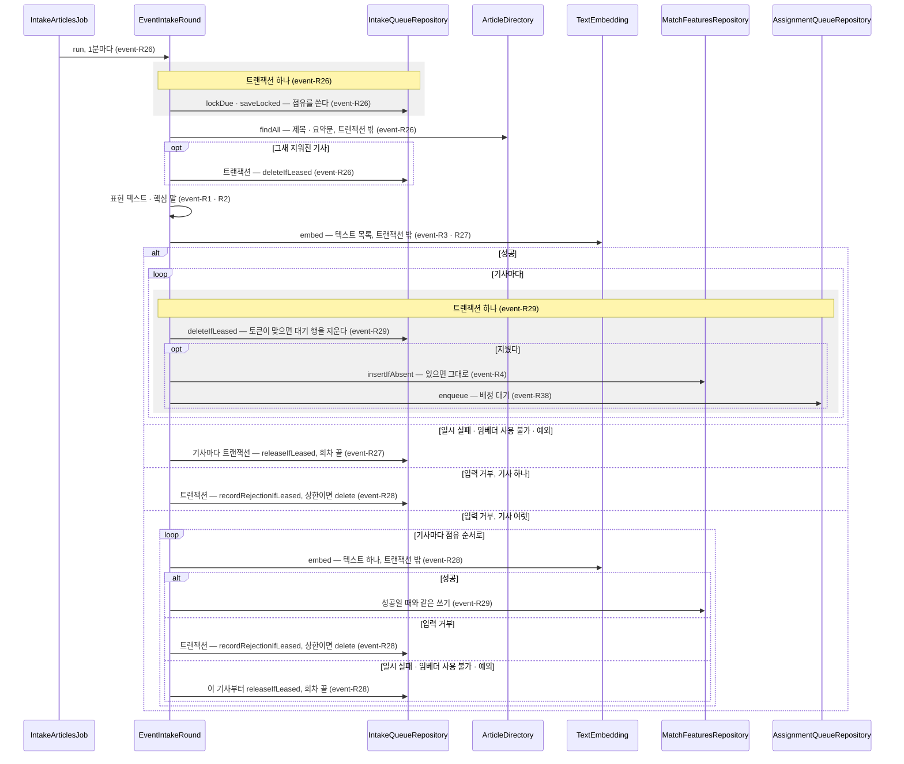
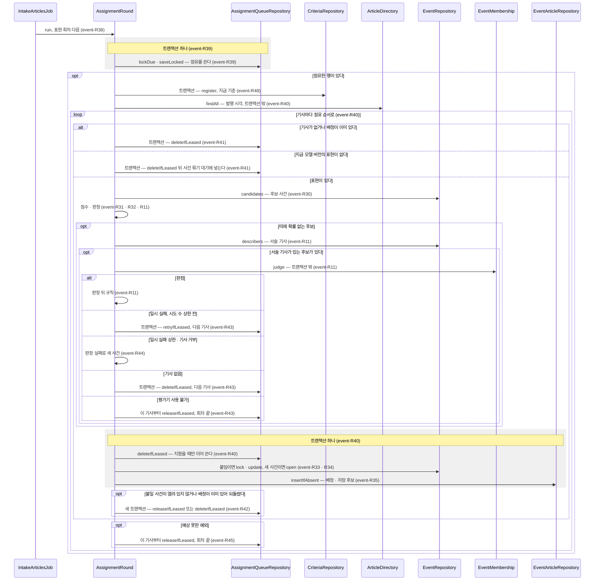
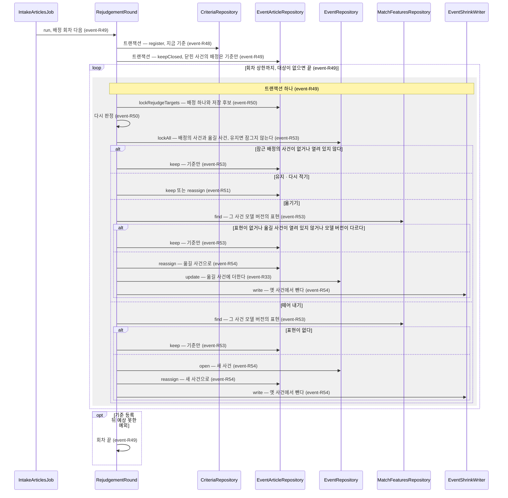
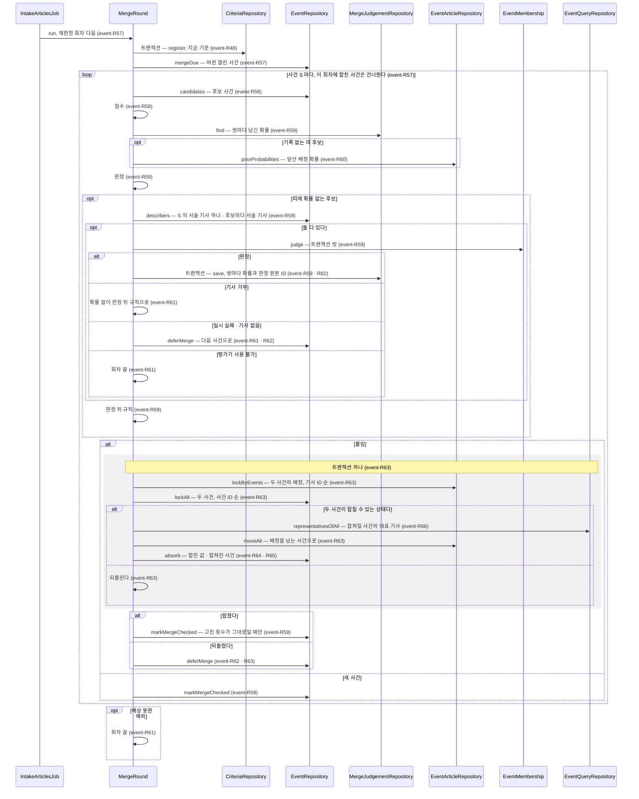
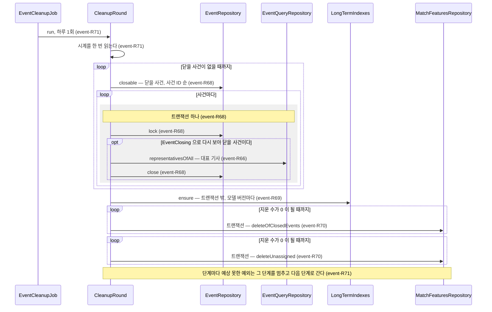
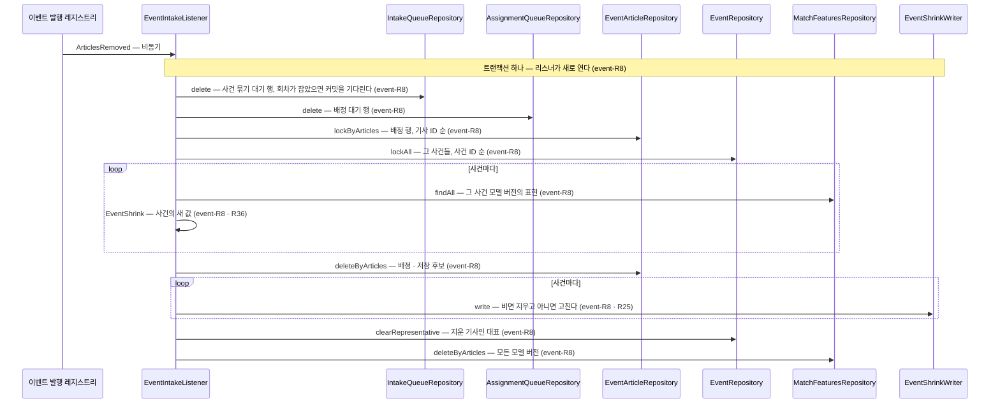

# event 모듈 Spec

공통 구조와 쓰는 규칙은 [specs/README.md](README.md)에 있다.

## 1. 책임과 범위

`event` 는 한 번 일어난 일을 다룬 기사를 사용자와 무관하게 공유 사건으로 묶는다. 비용은 운영자가 내고, 생성형 LLM 을 쓰지 않는다([ADR-0026](../adr/0026-event-clustering-with-local-embeddings-and-jev.md) · [ADR-0102](../adr/0102-an-event-is-the-reports-of-one-happening-narrowed-by-the-event-membership-question-wording.md)).

- **사건 묶기 대기** — 새 기사를 대기에 넣고, 작업 역할의 반복 작업이 회차마다 대기 행 여럿을 점유해 처리한다(event-R5 · R6 · R7, [ADR-0074](../adr/0074-article-features-built-by-event-intake-queue-job-and-skipped-without-an-embedder.md))
- **기사 표현** — 기사의 제목과 요약문 앞부분으로 표현 텍스트를 만들고, 그 임베딩과 핵심 말을 임베딩 모델 버전과 함께 저장한다. 임베딩은 `evaluation` 의 공개 API `TextEmbedding` 으로 얻고, 핵심 말은 Lucene Nori 로 뽑는다. 사건 배정의 입력이다(event-R1 ~ R4, [ADR-0075](../adr/0075-article-vectors-in-a-dimensionless-vector-column-one-row-per-model-version.md) · [ADR-0076](../adr/0076-key-terms-from-nori-without-decompounding-proper-common-and-foreign-nouns.md))
- **사건 배정** — 표현을 쓴 기사를 배정 대기에 넣는다. 같은 반복 작업이 기사 하나씩 시간 창 안의 열린 사건에서 후보를 골라 산식으로 판정하고, 애매한 구간은 `evaluation` 의 사건 소속 판정에 묻는다. 그 결과로 기사를 사건에 붙이거나 새 사건을 연다(event-R10 ~ R12 · R16, [ADR-0077](../adr/0077-event-assignment-queue-judged-one-article-at-a-time-with-evaluation-failure-kinds.md) · [ADR-0078](../adr/0078-articles-ending-in-a-judgement-failure-open-a-new-event-marked-as-failed.md) · [ADR-0079](../adr/0079-event-centroids-in-a-dimensionless-halfvec-column-with-a-model-version-per-event.md) · [ADR-0080](../adr/0080-event-centroids-and-key-terms-accumulated-with-article-counts-and-updated-incrementally.md))
- **기준과 재판정** — 사건 기준 · 저장 기준은 설정이다. 배정은 저장 기준 이상인 후보의 점수 · 확률과 판정에 쓴 기준을 남긴다. 기준이 바뀌면 그 저장값으로 열린 사건의 배정을 다시 판정하고, 닫힌 사건의 배정은 기준만 새것으로 적는다(event-R17 · R18, [ADR-0081](../adr/0081-event-assignment-criteria-in-settings-and-rejudgement-within-stored-scores.md) · [ADR-0085](../adr/0085-rejudgement-knows-opened-events-from-an-assignment-flag-and-reads-merged-candidates-as-survivors.md) · [ADR-0087](../adr/0087-closed-event-assignments-are-not-rejudged-and-closing-and-merging-are-not-undone.md))
- **채우기** — 운영자가 기간을 정해, 그 기간에 처음 본 기사 가운데 배정이 없는 기사를 사건 묶기 대기에 넣는다(event-R19)
- **지운 기사 따르기** — `article` 이 기사를 지우면 그 기사의 대기 행 · 배정 · 후보 · 표현을 지우고 사건을 다시 맞춘다(event-R8)
- **사건 병합 · 정비** — 같은 반복 작업의 병합 회차가 바뀐 열린 사건을 가까운 열린 사건과 합친다. 합칠지는 배정의 산식과 판정으로 정하고, 배정 때 받은 확률이 확률 기준 미만인 쌍은 묻지 않는다. 확인을 끝내지 못한 사건은 뒤로 미뤄 다른 사건의 확인을 막지 않는다. 하루 1회 사건 정비가 오래된 사건을 대표 기사와 함께 닫고, 닫힌 사건에 장기 검색 인덱스를 두고, 다 쓴 기사 표현을 지운다(event-R13, [ADR-0084](../adr/0084-event-merge-applies-assignment-scoring-between-events-and-keeps-merged-rows-pointing-to-survivors.md) · [ADR-0086](../adr/0086-events-close-after-an-idle-period-since-the-last-join-or-a-maximum-period-since-opening.md) · [ADR-0087](../adr/0087-closed-event-assignments-are-not-rejudged-and-closing-and-merging-are-not-undone.md) · [ADR-0088](../adr/0088-article-features-kept-until-their-event-closes-and-unassigned-ones-for-the-window-plus-a-margin.md) · [ADR-0089](../adr/0089-long-term-hnsw-indexes-on-closed-events-created-per-model-version-at-runtime-by-the-worker-role.md) · [ADR-0119](../adr/0119-event-merge-does-not-ask-band-pairs-whose-prior-assignment-probability-is-below-the-probability-threshold.md) · [ADR-0213](../adr/0213-event-merge-defers-events-whose-check-did-not-finish-until-a-retry-time-on-the-event-row-and-never-drops-them.md))
- **사건 조회 · 대표 기사 · 기간 집계** — 공개 조회 `EventDirectory` 로 사건과 그 기사, 기사의 사건, 사건 목록을 내고 합쳐진 사건을 푼다. 사건마다 대표 기사를 고른다. 사건 집합마다 조회 기간 안 기사의 기간 집계를 세고, 기간 안 기사가 있는 모든 사건을 한데 모은 기간 전체 집계를 낸다. 사건 목록과 `storyline` 의 큰 판정이 이 집계를 쓴다(event-R14 · R15 · R20, [ADR-0117](../adr/0117-big-judgement-materials-are-tallied-by-event-per-group-of-events-and-storyline-passes-only-event-ids.md))
- **운영자 사건 조회** — 운영자 화면에 공개 조회 `EventReview` 로 사건 배정 기준, 합쳐진 사건, 판정 원본의 쓰임, 기사 하나의 배정과 표현의 핵심 말을 낸다. 배정 · 병합 판정 기록은 반영한 판정 원본의 ID 를 남겨, 판정의 쓰임과 지금 결과를 잇는다(event-R12 · R13 · R22, [ADR-0094](../adr/0094-event-membership-judgements-identified-by-id-read-by-operators-and-referenced-by-the-records-that-apply-them.md))
- **사건 변화 알림** — 사건을 바꾸는 쓰기는 같은 트랜잭션에서 바뀐 사건 ID 를 발행하고(`EventsChanged`), 사건을 지우면 지운 사건 ID 를 따로 발행한다(`EventsRemoved`). 스토리라인 잇기의 재료(사건 표현 · 이웃 사건 · 말 수 · 채우기 대상)를 공개 조회로 낸다(event-R23 ~ R25, [ADR-0105](../adr/0105-storylines-link-incrementally-from-event-change-notifications-and-events-publish-changed-event-ids.md) · [ADR-0267](../adr/0267-removed-events-are-announced-by-event-and-feedback-deletes-their-feedback-with-recording-and-removal-ordered-by-a-fence.md))

하지 않는 것:

- 사용자를 모른다. 후보 선별은 `digest` 가 한다
- 사건을 스토리라인으로 잇지 않는다. 그 일은 `storyline` 이 하고, `event` 는 스토리라인을 모른다. 바뀐 사건 ID 를 알리고 재료를 조회로 낼 뿐이다([ADR-0101](../adr/0101-shared-storylines-connect-events-and-the-personal-side-is-storyline-subscriptions-and-interests.md))
- Jev 를 직접 부르지 않는다. 사건 소속 판정은 `evaluation` 의 공개 API 를 부른다([ADR-0026](../adr/0026-event-clustering-with-local-embeddings-and-jev.md) · [ADR-0071](../adr/0071-event-membership-judged-from-article-ids-with-questions-built-in-evaluation.md))
- 임베더를 갖지 않는다. 임베딩은 `evaluation` 의 공개 API 를 부르고, 이 모듈은 벡터와 모델 버전을 저장 · 비교하는 일만 한다([ADR-0114](../adr/0114-article-embedding-is-a-gateway-operation-of-evaluation-taking-callers-texts-checking-results-and-recording-nothing.md))
- 기사 내용을 갖지 않는다. 제목 · 요약문은 `article` 의 공개 조회로 읽고, 표현 행에는 벡터와 핵심 말만 남긴다

사건 기준 · 저장 기준 · 닫는 기간 · 최대 기간의 기본값과 그 기본값을 정한 이유는 §7 에 있다. 기본 임베딩 모델은 [ADR-0091](../adr/0091-local-embedding-model-is-multilingual-e5-small-int8-fetched-at-build-into-the-image-with-onnx-telemetry-off.md)이 정한다. 묶기 품질은 수집한 기사 표본에 사건 라벨을 붙인 평가 세트로 잰다. 증거로서의 자격은 [테스트 전략](../qa/test-strategy.md) ⑪ 에, 표본의 실제 기사 텍스트를 공개 저장소에 두지 않는 규칙은 [security.md](../security.md)에 있다.

다른 모듈과의 의존과 주고받는 이벤트는 [overview.md §5](../overview.md#5-모듈-지도)에 있다.

## 2. 용어

사건은 [overview.md §8](../overview.md#8-용어)에 있다. 임베더 · 사건 소속 판정 · 서술 기사 · 판정 원본은 이 개념을 소유한 [evaluation Spec §2](evaluation.md#2-용어)에 있다.

| 용어 | 뜻 |
|---|---|
| 기사 표현 | 기사 하나의 임베딩 벡터 · 핵심 말 · 임베딩 모델 버전(`article_match_features` 한 행). 사건 배정의 입력이고, 기사 × 모델 버전마다 하나다(event-R4) |
| 표현 텍스트 | 제목과 요약문 앞부분으로 만든 텍스트 하나. 임베딩과 핵심 말이 같은 텍스트를 쓴다(event-R1) |
| 핵심 말 | 표현 텍스트에서 Nori 로 뽑은 고유명사 · 일반명사 · 외국어(event-R2). 후보 점수의 핵심 말 겹침에 쓴다(event-R31) |
| 사건 중심 | 사건의 구성 기사 벡터의 평균(`events.centroid`). 반 정밀도로 저장하고, 같은 모델 버전끼리만 비교한다(event-R31 · R33) |
| 거부 수 | 임베더가 그 기사의 입력을 거부한 횟수(`event_intake_queue.rejections`). 상한에 이르면 대기에서 뺀다(event-R28) |
| 사건 묶기 대기 | 처리할 기사의 목록(`event_intake_queue`, 기사마다 한 행). 넣은 시각과 점유를 갖는다(event-R5) |
| 회차 | 반복 작업이 한 번 돌 때 하는 일 하나. 표현 회차(event-R6) · 배정 회차(event-R16) · 재판정 회차(event-R18) · 병합 회차(event-R13)를 차례로 돈다 |
| 점유 | 회차가 대기 행을 가져갔다는 표시(토큰과 만료 시각). 만료되면 다른 회차가 다시 가져간다(event-R26 · R39) |
| 배정 | 기사 하나가 속한 사건(`event_articles` 한 행). 기사마다 하나이고, 남기는 값은 event-R35 다 |
| 연 사건 표지 | 그 기사가 판정으로 이 배정의 사건을 열었다는 배정의 표지(event-R52) |
| 배정 대기 | 표현을 쓴 뒤 배정할 기사의 목록(`event_assignment_queue`, 기사마다 한 행). 시도 수 · 판정 가능 시각 · 점유를 갖는다(event-R38) |
| 사건 기준 | 판정에 쓰는 시간 창 · 위 기준 · 아래 기준 · 확률 기준(event-R47) |
| 저장 기준 | 배정과 함께 후보를 남기는 점수의 바닥. 이 이상인 후보의 점수 · 판정 확률을 남긴다(event-R32 · R35) |
| 띠 | 아래 기준 이상 · 위 기준 미만인 점수. 사건 소속 판정에 묻는 구간이다(event-R11) |
| 저장 후보 | 배정과 함께 남긴 후보(`event_article_candidates`)의 사건 · 점수 · 판정 확률. 확률은 묻지 않았으면 없다. 재판정의 재료이고(event-R50), 병합이 앞선 배정 확률로 읽는다(event-R60) |
| 기준 이력 | 회차가 판정에 쓴 사건 기준 · 저장 기준 값의 목록(`event_assignment_criteria`). 같은 값이면 한 행이고, 배정이 그 ID 를 가리킨다(event-R48) |
| 재판정 | 지금 기준과 다른 기준으로 판정된 배정을 저장 후보로 다시 판정하는 일(event-R18) |
| 채우기 | 운영자가 정한 기간에 처음 본 기사 가운데 배정이 없는 기사를 사건 묶기 대기에 넣는 운영 기능(event-R19) |
| 병합 회차 | 지난 확인 뒤 바뀐 열린 사건마다 가까운 열린 사건을 찾아 합치는 회차(event-R57) |
| 남는 사건 | 병합에서 남는 사건. 합쳐진 사건의 배정을 받는다(event-R63) |
| 합쳐진 사건 | 병합으로 배정을 남는 사건에 넘긴 사건. 상태 `MERGED` 로 남아 남는 사건을 바로 가리킨다(event-R65 · R67) |
| 지금 사건 | 사건 하나를 병합을 따라 푼 사건. 합쳐졌으면 남는 사건, 그대로면 그 사건이고, 지운 사건에는 없다. 공개 조회 `EventDirectory.currentOf` 가 낸다(event-R67 · R80) |
| 병합 판정 기록 | 띠에 든 사건 쌍의 사건 소속 판정 확률(`event_merge_judgements`). 순서 없는 쌍마다 한 행이고, 남긴 쌍은 다시 묻지 않는다(event-R59) |
| 병합 미룸 | 병합 회차가 확인을 끝내지 못한 사건에 남기는 이어서 미룬 횟수와 다시 볼 시각(event-R62) |
| 닫는 기간 | 마지막으로 기사가 붙은 뒤 이만큼 새 기사가 없으면 사건을 닫는 설정(event-R68) |
| 최대 기간 | 사건을 연 뒤 이만큼 지나면 새 기사가 있어도 닫는 설정(event-R68) |
| 사건 정비 | 하루 1회 반복 작업이 닫기 · 장기 검색 인덱스 · 기사 표현 지우기를 차례로 하는 일(`CleanupRound`, event-R71) |
| 장기 검색 인덱스 | 닫힌 사건 중심의 HNSW 인덱스. 모델 버전마다 하나이고, 사건 정비가 실행 중에 만든다(event-R69) |
| 조회 기간 | 사건 조회 · 기간 집계가 받는 기간(`EventPeriod`). 길이의 상한과 기간 안 기사를 고르는 법은 event-R78 이다 |
| 사건 집합 | 기간 집계의 입력 하나. 부르는 쪽이 정한 키마다의 사건 여럿이다(`EventDirectory.tallies`, event-R15) |
| 기간 집계 | 사건 하나 또는 사건 집합의 조회 기간 안 기사 수 · 그 기사들의 서로 다른 소스 수 · 중요도 평균 · 중요도 합(`EventTally`). 사건 목록과 `storyline` 의 큰 판정이 쓴다(event-R15) |
| 대표 기사 | 사건의 기사 가운데 사건 중심에 가장 가까운 기사. 닫을 때 남긴 대표가 있으면 그것이다(event-R14) |
| 판정 원본의 쓰임 | `evaluation` 의 사건 소속 판정 원본을 반영한 기록. 배정 판정이면 그 판정으로 쓴 배정, 병합 판정이면 그 판정으로 남긴 병합 판정 기록이다(event-R22) |

## 3. 공개 인터페이스

이 모듈은 `article` 의 이벤트를 받고, 사건 변화 알림(`EventsChanged`)과 사건 삭제 알림(`EventsRemoved`)을 발행한다. 공개 조회 둘(`EventDirectory` · 운영자 화면의 `EventReview`)과 공개 운영 API 하나(`EventIntakeAdministration`)를 낸다. `EventDirectory` 는 `digest` · `report` · `admin` · `storyline` · `user` · `feedback` · `reader` 가 쓰고, `EventReview` 와 운영 API 는 `admin` 이 운영자 요청으로 부른다([ADR-0045](../adr/0045-admin-module-serves-operator-api-over-module-public-operation-apis.md)).

### EventsChanged

사건이 바뀌었다는 알림(event-R23). 발행 주체는 `adapter/out/persistence` 의 `JdbcEventRepository` 다.

```java
public record EventsChanged(List<EventId> eventIds) {}   // 비어 있지 않고 중복이 없다 — 아니면 IllegalArgumentException
```

| 필드 | 뜻 |
|---|---|
| `eventIds` | 바뀐 사건. 쓰기마다 어느 사건을 싣는지는 event-R23 이다 |

- 계약
  - 발행 시점과 횟수는 event-R23 이다. 이벤트 발행 레지스트리에 기록되고, 리스너는 커밋 뒤에 받는다
  - 무엇이 일어났는지는 싣지 않는다. 받는 쪽이 `EventDirectory.find` 로 지금 상태(없음 · 남는 사건 · 그대로)를 읽어 가른다
  - 그래서 같은 사건의 알림이 순서를 바꾸거나 두 번 와도 받는 쪽의 결과가 같다
  - 알리지 않는 쓰기는 event-R23 에 있다
  - 받는 쪽: `storyline`

### EventsRemoved

사건을 지웠다는 알림(event-R25). 발행 주체는 `adapter/out/persistence` 의 `JdbcEventRepository` 다.

```java
public record EventsRemoved(List<EventId> eventIds) {}   // 비어 있지 않고 중복이 없다 — 아니면 IllegalArgumentException
```

| 필드 | 뜻 |
|---|---|
| `eventIds` | 지운 사건. 어느 사건을 싣는지와 순서는 event-R25 다 |

- 계약
  - 발행 시점과 횟수는 event-R25 다. 이벤트 발행 레지스트리에 기록되고, 리스너는 커밋 뒤에 받는다
  - 받는 쪽은 그 ID 를 가리키는 자기 행을 지우면 된다. 다시 처리해도 결과가 같게 받는다
  - 받는 쪽: `feedback`([feedback Spec](feedback.md#지운-사건--지운-항목-따르기) feedback-R5)

### EventIntakeAdministration · IntakeFillResult

사건 묶기 채우기의 운영 API 다(event-R19). 구현은 `application` 의 `EventIntakeAdministrationService` 다.

```java
public interface EventIntakeAdministration {
    int MAX_DAYS = 30;                       // 채울 기간의 상한(일) — 정본
    IntakeFillResult fill(int days);
}

public sealed interface IntakeFillResult {
    record Filled(int articles, int enqueued) implements IntakeFillResult {}
    record DaysOutOfRange(int max) implements IntakeFillResult {}
}
```

| 타입 · 멤버 | 뜻 |
|---|---|
| `fill` | 기간에 처음 본, 배정 없는 기사를 사건 묶기 대기에 넣는다(event-R19) |
| `Filled.articles` | 기간에 처음 본 기사 수 |
| `Filled.enqueued` | 그 가운데 새로 대기에 넣은 기사 수. 배정이 있거나 이미 대기에 있는 기사는 세지 않는다 |
| `DaysOutOfRange.max` | 일수가 1 ~ `max` 밖이라 아무것도 하지 않았다. `max` 는 `MAX_DAYS` 다 |

- 계약
  - 트랜잭션 · 역할 애너테이션이 없다(두 역할 공통)
  - 기사 고르기는 `article` 의 공개 조회 하나이고, 표 전체를 읽는 드문 운영 연산이다

### EventDirectory

사건 조회다. 다른 모듈이 사건과 그 기사, 대표 기사와 기간 집계, 스토리라인 잇기의 재료를 읽고 합쳐진 사건을 푼다(event-R13 · R14 · R15 · R20 · R24). 구현은 `application` 의 `EventDirectoryService` 다.

```java
public interface EventDirectory {
    int MAX_PAGE_SIZE = 100;                                  // 사건 목록 한 쪽의 상한 — 정본. 측정 전 목표
    int MAX_KEY_TERMS = 100;                                  // 표현 · 이웃 조회의 핵심 말 수 상한 — 정본
    int MAX_NEIGHBORS = 100;                                  // 이웃 조회 한 번의 상한 — 정본
    int MAX_TERMS = 100;                                      // 말 수 조회 한 번에 묻는 말의 상한 — 정본
    int MAX_RESOLVE_EVENTS = 1000;                            // 풀기 조회 한 번에 묻는 서로 다른 사건 수의 상한 — 정본. 측정 전 목표
    Optional<EventView> find(EventId id);
    List<EventArticleView> articles(EventId id);
    Map<EventId, List<ArticleId>> articleIdsOf(Collection<EventId> events);
    Map<ArticleId, EventId> eventsOf(Collection<ArticleId> articleIds);
    Map<EventId, ArticleId> representativesOfAll(Collection<EventId> events);
    Map<EventId, EventView> views(Collection<EventId> ids);
    Map<EventId, Integer> articleCountsIn(EventPeriod period);
    <K> Map<K, EventTally> tallies(Map<K, ? extends Collection<EventId>> groups, EventPeriod period);
    EventTally total(EventPeriod period);
    EventPage list(EventPeriod period, @Nullable EventCursor after, int size);
    Map<EventId, EventProfile> profiles(Collection<EventId> ids, int keyTerms);
    List<EventNeighbor> neighbors(EventId id, Instant from, Instant to, double minCosine, int keyTerms, int limit);
    EventTermCounts termCounts(Collection<String> terms, Instant from, Instant to);
    List<EventView> lastArticleSince(Instant since);
    Map<EventId, EventId> currentOf(Collection<EventId> ids);
    Map<EventId, List<EventId>> absorbedInto(Collection<EventId> survivors);
}
```

| 멤버 | 뜻 |
|---|---|
| `find` | 사건 하나. 합쳐진 사건의 ID 면 남는 사건을 낸다(event-R80). 없는 사건이면 빈 값 |
| `articles` | 사건의 배정 전부. 발행 시각 · 기사 ID 순이다. 없는 사건이나 합쳐진 사건이면 빈 목록이다(event-R80) |
| `articleIdsOf` | 사건마다 배정된 기사 ID. 사건 ID 순, 사건마다 발행 시각 · 기사 ID 순이고 기간을 보지 않는다. 배정이 없는 사건(합쳐진 사건 포함, event-R80) · 없는 사건은 빠지고, 같은 사건은 한 번이다. 빈 입력이면 빈 맵 |
| `eventsOf` | 기사들의 사건. 배정이 없는 기사는 빠진다. 빈 입력이면 빈 맵 |
| `representativesOfAll` | 사건마다 대표 기사(event-R14). `list` 의 대표와 같은 정본이다. 배정이 없는 사건(합쳐진 사건 포함) · 없는 사건은 빠지고, 빈 입력이면 빈 맵 |
| `views` | 사건들. 합쳐진 사건 · 없는 사건은 빠진다(event-R80). 빈 입력이면 빈 맵 |
| `articleCountsIn` | 조회 기간 안 기사가 있는 사건과 그 기간 안 기사 수(event-R79) |
| `tallies` | 사건 집합(집합 키 → 사건들)마다 기간 집계(event-R15). 입력의 모든 키가 결과에 있다. 빈 입력이면 빈 맵 |
| `total` | 기간 전체 집계(event-R76). 사건의 범위는 `articleCountsIn` 과 같다 |
| `list` | 사건 목록 한 쪽 `size` 건(event-R79). `size` 가 1 ~ `MAX_PAGE_SIZE` 밖이면 `IllegalArgumentException` |
| `profiles` | 사건들의 표현(`EventProfile`, event-R86). 핵심 말은 상위 `keyTerms` 개다. 빈 입력이면 빈 맵. `keyTerms` 가 1 ~ `MAX_KEY_TERMS` 밖이면 `IllegalArgumentException` |
| `neighbors` | 사건과 가까운 사건(event-R87). `from` 이 `to` 보다 늦거나, `keyTerms` 가 1 ~ `MAX_KEY_TERMS` 밖이거나, `limit` 이 1 ~ `MAX_NEIGHBORS` 밖이면 `IllegalArgumentException` |
| `termCounts` | 범위와 겹치는 사건 수와 말마다 사건 수(event-R88). 겹친 말은 한 번만 세고, 어느 사건에도 없는 말은 0 이다. 빈 입력이면 사건 수와 빈 맵. `from` 이 `to` 보다 늦거나 서로 다른 말이 `MAX_TERMS` 개를 넘으면 `IllegalArgumentException` |
| `lastArticleSince` | 채우기 대상(event-R89). 첫 기사 시각 · 사건 ID 순 |
| `currentOf` | 사건마다 지금 사건. 합쳐진 사건이면 남는 사건, 아니면 그 사건이다(event-R67). 없는(지운) 사건은 빠지고 같은 사건은 한 번이다. 빈 입력이면 빈 맵. 서로 다른 사건이 `MAX_RESOLVE_EVENTS` 개를 넘으면 `IllegalArgumentException` |
| `absorbedInto` | 사건마다 그 사건으로 합쳐진 사건들. 사건 ID 순이다(event-R65). 합쳐진 사건이 없는 사건 · 없는 사건은 빠진다. 빈 입력이면 빈 맵. 서로 다른 사건이 `MAX_RESOLVE_EVENTS` 개를 넘으면 `IllegalArgumentException` |

- 계약
  - 트랜잭션 · 역할 애너테이션이 없다(두 역할 공통)
  - 사용자 정보를 받지 않는다. 대표 기사도 사용자의 제외 조건으로 거르지 않는다(event-R14)
  - 각 질의는 그 순간의 값이다. 기간 집계의 재료(소스 · 중요도)는 `article` 의 `ArticleDirectory.sources` 와 `tag` 의 `ArticleEvaluations.importances` 로 따로 읽으므로 한 스냅숏이 아니다
  - `list` 의 커서는 앞 쪽 마지막 사건의 (마지막 기사 시각, 사건 ID)다. 쪽 사이에 마지막 기사 시각이 바뀐 사건은 건너뛰거나 다시 나올 수 있다
  - `profiles` · `neighbors` · `termCounts` 는 사용자를 모르는 잇기의 재료다. 점수 · 말의 무게 · 판정은 부르는 쪽이 한다. `neighbors` 의 코사인 하한과 상한 수, `termCounts` 의 범위도 부르는 쪽이 정한다
  - `tallies` 는 집합의 뜻을 모른다(event-R76)
  - `currentOf` · `absorbedInto` 는 쓰지 않는 풀기다. 합쳐진 사건을 가리키는 다른 모듈의 기록은 그 모듈이 읽을 때 `currentOf` 로 풀고, 남는 사건으로 풀리는 기록은 `absorbedInto` 로 찾는다([ADR-0266](../adr/0266-feedback-is-recorded-under-the-original-event-id-and-feedback-resolves-merged-events-through-event-when-reading-with-the-last-pressed-value-winning.md))
  - `absorbedInto` 는 합칠 때의 값(시각 · 확률 · 대표 기사)을 내지 않는다. 운영자 화면은 그 값을 `EventReview.mergedInto` 로 읽는다
  - `articleIdsOf` 는 독자 화면이 타임라인 사건의 기사로 받은 소식을 맞추는 데 쓴다

### EventId · EventPeriod · EventView · EventArticleView · EventStatus · DecidedBy

```java
public record EventId(long value) {}                     // 1 이상 — 아니면 IllegalArgumentException

public record EventPeriod(Instant from, Instant to) {    // [from, to)
    public static final int MAX_DAYS = 31;               // 날짜 범위의 상한 — 정본. 측정 전 목표
    public static final Duration MAX_LENGTH = DayRange.maxLength(MAX_DAYS);   // 시각 범위의 상한 — 32일
    public static Optional<EventPeriod> of(Instant from, Instant to);
    public static Optional<EventPeriod> ofDays(LocalDate first, LocalDate last, ZoneId zone);
}

public record EventView(EventId id, EventStatus status, int articleCount, Instant firstArticleAt, Instant lastArticleAt,
        Instant createdAt) {}

public record EventArticleView(ArticleId articleId, Instant publishedAt, @Nullable Double score, DecidedBy decidedBy,
        Instant assignedAt) {}

public enum EventStatus { OPEN, CLOSED, MERGED }
public enum DecidedBy { FORMULA, EVALUATOR, JUDGEMENT_FAILED }
```

| 타입 · 필드 | 뜻 |
|---|---|
| `EventPeriod` | 조회 기간(event-R78). 생성자는 `from < to` 이고 길이가 `MAX_LENGTH` 이하가 아니면 `IllegalArgumentException` 이고, `of` 는 빈 값을 낸다. `MAX_LENGTH` 는 날짜 `MAX_DAYS` 일에 시간대 전환 여유로 하루를 더한 것이다(`platform` 의 `DayRange.maxLength`) |
| `EventPeriod.ofDays` | 날짜 범위 `[first 의 그 시간대 자정, last 다음 날의 그 시간대 자정)`. 변환은 `platform` 의 `DayRange.of` 다([platform Spec §3](platform.md#3-공개-인터페이스)). 날짜 수가 1 ~ `MAX_DAYS` 가 아니거나 시각 범위를 만들 수 없으면 빈 값이다(event-R78) |
| `EventView.articleCount` · `firstArticleAt` · `lastArticleAt` | 사건 전체의 기사 수 · 첫 · 마지막 기사 시각(기간과 무관) |
| `EventView.createdAt` | 사건을 연 시각. 다른 사건을 합친 사건은 두 사건 가운데 이른 쪽이다(event-R64) |
| `EventArticleView.score` | 배정 행의 점수(event-R35) |
| `EventArticleView.decidedBy` | 배정을 정한 것. 산식 · 판정 · 판정 실패다(event-R11 · R44) |
| `EventStatus` | 사건의 상태. `OPEN` 은 기사를 붙이는 사건이고, `CLOSED` 는 닫혀 기사를 붙이지 않고 배정을 재판정하지 않으며, `MERGED` 는 다른 사건에 합쳐져 남는 사건을 가리킨다(event-R65 · R68). `find` 가 남는 사건을 내므로 조회 결과의 상태는 `MERGED` 가 아니다 |

### EventProfile · EventNeighbor · EventKeyTerm · EventTermCounts

```java
public record EventProfile(EventId id, EventStatus status, String modelVersion, float[] centroid, int articleCount,
        Instant firstArticleAt, Instant lastArticleAt, List<EventKeyTerm> keyTerms) {}
public record EventNeighbor(EventId id, double cosine, int articleCount, Instant firstArticleAt, Instant lastArticleAt,
        List<EventKeyTerm> keyTerms) {}
public record EventKeyTerm(String term, int articleCount) {}
public record EventTermCounts(long events, Map<String, Long> eventsByTerm) {}
```

| 타입 · 필드 | 뜻 |
|---|---|
| `EventProfile.centroid` | 사건 중심(반 정밀도로 저장한 값). 복사해 받고 복사해 낸다 |
| `EventProfile.status` | `OPEN` 또는 `CLOSED`. 합쳐진 사건은 표현 조회에 나오지 않는다(event-R86) |
| `EventProfile.keyTerms` · `EventNeighbor.keyTerms` | 기사 수가 많은 순(같으면 말 바이트 순) 상위 핵심 말 |
| `EventNeighbor.cosine` | 기준 사건 중심과의 코사인 유사도(반 정밀도로 비교한다) |
| `EventKeyTerm` | 사건 핵심 말 하나와 그 말을 가진 구성 기사 수. 말은 비지 않고, 수는 1 이상이다(event-R33) |
| `EventTermCounts.events` | 범위와 겹치는 합쳐지지 않은 사건 수. 0 이상이다 |
| `EventTermCounts.eventsByTerm` | 물은 말마다 그 말을 핵심 말로 가진 범위 안 사건 수. 0 이상이고 물은 말마다 하나다. 복사해 받는다 |

### EventTally · EventSummary · EventCursor · EventPage

```java
public record EventTally(int articles, int sources, @Nullable BigDecimal importance, BigDecimal importanceSum) {}
public record EventSummary(EventView event, EventTally tally, @Nullable ArticleId representative) {}
public record EventCursor(Instant lastArticleAt, EventId id) {}
public record EventPage(List<EventSummary> events, @Nullable EventCursor next) {}
```

| 타입 · 필드 | 뜻 |
|---|---|
| `EventTally` | 사건 하나 또는 사건 집합의 기간 집계(event-R15). 조회 기간 안 기사 수, 서로 다른 소스 수, 중요도 평균(없으면 null), 중요도 합(없으면 0)이다 |
| `EventSummary.representative` | 대표 기사(event-R14). 배정이 없으면 null |
| `EventPage.next` | 다음 쪽의 커서. 더 없으면 null |

HTTP 엔드포인트는 없다.

### EventReview · AssignmentCriteria · MergedEvent · JudgementUse · MergePair · ArticleAssignment · AssignmentCandidate · ArticleKeyTerms

운영자 화면의 사건 조회다. 사건 배정 기준, 합쳐진 사건, 판정 원본의 쓰임, 기사 하나의 배정과 표현의 핵심 말을 낸다(event-R12 · R13 · R17 · R22). 구현은 `application` 의 `EventReviewService` 다.

```java
public interface EventReview {
    AssignmentCriteria assignmentCriteria();
    List<MergedEvent> mergedInto(EventId survivor);
    Map<EventJudgementId, JudgementUse> judgementUses(Collection<EventJudgementId> judgements);
    Optional<ArticleAssignment> assignmentOf(ArticleId articleId);
    List<ArticleKeyTerms> keyTermsOf(ArticleId articleId);
}

public record AssignmentCriteria(Duration window, double upper, double lower, double store, double probability) {}
public record MergedEvent(EventId id, int articleCount, Instant firstArticleAt, Instant lastArticleAt,
        Instant createdAt, Instant mergedAt, @Nullable ArticleId representative, @Nullable Double probability) {}

public sealed interface JudgementUse {
    record Assignment(ArticleId articleId, EventId event, DecidedBy decidedBy) implements JudgementUse {}
    record Merge(List<MergePair> pairs) implements JudgementUse {}
}
public record MergePair(EventId low, EventId high, double probability, @Nullable EventId survivor) {}

public record ArticleAssignment(ArticleId articleId, EventId event, Instant publishedAt, @Nullable Double score,
        DecidedBy decidedBy, boolean opened, AssignmentCriteria criteria, Instant assignedAt,
        @Nullable EventJudgementId judgement, List<AssignmentCandidate> candidates) {}
public record AssignmentCandidate(EventId event, EventId current, double score, @Nullable Double probability) {}
public record ArticleKeyTerms(String modelVersion, List<String> terms, Instant createdAt) {}
```

| 타입 · 멤버 | 뜻 |
|---|---|
| `assignmentCriteria` | 이 프로세스의 사건 기준 · 저장 기준. 설정이다(event-R47). 화면 역할과 작업 역할을 나눠 띄우면 화면 프로세스의 설정이다 |
| `AssignmentCriteria` | 사건 기준과 저장 기준. 시간 창은 0 보다 큰 초 단위다. 생성자는 `0 ≤ store ≤ lower ≤ upper ≤ 1` · `0 < probability ≤ 1` 을 어기면 `IllegalArgumentException` 이다(event-R47). 배정 · 재판정 · 병합 회차도 이 값을 쓴다 |
| `mergedInto` | 이 사건으로 합쳐진 사건. 합친 시각 · 사건 ID 순이다. 남는 사건이 아니거나 없는 사건이면 빈 목록 |
| `MergedEvent` | 합쳐진 사건 하나. 필드의 뜻은 표 아래 목록이다 |
| `judgementUses` | 판정 원본을 반영한 기록(event-R22). 원본 ID → 쓰임이다. 가리키는 기록이 없는 원본은 빠지고, 빈 입력이면 빈 맵이다. 한 원본을 배정과 병합 판정 기록이 함께 가리키거나 배정 둘이 가리키면 `IllegalStateException` 이다(event-R84) |
| `JudgementUse.Assignment` | 배정 판정. 그 기사 배정의 사건 · 정한 것(재판정 · 병합 뒤 값)이다(event-R81) |
| `JudgementUse.Merge` | 병합 판정. 그 판정으로 남긴 쌍들이고, (작은 ID, 큰 ID) 순으로 하나 이상이다(event-R82) |
| `MergePair.survivor` | 두 사건이 지금 같은 사건이면 그 사건, 아니면 null. 합쳐진 사건은 남는 사건으로 읽는다 |
| `assignmentOf` | 기사 하나의 배정과 그 근거. 배정 행 · 판정에 쓴 기준 · 저장 후보를 한 질의로 읽는다. 배정이 없으면 빈 값 |
| `ArticleAssignment` | 배정 하나. 필드의 뜻은 표 아래 목록이다 |
| `AssignmentCandidate` | 저장 후보 하나. 배정 때의 사건, 그 지금 사건(합쳐졌으면 남는 사건), 점수, 판정 확률(묻지 않았으면 null)이다. 사라진 사건의 후보는 빠진다. 사건을 지울 때 후보도 함께 지우므로 보통 없다 |
| `keyTermsOf` | 기사 하나의 표현마다 핵심 말. 만든 시각 · 모델 버전 순이다. 표현이 없으면 빈 목록이다. 아직 만들지 않았거나 사건 정비가 지운 경우다(event-R70) |
| `ArticleKeyTerms` | 표현 한 행의 모델 버전 · 핵심 말 · 만든 시각. 핵심 말은 처음 나온 순서이고 빈 목록도 표현이다(event-R2). 벡터는 내지 않는다 |

`MergedEvent` 의 필드:

- 기사 수 · 시각은 합칠 때의 값이고, `mergedAt` 은 열림이 끝난 시각이다
- `representative` 는 합치기 직전 그 사건의 대표 기사다(event-R66). 남기지 않았거나 그 기사를 지웠으면 null 이다
- `probability` 는 (그 사건, 지금 남는 사건) 쌍의 병합 판정 기록이다. 그 쌍을 사건 소속 판정에 물어 받은 확률이고, 묻지 않았으면 null 이다
- 위 기준 이상으로 산식이 합친 쌍도 앞서 띠에서 물은 적이 있으면 그 확률이 있다. 이 확률은 확률 기준 미만일 수 있다
- 다른 사건을 거쳐 합쳐져 가리킴이 평평해졌으면, 그 쌍을 물은 적이 없는 한 null 이다. A 를 B 에, B 를 C 에 합치면 A 는 C 를 가리키고 쌍은 (A, C) 다

`ArticleAssignment` 의 필드:

- `event` 는 배정의 사건이다. 합쳐진 사건의 배정은 남는 사건으로 옮겨져 있다(event-R63)
- `score` · `decidedBy` · `opened` · `assignedAt` 은 배정 행의 값이다(event-R35 · R52)
- `criteria` 는 판정에 쓴 기준 이력의 값이다. 재판정했으면 그 기준이다(event-R48)
- `judgement` 는 반영한 판정 원본이고, 없으면 null 이다(event-R81)
- `candidates` 는 저장 후보다. 점수 내림차순, 같으면 사건 ID 순이다

- 계약
  - 트랜잭션 · 역할 애너테이션이 없다(두 역할 공통). 각 질의는 그 순간의 값이다
  - 사용자 정보를 받지 않는다
  - 판정 원본 ID(`EventJudgementId`)는 `evaluation` 의 공개 값이다. 의존 방향은 `event` → `evaluation` 그대로다
  - 기사 하나의 배정 · 핵심 말은 기사를 모른다. 기사가 지워졌는지는 부르는 쪽이 `article` 의 공개 조회로 본다. 지운 기사의 배정 · 표현은 지운 기사 따르기(event-R8)가 지운다

## 4. 내부 구조

### 개관

| 패키지 | 책임 |
|---|---|
| (최상위) | 모듈 선언(`package-info`)과 §3 의 공개 타입 |
| `domain/feature` | 기사 표현의 구성 · 보관 기준과 표현 저장소 |
| `domain/intake` | 사건 묶기 대기와 그 점유 |
| `domain/assignment` | 배정 · 재판정 · 병합의 판단, 배정 대기와 그 일정, 기준 이력 · 병합 판정 기록 저장소 |
| `domain/event` | 사건과 배정의 저장 단위, 닫기 판정, 사건 조회 저장소, 장기 검색 인덱스 |
| `domain/tally` | 기간 집계의 산식 |
| `application` | 리스너, 네 회차와 사건 정비, 공개 API 의 구현과 그 협력자, 설정의 결선 |
| `adapter/in/job` | 반복 작업 둘(작업 역할) |
| `adapter/out/persistence` | 저장소 · 장기 검색 인덱스의 JdbcClient 구현과 "중심에 가까운 순" 정렬 조각 |

협력은 과정마다 아래와 같다. 그림이 있는 과정의 호출 순서는 그림에 있다.

- **새 기사 넣기** — `EventIntakeListener` 가 `ArticleStored` 를 받아 `IntakeQueueRepository` 로 사건 묶기 대기에 넣는다(event-R5)
- **표현 회차** — 작업 역할의 `IntakeArticlesJob` 이 1분마다 `EventIntakeRound` 를 돌린다. 회차는 대기를 점유하고 `MatchText` · `KeyTermExtractor` 로 표현 텍스트와 핵심 말을 만들어 `TextEmbedding` 에 넘긴 뒤, 기사마다 표현을 쓰고 배정 대기에 넣는다(event-R1 ~ R4 · R6, 그림 "표현 회차")
- **배정 회차** — 같은 반복 작업이 표현 회차 다음에 `AssignmentRound` 를 돌린다. 회차는 배정 대기를 점유하고 기사마다 `CandidateScoring` · `AssignmentRule` 로 판정하며, 띠면 `EventMembership` 에 물은 뒤 사건을 잠가 배정을 쓴다(event-R10 ~ R12 · R16, 그림 "배정 회차")
- **재판정 회차** — 배정 회차 다음에 `RejudgementRound` 가 기준이 다른 배정을 저장 후보로 다시 판정하고 `Reassignment` 로 적용한다. 옛 사건은 `EventShrinkWriter` 로 쓴다(event-R18, 그림 "재판정 회차")
- **병합 회차** — 재판정 회차 다음에 `MergeRound` 가 바뀐 열린 사건마다 후보 사건을 판정해 합치거나 미룬다. 남는 사건과 합친 값은 `MergeRule` · `LockedEvent` 가 정한다(event-R13, 그림 "병합 회차")
- **사건 정비** — 작업 역할의 `EventCleanupJob` 이 하루 1회 `CleanupRound` 를 돌린다. `EventClosing` 으로 사건을 닫고, `LongTermIndexes` 로 장기 검색 인덱스를 만들고, `FeatureRetention` 으로 기사 표현을 지운다(event-R13, 그림 "사건 정비")
- **지운 기사 따르기** — `EventIntakeListener` 가 `ArticlesRemoved` 를 받아 한 트랜잭션에서 대기 행 · 배정 · 표현을 지운다. 사건의 새 값은 `EventShrink` 로 정해 `EventShrinkWriter` 로 쓴다(event-R8, 그림 "지운 기사 따르기")
- **채우기** — `EventIntakeAdministrationService` 가 `ArticleDirectory.firstSeenSince` 로 기사를 고르고 `IntakeQueueRepository` 로 배정 없는 기사를 넣는다(event-R19)
- **사건 조회** — `EventDirectoryService` 가 `EventQueryRepository` 로 읽는다. 대표 기사의 정렬은 `CentroidOrder` 다. 기간 집계는 `EventTallyReader` 가 소스 · 중요도를 읽어 `EventTallies` 로 센다(event-R14 · R15 · R20 · R24)
- **운영자 사건 조회** — `EventReviewService` 가 `AssignmentSettings` 의 기준과 `EventQueryRepository` 의 읽기로 낸다(event-R17 · R22)
- **사건 변화 알림** — 사건 행의 쓰기는 모두 `EventRepository` 를 지나고, 그 쓰기가 같은 트랜잭션에서 `EventsChanged` 를 발행한다. 지우기는 `EventsRemoved` 도 발행한다(event-R23 · R25)

#### 표현 회차



#### 배정 회차



#### 재판정 회차



#### 병합 회차



#### 사건 정비



#### 지운 기사 따르기



### 들어오는 쪽

- 이벤트 리스너 — `EventIntakeListener`(`application`, 두 역할)
  - 계기: `article` 의 `ArticleStored`(event-R5) · `ArticlesRemoved`(event-R8)
  - 멱등성: 다시 처리해도 결과가 같다(event-R5 · R8)
  - 실패 처리: 비동기 · 새 트랜잭션이고 이벤트 발행 레지스트리에 기록된다(Spring Modulith `@ApplicationModuleListener`). 처리가 실패한 발행은 `platform` 의 이벤트 재처리 작업이 다시 처리한다
  - 임베더 · Nori 를 쓰지 않아 화면 역할에서 돌아도 된다
- 반복 작업 — `IntakeArticlesJob`(`adapter/in/job`, 작업 역할)
  - 계기와 주기: JobRunr 반복 작업 `event-intake` 이 1분마다 표현 · 배정 · 재판정 · 병합 회차를 차례로 돌린다(event-R6 · R16 · R18 · R13)
  - 겹침 방지: 네 회차가 한 작업이라 서로 겹치지 않는다. 이전 실행이 대기 · 처리 중이면 그 실행은 건너뛴다(event-R26)
  - 실패 처리: 재시도하지 않는다. 회차마다의 실패는 event-R27 · R45 · R49 · R61 이다
  - 임베더를 받지 않는다(event-R7)
- 반복 작업 — `EventCleanupJob`(`adapter/in/job`, 작업 역할)
  - 계기와 주기: JobRunr 반복 작업 `event-cleanup` 이 하루 1회 `CleanupRound` 로 사건 정비를 한다(event-R13)
  - 멱등성: 다시 돌려도 결과가 같다(event-R71)
  - 실패 처리: 재시도하지 않고 다음 날 다시 돈다. 단계마다의 실패는 event-R71 이다
- 공개 API 의 구현 — `EventIntakeAdministrationService` · `EventDirectoryService` · `EventReviewService`(`application`, 두 역할). 다른 모듈이 부르고, 운영 API 와 `EventReview` 는 `admin` 이 운영자 요청으로 부른다
- 기동 시 동작 — `AssignmentConfiguration` 이 설정을 검증된 기준으로 바꾼다. 어기면 기동하지 않는다(event-R47 · R68)
- 컨트롤러는 없다

### `application`

- `EventIntakeListener` — 리스너(들어오는 쪽). 넣는 시각은 `platform` 의 앱 시계(`InstantSource`, platform-R26)에서 얻는다. 빈 이름이 단순 클래스 이름이라 `tag` · `evaluation` 의 리스너와 이름을 달리한다
- `EventIntakeRound` — 표현 회차 하나(event-R6). 임베딩은 생성자로 받은 `evaluation` 의 `TextEmbedding` 으로 얻는다. 시각과 임대 만료 상한은 앱 시계(`AppClock`, platform-R28)에서 얻는다. 트랜잭션은 `TransactionTemplate` 으로 여는 짧은 트랜잭션이고, 그 경계는 그림 "표현 회차"다. 다른 회차도 같다. 결과와 실패의 종류는 `default` 없는 `switch` 식으로 가른다. 트랜잭션 · 역할 애너테이션이 없다(두 역할 공통)
- `AssignmentRound` — 배정 회차 하나(event-R16). `TextEmbedding` 은 지금 모델 버전을 정하는 데만 쓴다. 시계는 앱 시계(`AppClock`)이고 기사마다 다시 읽는다. 트랜잭션 경계는 그림 "배정 회차"다. 판정과 실패의 종류는 `default` 없는 `switch` 식으로 가른다. 트랜잭션 · 역할 애너테이션이 없다
- `RejudgementRound` — 재판정 회차 하나(event-R18). 트랜잭션 경계는 그림 "재판정 회차"다. 트랜잭션 · 역할 애너테이션이 없다
- `MergeRound` — 병합 회차 하나(event-R13). 임베더를 받지 않고, 모델 버전은 사건의 것을 쓴다. 시각은 앱 시계(`InstantSource`, platform-R26)에서 얻는다. 트랜잭션 경계는 그림 "병합 회차"이고, 확인 표시와 미룸 쓰기는 트랜잭션 없이 한 문장씩이다. 판정과 실패의 종류는 `default` 없는 `switch` 식으로 가른다. 트랜잭션 · 역할 애너테이션이 없다
- `CleanupRound` — 사건 정비 하나(event-R71). 트랜잭션 경계는 그림 "사건 정비"다. 장기 검색 인덱스의 경고 로그는 `JdbcLongTermIndexes` 가 남긴다. 트랜잭션 · 역할 애너테이션이 없다
- `EventShrinkWriter` — 기사를 뺀 사건 쓰기의 정본(event-R8 · R54). 뺀 기사의 배정을 지우거나 옮긴 뒤 같은 트랜잭션에서 부른다. 쓰는 값은 event-R8 의 5 다
- `EventAssignmentProperties` · `AssignmentConfiguration` · `AssignmentSettings` — 설정 `yozmnews.event-assignment`(§7)과 그것을 검증된 기준으로 바꾸는 결선(event-R47 · R68). 기본값의 정본은 레코드 컴포넌트의 `@DefaultValue` 다. 공개 타입 `AssignmentCriteria` 는 패키지 내부 레코드 `AssignmentSettings` 에 감싼 빈으로 운반하고, 닫기 기준은 `EventClosing` 빈이다. 두 빈 모두 기동 때 검증된다
- `EventIntakeAdministrationService` — 공개 운영 API `EventIntakeAdministration` 의 구현(event-R19). 시각은 앱 시계(`InstantSource`, platform-R26)에서 얻는다
- `KeyTermConfiguration` — `KeyTermExtractor` 를 빈으로 두고, 컨텍스트가 닫힐 때 닫는다
- `EventReviewService` — 공개 조회 `EventReview` 의 구현(event-R17 · R22). 판정 원본의 쓰임은 배정과 병합 판정 기록을 각각 원본 ID 로 찾아 합친다. 트랜잭션 · 역할 애너테이션이 없다
- `EventDirectoryService` — 공개 조회 `EventDirectory` 의 구현(event-R14 · R15 · R20 · R24). 표현 · 이웃 · 말 수 · 풀기 조회의 범위를 검사한다. 기간 집계는 집합들의 사건 ID 합집합으로 기간 안 배정을 한 번 읽고, 집합마다 구성 사건(중복 없이)의 기사를 이어 `EventTallyReader` 에 넘긴다. 사건 목록의 집계와 기간 전체 집계도 같은 길이다. `list` 는 한 건 더 읽어 다음 커서를 정한다. 트랜잭션 · 역할 애너테이션이 없다
- `EventTallyReader` — 집합별 기간 안 기사의 소스 · 중요도를 `article` 의 `ArticleDirectory.sources` 와 `tag` 의 `ArticleEvaluations.importances` 로 한 번씩 읽어 `EventTallies` 로 센다. 기간 집계의 길은 이것 하나다. 입력이 비면 부르지 않는다

### `domain`

#### `domain/feature`

- `MatchText` — 표현 텍스트 구성의 정본(event-R1). 자르기는 `platform` 의 `CodePoints` 다
- `KeyTermExtractor` — 핵심 말 추출의 정본(event-R2). Lucene `Analyzer` 를 하나 갖고 여러 스레드에서 쓰며, 닫을 수 있다
- `FeatureRetention` — 표현 보관 기준의 정본(event-R70)
- 저장 단위: aggregate 가 없다. 표현 행 `MatchFeatures` 는 만든 뒤 바꾸지 않고, 저장소 `MatchFeaturesRepository` 가 넣기 · 읽기 · 지우기만 한다(event-R4 · R70). 벡터는 `evaluation` 의 공개 값 타입 `Embedding` 이다

#### `domain/intake`

- `IntakeSchedule` — 대기 상수(점유 기간 · 회차의 점유 상한 · 거부 상한)와 거부 상한 판정의 정본(event-R26 · R28)
- `PendingArticle` — 대기 행 하나와 그 점유 전이(event-R26)
- 저장 단위: aggregate 가 없다. 대기 행의 전이는 `PendingArticle` 이 계산하고, 저장소 `IntakeQueueRepository` 가 점유 토큰을 조건으로 쓴다. 평가 대기와 같은 모양이다([ADR-0059](../adr/0059-evaluation-job-limits-concurrency-and-retries-with-db-leases-on-queue-rows.md))
- 그 밖의 값: `IntakeLease`

#### `domain/assignment`

- 사건 기준 · 저장 기준 `AssignmentCriteria` 는 공개 타입이다(§3). 이 패키지의 판단이 받는다
- `CandidateScoring` — 후보 점수 산식과 그 상수 `KEY_TERM_WEIGHT` · `HALF_LIFE` · `EVENT_KEY_TERMS` 의 정본(event-R31 · R58). 배정은 발행 시각 하나를, 병합은 바뀐 사건의 첫 ~ 마지막 기사 시각을 구간으로 넘긴다
- `AssignmentRule` — 판정 규칙의 정본(event-R11 · R50 · R59). 처음 판정 · 판정 뒤 · 재판정(`DecisionPhase`)과 병합이 같은 함수를 쓴다. 띠의 정의와 확률 기준의 비교는 여기 하나다
- `MergeRule` — 사건 대 사건 판단의 정본. 핵심 말 겹침의 기준 쪽(event-R58), 남는 사건(event-R63), 병합이 쓰는 앞선 배정 확률(event-R60)을 정한다
- `Reassignment` — 재판정 결과를 지금 배정에 적용하는 방식의 정본(event-R51)
- `StoredCandidate` — 저장 후보 하나. `StoredCandidate.folded` 가 같은 사건의 저장 후보를 하나로 모으는 정본이다(event-R50)
- `CentroidUpdate` — 중심 누적 갱신의 정본(event-R33 · R36 · R64)
- `AssignmentSchedule` — 배정 대기 · 재판정 · 병합 회차와 사건 정비의 상수의 정본(event-R39 · R43 · R49 · R57 · R68 · R70). 점유 기간 `LEASE` 는 `evaluation` 의 `EvaluatorTiming.LONGEST_JUDGEMENT` × `BATCH_SIZE` + 여유 4분이다
- `PendingAssignment` — 배정 대기 행 하나와 그 전이. 전이는 점유 · 일시 실패 · 상한에 이름이다(event-R39 · R43)
- 저장 단위: aggregate 가 없다. 배정 대기 행의 전이는 `PendingAssignment` 가 계산하고, 저장소 `AssignmentQueueRepository` 가 점유 토큰을 조건으로 쓴다(사건 묶기 대기와 같은 모양). 기준 이력 저장소 `CriteriaRepository` 는 쓰기만 하고(event-R48), 병합 판정 기록 저장소 `MergeJudgementRepository` 는 쌍마다 한 번 쓰고 바꾸지 않는다(event-R59)
- 그 밖의 값: `Decision` · `DecisionPhase` · `EventSnapshot` · `ScoredCandidate`

#### `domain/event`

- `LockedEvent` — 잠근 사건 한 행. `LockedEvent.joined` 가 기사 하나를 더한 사건의 정본이고(배정과 재판정의 옮기기, event-R33), `LockedEvent.absorbed` 가 다른 사건을 합친 사건의 정본이다(병합, event-R64)
- `EventShrink` — 기사를 뺀 사건의 새 값의 정본(event-R8 · R36). 결과는 `EventShrink.Emptied` · `EventShrink.Shrunk` 다
- `EventClosing` — 닫기 판정의 정본(event-R68). 닫는 기간 · 최대 기간을 검증하고, 저장소가 미리 거를 시각을 낸다
- `EventArticle` — 배정 한 행. 연 사건 표지(event-R52)와 반영한 판정 원본(event-R81)을 갖는다
- `RejudgeTarget` — 재판정 대상 배정과 그 저장 후보(event-R50)
- `MergeSubject` — 병합 회차가 읽는 바뀐 열린 사건. 잠그지 않은 값이다(event-R57)
- 저장 단위: aggregate 가 없다. 사건 행은 사건 저장소 `EventRepository` 만 쓰고, 그 쓰기가 사건 변화 알림을 낸다(event-R23). 배정 행은 `EventArticleRepository` 가 쓴다. 장기 검색 인덱스는 `LongTermIndexes` 가 만든다(event-R69)
- 사건 조회 저장소 `EventQueryRepository` — 공개 조회의 읽기 전용 질의. 배정 쓰기용 `EventRepository` 와 나눈다
- 그 밖의 값: `PublishedSpan`. 사건 상태 `EventStatus` · 배정을 정한 것 `DecidedBy` 는 공개 타입이다(§3)

#### `domain/tally`

- `EventTallies` — 기간 집계의 정본(event-R15). 집합 키는 타입 매개변수이고, 평균은 `BigDecimal`(`MathContext.DECIMAL64`)로 센다

### 나가는 쪽

포트는 없다. 임베딩과 사건 소속 판정은 `evaluation` 의 공개 API([`TextEmbedding`](evaluation.md#textembedding--embedderinfo--embedding--embeddingresult--embeddings--embeddingfailure--embedderfailurekind) · `EventMembership`)로 부르고, 그 로컬 대체물도 `evaluation` 에 있다([evaluation Spec §5](evaluation.md#기사-임베딩)).

#### 저장소 구현

- `JdbcIntakeQueueRepository` · `JdbcAssignmentQueueRepository` — 두 대기의 저장소. 넣기는 이미 있으면 그대로이고, 잠금은 다른 트랜잭션이 잡은 행을 건너뛴다. 점유한 회차의 반영은 점유 토큰을 조건으로 한 갱신 · 삭제다(event-R26 · R39)
- `JdbcMatchFeaturesRepository` — 표현 저장소. 벡터는 `platform` 의 `VectorText` 로 pgvector 텍스트 표현을 주고받는다. 지우기는 다른 트랜잭션이 잡은 행을 건너뛰어 지운 기사 따르기와 엇갈려 기다리지 않는다(event-R70)
- `JdbcCriteriaRepository` — 기준 이력 저장소(event-R48)
- `JdbcMergeJudgementRepository` — 병합 판정 기록 저장소. 쌍은 (작은 ID, 큰 ID) 한 행이다(event-R59)
- `JdbcEventRepository` — 사건 저장소. 사건을 바꾸는 쓰기는 열린 트랜잭션 안에서만 돌고 사건 변화 알림을 낸다(event-R23 · R25). 중심은 `halfvec` 으로 쓰고 읽는다. 사건 값 쓰기는 고치기와 병합의 남는 사건이 함께 쓰는 한 문장이다. 사건 핵심 말 상위 수는 `CandidateScoring.EVENT_KEY_TERMS` 를 넘겨, 후보와 병합 대상이 같은 질의 조각을 쓴다(event-R31)
- `JdbcEventArticleRepository` — 배정 저장소. 저장 후보의 사건은 남는 사건으로 읽는다(event-R50). 판정 원본 ID 는 넣기에서만 쓴다(event-R81)
- `JdbcLongTermIndexes` — 장기 검색 인덱스의 이름 · 식 · 조건의 정본(event-R69). 이름은 `events_closed_centroid_` 에 모델 버전 SHA-256 앞 16 hex 를 붙인 것이다. 자동 커밋 연결에서 한 문장씩 만든다
- `CentroidOrder` — "중심에 가까운 순" 정렬의 정본 질의 조각(event-R11 · R14). 서술 기사는 표현이 있는 기사만, 대표 기사는 표현이 없는 기사까지 이 순서로 고른다
- `JdbcEventQueryRepository` — 사건 조회 저장소. 합쳐진 사건의 가리킴을 한 번 따른다(event-R80). 기사 하나의 배정은 기준 이력 · 저장 후보와 함께 한 질의로 읽는다

#### 신뢰할 수 없는 입력

- 기사 제목 · 요약문은 피드 텍스트다. `source` 가 길이를 제한해 저장하고([source Spec](source.md)), 이 모듈은 요약문을 앞부분만 잘라 쓴다(event-R1). Nori 와 임베딩에 넘기는 텍스트는 이 텍스트뿐이다
- 임베딩 결과의 수 · 차원 · 유한한 값과 외부 임베딩 응답은 `evaluation` 이 확인한다([evaluation-R45](evaluation.md#기사-임베딩))

## 5. 규칙과 불변식

### 기사 표현

판단의 이유는 [ADR-0026](../adr/0026-event-clustering-with-local-embeddings-and-jev.md) · [ADR-0075](../adr/0075-article-vectors-in-a-dimensionless-vector-column-one-row-per-model-version.md) · [ADR-0076](../adr/0076-key-terms-from-nori-without-decompounding-proper-common-and-foreign-nouns.md)에 있다.

- **event-R1** — 표현 텍스트는 제목에, 요약문이 있으면 줄바꿈 하나와 요약문 앞 300 코드 포인트(측정 전, `MatchText.SUMMARY_PREFIX_CODE_POINTS`)를 이은 것이다.
  - 요약문은 앞뒤 공백(`String.strip`)을 걷은 뒤 자른다. 코드 포인트 단위라 서로게이트 쌍을 가르지 않는다
  - 요약문이 없거나 공백뿐이면 제목만이다
  - 제목은 고치지 않고, 공백뿐인 제목은 거부한다
  - 임베딩과 핵심 말은 같은 텍스트를 쓴다
- **event-R2** — 핵심 말은 표현 텍스트를 Lucene Nori `KoreanTokenizer` 로 나눠, 토큰의 왼쪽 품사가 고유명사(`NNP`) · 일반명사(`NNG`) · 외국어(`SL`)인 것을 고른 목록이다. 품사의 정본은 `KeyTermExtractor.KEPT_TAGS` 다.
  - 토크나이저는 사용자 사전이 없고, 복합어를 나누지 않으며(`DecompoundMode.NONE`), 미등록어를 한 글자씩 나누지 않고, 구두점을 버린다
  - 한 코드 포인트짜리 한글(`Character.UnicodeScript.HANGUL`) 일반명사는 버린다. 한 코드 포인트라도 고유명사 · 한자 · 영문은 남긴다
  - 외국어는 `Locale.ROOT` 소문자로 바꾼다
  - 처음 나온 순서이고 같은 말은 한 번이다
  - 뽑을 말이 없으면 빈 목록이고, 빈 목록도 유효한 표현이다
- **event-R3** — 회차는 `evaluation` 의 `TextEmbedding` 에 임베더의 정보(이름 · 모델 버전 · 차원)를 한 번 묻고, 표현 텍스트 목록을 한 번에 넘긴다. 결과의 수 · 차원 · 차원 상한 · 유한한 값은 관문이 확인한다. 어긋나면 관문의 예외로 와서 저장하지 않는다([evaluation-R45](evaluation.md#기사-임베딩))
- **event-R4** — 표현 행은 기사 × 임베딩 모델 버전마다 한 행이다. 모델 버전은 임베더가 밝힌 값이다.
  - 이미 있으면 그대로다. 먼저 쓴 것이 남고, 같은 기사를 다시 처리해도 결과가 같다
  - 모델이 바뀌면 같은 컬럼에 새 모델 버전의 행이 생긴다. 벡터 컬럼은 차원을 정하지 않는다
  - 표현 텍스트 · 핵심 말 규칙의 변경은 모델 버전에 넣지 않는다. 그 뒤 기사부터 새 규칙을 쓴다

### 사건 묶기 대기와 회차

판단의 이유는 [ADR-0074](../adr/0074-article-features-built-by-event-intake-queue-job-and-skipped-without-an-embedder.md) · [ADR-0060](../adr/0060-article-deletion-announced-by-removed-article-ids-and-followed-by-referencing-modules.md) · [ADR-0080](../adr/0080-event-centroids-and-key-terms-accumulated-with-article-counts-and-updated-incrementally.md) · [ADR-0092](../adr/0092-embedder-failures-in-three-kinds-with-rejected-articles-isolated-and-dropped-after-a-limit.md) · [ADR-0093](../adr/0093-worker-role-does-not-run-without-an-embedder-built-only-in-the-worker-role.md)에 있다.

- **event-R5** — 새 기사(`ArticleStored`)를 사건 묶기 대기에 넣는다. 기사마다 한 행이고 이미 있으면 그대로라, 같은 이벤트를 다시 처리해도 결과가 같다.
  - 정착 시간이 없다. 기사의 제목 · 요약문은 처음 저장한 값이 남는다(article-R19)
  - 이 모듈이 생기기 전에 저장된 기사는 운영자가 채우기 전까지 대기에 들어가지 않는다(event-R19)
- **event-R6** — 표현 회차의 점유 · 임베더 호출 · 입력 거부 · 쓰기를 덮는다. 하위 규칙: event-R26 ~ R29
- **event-R7** — 표현 회차 · 배정 회차는 `evaluation` 의 `TextEmbedding` 을 생성자로 받고, 반복 작업은 임베더를 받지 않는다([ADR-0115](../adr/0115-embedding-api-in-both-roles-looks-up-the-embedder-on-call-and-a-worker-startup-check-requires-one.md)).
  - 작업 역할은 임베더 없이 뜨지 않고, 운영 임베더는 작업 역할에서만 만든다. 이것은 `evaluation` 이 보장한다([evaluation-R46](evaluation.md#기사-임베딩))
  - 화면 역할만 띄운 프로세스는 임베더를 요구하지 않는다. 리스너는 임베딩을 받지 않고, 회차가 받는 공개 API 는 두 역할 공통이다
  - 임베더가 없던 동안 쌓인 기사는 따로 처분하지 않고 넣은 순서로 처리한다
  - 사건 정비(event-R13)는 임베더를 쓰지 않는다
- **event-R8** — `ArticlesRemoved` 를 받으면 아래를 한 트랜잭션에서 차례로 한다. 다시 처리해도 결과가 같다.
  1. 그 기사들의 사건 묶기 대기 · 배정 대기 행을 지운다. 진행 중인 회차의 쓰기 트랜잭션이 대기 행을 잡고 있으면 그 커밋을 기다려, 커밋 직전의 표현 · 배정을 놓치지 않는다. 지우기가 먼저 커밋되면 회차는 토큰 조건이 맞지 않아 쓰지 않는다(event-R29 · R40)
  2. 그 기사들의 배정 행을 기사 ID 순으로, 그 배정의 사건을 사건 ID 순으로 잠근다
  3. 사건마다 새 값을 정한다(`EventShrink`). 남는 기사가 없으면 지울 사건이다. 아니면 지운 기사마다 기사 수를 하나 줄이고, 그 사건 모델 버전의 표현이 있으면 중심에서 그 벡터를 빼고(`CentroidUpdate.remove`) 그 핵심 말의 수를 줄인다. 표현이 없으면 중심 · 핵심 말은 그대로다(event-R36)
  4. 그 기사들의 배정 · 저장 후보를 지운다
  5. 사건을 고친다(`EventShrinkWriter`). 빈 사건은 그 사건에 합쳐진 사건 행(event-R65), 그 사건들을 가리키는 다른 기사의 저장 후보 · 병합 판정 기록과 함께 지우고, 지운 사건은 알린다(event-R25). 나머지는 3 의 값과 남은 배정의 발행 시각 최소 · 최대(첫 · 마지막 기사 시각)를 쓰고, 연 시각 · 마지막으로 붙은 시각은 그대로 둔다. 남는 수가 있는데 배정이 없으면 지운다
  6. 닫거나 합칠 때 남긴 대표 기사(event-R66)가 그 기사들인 사건의 대표를 비운다
  7. 표현 행(모든 모델 버전)을 지운다. 3 이 표현을 읽은 뒤다
- **event-R19** — 운영자가 일수(1 ~ 30, `EventIntakeAdministration.MAX_DAYS`)를 정하면, 처음 본 시각이 지금 − 일수 × 24시간 이후(그 시각 포함)인 기사 가운데 배정이 없는 기사를 질의 한 번으로 사건 묶기 대기에 넣는다.
  - 이미 대기에 있으면 그대로이고 세지 않는다
  - 일수가 범위 밖이면 아무것도 하지 않는다
  - 넣은 기사는 표현 회차와 배정 회차가 처리한다. 표현이 이미 있으면 그대로 두고 배정 대기로 넘긴다(event-R4 · R29)
- **event-R26** — 작업 역할의 반복 작업이 1분마다 표현 회차를 돈다. 재시도하지 않고, 이전 실행이 대기 · 처리 중이면 그 회차를 건너뛴다.
  - 회차는 점유가 없거나 만료된 대기 행을 넣은 시각 · 기사 ID 순으로 64건(측정 전, `IntakeSchedule.BATCH_SIZE`)까지 잠가 점유를 쓰고 커밋한다. 다른 트랜잭션이 잡은 행은 건너뛴다
  - 점유는 토큰과 만료 시각이고, 만료 시각은 지금 + 10분(측정 전, `IntakeSchedule.LEASE`)이다
  - 점유가 만료되었다는 것은 만료 시각 ≤ `AppClock.expiredBy(10분)` 이라는 뜻이다. 점유한 뒤 시계가 넘긴 시간을 뺀 경과가 임대 이상이다(platform-R28)
  - 기사의 제목 · 요약문은 트랜잭션 밖에서 한 번에 읽는다. 그새 지워진 기사는 토큰이 맞으면 대기 행을 지우고 정보 로그를 남긴다. 남은 기사가 없으면 임베더를 부르지 않는다
  - 회차 도중 프로세스가 죽으면 점유가 만료된 뒤 다른 회차가 가져간다
- **event-R27** — 회차는 임베더를 트랜잭션 밖에서 한 번 부르고, 결과에 따라 처리한다([ADR-0092](../adr/0092-embedder-failures-in-three-kinds-with-rejected-articles-isolated-and-dropped-after-a-limit.md)).
  - 성공이면 기사마다 쓴다(event-R29). 수 · 차원은 관문이 확인했다(event-R3)
  - 일시 실패 · 임베더 사용 불가면 남은 점유를 토큰이 맞을 때 풀고 회차를 끝낸 뒤 경고 로그를 남긴다. 거부 수는 그대로이고, 다음 회차가 다시 점유한다
  - 예외면 일시 실패와 같게 처리하고 오류 로그를 예외와 함께 남긴다. 관문이 낸 결과 어긋남도 예외로 온다
  - 입력 거부면 event-R28 이다
- **event-R28** — 임베더가 입력을 거부하면 거부된 기사를 가려 거부로 센다.
  - 텍스트 목록이 기사 하나면 다시 부르지 않고 바로 거부로 센다
  - 기사가 여럿이면 점유 순서대로 기사 하나씩 다시 부른다. 성공하면 쓰고(event-R29), 입력 거부면 거부로 센다
  - 다시 부르는 도중 일시 실패 · 사용 불가 · 예외(결과 어긋남 포함)가 나면 그 기사부터 남은 점유를 풀고 회차를 끝낸다. 로그는 event-R27 과 같다
  - 거부로 세기는 한 트랜잭션에서 토큰이 맞을 때 거부 수를 하나 올리고 점유를 푸는 것이다. 올린 거부 수가 상한 3(측정 전, `IntakeSchedule.MAX_REJECTIONS`)에 이르면 그 대기 행을 지우고 경고 로그를 남긴다. 그 기사에는 표현 · 배정이 생기지 않는다. 상한 전이면 정보 로그를 남긴다
  - 상한에 이르러 뺀 기사는 운영자 채우기(event-R19)가 거부 수 0 으로 다시 넣을 수 있다
- **event-R29** — 기사마다 짧은 트랜잭션에서, 토큰이 맞아 대기 행을 지웠을 때만 표현을 쓰고 그 기사를 배정 대기에 넣는다(event-R38).
  - 표현 행이 이미 있어도 배정 대기에 넣는다(event-R4)
  - 토큰이 맞지 않으면 쓰지 않는다. 점유가 만료돼 다른 회차가 가져갔거나 기사를 지운 경우다

### 사건 배정

판단의 이유는 [ADR-0026](../adr/0026-event-clustering-with-local-embeddings-and-jev.md) · [ADR-0027](../adr/0027-pgvector-for-vector-storage.md) · [ADR-0077](../adr/0077-event-assignment-queue-judged-one-article-at-a-time-with-evaluation-failure-kinds.md) · [ADR-0078](../adr/0078-articles-ending-in-a-judgement-failure-open-a-new-event-marked-as-failed.md) · [ADR-0079](../adr/0079-event-centroids-in-a-dimensionless-halfvec-column-with-a-model-version-per-event.md) · [ADR-0080](../adr/0080-event-centroids-and-key-terms-accumulated-with-article-counts-and-updated-incrementally.md)에 있다.

- **event-R10** — 배정의 후보 사건 · 점수 · 저장 기준을 덮는다. 하위 규칙: event-R30 · R31 · R32
- **event-R11** — 판정은 아래 순서로 정한다(`AssignmentRule`). 경계는 포함한다.
  1. 점수가 가장 높은 후보(같으면 사건 ID 가 작은 것)가 위 기준 이상이면 그 사건에 붙인다. 정한 것은 산식(`FORMULA`)이다
  2. 띠(아래 기준 ≤ 점수 < 위 기준)의 후보 가운데 판정 확률이 가장 높은 것(같으면 점수가 높은 것, 그다음 사건 ID 가 작은 것)이 확률 기준 이상이면 그 사건에 붙인다. 정한 것은 판정(`EVALUATOR`)이다
  3. 띠에 확률 없는 후보가 있으면, 처음 판정은 점수 순(같으면 사건 ID 순)으로 5개(`AssignmentRule.MAX_ASKED`)까지 `evaluation` 의 사건 소속 판정(공개 API `EventMembership`)에 묻는다. 이 수는 사건 소속 판정의 후보 상한 `MembershipQuery.MAX_CANDIDATES` 이하다. 판정 확률을 채운 뒤 1 ~ 4 를 다시 하고, 그래도 확률이 없는 띠 후보는 붙일 수 없는 것으로 본다. 재판정은 event-R50 이다
  4. 그 밖에는 새 사건을 연다. 띠에 확률이 하나라도 있으면 정한 것은 판정, 없으면 산식이다
  - 묻는 후보마다 그 모델 버전 표현이 있는 구성 기사 가운데 사건 중심에 가까운 3개(측정 전, `AssignmentSchedule.DESCRIBED_ARTICLES`)를 서술 기사로 넘긴다. 질문에는 그 제목이 실린다. 서술 기사가 없는 후보는 묻지 않는다
  - Jev 호출은 DB 트랜잭션 밖에서 하고, 판정 원본은 `evaluation` 이 남긴다. Jev 관문은 `ArticleEvaluator` 다
- **event-R12** — 기사를 사건에 붙이거나 새 사건을 열 때, 배정 행을 쓸 때, 사건에서 기사를 뺄 때의 값을 덮는다. 하위 규칙: event-R33 ~ R37
- **event-R16** — 배정 대기와 배정 회차를 덮는다. 하위 규칙: event-R38 ~ R46
- **event-R30** — 후보 사건은 열린 사건 가운데 모델 버전이 기사 표현과 같고, 첫 ~ 마지막 기사 시각이 [발행 − 시간 창, 발행 + 시간 창] 과 겹치는 사건이다.
  - 기사 표현은 지금 임베더의 모델 버전 행만 읽는다(event-R4)
  - 기준 시각은 기사의 발행 시각이다(article-R19)
  - 비교는 인덱스 없는 정확 검색이라 같은 입력에서 같은 후보가 나온다
- **event-R31** — 점수(`CandidateScoring`)는 감쇠 × ((1 − w) × max(코사인, 0) + w × 핵심 말 겹침)이고 0 ~ 1 이다.
  - w 는 0.3(`CandidateScoring.KEY_TERM_WEIGHT`)이다
  - 코사인은 기사 벡터와 사건 중심의 코사인 유사도다. 둘 다 반 정밀도로 비교한다
  - 핵심 말 겹침은 |기사 핵심 말 ∩ 사건 핵심 말| ÷ |기사 핵심 말|이다. 기사 핵심 말이 없으면 0 이다
  - 사건 핵심 말은 기사 수가 많은 순(같으면 바이트 순) 상위 20개(측정 전, `CandidateScoring.EVENT_KEY_TERMS`)다
  - 시각 차 Δ 는 발행 시각이 마지막 기사 시각 뒤면 그 차, 첫 기사 시각 앞이면 그 차, 그 사이면 0 이다
  - 감쇠는 2^(−Δ ÷ 36시간)이고, 36시간은 반감기 `CandidateScoring.HALF_LIFE` 다
  - Δ 가 시간 창보다 크면 후보가 아니다. 같으면 후보다
- **event-R32** — 점수가 저장 기준 이상인 후보만 판정과 저장에 쓴다. 점수를 셀 수 없는 후보(영 벡터 중심의 NaN)는 빠진다
- **event-R33** — 기사를 붙일 때는 배정 행을 넣기 전에 한 트랜잭션에서 사건 행을 잠근다. 사건이 없거나 열려 있지 않거나 모델 버전이 다르면 쓰지 않는다(event-R42).
  - 사건의 기사 수를 하나 늘리고, 중심에 그 기사 벡터를 더한다(`LockedEvent.joined` · `CentroidUpdate.add`, `(c·n + v)/(n+1)`). 중심은 구성 기사 벡터의 평균이다
  - 첫 · 마지막 기사 시각을 발행 시각까지 넓히고, 마지막으로 붙은 시각은 지금이다
  - 핵심 말은 말마다 그 말을 가진 기사 수를 하나 늘린다
- **event-R34** — 새 사건은 열린 상태이고 기사가 하나다.
  - 중심은 그 기사 벡터, 모델 버전은 그 표현의 모델 버전이다
  - 첫 · 마지막 기사 시각은 발행 시각이고, 연 시각 · 마지막으로 붙은 시각은 지금이다
  - 핵심 말은 그 기사의 말마다 기사 수 1 이다
- **event-R35** — 배정은 기사마다 한 사건이다. 배정 행은 아래 값을 갖고, 저장 기준 이상인 후보를 점수 · 판정 확률과 함께 저장 후보로 남긴다.
  - 사건 · 발행 시각
  - 점수: 붙인 후보의 점수, 새 사건이면 가장 높은 후보의 점수다. 후보가 없으면 없다
  - 정한 것(`DecidedBy`)
  - 연 사건 표지: 새 사건이면 참, 붙이면 거짓이다(event-R52)
  - 판정에 쓴 기준 ID(event-R48) · 배정 시각
  - 반영한 판정 원본 ID: 이 배정을 쓸 때 사건 소속 판정을 반영했을 때만 있다(event-R81)
  - 같은 기사의 배정이 이미 있으면 사건 갱신까지 모두 쓰지 않는다(event-R42). 같은 기사를 다시 처리해도 배정을 유지한다
- **event-R36** — 기사를 빼면(event-R8 · R54) 그 사건 모델 버전의 표현이 있을 때 기여를 뺀다(`CentroidUpdate.remove`, `(c·n − v)/(n−1)`, n ≥ 2). 핵심 말은 그 기사의 말마다 수를 하나 줄이고, 0 이 된 말은 지운다.
  - 반 정밀도 누적이라 많이 더한 사건에서 많이 빼면 앞선 반올림 오차가 커진다
  - 표현이 없는 기사를 빼면 그 기여가 중심 · 핵심 말에 남는다. 그런 기사가 섞여 여러 기사를 한 번에 빼면 결과는 뺀 순서(기사 ID 순)를 따른다
- **event-R37** — **(미설계)** 모델을 바꾼 뒤 열린 사건의 중심을 새 모델로 다시 계산하는 일. 지금은 새 모델의 기사가 새 사건을 연다
- **event-R38** — 표현을 쓴 기사를 배정 대기에 넣는다(event-R29). 기사마다 한 행이고 이미 있으면 그대로다. 판정 가능 시각은 넣은 시각이다. 반복 작업이 표현 회차 다음에 배정 회차를 돈다
- **event-R39** — 배정 회차는 판정 가능 시각이 지났고 점유가 없거나 만료된 행을 판정 가능 시각 · 기사 ID 순으로 32건(측정 전, `AssignmentSchedule.BATCH_SIZE`)까지 잠가 점유를 쓰고 커밋한다.
  - 점유가 만료되었다는 것은 점유한 뒤의 경과가 임대 이상이라는 뜻이다(platform-R28)
  - 점유의 만료 시각은 지금 + 20분(측정 전, `AssignmentSchedule.LEASE`)이다. 기사마다 판정 한 번을 가장 길게 기다려도 안에 든다([evaluation-R53](evaluation.md#평가기-시간))
  - 다른 트랜잭션이 잡은 행은 건너뛴다
  - 점유한 행이 있으면 지금 기준을 기준 이력에 등록한다(event-R48)
- **event-R40** — 배정 회차는 기사를 점유 순서대로 하나씩 판정하고, 기사마다 짧은 트랜잭션에서 쓴다.
  - 같은 회차의 뒤 기사가 앞 기사가 연 사건을 후보로 본다
  - 시각은 기사마다 다시 읽는다
  - 쓰기는 토큰이 맞아 배정 대기 행을 지웠을 때만 한다
  - 기사 조회와 사건 소속 판정은 트랜잭션 밖이다
- **event-R41** — 배정 회차는 판정 전에 기사의 상태를 본다.
  - 기사가 없으면 대기 행을 지우고 정보 로그를 남긴다
  - 배정이 이미 있으면 대기 행만 지운다
  - 지금 모델 버전의 표현이 없으면(모델이 바뀜) 한 트랜잭션에서 대기 행을 지우고 사건 묶기 대기에 넣는다. 표현을 새 모델로 다시 만든다
- **event-R42** — 붙일 사건이 사라졌거나 열려 있지 않거나 모델 버전이 다르면, 또는 같은 기사의 배정이 이미 있으면 쓰기를 모두 되돌린다. 이어서 새 트랜잭션에서 대기 행을 처분해 점유 만료까지 묶이지 않게 한다.
  - 붙일 사건 때문이면 점유를 풀고 정보 로그를 남긴다. 다음 회차가 다시 판정하고, 시도 수 · 판정 가능 시각은 그대로다
  - 배정이 이미 있으면 대기 행을 지운다
- **event-R43** — 사건 소속 판정의 결과에 따라 아래처럼 처리한다.
  - 판정이면 event-R11 로 정한다
  - 일시 실패면 시도 수를 하나 늘리고 판정 가능 시각을 지금 + 1분 × 2^(시도 수 − 1)로 미룬 뒤 점유를 풀고 정보 로그를 남긴다. 간격은 1시간에서 멈추고, 정본은 `EvaluatorTiming.retryDelay` 다([evaluation-R53](evaluation.md#평가기-시간))
  - 일시 실패로 시도 수가 5(측정 전, `AssignmentSchedule.MAX_ATTEMPTS`)에 이르면 판정 실패로 끝내고(event-R44) 경고 로그를 남긴다
  - 기사 거부면 바로 판정 실패로 끝내고(event-R44) 경고 로그를 남긴다
  - 평가기 사용 불가면 그 기사부터 남은 점유를 풀고 회차를 멈춘 뒤 경고 로그를 남긴다. 기사는 대기에 남는다
  - 기사 없음이면 대기 행을 지우고 정보 로그를 남긴다
- **event-R44** — 판정 실패로 끝낸 기사는 그 기사 하나로 새 사건을 연다. 정한 것은 판정 실패(`JUDGEMENT_FAILED`)이고, 점수는 가장 높은 후보의 점수이며, 후보는 확률 없이 남긴다
- **event-R45** — 판정 중 예상 못한 예외(사건 소속 판정의 `IllegalStateException` 포함)가 나면 그 기사부터 남은 점유를 풀고 회차를 멈춘 뒤 오류 로그를 남긴다. 점유 · 기준 등록 · 기사 조회 · 점유 풀기의 예외는 회차 밖으로 나가고, 그때 점유한 기사는 점유가 만료된 뒤 다시 처리된다
- **event-R46** — 잠금 순서는 대기 행 → 배정 행(기사 ID 순) → 사건(사건 ID 순)이다. 배정 쓰기는 대기 행 → 사건 하나를 잡고, 새 배정 행은 그 뒤에 넣는다. 지운 기사 따르기(event-R8) · 재판정(event-R53) · 병합(event-R63)도 이 순서라 서로 엇갈려 기다리지 않는다

### 기준과 재판정

판단의 이유는 [ADR-0081](../adr/0081-event-assignment-criteria-in-settings-and-rejudgement-within-stored-scores.md) · [ADR-0085](../adr/0085-rejudgement-knows-opened-events-from-an-assignment-flag-and-reads-merged-candidates-as-survivors.md) · [ADR-0087](../adr/0087-closed-event-assignments-are-not-rejudged-and-closing-and-merging-are-not-undone.md)에 있다.

- **event-R17** — 사건 기준 · 저장 기준의 값과 기준 이력을 덮는다. 하위 규칙: event-R47 · R48
- **event-R18** — 재판정 회차를 덮는다. 하위 규칙: event-R49 ~ R55
- **event-R47** — 사건 기준과 저장 기준은 설정이다(§7). 창은 0 보다 큰 초 단위이고, 0 ≤ 저장 기준 ≤ 아래 기준 ≤ 위 기준 ≤ 1, 0 < 확률 기준 ≤ 1 이어야 한다. 어기면 기동하지 않는다(`AssignmentCriteria`)
- **event-R48** — 회차는 지금 기준을 기준 이력에 등록하고, 그 ID 를 배정에 남긴다. 다섯 값이 같은 행이 있으면 그 행이고, 창은 초로 적는다. 같은 값을 동시에 등록해도 한 행 · 같은 ID 다
- **event-R49** — 반복 작업이 배정 회차 다음에 재판정 회차를 돈다. 지금 기준과 다른 기준 ID 의 배정이 대상이다.
  - 닫힌 사건의 배정은 재판정하지 않는다. 회차는 먼저 닫힌 사건의 배정 가운데 대상인 것을 기사 ID 순으로 5,000건(측정 전, `AssignmentSchedule.CLOSED_KEEP_BATCH`)까지 한 트랜잭션에서 잠가 기준 ID 만 바꾼다. 바꾼 배정이 있으면 그 수를 정보 로그로 남긴다
  - 이어서 나머지 대상을 기간 제한 없이 기사 ID 순으로 하나씩 잠가, 하나마다 짧은 트랜잭션에서 다시 판정한다. 회차마다 200건(측정 전, `AssignmentSchedule.REJUDGE_BATCH`)까지이고, 다시 판정한 배정이 있으면 그 수를 정보 로그로 남긴다
  - 두 잠금 모두 다른 트랜잭션이 잡은 행은 건너뛴다
  - 기준 등록 뒤 예상 못한 예외가 나면 회차를 멈추고 오류 로그를 남긴다
- **event-R50** — 재판정은 사건 소속 판정 · 임베더를 부르지 않는다. 재료는 그 기사의 저장 후보뿐이고, event-R11 의 1 · 2 · 4 를 지금 기준으로 한다.
  - 사라진 사건의 후보는 빼고, 합쳐진 사건은 남는 사건으로 읽는다
  - 그래서 같은 사건이 둘 이상이면 하나로 모은다. 점수는 큰 값, 확률은 큰 값이고 확률이 없는 쪽은 있는 쪽에 진다(`StoredCandidate.folded`)
  - 저장 후보 자체는 고치지 않는다
  - 띠에 확률 없는 후보(묻지 않은 후보)가 있으면 지금 배정을 유지한다
- **event-R51** — 재판정 결과는 지금 배정에 아래처럼 적용한다(`Reassignment`).
  - 배정의 사건에 붙으면 같은 사건에 남아 점수 · 정한 것 · 기준 · 배정 시각을 다시 적는다
  - 다른 사건에 붙으면 그 사건으로 옮긴다
  - 새 사건이면, 연 사건 표지가 참일 때(그 기사가 판정으로 배정의 사건을 열었다) 다시 적는다. 거짓이면 다른 기사가 있을 때 새 사건으로 떼어 내고, 혼자면 다시 적는다
  - 유지면 기준 ID 만 바꾼다
- **event-R52** — 연 사건 표지는 처음 판정의 새 사건과 재판정의 떼어 내기에서 참이고, 붙이기 · 옮기기에서 거짓이다. 다시 적기는 그대로 두고, 병합으로 사건이 바뀌어도 그대로다(event-R63). 그래서 합쳐진 사건을 연 기사는 남는 사건에서도 연 기사로 읽힌다
- **event-R53** — 재판정은 배정의 사건과 옮길 사건을 사건 ID 순으로 잠근다. 유지는 잠그지 않는다.
  - 잠근 배정의 사건이 없거나 열려 있지 않으면 기준 ID 만 바꾼다. 그래서 일괄 유지(event-R49)가 지나간 뒤에 닫힌 사건의 배정도 재판정하지 않는다
  - 떼어 낼지는 잠근 뒤의 기사 수로 정한다
  - 옮길 사건이 열려 있지 않거나 모델 버전이 다르거나, 그 배정이 속한 사건 모델 버전의 표현이 없으면 기준 ID 만 바꾼다. 그 배정은 다시 대상이 되지 않는다
- **event-R54** — 옮기면 옮길 사건에 더하고(event-R33, 마지막으로 붙은 시각은 지금) 옛 사건에서 뺀다. 빼기는 event-R8 의 3 · 5 와 같은 정본이고, 배정을 옮긴 뒤라 빈 옛 사건을 지울 수 있다. 떼어 내면 옛 사건 모델 버전으로 새 사건을 열고 옛 사건에서 뺀다
- **event-R55** — 재판정은 저장값 안에서 한다.
  - 아래 기준을 판정 때의 저장 기준 아래로 내리면, 그 사이 점수의 후보는 저장되지 않아 보이지 않는다
  - 창을 줄여도 저장된 후보는 그대로다. 감쇠는 판정 때 값이다
  - 판정 뒤에 생긴 사건으로는 옮기지 못한다
  - 창 · 저장 기준만 바꿔도 모든 배정이 한 번씩 대상이 된다

### 사건 정리

판단의 이유는 [ADR-0026](../adr/0026-event-clustering-with-local-embeddings-and-jev.md) · [ADR-0084](../adr/0084-event-merge-applies-assignment-scoring-between-events-and-keeps-merged-rows-pointing-to-survivors.md) · [ADR-0086](../adr/0086-events-close-after-an-idle-period-since-the-last-join-or-a-maximum-period-since-opening.md) · [ADR-0087](../adr/0087-closed-event-assignments-are-not-rejudged-and-closing-and-merging-are-not-undone.md) · [ADR-0088](../adr/0088-article-features-kept-until-their-event-closes-and-unassigned-ones-for-the-window-plus-a-margin.md) · [ADR-0089](../adr/0089-long-term-hnsw-indexes-on-closed-events-created-per-model-version-at-runtime-by-the-worker-role.md) · [ADR-0119](../adr/0119-event-merge-does-not-ask-band-pairs-whose-prior-assignment-probability-is-below-the-probability-threshold.md) · [ADR-0213](../adr/0213-event-merge-defers-events-whose-check-did-not-finish-until-a-retry-time-on-the-event-row-and-never-drops-them.md)에 있다.

- **event-R13** — 열린 사건끼리 합치는 사건 병합과, 사건을 닫고 그 뒤를 정비하는 사건 정비를 덮는다. 하위 규칙: event-R56 ~ R71
- **event-R56** — 닫기 · 병합은 한 방향이다. 닫힌 사건을 다시 열거나 합친 사건을 나누지 않는다. 기준(사건 기준 · 닫는 기간 · 최대 기간)이 바뀌면 그 뒤의 닫기 · 병합에만 쓴다. 몇 주에 걸친 사건들은 스토리라인이 잇는다([storyline Spec](storyline.md))
- **event-R57** — 반복 작업이 재판정 회차 다음에 병합 회차를 돈다. 회차는 지금 기준을 기준 이력에 등록하고(event-R48), 바뀐 열린 사건을 16개(측정 전, `AssignmentSchedule.MERGE_BATCH`)까지 본다.
  - 바뀐 사건은 확인한 고친 횟수가 지금보다 작거나, 다른 기준으로 확인한 사건이다
  - 사건의 고친 횟수(`revision`)는 열 때 1 이고, 사건 값을 쓸 때마다(붙이기 · 빼기 · 옮기기 · 합치기) 하나 는다
  - 미룬 사건은 다시 볼 시각이 지금 이전(같으면 포함)인 것만 본다(event-R62)
  - 미루지 않은 사건을 사건 ID 순으로 먼저, 미룬 사건을 그 뒤에 다시 볼 시각 · 사건 ID 순으로 본다
  - 이 회차에서 앞서 합친 두 사건은 다시 보지 않는다
  - 합친 사건이 있으면 그 수를 정보 로그로 남긴다
- **event-R58** — 병합 점수는 바뀐 사건 S 를 기사 자리에 둔 배정의 산식이다(event-R31, `CandidateScoring`).
  - 후보는 S 와 모델 버전이 같은 다른 열린 사건 가운데 첫 ~ 마지막 기사 시각 범위가 [S 의 첫 기사 시각 − 창, S 의 마지막 기사 시각 + 창] 과 겹치는 사건이다
  - 코사인은 두 중심의 코사인이고, 시각 차 Δ 는 두 시각 범위 사이의 간격이다. 겹치면 0 이다
  - 핵심 말 겹침은 기사 수가 적은 사건(같으면 ID 가 큰 사건)의 핵심 말을 기준으로 센다(`MergeRule.termsFromSubject`). 두 사건 모두 event-R31 의 상위 핵심 말을 쓰므로, 어느 쪽이 바뀌어 보든 같은 쌍은 같은 점수다
  - 저장 기준 이상인 후보만 판정에 쓴다
- **event-R59** — 병합 판정은 event-R11 의 처음 판정 그대로다(`AssignmentRule`). 위 · 아래 · 확률 기준과 묻는 후보 수도 같다.
  - 병합 판정 기록이 있는 쌍은 사건이 바뀌어도 다시 묻지 않고 그 확률을 쓴다
  - 띠에 확률 없는 후보가 있으면 S 의 서술 기사 하나를 판정할 기사로, 후보 사건마다 event-R11 과 같은 수의 서술 기사를 서술로 `evaluation` 의 사건 소속 판정에 묻는다. S 의 서술 기사는 그 모델 버전 표현이 있는 구성 기사 가운데 중심에 가장 가까운 기사다
  - S 의 서술 기사가 없거나 서술 기사가 있는 후보가 없으면 묻지 않는다
  - 받은 확률은 순서 없는 쌍마다 병합 판정 기록에 그 판정 원본 ID 와 함께 한 번 남긴다. 쌍의 기록이 이미 있으면 먼저 남긴 확률과 판정 원본 ID 가 남는다
  - 묻고 나면(묻지 못했으면 그대로) event-R11 의 판정 뒤 규칙으로 정한다. 확률 없는 띠 후보는 붙일 수 없다
  - 붙임이면 합친다(event-R63). 새 사건이면 합치지 않고 S 의 확인을 표시한다. 확인 표시는 S 를 읽은 뒤 고친 횟수가 그대로일 때만 쓴다
  - Jev 호출은 DB 트랜잭션 밖에서 한다
- **event-R60** — 기록 없는 띠 쌍은 앞선 배정 확률이 확률 기준 미만이면 그 확률을 후보의 확률로 쓴다. 그 쌍은 묻지 않고 합치지 않는다(`MergeRule.priorProbability`).
  - 앞선 배정 확률은 한 사건의 기사가 배정 때 다른 사건을 후보로 받아 남긴 저장 후보의 확률이다. 두 방향을 모두 보고, 합쳐진 사건은 남는 사건으로 읽으며, 사라진 사건의 후보는 빼고, 쌍마다 가장 높은 값을 쓴다
  - 그 확률은 병합 판정 기록에 남기지 않는다. S 를 확인할 때마다 다시 읽어 그때의 확률 기준과 견준다
  - 앞선 배정 확률이 확률 기준 이상이거나 없는 쌍은 확률 없는 후보다. 앞선 배정 확률로는 합치지 않는다
- **event-R61** — 병합의 사건 소속 판정이 실패하면 종류에 따라 처리한다.
  - 일시 실패 · 판정할 기사 없음이면 S 를 표시하지 않고 미룬 뒤(event-R62) 다음 사건으로 간다. 일시 실패는 정보 로그를 남긴다
  - 기사 거부면 확률 없이 판정 뒤 규칙으로 정한다(event-R59). 경고 로그를 남긴다
  - 평가기 사용 불가면 회차를 멈추고 경고 로그를 남긴다. 미루지 않는다
  - 예상 못한 예외면 회차를 멈추고 오류 로그를 남긴다. 미루지 않는다
- **event-R62** — 확인을 끝내지 못한 사건은 미룬다. 판정의 일시 실패 · 판정할 기사 없음 · 합치지 못함이 그렇다.
  - 미루면 이어서 미룬 횟수를 하나 올리고, 다시 볼 시각을 지금 + 간격으로 쓴다. 간격은 미룬 횟수를 시도 수 자리에 넣은 event-R43 의 재시도 간격이다(`EvaluatorTiming.retryDelay`)
  - 미룸은 열린 사건에만 쓰고, 확인은 표시하지 않는다
  - 미룬 횟수에는 상한이 없다. 사건이 열려 있는 동안 다시 보고, 횟수가 쌓여도 대상에서 빼지 않는다
  - 미룸은 병합 회차의 결과로만 지운다. 확인을 표시할 때와 합칠 때(두 사건 모두)다
  - 기사가 붙거나 빠져 사건이 바뀌어도 미룸은 그대로이고, 그동안에도 그 사건은 다른 사건의 후보다
  - 그래서 확인을 끝내지 못하는 사건이 회차 크기 이상이어도 그 뒤의 사건을 확인한다
- **event-R63** — 합치기는 한 트랜잭션에서 두 사건의 배정 행을 기사 ID 순으로, 두 사건을 사건 ID 순으로 잠근다(event-R46).
  - 두 사건이 모두 있고, 열려 있고, 모델 버전이 같고, 잠근 배정 수가 각 사건의 기사 수와 같을 때만 합친다. 아니면 되돌리고 표시하지 않은 채 S 를 미루며(event-R62) 정보 로그를 남긴다
  - 남는 사건은 기사 수가 많은 쪽, 같으면 ID 가 작은 쪽이다(`MergeRule.survivor`)
  - 합쳐질 사건의 배정은 사건만 남는 사건으로 바꾸고, 그 밖의 값(event-R35)은 그대로 둔다
- **event-R64** — 합친 값의 정본은 `LockedEvent.absorbed` 다. 기사 표현은 읽지 않는다.
  - 중심은 기사 수 가중 평균이다(`CentroidUpdate.merge`, `(a·nA + b·nB)/(nA + nB)`, 둘 다 1 이상)
  - 기사 수는 합이다
  - 첫 기사 시각 · 연 시각은 이른 쪽, 마지막 기사 시각 · 마지막으로 붙은 시각은 늦은 쪽이다
  - 핵심 말은 말마다 그 말을 가진 기사 수를 더한다
  - 남는 사건은 고친 횟수가 늘고 미룸이 지워져 다음 회차가 다시 본다. 그래서 여러 사건이 차례로 한 사건에 모일 수 있다
- **event-R65** — 합쳐진 사건은 지우지 않는다. 상태 `MERGED` 로 남아 남는 사건을 가리킨다(`merged_into`).
  - 열림이 끝난 시각은 합친 시각이다
  - 기사 수 · 중심 · 시각은 합칠 때의 값이고, 핵심 말은 없다
  - 남는 사건이 비어 지워지면 그것에 합쳐진 행도 함께 지운다(event-R8 의 5)
  - `evaluation` 의 사건 소속 판정 원본은 판정 당시의 사건 ID 그대로다
- **event-R66** — 닫을 때와 합칠 때, 그 사건의 기사 전체에서 고른 대표 기사(event-R14 의 정렬)를 사건 행에 남긴다.
  - 합칠 때는 배정을 옮기기 전에 합쳐질 사건의 대표를 고른다
  - 배정이 없으면 대표가 없다
  - 그 기사를 지우면 대표를 비운다(event-R8 의 6)
- **event-R67** — 합쳐진 사건의 가리킴은 평평하다. 남는 사건이 다시 합쳐지면 그것을 가리키던 행도 새 남는 사건을 가리킨다. 그래서 가리킴을 한 번 따르면 지금 사건이다(event-R80)
- **event-R68** — 사건 정비는 열린 사건 가운데 마지막으로 기사가 붙은 시각 ≤ 지금 − 닫는 기간이거나 연 시각 ≤ 지금 − 최대 기간인 사건을 닫는다(`EventClosing`). 경계는 포함한다.
  - 기준 시각은 발행 시각이 아니다
  - 닫는 기간 · 최대 기간은 설정이다(§7). 둘 다 0 보다 큰 초 단위이고 시간 창 ≤ 닫는 기간 ≤ 최대 기간이어야 하며, 어기면 기동하지 않는다
  - 닫을 사건을 사건 ID 순으로 1,000개(측정 전, `AssignmentSchedule.CLEANUP_BATCH`)씩 읽고, 사건마다 한 트랜잭션에서 잠가 다시 판정한 뒤 닫는다
  - 닫으면 상태 `CLOSED`, 열림이 끝난 시각, 대표 기사(event-R66)를 쓴다
  - 닫힌 사건에는 기사를 붙이지 않고(event-R33) 병합하지 않는다. 그 뒤 기사는 새 사건을 연다
- **event-R69** — 사건 정비는 닫기 다음에, 닫힌 사건이 있는 모델 버전마다 장기 검색 인덱스가 쓸 수 있는 상태로 없으면 만든다.
  - 인덱스는 HNSW 이고 거리는 코사인이다. 그 모델 버전 닫힌 사건 중심의 차원을 정한 식과, 닫힌 사건 · 그 모델 버전의 부분 조건을 쓴다. 이름 · 식 · 조건의 정본은 `JdbcLongTermIndexes` 다
  - 동시 생성이라 트랜잭션 밖에서 쓰기를 막지 않고 만든다. 쓸 수 없는 같은 이름의 인덱스는 지우고 다시 만든다
  - 한 모델 버전 닫힌 사건의 중심 차원이 하나가 아니면 만들지 않고 경고 로그를 남긴다
  - 만들지 못하면(권한 · 잠금) 경고 로그를 남기고 다음 모델 버전으로 간다. 인덱스는 결과를 바꾸지 않는다
  - 기사 표현과 열린 사건에는 인덱스를 두지 않는다. 배정 후보는 인덱스 없는 정확 검색이다(event-R30)
- **event-R70** — 사건 정비는 인덱스 다음에 기사 표현을 지운다. 대상은 아래 둘이다(`FeatureRetention`).
  - 배정의 사건이 닫힌 기사의 표현(모든 모델 버전)
  - 만든 시각이 지금 − (창 + 여유) 보다 이르고, 그 기사가 그 모델 버전의 열린 사건에 배정되어 있지 않은 표현. 여유는 1일(측정 전, `FeatureRetention.MARGIN`)이다
  - 뒤쪽에는 배정 대기에 있는 기사와 옛 모델 버전 표현만 남은 기사의 표현이 든다. 배정 대기 기사의 표현은 배정 회차가 그 기사를 사건 묶기 대기로 돌려보내 다시 만든다(event-R41)
  - 닫기와 같은 수(`AssignmentSchedule.CLEANUP_BATCH`, event-R68)씩 한 트랜잭션에서 지울 행을 (기사, 모델 버전) 순으로 잠가 지우고, 지운 수가 0 이 될 때까지 되풀이한다. 다른 트랜잭션이 잡은 행은 건너뛴다
  - 표현은 닫을 때 대표 기사를 고른 뒤에 지운다
- **event-R71** — 사건 정비는 작업 역할의 반복 작업이 하루 1회 돈다. 시계를 한 번 읽고, 닫기(event-R68) → 장기 검색 인덱스(event-R69) → 기사 표현 지우기(event-R70)를 차례로 한다.
  - 단계마다 예상 못한 예외가 나면 오류 로그를 남기고 그 단계를 멈춘 뒤 다음 단계로 간다
  - 단계마다 한 일이 있으면 그 수를 정보 로그로 남긴다
  - 임베더 · 평가기를 쓰지 않는다
  - 다시 돌려도 결과가 같다

### 대표 기사 · 기간 집계

기간 집계를 `event` 가 세는 이유는 [ADR-0117](../adr/0117-big-judgement-materials-are-tallied-by-event-per-group-of-events-and-storyline-passes-only-event-ids.md)에 있다. 집계로 큰 스토리라인을 고르는 판정과 그 기준은 [storyline Spec "큰 판정"](storyline.md#큰-판정)에 있다.

- **event-R14** — 대표 기사는 사건의 기사 전체 가운데 사건 중심에 가장 가까운 기사다(`EventDirectory.representativesOfAll`). 사건 목록, 운영자 화면, 독자 화면의 스토리라인([reader Spec](reader.md)), 닫기와 합치기가 같은 대표를 쓴다.
  - 사건 모델 버전의 표현이 있는 기사를 중심과의 거리 순(같으면 기사 ID 순)으로 먼저, 표현이 없는 기사를 그 뒤에 발행 시각 · 기사 ID 순으로 두고 첫째를 고른다. 표현이 없는 기사는 표현을 지웠거나 다른 모델 버전의 표현만 있는 기사다
  - 정렬의 정본은 `CentroidOrder` 이고, 서술 기사(event-R11)와 같다
  - 닫을 때 남긴 대표 기사(event-R66)가 있으면 그것이다. 닫힌 사건은 기사 표현을 지운다(event-R70)
  - 합쳐진 사건은 배정이 없어 이 조회에 나오지 않는다. 합칠 때 남긴 대표는 합쳐진 사건 조회(`EventReview.mergedInto`)가 낸다
  - 사용자의 제외 조건으로 거르지 않는다. 공유 사건 · 스토리라인의 대표는 모든 사용자에게 같다
- **event-R15** — 기간 집계(`EventTallies`)를 덮는다. 하위 규칙: event-R72 ~ R77
- **event-R20** — 사건 조회의 조회 기간 · 사건 목록 · 합쳐진 사건의 조회를 덮는다. 하위 규칙: event-R78 · R79 · R80
- **event-R72** — 기사 수는 사건 집합의 사건들의 조회 기간 안 기사(event-R78) 수다. 한 집합 안에서 같은 사건은 한 번만 세고, 기사는 사건 하나에만 배정되므로 기사도 한 번이다. 한 사건이 여러 집합에 들면 집합마다 센다
- **event-R73** — 소스 수는 그 기사들의 엔트리 소스(`ArticleDirectory.sources`)의 서로 다른 수다. 다른 매체의 전재 기사는 다른 기사라 매체마다 하나씩 세고, 집합의 사건 둘이 같은 소스를 가지면 한 번 센다
- **event-R74** — 중요도 평균은 그 기사들 가운데 중요도가 있는 기사의 평균이다. 중요도는 `tag` 의 `ArticleEvaluations.importances` 이고, 버전 번호가 가장 큰 평가의 기대값이다.
  - 소수 산술로 센다. 부르는 쪽이 소수 기준과 같은 수 체계로 비교한다
  - 중요도가 없는 기사는 평균에서 빼고 소스 수에는 넣는다
  - 중요도가 있는 기사가 없으면 평균이 없다
- **event-R75** — 중요도 합은 평균과 같은 기사들의 중요도를 더한 값이다. 중요도가 있는 기사가 없으면 0 이다
- **event-R76** — 집계는 저장하지 않고 조회할 때 센다. `event` 는 집계로 판정하지 않고, 무엇을 한 집합으로 셀지와 판정은 부르는 쪽이 정한다.
  - 기간 전체 집계(`total`)는 조회 기간 안 기사가 있는 모든 사건을 한 집합으로 센 것이다. 스토리라인에 들었는지와 무관하다
  - 사건 목록의 집계는 사건 하나짜리 집합이다
- **event-R77** — 기간 안 기사가 없는 집합은 기사 0 · 소스 0 · 평균 없음 · 합 0 이다. 합쳐진 사건 · 없는 사건은 기간 안 기사가 없다. 집계는 사건의 상태 · 모델 버전 · 정한 것과 무관하다. 닫힌 사건, 판정 실패로 연 사건, 다른 모델 버전의 사건도 같은 규칙이다
- **event-R78** — 조회 기간은 시작 포함 · 끝 제외이고, 날짜 31일(측정 전, `EventPeriod.MAX_DAYS`)까지다.
  - 날짜 범위는 그 시간대 자정으로 옮긴다(`EventPeriod.ofDays`, `platform` 의 `DayRange`)
  - 시각 범위의 상한은 시간대 전환 여유로 하루를 더한 32일이다. 서머타임이 끝나는 날이 든 31일도 받는다
  - 기간 안 기사는 배정의 발행 시각으로 고른다
- **event-R79** — 사건 목록은 기간 안 기사가 있는 사건을 마지막 기사 시각 · 사건 ID 내림차순으로 한 쪽 100건(측정 전, `EventDirectory.MAX_PAGE_SIZE`)까지 낸다. 집계는 그 기간이고, 대표 기사는 사건 기사 전체에서 고른다(event-R14). 기간 안 사건 조회(`articleCountsIn`)는 기간 안 기사가 있는 사건과 그 기사 수를 사건 ID 순으로 낸다
- **event-R80** — 사건 ID 로 찾는 조회는 합쳐진 사건이면 남는 사건을 낸다. 가리킴이 평평해 한 번 따른다(event-R67).
  - 합쳐진 사건은 배정이 모두 남는 사건으로 옮겨져 있다. 그래서 사건의 기사 조회는 빈 목록이고, 사건 목록 · 기간 안 사건 · 사건 여럿 조회(`views`) · 기사의 사건에 나오지 않는다
  - 기사의 사건은 배정을 따른다
  - 합쳐진 사건일 수 있는 ID 는 먼저 사건 ID 로 찾아 남는 사건을 얻는다

### 판정 원본의 쓰임

판단의 이유는 [ADR-0094](../adr/0094-event-membership-judgements-identified-by-id-read-by-operators-and-referenced-by-the-records-that-apply-them.md)에 있다.

- **event-R22** — 사건 소속 판정의 결과가 싣는 판정 원본 ID(`evaluation` 의 evaluation-R38)를 그 판정을 반영한 기록이 남기는 것과 그 쓰임을 덮는다. 하위 규칙: event-R81 ~ R85
- **event-R81** — 배정 회차가 판정을 반영해 배정을 쓰면 배정 행에 판정 원본 ID 를 남긴다. 산식 · 판정 실패 · 서술 기사가 없어 묻지 않은 배정에는 없다.
  - 쓰기를 되돌리면(event-R42) 그 원본을 가리키는 배정이 남지 않는다
  - 재판정 · 병합으로 다시 적거나 옮겨도 원본 ID 는 그대로다
  - 쓰임의 결과는 그 기사의 지금 배정이다
- **event-R82** — 병합 회차가 새로 남기는 쌍의 기록에 판정 원본 ID 를 남긴다. 쌍의 기록이 이미 있으면 그대로 두어 그 판정의 원본 ID 는 남지 않는다. 쓰임의 결과는 쌍의 두 사건이 지금 같은 사건인지다
- **event-R83** — 가리키는 기록이 없는 원본은 반영되지 않은 것이다.
  - 배정에서는 쓰기를 되돌렸거나, 이 기록을 남기기 전(V21 전)의 원본이다
  - 병합에서는 쌍의 사건이 비어 지워져 기록이 함께 지워졌거나(event-R8), 쌍의 기록이 이미 있었거나, V21 전의 원본이다
- **event-R84** — 한 원본을 배정과 병합 판정 기록이 함께 가리키지 않는다. 배정 판정의 판정할 기사는 배정 대기의 기사이고, 병합 판정은 병합 판정 기록에만 쓴다. 어기면 조회가 `IllegalStateException` 이다
- **event-R85** — 판정 원본의 보존(180일)과 배정 · 병합 판정 기록의 보존(무기한)은 다르다. 원본이 지워져도 기록의 ID 는 남는다([data-model 보존 정책](../data-model.md#보존-정책))

### 사건 변화 알림 · 잇기의 재료

판단의 이유는 [ADR-0105](../adr/0105-storylines-link-incrementally-from-event-change-notifications-and-events-publish-changed-event-ids.md) · [ADR-0267](../adr/0267-removed-events-are-announced-by-event-and-feedback-deletes-their-feedback-with-recording-and-removal-ordered-by-a-fence.md)(사건 삭제 알림)에 있다.

- **event-R23** — 사건을 바꾸는 쓰기는 같은 트랜잭션에서 바뀐 사건 ID 를 `EventsChanged` 로 한 번 발행한다. 기사 하나가 배정될 때마다(열기 또는 붙이기) 한 번이다.
  - 싣는 사건은 열기 · 고치기 · 닫기면 그 사건, 합치기면 남는 사건과 합쳐진 사건, 지우기면 지운 사건과 함께 지운 합쳐진 사건 행이다
  - 사건 행은 사건 저장소(`EventRepository`)의 쓰기 다섯(`open` · `update` · `delete` · `absorb` · `close`)만 쓴다. 이 모듈의 모든 과정이 사건을 바꿀 때 이 다섯을 지난다
  - 다섯 쓰기는 열린 트랜잭션 안에서만 부를 수 있고, 밖에서 부르면 실패한다
  - 대표 기사 비우기와 병합 확인 표시 · 병합 미룸은 알리지 않는다
- **event-R24** — 스토리라인 잇기의 재료 조회를 덮는다. 하위 규칙: event-R86 ~ R89
- **event-R25** — 사건을 지우는 쓰기(`EventRepository.delete`)는 같은 트랜잭션에서 지운 사건 ID 를 `EventsRemoved` 로 한 번 발행한다.
  - 싣는 사건은 비어서 지운 사건과 그 사건에 합쳐져 함께 지운 사건 행이고, `EventsChanged`(event-R23)와 같은 ID 다
  - 사건을 지우는 길은 `EventShrinkWriter` 하나다. 그래서 지운 기사 따르기(event-R8)와 재판정의 옮기기(event-R54)가 사건을 비울 때 모두 알린다
  - 지운 행이 없으면(이미 없는 사건) 알리지 않는다
  - 지운 사건 ID 는 다시 쓰이지 않는다. 알림 안의 순서는 정해지지 않아 받는 쪽은 순서에 기대지 않는다
  - 사건이 남는 축소(기사를 빼거나 옮긴 뒤 남는 기사가 있는 사건)는 알리지 않는다
- **event-R86** — 사건 표현 조회(`profiles`)는 합쳐진 사건 · 없는 사건을 뺀다
- **event-R87** — 이웃 사건(`neighbors`)은 기준 사건과 같은 모델 버전의 합쳐지지 않은 사건(열림 · 닫힘) 가운데, 첫 ~ 마지막 기사 시각이 `[from, to]` 와 겹치고 중심의 코사인 유사도가 `minCosine` 이상인 것을 정확 검색으로 고른다.
  - 기준 사건과 코사인을 셀 수 없는 사건(영 벡터 중심)은 뺀다
  - 코사인 내림차순 · 사건 ID 순으로 상한까지 낸다
  - 기준 사건이 합쳐졌거나 없으면 이웃이 없다
- **event-R88** — 말 수(`termCounts`)는 첫 ~ 마지막 기사 시각이 `[from, to]` 와 겹치는 합쳐지지 않은 사건(열림 · 닫힘)의 수와, 그 가운데 말마다 그 말을 핵심 말로 가진 사건 수다.
  - 핵심 말은 임베딩 모델과 무관해(event-R2) 모델 버전을 가리지 않는다
  - 한 번에 묻는 서로 다른 말은 100개(`EventDirectory.MAX_TERMS`)까지다
- **event-R89** — 채우기 대상(`lastArticleSince`)은 마지막 기사 시각이 `since` 이후(같으면 포함)인 합쳐지지 않은 사건이다

### 폐지한 규칙

- **event-R9** — (폐지 — 임베더의 로컬 대체물은 [evaluation-R47](evaluation.md#기사-임베딩)이 정한다)
- **event-R21** — (폐지 — [storyline-R20](storyline.md#큰-판정))

## 6. 데이터

컬럼 타입 · 인덱스 · 제약 문면의 정본은 아래 마이그레이션이다. 둘째 줄부터는 첫 줄과 같은 디렉터리에 있다.

- `backend/src/main/resources/db/migration/V16__event_intake_and_match_features.sql` — 사건 묶기 대기 · 기사 표현
- `V17__events_and_assignments.sql` — `events` · `event_key_terms` · `event_assignment_criteria` · `event_articles` · `event_article_candidates` · `event_assignment_queue`
- `V18__event_queries_and_big_criteria.sql` — 배정의 발행 시각 인덱스. 이 파일이 만든 기준 테이블 둘은 `V29__drop_event_big_criteria.sql` 이 지운다
- `V19__event_merge_close_and_retention.sql` — 사건의 합쳐짐 · 닫기 · 병합 확인 · 대표 기사 컬럼, 배정의 연 사건 표지, 병합 판정 기록
- `V21__event_judgement_references.sql` — 배정 · 병합 판정 기록이 반영한 판정 원본 ID
- `V22__event_intake_rejections.sql` — 사건 묶기 대기의 거부 수
- `V23__event_unmerged_index.sql` — 합쳐지지 않은 사건의 모델 버전 · 마지막 기사 시각 인덱스
- `V30__event_key_terms_term_index.sql` — 사건 핵심 말의 말 인덱스
- `V54__event_merge_deferral.sql` — 병합 미룸의 이어서 미룬 횟수 · 다시 볼 시각

장기 검색 인덱스는 마이그레이션이 아니라 사건 정비가 만든다(event-R69). `article_id` 는 `article` 의 기사를 가리키지만 FK 를 두지 않는다. 모듈 사이는 ID 로만 참조한다. 보존 기간은 [data-model.md "보존 정책"](../data-model.md#보존-정책)에 있다.

| 테이블 | 주요 컬럼 | 뜻 |
|---|---|---|
| `event_intake_queue` | article_id(기본 키), enqueued_at, rejections(0 이상), lease_token, lease_expires_at | 사건 묶기 대기. 기사마다 한 행이다(event-R5) |
| `article_match_features` | article_id, model_version, embedding(`vector`), entities(`text[]`), created_at | 기사 표현. (article_id, model_version) 기본 키다(event-R4) |
| `events` | id, status(`OPEN`/`CLOSED`/`MERGED`), model_version, centroid(`halfvec`), article_count(1 이상), first_article_at, last_article_at, created_at, last_joined_at, closed_at, merged_into, revision, merge_checked_revision, merge_checked_criteria_id, merge_deferrals(0 이상), merge_retry_at, representative_article_id | 공유 사건 |
| `event_key_terms` | event_id, term, article_count(1 이상) | 사건 핵심 말. (event_id, term) 기본 키이고, 수는 그 말을 가진 구성 기사 수다(event-R33) |
| `event_assignment_criteria` | id, window_seconds, upper, lower, store, probability, created_at | 기준 이력. 다섯 값이 고유하다(event-R48) |
| `event_articles` | article_id(기본 키), event_id, published_at, score, decided_by(`FORMULA`/`EVALUATOR`/`JUDGEMENT_FAILED`), opened, criteria_id, assigned_at, judgement_id | 배정. 기사당 한 사건이다(event-R35) |
| `event_article_candidates` | article_id, event_id, score, probability | 저장 후보. (article_id, event_id) 기본 키다(event-R35) |
| `event_merge_judgements` | event_low, event_high, probability, judged_at, judgement_id | 병합 판정 기록. 순서 없는 쌍 (event_low, event_high) 기본 키다(event-R59) |
| `event_assignment_queue` | article_id(기본 키), enqueued_at, attempts(0 이상), available_at, lease_token, lease_expires_at | 배정 대기. 기사마다 한 행이다(event-R38) |

`event_intake_queue` · `event_assignment_queue`:

- 점유 둘(`lease_token` · `lease_expires_at`)은 함께 있거나 함께 없다(제약)
- `rejections` 는 거부 수다. 상한에 이르면 행을 지운다(event-R28)
- 표현을 쓰면 사건 묶기 대기 행을, 배정하면 배정 대기 행을 지운다(event-R29 · R40)

`article_match_features`:

- `embedding` 은 차원을 정하지 않은 `vector` 다. 길이는 쓰기 전에 관문이 확인한다(event-R3)
- `entities` 는 핵심 말이다(event-R2)

`events`:

- `centroid` 는 차원을 정하지 않은 `halfvec` 이다. 같은 모델 버전끼리만 비교하고, 길이는 쓰기 전에 앱이 확인한다(event-R31)
- `created_at` 은 사건을 연 시각이다. 합치면 두 사건 가운데 이른 쪽이다(event-R64)
- `last_joined_at` 은 마지막으로 기사가 붙은 시각(붙이기 · 옮기기 · 합치기)이고 닫기의 기준이다(event-R68)
- `closed_at` 은 열림이 끝난 시각(닫기 · 합쳐짐)이고, 열린 사건에만 없다(제약)
- `merged_into` 는 합쳐진 사건이 가리키는 남는 사건이다. `MERGED` 일 때만 있고 자기 자신이 아니며(제약), FK 다(event-R65)
- `revision` 은 사건 값을 쓸 때마다 는다. 병합 회차가 확인한 값 · 기준(`merge_checked_revision` · `merge_checked_criteria_id`)과 견줘 바뀐 사건을 고른다(event-R57)
- `merge_deferrals` · `merge_retry_at` 은 병합 미룸의 이어서 미룬 횟수와 다시 볼 시각이다. 미루지 않은 사건은 0 · 없음이고, 둘은 함께 있거나 함께 없다(제약, event-R62)
- `representative_article_id` 는 닫을 때 · 합쳐질 때 남긴 대표 기사다. `article` 의 기사를 가리키지만 FK 가 없다(event-R66)
- 장기 검색 HNSW 인덱스(모델 버전별 식 · 닫힌 사건 부분 인덱스)는 사건 정비가 만든다(event-R69)

`event_key_terms`: 사건을 지우면 함께 지워진다.

`event_articles`:

- `opened` 는 연 사건 표지다(event-R52)
- `judgement_id` 는 반영한 사건 소속 판정 원본(`evaluation` 의 `article_event_judgements`)이다. FK 가 없고, 넣기에서만 쓴다(event-R81)
- `event_id` · `criteria_id` 는 FK 이고 `ON DELETE` 가 없다. 사건을 지우기 전에 그 배정을 지우거나 옮긴다
- 사건이 합쳐지면 배정의 사건만 남는 사건으로 바꾼다(event-R63)

`event_article_candidates`:

- 판정 확률은 묻지 않았으면 없다(event-R35)
- 합쳐진 사건을 가리키는 후보는 고치지 않는다. 재판정이 남는 사건으로 읽는다(event-R50)
- `event_id` 에 FK 가 없다. 사건을 지울 때 함께 지운다(event-R8)

`event_merge_judgements`:

- 작은 ID < 큰 ID(제약)이고, 확률은 0 ~ 1 이다
- `judgement_id` 는 그 확률을 낸 판정 원본이다. FK 가 없고, V21 전의 행에는 없다(event-R82)
- 사건 FK 가 없다. 쌍의 사건을 지울 때 함께 지운다(event-R8)

## 7. 설정

| 설정 | 바꾸는 규칙 |
|---|---|
| 임베딩 — profile `local` 의 대체물 · `yozmnews.embedding.*` · 환경 변수 `ORT_DISABLE_TELEMETRY` | [evaluation Spec §7](evaluation.md#7-설정)에 있다. 모델 버전이 바뀌는 설정을 바꾸면 새 기사는 새 사건을 연다(event-R4 · R30) |
| `yozmnews.event-assignment.window` | 시간 창(`Duration`, 예 `72h`), 기본 72시간(event-R30 · R47) |
| `yozmnews.event-assignment.upper` | 위 기준, 기본 0.90(event-R11 · R47) |
| `yozmnews.event-assignment.lower` | 아래 기준, 기본 0.65(event-R11 · R47) |
| `yozmnews.event-assignment.store` | 저장 기준, 기본 0.40(event-R32 · R47) |
| `yozmnews.event-assignment.probability` | 확률 기준, 기본 0.50(event-R11 · R47) |
| `yozmnews.event-assignment.close-after` | 닫는 기간(`Duration`, 예 `4d`), 기본 4일(event-R68) |
| `yozmnews.event-assignment.max-open` | 최대 기간(`Duration`), 기본 14일(측정 전, event-R68) |

기본값의 정본은 `EventAssignmentProperties` 의 `@DefaultValue` 이고, `application.yaml` 에는 키가 없다. 기본값을 정한 이유는 [ADR-0109](../adr/0109-event-clustering-defaults-chosen-on-the-evaluation-set-with-operator-review-and-closing-from-operating-records.md) · [ADR-0120](../adr/0120-event-membership-probability-threshold-default-chosen-by-merge-precision-among-values-indistinguishable-in-assignment.md)에 있고, 최대 기간의 값은 [open-questions.md](../open-questions.md)의 미결 사항이다. 다른 임베딩 모델로 바꾸면 기준도 그 모델에 맞춰 다시 본다.

운영자는 환경 변수(`YOZMNEWS_EVENT_ASSIGNMENT_UPPER` 식)로 바꾼다. 범위 · 관계를 어기면 기동하지 않는다(event-R47 · R68). 값을 바꾸면 아래가 따른다.

- 사건 기준 · 저장 기준을 바꾸면 재판정 회차가 지난 배정을 다시 판정하고(event-R18), 병합 회차가 열린 사건을 한 번씩 다시 본다(event-R57)
- 닫는 기간 · 최대 기간을 바꾸면 그 뒤의 닫기에만 쓴다(event-R56)

그 밖의 설정 키는 없다.

## 8. 결정

| ADR | 한 줄 |
|---|---|
| [0013](../adr/0013-architecture-patterns.md) | 아키텍처 패턴: 모듈러 모놀리스 + 실용적 헥사고날 |
| [0026](../adr/0026-event-clustering-with-local-embeddings-and-jev.md) | 사건 묶기는 로컬 임베딩과 고유명사 산식으로 하고, 애매한 구간만 Jev 로 판정한다 |
| [0027](../adr/0027-pgvector-for-vector-storage.md) | 벡터 저장은 PostgreSQL pgvector 확장으로 한다 |
| [0042](../adr/0042-app-roles-as-web-worker-profiles-marked-by-platform-annotations.md) | 앱 역할은 Spring profile `web` · `worker` 로 나누고, 소속은 `platform` 역할 애너테이션으로 표시하며, 역할이 없으면 기동하지 않는다 |
| [0045](../adr/0045-admin-module-serves-operator-api-over-module-public-operation-apis.md) | 운영자 API 는 `admin` 모듈이 내고, 각 모듈은 운영 기능과 결과 타입을 최상위 공개 API 로 낸다 |
| [0057](../adr/0057-local-substitutes-registered-only-in-local-profile-without-operator-switch.md) | 로컬 대체물은 `local` profile 에서만 등록하고, 운영 설정으로 켜는 스위치를 두지 않는다 |
| [0058](../adr/0058-evaluator-failures-in-three-kinds-and-unavailable-evaluator-skips-article-retries.md) | 평가기 실패는 일시 · 기사 거부 · 평가기 사용 불가 셋으로 나누고, 평가기 사용 불가는 기사 재시도를 쓰지 않는다 |
| [0060](../adr/0060-article-deletion-announced-by-removed-article-ids-and-followed-by-referencing-modules.md) | 기사 삭제는 지운 기사 ID 이벤트로 알리고, 기사를 가리키는 모듈이 받아 자기 행을 지운다 |
| [0074](../adr/0074-article-features-built-by-event-intake-queue-job-and-skipped-without-an-embedder.md) | 사건 묶기의 기사 표현은 `event` 대기와 작업 역할의 반복 작업이 만들고, 임베더가 없으면 건너뛰어 대기에 쌓는다(임베더가 없으면 건너뜀은 ADR-0093 이 부분 대체) |
| [0075](../adr/0075-article-vectors-in-a-dimensionless-vector-column-one-row-per-model-version.md) | 기사 벡터는 차원 없는 `vector` 컬럼에 기사 × 모델 버전마다 한 행으로 두고, 모델 교체는 새 행으로 한다 |
| [0076](../adr/0076-key-terms-from-nori-without-decompounding-proper-common-and-foreign-nouns.md) | 기사의 핵심 말은 Nori 를 분해 없이 돌려 고유명사 · 일반명사 · 외국어를 고르고 한 글자 한글 일반명사를 버린다 |
| [0077](../adr/0077-event-assignment-queue-judged-one-article-at-a-time-with-evaluation-failure-kinds.md) | 사건 배정은 따로 둔 배정 대기를 사건 묶기 반복 작업이 기사 하나씩 판정해 커밋하고, 사건 소속 판정의 실패는 평가 작업과 같은 갈래로 처리한다 |
| [0078](../adr/0078-articles-ending-in-a-judgement-failure-open-a-new-event-marked-as-failed.md) | 사건 소속 판정에 실패해 끝낸 기사는 실패 표지를 단 새 사건으로 연다 |
| [0079](../adr/0079-event-centroids-in-a-dimensionless-halfvec-column-with-a-model-version-per-event.md) | 사건 중심 벡터는 차원 없는 `halfvec` 에 사건마다 모델 버전과 함께 둔다 |
| [0080](../adr/0080-event-centroids-and-key-terms-accumulated-with-article-counts-and-updated-incrementally.md) | 사건 중심 · 핵심 말은 기사 수와 함께 누적해 붙이고 뗄 때 증분 갱신한다 |
| [0081](../adr/0081-event-assignment-criteria-in-settings-and-rejudgement-within-stored-scores.md) | 사건 기준 · 저장 기준은 설정에 두고(기본값은 코드), 기준이 바뀌면 저장된 점수 · 확률 안에서 재판정한다 |
| [0084](../adr/0084-event-merge-applies-assignment-scoring-between-events-and-keeps-merged-rows-pointing-to-survivors.md) | 사건 병합은 배정 산식 · 판정을 사건 대 사건에 쓰고, 합쳐진 사건은 남는 사건을 가리키는 행으로 남긴다 |
| [0085](../adr/0085-rejudgement-knows-opened-events-from-an-assignment-flag-and-reads-merged-candidates-as-survivors.md) | 재판정은 그 기사가 연 사건을 배정의 표지로 알고, 저장 후보의 합쳐진 사건은 남는 사건으로 읽는다 |
| [0086](../adr/0086-events-close-after-an-idle-period-since-the-last-join-or-a-maximum-period-since-opening.md) | 사건은 마지막으로 기사가 붙은 뒤 닫는 기간이 지나거나 연 뒤 최대 기간이 지나면 닫는다 |
| [0087](../adr/0087-closed-event-assignments-are-not-rejudged-and-closing-and-merging-are-not-undone.md) | 닫힌 사건의 배정은 재판정하지 않고, 닫기 · 병합은 기준이 바뀌어도 되돌리지 않는다 |
| [0088](../adr/0088-article-features-kept-until-their-event-closes-and-unassigned-ones-for-the-window-plus-a-margin.md) | 기사 표현은 그 기사의 사건이 닫힐 때까지 보관하고, 배정 없는 표현은 만든 뒤 시간 창 + 여유만큼 보관한다 |
| [0089](../adr/0089-long-term-hnsw-indexes-on-closed-events-created-per-model-version-at-runtime-by-the-worker-role.md) | 장기 검색 HNSW 인덱스는 닫힌 사건에 모델 버전마다 작업 역할이 실행 중에 만든다 |
| [0090](../adr/0090-article-embedding-defaults-to-an-in-app-local-model-with-an-openai-compatible-api-by-setting.md) | 기사 임베딩의 기본은 앱 안 로컬 모델이고, OpenAI 호환 외부 API 를 설정으로 고르며, 외부 방식의 차원은 운영자가 정한다 |
| [0091](../adr/0091-local-embedding-model-is-multilingual-e5-small-int8-fetched-at-build-into-the-image-with-onnx-telemetry-off.md) | 기본 로컬 모델은 multilingual-e5-small int8 을 DJL 토크나이저로 돌리고, 고정 리비전 · 해시로 빌드 때 받아 이미지에 담으며, ONNX Runtime 텔레메트리를 끄는 환경 변수가 없으면 모델을 열지 않는다 |
| [0092](../adr/0092-embedder-failures-in-three-kinds-with-rejected-articles-isolated-and-dropped-after-a-limit.md) | 임베더 실패는 일시 · 입력 거부 · 사용 불가 셋으로 나누고, 입력 거부는 기사 하나씩 다시 불러 가린 뒤 거부 수가 상한에 이르면 사건 묶기 대기에서 뺀다 |
| [0093](../adr/0093-worker-role-does-not-run-without-an-embedder-built-only-in-the-worker-role.md) | 작업 역할은 임베더 없이 운영하지 않는다 — 운영 임베더는 작업 역할에서만 만들고, 반복 작업이 생성자로 받는다(반복 작업이 임베더를 생성자로 받는 것은 ADR-0115 가 부분 대체) |
| [0094](../adr/0094-event-membership-judgements-identified-by-id-read-by-operators-and-referenced-by-the-records-that-apply-them.md) | 사건 소속 판정 원본은 ID 로 식별되어 운영자 조회로 읽히고, 판정을 반영한 `event` 기록이 그 ID 를 가리켜 판정의 쓰임과 결과를 잇는다 |
| [0101](../adr/0101-shared-storylines-connect-events-and-the-personal-side-is-storyline-subscriptions-and-interests.md) | 사건을 잇는 흐름은 모든 사용자가 공유하는 스토리라인이 맡고, 개인 쪽은 스토리라인 구독과 관심사로 나눈다(개인 쪽의 나눔은 ADR-0281 이 부분 대체) |
| [0102](../adr/0102-an-event-is-the-reports-of-one-happening-narrowed-by-the-event-membership-question-wording.md) | 사건은 한 번 일어난 일을 다룬 보도들이고, 시스템의 사건 범위는 사건 소속 질문 문구로 좁힌다 |
| [0103](../adr/0103-big-judgement-on-storylines-and-the-storyline-milestone-right-after-event-clustering-takes-over-big-events.md) | 큰 판정은 스토리라인 단위로 하고, 사건 묶기 바로 뒤 스토리라인 마일스톤이 사건의 큰 사건 판정을 거둔다 |
| [0105](../adr/0105-storylines-link-incrementally-from-event-change-notifications-and-events-publish-changed-event-ids.md) | 스토리라인은 사건 변화 알림으로 증분으로 잇고, `event` 는 바뀐 사건 ID 를 발행한다 |
| [0109](../adr/0109-event-clustering-defaults-chosen-on-the-evaluation-set-with-operator-review-and-closing-from-operating-records.md) | 사건 묶기 기본값은 기본 임베딩 모델에 맞춰 평가 세트로 견주고 운영자 표본 검수로 확인해 정하며, 반감기는 상수로 두고 닫는 기간은 시간 창에 늦은 수집의 여유를 더한다 |
| [0114](../adr/0114-article-embedding-is-a-gateway-operation-of-evaluation-taking-callers-texts-checking-results-and-recording-nothing.md) | 기사 임베딩은 `evaluation` 관문의 연산으로 두고, 텍스트는 부르는 쪽이 넘기며, 결과는 관문이 확인하고 기록하지 않는다 |
| [0115](../adr/0115-embedding-api-in-both-roles-looks-up-the-embedder-on-call-and-a-worker-startup-check-requires-one.md) | 기사 임베딩 공개 API 는 두 역할 공통 빈으로 두고 임베더는 부를 때 찾으며, 작업 역할의 임베더 요구는 `evaluation` 의 기동 검사가 맡는다 |
| [0117](../adr/0117-big-judgement-materials-are-tallied-by-event-per-group-of-events-and-storyline-passes-only-event-ids.md) | 큰 판정의 재료는 `event` 가 사건 묶음 단위로 세고 `storyline` 은 사건 ID 만 넘긴다 |
| [0119](../adr/0119-event-merge-does-not-ask-band-pairs-whose-prior-assignment-probability-is-below-the-probability-threshold.md) | 사건 병합은 배정 때 받은 확률이 확률 기준 미만인 띠 쌍을 다시 묻지 않는다 |
| [0120](../adr/0120-event-membership-probability-threshold-default-chosen-by-merge-precision-among-values-indistinguishable-in-assignment.md) | 사건 소속 판정의 확률 기준 기본값은 배정에서 구별되지 않는 값 가운데 병합 판정의 정밀이 높은 값으로 정한다 |
| [0213](../adr/0213-event-merge-defers-events-whose-check-did-not-finish-until-a-retry-time-on-the-event-row-and-never-drops-them.md) | 병합 회차가 확인을 끝내지 못한 사건은 사건 행에 남긴 다시 볼 시각까지 미루고, 미룬 횟수로 대상에서 빼지 않는다 |
| [0252](../adr/0252-the-stall-and-duration-of-work-in-progress-are-measured-as-elapsed-time-without-the-jumps-of-the-clock.md) | 진행 중 작업의 멈춤과 걸린 시간은 시계가 넘긴 시간을 뺀 경과로 잰다 |
| [0259](../adr/0259-evaluator-timing-is-owned-by-one-evaluation-type-and-judging-queues-derive-their-leases-from-the-longest-judgement.md) | 평가기 요청 마감 · 판정 한 번의 가장 긴 시간 · 일시 실패 뒤 간격은 `evaluation` 의 공개 타입 하나가 정본이고, 판정을 부르는 대기의 점유 기간은 판정 한 번의 가장 긴 시간에서 계산한다 |
| [0266](../adr/0266-feedback-is-recorded-under-the-original-event-id-and-feedback-resolves-merged-events-through-event-when-reading-with-the-last-pressed-value-winning.md) | 다른 모듈이 기록한 사건 ID 는 그 모듈이 읽을 때 `event` 의 풀기 조회로 합쳐진 사건을 푼다 |
| [0267](../adr/0267-removed-events-are-announced-by-event-and-feedback-deletes-their-feedback-with-recording-and-removal-ordered-by-a-fence.md) | 사건을 지우면 지운 사건 ID 를 `EventsRemoved` 로 알리고, 사건을 가리키는 모듈이 받아 자기 행을 지운다 |
