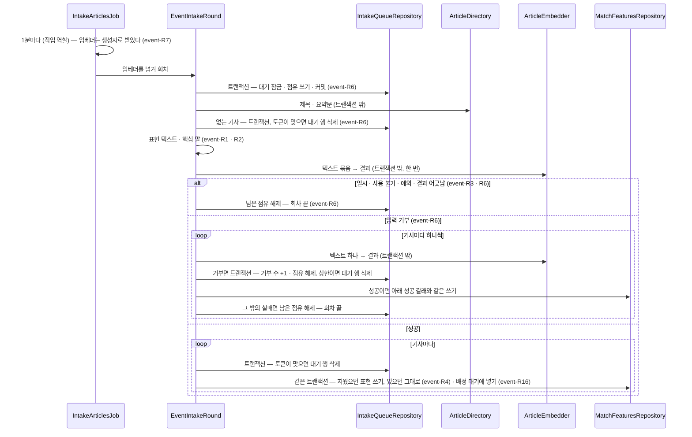
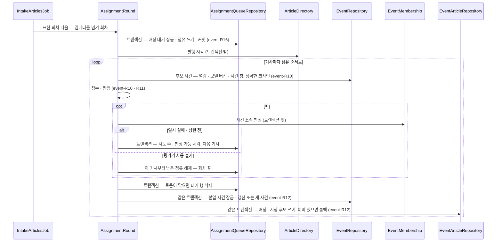
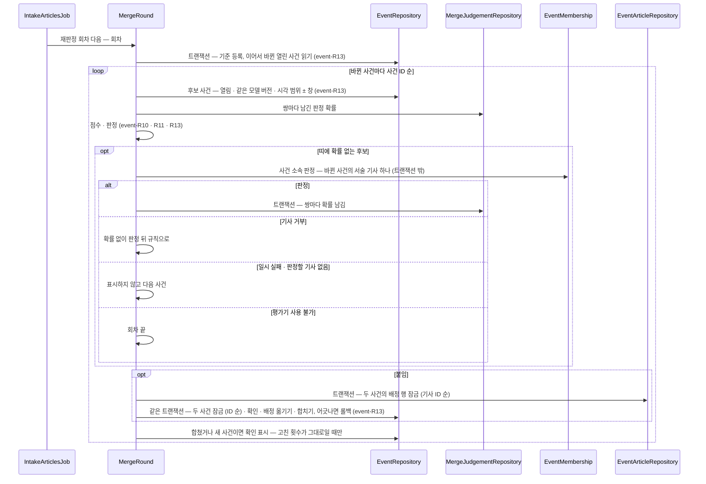

# event 모듈 Spec

공통 구조와 쓰는 규칙은 [specs/README.md](README.md)에 있다.

## 1. 책임과 범위

`event` 는 같은 사건을 다룬 기사를 사용자와 무관하게 공유 사건으로 묶는다. 비용은 운영자가 내고, 생성형 LLM 을 쓰지 않는다([ADR-0026](../adr/0026-event-clustering-with-local-embeddings-and-jev.md)).

- **사건 묶기 대기** — 새 기사를 대기에 넣고, 작업 역할의 반복 작업이 대기를 묶음으로 점유해 처리한다(event-R5 · R6 · R7, [ADR-0074](../adr/0074-article-features-built-by-event-intake-queue-job-and-skipped-without-an-embedder.md))
- **기사 표현** — 기사의 제목과 요약문 앞부분으로 텍스트 하나를 만들고, 그 텍스트의 임베딩(포트 `ArticleEmbedder`)과 핵심 말(Lucene Nori)을 임베딩 모델 버전과 함께 저장한다. 사건 배정의 입력이다(event-R1 ~ R4, [ADR-0075](../adr/0075-article-vectors-in-a-dimensionless-vector-column-one-row-per-model-version.md) · [ADR-0076](../adr/0076-key-terms-from-nori-without-decompounding-proper-common-and-foreign-nouns.md))
- **사건 배정** — 표현을 쓴 기사를 배정 대기에 넣고, 같은 반복 작업이 기사 하나씩 시간 창 안의 열린 사건 가운데 후보를 골라 산식으로 판정하거나 애매한 구간을 `evaluation` 의 사건 소속 판정으로 판정해, 사건에 붙이거나 새 사건을 연다(event-R10 ~ R12 · R16, [ADR-0077](../adr/0077-event-assignment-queue-judged-one-article-at-a-time-with-evaluation-failure-kinds.md) · [ADR-0078](../adr/0078-articles-ending-in-a-judgement-failure-open-a-new-event-marked-as-failed.md) · [ADR-0079](../adr/0079-event-centroids-in-a-dimensionless-halfvec-column-with-a-model-version-per-event.md) · [ADR-0080](../adr/0080-event-centroids-and-key-terms-accumulated-with-article-counts-and-updated-incrementally.md))
- **기준과 재판정** — 사건 기준 · 저장 기준은 설정이다. 배정은 저장 기준 이상인 후보의 점수 · 확률과 판정에 쓴 기준을 남기고, 기준이 바뀌면 그 저장값으로 열린 사건의 배정을 다시 판정한다 — 닫힌 사건의 배정은 기준만 새것으로 적는다(event-R17 · R18, [ADR-0081](../adr/0081-event-assignment-criteria-in-settings-and-rejudgement-within-stored-scores.md) · [ADR-0085](../adr/0085-rejudgement-knows-opened-events-from-an-assignment-flag-and-reads-merged-candidates-as-survivors.md) · [ADR-0087](../adr/0087-closed-event-assignments-are-not-rejudged-and-closing-and-merging-are-not-undone.md))
- **채우기** — 운영자가 기간을 정해, 그 기간에 처음 본 기사 가운데 배정이 없는 기사를 사건 묶기 대기에 넣는다(event-R19)
- **지운 기사 따르기** — `article` 이 기사를 지우면 그 기사의 대기 행 · 배정 · 후보 · 표현을 지우고 사건을 다시 맞춘다(event-R8)
- **사건 정리** — 같은 반복 작업이 바뀐 열린 사건을 가까운 열린 사건과 합치고(배정 산식 · 판정, 애매한 구간은 사건 소속 판정), 하루 1회 정리 작업이 오래된 사건을 대표 기사와 함께 닫고, 닫힌 사건에 장기 검색 인덱스를 두고, 다 쓴 기사 표현을 지운다(event-R13, [ADR-0084](../adr/0084-event-merge-applies-assignment-scoring-between-events-and-keeps-merged-rows-pointing-to-survivors.md) · [ADR-0086](../adr/0086-events-close-after-an-idle-period-since-the-last-join-or-a-maximum-period-since-opening.md) · [ADR-0087](../adr/0087-closed-event-assignments-are-not-rejudged-and-closing-and-merging-are-not-undone.md) · [ADR-0088](../adr/0088-article-features-kept-until-their-event-closes-and-unassigned-ones-for-the-window-plus-a-margin.md) · [ADR-0089](../adr/0089-long-term-hnsw-indexes-on-closed-events-created-per-model-version-at-runtime-by-the-worker-role.md))
- **사건 조회 · 대표 기사 · 큰 사건** — 사건 · 사건의 기사 · 기사의 사건 · 사건 목록을 공개 조회(`EventDirectory`)로 내고, 주어진 기사 가운데 대표 기사를 고르고, 기간 안의 큰 사건을 조회할 때 지금 기준으로 판정한다(event-R14 · R15 · R20, [ADR-0082](../adr/0082-big-events-judged-at-query-time-by-distinct-sources-and-mean-importance-both-reaching-criteria.md))
- **큰 사건 기준** — 운영자 설정(지금 값 한 행)과 추가 전용 이력으로 두고, 기동 때 처음 값을 적재하고, 공개 운영 API(`BigEventAdministration`)로 지금 값 · 변경 · 이력 · 미리보기를 낸다(event-R21, [ADR-0083](../adr/0083-big-event-criteria-as-operator-settings-with-append-only-history-and-preview.md))

하지 않는 것:

- 사용자를 모른다. 후보 선별 · 이슈 연결은 `digest` · `storyline` 이 한다
- Jev 를 직접 부르지 않는다 — 사건 소속 판정은 `evaluation` 의 공개 API 를 부른다([ADR-0026](../adr/0026-event-clustering-with-local-embeddings-and-jev.md) · [ADR-0071](../adr/0071-event-membership-judged-from-article-ids-with-questions-built-in-evaluation.md))
- 기사 내용을 갖지 않는다. 제목 · 요약문은 `article` 의 공개 조회로 읽고, 표현 행에는 벡터와 핵심 말만 남긴다

사건 기준 · 저장 기준 · 닫는 기간 · 최대 기간의 기본값(§7)과 큰 사건 기준의 처음 값(event-R21)은 측정 전 목표다. 큰 사건 기준 · 닫는 기간 · 최대 기간은 운영하면서 정한다([open-questions.md](../open-questions.md)). 기본 임베딩 모델([ADR-0091](../adr/0091-local-embedding-model-is-multilingual-e5-small-int8-fetched-at-build-into-the-image-with-onnx-telemetry-off.md))도 평가 세트로 다시 본다. 묶기 품질은 수집한 기사 표본에 사건 라벨을 붙인 평가 세트로 잰다 — 증거로서의 자격은 [테스트 전략](../qa/test-strategy.md) ⑪, 표본의 실제 기사 텍스트를 공개 저장소에 두지 않는 규칙은 [security.md](../security.md)에 있다.

다른 모듈과의 의존과 이벤트 흐름은 [overview.md §5](../overview.md#5-모듈-지도)에 있다.

## 2. 용어

사건 · 큰 사건은 [overview.md §8](../overview.md#8-용어)에 있다.

| 용어 | 뜻 |
|---|---|
| 기사 표현 | 사건 배정의 입력 — 기사 하나의 임베딩 벡터 · 핵심 말 · 임베딩 모델 버전(`article_match_features` 한 행). 기사 × 모델 버전마다 하나다(event-R4) |
| 표현 텍스트 | 제목과 요약문 앞부분으로 만든 텍스트 하나. 임베딩과 핵심 말이 같은 텍스트를 쓴다(event-R1) |
| 핵심 말 | 표현 텍스트에서 Nori 로 뽑은 고유명사 · 일반명사 · 외국어(event-R2). 고유명사 겹침 점수의 입력이다 |
| 임베더 | 텍스트를 벡터로 바꾸는 외부 의존 — 포트 `ArticleEmbedder`. 이름 · 모델 버전 · 차원을 밝힌다(event-R3). 운영 구현은 로컬 모델(기본)과 OpenAI 호환 외부 API 둘이다 |
| 거부 수 | 임베더가 그 기사의 입력을 거부한 횟수(`event_intake_queue.rejections`) — 상한에 이르면 대기에서 뺀다(event-R6) |
| 사건 묶기 대기 | 처리할 기사의 목록(`event_intake_queue` — 기사마다 한 행). 넣은 시각과 점유를 갖는다(event-R5) |
| 회차 | 반복 작업이 한 번 돌 때 하는 일 하나 — 표현 회차(대기를 점유해 표현을 만든다, event-R6) · 배정 회차(배정 대기를 점유해 배정한다, event-R16) · 재판정 회차(event-R18) · 병합 회차(event-R13)를 차례로 돈다 |
| 점유 | 회차가 대기 행을 가져갔다는 표시 — 토큰 · 만료 시각. 만료되면 다른 회차가 다시 가져간다(event-R6 · R16) |
| 배정 | 기사 하나가 속한 사건(`event_articles` 한 행) — 기사마다 하나. 점수 · 정한 것(산식 · 판정 · 판정 실패) · 연 사건 표지 · 판정에 쓴 기준 · 배정 시각을 갖는다(event-R12) |
| 연 사건 표지 | 그 기사가 판정으로 이 배정의 사건을 열었다는 배정의 표지 — 처음 판정의 새 사건 · 재판정의 떼어 내기. 병합으로 사건이 바뀌어도 그대로다(event-R18) |
| 배정 대기 | 표현을 쓴 뒤 배정할 기사의 목록(`event_assignment_queue` — 기사마다 한 행). 시도 수 · 판정 가능 시각 · 점유를 갖는다(event-R16) |
| 사건 기준 | 판정에 쓰는 값 — 시간 창 · 위 기준 · 아래 기준 · 확률 기준(event-R17) |
| 저장 기준 | 배정과 함께 후보를 남기는 점수의 바닥 — 이 이상인 후보의 점수 · 판정 확률을 남긴다(event-R17) |
| 띠 | 아래 기준 이상 · 위 기준 미만인 점수 — 사건 소속 판정에 묻는 구간(event-R11) |
| 저장 후보 | 배정과 함께 남긴 후보(`event_article_candidates`) — 사건 · 점수 · 판정 확률(묻지 않았으면 없음). 재판정의 재료다(event-R18) |
| 기준 이력 | 회차가 판정에 쓴 사건 기준 · 저장 기준 값의 목록(`event_assignment_criteria`) — 같은 값이면 한 행이고, 배정이 그 ID 를 가리킨다(event-R17) |
| 재판정 | 지금 기준과 다른 기준으로 판정된 배정을 저장 후보로 다시 판정하는 일(event-R18) |
| 채우기 | 운영자가 정한 기간에 처음 본 기사 가운데 배정이 없는 기사를 사건 묶기 대기에 넣는 운영 기능(event-R19) |
| 병합 회차 | 지난 확인 뒤 바뀐 열린 사건마다 가까운 열린 사건을 찾아 합치는 회차(event-R13) |
| 남는 사건 | 병합에서 남는 사건 — 기사 수가 많은 쪽, 같으면 ID 가 작은 쪽. 합쳐진 사건의 배정을 받는다(event-R13) |
| 합쳐진 사건 | 병합으로 배정을 남는 사건에 넘긴 사건 — 상태 `MERGED` 로 남아 남는 사건을 바로 가리킨다(event-R13) |
| 병합 판정 기록 | 띠에 든 사건 쌍의 사건 소속 판정 확률(`event_merge_judgements`) — 순서 없는 쌍마다 한 행이고, 남긴 쌍은 다시 묻지 않는다(event-R13) |
| 닫는 기간 | 마지막으로 기사가 붙은 뒤 이만큼 새 기사가 없으면 사건을 닫는다 — 설정(event-R13) |
| 최대 기간 | 사건을 연 뒤 이만큼 지나면 새 기사가 있어도 닫는다 — 설정(event-R13) |
| 정리 작업 | 하루 1회 반복 작업 — 닫기 · 장기 검색 인덱스 · 기사 표현 정리를 차례로 한다(event-R13) |
| 장기 검색 인덱스 | 닫힌 사건 중심의 HNSW 인덱스 — 모델 버전마다 하나이고, 정리 작업이 실행 중에 만든다(event-R13) |
| 조회 기간 | 사건 조회 · 큰 사건 판정이 받는 기간 — 시작 포함 · 끝 제외, 31일까지(`EventPeriod`). 기간 안 기사는 배정의 발행 시각으로 고른다(event-R20) |
| 사건 집계 | 조회 기간 안 기사 수 · 그 기사들의 서로 다른 소스 수 · 중요도 평균(`EventTally`) — 큰 사건 판정의 재료(event-R15) |
| 큰 사건 기준 | 소스 기준(서로 다른 소스 수의 하한)과 중요도 기준(중요도 평균의 하한) — 운영자 설정(event-R21) |
| 대표 기사 | 주어진 기사 가운데 사건 중심에 가장 가까운 기사 — 사건 기사 전체에서 고를 때는 닫을 때 남긴 대표가 있으면 그것(event-R14) |

## 3. 공개 인터페이스

이 모듈은 `article` 의 이벤트를 받고, 공개 조회 하나(`EventDirectory`)와 공개 운영 API 둘(`EventIntakeAdministration` · `BigEventAdministration`)을 낸다. 조회는 `digest` · `report` · `admin` 이 쓰고, 운영 API 는 `admin` 이 운영자 요청으로 부른다([ADR-0045](../adr/0045-admin-module-serves-operator-api-over-module-public-operation-apis.md)).

### EventIntakeAdministration · IntakeFillResult

사건 묶기 채우기의 운영(event-R19). 구현은 `application` 의 `EventIntakeAdministrationService` 다.

```java
public interface EventIntakeAdministration {
    int MAX_DAYS = 30;                       // 채울 기간의 상한(일) — 정본
    IntakeFillResult fill(int days);
}

public sealed interface IntakeFillResult {
    record Filled(int articles, int enqueued) implements IntakeFillResult {}
    record DaysOutOfRange(int max) implements IntakeFillResult {}
}
```

| 타입 · 멤버 | 뜻 |
|---|---|
| `fill` | 처음 본 시각이 지금 − 일수 × 24시간 이후(그 시각 포함)이고 배정이 없는 기사를 사건 묶기 대기에 넣는다. 이미 대기에 있으면 그대로다 |
| `Filled.articles` | 기간에 처음 본 기사 수 |
| `Filled.enqueued` | 그 가운데 새로 대기에 넣은 기사 수 — 배정이 있거나 이미 대기에 있는 기사는 세지 않는다 |
| `DaysOutOfRange.max` | 일수가 1 ~ `max` 밖이라 아무것도 하지 않았다 — `max` 는 `MAX_DAYS` |

- 계약
  - 트랜잭션 · 역할 애너테이션이 없다(두 역할 공통). 기사 고르기는 `article` 의 공개 조회 하나(표 전체 읽기 — 드문 운영 연산)이고, 넣기는 SQL 한 문장이다
  - 넣은 기사는 표현 회차가 표현을 만든 뒤 배정 대기로 넘긴다 — 표현이 이미 있으면 그대로 두고 넘긴다(event-R4 · R6)

### EventDirectory

사건 조회 — 다른 모듈이 사건 · 사건의 기사 · 기사의 사건 · 대표 기사 · 큰 사건 · 사건 목록을 읽는다(event-R14 · R15 · R20). 구현은 `application` 의 `EventDirectoryService` 다.

```java
public interface EventDirectory {
    int MAX_PAGE_SIZE = 100;                                  // 사건 목록 한 쪽의 상한 — 정본. 측정 전 목표
    Optional<EventView> find(EventId id);
    List<EventArticleView> articles(EventId id);
    Map<ArticleId, EventId> eventsOf(Collection<ArticleId> articleIds);
    Map<EventId, ArticleId> representatives(Map<EventId, ? extends Collection<ArticleId>> among);
    List<BigEvent> bigEvents(EventPeriod period);
    EventPage list(EventPeriod period, @Nullable EventCursor after, int size);
}
```

| 멤버 | 뜻 |
|---|---|
| `find` | 사건 하나 — 합쳐진 사건의 ID 면 남는 사건을 낸다(event-R13 · R20). 없는 사건이면 빈 값 |
| `articles` | 사건의 배정 전부 — 발행 시각 · 기사 ID 순. 없는 사건이나 합쳐진 사건이면 빈 목록이다 — 합쳐진 사건의 기사는 남는 사건에 있으므로, 합쳐진 사건일 수 있는 ID 는 먼저 `find` 로 남는 사건을 얻는다(event-R20) |
| `eventsOf` | 기사들의 사건 — 배정이 없는 기사는 빠진다. 빈 입력이면 빈 맵 |
| `representatives` | 사건마다 주어진 기사 가운데 대표 기사(event-R14) — 그 사건의 기사가 아닌 것은 무시하고, 남는 기사가 없는 사건은 빠진다 |
| `bigEvents` | 조회 기간 안의 큰 사건 — 지금 기준으로 판정한다(event-R15). 소스 수 내림차순, 중요도 평균 내림차순, 사건 ID 순 |
| `list` | 조회 기간 안 기사가 있는 사건 — 마지막 기사 시각 내림차순, 사건 ID 내림차순으로 `size` 건. 집계 · 큰 사건 여부는 그 기간, 대표 기사는 사건 기사 전체에서(닫을 때 남긴 대표가 있으면 그것 — event-R14). `size` 가 1 ~ `MAX_PAGE_SIZE` 밖이면 `IllegalArgumentException` |

- 계약
  - 트랜잭션 · 역할 애너테이션이 없다(두 역할 공통). 사용자 정보를 받지 않는다 — 사용자 제외 조건은 부르는 쪽이 기사를 걸러 `representatives` 에 넘긴다
  - 각 질의는 그 순간의 값이다. 큰 사건의 재료(소스 · 중요도)는 `article` 의 `ArticleDirectory.sources` 와 `evaluation` 의 `ArticleEvaluations.importances` 로 따로 읽는다 — 한 스냅숏이 아니다
  - `bigEvents` · `list` 는 큰 사건 기준의 처음 값을 적재하기 전이면 `IllegalStateException`(`list` 는 쪽에 사건이 있을 때)
  - `list` 의 커서는 앞 쪽 마지막 사건의 (마지막 기사 시각, 사건 ID)다 — 쪽 사이에 마지막 기사 시각이 바뀐 사건은 건너뛰거나 다시 나올 수 있다

### EventId · EventPeriod · EventView · EventArticleView · EventStatus · DecidedBy

```java
public record EventId(long value) {}                     // 1 이상 — 아니면 IllegalArgumentException

public record EventPeriod(Instant from, Instant to) {    // [from, to)
    public static final int MAX_DAYS = 31;               // 정본. 측정 전 목표
    public static final Duration MAX_LENGTH = Duration.ofDays(MAX_DAYS);
    public static Optional<EventPeriod> of(Instant from, Instant to);
}

public record EventView(EventId id, EventStatus status, int articleCount, Instant firstArticleAt, Instant lastArticleAt,
        Instant createdAt) {}

public record EventArticleView(ArticleId articleId, Instant publishedAt, @Nullable Double score, DecidedBy decidedBy,
        Instant assignedAt) {}

public enum EventStatus { OPEN, CLOSED, MERGED }
public enum DecidedBy { FORMULA, EVALUATOR, JUDGEMENT_FAILED }
```

| 타입 · 필드 | 뜻 |
|---|---|
| `EventPeriod` | 조회 기간 — 생성자는 `from < to` 이고 길이가 `MAX_LENGTH` 이하가 아니면 `IllegalArgumentException`, `of` 는 빈 값 |
| `EventView.articleCount` · `firstArticleAt` · `lastArticleAt` | 사건 전체의 기사 수 · 첫 · 마지막 기사 시각(기간과 무관) |
| `EventView.createdAt` | 사건을 연 시각 — 다른 사건을 합친 사건은 두 사건 가운데 이른 쪽(event-R13) |
| `EventArticleView.score` | 붙인 후보의 점수, 새 사건이면 가장 높은 후보의 점수 — 후보가 없었으면 null(event-R12) |
| `EventArticleView.decidedBy` | 배정을 정한 것 — 산식 · 판정 · 판정 실패(event-R11 · R16) |
| `EventStatus` | 사건의 상태 — `OPEN`(기사를 붙인다) · `CLOSED`(닫혔다 — 기사를 붙이지 않고 배정을 재판정하지 않는다) · `MERGED`(다른 사건에 합쳐져 남는 사건을 가리킨다)(event-R13). `find` 가 남는 사건을 내므로 조회 결과의 상태는 `MERGED` 가 아니다 |

### EventTally · BigEvent · EventSummary · EventCursor · EventPage

```java
public record EventTally(int articles, int sources, @Nullable BigDecimal importance) {}
public record BigEvent(EventId id, List<ArticleId> articles, EventTally tally) {}
public record EventSummary(EventView event, EventTally tally, boolean big, @Nullable ArticleId representative) {}
public record EventCursor(Instant lastArticleAt, EventId id) {}
public record EventPage(List<EventSummary> events, @Nullable EventCursor next) {}
```

| 타입 · 필드 | 뜻 |
|---|---|
| `EventTally` | 조회 기간 안 사건 집계(event-R15) — 기사 수, 서로 다른 소스 수, 중요도가 있는 기사의 중요도 평균(없으면 null) |
| `BigEvent.articles` | 조회 기간 안 기사 — 발행 시각 · 기사 ID 순 |
| `EventSummary.big` | 목록 기간 · 지금 기준으로 큰 사건인가 |
| `EventSummary.representative` | 사건 기사 전체에서 고른 대표 기사 — 닫을 때 남긴 대표가 있으면 그것(event-R14). 배정이 없으면 null |
| `EventPage.next` | 다음 쪽의 커서 — 더 없으면 null |

### BigEventAdministration · BigEventCriteria · BigEventCriteriaChange · BigEventCriteriaChangeResult

큰 사건 기준의 운영(event-R21) — 운영자 화면이 부른다. 구현은 `application` 의 `BigEventAdministrationService` 다.

```java
public interface BigEventAdministration {
    BigEventCriteria criteria();
    BigEventCriteriaChangeResult change(int minSources, BigDecimal minImportance, ChangeActor actor);
    List<BigEventCriteriaChange> changes();
    List<BigEvent> preview(BigEventCriteria proposed, EventPeriod period);
}

public record BigEventCriteria(int minSources, BigDecimal minImportance) {
    public static final int IMPORTANCE_SCALE = 2;                       // 중요도 기준의 소수 자릿수 — 정본
    public static final BigEventCriteria DEFAULT;                       // (3, 3.00) — 처음 값의 정본. 측정 전 목표
    public static Optional<BigEventCriteria> of(int minSources, BigDecimal minImportance);
}

public record BigEventCriteriaChange(@Nullable BigEventCriteria previous, BigEventCriteria current, ChangeActor actor,
        Instant changedAt) {}

public sealed interface BigEventCriteriaChangeResult {
    record Changed(BigEventCriteria previous, BigEventCriteria current) implements BigEventCriteriaChangeResult {}
    record Unchanged(BigEventCriteria current) implements BigEventCriteriaChangeResult {}
    record OutOfRange() implements BigEventCriteriaChangeResult {}
}
```

| 타입 · 멤버 | 뜻 |
|---|---|
| `criteria` | 지금 기준 |
| `change` | 기준을 바꾼다 — 범위 밖이면 `OutOfRange`, 지금 값과 같으면 `Unchanged` 이고 둘 다 아무것도 쓰지 않는다 |
| `changes` | 이력 — 최근 것부터, 같은 시각이면 나중에 쓴 것부터 |
| `preview` | 제안 기준으로 판정한 조회 기간 안의 큰 사건 — 판정 · 순서는 `EventDirectory.bigEvents` 와 같고 아무것도 쓰지 않는다 |
| `BigEventCriteria` | 생성자는 소스 기준 1 이상, 중요도 기준이 중요도 수준의 범위(`ImportanceScale.MIN_LEVEL` ~ `MAX_LEVEL`) 안 · 소수 둘째 자리까지가 아니면 `IllegalArgumentException`. 중요도 기준은 둘째 자리로 맞춘다 — 같은 값이면 같다. `of` 는 범위 밖이면 빈 값 |
| `BigEventCriteriaChange.previous` | 바꾸기 전 값 — 처음 값이면 null |

- 계약
  - `change` 는 한 트랜잭션이다. 지금 값 행을 잠가 동시 변경이 줄을 서므로, 이력의 이전 값이 바로 앞 변경의 새 값이다
  - 행위자는 `evaluation` 의 `ChangeActor` 다 — 운영자 요청은 `OPERATOR`, 기동 적재는 `SYSTEM`
  - `criteria` · `change`(범위 안의 값) 는 처음 값을 적재하기 전이면 `IllegalStateException`. 역할 애너테이션이 없다(두 역할 공통)

HTTP 엔드포인트는 없다.

## 4. 내부 구조

### 개관

| 패키지 | 책임 |
|---|---|
| (최상위) | 모듈 선언(`package-info`), 공개 조회 `EventDirectory` 와 그 값 타입, 공개 운영 API `EventIntakeAdministration` · `BigEventAdministration` 과 그 결과 · 값 타입, 사건 상태 · 배정을 정한 것(`EventStatus` · `DecidedBy`) |
| `domain/feature` | 기사 표현 — 임베더 포트와 그 정보 · 벡터 값 · 결과(성공 · 실패 갈래), 표현 텍스트 구성 · 핵심 말 추출 · 임베더 결과 확인 · 벡터 정규화 · 표현 보관 기준의 정본, 표현 행과 그 저장소 |
| `domain/intake` | 사건 묶기 대기 — 대기 행과 그 점유, 대기 상수 · 거부 상한, 대기 저장소 |
| `domain/assignment` | 사건 배정의 판단 — 기준, 후보 점수 산식, 판정 규칙, 사건 대 사건 규칙(병합), 재판정 적용 규칙, 저장 후보 모으기, 중심 누적 갱신 · 합치기, 배정 대기 행과 그 일정, 배정 대기 · 기준 이력 · 병합 판정 기록 저장소 |
| `domain/event` | 사건과 배정 — 잠근 사건 행과 기사 하나 더하기 · 사건 합치기, 기사를 뺀 사건의 새 값, 닫기 판정, 병합 회차가 읽는 사건, 배정 행, 사건 · 배정 저장소, 장기 검색 인덱스, 사건 조회 저장소 |
| `domain/bigevent` | 큰 사건 — 판정 규칙 · 순서, 사건 집계, 큰 사건 기준 저장소 |
| `domain/openai` | OpenAI 호환 외부 임베딩의 판단 — 요청 본문, 응답 읽기, 상태 코드 갈래, 키 형식, 모델 버전 규칙 |
| `application` | 기사 이벤트 리스너, 표현 · 배정 · 재판정 · 병합 회차, 정리 작업, 기사를 뺀 사건 쓰기, 기준 설정과 결선, 공개 조회 · 공개 운영 API 의 구현, 사건 집계 읽기, 큰 사건 기준의 처음 값 적재, 핵심 말 추출기의 결선, 임베딩 provider 설정과 결선 조건 |
| `adapter/in/job` | 사건 묶기 대기 반복 작업(작업 역할) — 네 회차를 차례로, 사건 정리 반복 작업(작업 역할) — 하루 1회 |
| `adapter/out/persistence` | 대기 · 표현 · 배정 대기 · 기준 이력 · 병합 판정 기록 · 사건 · 배정 · 사건 조회 · 큰 사건 기준 저장소와 장기 검색 인덱스의 JdbcClient 구현, "중심에 가까운 순" 정렬 조각, 벡터의 pgvector 텍스트 표현 |
| `adapter/out/openai` | 임베더 포트의 OpenAI 호환 외부 구현 — HTTP 연결 · 설정 · 결선(작업 역할) |
| `adapter/out/onnx` | 임베더 포트의 로컬 모델 구현 — 모델 파일 정보 · 토크나이저 · ONNX Runtime 추론 · 결선(작업 역할, `local` 밖) |
| `adapter/out/fake` | 임베더 포트의 로컬 대체물과 그 결선(`local` 에서만) |

협력: `EventIntakeListener` 가 `ArticleStored` 로 기사를 `IntakeQueueRepository` 에 넣고, `ArticlesRemoved` 로 대기 행과 표현 행(`MatchFeaturesRepository`)을 지운다. 작업 역할의 `IntakeArticlesJob` 이 생성자로 받은 임베더를 1분마다 `EventIntakeRound` 에 넘겨 돌린다. 회차는 `IntakeQueueRepository` 로 대기를 점유하고(`PendingArticle.claim` · `IntakeSchedule`), `article` 의 `ArticleDirectory` 로 제목 · 요약문을 읽어, 기사마다 `MatchText` 로 표현 텍스트를, `KeyTermExtractor` 로 핵심 말을 만든다. 포트 `ArticleEmbedder` 로 텍스트 묶음을 한 번에 벡터로 바꾸고 `EmbeddingCheck` 로 결과를 확인한 뒤, 기사마다 `IntakeQueueRepository.deleteIfLeased` 가 대기 행을 지웠을 때만 `MatchFeaturesRepository.insertIfAbsent` 로 표현을 쓴다. 결과가 입력 거부면 기사 하나씩 다시 불러, 거부된 기사는 `IntakeQueueRepository.recordRejectionIfLeased` 로 거부 수를 올리고 상한(`IntakeSchedule.rejectionsExhausted`)이면 `delete` 로 뺀다. 임베더는 provider 설정(`EmbeddingProperties` — 결선 조건은 `EmbeddingProviderCondition`)에 따라 작업 역할에서 `OnnxArticleEmbedderConfiguration`(기본, `local` 밖) 또는 `OpenAiCompatibleEmbedderConfiguration` 이, `local` 에서 provider 가 기본이면 `FakeArticleEmbedderConfiguration` 이 포트로 등록한다. `KeyTermExtractor` 는 `KeyTermConfiguration` 이 빈으로 둔다. 표현을 쓰는 같은 트랜잭션에서 `AssignmentQueueRepository.enqueue` 로 그 기사를 배정 대기에 넣는다.

배정: 반복 작업이 표현 회차 다음에 `AssignmentRound` 를 돌린다. 회차는 `AssignmentQueueRepository` 로 배정 대기를 점유하고(`PendingAssignment.claim` · `AssignmentSchedule`), `CriteriaRepository` 에 지금 기준(`AssignmentCriteria` — `EventAssignmentProperties` 를 `AssignmentConfiguration` 이 빈으로 바꾼 것)을 등록하고, `ArticleDirectory` 로 발행 시각을 읽는다. 기사마다 `MatchFeaturesRepository.find` 로 지금 모델 버전의 표현을 읽어 `EventRepository.candidates` 로 후보 사건을 얻고, `CandidateScoring` 으로 점수를 매겨 `AssignmentRule` 로 판정한다. 띠면 `EventRepository.describers` 로 서술 기사를 골라 `evaluation` 의 `EventMembership` 에 묻는다. 쓰기는 `EventRepository.lock` · `update`(`LockedEvent.joined`) 또는 `open` 과 `EventArticleRepository.insertIfAbsent` 다. 이어서 `RejudgementRound` 가 `EventArticleRepository.keepClosed` 로 닫힌 사건의 배정을 기준만 새것으로 적고, `lockRejudgeTargets` 로 기준이 다른 배정을 잠가(저장 후보는 `RejudgeTarget` 이 `StoredCandidate.folded` 로 모은다) `AssignmentRule` · `Reassignment` 로 다시 판정하고, 옮기거나 떼어 내면 옛 사건을 `EventShrinkWriter` 로 쓴다. 지운 기사 따르기는 `EventIntakeListener` 가 `EventShrink` 로 사건의 새 값을 정해 `EventShrinkWriter` 로 쓰고, `EventRepository.clearRepresentative` 로 지운 기사인 대표를 비운다. 채우기는 `EventIntakeAdministrationService` 가 `ArticleDirectory.firstSeenSince` 와 `IntakeQueueRepository.enqueueUnassigned` 로 한다.

병합: 반복 작업이 재판정 회차 다음에 `MergeRound` 를 돌린다. 회차는 `CriteriaRepository` 에 지금 기준을 등록하고 `EventRepository.mergeDue` 로 바뀐 열린 사건(`MergeSubject`)을 읽는다. 사건마다 `EventRepository.candidates` 로 후보 사건을 얻어 `MergeRule.termsFromSubject` 로 핵심 말 겹침의 기준 쪽을 정하고 `CandidateScoring` 으로 점수를 매긴 뒤, `MergeJudgementRepository.find` 로 남긴 확률을 채워 `AssignmentRule` 로 판정한다. 띠면 `EventRepository.describers` 로 서술 기사를 골라 `EventMembership` 에 묻고 받은 확률을 `MergeJudgementRepository.save` 로 남긴다. 합치기는 `EventArticleRepository.lockByEvents` → `EventRepository.lockAll` → `MergeRule.survivor` → `EventArticleRepository.moveAll` → `EventRepository.absorb`(`LockedEvent.absorbed` · `CentroidUpdate.merge`)이고, 확인 표시는 `EventRepository.markMergeChecked` 다.

정리: 작업 역할의 `EventCleanupJob` 이 하루 1회 `CleanupRound` 를 돌린다. 닫기는 `EventRepository.closable` 로 고른 사건을 `lock` 해 `EventClosing.due` 로 다시 보고, `EventQueryRepository.representativesOfAll` 로 대표 기사를 골라 `EventRepository.close` 로 닫는다. 이어서 `LongTermIndexes.ensure` 로 장기 검색 인덱스를 만들고, `MatchFeaturesRepository.deleteOfClosedEvents` · `deleteUnassigned`(기준 시각은 `FeatureRetention`)로 기사 표현을 지운다. 닫기 기준 `EventClosing` 은 `EventAssignmentProperties` 를 `AssignmentConfiguration` 이 빈으로 바꾼 것이다.

조회: `EventDirectoryService` 가 `EventQueryRepository` 로 사건(합쳐진 사건이면 남는 사건) · 배정 · 기사의 사건 · 대표 기사(정렬은 `CentroidOrder` — `describers` 와 같은 조각, 사건 기사 전체에서는 닫을 때 남긴 대표가 먼저) · 기간 안 배정 · 사건 쪽을 읽는다. 큰 사건은 기간 안 배정을 `EventTallyReader` 에 넘겨 `article` 의 `ArticleDirectory.sources` · `evaluation` 의 `ArticleEvaluations.importances` 로 재료를 한 번씩 읽고 `EventTallies` 로 센 뒤, `BigEventCriteriaRepository` 의 지금 기준으로 `BigEventRule` 이 판정 · 정렬한다. 큰 사건 기준은 `BigEventCriteriaSeeding` 이 기동 때 처음 값을 넣고, `BigEventAdministrationService` 가 변경 · 이력을 저장소로 쓰며 지금 값 읽기와 미리보기는 `EventDirectoryService` 의 것을 쓴다.

#### 회차 흐름



#### 배정 회차 흐름



#### 병합 회차 흐름



### 들어오는 쪽

| 진입점 | 구성 요소 | 계기 | 내용 |
|---|---|---|---|
| `ArticleStored` · `ArticlesRemoved` 리스너 | `EventIntakeListener`(`application`) | `article` 의 `ArticleStored` · `ArticlesRemoved` | 새 기사를 대기에 넣고(event-R5), 지운 기사의 대기 · 배정 대기 · 배정 · 후보 · 표현 행을 지우고 사건을 다시 맞춘다(event-R8). 비동기 · 새 트랜잭션이고 이벤트 발행 레지스트리에 기록된다(Spring Modulith `@ApplicationModuleListener`). 실패한 발행은 `platform` 의 이벤트 재처리 작업이 다시 처리하고, 다시 처리해도 결과가 같다. 임베더 · Nori 를 쓰지 않는다 — 화면 역할에서 돌아도 된다 |
| 사건 묶기 대기 반복 작업 | `IntakeArticlesJob`(`adapter/in/job`, 작업 역할) | JobRunr 반복 작업 `event-intake` — 1분마다, 재시도 없음 | 생성자로 받은 임베더로 `EventIntakeRound` → `AssignmentRound` → `RejudgementRound` → `MergeRound` 를 차례로 돌린다(event-R6 · R16 · R18 · R13). 임베더가 없으면 작업 역할이 뜨지 않는다(event-R7). 이전 실행이 대기 · 처리 중이면 그 실행은 건너뛴다 |
| 채우기 | `EventIntakeAdministrationService`(`application`) | `admin` 의 운영자 요청(`EventIntakeAdministration.fill`) | 기간에 처음 본, 배정 없는 기사를 사건 묶기 대기에 넣는다(event-R19). 두 역할 공통 |
| 사건 조회 | `EventDirectoryService`(`application`) | 다른 모듈의 `EventDirectory` 호출 | 사건 · 사건의 기사 · 기사의 사건 · 대표 기사 · 큰 사건 · 사건 목록(event-R14 · R15 · R20). 두 역할 공통 |
| 큰 사건 기준 운영 | `BigEventAdministrationService`(`application`) | `admin` 의 운영자 요청(`BigEventAdministration`) | 지금 값 · 변경 · 이력 · 미리보기(event-R21). 두 역할 공통 |
| 큰 사건 기준 처음 값 | `BigEventCriteriaSeeding`(`application`) | 기동(`SmartInitializingSingleton`) | 지금 값이 없으면 처음 값과 이력 한 행을 넣는다(event-R21). 두 역할 공통 |
| 사건 정리 반복 작업 | `EventCleanupJob`(`adapter/in/job`, 작업 역할) | JobRunr 반복 작업 `event-cleanup` — 하루 1회, 재시도 없음 | `CleanupRound` 로 닫기 · 장기 검색 인덱스 · 기사 표현 정리를 차례로 한다(event-R13). 임베더 · 평가기를 쓰지 않는다. 실패하면 다음 날 다시 돈다 — 다시 돌려도 결과가 같다 |

컨트롤러는 없다.

### `application`

- `EventIntakeListener` — 리스너(들어오는 쪽). 넣기는 시각을 `InstantSource` 에서 얻는다. 지우기는 한 트랜잭션에서 event-R8 의 순서로 한다 — 사건의 새 값은 `EventShrink`, 쓰기는 `EventShrinkWriter`, 대표 비우기는 `EventRepository.clearRepresentative`. 이름은 `evaluation` 의 리스너와 다르다 — 빈 이름은 단순 클래스 이름이다
- `EventIntakeRound` — 표현 회차 하나(event-R6 · R8). 임베더는 `run(ArticleEmbedder)` 의 인자로 받는다 — 작업 진입점이 넘긴다. 시각은 `InstantSource` 에서 얻는다. 점유와 쓰기는 `TransactionTemplate` 의 짧은 트랜잭션이고, 기사 조회와 임베더 호출은 트랜잭션 밖이다. 표현을 쓰는 트랜잭션에서 배정 대기에 넣는다. 트랜잭션 · 역할 애너테이션이 없다(두 역할 공통). 결과 · 실패 갈래는 `default` 없는 `switch` 식이다. 로그(`{n}건` 은 남은 점유 수, `{문구}` 는 실패 결과의 운영자용 문구): `사건 묶기 대기 기사가 지워져 대기에서 뺐다 — 기사 {ID}` · `임베더가 기사를 거부했다 — 기사 {ID}, 거부 {n}회: {문구}`(정보), `임베더가 일시 실패해 회차를 멈췄다 — {이름} {모델 버전}, 기사 {n}건: {문구}` · `임베더를 쓸 수 없어 회차를 멈췄다 — {이름} {모델 버전}, 기사 {n}건: {문구}` · `임베더가 기사를 거부해 사건 묶기에서 뺐다 — 기사 {ID}, 거부 {n}회: {문구}`(경고), `임베더가 실패해 회차를 멈췄다 — {이름} {모델 버전}, 기사 {n}건: {사유}`(오류 — 사유는 예외면 예외 클래스 이름과 스택, 결과가 어긋나면 어긋남 문구)
- `AssignmentRound` — 배정 회차 하나(event-R10 ~ R12 · R16). `run(ArticleEmbedder)` 의 임베더는 지금 모델 버전을 정하는 데만 쓴다. 기사마다 시계를 다시 읽는다. 점유 · 쓰기는 짧은 트랜잭션이고 기사 조회 · 사건 소속 판정은 트랜잭션 밖이다. 판정 · 실패 갈래는 `default` 없는 `switch` 식이다. 예외를 밖으로 던지지 않는다. 트랜잭션 · 역할 애너테이션이 없다. 로그: `배정 대기 기사가 지워져 대기에서 뺐다 — 기사 {ID}` · `배정 대기 기사가 판정 중에 지워져 대기에서 뺐다 — 기사 {ID}` · `사건 소속 판정이 일시 실패해 다시 시도한다 — 기사 {ID}, 시도 {n}: {문구}` · `붙일 사건이 사라졌거나 닫혀 다음 회차에 다시 판정한다 — 기사 {ID}`(정보), `사건 소속 판정의 일시 실패가 상한에 이르러 새 사건으로 끝낸다 — 기사 {ID}: {문구}` · `평가기가 기사를 거부해 새 사건으로 끝낸다 — 기사 {ID}: {문구}` · `평가기를 쓸 수 없어 배정 회차를 멈췄다 — 남은 기사 {n}건: {문구}`(경고), `배정 회차가 예상하지 못한 오류로 멈췄다 — 기사 {ID}, 남은 기사 {n}건`(오류)
- `RejudgementRound` — 재판정 회차 하나(event-R18). 먼저 닫힌 사건의 배정을 한 트랜잭션에서 기준만 새것으로 적고, 이어서 배정 하나마다 짧은 트랜잭션이다. 사건 소속 판정 · 임베더를 부르지 않는다. 트랜잭션 · 역할 애너테이션이 없다. 로그: `닫힌 사건의 배정 {n}건은 기준만 새것으로 적었다` · `배정 {n}건을 지금 기준으로 다시 판정했다`(정보, 한 건 이상일 때), `재판정 회차가 예상하지 못한 오류로 멈췄다 — 이번 회차에 다시 판정한 배정 {n}건`(오류)
- `MergeRound` — 병합 회차 하나(event-R13). 임베더를 받지 않는다 — 모델 버전은 사건의 것이다. 시각은 `InstantSource` 에서 얻는다. 기준 등록 · 판정 기록 쓰기 · 합치기는 짧은 트랜잭션이고, 사건 소속 판정은 트랜잭션 밖이다. 판정 · 실패 갈래는 `default` 없는 `switch` 식이다. 예외를 밖으로 던지지 않는다. 트랜잭션 · 역할 애너테이션이 없다. 로그: `사건 {n}건을 합쳤다` · `합칠 사건이 닫혔거나 그새 바뀌어 다음 회차에 다시 본다 — 사건 {ID} · {ID}` · `사건 병합 판정이 일시 실패해 다음 회차에 다시 본다 — 사건 {ID}: {문구}`(정보), `평가기가 기사를 거부해 병합 판정을 확률 없이 정한다 — 사건 {ID}: {문구}` · `평가기를 쓸 수 없어 병합 회차를 멈췄다 — 사건 {ID}: {문구}`(경고), `병합 회차가 예상하지 못한 오류로 멈췄다 — 사건 {ID}`(오류)
- `CleanupRound` — 정리 작업 하나(event-R13) — 닫기 · 장기 검색 인덱스 · 기사 표현 정리를 차례로 한다. 시계는 한 번 읽는다. 닫기는 사건마다, 표현 정리는 묶음마다 짧은 트랜잭션이고, 인덱스는 트랜잭션 밖(자동 커밋)이다. 단계마다 예상 못한 예외는 그 단계에서 멈추고 다음 단계로 간다. 예외를 밖으로 던지지 않는다. 트랜잭션 · 역할 애너테이션이 없다. 로그: `사건 {n}건을 닫았다` · `장기 검색 인덱스 {n}개를 만들었다` · `기사 표현 {n}건을 지웠다`(정보, 하나라도 있을 때), `사건 닫기가 예상하지 못한 오류로 멈췄다 — 닫은 사건 {n}건` · `장기 검색 인덱스 확인이 예상하지 못한 오류로 멈췄다` · `기사 표현 정리가 예상하지 못한 오류로 멈췄다 — 지운 표현 {n}건`(오류). 인덱스의 경고 로그는 `JdbcLongTermIndexes` 가 남긴다
- `EventShrinkWriter` — 기사를 뺀 사건 쓰기의 정본(event-R8 · R18). 뺀 기사의 배정이 지워지거나 옮겨진 뒤 같은 트랜잭션에서 부른다 — 비면 사건을 지우고, 아니면 새 중심 · 수 · 핵심 말과 남은 배정의 발행 시각 범위를 쓴다(연 시각 · 마지막으로 붙은 시각은 그대로). 남은 수가 있는데 배정이 없으면 사건을 지운다
- `EventAssignmentProperties` · `AssignmentConfiguration` — 사건 기준 · 저장 기준 · 닫는 기간 · 최대 기간 설정(`yozmnews.event-assignment`, 기본값의 정본은 레코드 컴포넌트의 `@DefaultValue`)과 그것을 검증된 `AssignmentCriteria` · `EventClosing` 빈으로 바꾸는 결선(event-R13 · R17)
- `EventIntakeAdministrationService` — 공개 운영 API `EventIntakeAdministration` 의 구현(event-R19). 시각은 `InstantSource` 에서 얻는다
- `KeyTermConfiguration` — `KeyTermExtractor` 를 빈으로 두고, 컨텍스트가 닫을 때 닫는다
- `EmbeddingProperties` · `EmbeddingProviderCondition` — 임베딩 provider 설정(`yozmnews.embedding.provider` — `onnx` 기본 · `openai-compatible`, 기본값의 정본은 레코드 컴포넌트의 `@DefaultValue`)과 그것을 읽는 결선 조건의 정본(`Onnx` · `OpenAiCompatible`). 조건은 `Binder` 로 같은 레코드에 묶어 읽는다 — 값이 틀리면 기동하지 않는다
- `EventDirectoryService` — 공개 조회 `EventDirectory` 의 구현(event-R14 · R15 · R20). 큰 사건 판정은 패키지 비공개 `bigEvents(EventPeriod, BigEventCriteria)` 하나를 공개 조회(지금 기준)와 미리보기(제안 기준)가 함께 쓴다. `list` 는 한 건 더 읽어 다음 커서를 정한다. 트랜잭션 · 역할 애너테이션이 없다
- `EventTallyReader` — 사건별 기간 안 기사의 소스 · 중요도를 다른 모듈의 공개 조회로 한 번씩 읽어 `EventTallies` 로 세는 협력자(집계 경로 하나). 입력이 비면 부르지 않는다
- `BigEventAdministrationService` — 공개 운영 API `BigEventAdministration` 의 구현(event-R21). 변경은 지금 값 행을 잠근 한 트랜잭션이고, 바꿨으면 정보 로그 `큰 사건 기준을 바꿨다 — 소스 {a} → {b}, 중요도 {x} → {y}, {행위자}` 를 남긴다. 시각은 `InstantSource` 에서 얻는다
- `BigEventCriteriaSeeding` — 기동 때 한 트랜잭션에서 처음 값(`BigEventCriteria.DEFAULT`)을 넣는다(event-R21). 넣었으면 정보 로그 `큰 사건 기준의 처음 값을 적재했다 — 소스 {n} · 중요도 {x}`

### `domain`

#### `domain/feature`

- `MatchText` — 표현 텍스트 구성의 정본. 요약문 앞부분 길이 `SUMMARY_PREFIX_CODE_POINTS`(300 코드 포인트 — 측정 전 목표)(event-R1). 자르기는 `platform` 의 `CodePoints` 다
- `KeyTermExtractor` — 핵심 말 추출의 정본. 고르는 품사 `KEPT_TAGS`(`NNP` · `NNG` · `SL`). Lucene `Analyzer` 를 하나 갖고 여러 스레드에서 쓴다. 닫을 수 있다(event-R2)
- `EmbeddingCheck` — 임베더 결과가 요청 수 · 밝힌 차원과 맞는지의 판정(event-R3)
- `Embedding.normalized` — L2 정규화의 정본. 합 · 나눗셈은 `double`, 결과는 `float`. 빈 배열 · 유한하지 않은 값 · 영벡터는 거부한다. 로컬 대체물 · 외부 · 로컬 모델 구현이 함께 쓴다
- `FeatureRetention` — 표현 보관 기준의 정본(event-R13). 배정되지 않은 표현의 여유 `MARGIN`(1일 — 측정 전 목표), `unassignedBefore(지금, 창)` = 지금 − 창 − 여유
- `MatchFeatures` — 표현 한 행(기사 · 모델 버전 · 벡터 · 핵심 말 · 만든 시각)
- 저장 단위: aggregate 가 없다 — 표현 행은 만든 뒤 바꾸지 않고, 저장소 `MatchFeaturesRepository` 가 넣기 · 읽기 · 지우기만 한다

  ```java
  public interface MatchFeaturesRepository {
      boolean insertIfAbsent(MatchFeatures features);                 // 없으면 쓴다 — (기사, 모델 버전)이 있으면 그대로. 썼으면 true
      Optional<MatchFeatures> find(ArticleId articleId, String modelVersion);                  // 그 모델 버전 표현 — 없으면 빈 값
      List<MatchFeatures> findAll(Collection<ArticleId> articleIds, String modelVersion);     // 기사 ID 순, 없는 기사는 빠진다
      void deleteByArticles(Collection<ArticleId> articleIds);       // 지운 기사 따르기 — 모든 모델 버전
      int deleteOfClosedEvents(int limit);                           // 배정의 사건이 닫힌 기사의 표현(모든 모델 버전) — (기사, 모델 버전) 순 FOR UPDATE SKIP LOCKED 로 limit 건까지. 지운 수
      int deleteUnassigned(Instant createdBefore, int limit);        // 만든 시각 < createdBefore 이고 그 모델 버전의 열린 사건에 배정되지 않은 표현(배정 대기 기사 포함) — 잠금은 위와 같다. 지운 수
  }
  ```

- 그 밖의 값: `EmbedderInfo` · `Embedding` · `EmbeddingResult` · `Embeddings` · `EmbeddingFailure` · `EmbedderFailureKind`(포트 — 나가는 쪽)

#### `domain/intake`

- `IntakeSchedule` — 점유 기간(`LEASE` 10분) · 회차의 점유 상한(`BATCH_SIZE` 64) · 거부 상한(`MAX_REJECTIONS` 3)과 판정 `rejectionsExhausted(거부 수)` = 거부 수 ≥ 상한의 정본. 값은 측정 전 목표다(event-R6)
- `PendingArticle` — 대기 행 하나와 그 전이 `claim`(event-R6)
- 저장 단위: aggregate 가 없다 — 대기 행의 전이는 `PendingArticle` 이 계산하고, 점유 토큰을 조건으로 한 SQL 갱신 · 삭제로 쓴다(평가 대기와 같은 모양 — [ADR-0059](../adr/0059-evaluation-job-limits-concurrency-and-retries-with-db-leases-on-queue-rows.md)). 저장소 `IntakeQueueRepository` 가 쓴다

  ```java
  public interface IntakeQueueRepository {
      void enqueue(ArticleId articleId, Instant now);                  // 없으면 넣기. 있으면 그대로
      int enqueueUnassigned(Collection<ArticleId> articleIds, Instant now);  // 배정이 없는 기사만 넣기 — 새로 넣은 수(event-R19)
      List<PendingArticle> lockDue(Instant now, int limit);           // 점유가 없거나 만료(≤ now)된 행 — 넣은 시각, 기사 ID 순. 잡힌 행은 건너뛴다
      void saveLocked(PendingArticle next);                            // lockDue 로 잠근 행 갱신
      boolean deleteIfLeased(ArticleId articleId, UUID token);        // 토큰이 맞을 때만 삭제
      boolean releaseIfLeased(ArticleId articleId, UUID token);       // 토큰이 맞을 때만 점유 해제
      OptionalInt recordRejectionIfLeased(ArticleId articleId, UUID token);  // 토큰이 맞을 때만 거부 수 +1 · 점유 해제 — 올린 뒤의 거부 수, 안 맞으면 빈 값. 트랜잭션 안에서 부른다
      void delete(Collection<ArticleId> articleIds);                   // 지운 기사 따르기
  }
  ```

- 그 밖의 값: `IntakeLease`

#### `domain/assignment`

- `AssignmentCriteria(Duration window, double upper, double lower, double store, double probability)` — 사건 기준 · 저장 기준의 검증과 운반(event-R17). 창은 0 보다 큰 초 단위, `0 ≤ store ≤ lower ≤ upper ≤ 1`, `0 < probability ≤ 1` — 어기면 `IllegalArgumentException`
- `CandidateScoring` — 후보 점수 산식의 정본(event-R10 · R13). 핵심 말 가중치 `KEY_TERM_WEIGHT`(0.3) · 감쇠 반감기 `HALF_LIFE`(24시간) · 산식에 쓰는 사건 핵심 말 수 `EVENT_KEY_TERMS`(20) — 측정 전 목표. `score(EventSnapshot, 기준 핵심 말, 구간 시작, 구간 끝, 창)` → `Optional<ScoredCandidate>` — 병합은 바뀐 사건의 첫 ~ 마지막 기사 시각을 구간으로 넘기고, 배정의 `score(EventSnapshot, 기사 핵심 말, 발행 시각, 창)` 은 발행 시각 하나의 구간으로 위임한다
- `AssignmentRule` — 판정 규칙의 정본(event-R11 · R13 · R18). 한 번에 묻는 후보 수 `MAX_ASKED`(5 — 사건 소속 판정의 후보 상한 이하). `decide(후보, 기준, DecisionPhase)` → `Decision`. 처음 판정 · 판정 뒤 · 재판정 · 병합이 같은 함수를 쓴다
- `MergeRule` — 사건 대 사건 판단의 정본(event-R13). `termsFromSubject(바뀐 사건 기사 수, 바뀐 사건 ID, 상대 기사 수, 상대 ID)` — 핵심 말 겹침의 기준이 바뀐 사건 쪽인가. `survivor(LockedEvent, LockedEvent)` — 남는 사건 ID
- `Reassignment` — 재판정 결과를 지금 배정에 적용하는 방식의 정본(event-R18). `of(Decision, 지금 사건, 연 사건 표지, 잠근 지금 사건의 기사 수)`
- `StoredCandidate.folded` — 같은 사건이 둘 이상인 저장 후보를 하나로 모으는 정본(event-R18)
- `CentroidUpdate` — 중심 누적 갱신의 정본(event-R12 · R13) — `add(c, n, v)` = `(c·n + v)/(n+1)`, `remove(c, n, v)` = `(c·n − v)/(n−1)`(n ≥ 2), `merge(a, nA, b, nB)` = `(a·nA + b·nB)/(nA + nB)`(둘 다 1 이상)
- `AssignmentSchedule` — 배정 대기 · 재판정 · 병합 회차와 정리 작업의 상수, 재시도 시각의 정본(event-R13 · R16 · R18). 값은 측정 전 목표다
- `PendingAssignment` — 배정 대기 행 하나와 그 전이 — `claim`(점유) · `afterTransient`(일시 실패) · `exhausted`(상한에 이름)(event-R16)

  ```java
  public record EventSnapshot(long eventId, double cosine, List<String> keyTerms, Instant firstArticleAt, Instant lastArticleAt,
          int articleCount) {}
  public record ScoredCandidate(long eventId, double score) {}
  public record StoredCandidate(long eventId, double score, @Nullable Double probability) {
      public static List<StoredCandidate> folded(List<StoredCandidate> candidates);  // 같은 사건 ID 를 하나로 — 점수 · 확률은 큰 값(확률이 없는 쪽은 진다), 사건 ID 순
  }
  public enum DecisionPhase { FIRST, AFTER_JUDGEMENT, REJUDGE }
  public sealed interface Decision {
      record Attach(long eventId, double score, DecidedBy by) implements Decision {}
      record Open(@Nullable Double bestScore, DecidedBy by) implements Decision {}
      record Ask(List<Long> eventIds) implements Decision {}        // 처음 판정에서만
      record Keep() implements Decision {}                          // 재판정에서만
  }
  public sealed interface Reassignment {
      record Keep() implements Reassignment {}                                          // 기준만 새것으로
      record Restamp(@Nullable Double score, DecidedBy by) implements Reassignment {}   // 같은 사건에서 다시 적기
      record Move(long eventId, double score, DecidedBy by) implements Reassignment {}  // 저장 후보인 다른 사건으로
      record Split(@Nullable Double bestScore, DecidedBy by) implements Reassignment {} // 새 사건으로 떼어 내기
  }
  public record PendingAssignment(ArticleId articleId, Instant enqueuedAt, int attempts, Instant availableAt,
          @Nullable IntakeLease lease) {}
  ```

- 저장 단위: aggregate 가 없다 — 배정 대기 행의 전이는 `PendingAssignment` 가 계산하고 점유 토큰을 조건으로 한 SQL 로 쓴다(사건 묶기 대기와 같은 모양). 기준 이력 행은 쓰기만 한다. 병합 판정 기록은 쌍마다 한 번 쓰고 바꾸지 않는다

  ```java
  public interface AssignmentQueueRepository {
      void enqueue(ArticleId articleId, Instant now);                               // 없으면 넣기 — 판정 가능 시각 = now
      List<PendingAssignment> lockDue(Instant now, int limit);                     // 판정 가능 시각 ≤ now · 점유 없음/만료 — 판정 가능 시각, 기사 ID 순. 잡힌 행은 건너뛴다
      void saveLocked(PendingAssignment next);
      boolean deleteIfLeased(ArticleId articleId, UUID token);
      boolean releaseIfLeased(ArticleId articleId, UUID token);                    // 시도 수 · 판정 가능 시각은 그대로
      boolean retryIfLeased(ArticleId articleId, UUID token, int attempts, Instant availableAt);  // 일시 실패 — 점유를 푼다
      void delete(Collection<ArticleId> articleIds);                                // 지운 기사 따르기
  }

  public interface CriteriaRepository {
      long register(AssignmentCriteria criteria, Instant now);                      // 같은 값의 행이 있으면 그 ID, 없으면 더한다
  }

  public interface MergeJudgementRepository {
      Map<Long, Double> find(long eventId, Collection<Long> others);               // 순서 없는 쌍 — 기록이 있는 상대만, 상대 사건 ID → 확률
      void save(long eventId, Map<Long, Double> probabilities, Instant now);       // 쌍의 기록이 이미 있으면 그대로
  }
  ```

#### `domain/event`

- `LockedEvent(long id, EventStatus status, String modelVersion, float[] centroid, int articleCount, Instant firstArticleAt, Instant lastArticleAt, Instant openedAt, Instant lastJoinedAt)` — 잠근 사건 한 행. `joined(벡터, 발행 시각, 지금)` 이 기사 하나를 더한 사건의 정본이다 — 배정과 재판정의 옮기기가 쓴다(event-R12). `absorbed(다른 사건)` 이 다른 사건을 합친 사건의 정본이다 — 병합이 쓴다(event-R13)
- `EventShrink` — 기사를 뺀 사건의 새 값의 정본(event-R8 · R18) — `of(LockedEvent, 뺀 기사, 그 사건 모델 버전의 표현)` → `Emptied` · `Shrunk(centroid, articleCount, removedTerms)`
- `EventClosing(closeAfter, maxOpen)` — 닫기 판정의 정본(event-R13) — `of(닫는 기간, 최대 기간, 창)` 이 검증하고, `due(LockedEvent, 지금)` 이 판정하며, `idleBefore(지금)` · `openedBefore(지금)` 이 저장소가 미리 거를 시각을 낸다
- `PublishedSpan(first, last)` · `MergeSubject`(병합 회차가 읽는 바뀐 열린 사건 — 잠그지 않은 값) — 사건 상태 `EventStatus` · 배정을 정한 것 `DecidedBy` 는 공개 타입이다(§3)

  ```java
  public record EventArticle(ArticleId articleId, long eventId, Instant publishedAt, @Nullable Double score,
          DecidedBy decidedBy, boolean opened, long criteriaId, Instant assignedAt) {}   // opened — 연 사건 표지(event-R18)
  public record RejudgeTarget(EventArticle assignment, List<StoredCandidate> stored) {}   // 저장 후보는 StoredCandidate.folded 로 모은다
  public record MergeSubject(long id, String modelVersion, float[] centroid, int articleCount, List<String> keyTerms,
          Instant firstArticleAt, Instant lastArticleAt, long revision) {}   // 핵심 말은 후보 쪽과 같은 상위 EVENT_KEY_TERMS 개

  public interface EventRepository {
      List<EventSnapshot> candidates(String modelVersion, float[] vector, Instant from, Instant to);  // event-R10, 사건 ID 순
      List<ArticleId> describers(long eventId, String modelVersion, int limit);   // 그 모델 버전 표현이 있는 구성 기사 — 중심에 가까운 순, 같으면 기사 ID 순(CentroidOrder)
      Optional<LockedEvent> lock(long eventId);                                   // FOR UPDATE
      List<LockedEvent> lockAll(Collection<Long> eventIds);                       // 사건 ID 순 FOR UPDATE
      long open(String modelVersion, float[] centroid, Instant publishedAt, List<String> keyTerms, Instant now);  // 새 사건 — 같은 말은 한 번, 연 시각 · 마지막으로 붙은 시각은 now
      void update(LockedEvent next, List<String> addedTerms, List<String> removedTerms);   // 핵심 말은 목록에 나온 수만큼 늘리고 줄여 0 이면 지운다. revision + 1
      void delete(long eventId);                                                  // 사건 · 핵심 말 · 그 사건에 합쳐진 사건 행, 이 사건들을 가리키는 후보 · 병합 판정 기록 — 배정이 먼저 지워지거나 옮겨져 있어야 한다
      List<MergeSubject> mergeDue(long criteriaId, int limit);                    // 열린 사건 가운데 확인한 revision 이 revision 보다 작거나 확인 기준이 criteriaId 가 아닌 것 — 사건 ID 순
      void markMergeChecked(long eventId, long revision, long criteriaId);       // 병합 확인 표시 — revision 이 그대로일 때만
      void absorb(LockedEvent survivorNext, LockedEvent absorbed, Instant now);   // 합친 값 쓰기(revision + 1) · 핵심 말 수 더하기 · 합쳐질 사건 MERGED · 그 사건을 가리키던 행도 남는 사건으로 — 배정을 옮긴 뒤
      List<Long> closable(Instant idleBefore, Instant openedBefore, long afterId, int limit);  // 열린 사건, 마지막으로 붙은 시각 ≤ idleBefore 이거나 연 시각 ≤ openedBefore — 사건 ID > afterId, 사건 ID 순
      void close(long eventId, @Nullable ArticleId representative, Instant now);  // CLOSED · 열림이 끝난 시각 · 대표 기사
      void clearRepresentative(Collection<ArticleId> articleIds);                 // 대표 기사가 이 기사들인 사건의 대표를 비운다
  }

  public interface EventArticleRepository {
      boolean exists(ArticleId articleId);
      boolean insertIfAbsent(EventArticle row, List<StoredCandidate> stored);    // 배정 + 저장 후보 — 이미 있으면 그대로, 썼으면 true
      List<RejudgeTarget> lockRejudgeTargets(long criteriaId, int limit);       // 기준 ID 가 다른 배정 — 기사 ID 순 FOR UPDATE SKIP LOCKED. 저장 후보는 사라진 사건을 빼고 합쳐진 사건은 남는 사건으로 읽는다. 사건은 잠그지 않는다
      void reassign(ArticleId articleId, long eventId, @Nullable Double score, DecidedBy by, boolean opened,
              long criteriaId, Instant now);
      void keep(ArticleId articleId, long criteriaId);                           // 기준만 새것으로
      int keepClosed(long criteriaId, int limit);                                // 닫힌 사건의 배정 가운데 기준 ID 가 다른 것 — 기사 ID 순 FOR UPDATE SKIP LOCKED 로 limit 건까지 기준만 새것으로. 적은 수
      List<EventArticle> lockByArticles(Collection<ArticleId> articleIds);       // 기사 ID 순 FOR UPDATE
      List<EventArticle> lockByEvents(Collection<Long> eventIds);               // 기사 ID 순 FOR UPDATE — 병합이 사건보다 먼저 잠근다
      void moveAll(long fromEventId, long toEventId);                            // 사건만 바꾼다 — 연 사건 표지 · 점수 · 정한 것 · 기준 · 배정 시각은 그대로
      Optional<PublishedSpan> publishedSpan(long eventId);                       // 남은 배정의 발행 시각 범위 — 배정이 없으면 빈 값
      void deleteByArticles(Collection<ArticleId> articleIds);                   // 배정 · 그 기사의 후보
  }

  public interface LongTermIndexes {
      int ensure();   // 닫힌 사건이 있는 모델 버전마다 장기 검색 인덱스가 없으면 만든다 — 만든 수. 트랜잭션 밖에서 부른다
  }
  ```

- 사건 조회 저장소 `EventQueryRepository` — 공개 조회의 읽기 전용 질의(배정 쓰기용 `EventRepository` 와 나눈다). 기간은 배정의 발행 시각으로 고른다(시작 포함 · 끝 제외)

  ```java
  public interface EventQueryRepository {
      Optional<EventView> find(long eventId);                                       // 합쳐진 사건이면 남는 사건
      List<EventArticleView> articles(long eventId);                                // 발행 시각 · 기사 ID 순
      Map<ArticleId, Long> eventsOf(Collection<ArticleId> articleIds);             // 배정이 없는 기사는 빠진다
      Map<Long, ArticleId> representatives(Map<Long, ? extends Collection<ArticleId>> among);  // 그 사건의 배정이 아닌 쌍은 무시
      Map<Long, ArticleId> representativesOfAll(Collection<Long> eventIds);        // 사건 기사 전체에서 — 닫을 때 남긴 대표가 있으면 그것
      Map<Long, List<ArticleId>> membersIn(Instant from, Instant to);              // 사건 ID 순, 사건마다 발행 시각 · 기사 ID 순
      Map<Long, List<ArticleId>> membersIn(Collection<Long> eventIds, Instant from, Instant to);
      List<EventView> page(Instant from, Instant to, @Nullable Instant afterLast, @Nullable Long afterId, int limit);  // 기간 안 배정이 있는 사건 — 마지막 기사 시각 · 사건 ID 내림차순
  }
  ```

#### `domain/bigevent`

- `BigEventRule` — 큰 사건 판정 규칙의 정본(event-R15) — `isBig(EventTally, BigEventCriteria)`, 순서 `ORDER`(소스 수 · 중요도 평균 내림차순, 사건 ID 오름차순)
- `EventTallies` — 사건 집계의 정본(event-R15) — `tally(사건별 기사, 기사별 소스, 기사별 중요도)` → 사건별 `EventTally`. 평균은 `BigDecimal`(`MathContext.DECIMAL64`)로 센다
- 저장 단위: aggregate 가 없다 — 지금 값 한 행과 추가 전용 이력을 저장소 `BigEventCriteriaRepository` 가 쓴다(부르는 쪽 트랜잭션 안)

  ```java
  public interface BigEventCriteriaRepository {
      boolean seedIfAbsent(BigEventCriteria criteria, Instant now);   // 없으면 지금 값 · 이력(SYSTEM, 이전 값 없음) — 넣었으면 true
      Optional<BigEventCriteria> current();
      BigEventCriteria lockCurrent();                                  // FOR UPDATE — 없으면 IllegalStateException
      void change(BigEventCriteria previous, BigEventCriteria next, ChangeActor actor, Instant now);  // 지금 값 갱신 + 이력 한 행
      List<BigEventCriteriaChange> changes();                          // 최근 것부터, 같은 시각이면 나중에 넣은 것부터
  }
  ```

#### `domain/openai`

OpenAI 호환 외부 임베딩의 판단이다. 스프링 없이 단위 시험하고, `adapter/out/openai` 가 쓴다([ADR-0090](../adr/0090-article-embedding-defaults-to-an-in-app-local-model-with-an-openai-compatible-api-by-setting.md)).

- `OpenAiEmbeddingRequest.body(모델, 입력, 차원 또는 없음)` — 요청 본문 JSON 의 정본. `model` · `input`(입력 앞 문자열을 붙인 텍스트), 차원을 넘기면 `dimensions`. `encoding_format` 은 넣지 않는다
- `OpenAiEmbeddingResponse.read(본문, 기대 수)` — 2xx 본문 읽기의 정본. `data[]` 를 `index` 로 정렬하고 수를 확인해 `Embedding.normalized` 로 정규화한 `Embeddings` 를 낸다. 읽을 수 없는 JSON · 수 불일치 · 빠지거나 겹친 `index` · 수 배열이 아닌 `embedding` · 유한하지 않은 값 · 영벡터는 `EmbeddingFailure`(`EMBEDDER_UNAVAILABLE`)다. 문구에 본문 조각을 싣지 않는다
- `OpenAiEmbeddingErrors.classify(상태 코드)` — 2xx 가 아닌 상태의 갈래 정본: 400 · 413 · 422 → `INPUT_REJECTED`, 401 · 403 · 404 → `EMBEDDER_UNAVAILABLE`, 408 · 409 · 429 · 5xx → `TRANSIENT`, 그 밖의 3xx · 4xx → `EMBEDDER_UNAVAILABLE`
- `EmbeddingApiKey` — 키 형식(비어 있지 않음, 공백 · 제어 문자 · ASCII 밖 문자 없음, 512자 이하)의 정본. `authorization()` 은 `Bearer {키}`, `toString()` 은 값을 숨긴다. 형식 오류 문구에 값이 없다
- `OpenAiModelVersion.of(모델, 차원, 주소, 입력 앞 문자열, 차원 요청 여부)` — 외부 모델 버전 규칙의 정본: `openai-compatible:{모델}:{차원}:` + SHA-256(`{끝의 / 를 뗀 주소}\n{입력 앞 문자열}\n{차원 요청 여부}`) 앞 12 hex. 같은 모델 이름이라도 주소 · 입력 앞 문자열 · 차원 · 차원 요청 여부가 다르면 다른 버전이다

### 나가는 쪽

#### `ArticleEmbedder`

`domain/feature` 의 포트 — 텍스트를 벡터로 바꾸는 외부 의존(임베딩 모델 · 외부 API)을 감춘다. 사용자 정보를 받지 않는다.

```java
public interface ArticleEmbedder {
    EmbedderInfo info();                          // 이름 · 모델 버전 · 차원 — 부를 때마다 같은 값
    EmbeddingResult embed(List<String> texts);    // 텍스트마다 벡터 하나 — 예상한 실패는 결과 값
}

public record EmbedderInfo(String name, String modelVersion, int dimensions) {
    public static final int MAX_DIMENSIONS = 4000;
}

public final class Embedding {
    public static Embedding of(float[] values);          // 값을 복사해 받는다
    public static Embedding normalized(float[] values);  // L2 길이 1 로 나눠 받는다
    public int dimensions();
    public float[] values();                             // 복사해 낸다
}

public sealed interface EmbeddingResult permits Embeddings, EmbeddingFailure {}

public record Embeddings(List<Embedding> vectors) implements EmbeddingResult {}                  // 넘긴 순서 · 같은 수
public record EmbeddingFailure(EmbedderFailureKind kind, String message) implements EmbeddingResult {}

public enum EmbedderFailureKind { TRANSIENT, INPUT_REJECTED, EMBEDDER_UNAVAILABLE }
```

| 값 | 뜻 | 제약 |
|---|---|---|
| `EmbedderInfo.name` | 임베더 이름(로그용) | 비어 있지 않다 |
| `EmbedderInfo.modelVersion` | 모델을 가리키는 값 — 표현 행의 `model_version`. 다른 모델과 겹치지 않는다 | 비어 있지 않다 |
| `EmbedderInfo.dimensions` | 벡터 차원 | 1 이상 · `MAX_DIMENSIONS`(4,000 — 장기 검색 인덱스 `halfvec` HNSW 의 상한) 이하 |
| `Embedding` | 벡터 하나. 같은 값이면 같다(`equals`) | 길이 1 이상, 값은 모두 유한한 `float` |
| `Embeddings.vectors` | 넘긴 텍스트마다 벡터 하나 | 복사해 받는다, null 원소 없음 |
| `EmbeddingFailure.message` | 운영자용 문구 | 비어 있지 않다. 비밀 값 · 응답 본문 · 입력 텍스트를 담지 않는다 |
| `EmbedderFailureKind` | `TRANSIENT` — 시간이 지나면 풀릴 수 있다(연결 · 마감 · 요청 제한 · 서버 오류). `INPUT_REJECTED` — 넘긴 입력 때문이라 같은 입력을 다시 보내도 같다. `EMBEDDER_UNAVAILABLE` — 임베더 자체를 쓸 수 없다(키 무효 · 모델 없음 · 읽을 수 없는 응답 · 추론 오류) | 갈래마다 무엇을 할지는 부르는 쪽이 정한다(event-R6) |

- 계약
  - `embed` 는 예상한 실패를 `EmbeddingFailure` 로 돌려준다. 오류 원인을 갈래에 대응시키는 것은 구현이 한다. 예상 못한 예외는 구현 결함이고, 구현은 예외 문구에 비밀 값 · 응답 본문 · 입력 텍스트를 싣지 않는다
  - 결과의 수 · 차원이 맞는지는 부르는 쪽이 `EmbeddingCheck` 로 확인한다(event-R3)
- v1 운영 구현: 로컬 모델(기본)과 OpenAI 호환 외부 API — 설정으로 고른다([ADR-0090](../adr/0090-article-embedding-defaults-to-an-in-app-local-model-with-an-openai-compatible-api-by-setting.md) · [ADR-0091](../adr/0091-local-embedding-model-is-multilingual-e5-small-int8-fetched-at-build-into-the-image-with-onnx-telemetry-off.md)). 작업 역할에서만 만든다(event-R7)

#### 구현과 로컬 대체물

- `FakeArticleEmbedder`(`adapter/out/fake`) — 로컬 대체물. 문자 2-그램 특징 해싱(event-R9). 이름 `fake` · 모델 버전 `fake-char-bigram-256-1` · 차원 256. 같은 텍스트면 같은 벡터, 겹치는 2-그램이 많을수록 코사인이 크다 — 의미가 아니라 표면 겹침이라 운영 모델과 분포가 다르다. 사건 배정의 기준을 이 유사도로 정하지 않는다
- `FakeArticleEmbedderConfiguration`(`adapter/out/fake`) — 대체물의 결선. `@LocalDevelopment` — profile `local` 에서만, provider 가 `onnx`(기본)일 때 등록한다(platform-R18). `local` 에서 provider 를 `openai-compatible` 로 주면 외부 구현만 등록된다
- `OnnxArticleEmbedder`(`adapter/out/onnx`) — 로컬 모델 구현([ADR-0091](../adr/0091-local-embedding-model-is-multilingual-e5-small-int8-fetched-at-build-into-the-image-with-onnx-telemetry-off.md)). `multilingual-e5-small` int8 을 DJL 토크나이저(최대 512 토큰에서 자름)와 ONNX Runtime 으로 돌린다 — 입력마다 접두사(`query: `)를 붙이고, 8건씩 추론해 마지막 은닉 상태를 마스크로 평균 풀링한 뒤 `Embedding.normalized` 로 정규화한다. 연산 스레드는 가용 CPU 와 4 가운데 작은 값이다. 이름 `onnx`, 모델 버전 · 차원(384) · 접두사는 모델 정보를 따른다. 추론 · 토크나이저 예외는 `EMBEDDER_UNAVAILABLE`(문구는 예외 클래스 이름)이고 `INPUT_REJECTED` 는 내지 않는다. 생성자는 ONNX Runtime 을 올리기 전에 환경 변수 `ORT_DISABLE_TELEMETRY` 가 `1` 인지 보고, 아니면 `IllegalStateException` 이다
- `EmbeddingModel`(`adapter/out/onnx`) — 모델 정보 읽기. classpath `embedding-model/model.properties`(원본 `backend/embedding-model.properties` — 저장소 · 리비전 · 파일과 sha256 · 모델 버전 · 차원 · 접두사의 정본)와 같은 자리의 모델 · 토크나이저 파일을 `Path` 로 찾고 sha256 을 확인한다. 파일이 아니거나(`jar:`) 해시가 다르면 `IllegalStateException`. 파일은 빌드가 고정 리비전 · 해시로 받아 넣는다
- `OnnxArticleEmbedderConfiguration`(`adapter/out/onnx`) — 로컬 모델 구현의 결선. `@WorkerRole`, profile `local` 밖, provider 가 `onnx`(기본)일 때. 열지 못하면 `IllegalStateException`(`임베딩 모델을 읽지 못해 작업 역할을 띄울 수 없다 — {예외 클래스}`)
- `OpenAiCompatibleEmbedder`(`adapter/out/openai`) — OpenAI 호환 외부 구현([ADR-0090](../adr/0090-article-embedding-defaults-to-an-in-app-local-model-with-an-openai-compatible-api-by-setting.md)). JDK `HttpClient` — 연결 마감 5초 · 요청 하나의 마감 30초 · 응답 본문 상한 32 MiB(본문 수신자는 `platform` 의 `CappedBody`) · 리다이렉트를 따르지 않고 시스템 프록시를 읽지 않는다. `POST {주소}/embeddings` 를 한 요청의 입력 수로 나눠 차례로 보내고, 한 요청이라도 실패하면 그 실패가 전체 결과다. 키가 있으면 `Authorization` 을 보낸다. 판단은 `domain/openai` 가 하고, 연결 · 마감 · 입출력 실패는 `TRANSIENT`, 본문 상한 초과는 `EMBEDDER_UNAVAILABLE` 로 스스로 바꾼다. 실패 문구는 고정 문구 · 상태 코드 · 예외 클래스 이름만이다. 이름 `openai-compatible`, 모델 버전은 `OpenAiModelVersion`, 차원은 설정
- `OpenAiCompatibleEmbedderConfiguration`(`adapter/out/openai`) — 외부 구현의 결선. `@WorkerRole`, provider 가 `openai-compatible` 일 때(모든 profile). 설정은 `OpenAiCompatibleProperties`(`yozmnews.embedding.openai-compatible`, 기본값의 정본은 레코드 컴포넌트의 `@DefaultValue`)다. 필수 값 · 형식이 틀리면 `IllegalStateException` — 문구에 설정 이름 · 환경 변수 이름만 있고 키 값은 없다. 설정 레코드의 `toString` 은 키를 숨긴다

#### 저장소 구현

- `JdbcIntakeQueueRepository` — 넣기는 `INSERT … ON CONFLICT DO NOTHING`, 잠금은 `FOR UPDATE SKIP LOCKED`, 점유한 회차의 반영은 점유 토큰을 조건으로 한 갱신 · 삭제다
- `JdbcMatchFeaturesRepository` — 넣기는 `INSERT … ON CONFLICT (article_id, model_version) DO NOTHING`. 벡터는 `VectorText` 가 만든 pgvector 텍스트 표현(`[v1,v2,…]`)을 SQL 이 `vector` 로 바꾸고, `embedding::text` 를 `VectorText.parse` 로 되읽는다. 핵심 말은 `text[]`. 정리는 지울 행을 (기사, 모델 버전) 순 `FOR UPDATE SKIP LOCKED` 로 골라 지운다 — 지운 기사 따르기의 표현 지우기와 엇갈려 기다리지 않는다
- `JdbcAssignmentQueueRepository` — 사건 묶기 대기 구현과 같은 모양
- `JdbcCriteriaRepository` — 같은 값의 행을 먼저 읽고, 없을 때만 `INSERT … ON CONFLICT … DO UPDATE … RETURNING id`(동시에 같은 값을 넣어도 한 행 · 같은 ID). 창은 초로 적는다
- `JdbcMergeJudgementRepository` — 쌍은 (작은 ID, 큰 ID) 한 행이다. 넣기는 `INSERT … ON CONFLICT DO NOTHING` 이라 먼저 남긴 확률이 남는다
- `JdbcEventRepository` — 중심은 `halfvec` 이고 같은 텍스트 표현으로 쓰고 읽는다. 후보의 코사인은 `1 − (중심 <=> cast(벡터 as halfvec))` 를 열린 사건마다 센다(인덱스 없음). 사건 핵심 말 상위 수는 `CandidateScoring.EVENT_KEY_TERMS` 를 매개변수로 넘기고, 말 순은 바이트 순(`COLLATE "C"`)이다 — 후보와 병합 대상이 같은 조각을 쓴다. 사건 값 쓰기는 `update` 와 병합의 남는 사건이 함께 쓰는 한 문장이고, 연 시각 · 마지막으로 붙은 시각까지 쓰고 `revision` 을 하나 늘린다. 병합은 합쳐질 사건의 핵심 말 수를 남는 사건에 더한 뒤 합쳐질 사건 행을 `MERGED` 로 남긴다
- `JdbcEventArticleRepository` — 배정은 `INSERT … ON CONFLICT (article_id) DO NOTHING` 이고 썼을 때만 후보를 쓴다. 재판정 대상은 `criteria_id < :c or criteria_id > :c` 로 기준 인덱스를 쓴다. 저장 후보의 사건은 `coalesce(merged_into, id)` 로 읽는다. 닫힌 사건 일괄 유지는 `FOR UPDATE OF a SKIP LOCKED` 로 고른 배정의 기준만 갱신한다
- `JdbcLongTermIndexes` — 장기 검색 인덱스의 이름 · 식 · 조건의 정본. 이름은 `events_closed_centroid_` + 모델 버전 SHA-256 앞 16 hex, 식은 `centroid::halfvec(차원)` 의 `halfvec_cosine_ops` HNSW, 조건은 `status = 'CLOSED' AND model_version = '모델 버전'`(작은따옴표는 둘로)이다. 차원은 그 모델 버전 닫힌 사건의 `vector_dims(centroid)` 다. `CREATE INDEX CONCURRENTLY IF NOT EXISTS` 라 자동 커밋 연결에서 한 문장씩 돌고, 쓸 수 없는(invalid) 같은 이름의 인덱스는 `DROP INDEX CONCURRENTLY` 뒤 다시 만든다. 로그: `닫힌 사건의 중심 차원이 모델 버전 안에서 달라 장기 검색 인덱스를 만들지 않았다 — {모델 버전}: {최소} ~ {최대}` · `장기 검색 인덱스를 만들지 못했다 — {모델 버전}: {문구}`(경고)
- `CentroidOrder` — "중심에 가까운 순" 정렬의 정본 SQL 조각(event-R11 · R14). 사건 모델 버전의 표현이 있는 기사를 거리 순 · 같으면 기사 ID 순으로 먼저, 없는 기사는 그 뒤에 발행 시각 · 기사 ID 순. `JdbcEventRepository.describers`(내부 조인 — 표현이 있는 기사만)와 `JdbcEventQueryRepository` 의 대표 기사(왼쪽 조인)가 쓴다
- `JdbcEventQueryRepository` — `find` 는 합쳐진 사건의 `merged_into` 를 한 번 따른다(가리킴이 평평하다). 대표 기사는 (사건, 기사) 두 배열을 `unnest` 해 배정과 조인하고 `distinct on (사건)` 으로 사건마다 첫째를 고른다. 사건 기사 전체의 대표는 `representative_article_id` 가 있는 사건은 그 값, 없는 사건만 정렬로 고른다(`union all`). 기간은 `published_at` 범위(인덱스 `event_articles_published_idx`), 쪽은 `exists`(기간 안 배정)와 커서 `(last_article_at, id) <` 조건
- `JdbcBigEventCriteriaRepository` — 지금 값은 ID 1 인 한 행이다. 처음 값은 `INSERT … ON CONFLICT (id) DO NOTHING` 이 넣었을 때만 이력을 쓴다(동시에 떠도 한 행). 중요도는 `NUMERIC(3, 2)` 를 `BigDecimal` 로 읽고 쓴다

#### 신뢰할 수 없는 입력

- 기사 제목 · 요약문은 피드 텍스트다 — `source` 가 길이를 제한해 저장하고(제목 · 요약문 상한 — [source Spec](source.md)), 이 모듈은 요약문을 앞 300 코드 포인트로 잘라 쓴다(event-R1). Nori 와 임베더에 넘기는 텍스트는 이 텍스트뿐이다
- 임베더 결과는 저장 전에 수 · 차원 · 유한한 값을 확인한다(event-R3)
- 외부 임베딩 응답은 신뢰할 수 없는 입력이다 — 본문은 32 MiB 까지만 읽고, 읽을 수 없거나 모양이 어긋나면 `EMBEDDER_UNAVAILABLE` 이다. 본문 · 키 · 입력 텍스트를 로그 · 실패 문구에 싣지 않는다

## 5. 규칙과 불변식

### 기사 표현

판단의 이유는 [ADR-0026](../adr/0026-event-clustering-with-local-embeddings-and-jev.md) · [ADR-0075](../adr/0075-article-vectors-in-a-dimensionless-vector-column-one-row-per-model-version.md) · [ADR-0076](../adr/0076-key-terms-from-nori-without-decompounding-proper-common-and-foreign-nouns.md)에 있다.

- **event-R1** — 표현 텍스트: 제목에, 요약문이 있으면 줄바꿈 하나와 요약문 앞 300 코드 포인트(`MatchText.SUMMARY_PREFIX_CODE_POINTS` — 정본)를 잇는다. 요약문은 앞뒤 공백(`String.strip`)을 걷은 뒤 자르고, 코드 포인트 단위라 서로게이트 쌍을 가르지 않는다. 요약문이 없거나 공백뿐이면 제목만이다. 제목은 고치지 않고, 공백뿐인 제목은 거부한다. 임베딩과 핵심 말은 같은 텍스트를 쓴다
- **event-R2** — 핵심 말: 표현 텍스트를 Lucene Nori `KoreanTokenizer`(사용자 사전 없음 · 복합어를 나누지 않음(`DecompoundMode.NONE`) · 미등록어를 한 글자씩 나누지 않음 · 구두점 버림)로 나누고, 토큰의 왼쪽 품사가 고유명사(`NNP`) · 일반명사(`NNG`) · 외국어(`SL`)인 것을 고른다(`KeyTermExtractor.KEPT_TAGS` — 정본). 한 코드 포인트짜리 한글(`Character.UnicodeScript.HANGUL`) 일반명사는 버리고, 한 코드 포인트라도 고유명사 · 한자 · 영문은 남긴다. 외국어는 `Locale.ROOT` 소문자로 바꾼다. 처음 나온 순서이고 같은 말은 한 번이다. 뽑을 말이 없으면 빈 목록이고, 빈 목록도 유효한 표현이다
- **event-R3** — 임베딩: 임베더의 차원은 1 ~ 4,000(`EmbedderInfo.MAX_DIMENSIONS`)이다. 회차는 임베더의 정보(이름 · 모델 버전 · 차원)를 한 번 읽고 표현 텍스트 묶음을 한 번에 넘긴다. 결과가 넘긴 수와 다르거나, 밝힌 차원과 다른 벡터가 있으면(`EmbeddingCheck` — 정본) 저장하지 않는다. 벡터 값은 유한해야 한다(`Embedding`)
- **event-R4** — 표현 행: 기사 × 임베딩 모델 버전마다 한 행이다. 모델 버전은 임베더가 밝힌 값이다. 이미 있으면 그대로다 — 먼저 쓴 것이 남고, 같은 기사를 다시 처리해도 결과가 같다. 모델이 바뀌면 같은 컬럼에 새 모델 버전의 행이 생긴다 — 벡터 컬럼은 차원을 정하지 않는다. 표현 텍스트 · 핵심 말 규칙의 변경은 모델 버전에 넣지 않는다 — 그 뒤 기사부터 새 규칙을 쓴다

### 사건 묶기 대기와 회차

판단의 이유는 [ADR-0074](../adr/0074-article-features-built-by-event-intake-queue-job-and-skipped-without-an-embedder.md) · [ADR-0060](../adr/0060-article-deletion-announced-by-removed-article-ids-and-followed-by-referencing-modules.md) · [ADR-0080](../adr/0080-event-centroids-and-key-terms-accumulated-with-article-counts-and-updated-incrementally.md) · [ADR-0092](../adr/0092-embedder-failures-in-three-kinds-with-rejected-articles-isolated-and-dropped-after-a-limit.md) · [ADR-0093](../adr/0093-worker-role-does-not-run-without-an-embedder-built-only-in-the-worker-role.md)에 있다.

- **event-R5** — 대기: 새 기사(`ArticleStored`)를 대기에 넣는다. 기사마다 한 행이고 이미 있으면 그대로다 — 같은 이벤트를 다시 처리해도 결과가 같다. 정착 시간이 없다 — 기사의 제목 · 요약문은 처음 저장한 값이 남는다(article-R8). 이 모듈이 생기기 전에 저장된 기사는 운영자가 채우기 전까지 대기에 들어가지 않는다(event-R19)
- **event-R6** — 회차: 반복 작업(1분, 재시도 없음)의 회차는 점유가 없거나 만료된(만료 시각 ≤ 지금) 대기 행을 넣은 시각 · 기사 ID 순으로 64건(`IntakeSchedule.BATCH_SIZE`)까지 잠가(다른 트랜잭션이 잡은 행은 건너뛴다) 점유(토큰 · 만료 = 지금 + 10분, `IntakeSchedule.LEASE`)를 쓰고 커밋한다. 반복 작업은 이전 실행이 대기 · 처리 중이면 그 회차를 건너뛴다.
  - 기사의 제목 · 요약문을 트랜잭션 밖에서 한 번에 읽는다. 그새 지워진 기사는 토큰이 맞으면 대기 행을 지운다. 남은 기사가 없으면 임베더를 부르지 않는다
  - 임베더를 트랜잭션 밖에서 한 번 부른다. 결과에 따라([ADR-0092](../adr/0092-embedder-failures-in-three-kinds-with-rejected-articles-isolated-and-dropped-after-a-limit.md))
    - 성공이고 결과가 맞으면(event-R3) 아래처럼 쓴다
    - 일시 실패 · 임베더 사용 불가 · 예외 · 결과 어긋남이면 남은 점유를 토큰이 맞을 때 풀고 회차를 끝낸다 — 다음 회차가 다시 점유한다. 거부 수는 그대로다
    - 입력 거부면 점유 순서대로 기사 하나씩 다시 부른다. 성공하면 쓰고, 입력 거부면 한 트랜잭션에서 토큰이 맞을 때 거부 수를 하나 올리고 점유를 푼다 — 올린 거부 수가 상한(3, `IntakeSchedule.MAX_REJECTIONS`)에 이르면 그 대기 행을 지운다(표현 · 배정 없음, 경고). 묶음이 기사 하나면 다시 부르지 않고 바로 거부로 센다. 다시 부르는 도중 일시 실패 · 사용 불가 · 예외 · 결과 어긋남이 나면 그 기사부터 남은 점유를 풀고 회차를 끝낸다
    - 거부 수가 상한에 이르러 뺀 기사는 운영자 채우기(event-R19)가 거부 수 0 으로 다시 넣을 수 있다
  - 기사마다 짧은 트랜잭션에서, 토큰이 맞아 대기 행을 지웠을 때만 표현을 쓰고 그 기사를 배정 대기에 넣는다(event-R16) — 표현 행이 이미 있어도 넣는다. 토큰이 맞지 않으면(점유가 만료돼 다른 회차가 가져갔거나 기사를 지웠다) 쓰지 않는다
  - 회차 도중 프로세스가 죽으면 점유가 만료된 뒤 다른 회차가 가져간다
- **event-R7** — 작업 역할의 임베더([ADR-0093](../adr/0093-worker-role-does-not-run-without-an-embedder-built-only-in-the-worker-role.md)): 작업 역할은 임베더 없이 뜨지 않는다 — 반복 작업이 임베더를 생성자로 받는다. 운영 임베더(로컬 모델 · 외부)는 작업 역할에서만 만들고, provider · 외부 설정이 틀리거나 로컬 모델을 열지 못하면 기동하지 않는다. 화면 역할만 띄운 프로세스는 임베더를 요구하지 않는다 — 리스너 · 회차는 임베더를 생성자로 받지 않는다. 임베더가 없던 동안 쌓인 기사는 따로 처분하지 않고 넣은 순서로 처리한다. 정리 작업(event-R13)은 임베더를 쓰지 않는다
- **event-R8** — 지운 기사 따르기: `ArticlesRemoved` 를 받으면 한 트랜잭션에서 차례로 한다 — 다시 처리해도 결과가 같다.
  1. 그 기사들의 사건 묶기 대기 · 배정 대기 행을 지운다. 진행 중인 회차의 쓰기 트랜잭션이 대기 행을 잡고 있으면 그 커밋을 기다려, 커밋 직전의 표현 · 배정을 놓치지 않는다. 지우기가 먼저 커밋되면 회차의 토큰 조건이 맞지 않아 쓰지 않는다(event-R6 · R16)
  2. 그 기사들의 배정 행을 기사 ID 순으로, 그 배정의 사건을 사건 ID 순으로 잠근다
  3. 사건마다 새 값을 정한다(`EventShrink` — 정본) — 남는 기사가 없으면 지울 사건이다. 아니면 지운 기사마다 기사 수를 하나 줄이고, 그 사건 모델 버전의 표현이 있으면 중심에서 그 벡터를 빼고(`CentroidUpdate.remove`) 그 핵심 말의 수를 줄인다. 표현이 없으면 중심 · 핵심 말은 그대로다(event-R12)
  4. 그 기사들의 배정 · 저장 후보를 지운다
  5. 사건을 고친다(`EventShrinkWriter` — 정본) — 빈 사건은 그 사건에 합쳐진 사건 행, 그 사건들을 가리키는 다른 기사의 저장 후보 · 병합 판정 기록과 함께 지우고(event-R13), 나머지는 3 의 값과 남은 배정의 발행 시각 최소 · 최대(첫 · 마지막 기사 시각)를 쓴다. 남는 수가 있는데 배정이 없으면 지운다
  6. 닫을 때 남긴 대표 기사(event-R13)가 그 기사들인 사건의 대표를 비운다
  7. 표현 행(모든 모델 버전)을 지운다 — 3 이 표현을 읽은 뒤다
- **event-R19** — 채우기: 운영자가 일수(1 ~ 30, `EventIntakeAdministration.MAX_DAYS`)를 정하면, 처음 본 시각이 지금 − 일수 × 24시간 이후(그 시각 포함)인 기사 가운데 배정이 없는 기사를 SQL 한 문장으로 사건 묶기 대기에 넣는다. 이미 대기에 있으면 그대로이고 세지 않는다. 범위 밖이면 아무것도 하지 않는다. 넣은 기사는 표현 회차와 배정 회차가 처리한다

### 로컬 대체물

- **event-R9** — 로컬 대체물(`FakeArticleEmbedder`)은 profile `local` 에서만 등록한다(platform-R18). 벡터 규칙: 텍스트를 공백(`Character.isWhitespace`)으로 나눈 낱말마다 코드 포인트 둘씩 겹쳐 이은 2-그램(낱말이 한 코드 포인트면 그 하나)을 `Locale.ROOT` 소문자로 바꾸고, `String.hashCode()` 를 256 으로 나눈 나머지(`Math.floorMod`) 칸을 1 늘린 뒤 L2 길이 1 로 나눈다. 2-그램이 하나도 없으면(공백뿐) 거부한다. 이름 · 모델 버전 · 차원은 `FakeArticleEmbedder.NAME` · `MODEL_VERSION` · `DIMENSIONS` 가 정본이다

### 사건 배정

판단의 이유는 [ADR-0026](../adr/0026-event-clustering-with-local-embeddings-and-jev.md) · [ADR-0027](../adr/0027-pgvector-for-vector-storage.md) · [ADR-0077](../adr/0077-event-assignment-queue-judged-one-article-at-a-time-with-evaluation-failure-kinds.md) · [ADR-0078](../adr/0078-articles-ending-in-a-judgement-failure-open-a-new-event-marked-as-failed.md) · [ADR-0079](../adr/0079-event-centroids-in-a-dimensionless-halfvec-column-with-a-model-version-per-event.md) · [ADR-0080](../adr/0080-event-centroids-and-key-terms-accumulated-with-article-counts-and-updated-incrementally.md)에 있다.

- **event-R10** — 후보: 기사 표현은 지금 임베더의 모델 버전 행만 읽는다(event-R4). 기준 시각은 기사의 발행 시각이다(article-R8).
  - 후보 사건은 열린 사건 가운데 모델 버전이 같고, 구성 기사의 발행 시각 범위(첫 ~ 마지막 기사 시각)가 [발행 − 시간 창, 발행 + 시간 창] 과 겹치는 사건이다. 비교는 인덱스 없는 정확 검색이라 같은 입력에서 같은 후보가 나온다
  - 점수(`CandidateScoring` — 정본) = 감쇠 × ((1 − w) × max(코사인, 0) + w × 핵심 말 겹침), 0 ~ 1. w 는 0.3(`CandidateScoring.KEY_TERM_WEIGHT`)이다. 코사인은 기사 벡터와 사건 중심의 코사인 유사도다(둘 다 반 정밀도로 비교한다). 핵심 말 겹침은 |기사 핵심 말 ∩ 사건 핵심 말| ÷ |기사 핵심 말|(기사 핵심 말이 없으면 0)이고, 사건 핵심 말은 기사 수가 많은 순(같으면 바이트 순) 상위 20개(`CandidateScoring.EVENT_KEY_TERMS`)다
  - 시각 차 Δ 는 발행 시각이 마지막 기사 시각 뒤면 그 차, 첫 기사 시각 앞이면 그 차, 그 사이면 0 이다. 감쇠는 2^(−Δ ÷ 24시간)(반감기 `CandidateScoring.HALF_LIFE`)이고, Δ 가 시간 창보다 크면 후보가 아니다(같으면 후보다)
  - 점수가 저장 기준 이상인 후보만 판정과 저장에 쓴다 — 점수를 셀 수 없으면(영 벡터 중심의 NaN) 빠진다
- **event-R11** — 판정(`AssignmentRule` — 정본, 경계는 포함):
  1. 점수가 가장 높은 후보(같으면 사건 ID 가 작은 것)가 위 기준 이상이면 그 사건에 붙인다 — 정한 것은 산식(`FORMULA`)
  2. 띠(아래 기준 ≤ 점수 < 위 기준)의 후보 가운데 판정 확률이 가장 높은 것(같으면 점수가 높은 것, 그다음 사건 ID 가 작은 것)이 확률 기준 이상이면 그 사건에 붙인다 — 정한 것은 판정(`EVALUATOR`)
  3. 띠에 확률 없는 후보가 있으면 — 처음 판정은 점수 순(같으면 사건 ID 순)으로 5개(`AssignmentRule.MAX_ASKED`)까지 `evaluation` 의 사건 소속 판정(공개 API `EventMembership` — Jev 관문은 `ArticleEvaluator`)에 묻는다. 후보 사건마다 그 모델 버전 표현이 있는 구성 기사 가운데 사건 중심에 가까운 3개(`AssignmentSchedule.DESCRIBED_ARTICLES`)를 서술로 넘긴다(질문에는 그 제목이 실린다). 서술 기사가 없는 후보는 묻지 않는다. 판정 확률을 채운 뒤 1 ~ 4 를 다시 하고, 그래도 확률이 없는 띠 후보는 붙일 수 없는 것으로 본다. 재판정은 event-R18
  4. 그 밖에는 새 사건을 연다 — 띠에 확률이 하나라도 있으면 판정, 없으면 산식이 정한 것이다
  - Jev 호출은 DB 트랜잭션 밖에서 하고, 판정 원본은 `evaluation` 이 남긴다
- **event-R12** — 배정: 기사마다 한 사건이고 배정은 사건 **중심**과의 거리로 한다 — 사건 안의 기사 하나와만 닮아도 붙이면 사건이 번진다.
  - 붙이면 한 트랜잭션에서 사건을 잠그고(`FOR UPDATE`, 배정 행을 넣기 전에), 사건이 없거나 열려 있지 않거나 모델 버전이 다르면 쓰지 않는다. 사건은 기사 수와 중심(구성 기사 벡터의 평균)을 갖고 붙일 때 그 벡터를 평균에 더한다(`LockedEvent.joined` · `CentroidUpdate.add`). 첫 · 마지막 기사 시각을 발행 시각까지 넓히고, 마지막으로 붙은 시각은 지금이며, 핵심 말은 말마다 그 말을 가진 기사 수를 하나 늘린다
  - 새 사건은 열린 상태 · 기사 하나 · 중심은 그 기사 벡터 · 모델 버전은 그 표현의 모델 버전 · 첫 = 마지막 기사 시각은 발행 시각 · 연 시각 = 마지막으로 붙은 시각은 지금이다
  - 배정 행은 사건 · 발행 시각 · 점수(붙인 후보의 점수, 새 사건이면 가장 높은 후보의 점수 — 후보가 없으면 없음) · 정한 것 · 연 사건 표지(새 사건이면 참, 붙이면 거짓 — event-R18) · 판정에 쓴 기준 ID · 배정 시각이고, 저장 기준 이상인 후보를 점수 · 판정 확률과 함께 저장 후보로 남긴다. 같은 기사의 배정이 이미 있으면 사건 갱신까지 모두 쓰지 않는다 — 같은 기사를 다시 처리해도 배정을 유지한다
  - 기사를 빼면(event-R8 · R18) 그 사건 모델 버전의 표현이 있을 때 기여를 뺀다(`CentroidUpdate.remove`). 반 정밀도 누적이라 많이 더한 사건에서 많이 빼면 앞선 반올림 오차가 커진다. 표현이 없는 기사를 빼면 그 기여가 중심 · 핵심 말에 남고, 그런 기사가 섞여 여러 기사를 한 번에 빼면 결과는 뺀 순서(기사 ID 순)를 따른다
  - **(미설계)** 모델을 바꾼 뒤 열린 사건의 중심을 새 모델로 다시 계산하는 일 — 지금은 새 모델의 기사가 새 사건을 연다
- **event-R16** — 배정 대기와 배정 회차: 표현을 쓴 기사를 배정 대기에 넣는다(event-R6) — 기사마다 한 행이고 이미 있으면 그대로, 판정 가능 시각은 넣은 시각이다. 반복 작업이 표현 회차 다음에 배정 회차를 돈다.
  - 회차는 판정 가능 시각이 지났고 점유가 없거나 만료된 행을 판정 가능 시각 · 기사 ID 순으로 32건(`AssignmentSchedule.BATCH_SIZE`)까지 잠가 점유(만료 = 지금 + 20분, `AssignmentSchedule.LEASE` — 32 × 요청 둘 × 마감 15초 = 16분보다 길다)를 쓰고 커밋한다. 점유한 행이 있으면 지금 기준을 기준 이력에 등록한다(event-R17)
  - 기사를 점유 순서대로 하나씩 판정하고 기사마다 짧은 트랜잭션에서 쓴다 — 같은 회차의 뒤 기사가 앞 기사가 연 사건을 후보로 본다. 시각은 기사마다 다시 읽는다. 쓰기는 토큰이 맞아 배정 대기 행을 지웠을 때만 한다
  - 기사가 없으면 대기 행을 지운다. 배정이 이미 있으면 대기 행만 지운다. 지금 모델 버전의 표현이 없으면(모델이 바뀜) 한 트랜잭션에서 대기 행을 지우고 사건 묶기 대기에 넣는다 — 표현을 새 모델로 다시 만든다
  - 붙일 사건이 사라졌거나 열려 있지 않거나 모델 버전이 다르면, 또는 배정이 이미 있으면 쓰기를 모두 되돌리고 새 트랜잭션에서 점유를 풀거나(다음 회차가 다시 판정) 대기 행을 지운다 — 점유 만료까지 묶이지 않는다
  - 사건 소속 판정의 결과: 판정 → event-R11. 일시 실패 → 시도 수를 하나 늘리고 판정 가능 시각을 지금 + 1분 × 2^(시도 수 − 1)(1시간에서 멈춤, `AssignmentSchedule.retryAt` — 정본)로 미루고 점유를 푼다. 시도 수가 5(`AssignmentSchedule.MAX_ATTEMPTS`)에 이르면 판정 실패로 끝낸다. 기사 거부 → 바로 판정 실패로 끝낸다. 평가기 사용 불가 → 그 기사부터 남은 점유를 풀고 회차를 멈춘다(기사는 대기에 남는다). 기사 없음 → 대기 행을 지운다
  - 판정 실패로 끝낸 기사는 그 기사 하나로 새 사건을 연다 — 정한 것은 판정 실패(`JUDGEMENT_FAILED`), 점수는 가장 높은 후보의 점수, 후보는 확률 없이 남긴다
  - 예상 못한 예외(사건 소속 판정의 `IllegalStateException` 포함)면 그 기사부터 남은 점유를 풀고 회차를 멈춘다
  - 잠금 순서는 대기 행 → 배정 행(기사 ID 순) → 사건(사건 ID 순)이다 — 배정 쓰기는 대기 행 → 사건 하나를 잡고 새 배정 행은 그 뒤에 넣으며, 지운 기사 따르기 · 재판정 · 병합(event-R13)도 이 순서라 서로 엇갈려 기다리지 않는다

### 기준과 재판정

판단의 이유는 [ADR-0081](../adr/0081-event-assignment-criteria-in-settings-and-rejudgement-within-stored-scores.md) · [ADR-0085](../adr/0085-rejudgement-knows-opened-events-from-an-assignment-flag-and-reads-merged-candidates-as-survivors.md) · [ADR-0087](../adr/0087-closed-event-assignments-are-not-rejudged-and-closing-and-merging-are-not-undone.md)에 있다.

- **event-R17** — 사건 기준 · 저장 기준: 시간 창 · 위 기준 · 아래 기준 · 저장 기준 · 확률 기준은 설정이다(§7). 창은 0 보다 큰 초 단위, 0 ≤ 저장 기준 ≤ 아래 기준 ≤ 위 기준 ≤ 1, 0 < 확률 기준 ≤ 1 이어야 하고, 어기면 기동하지 않는다(`AssignmentCriteria`). 회차는 지금 기준을 기준 이력에 등록하고(다섯 값이 같은 행이 있으면 그 행 — 창은 초로 적는다), 그 ID 를 배정에 남긴다
- **event-R18** — 재판정: 반복 작업이 배정 회차 다음에 재판정 회차를 돈다. 닫힌 사건의 배정은 재판정하지 않는다 — 회차는 먼저 닫힌 사건의 배정 가운데 지금 기준과 다른 기준 ID 의 것을 기사 ID 순으로 5,000건(`AssignmentSchedule.CLOSED_KEEP_BATCH`)까지 한 트랜잭션에서 잠가(다른 트랜잭션이 잡은 행은 건너뛴다) 기준 ID 만 바꾼다. 이어서 지금 기준과 다른 기준 ID 의 배정을 기간 제한 없이 기사 ID 순으로 하나씩 잠가(다른 트랜잭션이 잡은 행은 건너뛴다) 짧은 트랜잭션에서 다시 판정한다 — 회차마다 200건(`AssignmentSchedule.REJUDGE_BATCH`)까지.
  - 사건 소속 판정 · 임베더를 부르지 않는다. 재료는 그 기사의 저장 후보뿐이다 — 사라진 사건은 빼고, 합쳐진 사건은 남는 사건으로 읽는다. 그래서 같은 사건이 둘 이상이면 하나로 모은다 — 점수는 큰 값, 확률은 큰 값이고 확률이 없는 쪽은 있는 쪽에 진다(`StoredCandidate.folded` — 정본). 저장 후보 자체는 고치지 않는다. event-R11 의 1 · 2 · 4 를 지금 기준으로 한다. 띠에 확률 없는 후보가 있으면(묻지 않은 후보) 지금 배정을 유지한다
  - 결과의 적용(`Reassignment` — 정본): 지금 사건에 붙으면 같은 사건에 남아 점수 · 정한 것 · 기준 · 배정 시각을 다시 적는다. 다른 사건에 붙으면 그 사건으로 옮긴다. 새 사건이면 — 연 사건 표지가 참이면(그 기사가 판정으로 지금 사건을 열었다) 다시 적고, 거짓이면(붙었던 사건) 다른 기사가 있을 때 새 사건으로 떼어 내고 혼자면 다시 적는다. 유지면 기준 ID 만 바꾼다
  - 연 사건 표지: 처음 판정의 새 사건과 재판정의 떼어 내기는 참, 붙이기 · 옮기기는 거짓이다. 다시 적기는 그대로 두고, 병합으로 사건이 바뀌어도 그대로다(event-R13) — 합쳐진 사건을 연 기사는 남는 사건에서도 연 기사로 읽힌다
  - 지금 사건과 옮길 사건을 사건 ID 순으로 잠근다(유지는 잠그지 않는다). 잠근 지금 사건이 없거나 열려 있지 않으면 기준 ID 만 바꾼다 — 일괄 유지가 지나간 뒤에 닫힌 사건의 배정도 재판정하지 않는다. 떼어 낼지는 잠근 뒤의 기사 수로 정한다. 옮길 사건이 열려 있지 않거나 모델 버전이 다르거나, 그 배정이 속한 사건 모델 버전의 표현이 없으면 기준 ID 만 바꾼다 — 다시 대상이 되지 않는다
  - 옮기면 옮긴 사건에 더하고(event-R12 — 마지막으로 붙은 시각은 지금) 옛 사건에서 뺀다(event-R8 의 3 · 5 와 같은 정본) — 배정을 옮긴 뒤라 빈 옛 사건을 지울 수 있다. 떼어 내면 옛 사건 모델 버전으로 새 사건을 연다
  - 재판정은 저장값 안이다 — 아래 기준을 판정 때의 저장 기준 아래로 내리면 그 사이 점수의 후보는 저장되지 않아 보이지 않고, 창을 줄여도 저장된 후보는 그대로다(감쇠는 판정 때 값). 판정 뒤에 생긴 사건으로는 옮기지 못한다. 창 · 저장 기준만 바꿔도 모든 배정이 한 번씩 대상이 된다

### 사건 정리

판단의 이유는 [ADR-0026](../adr/0026-event-clustering-with-local-embeddings-and-jev.md) · [ADR-0084](../adr/0084-event-merge-applies-assignment-scoring-between-events-and-keeps-merged-rows-pointing-to-survivors.md) · [ADR-0086](../adr/0086-events-close-after-an-idle-period-since-the-last-join-or-a-maximum-period-since-opening.md) · [ADR-0087](../adr/0087-closed-event-assignments-are-not-rejudged-and-closing-and-merging-are-not-undone.md) · [ADR-0088](../adr/0088-article-features-kept-until-their-event-closes-and-unassigned-ones-for-the-window-plus-a-margin.md) · [ADR-0089](../adr/0089-long-term-hnsw-indexes-on-closed-events-created-per-model-version-at-runtime-by-the-worker-role.md)에 있다.

- **event-R13** — 사건 정리: 열린 사건끼리 합치는 병합과, 사건을 닫고 그 뒤를 정리하는 정리 작업이다. 닫기 · 병합은 한 방향이다 — 닫힌 사건을 다시 열거나 합친 사건을 나누지 않고, 기준(사건 기준 · 닫는 기간 · 최대 기간)이 바뀌면 그 뒤의 닫기 · 병합에만 쓴다. 몇 주에 걸친 전개는 이슈가 잇는다([pipeline.md §9](../pipeline.md#9-이슈)).
  - 병합 대상: 반복 작업이 재판정 회차 다음에 병합 회차를 돈다. 사건의 고친 횟수(`revision`)는 열 때 1 이고, 사건 값을 쓸 때마다(붙이기 · 빼기 · 옮기기 · 합치기) 하나 는다. 회차는 지금 기준을 기준 이력에 등록하고, 열린 사건 가운데 확인한 고친 횟수가 지금보다 작거나 다른 기준으로 확인한 사건을 사건 ID 순으로 16개(`AssignmentSchedule.MERGE_BATCH`)까지 본다. 이 회차에서 앞서 합친 두 사건은 다시 보지 않는다
  - 병합 점수: 바뀐 사건 S 를 기사 자리에 둔 배정의 산식이다(event-R10 — `CandidateScoring` 정본). 후보는 S 와 모델 버전이 같은 다른 열린 사건 가운데 첫 ~ 마지막 기사 시각 범위가 [S 의 첫 기사 시각 − 창, S 의 마지막 기사 시각 + 창] 과 겹치는 사건이다. 코사인은 두 중심의 코사인이고, 시각 차 Δ 는 두 시각 범위 사이의 간격(겹치면 0)이다. 핵심 말 겹침은 기사 수가 적은 사건(같으면 ID 가 큰 사건)의 핵심 말을 기준으로 센다(`MergeRule.termsFromSubject` — 정본) — 두 사건 모두 상위 20개 핵심 말을 쓰므로 어느 쪽이 바뀌어 보든 같은 쌍은 같은 점수다. 저장 기준 이상인 후보만 판정에 쓴다
  - 병합 판정: event-R11 의 처음 판정 그대로다(`AssignmentRule` — 위 · 아래 · 확률 기준, 묻는 후보 수 5). 띠에 확률 없는 후보가 있으면 S 의 서술 기사 하나(그 모델 버전 표현이 있는 구성 기사 가운데 중심에 가장 가까운 기사)를 판정할 기사로, 후보 사건마다 서술 기사 3개(`AssignmentSchedule.DESCRIBED_ARTICLES`)를 서술로 `evaluation` 의 사건 소속 판정에 묻는다. 받은 확률은 순서 없는 쌍마다 병합 판정 기록에 한 번 남기고, 기록이 있는 쌍은 사건이 바뀌어도 다시 묻지 않고 그 확률을 쓴다. S 의 서술 기사가 없거나 서술 기사가 있는 후보가 없으면 묻지 않는다. 묻고 나면(묻지 못했으면 그대로) event-R11 의 판정 뒤 규칙으로 정한다 — 확률 없는 띠 후보는 붙일 수 없다. 붙임이면 합치고, 새 사건이면 합치지 않고 S 의 확인을 표시한다. Jev 호출은 DB 트랜잭션 밖에서 한다
  - 판정 실패: 일시 실패 · 판정할 기사 없음 → S 를 표시하지 않고 다음 사건으로 간다(다음 회차가 다시 본다). 기사 거부 → 확률 없이 판정 뒤 규칙으로 정하고 표시한다. 평가기 사용 불가 · 예상 못한 예외 → 회차를 멈춘다
  - 합치기: 한 트랜잭션에서 두 사건의 배정 행을 기사 ID 순으로, 두 사건을 사건 ID 순으로 잠그고(지운 기사 따르기 · 재판정과 같은 순서 — event-R16), 두 사건이 모두 있고 열려 있고 모델 버전이 같고 잠근 배정 수가 각 사건의 기사 수와 같을 때만 합친다. 아니면 되돌리고 표시하지 않는다 — 다음 회차가 다시 본다. 남는 사건은 기사 수가 많은 쪽, 같으면 ID 가 작은 쪽이다(`MergeRule.survivor` — 정본). 합쳐질 사건의 배정은 사건만 남는 사건으로 바꾼다 — 연 사건 표지 · 점수 · 정한 것 · 기준 · 배정 시각은 그대로다
  - 합친 값(`LockedEvent.absorbed` — 정본): 중심은 기사 수 가중 평균(`CentroidUpdate.merge`), 기사 수는 합, 첫 기사 시각 · 연 시각은 이른 쪽, 마지막 기사 시각 · 마지막으로 붙은 시각은 늦은 쪽이고, 핵심 말은 말마다 그 말을 가진 기사 수를 더한다. 기사 표현을 읽지 않는다. 합친 뒤 남는 사건은 고친 횟수가 늘어 다음 회차가 다시 본다 — 여러 사건이 차례로 한 사건에 모일 수 있다
  - 합쳐진 사건: 지우지 않는다. 상태 `MERGED` 로 남는 사건을 가리키고(`merged_into`), 열림이 끝난 시각은 합친 시각이다. 기사 수 · 중심 · 시각은 합칠 때의 값이고 핵심 말은 없다. 가리킴은 평평하다 — 남는 사건이 다시 합쳐지면 그것을 가리키던 행도 새 남는 사건을 가리킨다. 남는 사건이 비어 지워지면(event-R8) 그것에 합쳐진 행과, 그 사건들을 가리키는 저장 후보 · 병합 판정 기록을 함께 지운다. 사건 소속 판정 원본(`evaluation`)은 판정 당시의 사건 ID 그대로다
  - 닫기: 작업 역할의 하루 1회 정리 작업이 닫는다. 닫을 사건은 열린 사건 가운데 마지막으로 기사가 붙은 시각 ≤ 지금 − 닫는 기간이거나 연 시각 ≤ 지금 − 최대 기간인 사건이다(경계 포함 — `EventClosing` 정본). 기준 시각은 발행 시각이 아니다. 닫는 기간 · 최대 기간은 설정이다(§7). 시계를 한 번 읽고, 닫을 사건을 사건 ID 순으로 1,000개(`AssignmentSchedule.CLEANUP_BATCH`)씩 읽어 사건마다 한 트랜잭션에서 잠가 다시 판정한 뒤 닫는다 — 상태 `CLOSED`, 열림이 끝난 시각, 대표 기사. 닫힌 사건에는 기사를 붙이지 않고(event-R12) 병합하지 않는다 — 그 뒤 기사는 새 사건을 연다
  - 대표 기사 저장: 닫을 때 사건 기사 전체에서 고른 대표 기사(event-R14 의 정렬)를 사건에 남긴다 — 배정이 없으면 없다. 그 기사를 지우면 비운다(event-R8)
  - 장기 검색 인덱스: 정리 작업이 닫기 다음에, 닫힌 사건이 있는 모델 버전마다 장기 검색 인덱스가 쓸 수 있는 상태로 없으면 만든다 — HNSW, 그 모델 버전 닫힌 사건 중심의 차원을 정한 식, 닫힌 사건 · 그 모델 버전의 부분 조건, 코사인 거리(이름 · 식 · 조건의 정본은 `JdbcLongTermIndexes`). 동시 생성이라 트랜잭션 밖에서 쓰기를 막지 않고 만들고, 쓸 수 없는 같은 이름의 인덱스는 지우고 다시 만든다. 한 모델 버전 닫힌 사건의 중심 차원이 하나가 아니면 만들지 않고 경고한다. 만들지 못하면(권한 · 잠금) 경고하고 다음 모델 버전으로 간다 — 인덱스는 결과를 바꾸지 않는다. 기사 표현과 열린 사건에는 인덱스를 두지 않는다 — 배정 후보는 인덱스 없는 정확 검색이다(event-R10)
  - 표현 정리: 정리 작업이 인덱스 다음에 지운다 — 배정의 사건이 닫힌 기사의 표현(모든 모델 버전)과, 만든 시각이 지금 − (창 + 여유) 보다 이르고 그 기사가 그 모델 버전의 열린 사건에 배정되어 있지 않은 표현이다(`FeatureRetention` 정본, 여유 1일). 뒤쪽에는 배정 대기에 있는 기사 · 옛 모델 버전 표현만 남은 기사의 표현이 든다 — 배정 대기 기사의 표현은 배정 회차가 그 기사를 사건 묶기 대기로 돌려보내 다시 만든다(event-R16). 묶음(1,000건)마다 한 트랜잭션에서 지울 행을 (기사, 모델 버전) 순으로 잠그고, 다른 트랜잭션이 잡은 행은 건너뛴다. 표현은 닫을 때 대표 기사를 고른 뒤에 지운다
  - 정리 작업의 세 단계는 차례로 돌고, 예상 못한 예외가 나면 그 단계에서 멈추고 다음 단계로 간다. 임베더 · 평가기를 쓰지 않는다. 다시 돌려도 결과가 같다

### 대표 기사 · 큰 사건

판단의 이유는 [ADR-0082](../adr/0082-big-events-judged-at-query-time-by-distinct-sources-and-mean-importance-both-reaching-criteria.md) · [ADR-0083](../adr/0083-big-event-criteria-as-operator-settings-with-append-only-history-and-preview.md)에 있다.

- **event-R14** — 대표 기사: 주어진 기사들 가운데 사건 중심에 가장 가까운 기사다. 후보 선별([pipeline.md §6](../pipeline.md#6-다이제스트-생성))에서는 그 사용자의 제외 조건(소스 · 지역 · 형식 · 싫어요)을 통과한 기사 가운데서 고르고, 운영자 화면은 사건의 기사 전체에서 고른다.
  - 사건 모델 버전의 표현이 있는 기사를 중심과의 거리 순(같으면 기사 ID 순)으로 먼저, 표현이 없는 기사(지웠거나 다른 모델 버전의 표현만 있다)는 그 뒤에 발행 시각 · 기사 ID 순으로 두고 첫째를 고른다(`CentroidOrder` — 서술 기사와 같은 정본)
  - 사건 기사 전체에서 고를 때는 닫을 때 남긴 대표 기사(event-R13)가 있으면 그것이다 — 닫힌 사건은 기사 표현을 지운다. 걸러진 기사에서 고를 때는 남긴 대표를 쓰지 않는다
  - 주어진 기사 가운데 그 사건의 기사가 아닌 것은 무시하고, 남는 기사가 없는 사건은 대표가 없다
- **event-R15** — 큰 사건: 조회할 때 지금 기준(event-R21)으로 판정하고 결과를 저장하지 않는다. 조회 기간 안 기사(event-R20)로 센 서로 다른 소스 수가 소스 기준 이상이고, 중요도 평균이 있고 중요도 기준 이상이면 큰 사건이다(경계 포함 — `BigEventRule` 정본).
  - 소스 수는 기간 안 기사들의 엔트리 소스(`ArticleDirectory.sources`)의 서로 다른 수다 — 다른 매체의 전재 기사는 다른 기사라 매체마다 하나씩 센다
  - 중요도 평균은 기간 안 기사 가운데 중요도가 있는 기사(`ArticleEvaluations.importances` — 버전 번호가 가장 큰 평가의 기대값)의 평균이다. 소수 산술로 세어 기준과 같은 수 체계로 비교한다(`EventTallies` 정본). 중요도가 없는 기사는 평균에서 빼고 소스 수에는 넣는다
  - 순서는 소스 수 · 중요도 평균 내림차순, 사건 ID 오름차순(`BigEventRule.ORDER`). 몇 개를 쓸지는 부르는 쪽이 정한다
  - 사건의 상태 · 모델 버전 · 정한 것과 무관하다 — 닫힌 사건, 판정 실패로 연 사건, 다른 모델 버전의 사건도 같은 규칙이다
- **event-R20** — 사건 조회: 조회 기간은 시작 포함 · 끝 제외이고 31일(`EventPeriod.MAX_DAYS`)까지다. 기간 안 기사는 배정의 발행 시각으로 고른다. 사건 목록은 기간 안 기사가 있는 사건을 마지막 기사 시각 · 사건 ID 내림차순으로 한 쪽 100건(`EventDirectory.MAX_PAGE_SIZE`)까지 낸다 — 집계 · 큰 사건 여부는 그 기간, 대표 기사는 사건 기사 전체에서. 기사의 사건은 배정을 따른다. 사건 ID 로 찾는 조회는 합쳐진 사건이면 남는 사건을 낸다(event-R13) — 가리킴이 평평해 한 번 따른다. 합쳐진 사건은 배정이 모두 남는 사건으로 옮겨져, 사건의 기사 조회는 빈 목록이고 사건 목록 · 큰 사건 · 기사의 사건에 나오지 않는다 — 합쳐진 사건일 수 있는 ID 는 먼저 사건 ID 로 찾아 남는 사건을 얻는다
- **event-R21** — 큰 사건 기준: 소스 기준(1 이상)과 중요도 기준(중요도 수준 범위 안, 소수 둘째 자리까지)은 운영자 설정이다 — 지금 값 한 행과 추가 전용 이력(이전 값 · 새 값 · 행위자 종류 · 시각).
  - 처음 값은 `BigEventCriteria.DEFAULT`(소스 3 · 중요도 3.00 — 측정 전 목표)이고, 기동 때 지금 값이 없으면 넣고 그때만 행위자 `SYSTEM` 의 이력 한 행을 남긴다. 두 역할이 동시에 떠도 한 행이다
  - 변경은 지금 값 행을 잠근 한 트랜잭션이다 — 동시 변경이 줄을 서 이력의 이전 값이 바로 앞 변경의 새 값이다. 같은 값이면 바꾸지 않고, 범위 밖이면 거부한다. 둘 다 이력을 남기지 않는다
  - 바꾸면 다음 조회부터 모든 기간에 적용된다 — 재판정이 없다. 미리보기는 제안 기준으로 같은 판정을 하고 아무것도 쓰지 않는다

## 6. 데이터

컬럼 타입 · 인덱스 · 제약 문면의 정본은 `backend/src/main/resources/db/migration/V16__event_intake_and_match_features.sql`(사건 묶기 대기 · 기사 표현)과 `V17__events_and_assignments.sql`(사건 · 사건 핵심 말 · 기준 이력 · 배정 · 저장 후보 · 배정 대기), `V18__event_queries_and_big_criteria.sql`(배정의 발행 시각 인덱스 · 큰 사건 기준 · 큰 사건 기준 이력), `V19__event_merge_close_and_retention.sql`(사건의 합쳐짐 · 닫기 · 병합 확인 · 대표 기사 컬럼, 배정의 연 사건 표지, 병합 판정 기록), `V20__event_intake_rejections.sql`(사건 묶기 대기의 거부 수)이다. 장기 검색 인덱스는 마이그레이션이 아니라 정리 작업이 만든다(event-R13). `article_id` 는 `article` 의 기사를 가리키지만 FK 를 두지 않는다 — 모듈 사이는 ID 로만 참조한다. 보존 기간은 [data-model.md "보존 정책"](../data-model.md#보존-정책-초안)에 있다.

| 테이블 | 주요 컬럼 | 뜻 |
|---|---|---|
| `event_intake_queue` | article_id(기본 키), enqueued_at, rejections(0 이상), lease_token, lease_expires_at | 사건 묶기 대기 — 기사마다 한 행(event-R5). 점유 둘은 함께 있거나 함께 없다(제약). 회차의 잠금은 `(enqueued_at, article_id)` 인덱스로 찾는다(event-R6). `rejections` 는 거부 수다 — 상한에 이르면 행을 지운다(event-R6). 표현을 쓰면 지운다 |
| `article_match_features` | article_id, model_version, embedding(`vector`), entities(`text[]`), created_at | 기사 표현 — (article_id, model_version) 기본 키(event-R4). `embedding` 은 차원을 정하지 않은 `vector` 다 — 길이는 쓰기 전에 앱이 확인한다(event-R3). `entities` 는 핵심 말(event-R2) |
| `events` | id, status(`OPEN`/`CLOSED`/`MERGED`), model_version, centroid(`halfvec`), article_count(1 이상), first_article_at, last_article_at, created_at, last_joined_at, closed_at, merged_into, revision, merge_checked_revision, merge_checked_criteria_id, representative_article_id | 공유 사건. `centroid` 는 차원을 정하지 않은 `halfvec` 이다 — 같은 모델 버전끼리만 비교하고 길이는 쓰기 전에 앱이 확인한다(event-R12). 후보는 `(model_version, last_article_at)` 의 열린 사건 부분 인덱스로 거른다(event-R10). `created_at` 은 사건을 연 시각이다 — 합치면 두 사건 가운데 이른 쪽(event-R13). `last_joined_at` 은 마지막으로 기사가 붙은 시각(붙이기 · 옮기기 · 합치기)이고 닫기의 기준이다. `closed_at` 은 열림이 끝난 시각(닫기 · 합쳐짐)이고 열린 사건에만 없다(제약). `merged_into` 는 합쳐진 사건이 가리키는 남는 사건이다 — `MERGED` 일 때만 있고 자기 자신이 아니다(제약), FK 다. `revision` 은 사건 값을 쓸 때마다 늘고, 병합 회차가 확인한 값 · 기준(`merge_checked_revision` · `merge_checked_criteria_id`)과 비교해 바뀐 사건을 고른다(event-R13). `representative_article_id` 는 닫을 때 남긴 대표 기사다 — `article` 의 기사를 가리키지만 FK 가 없다(event-R14). 장기 검색 HNSW 인덱스(모델 버전별 식 · 닫힌 사건 부분 인덱스)는 정리 작업이 만든다(event-R13) |
| `event_key_terms` | event_id, term, article_count(1 이상) | 사건 핵심 말 — (event_id, term) 기본 키, 그 말을 가진 구성 기사 수(event-R12). 사건을 지우면 함께 지워진다 |
| `event_assignment_criteria` | id, window_seconds, upper, lower, store, probability, created_at | 기준 이력 — 다섯 값이 고유하다(event-R17) |
| `event_articles` | article_id(기본 키), event_id, published_at, score, decided_by(`FORMULA`/`EVALUATOR`/`JUDGEMENT_FAILED`), opened, criteria_id, assigned_at | 배정 — 기사당 한 사건(event-R12). `opened` 는 연 사건 표지다(event-R18). `event_id` · `criteria_id` 는 FK 이고 `ON DELETE` 가 없다 — 사건을 지우기 전에 그 배정을 지우거나 옮긴다. 사건이 합쳐지면 배정의 사건만 남는 사건으로 바꾼다(event-R13). 재판정 대상은 `criteria_id` 인덱스로 찾는다(event-R18). 조회 기간은 `published_at` 인덱스로 고른다(event-R20) |
| `event_article_candidates` | article_id, event_id, score, probability | 저장 후보 — (article_id, event_id) 기본 키, 판정 확률은 묻지 않았으면 없다(event-R12 · R18). 합쳐진 사건을 가리키는 후보는 고치지 않는다 — 재판정이 남는 사건으로 읽는다(event-R18). `event_id` 에 FK 가 없다 — 사건을 지울 때 함께 지운다(`event_id` 인덱스) |
| `event_merge_judgements` | event_low, event_high, probability, judged_at | 병합 판정 기록 — 순서 없는 쌍 (event_low, event_high) 기본 키, 작은 ID < 큰 ID(제약), 확률은 0 ~ 1(event-R13). 사건 FK 가 없다 — 쌍의 사건을 지울 때 함께 지운다(`event_high` 인덱스) |
| `event_assignment_queue` | article_id(기본 키), enqueued_at, attempts(0 이상), available_at, lease_token, lease_expires_at | 배정 대기 — 기사마다 한 행(event-R16). 점유 둘은 함께 있거나 함께 없다(제약). 회차의 잠금은 `(available_at, article_id)` 인덱스로 찾는다. 배정하면 지운다 |
| `event_big_criteria` | id(1 만), min_sources(1 이상), min_importance(`NUMERIC(3, 2)`, 1 ~ 5), changed_at | 큰 사건 기준의 지금 값 — 한 행(event-R21) |
| `event_big_criteria_changes` | id, previous_min_sources, previous_min_importance, min_sources, min_importance, actor(`SYSTEM`/`OPERATOR`), changed_at | 큰 사건 기준 이력 — 추가만 한다(event-R21). 이전 값 둘은 함께 있거나 함께 없다(처음 값) |

## 7. 설정

| 설정 | 바꾸는 규칙 |
|---|---|
| profile `local` | provider 가 `onnx`(기본)이면 로컬 대체물 `FakeArticleEmbedder` 를 `ArticleEmbedder` 로 등록하고, 로컬 모델 구현은 등록하지 않는다(event-R9 · platform-R18). 그 밖의 profile 에서는 대체물이 등록되지 않는다. 로컬 대체물을 켜는 설정 키는 없다([ADR-0057](../adr/0057-local-substitutes-registered-only-in-local-profile-without-operator-switch.md)) |
| `yozmnews.embedding.provider` | 임베더 — `onnx`(기본, 앱 안 로컬 모델) · `openai-compatible`(외부 API). 그 밖의 값이면 기동하지 않는다(event-R7) |
| `yozmnews.embedding.openai-compatible.base-url` | 외부 API 의 주소 — `/embeddings` 를 그 뒤에 붙인다. 외부 방식에서 필수, 호스트가 있고 질의 · 조각이 없는 http · https |
| `yozmnews.embedding.openai-compatible.model` | 외부 모델 이름. 외부 방식에서 필수 |
| `yozmnews.embedding.openai-compatible.api-key` | 외부 API 키 — 비밀 값. 비면 `Authorization` 을 보내지 않는다 |
| `yozmnews.embedding.openai-compatible.dimensions` | 외부 모델의 벡터 차원 — 외부 방식에서 필수, 1 ~ 4,000(event-R3) |
| `yozmnews.embedding.openai-compatible.send-dimensions` | `true` 면 요청에 `dimensions` 를 담는다. 기본 `false` |
| `yozmnews.embedding.openai-compatible.input-prefix` | 텍스트마다 앞에 붙일 문자열. 기본 없음 |
| `yozmnews.embedding.openai-compatible.batch-size` | 한 요청의 입력 수 — 1 ~ 256, 기본 32 |
| 환경 변수 `ORT_DISABLE_TELEMETRY` | `1` 이 아니면 로컬 모델 구현이 ONNX Runtime 을 올리지 않는다 — 배포 이미지가 갖는다([ADR-0091](../adr/0091-local-embedding-model-is-multilingual-e5-small-int8-fetched-at-build-into-the-image-with-onnx-telemetry-off.md)) |
| `yozmnews.event-assignment.window` | 시간 창(`Duration` — 예 `72h`), 기본 72시간(event-R10 · R17) |
| `yozmnews.event-assignment.upper` | 위 기준, 기본 0.80(event-R11 · R17) |
| `yozmnews.event-assignment.lower` | 아래 기준, 기본 0.55(event-R11 · R17) |
| `yozmnews.event-assignment.store` | 저장 기준, 기본 0.40(event-R10 · R17) |
| `yozmnews.event-assignment.probability` | 확률 기준, 기본 0.50(event-R11 · R17) |
| `yozmnews.event-assignment.close-after` | 닫는 기간(`Duration` — 예 `7d`), 기본 7일(event-R13) |
| `yozmnews.event-assignment.max-open` | 최대 기간(`Duration`), 기본 14일(event-R13) |

사건 기준 · 저장 기준 · 닫는 기간 · 최대 기간 기본값의 정본은 `EventAssignmentProperties` 의 `@DefaultValue` 이고 `application.yaml` 에는 키가 없다. 기본값은 측정 전 목표다. 운영자는 환경 변수(`YOZMNEWS_EVENT_ASSIGNMENT_UPPER` 식)로 바꾸고, 범위 · 관계를 어기면 기동하지 않는다 — 닫는 기간 · 최대 기간은 0 보다 큰 초 단위이고 시간 창 ≤ 닫는 기간 ≤ 최대 기간이어야 한다(`EventClosing`). 사건 기준 · 저장 기준을 바꾸면 재판정 회차가 지난 배정을 다시 판정하고(event-R18), 병합 회차가 열린 사건을 한 번씩 다시 본다(event-R13). 닫는 기간 · 최대 기간을 바꾸면 그 뒤의 닫기에만 쓴다(event-R13). 임베딩 설정의 기본값은 `EmbeddingProperties` · `OpenAiCompatibleProperties` 의 `@DefaultValue` 가 정본이다. 방식 · 외부 모델 · 주소 · 입력 앞 문자열 · 차원 · 차원 요청 여부를 바꾸면 모델 버전이 바뀌어 새 기사는 새 사건을 연다(event-R4 · R10). 그 밖의 설정 키는 없다 — 큰 사건 기준은 설정이 아니라 운영자 설정이다(event-R21).

## 8. 결정

| ADR | 한 줄 |
|---|---|
| [0013](../adr/0013-architecture-patterns.md) | 아키텍처 패턴: 모듈러 모놀리스 + 실용적 헥사고날 |
| [0026](../adr/0026-event-clustering-with-local-embeddings-and-jev.md) | 사건 묶기는 로컬 임베딩과 고유명사 산식으로 하고, 애매한 구간만 Jev 로 판정한다 |
| [0027](../adr/0027-pgvector-for-vector-storage.md) | 벡터 저장은 PostgreSQL pgvector 확장으로 한다 |
| [0042](../adr/0042-app-roles-as-web-worker-profiles-marked-by-platform-annotations.md) | 앱 역할은 Spring profile `web` · `worker` 로 나누고, 소속은 `platform` 역할 애너테이션으로 표시하며, 역할이 없으면 기동하지 않는다 |
| [0045](../adr/0045-admin-module-serves-operator-api-over-module-public-operation-apis.md) | 운영자 API 는 `admin` 모듈이 내고, 각 모듈은 운영 기능과 결과 타입을 최상위 공개 API 로 낸다 |
| [0057](../adr/0057-local-substitutes-registered-only-in-local-profile-without-operator-switch.md) | 로컬 대체물은 `local` profile 에서만 등록하고, 운영 설정으로 켜는 스위치를 두지 않는다 |
| [0058](../adr/0058-evaluator-failures-in-three-kinds-and-unavailable-evaluator-skips-article-retries.md) | 평가기 실패는 일시 · 기사 거부 · 평가기 사용 불가 셋으로 나누고, 평가기 사용 불가는 기사 재시도를 쓰지 않는다 |
| [0060](../adr/0060-article-deletion-announced-by-removed-article-ids-and-followed-by-referencing-modules.md) | 기사 삭제는 지운 기사 ID 이벤트로 알리고, 기사를 가리키는 모듈이 받아 자기 행을 지운다 |
| [0074](../adr/0074-article-features-built-by-event-intake-queue-job-and-skipped-without-an-embedder.md) | 사건 묶기의 기사 표현은 `event` 대기와 작업 역할의 반복 작업이 만들고, 임베더가 없으면 건너뛰어 대기에 쌓는다 |
| [0075](../adr/0075-article-vectors-in-a-dimensionless-vector-column-one-row-per-model-version.md) | 기사 벡터는 차원 없는 `vector` 컬럼에 기사 × 모델 버전마다 한 행으로 두고, 모델 교체는 새 행으로 한다 |
| [0076](../adr/0076-key-terms-from-nori-without-decompounding-proper-common-and-foreign-nouns.md) | 기사의 핵심 말은 Nori 를 분해 없이 돌려 고유명사 · 일반명사 · 외국어를 고르고 한 글자 한글 일반명사를 버린다 |
| [0077](../adr/0077-event-assignment-queue-judged-one-article-at-a-time-with-evaluation-failure-kinds.md) | 사건 배정은 따로 둔 배정 대기를 사건 묶기 반복 작업이 기사 하나씩 판정해 커밋하고, 사건 소속 판정의 실패는 평가 작업과 같은 갈래로 처리한다 |
| [0078](../adr/0078-articles-ending-in-a-judgement-failure-open-a-new-event-marked-as-failed.md) | 사건 소속 판정에 실패해 끝낸 기사는 실패 표지를 단 새 사건으로 연다 |
| [0079](../adr/0079-event-centroids-in-a-dimensionless-halfvec-column-with-a-model-version-per-event.md) | 사건 중심 벡터는 차원 없는 `halfvec` 에 사건마다 모델 버전과 함께 둔다 |
| [0080](../adr/0080-event-centroids-and-key-terms-accumulated-with-article-counts-and-updated-incrementally.md) | 사건 중심 · 핵심 말은 기사 수와 함께 누적해 붙이고 뗄 때 증분 갱신한다 |
| [0081](../adr/0081-event-assignment-criteria-in-settings-and-rejudgement-within-stored-scores.md) | 사건 기준 · 저장 기준은 설정에 두고(기본값은 코드), 기준이 바뀌면 저장된 점수 · 확률 안에서 재판정한다 |
| [0082](../adr/0082-big-events-judged-at-query-time-by-distinct-sources-and-mean-importance-both-reaching-criteria.md) | 큰 사건은 기간 안의 서로 다른 소스 수와 중요도 평균이 둘 다 기준 이상인 사건이고, 조회할 때 지금 기준으로 판정한다 |
| [0083](../adr/0083-big-event-criteria-as-operator-settings-with-append-only-history-and-preview.md) | 큰 사건 기준은 운영자 설정으로 두고 추가 전용 이력과 미리보기를 둔다 |
| [0084](../adr/0084-event-merge-applies-assignment-scoring-between-events-and-keeps-merged-rows-pointing-to-survivors.md) | 사건 병합은 배정 산식 · 판정을 사건 대 사건에 쓰고, 합쳐진 사건은 남는 사건을 가리키는 행으로 남긴다 |
| [0085](../adr/0085-rejudgement-knows-opened-events-from-an-assignment-flag-and-reads-merged-candidates-as-survivors.md) | 재판정은 그 기사가 연 사건을 배정의 표지로 알고, 저장 후보의 합쳐진 사건은 남는 사건으로 읽는다 |
| [0086](../adr/0086-events-close-after-an-idle-period-since-the-last-join-or-a-maximum-period-since-opening.md) | 사건은 마지막으로 기사가 붙은 뒤 닫는 기간이 지나거나 연 뒤 최대 기간이 지나면 닫는다 |
| [0087](../adr/0087-closed-event-assignments-are-not-rejudged-and-closing-and-merging-are-not-undone.md) | 닫힌 사건의 배정은 재판정하지 않고, 닫기 · 병합은 기준이 바뀌어도 되돌리지 않는다 |
| [0088](../adr/0088-article-features-kept-until-their-event-closes-and-unassigned-ones-for-the-window-plus-a-margin.md) | 기사 표현은 그 기사의 사건이 닫힐 때까지 보관하고, 배정 없는 표현은 만든 뒤 시간 창 + 여유만큼 보관한다 |
| [0089](../adr/0089-long-term-hnsw-indexes-on-closed-events-created-per-model-version-at-runtime-by-the-worker-role.md) | 장기 검색 HNSW 인덱스는 닫힌 사건에 모델 버전마다 작업 역할이 실행 중에 만든다 |
| [0090](../adr/0090-article-embedding-defaults-to-an-in-app-local-model-with-an-openai-compatible-api-by-setting.md) | 기사 임베딩의 기본은 앱 안 로컬 모델이고, OpenAI 호환 외부 API 를 설정으로 고르며, 외부 방식의 차원은 운영자가 정한다 |
| [0091](../adr/0091-local-embedding-model-is-multilingual-e5-small-int8-fetched-at-build-into-the-image-with-onnx-telemetry-off.md) | 기본 로컬 모델은 multilingual-e5-small int8 을 DJL 토크나이저로 돌리고, 고정 리비전 · 해시로 빌드 때 받아 이미지에 담으며, ONNX Runtime 텔레메트리를 끄는 환경 변수가 없으면 모델을 열지 않는다 |
| [0092](../adr/0092-embedder-failures-in-three-kinds-with-rejected-articles-isolated-and-dropped-after-a-limit.md) | 임베더 실패는 일시 · 입력 거부 · 사용 불가 셋으로 나누고, 입력 거부는 기사 하나씩 다시 불러 가린 뒤 거부 수가 상한에 이르면 사건 묶기 대기에서 뺀다 |
| [0093](../adr/0093-worker-role-does-not-run-without-an-embedder-built-only-in-the-worker-role.md) | 작업 역할은 임베더 없이 운영하지 않는다 — 운영 임베더는 작업 역할에서만 만들고, 반복 작업이 생성자로 받는다 |
