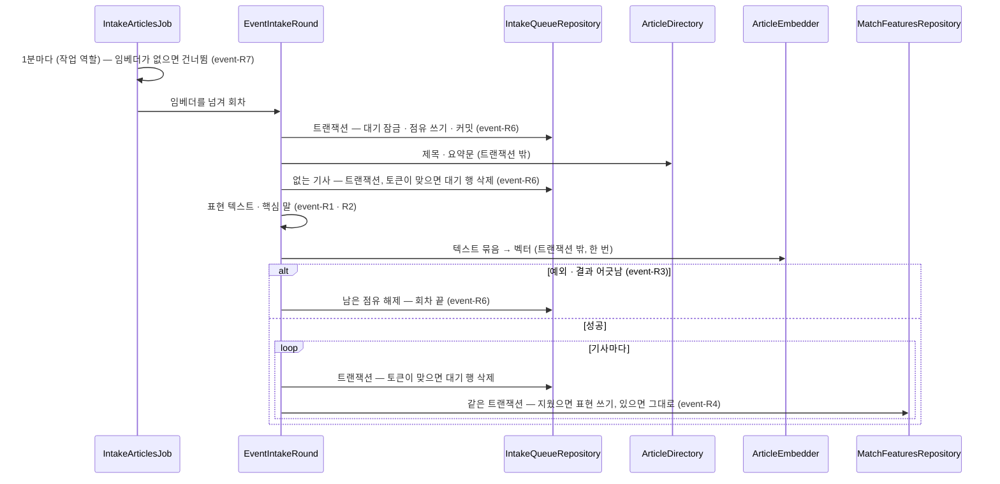

# event 모듈 Spec

공통 구조와 쓰는 규칙은 [specs/README.md](README.md)에 있다.

## 1. 책임과 범위

`event` 는 같은 사건을 다룬 기사를 사용자와 무관하게 공유 사건으로 묶는다. 비용은 운영자가 내고, 생성형 LLM 을 쓰지 않는다([ADR-0026](../adr/0026-event-clustering-with-local-embeddings-and-jev.md)).

- **사건 묶기 대기** — 새 기사를 대기에 넣고, 작업 역할의 반복 작업이 대기를 묶음으로 점유해 처리한다(event-R5 · R6 · R7, [ADR-0074](../adr/0074-article-features-built-by-event-intake-queue-job-and-skipped-without-an-embedder.md))
- **기사 표현** — 기사의 제목과 요약문 앞부분으로 텍스트 하나를 만들고, 그 텍스트의 임베딩(포트 `ArticleEmbedder`)과 핵심 말(Lucene Nori)을 임베딩 모델 버전과 함께 저장한다. 사건 배정의 입력이다(event-R1 ~ R4, [ADR-0075](../adr/0075-article-vectors-in-a-dimensionless-vector-column-one-row-per-model-version.md) · [ADR-0076](../adr/0076-key-terms-from-nori-without-decompounding-proper-common-and-foreign-nouns.md))
- **지운 기사 따르기** — `article` 이 기사를 지우면 그 기사의 대기 행과 표현을 지운다(event-R8)
- **(미구현)** **사건 배정** — 표현으로 시간 창 안의 열린 사건 가운데 후보를 고르고, 산식으로 판정하거나 애매한 구간을 `evaluation` 의 사건 소속 판정으로 판정해, 사건에 붙이거나 새 사건을 연다(event-R10 ~ R12)
- **(미구현)** **사건 정리** — 잘게 쪼개진 열린 사건을 합치고, 새 기사가 일정 기간 없는 사건을 닫는다(event-R13)
- **(미구현)** **대표 기사 · 큰 사건 · 사건 조회** — 사건의 대표 기사를 고르고, 큰 사건을 조회할 때 판정하고, 사건을 다른 모듈에 낸다(event-R14 · R15)

하지 않는 것:

- 사용자를 모른다. 후보 선별 · 이슈 연결은 `digest` · `storyline` 이 한다
- Jev 를 직접 부르지 않는다 — 사건 소속 판정은 `evaluation` 의 공개 API 를 부른다([ADR-0026](../adr/0026-event-clustering-with-local-embeddings-and-jev.md) · [ADR-0071](../adr/0071-event-membership-judged-from-article-ids-with-questions-built-in-evaluation.md))
- 기사 내용을 갖지 않는다. 제목 · 요약문은 `article` 의 공개 조회로 읽고, 표현 행에는 벡터와 핵심 말만 남긴다

시간 창 · 위 · 아래 기준 · 큰 사건 기준 · 닫는 기간 · 임베딩 모델은 운영하면서 정한다([open-questions.md](../open-questions.md)). 묶기 품질은 수집한 기사 표본에 사건 라벨을 붙인 평가 세트로 잰다 — 증거로서의 자격은 [테스트 전략](../qa/test-strategy.md) ⑪, 표본의 실제 기사 텍스트를 공개 저장소에 두지 않는 규칙은 [security.md](../security.md)에 있다.

다른 모듈과의 의존과 이벤트 흐름은 [overview.md §5](../overview.md#5-모듈-지도)에 있다.

## 2. 용어

사건 · 큰 사건은 [overview.md §8](../overview.md#8-용어)에 있다.

| 용어 | 뜻 |
|---|---|
| 기사 표현 | 사건 배정의 입력 — 기사 하나의 임베딩 벡터 · 핵심 말 · 임베딩 모델 버전(`article_match_features` 한 행). 기사 × 모델 버전마다 하나다(event-R4) |
| 표현 텍스트 | 제목과 요약문 앞부분으로 만든 텍스트 하나. 임베딩과 핵심 말이 같은 텍스트를 쓴다(event-R1) |
| 핵심 말 | 표현 텍스트에서 Nori 로 뽑은 고유명사 · 일반명사 · 외국어(event-R2). 고유명사 겹침 점수의 입력이다 |
| 임베더 | 텍스트를 벡터로 바꾸는 외부 의존 — 포트 `ArticleEmbedder`. 이름 · 모델 버전 · 차원을 밝힌다(event-R3) |
| 사건 묶기 대기 | 처리할 기사의 목록(`event_intake_queue` — 기사마다 한 행). 넣은 시각과 점유를 갖는다(event-R5) |
| 회차 | 반복 작업이 한 번 돌 때 대기를 점유해 표현을 만드는 일 하나(event-R6) |
| 점유 | 회차가 대기 행을 가져갔다는 표시 — 토큰 · 만료 시각. 만료되면 다른 회차가 다시 가져간다(event-R6) |

## 3. 공개 인터페이스

공개 타입(모듈 최상위 패키지의 타입)이 없다. 이 모듈은 `article` 의 이벤트를 받기만 하고 아무것도 내놓지 않는다.

- **(미설계)** 사건 조회 · 큰 사건 판정의 공개 API — `digest` · `report` · `admin` 이 쓴다(event-R14 · R15)

HTTP 엔드포인트는 없다.

## 4. 내부 구조

### 개관

| 패키지 | 책임 |
|---|---|
| (최상위) | 모듈 선언(`package-info`) — 공개 타입 없음 |
| `domain/feature` | 기사 표현 — 임베더 포트와 그 정보 · 벡터 값, 표현 텍스트 구성 · 핵심 말 추출 · 임베더 결과 확인의 정본, 표현 행과 그 저장소 |
| `domain/intake` | 사건 묶기 대기 — 대기 행과 그 점유, 대기 상수, 대기 저장소 |
| `application` | 기사 이벤트 리스너, 회차, 핵심 말 추출기의 결선 |
| `adapter/in/job` | 사건 묶기 대기 반복 작업(작업 역할) |
| `adapter/out/persistence` | 대기 · 표현 저장소의 JdbcClient 구현, 벡터의 pgvector 텍스트 표현 |
| `adapter/out/fake` | 임베더 포트의 로컬 대체물과 그 결선(`local` 에서만) |

협력: `EventIntakeListener` 가 `ArticleStored` 로 기사를 `IntakeQueueRepository` 에 넣고, `ArticlesRemoved` 로 대기 행과 표현 행(`MatchFeaturesRepository`)을 지운다. 작업 역할의 `IntakeArticlesJob` 이 1분마다 임베더를 찾아 있으면 `EventIntakeRound` 에 넘겨 돌린다. 회차는 `IntakeQueueRepository` 로 대기를 점유하고(`PendingArticle.claim` · `IntakeSchedule`), `article` 의 `ArticleDirectory` 로 제목 · 요약문을 읽어, 기사마다 `MatchText` 로 표현 텍스트를, `KeyTermExtractor` 로 핵심 말을 만든다. 포트 `ArticleEmbedder` 로 텍스트 묶음을 한 번에 벡터로 바꾸고 `EmbeddingCheck` 로 결과를 확인한 뒤, 기사마다 `IntakeQueueRepository.deleteIfLeased` 가 대기 행을 지웠을 때만 `MatchFeaturesRepository.insertIfAbsent` 로 표현을 쓴다. 임베더는 `local` 에서 `FakeArticleEmbedderConfiguration` 이 `FakeArticleEmbedder` 를 포트로 등록한다. `KeyTermExtractor` 는 `KeyTermConfiguration` 이 빈으로 둔다.

#### 회차 흐름



### 들어오는 쪽

| 진입점 | 구성 요소 | 계기 | 내용 |
|---|---|---|---|
| `ArticleStored` · `ArticlesRemoved` 리스너 | `EventIntakeListener`(`application`) | `article` 의 `ArticleStored` · `ArticlesRemoved` | 새 기사를 대기에 넣고(event-R5), 지운 기사의 대기 · 표현 행을 지운다(event-R8). 비동기 · 새 트랜잭션이고 이벤트 발행 레지스트리에 기록된다(Spring Modulith `@ApplicationModuleListener`). 실패한 발행은 `platform` 의 이벤트 재처리 작업이 다시 처리하고, 다시 처리해도 결과가 같다. 임베더 · Nori 를 쓰지 않는다 — 화면 역할에서 돌아도 된다 |
| 사건 묶기 대기 반복 작업 | `IntakeArticlesJob`(`adapter/in/job`, 작업 역할) | JobRunr 반복 작업 `event-intake` — 1분마다, 재시도 없음 | 임베더를 부를 때 찾아 `EventIntakeRound` 에 넘겨 돌린다. 없으면 건너뛴다 — 기동 때 경고 한 번(event-R7). 이전 실행이 대기 · 처리 중이면 그 회차는 건너뛴다 |
| **(미구현)** 사건 배정 | — | 표현을 쓴 뒤 | 후보 → 판정 → 배정 또는 새 사건(event-R10 ~ R12) |
| **(미구현)** 사건 병합 | — | 주기 | 가까운 열린 사건끼리 합친다(event-R13) |
| **(미구현)** 사건 닫기 | — | 하루 1회 | 새 기사가 일정 기간 없는 사건을 닫는다(event-R13) |

컨트롤러는 없다.

### `application`

- `EventIntakeListener` — 리스너(들어오는 쪽). 넣기는 시각을 `InstantSource` 에서 얻는다. 지우기는 한 트랜잭션에서 대기 행을 먼저, 표현 행을 나중에 지운다(event-R8). 이름은 `evaluation` 의 리스너와 다르다 — 빈 이름은 단순 클래스 이름이다
- `EventIntakeRound` — 회차 하나(event-R6 · R8). 임베더는 `run(ArticleEmbedder)` 의 인자로 받는다 — 작업 진입점이 넘긴다. 시각은 `InstantSource` 에서 얻는다. 점유와 쓰기는 `TransactionTemplate` 의 짧은 트랜잭션이고, 기사 조회와 임베더 호출은 트랜잭션 밖이다. 트랜잭션 · 역할 애너테이션이 없다(두 역할 공통). 로그: `사건 묶기 대기 기사가 지워져 대기에서 뺐다 — 기사 {ID}`(정보), `임베더가 실패해 회차를 멈췄다 — {이름} {모델 버전}, 기사 {n}건: {문구}`(오류)
- `KeyTermConfiguration` — `KeyTermExtractor` 를 빈으로 두고, 컨텍스트가 닫을 때 닫는다

### `domain`

#### `domain/feature`

- `MatchText` — 표현 텍스트 구성의 정본. 요약문 앞부분 길이 `SUMMARY_PREFIX_CODE_POINTS`(300 코드 포인트 — 측정 전 목표)(event-R1)
- `KeyTermExtractor` — 핵심 말 추출의 정본. 고르는 품사 `KEPT_TAGS`(`NNP` · `NNG` · `SL`). Lucene `Analyzer` 를 하나 갖고 여러 스레드에서 쓴다. 닫을 수 있다(event-R2)
- `EmbeddingCheck` — 임베더 결과가 요청 수 · 밝힌 차원과 맞는지의 판정(event-R3)
- `MatchFeatures` — 표현 한 행(기사 · 모델 버전 · 벡터 · 핵심 말 · 만든 시각)
- 저장 단위: aggregate 가 없다 — 표현 행은 만든 뒤 바꾸지 않고, 저장소 `MatchFeaturesRepository` 가 넣기와 지우기만 한다

  ```java
  public interface MatchFeaturesRepository {
      boolean insertIfAbsent(MatchFeatures features);                 // 없으면 쓴다 — (기사, 모델 버전)이 있으면 그대로. 썼으면 true
      void deleteByArticles(Collection<ArticleId> articleIds);       // 지운 기사 따르기 — 모든 모델 버전
  }
  ```

- 그 밖의 값: `EmbedderInfo` · `Embedding`(포트 — 나가는 쪽)

#### `domain/intake`

- `IntakeSchedule` — 점유 기간(`LEASE` 10분) · 회차의 점유 상한(`BATCH_SIZE` 64)의 정본. 값은 측정 전 목표다(event-R6)
- `PendingArticle` — 대기 행 하나와 그 전이 `claim`(event-R6)
- 저장 단위: aggregate 가 없다 — 대기 행의 전이는 `PendingArticle` 이 계산하고, 점유 토큰을 조건으로 한 SQL 갱신 · 삭제로 쓴다(평가 대기와 같은 모양 — [ADR-0059](../adr/0059-evaluation-job-limits-concurrency-and-retries-with-db-leases-on-queue-rows.md)). 저장소 `IntakeQueueRepository` 가 쓴다

  ```java
  public interface IntakeQueueRepository {
      void enqueue(ArticleId articleId, Instant now);                  // 없으면 넣기. 있으면 그대로
      List<PendingArticle> lockDue(Instant now, int limit);           // 점유가 없거나 만료(≤ now)된 행 — 넣은 시각, 기사 ID 순. 잡힌 행은 건너뛴다
      void saveLocked(PendingArticle next);                            // lockDue 로 잠근 행 갱신
      boolean deleteIfLeased(ArticleId articleId, UUID token);        // 토큰이 맞을 때만 삭제
      boolean releaseIfLeased(ArticleId articleId, UUID token);       // 토큰이 맞을 때만 점유 해제
      void delete(Collection<ArticleId> articleIds);                   // 지운 기사 따르기
  }
  ```

- 그 밖의 값: `IntakeLease`

### 나가는 쪽

#### `ArticleEmbedder`

`domain/feature` 의 포트 — 텍스트를 벡터로 바꾸는 외부 의존(임베딩 모델 · 외부 API)을 감춘다. 사용자 정보를 받지 않는다.

```java
public interface ArticleEmbedder {
    EmbedderInfo info();                          // 이름 · 모델 버전 · 차원 — 부를 때마다 같은 값
    List<Embedding> embed(List<String> texts);    // 텍스트마다 벡터 하나 — 같은 순서 · 같은 수, 차원은 info().dimensions()
}

public record EmbedderInfo(String name, String modelVersion, int dimensions) {}

public final class Embedding {
    public static Embedding of(float[] values);   // 값을 복사해 받는다
    public int dimensions();
    public float[] values();                      // 복사해 낸다
}
```

| 값 | 뜻 | 제약 |
|---|---|---|
| `EmbedderInfo.name` | 임베더 이름(로그용) | 비어 있지 않다 |
| `EmbedderInfo.modelVersion` | 모델을 가리키는 값 — 표현 행의 `model_version`. 다른 모델과 겹치지 않는다 | 비어 있지 않다 |
| `EmbedderInfo.dimensions` | 벡터 차원 | 1 이상 |
| `Embedding` | 벡터 하나. 같은 값이면 같다(`equals`) | 길이 1 이상, 값은 모두 유한한 `float` |

- 계약
  - `embed` 는 계산하지 못하면 `RuntimeException` 을 던진다. 실패 갈래는 정하지 않는다
  - **(미설계)** 운영 구현의 실패 갈래 · 재시도 · 건너뜀
  - 결과의 수 · 차원이 맞는지는 부르는 쪽이 `EmbeddingCheck` 로 확인한다(event-R3)
- v1 운영 구현: **(미구현)** — 로컬 모델(ONNX Runtime)이 기본이고 설정으로 외부 임베딩 API 로 바꿀 수 있다([ADR-0026](../adr/0026-event-clustering-with-local-embeddings-and-jev.md)). 운영 구현이 없는 동안 `local` 이 아닌 구성에는 임베더가 없다(event-R7)

#### 구현과 로컬 대체물

- `FakeArticleEmbedder`(`adapter/out/fake`) — 로컬 대체물. 문자 2-그램 특징 해싱(event-R9). 이름 `fake` · 모델 버전 `fake-char-bigram-256-1` · 차원 256. 같은 텍스트면 같은 벡터, 겹치는 2-그램이 많을수록 코사인이 크다 — 의미가 아니라 표면 겹침이라 운영 모델과 분포가 다르다. 사건 배정의 기준을 이 유사도로 정하지 않는다
- `FakeArticleEmbedderConfiguration`(`adapter/out/fake`) — 대체물의 결선. `@LocalDevelopment` — profile `local` 에서만 등록한다(platform-R18)

#### 저장소 구현

- `JdbcIntakeQueueRepository` — 넣기는 `INSERT … ON CONFLICT DO NOTHING`, 잠금은 `FOR UPDATE SKIP LOCKED`, 점유한 회차의 반영은 점유 토큰을 조건으로 한 갱신 · 삭제다
- `JdbcMatchFeaturesRepository` — 넣기는 `INSERT … ON CONFLICT (article_id, model_version) DO NOTHING`. 벡터는 `VectorText` 가 만든 pgvector 텍스트 표현(`[v1,v2,…]`)을 SQL 이 `vector` 로 바꾼다. 핵심 말은 `text[]`

#### 신뢰할 수 없는 입력

- 기사 제목 · 요약문은 피드 텍스트다 — `source` 가 길이를 제한해 저장하고(제목 · 요약문 상한 — [source Spec](source.md)), 이 모듈은 요약문을 앞 300 코드 포인트로 잘라 쓴다(event-R1). Nori 와 임베더에 넘기는 텍스트는 이 텍스트뿐이다
- 임베더 결과는 저장 전에 수 · 차원 · 유한한 값을 확인한다(event-R3)

## 5. 규칙과 불변식

### 기사 표현

판단의 이유는 [ADR-0026](../adr/0026-event-clustering-with-local-embeddings-and-jev.md) · [ADR-0075](../adr/0075-article-vectors-in-a-dimensionless-vector-column-one-row-per-model-version.md) · [ADR-0076](../adr/0076-key-terms-from-nori-without-decompounding-proper-common-and-foreign-nouns.md)에 있다.

- **event-R1** — 표현 텍스트: 제목에, 요약문이 있으면 줄바꿈 하나와 요약문 앞 300 코드 포인트(`MatchText.SUMMARY_PREFIX_CODE_POINTS` — 정본)를 잇는다. 요약문은 앞뒤 공백(`String.strip`)을 걷은 뒤 자르고, 코드 포인트 단위라 서로게이트 쌍을 가르지 않는다. 요약문이 없거나 공백뿐이면 제목만이다. 제목은 고치지 않고, 공백뿐인 제목은 거부한다. 임베딩과 핵심 말은 같은 텍스트를 쓴다
- **event-R2** — 핵심 말: 표현 텍스트를 Lucene Nori `KoreanTokenizer`(사용자 사전 없음 · 복합어를 나누지 않음(`DecompoundMode.NONE`) · 미등록어를 한 글자씩 나누지 않음 · 구두점 버림)로 나누고, 토큰의 왼쪽 품사가 고유명사(`NNP`) · 일반명사(`NNG`) · 외국어(`SL`)인 것을 고른다(`KeyTermExtractor.KEPT_TAGS` — 정본). 한 코드 포인트짜리 한글(`Character.UnicodeScript.HANGUL`) 일반명사는 버리고, 한 코드 포인트라도 고유명사 · 한자 · 영문은 남긴다. 외국어는 `Locale.ROOT` 소문자로 바꾼다. 처음 나온 순서이고 같은 말은 한 번이다. 뽑을 말이 없으면 빈 목록이고, 빈 목록도 유효한 표현이다
- **event-R3** — 임베딩: 회차는 임베더의 정보(이름 · 모델 버전 · 차원)를 한 번 읽고 표현 텍스트 묶음을 한 번에 넘긴다. 결과가 넘긴 수와 다르거나, 밝힌 차원과 다른 벡터가 있으면(`EmbeddingCheck` — 정본) 저장하지 않는다. 벡터 값은 유한해야 한다(`Embedding`)
- **event-R4** — 표현 행: 기사 × 임베딩 모델 버전마다 한 행이다. 모델 버전은 임베더가 밝힌 값이다. 이미 있으면 그대로다 — 먼저 쓴 것이 남고, 같은 기사를 다시 처리해도 결과가 같다. 모델이 바뀌면 같은 컬럼에 새 모델 버전의 행이 생긴다 — 벡터 컬럼은 차원을 정하지 않는다. 표현 텍스트 · 핵심 말 규칙의 변경은 모델 버전에 넣지 않는다 — 그 뒤 기사부터 새 규칙을 쓴다

### 사건 묶기 대기와 회차

판단의 이유는 [ADR-0074](../adr/0074-article-features-built-by-event-intake-queue-job-and-skipped-without-an-embedder.md) · [ADR-0060](../adr/0060-article-deletion-announced-by-removed-article-ids-and-followed-by-referencing-modules.md)에 있다.

- **event-R5** — 대기: 새 기사(`ArticleStored`)를 대기에 넣는다. 기사마다 한 행이고 이미 있으면 그대로다 — 같은 이벤트를 다시 처리해도 결과가 같다. 정착 시간이 없다 — 기사의 제목 · 요약문은 처음 저장한 값이 남는다(article-R8). 이 모듈이 생기기 전에 저장된 기사는 대기에 넣지 않는다 — 표현이 없다
- **event-R6** — 회차: 반복 작업(1분, 재시도 없음)의 회차는 점유가 없거나 만료된(만료 시각 ≤ 지금) 대기 행을 넣은 시각 · 기사 ID 순으로 64건(`IntakeSchedule.BATCH_SIZE`)까지 잠가(다른 트랜잭션이 잡은 행은 건너뛴다) 점유(토큰 · 만료 = 지금 + 10분, `IntakeSchedule.LEASE`)를 쓰고 커밋한다. 반복 작업은 이전 실행이 대기 · 처리 중이면 그 회차를 건너뛴다.
  - 기사의 제목 · 요약문을 트랜잭션 밖에서 한 번에 읽는다. 그새 지워진 기사는 토큰이 맞으면 대기 행을 지운다. 남은 기사가 없으면 임베더를 부르지 않는다
  - 임베더를 트랜잭션 밖에서 한 번 부른다. 예외를 던지거나 결과가 어긋나면(event-R3) 남은 점유를 토큰이 맞을 때 풀고 회차를 끝낸다 — 다음 회차가 다시 점유한다
  - 기사마다 짧은 트랜잭션에서, 토큰이 맞아 대기 행을 지웠을 때만 표현을 쓴다. 토큰이 맞지 않으면(점유가 만료돼 다른 회차가 가져갔거나 기사를 지웠다) 쓰지 않는다
  - 회차 도중 프로세스가 죽으면 점유가 만료된 뒤 다른 회차가 가져간다
  - **(미설계)** 임베더가 같은 묶음에서 계속 실패할 때의 처분 — 지금은 회차가 넣은 시각 순으로 점유하므로 그 묶음 뒤의 기사도 처리되지 않는다
- **event-R7** — 임베더가 없는 프로세스: 반복 작업은 임베더를 부를 때 찾고, 없으면 회차를 건너뛴다 — 기사는 대기에 남아 임베더가 생긴 뒤 처리된다. 작업 역할이 뜰 때 임베더가 없으면 경고 `임베더가 없어 사건 묶기 대기 기사를 처리하지 않는다 — 기사는 대기에 쌓인다` 를 한 번 남긴다. 리스너 · 회차는 임베더를 생성자로 받지 않는다 — 임베더 없는 화면 역할도 뜬다
- **event-R8** — 지운 기사 따르기: `ArticlesRemoved` 를 받으면 한 트랜잭션에서 그 기사들의 대기 행을 먼저, 표현 행(모든 모델 버전)을 나중에 지운다. 진행 중인 회차의 쓰기 트랜잭션이 대기 행을 잡고 있으면 그 커밋을 기다린 뒤 표현 행을 지워 커밋 직전의 표현을 놓치지 않는다. 지우기가 먼저 커밋되면 회차의 토큰 조건이 맞지 않아 표현을 쓰지 않는다(event-R6). 다시 처리해도 결과가 같다

### 로컬 대체물

- **event-R9** — 로컬 대체물(`FakeArticleEmbedder`)은 profile `local` 에서만 등록한다(platform-R18). 벡터 규칙: 텍스트를 공백(`Character.isWhitespace`)으로 나눈 낱말마다 코드 포인트 둘씩 겹쳐 이은 2-그램(낱말이 한 코드 포인트면 그 하나)을 `Locale.ROOT` 소문자로 바꾸고, `String.hashCode()` 를 256 으로 나눈 나머지(`Math.floorMod`) 칸을 1 늘린 뒤 L2 길이 1 로 나눈다. 2-그램이 하나도 없으면(공백뿐) 거부한다. 이름 · 모델 버전 · 차원은 `FakeArticleEmbedder.NAME` · `MODEL_VERSION` · `DIMENSIONS` 가 정본이다

### 사건 배정

판단의 이유는 [ADR-0026](../adr/0026-event-clustering-with-local-embeddings-and-jev.md) · [ADR-0027](../adr/0027-pgvector-for-vector-storage.md)에 있다.

- **event-R10** — **(미구현)** 후보: 시간 창 안의 열린 사건 중 가까운 사건 몇 개를 고른다. 점수는 사건 중심 벡터와의 코사인 유사도, 고유명사 겹침, 발행 시각 차이에 따른 감쇠로 계산한다. 비교는 인덱스 없는 정확 검색이라 같은 입력에서 같은 후보가 나온다. 기사 표현은 지금 임베더의 모델 버전 행만 읽는다(event-R4)
- **event-R11** — **(미구현)** 판정: 점수가 위 기준 이상이면 가장 가까운 사건에 붙이고, 아래 기준 미만이면 새 사건을 연다. 그 사이는 `evaluation` 의 사건 소속 판정(공개 API `EventMembership` — Jev 관문은 `ArticleEvaluator`)으로 Jev 에 묻는다. 후보 사건마다 사건 중심에 가까운 기사 몇 개를 서술로 넘기고(질문에는 그 제목이 실린다), 확률이 가장 높으면서 기준을 넘는 사건에 붙인다. 넘는 사건이 없으면 새 사건을 연다. Jev 호출은 DB 트랜잭션 밖에서 하고, 판정 원본은 `evaluation` 이 남긴다
- **event-R12** — **(미구현)** 배정: 사건에 붙이면 사건 중심 벡터 · 고유명사 · 마지막 기사 시각을 갱신한다. 배정은 사건 **중심**과의 거리로 한다 — 사건 안의 기사 하나와만 닮아도 붙이면 사건이 번진다. 같은 기사를 다시 처리해도 이미 있는 배정을 유지한다

### 사건 정리

- **event-R13** — **(미구현)** 주기적으로 중심이 가깝고 고유명사가 겹치는 열린 사건끼리 합친다. 합쳐진 사건의 기사는 남는 사건으로 옮기고, 합쳐진 사건은 남는 사건을 가리킨다. 새 기사가 일정 기간 없는 사건은 닫고, 닫힌 사건에는 새 기사를 붙이지 않는다. 몇 주에 걸친 전개는 이슈가 잇는다([pipeline.md §9](../pipeline.md#9-이슈))

### 대표 기사 · 큰 사건

- **event-R14** — **(미구현)** 대표 기사: 주어진 기사들 가운데 사건 중심에 가장 가까운 기사다. 후보 선별([pipeline.md §6](../pipeline.md#6-다이제스트-생성))에서는 그 사용자의 제외 조건(소스 · 지역 · 형식 · 싫어요)을 통과한 기사 가운데서 고르고, 운영자 화면은 사건의 기사 전체에서 고른다
- **event-R15** — **(미구현)** 큰 사건: 조회할 때 판정한다. 기간 안에서 사건을 다룬 서로 다른 소스 수와 기사들의 Jev 중요도가 운영자가 정한 기준을 넘는 사건이다

## 6. 데이터

컬럼 타입 · 인덱스 · 제약 문면의 정본은 `backend/src/main/resources/db/migration/V16__event_intake_and_match_features.sql`(사건 묶기 대기 · 기사 표현)이다. `article_id` 는 `article` 의 기사를 가리키지만 FK 를 두지 않는다 — 모듈 사이는 ID 로만 참조한다. 보존 기간은 [data-model.md "보존 정책"](../data-model.md#보존-정책-초안)에 있다.

| 테이블 | 주요 컬럼 | 뜻 |
|---|---|---|
| `event_intake_queue` | article_id(기본 키), enqueued_at, lease_token, lease_expires_at | 사건 묶기 대기 — 기사마다 한 행(event-R5). 점유 둘은 함께 있거나 함께 없다(제약). 회차의 잠금은 `(enqueued_at, article_id)` 인덱스로 찾는다(event-R6). 표현을 쓰면 지운다 |
| `article_match_features` | article_id, model_version, embedding(`vector`), entities(`text[]`), created_at | 기사 표현 — (article_id, model_version) 기본 키(event-R4). `embedding` 은 차원을 정하지 않은 `vector` 다 — 길이는 쓰기 전에 앱이 확인한다(event-R3). `entities` 는 핵심 말(event-R2) |
| **(미구현)** `events` | id, status(`OPEN`/`CLOSED`), centroid(`halfvec`), entities, model_version, first_article_at, last_article_at, merged_into, created_at, closed_at | 공유 사건. 장기 검색용 HNSW 인덱스는 `centroid` 에만 둔다. 합쳐진 사건은 `merged_into` 로 남는 사건을 가리킨다 |
| **(미구현)** `event_articles` | event_id, article_id(고유), score, decided_by(`FORMULA`/`EVALUATOR`), assigned_at | 기사당 한 사건. 사건이 합쳐지면 남는 사건으로 옮긴다 |

## 7. 설정

| 설정 | 바꾸는 규칙 |
|---|---|
| profile `local` | 로컬 대체물 `FakeArticleEmbedder` 를 `ArticleEmbedder` 로 등록한다(event-R9 · platform-R18). 그 밖의 profile 에서는 대체물이 등록되지 않는다. 로컬 대체물을 켜는 설정 키는 없다([ADR-0057](../adr/0057-local-substitutes-registered-only-in-local-profile-without-operator-switch.md)) |

그 밖의 설정 키는 없다.

## 8. 결정

| ADR | 한 줄 |
|---|---|
| [0013](../adr/0013-architecture-patterns.md) | 아키텍처 패턴: 모듈러 모놀리스 + 실용적 헥사고날 |
| [0026](../adr/0026-event-clustering-with-local-embeddings-and-jev.md) | 사건 묶기는 로컬 임베딩과 고유명사 산식으로 하고, 애매한 구간만 Jev 로 판정한다 |
| [0027](../adr/0027-pgvector-for-vector-storage.md) | 벡터 저장은 PostgreSQL pgvector 확장으로 한다 |
| [0042](../adr/0042-app-roles-as-web-worker-profiles-marked-by-platform-annotations.md) | 앱 역할은 Spring profile `web` · `worker` 로 나누고, 소속은 `platform` 역할 애너테이션으로 표시하며, 역할이 없으면 기동하지 않는다 |
| [0057](../adr/0057-local-substitutes-registered-only-in-local-profile-without-operator-switch.md) | 로컬 대체물은 `local` profile 에서만 등록하고, 운영 설정으로 켜는 스위치를 두지 않는다 |
| [0060](../adr/0060-article-deletion-announced-by-removed-article-ids-and-followed-by-referencing-modules.md) | 기사 삭제는 지운 기사 ID 이벤트로 알리고, 기사를 가리키는 모듈이 받아 자기 행을 지운다 |
| [0074](../adr/0074-article-features-built-by-event-intake-queue-job-and-skipped-without-an-embedder.md) | 사건 묶기의 기사 표현은 `event` 대기와 작업 역할의 반복 작업이 만들고, 임베더가 없으면 건너뛰어 대기에 쌓는다 |
| [0075](../adr/0075-article-vectors-in-a-dimensionless-vector-column-one-row-per-model-version.md) | 기사 벡터는 차원 없는 `vector` 컬럼에 기사 × 모델 버전마다 한 행으로 두고, 모델 교체는 새 행으로 한다 |
| [0076](../adr/0076-key-terms-from-nori-without-decompounding-proper-common-and-foreign-nouns.md) | 기사의 핵심 말은 Nori 를 분해 없이 돌려 고유명사 · 일반명사 · 외국어를 고르고 한 글자 한글 일반명사를 버린다 |
