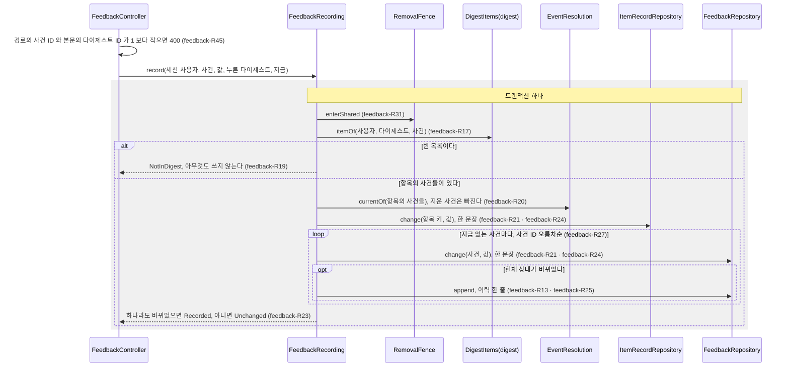
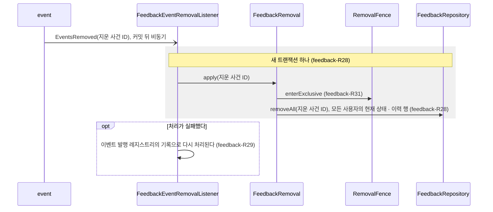
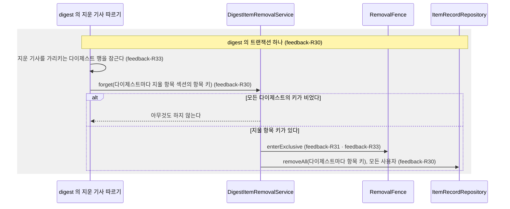

# feedback 모듈 Spec

공통 구조와 쓰는 규칙은 [specs/README.md](README.md)에 있다.

## 1. 책임과 범위

`feedback` 은 사용자가 다이제스트 항목에 누르는 좋아요 / 싫어요 / 없음을 받아, 그 항목에 누른 값과 그 항목의 사건마다의 값을 기록한다. 관심 신호 가운데 사건에 대한 반응이다([overview.md §6](../overview.md#6-횡단-규약) "신호 이력").

- **항목 기록** — (사용자, 다이제스트, 항목 키)마다 그 항목에 누른 값 하나. 화면이 보이는 값이고 이력이 없다
- **사건마다의 현재 상태와 이력** — (사용자, 사건)마다 지금 값 하나(현재 상태)와, 값이 바뀔 때마다 한 줄씩 더하는 이력. 관심 신호이고 이력이 정본이다. 어느 다이제스트에서 눌렀는지를 함께 남긴다. 사건은 누른 때의 ID 로 남고 고쳐 쓰지 않는다
- **받을 수 있는 항목** — 그 사용자의 다이제스트에서 요청의 사건이 든 항목에만 받는다. 항목의 사건들은 이 모듈이 선언한 공급 인터페이스 `DigestItems` 로 묻고 `digest` 가 답한다
- **지운 사건 · 지운 항목 따르기** — `event` 가 지운 사건의 현재 상태 · 이력 행을 지우고, `digest` 가 지운 항목 섹션의 항목 기록을 지운다
- **화면용 API** — 항목의 누르기 · 되돌리기와, 화면이 쓸 항목 기록 조회
- **소비자 조회** — 다이제스트 후보 선별 · 관심도 · 관심사 히스토리와 `user` 의 사용자 스토리라인 맞추기가 읽는 싫어요 사건과 기간의 이력(`EventFeedback`). 합쳐진 사건은 읽을 때 `event` 로 푼다
- **(미구현)** 탈퇴한 사용자의 항목 기록 · 현재 상태 · 이력 지우기

하지 않는 것:

- 관심도를 계산하지 않는다. 산식은 노출 기록을 가진 `digest` 의 것이다([digest Spec "관심도"](digest.md#관심도))
- 다이제스트의 내용 · 항목 구성을 읽지 않는다. 다이제스트는 ID 로만 가리키고, 항목의 사건은 `digest` 가 답한다
- 사건을 합치거나 지우지 않는다. 합쳐진 사건과 지운 사건은 `event` 의 공개 조회 · 이벤트로 안다
- 요청 제한을 세지 않는다. 처리기에 표시를 달 뿐이고, 세기와 한도는 `account` 의 것이다([account Spec](account.md#요청-방어) account-R30 · R32)
- 사용자를 인증하지 않는다. 세션 · 키 관문은 `account` 의 보안 구성이 한다([account Spec](account.md#화면용-api-의-공개와-세션-사용자) account-R5 · R6)

다른 모듈과의 의존과 주고받는 이벤트는 [overview.md §5](../overview.md#5-모듈-지도)에 있다.

## 2. 용어

| 용어 | 뜻 |
|---|---|
| 값 | 항목에 누르는 좋아요(`LIKE`) · 싫어요(`DISLIKE`) · 없음(`NONE`) |
| 항목 키 | 항목을 가리키는 사건. 그 항목의 첫 사건(섹션 사건 위치 0)이다. 항목은 (다이제스트, 항목 키)로 가리킨다 |
| 항목 기록 | (사용자, 다이제스트, 항목 키)에 누른 지금 값. 화면이 보이는 값이고, 꼴은 feedback-R11 이다 |
| 현재 상태 | (사용자, 사건)의 지금 값. 이력의 투영이고, 꼴은 feedback-R12 다 |
| 이력 | 사건마다 값이 바뀔 때 더하는 기록. 꼴은 feedback-R13 이다 |
| 누르기 · 되돌리기 | 항목의 값을 좋아요 · 싫어요로 바꾸는 요청과 없음으로 바꾸는 요청. 같은 처리기의 같은 요청이다 |
| 누른 다이제스트 | 그 값을 누른 화면의 다이제스트. 요청이 싣고 현재 상태와 이력에 남는다(feedback-R14) |
| 기록한 사건 | 누른 때의 사건 ID. 읽을 때 지금 사건으로 푼다(feedback-R38) |
| 마지막으로 누른 값 | 한 지금 사건으로 풀리는 기록한 사건들의 값으로 고르는 값. 고르는 법은 feedback-R39 다 |
| 울타리 | 기록과 삭제(지운 사건 · 지운 항목 따르기)가 서로를 지나치지 않게 하는 이 모듈의 advisory 잠금 하나. 잡는 법은 feedback-R31 이다 |

항목은 `digest` 가 소유한 말이고 [digest Spec §2](digest.md#2-용어)에 있다. 지금 사건은 `event` 가 소유한 말이고 [event Spec §2](event.md#2-용어)에 있다.

## 3. 공개 인터페이스

모듈 최상위 패키지 `net.yozmnews.feedback` 의 공개 타입은 다섯이다 — 값 `FeedbackValue`, 소비자 조회 `EventFeedback` 과 그 값 `FeedbackChange`, 다른 모듈이 구현하는 공급 인터페이스 `DigestItems`, 지운 항목의 항목 기록 지우기 `DigestItemRemoval`. 받는 이벤트는 `event` 의 `EventsRemoved` 다(§4 들어오는 쪽).

HTTP 엔드포인트:

| 경로 | 메서드 | 용도 |
|---|---|---|
| `/api/feedback/{eventId}` | `PUT` | 누르기 · 되돌리기(feedback-R2 ~ R4) |
| `/api/feedback` | `GET` | 질의 `digestId` 의 다이제스트에서 세션 사용자의 항목 기록(feedback-R7) |

- 두 경로 모두 세션이 필요하고 사용자 격리 시험에 등록돼 있다([account Spec](account.md#화면용-api-의-공개와-세션-사용자) account-R6)
- 두 경로 모두 키 관문 뒤다. 키 없이 여는 표시가 없다(feedback-R43, account-R5)
- `PUT` 의 경로는 항목의 사건 하나이고, 본문은 값과 누른 다이제스트다. 항목의 사건 ID 는 독자 화면의 다이제스트 응답이 섹션마다 싣는다([reader Spec](reader.md#다이제스트) reader-R9)
- `PUT` 에는 요청 제한이 걸려 한도를 넘으면 처리기 앞에서 429 다(feedback-R44)
- 판정 결과는 200 이다(feedback-R46). 요청 · 응답 형식은 `api/openapi.json` 에 있다

### FeedbackValue

다이제스트 항목에 누르고 그 항목의 사건마다 기록하는 값.

```java
public enum FeedbackValue { LIKE, DISLIKE, NONE }
```

| 값 | 뜻 |
|---|---|
| `LIKE` | 좋아요 |
| `DISLIKE` | 싫어요 |
| `NONE` | 없음. 항목 기록 · 현재 상태에는 행이 없고 이력과 요청에만 있다(feedback-R10) |

관련 규칙: feedback-R1

### EventFeedback · FeedbackChange

좋아요 / 싫어요의 소비자 조회. 사건마다의 기록을 다이제스트 후보 선별 · 관심도 · 관심사 히스토리가 읽고, 기간의 이력은 `user` 의 사용자 스토리라인 맞추기도 읽는다([user-R66](user.md#사용자-스토리라인)). 구현은 `application` 의 `EventFeedbackService` 다.

```java
public interface EventFeedback {
    int MAX_EVENTS = 1000;                                    // 한 번에 묻는 서로 다른 사건 수의 상한의 정본(측정 전)
    Set<EventId> dislikedAmong(UserId user, Collection<EventId> events);
    List<FeedbackChange> changes(UserId user, Instant from, Instant to);
}

public record FeedbackChange(EventId recorded, @Nullable EventId current, FeedbackValue value, long digestId,
        Instant occurredAt) { }
```

| 멤버 | 뜻 |
|---|---|
| `dislikedAmong` | 주어진 (지금) 사건 가운데 그 사용자의 값이 싫어요인 사건(feedback-R40) |
| `changes` | 그 사용자의 이력 행 가운데 시각이 `from` 이상 · `to` 미만인 것(feedback-R41) |

| `FeedbackChange` 의 필드 | 뜻 | 제약 |
|---|---|---|
| `recorded` | 값을 기록한 사건. 누른 때의 사건 ID 다 | — |
| `current` | 지금 사건. 합쳐졌으면 남는 사건이고, 그대로면 `recorded` 와 같다 | 지운 사건이면 null |
| `value` | 바뀐 뒤의 값 | 없음으로 되돌린 행은 `NONE` |
| `digestId` | 누른 다이제스트의 ID | 1 이상. `digest` 의 다이제스트 ID 다 |
| `occurredAt` | 요청을 받은 시각 | 마이크로초까지 |

- 계약
  - 사용자를 인자로 받는 조회다. 사용자는 부르는 쪽이 넘긴 `UserId` 이고, 화면 경로에서는 세션 사용자로만 부른다([ADR-0228](../adr/0228-consumer-queries-scoped-by-a-user-argument-may-be-called-on-screen-paths-with-the-session-user.md))
  - `dislikedAmong` 은 같은 사건이 두 번 와도 한 번 답한다. 빈 입력이면 빈 집합이다. 서로 다른 사건이 `MAX_EVENTS` 개를 넘으면 `IllegalArgumentException` 이다
  - `changes` 는 `from` 이 `to` 보다 늦으면 `IllegalArgumentException` 이다
  - 읽기 전용 트랜잭션 하나이고 쓰지 않는다(feedback-R38)
  - 역할 애너테이션이 없다(두 역할 공통)
  - 기간을 사용자 시간대의 날로 자르는 일과 주제로 모으는 일은 부르는 쪽이 한다. 행을 고르고 지금 사건으로 묶는 일도 부르는 쪽이 한다(feedback-R41)
  - `changes` 의 순서는 기록한 순서(행 ID 순)다. 같은 (사용자, 기록한 사건)의 마지막 행의 값은 그 사건의 현재 상태와 같고(feedback-R25), 시각 순으로 다시 정렬하면 이 성질이 깨질 수 있다(feedback-R26)
  - 지운 사건의 행은 없다(feedback-R28)

`EventId` 는 `event` 의 공개 타입이고 `UserId` 는 `platform` 의 공개 타입이다([platform Spec](platform.md#userid)).

관련 규칙: feedback-R8

### DigestItems

다이제스트의 항목 확인. 이 모듈이 선언하고 `digest` 가 구현한다([digest Spec](digest.md#항목-확인) digest-R14). 기록이 받을 수 있는 항목을 판정할 때 부른다.

```java
public interface DigestItems {
    List<EventId> itemOf(UserId user, long digestId, EventId event);
}
```

| 멤버 | 뜻 |
|---|---|
| `itemOf` | `digestId` 가 그 사용자의 다이제스트이고 그 사건이 든 항목(주요 뉴스 · 헤드라인 섹션)이 하나면 그 항목의 사건들. 위치 순이고 첫 사건이 항목 키다 |

- 계약
  - `itemOf` 는 아래 경우에 빈 목록을 낸다
    - 없는 다이제스트
    - 다른 사용자의 다이제스트
    - 그 다이제스트가 보이지 않은 사건
    - 그 사건이 든 항목이 둘 이상
  - 구현은 앱에 하나이고 `digest` 가 낸다. 이 모듈은 `digest` 의 타입을 쓰지 않고 다이제스트를 `long` ID 로만 든다
  - 그 다이제스트가 날짜별로 보이는 다이제스트([digest Spec](digest.md#받은-소식) digest-R13)인지는 보지 않는다(feedback-R18)
  - 부르는 쪽의 트랜잭션에 들고 쓰지 않는다

관련 규칙: feedback-R2

### DigestItemRemoval

지운 항목의 항목 기록 지우기. `digest` 가 지운 기사를 따라 항목 섹션을 지우는 트랜잭션 안에서 부른다([digest Spec](digest.md#지운-기사-따르기) digest-R10). 구현은 `application` 의 `DigestItemRemovalService` 다.

```java
public interface DigestItemRemoval {
    void forget(Map<Long, ? extends Collection<EventId>> itemKeysByDigest);
}
```

| 멤버 | 뜻 |
|---|---|
| `forget` | 다이제스트 ID 마다 주어진 항목 키의 항목 기록을 모든 사용자에 대해 지운다(feedback-R30) |

- 계약
  - 빈 입력(모든 다이제스트의 키가 빈 것 포함)이면 아무것도 하지 않는다
  - 다시 불러도 결과가 같다
  - 부르는 쪽의 트랜잭션에 들어 울타리를 배타로 잡는다(feedback-R31)
  - 부르는 쪽은 다이제스트 행을 잠근 뒤 부른다. 기록과의 사이에 교착이 없는 것은 feedback-R33 이다
  - 사건마다의 현재 상태 · 이력은 건드리지 않는다(feedback-R30)
  - 역할 애너테이션이 없다(두 역할 공통)

관련 규칙: feedback-R5 · R6

## 4. 내부 구조

### 개관

| 패키지 | 책임 |
|---|---|
| (최상위) | §3 의 공개 타입 |
| `domain/record` | 받을 수 있는 항목의 판정, 풀린 사건의 값 고르기, 저장소와 울타리. 값 타입 `LastChange` · `HistoryRow` |
| `application` | 유스케이스, 공개 API 의 구현, 기록한 사건 풀기, 이벤트 리스너. 결과 타입 `RecordOutcome` |
| `adapter/in/web` | 처리기와 요청 · 응답 타입 |
| `adapter/out/persistence` | 저장소 · 울타리의 JdbcClient 구현 |

저장은 JdbcClient 로 한다([ADR-0014](../adr/0014-spring-data-jdbc.md)). 항목 기록 · 현재 상태 행은 값 하나이고, 쓰기는 조건 있는 한 문장이다(feedback-R24).

협력은 과정마다 아래와 같다. 그림이 있는 과정의 호출 순서는 그림에 있다.

- **누르기 · 되돌리기** — `FeedbackRecording` 이 한 트랜잭션에서 울타리를 공유로 잡고, `DigestItems` 로 찾은 항목을 판정한 뒤 항목 기록과 항목의 지금 있는 사건마다의 현재 상태 · 이력을 쓴다(feedback-R2 ~ R4, 그림 "누르기 · 되돌리기")
- **항목 기록 조회** — `FeedbackStates` 가 세션 사용자의 항목 기록을 읽기만 한다(feedback-R7)
- **소비자 조회** — `EventFeedbackService` 가 이력을 읽고 `EventResolution` 으로 합쳐진 사건을 푼다. 풀린 사건들의 값은 `MergedValue` 가 고른다(feedback-R8)
- **지운 사건 따르기** — `EventsRemoved` 를 받은 `FeedbackEventRemovalListener` 가 `FeedbackRemoval` 을 부르고, `FeedbackRemoval` 은 한 트랜잭션에서 울타리를 배타로 잡고 그 사건들의 현재 상태 · 이력 행을 지운다(feedback-R5 · R6, 그림 "지운 사건 따르기")
- **지운 항목의 항목 기록 지우기** — `digest` 의 지운 기사 따르기가 다이제스트 행을 잠근 트랜잭션에서 `DigestItemRemoval.forget` 을 부르면, `DigestItemRemovalService` 가 울타리를 배타로 잡고 항목 기록을 지운다(feedback-R5 · R6, 그림 "지운 항목의 항목 기록 지우기")

그림 "누르기 · 되돌리기":



그림 "지운 사건 따르기":



그림 "지운 항목의 항목 기록 지우기":



### 들어오는 쪽

- 컨트롤러 — `FeedbackController`(화면 역할 `@WebRole`)
  - 계기: `PUT /api/feedback/{eventId}` 는 `FeedbackRecording` 을, `GET /api/feedback?digestId=` 는 `FeedbackStates` 를 부른다(feedback-R2 ~ R4 · R7)
  - 사용자는 세션에서 채운 인자로만 받는다(feedback-R42). 요청 제한과 꼴 검증은 feedback-R44 · R45 다
  - 겹침 방지: 같은 행의 기록은 그 행의 잠금에서 차례로 선다(feedback-R24)
- 이벤트 리스너 — `FeedbackEventRemovalListener`
  - 계기: `event` 의 `EventsRemoved` 다. 비동기 · 새 트랜잭션이고 이벤트 발행 레지스트리에 기록된다(Spring Modulith `@ApplicationModuleListener`)
  - 멱등성: 다시 처리해도 결과가 같고, 지운 사건 ID 의 순서에 기대지 않는다(feedback-R29)
  - 실패 처리: 레지스트리의 기록으로 다시 처리된다
- 다른 모듈이 부르는 공개 API — `DigestItemRemovalService`
  - 계기: `digest` 의 지운 기사 따르기가 `DigestItemRemoval.forget` 을 부른다. 부르는 쪽의 트랜잭션 안이다(feedback-R30)
  - 멱등성: 다시 불러도 결과가 같다(§3 `DigestItemRemoval`)
- 반복 작업 · 기동 시 동작은 없다

### `application`

- `FeedbackRecording` — 누르기 · 되돌리기(feedback-R2 ~ R4). 트랜잭션 하나이고 울타리를 공유로 잡는다(feedback-R31)
- `FeedbackStates` — 화면의 항목 기록 조회. 읽기 전용 트랜잭션이다(feedback-R7)
- `EventFeedbackService` — 공개 조회 `EventFeedback` 의 구현. 읽기 전용 트랜잭션이다(feedback-R8)
- `EventResolution` — 기록한 사건 풀기의 정본(feedback-R38). 기록한 사건을 지금 사건으로, 지금 사건을 그 사건으로 풀리는 기록한 사건들로 푼다. `event` 의 `EventDirectory.currentOf` · `absorbedInto` 를 `EventDirectory.MAX_RESOLVE_EVENTS` 씩 나눠 부른다
- `FeedbackRemoval` — 지운 사건 따르기. 트랜잭션 하나이고 울타리를 배타로 잡는다(feedback-R28 · R31)
- `FeedbackEventRemovalListener` — `EventsRemoved` 를 받아 `FeedbackRemoval` 을 부른다
- `DigestItemRemovalService` — 공개 API `DigestItemRemoval` 의 구현. 부르는 쪽의 트랜잭션에서 울타리를 배타로 잡는다(feedback-R30 · R31)

### `domain`

- `FeedbackAcceptance` — 받을 수 있는 항목의 판정의 정본(feedback-R17)
- `MergedValue` — 풀린 사건의 값 고르기의 정본(feedback-R39). 지금 사건이 없는 행은 버린다
- `FeedbackRepository` — 사건마다의 현재 상태와 이력의 저장소. 현재 상태 쓰기는 값이 바뀌었는지를 돌려준다(feedback-R22 · R24)
- `ItemRecordRepository` — 항목 기록의 저장소. 쓰기는 값이 바뀌었는지를 돌려준다(feedback-R22 · R24)
- `RemovalFence` — 울타리. 트랜잭션 안에서 공유나 배타로 잡고, 트랜잭션이 끝나면 풀린다(feedback-R31)

aggregate 는 없다. 항목 기록 · 현재 상태는 행마다 값 하나이고, 전이는 값이 다르면 바꾸는 것 하나다(feedback-R22).

### 나가는 쪽

포트는 없다. 외부 의존성이 없다.

- 저장소 구현은 `JdbcFeedbackRepository` · `JdbcItemRecordRepository` 다. 현재 상태와 항목 기록의 쓰기는 각각 한 문장이다(feedback-R24)
- 울타리 구현 `JdbcRemovalFence` 는 이 모듈의 이름공간 하나를 쓰는 트랜잭션 advisory 잠금이다
- 다른 모듈의 공개 조회는 `event` 의 `EventDirectory.currentOf` · `absorbedInto`([event Spec](event.md#eventdirectory))이고, `EventResolution` 만 부른다

신뢰할 수 없는 입력과 그 방어 규칙:

| 입력 | 규칙 |
|---|---|
| 경로의 사건 ID · 본문의 다이제스트 ID · 값 | 꼴 검증 feedback-R45, 받을 수 있는 항목 feedback-R17 |
| 질의의 `digestId` | 꼴 검증 feedback-R45, 세션 사용자의 항목 기록만 읽기 feedback-R37 |

## 5. 규칙과 불변식

### 값과 기록

판단의 이유는 [ADR-0265](../adr/0265-feedback-is-pressed-once-per-digest-item-and-recorded-on-each-event-of-the-item-the-screen-shows-the-item-value-and-signals-use-event-records.md) · [ADR-0266](../adr/0266-feedback-is-recorded-under-the-original-event-id-and-feedback-resolves-merged-events-through-event-when-reading-with-the-last-pressed-value-winning.md) · [ADR-0028](../adr/0028-explicit-signals-and-interest-weighted-candidates.md)에 있다.

- **feedback-R1** — 값과, 그 값을 남기는 기록 둘(항목 기록, 사건마다의 현재 상태와 이력)의 꼴을 덮는다. 하위: feedback-R10 ~ R16
- **feedback-R2** — 누르기 · 되돌리기를 받을 수 있는 항목을 덮는다. 하위: feedback-R17 ~ R20
- **feedback-R3** — 누르기 한 번이 바꾸는 것과 그 결과를 덮는다. 하위: feedback-R21 ~ R23
- **feedback-R4** — 같은 행의 기록이 차례를 서는 것과 누르기 한 번의 잠금 순서를 덮는다. 하위: feedback-R24 ~ R27
- **feedback-R10** — 값은 좋아요 · 싫어요 · 없음이다. 없음은 이력과 요청에만 있고, 항목 기록 · 현재 상태에서는 행이 없는 것이다
- **feedback-R11** — 항목 기록은 (사용자, 다이제스트, 항목 키)마다 많아야 한 행이고 값은 좋아요나 싫어요다. 없음이면 행이 없다. 이력이 없고, 화면이 보이는 값이다
- **feedback-R12** — 사건마다의 현재 상태는 (사용자, 사건)마다 많아야 한 행이고 값은 좋아요나 싫어요다. 없음이면 행이 없다
- **feedback-R13** — 이력은 사건마다 값이 바뀔 때 한 줄이고, 없음으로 되돌린 것도 한 줄이다. 관심 신호의 정본은 이력이고 현재 상태는 그 투영이다
- **feedback-R14** — 현재 상태와 이력 행은 누른 다이제스트를 갖는다. 없음 행의 누른 다이제스트는 되돌리기를 누른 다이제스트다
- **feedback-R15** — 사건은 누른 때의 ID(기록한 사건)로 남는다. 사건이 합쳐져도, 재판정으로 기사가 옮겨 가도 고쳐 쓰지 않는다. 읽을 때 푸는 일은 feedback-R38 이다
- **feedback-R16** — 이력은 고쳐 쓰지 않는다. 지우는 것은 지운 사건을 따를 때뿐이다(feedback-R28)
- **feedback-R17** — 받을 수 있는 항목은 요청의 다이제스트가 그 사용자의 것이고, 그 다이제스트에서 요청의 사건이 든 항목이 하나 있는 것이다(`DigestItems.itemOf` 가 빈 목록이 아니다). 누르기와 되돌리기 모두 같은 확인을 지난다
- **feedback-R18** — 그 다이제스트가 날짜별로 보이는 다이제스트인지는 묻지 않는다. 화면을 열어 둔 사이 같은 날짜가 다시 만들어져도 열어 둔 화면에서 누른 것을 받는다
- **feedback-R19** — 받을 수 없으면 아무것도 쓰지 않고 결과는 `NotInDigest` 다
- **feedback-R20** — 항목의 사건 가운데 지금 없는(지운) 사건이 있어도 받는다. 항목 기록은 쓰고, 지운 사건의 사건 기록은 쓰지 않는다(feedback-R31). 합쳐진 사건은 지금 있는 사건이고 기록한 사건 ID 로 쓴다
- **feedback-R21** — 누르기 한 번은 항목 기록을 그 값으로 두고, 그 항목의 지금 있는 사건 모두를 그 값으로 둔다. 없음(되돌리기)이면 항목 기록을 지우고 그 사건들을 모두 없음으로 둔다. 다른 항목에서 그 사건에 남긴 값도 바뀐다
- **feedback-R22** — 값이 바뀌지 않는 기록은 쓰지 않는다. 항목 기록과 사건마다의 기록에 모두 적용한다.
  - 좋아요인 사건에 좋아요, 현재 상태가 없는 사건에 없음이 그런 기록이다
  - 이력을 더하지 않고, 현재 상태의 누른 다이제스트와 시각도 그대로다. 다른 다이제스트에서 같은 값을 다시 눌러도 처음 누른 다이제스트가 남는다
  - 그래서 이미 같은 값인 사건에는 이력 행이 생기지 않는다. 마지막으로 누른 값(feedback-R39)은 값이 바뀐 누르기 기준이다
- **feedback-R23** — 항목 기록이나 사건 하나라도 바뀌었으면 결과는 `Recorded`, 아무것도 바뀌지 않았으면 `Unchanged` 다
- **feedback-R24** — 같은 행의 기록은 차례로 선다. 항목 기록과 현재 상태의 쓰기는 각각 한 문장이다(넣기, 값이 다를 때만 고치기, 없음은 지우기). 그 행의 잠금에서 뒤 요청이 앞 요청의 커밋을 기다린 뒤 판정한다
- **feedback-R25** — 사건마다 현재 상태 행의 잠금을 쥔 뒤에 이력 행을 더한다. 그래서 같은 값의 동시 요청 둘은 그 사건에 이력 한 줄을 남기고, (사용자, 기록한 사건)의 이력에서 마지막 행(ID 가 가장 큰 것)의 값은 현재 상태와 같다. 마지막 행이 없음이면 현재 상태가 없다
- **feedback-R26** — 이력의 순서의 정본은 행 ID 다. 이력의 시각은 요청을 받은 때라, 잠금을 기다린 요청끼리는 시각이 행 순서와 어긋날 수 있다
- **feedback-R27** — 누르기 한 번의 잠금 순서는 항목 기록 행 → 사건 행(사건 ID 오름차순)이다. 같은 사건을 서로 다른 순서로 담은 두 항목을 동시에 눌러도 교착하지 않는다

### 지운 사건 · 지운 항목 따르기

판단의 이유는 [ADR-0267](../adr/0267-removed-events-are-announced-by-event-and-feedback-deletes-their-feedback-with-recording-and-removal-ordered-by-a-fence.md) · [ADR-0060](../adr/0060-article-deletion-announced-by-removed-article-ids-and-followed-by-referencing-modules.md)에 있다.

- **feedback-R5** — 지운 사건 · 지운 항목을 가리키는 행을 따라 지우는 것을 덮는다. 하위: feedback-R28 ~ R30
- **feedback-R6** — 기록과 삭제가 울타리로 차례를 서는 것과 그 잠금 순서를 덮는다. 하위: feedback-R31 ~ R33
- **feedback-R28** — `EventsRemoved` 를 받으면 한 트랜잭션에서 그 사건들의 현재 상태 행과 이력 행을 모든 사용자에 대해 지운다. 그 사건들은 비어서 지운 사건과 그 사건에 합쳐져 함께 지운 사건이다([event Spec](event.md#사건-변화-알림--잇기의-재료) event-R25).
  - 항목 기록과 다른 사건의 행은 건드리지 않는다
  - 재판정으로 원래 사건이 비어 지워져도 같다. 반응은 기사가 옮겨 간 사건을 따라가지 않는다
- **feedback-R29** — 지운 사건 따르기는 다시 처리해도 결과가 같고, 지운 사건 ID 의 순서에 기대지 않는다
- **feedback-R30** — `DigestItemRemoval.forget` 이 불리면 부르는 쪽의 트랜잭션에서 다이제스트마다 주어진 항목 키의 항목 기록을 모든 사용자에 대해 지운다. 사건마다의 현재 상태 · 이력은 건드리지 않는다.
  - `digest` 는 인용이 모두 지운 기사인 항목 섹션을 지울 때 그 섹션의 위치 0 사건으로 부른다([digest Spec](digest.md#지운-기사-따르기) digest-R10)
- **feedback-R31** — 기록은 울타리를 공유로 잡은 뒤에 항목과 지금 있는 사건을 확인한다. 삭제(지운 사건 · 지운 항목)는 울타리를 배타로 잡고 지운다. 울타리는 트랜잭션이 끝날 때 놓는다
- **feedback-R32** — 삭제가 지나간 뒤에는 지운 사건을 가리키는 현재 상태 · 이력 행과 지운 항목을 가리키는 항목 기록이 남지 않는다.
  - 삭제가 울타리를 얻은 뒤에 시작한 기록은 사건 삭제 · 섹션 삭제가 이미 커밋된 뒤라, 그 사건의 기록을 쓰지 않거나(feedback-R20) 항목을 찾지 못해 받지 않는다
  - 그 전에 진행 중이던 기록은 삭제보다 먼저 커밋되고, 삭제가 그 행을 지운다
- **feedback-R33** — 지운 항목 따르기의 잠금 순서는 다이제스트 행(`digest`) → 울타리다. 기록은 울타리를 먼저 잡지만 다이제스트 행을 잠그지 않으므로(`DigestItems` 는 읽기만 한다) 둘 사이에 교착이 없다

### 화면의 항목 기록 조회

- **feedback-R7** — 화면이 읽는 항목 기록 조회를 덮는다. 하위: feedback-R34 ~ R37
- **feedback-R34** — 그 다이제스트에서 세션 사용자가 값을 누른 항목의 항목 키와 그 값(좋아요 · 싫어요)을 항목 키 순으로 낸다. 누른 값이 없는 항목은 빠진다
- **feedback-R35** — 결과는 다이제스트 하나의 항목 수를 넘지 않고, 상한을 두지 않는다
- **feedback-R36** — 사건마다의 현재 상태는 읽지 않는다. 같은 사건이 다른 다이제스트의 다른 항목에서 받은 값은 이 항목에 보이지 않는다
- **feedback-R37** — 그 다이제스트가 그 사용자의 것인지 보지 않는다. 항목 기록을 세션 사용자로만 읽으므로 다른 사용자의 다이제스트 ID 로 물으면 빈 목록이다

### 소비자 조회와 합쳐진 사건 풀기

판단의 이유는 [ADR-0266](../adr/0266-feedback-is-recorded-under-the-original-event-id-and-feedback-resolves-merged-events-through-event-when-reading-with-the-last-pressed-value-winning.md) · [ADR-0191](../adr/0191-the-consumer-query-of-storyline-subscriptions-is-opened-with-the-subscriptions-and-resolves-ids-without-writing.md)(같은 꼴의 선례)에 있다.

- **feedback-R8** — 소비자 조회(`EventFeedback`)가 읽는 범위와 합쳐진 사건 풀기를 덮는다. 하위: feedback-R38 ~ R41
- **feedback-R38** — 소비자 조회는 그 사용자의 것만 읽고, 합쳐진 사건은 읽을 때 `event` 로 푼다. 쓰지 않는다
- **feedback-R39** — 마지막으로 누른 값은 한 지금 사건으로 풀리는 기록한 사건들(그 사건과 그 사건으로 합쳐진 사건)의 이력 가운데 행 ID 가 가장 큰 행의 값이다.
  - 그 값이 없음(되돌리기)이면 앞의 다른 사건에 남은 값이 있어도 없음이다
  - 사건 하나의 마지막 이력 행의 값은 그 사건의 현재 상태와 같다(feedback-R25). 그래서 현재 상태를 읽은 것과 같은 값이고, 풀린 사건들 사이는 행 ID 로 견준다
- **feedback-R40** — 싫어요 사건(`dislikedAmong`)은 주어진 (지금) 사건마다 마지막으로 누른 값이 싫어요인 사건이다. 합쳐진 사건의 싫어요는 그보다 늦게 누른 값이 없으면 남는 사건을 싫어요로 만든다
- **feedback-R41** — 기간의 이력(`changes`)은 시각이 반열린 구간(시작 포함, 끝 제외)에 드는 행을 기록한 순서로 그대로 낸다. 행마다 기록한 사건과 지금 사건(지운 사건이면 없음)을 싣는다. 관심 신호로 쓸 행을 고르고 지금 사건으로 묶는 일은 부르는 쪽이 한다([digest Spec](digest.md#관심도) digest-R25)

### 처리기의 관문

판단의 이유는 [ADR-0198](../adr/0198-feedback-recording-is-request-limited-per-session-user.md) · [ADR-0265](../adr/0265-feedback-is-pressed-once-per-digest-item-and-recorded-on-each-event-of-the-item-the-screen-shows-the-item-value-and-signals-use-event-records.md) · [ADR-0192](../adr/0192-reader-screens-are-composed-by-the-reader-module-over-module-public-queries.md) · [ADR-0158](../adr/0158-requests-of-session-users-without-a-key-are-closed-by-default-and-handlers-open-without-a-key-carry-a-platform-annotation.md) · [ADR-0160](../adr/0160-users-without-a-key-may-use-key-account-and-notice-handlers.md)에 있다.

- **feedback-R9** — 두 처리기가 요청을 받는 조건과 응답의 상태 코드를 덮는다. 하위: feedback-R42 ~ R46
- **feedback-R42** — 두 처리기는 사용자를 세션에서 채운 `UserId` 인자로만 받는다(account-R6)
- **feedback-R43** — 두 처리기에는 키 없이 여는 표시가 없다
- **feedback-R44** — 누르기 · 되돌리기에는 요청 제한 표시(`@RequestLimited(GuardedAction.FEEDBACK)`)가 있고, 항목 기록 조회에는 없다.
  - 세션 사용자로 세고, 한도는 [account Spec](account.md#요청-방어) account-R30 의 정책 표에 있다
  - 요청 하나에 한 번 세고 결과와 무관하다. 값이 바뀌지 않는 요청과 받을 수 없는 항목의 요청도 센다(account-R31)
- **feedback-R45** — 꼴이 틀린 요청은 400 이다.
  - 경로의 사건 ID, 본문의 다이제스트 ID, 조회의 `digestId` 가 1 보다 작으면 400 이다
  - 본문의 칸이 없거나 값 이름이 틀리면 본문 형식 400 이다
  - 조회의 `digestId` 가 없거나 숫자가 아니면 400 이다
- **feedback-R46** — 누르기 · 되돌리기의 판정 결과는 200 이다. 받을 수 없는 항목도 오류가 아니라 200 `NOT_IN_DIGEST` 다. `RECORDED` · `UNCHANGED` 는 요청 뒤의 지금 값을 함께 싣는다

## 6. 데이터

컬럼 타입 · 인덱스 · 제약 문면의 정본은 `backend/src/main/resources/db/migration/V72__feedback_by_event.sql` 이다.

| 테이블 | 주요 컬럼 | 뜻 |
|---|---|---|
| `feedback` | user_id, event_id, value(`LIKE`/`DISLIKE`), digest_id, updated_at | 사건마다의 현재 상태(feedback-R12). 기본 키는 (user_id, event_id) 다 |
| `feedback_events` | id, user_id, event_id, value(`LIKE`/`DISLIKE`/`NONE`), digest_id, occurred_at | 이력(feedback-R13). 순서의 정본은 `id` 다(feedback-R26) |
| `feedback_items` | user_id, digest_id, item_event_id, value(`LIKE`/`DISLIKE`), updated_at | 항목 기록(feedback-R11). 기본 키는 (user_id, digest_id, item_event_id) 다 |

컬럼의 뜻:

| 컬럼 | 뜻 |
|---|---|
| `event_id`(`feedback` · `feedback_events`) | 기록한 사건(feedback-R15) |
| `digest_id`(`feedback` · `feedback_events`) | 그 값을 누른 다이제스트(feedback-R14) |
| `feedback.updated_at` | 그 값으로 바뀐 시각 |
| `feedback_items.item_event_id` | 항목 키. 그 항목의 첫 사건이다 |

- `feedback` · `feedback_items` 에는 없음이면 행이 없다(feedback-R10). 항목 기록에는 이력이 없다(feedback-R11)
- `feedback` 의 행은 같은 사건의 기록이 차례를 서는 잠금 자리다(feedback-R24)
- `user_id` 는 `account` 의 사용자 ID, `event_id` · `item_event_id` 는 `event` 의 사건 ID, `digest_id` 는 `digest` 의 다이제스트 ID 다. 모듈 사이라 FK 가 없다
- 지운 사건과 지운 항목의 행은 feedback-R5 가 따라 지운다
- **(미구현)** 탈퇴한 사용자의 행 지우기

## 7. 설정

해당 없음. 읽는 설정 키가 없다. 상한 · 한도는 코드 상수다.

- 소비자 조회의 상한: `EventFeedback.MAX_EVENTS`(§3)
- 풀기 조회의 상한: `event` 의 `EventDirectory.MAX_RESOLVE_EVENTS`
- 요청 제한의 한도: `account` 의 정책 표(feedback-R44)

## 8. 결정

| ADR | 한 줄 |
|---|---|
| [0028](../adr/0028-explicit-signals-and-interest-weighted-candidates.md) | 관심 신호는 명시적 행동만 쓰고, 추가 전용 이벤트 기록이 정본이다 |
| [0060](../adr/0060-article-deletion-announced-by-removed-article-ids-and-followed-by-referencing-modules.md) | 지운 것을 ID 로 알리고, 가리키는 모듈이 받아 자기 행을 지운다. 사건 삭제도 같은 꼴이다 |
| [0125](../adr/0125-screen-api-handlers-need-a-session-unless-marked-public-and-take-the-user-only-as-a-session-filled-argument.md) | 화면용 API 처리기는 세션 사용자를 인자로만 받고 격리 시험에 등록한다 |
| [0191](../adr/0191-the-consumer-query-of-storyline-subscriptions-is-opened-with-the-subscriptions-and-resolves-ids-without-writing.md) | 소비자 조회는 신호를 만든 작업이 열고 소비자의 필요는 비워 둔다 |
| [0192](../adr/0192-reader-screens-are-composed-by-the-reader-module-over-module-public-queries.md) | 사용자가 정해 두는 것의 화면은 그 데이터를 가진 모듈이 연다 |
| [0196](../adr/0196-feedback-is-accepted-only-on-articles-cited-by-the-users-digest-and-digest-answers-through-an-interface-declared-by-feedback.md) | 그 다이제스트가 날짜별로 보이는 다이제스트인지는 묻지 않고, 다이제스트의 확인은 `feedback` 이 선언한 인터페이스를 `digest` 가 구현해 답한다 |
| [0198](../adr/0198-feedback-recording-is-request-limited-per-session-user.md) | 반응 기록에 세션 사용자 축 요청 제한을 건다 |
| [0228](../adr/0228-consumer-queries-scoped-by-a-user-argument-may-be-called-on-screen-paths-with-the-session-user.md) | 사용자를 인자로 받는 소비자 조회는 화면 경로에서 세션 사용자로 부를 수 있다 |
| [0265](../adr/0265-feedback-is-pressed-once-per-digest-item-and-recorded-on-each-event-of-the-item-the-screen-shows-the-item-value-and-signals-use-event-records.md) | 반응은 다이제스트 항목에 한 번 누르고 그 항목의 사건들에 기록하며, 화면은 항목에 누른 값을 보이고 신호는 사건 기록이 맡는다 |
| [0266](../adr/0266-feedback-is-recorded-under-the-original-event-id-and-feedback-resolves-merged-events-through-event-when-reading-with-the-last-pressed-value-winning.md) | 반응은 원래 사건 ID 로 기록하고 읽을 때 `event` 로 합쳐진 사건을 풀며, 풀린 사건들의 값은 마지막으로 누른 값이다 |
| [0267](../adr/0267-removed-events-are-announced-by-event-and-feedback-deletes-their-feedback-with-recording-and-removal-ordered-by-a-fence.md) | 지운 사건의 반응은 `event` 의 알림으로 지우고, 지운 항목의 항목 기록은 `digest` 가 같은 트랜잭션에서 지우게 하며, 기록과 삭제는 울타리로 차례를 세운다 |
