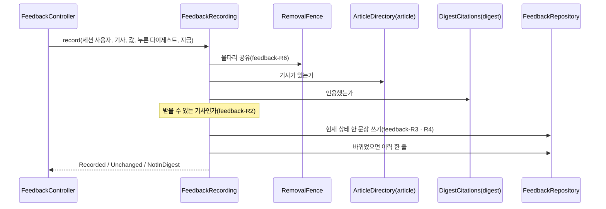

# feedback 모듈 Spec

공통 구조와 쓰는 규칙은 [specs/README.md](README.md)에 있다.

## 1. 책임과 범위

`feedback` 은 사용자가 기사에 남기는 좋아요 / 싫어요 / 없음을 기록한다 — 관심 신호 가운데 기사에 대한 반응이다([overview.md §6](../overview.md#6-횡단-규약) "신호 이력").

- **현재 상태와 이력** — (사용자, 기사)마다 지금 값 하나(현재 상태)와, 값이 바뀔 때마다 한 줄씩 더하는 이력. 어느 다이제스트에서 눌렀는지를 함께 남긴다
- **받을 수 있는 기사** — 그 사용자의 다이제스트가 인용한 기사에만 받는다. 인용했는지는 이 모듈이 선언한 인터페이스 `DigestCitations` 로 묻고 `digest` 가 답한다
- **지운 기사 따르기** — 운영자가 지운 기사의 현재 상태 · 이력 행을 지운다
- **화면용 API** — 누르기 · 되돌리기와, 화면이 쓸 현재 상태 조회
- **소비자 조회** — 다이제스트 후보 선별 · 관심도가 읽는 싫어요 기사와 기간의 이력(`ArticleFeedback`)
- **(미구현)** 탈퇴한 사용자의 현재 상태 · 이력 지우기

하지 않는 것:

- 관심도를 계산하지 않는다 — 산식은 노출 기록을 가진 `digest` 의 것이다([pipeline.md §7](../pipeline.md#7-피드백))
- 다이제스트의 내용 · 인용을 읽지 않는다 — 다이제스트는 ID 로만 가리키고, 인용했는지는 `digest` 가 답한다
- 요청 제한을 세지 않는다 — 처리기에 표시를 달 뿐이고, 세기와 한도는 `user` 의 것이다([user Spec](user.md#요청-방어) user-R38 · R40)
- 사용자를 인증하지 않는다 — 세션 · 키 관문은 `user` 의 보안 구성이 한다([user Spec](user.md#화면용-api-의-공개와-세션-사용자) user-R5 · R6)

다른 모듈과의 의존과 이벤트 흐름은 [overview.md §5](../overview.md#5-모듈-지도)에 있다.

## 2. 용어

| 용어 | 뜻 |
|---|---|
| 값 | 기사에 남기는 좋아요(`LIKE`) · 싫어요(`DISLIKE`) · 없음(`NONE`) |
| 현재 상태 | (사용자, 기사)의 지금 값 — 좋아요나 싫어요다. 없음이면 행이 없다 |
| 이력 | 값이 바뀔 때마다 더하는 기록 — 없음으로 되돌린 것도 한 줄이다 |
| 누르기 · 되돌리기 | 값을 좋아요 · 싫어요로 바꾸는 요청 · 없음으로 바꾸는 요청. 같은 처리기의 같은 요청이다 |
| 누른 다이제스트 | 그 값을 누른 화면의 다이제스트 — 요청이 싣고, 인용을 확인한 뒤 이력과 현재 상태에 남는다 |
| 울타리 | 기록과 지운 기사 삭제가 서로를 지나치지 않게 하는 모듈 하나의 advisory 잠금 — 기록은 공유, 삭제는 배타(feedback-R6) |

## 3. 공개 인터페이스

모듈 최상위 패키지 `net.yozmnews.feedback` 의 공개 타입은 넷이다 — 값 `FeedbackValue`, 소비자 조회 `ArticleFeedback` 과 그 값 `FeedbackChange`, 다른 모듈이 구현하는 공급 인터페이스 `DigestCitations`. 받는 이벤트는 `article` 의 `ArticlesRemoved` 다(§4 들어오는 쪽).

HTTP 엔드포인트:

| 경로 | 메서드 | 용도 |
|---|---|---|
| `/api/feedback/{articleId}` | `PUT` | 누르기 · 되돌리기 — 값과 누른 다이제스트를 받는다. `RECORDED`(+지금 값) · `UNCHANGED`(+지금 값) · `NOT_IN_DIGEST`(feedback-R2 ~ R4) |
| `/api/feedback` | `GET` | 현재 상태 — 질의 `articleIds`(쉼표로 이은 기사 ID)의 기사 가운데 세션 사용자의 현재 상태가 있는 것(feedback-R7) |

두 경로 모두 세션이 필요하고 키 관문 뒤이며(키 없이 여는 표시가 없다 — [user Spec](user.md#화면용-api-의-공개와-세션-사용자) user-R5) 사용자 격리 시험에 등록돼 있다(user-R6). `PUT` 에는 요청 제한이 걸려 한도를 넘으면 처리기 앞에서 429 다(feedback-R9). 판정 결과는 200 이고, 요청 · 응답 형식은 `api/openapi.json` 에 있다.

### FeedbackValue

기사에 남기는 값.

```java
public enum FeedbackValue { LIKE, DISLIKE, NONE }
```

| 값 | 뜻 |
|---|---|
| `LIKE` | 좋아요 |
| `DISLIKE` | 싫어요 |
| `NONE` | 없음 — 현재 상태에는 없고(행이 없다) 이력과 요청에만 있다 |

관련 규칙: feedback-R1

### ArticleFeedback · FeedbackChange

좋아요 / 싫어요의 소비자 조회 — 다이제스트 후보 선별 · 관심도가 읽는다. 구현은 `application` 의 `ArticleFeedbackService` 다.

```java
public interface ArticleFeedback {
    int MAX_ARTICLES = 1000;                                  // 한 번에 묻는 기사 수의 상한 — 정본. 측정 전 목표
    Set<ArticleId> dislikedAmong(UserId user, Collection<ArticleId> articles);
    List<FeedbackChange> changes(UserId user, Instant from, Instant to);
}

public record FeedbackChange(ArticleId article, FeedbackValue value, long digestId, Instant occurredAt) { }
```

| 멤버 | 뜻 |
|---|---|
| `dislikedAmong` | 주어진 기사 가운데 그 사용자의 현재 상태가 싫어요인 기사. 같은 기사가 두 번 와도 한 번. 빈 입력이면 빈 집합. 서로 다른 기사가 `MAX_ARTICLES` 개를 넘으면 `IllegalArgumentException` |
| `changes` | 그 사용자의 이력 행 가운데 시각이 `from` 이상 · `to` 미만인 것 — 기록한 순서(행 ID 순). `from` 이 `to` 보다 늦으면 `IllegalArgumentException` |

| `FeedbackChange` 의 필드 | 뜻 | 제약 |
|---|---|---|
| `article` | 값을 남긴 기사 | — |
| `value` | 바뀐 뒤의 값 | 없음으로 되돌린 행은 `NONE` |
| `digestId` | 누른 다이제스트의 ID | 1 이상. `digest` 의 다이제스트 ID 다 |
| `occurredAt` | 요청을 받은 시각 | 마이크로초까지 |

- 계약
  - 백그라운드 작업 전용이다 — 화면 경로에서 부르지 않는다(화면은 세션 사용자로 범위가 정해진 처리기를 쓴다). 사용자는 부르는 쪽이 넘긴 `UserId` 다
  - 읽기 전용 트랜잭션 하나 · 질의 하나다. 역할 애너테이션이 없다(두 역할 공통)
  - 기간을 사용자 시간대의 날로 자르는 일과 주제로 모으는 일은 부르는 쪽이 한다
  - `changes` 의 순서는 기록한 순서다 — 같은 (사용자, 기사)의 마지막 행의 값이 현재 상태와 같다(feedback-R4). 시각 순으로 다시 정렬하면 이 성질이 깨질 수 있다
  - 지운 기사의 행은 없다(feedback-R5)

`ArticleId` 는 `article` 의 공개 타입이고 `UserId` 는 `platform` 의 공개 타입이다([platform Spec](platform.md#userid)).

관련 규칙: feedback-R8

### DigestCitations

다이제스트의 인용 확인 — 이 모듈이 선언하고 `digest` 가 구현한다([digest Spec](digest.md#인용-확인) digest-R14). 기록이 받을 수 있는 기사를 판정할 때 부른다.

```java
public interface DigestCitations {
    boolean cites(UserId user, long digestId, ArticleId article);
}
```

| 멤버 | 뜻 |
|---|---|
| `cites` | `digestId` 가 그 사용자의 다이제스트이고 그 다이제스트의 인용에 그 기사가 있으면 참. 없는 다이제스트 · 다른 사용자의 다이제스트 · 인용하지 않은 기사는 거짓 |

- 계약
  - 구현은 앱에 하나다 — `digest` 가 낸다. 이 모듈은 `digest` 의 타입을 쓰지 않고 다이제스트를 `long` ID 로만 든다
  - 그 다이제스트가 날짜별로 보이는 다이제스트([digest Spec](digest.md#받은-소식) digest-R13)인지는 보지 않는다
  - 부르는 쪽의 트랜잭션에 들고 쓰지 않는다

관련 규칙: feedback-R2

## 4. 내부 구조

### 개관

| 패키지 | 책임 |
|---|---|
| (최상위) | 공개 타입 넷 |
| `domain/record` | 받을 수 있는 기사의 판정(`FeedbackAcceptance`), 현재 상태와 이력의 저장소(`FeedbackRepository`), 울타리(`RemovalFence`) |
| `application` | 기록(`FeedbackRecording` — 결과 `RecordOutcome`), 화면의 현재 상태 조회(`FeedbackStates`), 소비자 조회의 구현(`ArticleFeedbackService`), 지운 기사 따르기(`FeedbackRemoval`)와 그 리스너 |
| `adapter/in/web` | 처리기(`FeedbackController`)와 요청 · 응답 |
| `adapter/out/persistence` | 저장소 · 울타리의 JdbcClient 구현 |

저장은 JdbcClient 로 한다 — 현재 상태 행은 값 하나이고 쓰기가 조건 있는 한 문장이다([ADR-0014](../adr/0014-spring-data-jdbc.md)).

협력 — 누르기 한 번:



### 들어오는 쪽

| 진입점 | 구성 요소 | 계기 | 하는 일 |
|---|---|---|---|
| 누르기 · 되돌리기 | `FeedbackController` → `FeedbackRecording` | `PUT /api/feedback/{articleId}` | feedback-R2 ~ R4 · R9. 요청 값 `FeedbackRequest`, 응답 값 `FeedbackResponse` |
| 현재 상태 | `FeedbackController` → `FeedbackStates` | `GET /api/feedback` | feedback-R7 · R9. 응답 값 `FeedbackStatesResponse` · `FeedbackStateItem` |
| 지운 기사 | `FeedbackArticleRemovalListener` → `FeedbackRemoval` | `article` 의 `ArticlesRemoved` | 그 기사의 현재 상태 · 이력 행을 지운다(feedback-R5 · R6). 비동기 · 새 트랜잭션이고 이벤트 발행 레지스트리에 기록된다(Spring Modulith `@ApplicationModuleListener`) — 실패하면 다시 처리되고, 다시 처리해도 결과가 같다 |

처리기는 화면 역할(`@WebRole`)이다. 반복 작업 · 기동 시 동작은 없다.

### `application`

- `FeedbackRecording` — 누르기 · 되돌리기. 트랜잭션 하나에서 울타리를 공유로 잡고, 기사가 있는지와 인용했는지를 확인해 판정한 뒤, 현재 상태를 쓰고 바뀌었으면 이력을 더한다. 결과는 `RecordOutcome`(`Recorded` · `Unchanged` · `NotInDigest`)이다
- `FeedbackStates` — 화면의 현재 상태 조회. 읽기 전용 트랜잭션. 상한 `FeedbackStates.MAX_ARTICLES`(feedback-R7)
- `ArticleFeedbackService` — 공개 조회 `ArticleFeedback` 의 구현. 읽기 전용 트랜잭션
- `FeedbackRemoval` — 지운 기사 따르기. 트랜잭션 하나에서 울타리를 배타로 잡고 그 기사의 행을 지운다
- `FeedbackArticleRemovalListener` — `ArticlesRemoved` 를 받아 `FeedbackRemoval` 을 부른다

### `domain`

- `FeedbackAcceptance` — 받을 수 있는 기사의 판정의 정본(feedback-R2). 기사가 있는지와 인용했는지의 두 사실을 받아 답한다
- `FeedbackRepository` — 현재 상태와 이력의 저장소. 현재 상태 쓰기는 값이 바뀌었는지를 돌려준다(feedback-R3 · R4)
- `RemovalFence` — 울타리. 공유로 들어가기 · 배타로 들어가기 — 둘 다 트랜잭션 안에서 부르고 트랜잭션이 끝나면 풀린다(feedback-R6)

aggregate 는 없다 — 현재 상태는 (사용자, 기사)마다 값 하나이고 전이 규칙이 "값이 다르면 바꾼다" 하나다.

### 나가는 쪽

- 포트는 없다 — 외부 의존성이 없다
- 저장소 구현 — `JdbcFeedbackRepository`(현재 상태 쓰기는 한 문장), `JdbcRemovalFence`(트랜잭션 advisory 잠금 — 이 모듈의 이름공간 하나)
- 신뢰할 수 없는 입력 — 요청의 기사 ID · 다이제스트 ID · 값. 방어는 feedback-R2(받을 수 있는 기사) · feedback-R9(꼴 검증)다

## 5. 규칙과 불변식

### 값과 기록

판단의 이유는 [ADR-0028](../adr/0028-explicit-signals-and-interest-weighted-candidates.md) · [ADR-0196](../adr/0196-feedback-is-accepted-only-on-articles-cited-by-the-users-digest-and-digest-answers-through-an-interface-declared-by-feedback.md)에 있다.

- **feedback-R1** — 값은 좋아요 · 싫어요 · 없음이다. 현재 상태는 (사용자, 기사)마다 많아야 한 행이고 좋아요나 싫어요다 — 없음이면 행이 없다. 이력은 값이 바뀔 때마다 한 줄이고 없음으로 되돌린 것도 한 줄이다. 현재 상태와 이력 행은 누른 다이제스트를 갖는다 — 없음 행은 되돌리기를 누른 다이제스트다. 이력은 고쳐 쓰지 않는다 — 지우는 것은 지운 기사를 따를 때뿐이다(feedback-R5)
- **feedback-R2** — 받을 수 있는 기사: 기사가 있고(`article` 의 `ArticleDirectory`), 요청의 다이제스트가 그 사용자의 것이며 그 기사를 인용한다(`DigestCitations`). 판정의 정본은 `FeedbackAcceptance` 다. 누르기와 되돌리기 모두 같은 확인을 지난다. 그 다이제스트가 날짜별로 보이는 다이제스트인지는 묻지 않는다 — 화면을 열어 둔 사이 같은 날짜가 다시 만들어져도 열어 둔 화면에서 누른 것을 받는다. 받을 수 없으면 아무것도 쓰지 않고 결과는 `NotInDigest` 다
- **feedback-R3** — 값이 바뀌지 않는 요청은 아무것도 쓰지 않는다 — 좋아요인 기사에 좋아요, 현재 상태가 없는 기사에 없음. 이력을 더하지 않고 현재 상태의 누른 다이제스트 · 시각도 그대로다(다른 다이제스트에서 같은 값을 다시 눌러도 처음 누른 다이제스트가 남는다). 결과는 `Unchanged` 다. 값이 바뀌면 현재 상태를 쓰고 이력 한 줄을 더하며 결과는 `Recorded` 다
- **feedback-R4** — 같은 (사용자, 기사)의 기록은 차례로 선다 — 현재 상태의 쓰기는 한 문장이고(넣기 · 값이 다를 때만 고치기, 없음은 지우기) 그 행의 잠금에서 뒤 요청이 앞 요청의 커밋을 기다린 뒤 판정한다. 그래서 같은 값의 동시 요청 둘은 이력 한 줄을 남기고, (사용자, 기사)의 이력에서 마지막 행(ID 가 가장 큰 것)의 값은 현재 상태와 같다(마지막 행이 없음이면 현재 상태가 없다). 이력의 시각은 요청을 받은 때라 잠금을 기다린 요청끼리 행 순서와 어긋날 수 있다 — 순서의 정본은 행 ID 다

### 지운 기사 따르기

판단의 이유는 [ADR-0197](../adr/0197-feedback-on-removed-articles-is-deleted-from-both-the-current-state-and-the-history-and-recording-and-removal-are-ordered-by-a-fence-lock.md) · [ADR-0060](../adr/0060-article-deletion-announced-by-removed-article-ids-and-followed-by-referencing-modules.md)에 있다.

- **feedback-R5** — `ArticlesRemoved` 를 받으면 한 트랜잭션에서 그 기사의 현재 상태 행과 이력 행을 모두 지운다. 다른 기사 · 다른 사용자의 행은 건드리지 않는다. 다시 처리하거나 나뉘어 발행된 이벤트가 동시에 처리되어도 결과가 같다
- **feedback-R6** — 기록과 지운 기사 삭제는 울타리로 차례를 선다. 기록은 울타리를 공유로 잡은 뒤에 기사가 있는지를 확인하고, 삭제는 울타리를 배타로 잡고 지운 뒤 트랜잭션이 끝날 때 놓는다. 삭제가 울타리를 얻은 뒤에 시작한 기록은 기사 삭제가 이미 커밋돼 있어 받지 않고(feedback-R2), 그 전에 진행 중이던 기록은 삭제보다 먼저 커밋돼 삭제가 그 행을 지운다 — 삭제가 지나간 뒤에는 지운 기사를 가리키는 행이 남지 않는다. 인용 확인만으로는 이 틈이 닫히지 않는다 — `digest` 가 지운 기사의 인용을 지우기 전에는 인용이 남아 있다

### 화면의 현재 상태 조회

- **feedback-R7** — 주어진 기사 가운데 세션 사용자의 현재 상태가 있는 기사와 그 값을 기사 ID 순으로 낸다. 현재 상태가 없는 기사는 빠진다. 같은 기사가 두 번 와도 한 번이다. 한 번에 묻는 서로 다른 기사는 500 개(`FeedbackStates.MAX_ARTICLES` — 정본, 측정 전 목표)까지다 — 다이제스트 하나의 인용 상한(주요 뉴스 20 × 인용 20 + 추가 헤드라인 60 = 460 — [digest Spec](digest.md#출력-읽기))을 덮는 값이다

### 소비자 조회의 범위

판단의 이유는 [ADR-0191](../adr/0191-the-consumer-query-of-storyline-subscriptions-is-opened-with-the-subscriptions-and-resolves-ids-without-writing.md)(같은 꼴의 선례)에 있다.

- **feedback-R8** — 소비자 조회(`ArticleFeedback`)는 그 사용자의 것만 읽는다. 싫어요 기사는 주어진 기사 가운데서 현재 상태로 답하고, 기간의 이력은 시각이 반열린 구간(시작 포함 · 끝 제외)에 드는 행을 기록한 순서로 그대로 낸다 — 관심 신호로 쓸 행을 고르는 일은 부르는 쪽이 한다. 화면의 현재 상태 조회(feedback-R7)와 같은 질의로 현재 상태를 읽는다

### 처리기의 관문

판단의 이유는 [ADR-0198](../adr/0198-feedback-recording-is-request-limited-per-session-user.md) · [ADR-0192](../adr/0192-reader-screens-are-composed-by-the-reader-module-over-module-public-queries.md)에 있다.

- **feedback-R9** — 두 처리기는 사용자를 세션에서 채운 `UserId` 인자로만 받는다(user-R6). 키 없이 여는 표시가 없다 — 피드백은 다이제스트 화면에서 누르고 그 화면은 키 관문 뒤다. 누르기 · 되돌리기에는 요청 제한 표시(`@RequestLimited(GuardedAction.FEEDBACK)`)가 있다 — 세션 사용자로 세고 한도는 [user Spec](user.md#요청-방어) user-R38 의 정책 표에 있다. 결과와 무관하게 센다 — 값이 바뀌지 않는 요청 · 받을 수 없는 기사의 요청도 센다(user-R39). 현재 상태 조회에는 표시가 없다. 꼴 검증: 경로의 기사 ID · 본문의 다이제스트 ID 가 1 보다 작으면 400, 본문의 칸이 없거나 값 이름이 틀리면 본문 형식 400, 조회의 `articleIds` 가 없거나 비었거나 1 보다 작은 ID 가 있거나 서로 다른 ID 가 상한을 넘으면 400 이다. 받을 수 없는 기사는 오류가 아니라 판정 결과 200 `NOT_IN_DIGEST` 다

## 6. 데이터

컬럼 타입 · 인덱스 · 제약 문면의 정본은 `backend/src/main/resources/db/migration/V50__feedback.sql` 이다.

| 테이블 | 주요 컬럼 | 뜻 |
|---|---|---|
| `feedback` | user_id, article_id, value(`LIKE`/`DISLIKE`), digest_id, updated_at | 현재 상태(feedback-R1) — (user_id, article_id) 가 고유하다. 없음이면 행이 없다. `digest_id` 는 그 값을 누른 다이제스트, `updated_at` 은 그 값으로 바뀐 시각이다 |
| `feedback_events` | id, user_id, article_id, value(`LIKE`/`DISLIKE`/`NONE`), digest_id, occurred_at | 이력(feedback-R1) — 값이 바뀔 때마다 한 줄. 순서의 정본은 `id` 다(feedback-R4) |

`user_id` 는 `user` 의 사용자 ID, `article_id` 는 `article` 의 기사 ID, `digest_id` 는 `digest` 의 다이제스트 ID 다 — 모듈 사이라 FK 가 없다. 지운 기사는 feedback-R5 가 따른다. **(미구현)** 탈퇴한 사용자의 행 지우기.

## 7. 설정

해당 없음 — 읽는 설정 키가 없다. 상한 · 한도는 코드 상수다(`ArticleFeedback.MAX_ARTICLES` · `FeedbackStates.MAX_ARTICLES`, 요청 제한은 `user` 의 정책 표).

## 8. 결정

| ADR | 한 줄 |
|---|---|
| [0028](../adr/0028-explicit-signals-and-interest-weighted-candidates.md) | 관심 신호는 명시적 행동만 쓰고, 추가 전용 이벤트 기록이 정본이다 |
| [0060](../adr/0060-article-deletion-announced-by-removed-article-ids-and-followed-by-referencing-modules.md) | 기사 삭제는 지운 기사 ID 이벤트로 알리고, 기사를 가리키는 모듈이 받아 자기 행을 지운다 |
| [0125](../adr/0125-screen-api-handlers-need-a-session-unless-marked-public-and-take-the-user-only-as-a-session-filled-argument.md) | 화면용 API 처리기는 세션 사용자를 인자로만 받고 격리 시험에 등록한다 |
| [0191](../adr/0191-the-consumer-query-of-storyline-subscriptions-is-opened-with-the-subscriptions-and-resolves-ids-without-writing.md) | 소비자 조회는 신호를 만든 작업이 열고 소비자의 필요는 비워 둔다 |
| [0192](../adr/0192-reader-screens-are-composed-by-the-reader-module-over-module-public-queries.md) | 사용자가 정해 두는 것의 화면은 그 데이터를 가진 모듈이 연다 |
| [0196](../adr/0196-feedback-is-accepted-only-on-articles-cited-by-the-users-digest-and-digest-answers-through-an-interface-declared-by-feedback.md) | 피드백은 그 사용자의 다이제스트가 인용한 기사에만 받고, 그 확인은 `feedback` 이 선언한 인터페이스를 `digest` 가 구현해 답한다 |
| [0197](../adr/0197-feedback-on-removed-articles-is-deleted-from-both-the-current-state-and-the-history-and-recording-and-removal-are-ordered-by-a-fence-lock.md) | 지운 기사의 피드백은 현재 상태와 이력을 모두 지우고, 기록과 삭제는 울타리 잠금으로 차례를 세운다 |
| [0198](../adr/0198-feedback-recording-is-request-limited-per-session-user.md) | 피드백 기록에 세션 사용자 축 요청 제한을 건다 |
