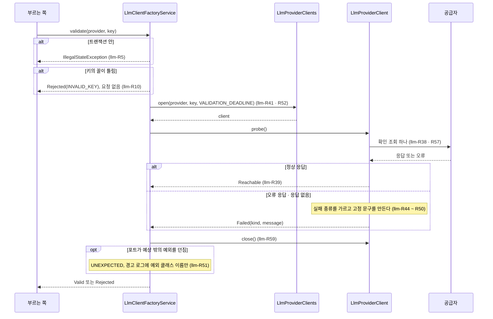
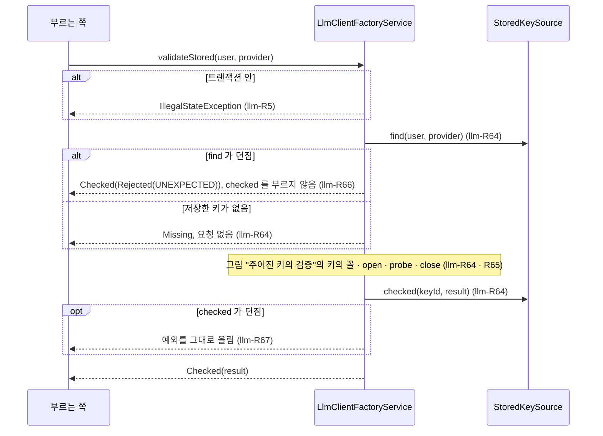
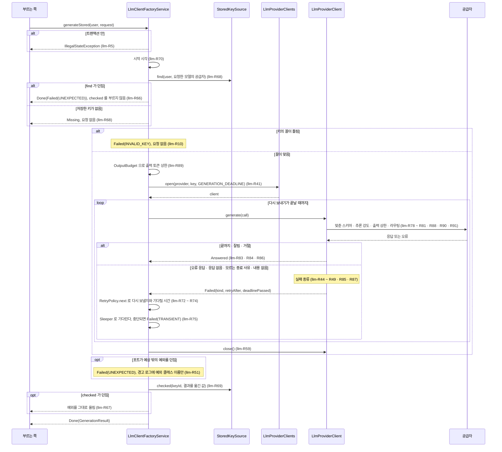

# llm 모듈 Spec

공통 구조와 쓰는 규칙은 [specs/README.md](README.md)에 있다.

## 1. 책임과 범위

`llm` 은 사용자 LLM 키(BYOK)로 하는 모든 LLM 호출의 관문이다. 공급자(OpenAI · Anthropic · OpenRouter)와 그 라이브러리를 아는 코드는 이 모듈에만 있다.

- **공급자와 허용 모델 목록** — 공급자 셋과, 사용자가 고를 수 있는 모델의 목록(모델마다 입력 토큰 예산 · 구조화 출력 지원 여부). 목록은 앱에 든 기본 파일이 정본이고 운영자가 자기 파일로 통째로 바꾼다
- **입력 토큰 어림** — 보내기 전에 입력의 코드 포인트 수로 토큰을 어림하는 비율 · 함수의 정본(`TokenEstimate`). 입력을 예산 안으로 자르는 과제 모듈이 함께 쓴다
- **키 검증** — 주어진 키로 공급자에 가벼운 요청 하나(공급자마다 정한 조회)를 보내 키가 쓸 수 있는지 본다. 실패는 종류로 가른다
- **공급자 클라이언트** — 주어진 키로 공급자 클라이언트를 요청마다 만들고 쓰고 닫는다. 주소 · 키 · 로그 수준을 언제나 명시하고, 전송은 이 모듈이 직접 구현한다
- **실패 분류** — 공급자가 답하지 못한 까닭을 종류로 가르는 정본. 검증과 생성 호출이 함께 쓴다
- **생성 호출** — 저장한 키로 지시 · 사용자 구획 · 출력 JSON 스키마를 넘겨 공급자의 응답(본문 · 토큰 · 종료 사유 · 소요 시간)을 받는다. 출력 스키마 · 추론 강도 · 출력 토큰 상한을 그 공급자의 꼴로 옮기고, 일시 장애를 정해진 만큼 다시 보낸다
- **로컬 대체물** — 로컬 개발에서 외부 계정 없이 키 검증과 생성 호출의 결과를 재현한다
- **저장한 키의 길** — 사용자가 저장한 키를 공급 인터페이스로 받아 호출 직전에만 쓰고, 결과를 그 키에 알린다. 이 길로 저장한 키의 검증과 생성 호출을 한다

하지 않는 것:

- 키를 저장하지 않는다. 암호화 보관과 복호화는 `credential` 의 것이다. 이 모듈은 공급 인터페이스로 받은 평문을 호출이 끝날 때까지만 쥔다
- 사용자가 고른 공급자 · 모델을 저장하지 않는다. 사용자 설정은 `user` 의 것이고, 이 모듈은 목록에 그 모델이 있는지만 답한다
- 프롬프트를 만들거나 LLM 출력을 파싱 · 검증하지 않는다. 다이제스트 · 변화 리포트를 만드는 모듈의 것이다. 추론 강도와 본문 토큰 몫도 그 모듈이 정한다
- 요청 제한을 걸지 않는다. 키 검증 경로의 요청 제한은 그 경로를 가진 쪽의 것이다
- Spring AI · 공급자 SDK 의 타입을 밖으로 내지 않는다(llm-R15)

다른 모듈과의 의존과 주고받는 이벤트는 [overview.md §5](../overview.md#5-모듈-지도)에 있다.

## 2. 용어

| 용어 | 뜻 |
|---|---|
| 공급자 | LLM API 를 내는 곳. OpenAI · Anthropic · OpenRouter 셋이다(llm-R25) |
| 중계 공급자 | 여러 회사의 모델을 한 키로 받아 그 모델의 회사나 호스팅 공급자로 옮겨 보내는 공급자. OpenRouter 가 그렇다 |
| 실제 공급자 | 중계 공급자가 요청을 옮겨 보내는 곳. 그 모델의 회사나 그 모델을 호스팅하는 곳(Azure · Bedrock · Vertex 등)이다 |
| 허용 모델 | 이 인스턴스의 사용자가 고를 수 있는 모델. 공급자와 모델 ID 로 가리킨다 |
| 입력 토큰 예산 | 그 모델에 한 번의 생성 요청으로 넣는 입력의 상한(토큰). 모델의 문맥 한도가 아니라 이 서비스가 정한 값이다(llm-R35) |
| 구조화 출력 | 공급자가 응답을 JSON 스키마에 맞게 강제하는 기능 |
| 키 검증 | 키가 쓸 수 있는지 공급자에 물어보는 가벼운 요청 |
| 실패 종류 | 공급자가 답하지 못한 까닭을 가른 값(`LlmFailureKind`) |
| 가짜 키 | 로컬 개발에서 로컬 대체물이 받는 정해진 접두의 키 |
| 저장한 키 | 사용자가 등록해 `credential` 이 암호화해 보관하는 키 |
| 공급 인터페이스 | 일반 뜻은 [overview.md §8](../overview.md#8-용어)에 있다. 이 모듈의 것은 저장한 키를 받으려고 선언하고 `credential` 이 구현하는 `StoredKeySource` 하나다 |
| 생성 호출 | 지시 · 사용자 구획을 보내 모델이 쓴 응답을 받는 요청. 과금된다 |
| 지시 · 사용자 구획 | 생성 호출의 두 입력. 지시는 공급자의 system, 사용자 구획은 user 메시지로 간다 |
| 추론 강도 | 모델이 응답 전에 생각하는 정도(`ReasoningEffort` 의 낮음 · 보통 · 높음). 출력 토큰 · 소요 시간 · 비용을 함께 바꾼다 |
| 본문 토큰 몫 | 부르는 쪽이 정하는 응답 본문의 출력 토큰 상한. 공급자에 보내는 출력 토큰 상한은 여기에 추론 강도의 여유를 더한 것이다(llm-R89) |
| 스키마 강제 | 출력 스키마를 공급자의 구조화 출력 인자로 보내 응답을 그 스키마에 맞게 만드는 것 |
| 종료 사유 | 공급자가 답한 생성이 끝난 까닭(`GenerationStop` 의 끝까지 · 잘림 · 거절) |

## 3. 공개 인터페이스

모듈 최상위 패키지 `net.yozmnews.llm` 의 공개 타입은 열다섯이다.

| 종류 | 타입 |
|---|---|
| 공개 API | `LlmClientFactory` · `LlmModels` |
| 입력 토큰 어림 | `TokenEstimate` |
| 값 타입 | `Provider` · `LlmModel` · `KeyValidationResult` · `StoredKeyValidation` · `LlmFailureKind` · `ReasoningEffort` · `GenerationRequest` · `GenerationStop` · `GenerationResult` · `StoredGeneration` |
| 명명 인터페이스 `stored-key` | `StoredKeySource` · `StoredKey` |

명명 인터페이스의 둘은 `credential` 에만 열린다(llm-R18). 이 모듈이 내는 HTTP 엔드포인트 · 이벤트는 없다.

### Provider

LLM 공급자.

```java
public enum Provider {
    OPENAI("openai"), ANTHROPIC("anthropic"), OPENROUTER("openrouter");
    public String key();
    public static Optional<Provider> ofKey(String key);
}
```

| 값 | 키 | 뜻 |
|---|---|---|
| `OPENAI` | `openai` | OpenAI API |
| `ANTHROPIC` | `anthropic` | Anthropic API |
| `OPENROUTER` | `openrouter` | OpenRouter API. 중계 공급자다 |

- 계약
  - 키는 허용 모델 목록 파일과 저장 값에 쓰는 이름이다. 소문자이고 바꾸지 않는다
  - `ofKey` 는 모르는 키에 빈 값을 낸다(대소문자를 가린다)
  - 선언 순서가 쓸 모델의 대체 순서다(`LlmModels.all`). 새 값은 끝에 둔다

관련 규칙: llm-R1

### LlmModel

허용 모델 하나.

```java
public record LlmModel(Provider provider, String id, int inputTokenBudget, boolean structuredOutput) { }
```

| 필드 | 뜻 | 제약 |
|---|---|---|
| `provider` | 공급자 | — |
| `id` | 공급자의 모델 ID | 1 ~ 128자 · 출력 가능한 ASCII, 공급자 안에서 유일 |
| `inputTokenBudget` | 입력 토큰 예산 | 1 ~ 10,000,000 |
| `structuredOutput` | 구조화 출력을 지원하는가 | — |

관련 규칙: llm-R2

### LlmModels

허용 모델 목록 조회. 두 역할 공통이고 트랜잭션과 무관하다(메모리의 값을 읽는다).

```java
public interface LlmModels {
    List<LlmModel> all();
    List<LlmModel> of(Provider provider);
    Optional<LlmModel> find(Provider provider, String id);
}
```

- 계약
  - `all` 은 공급자 선언 순(`Provider` 의 순서)이고, 공급자 안에서는 파일에 적힌 순이다
  - `all` 의 순서는 `user` 의 쓸 모델 판정에서 고른 모델을 쓸 수 없을 때의 대체 순서다. 공급자마다 첫 모델이 대체 모델이다([ADR-0178](../adr/0178-the-llm-model-to-use-is-decided-at-query-time-from-the-chosen-model-the-allowed-list-and-key-status.md))
  - `of` 는 그 공급자의 모델이고, 없으면 빈 목록이다
  - `find` 는 목록에 없는 모델에 빈 값을 낸다. 목록이 바뀌어 빠진 모델을 가리키는 쪽이 이것으로 안다
  - 목록은 기동 때 정해지고 실행 중에 바뀌지 않는다(llm-R32)

관련 규칙: llm-R2 ~ R4

### LlmClientFactory

모든 LLM 호출이 거치는 관문.

```java
public interface LlmClientFactory {
    Duration GENERATION_DEADLINE = Duration.ofSeconds(180);                            // 생성 호출의 요청 하나 마감 — 정본(llm-R7)
    Duration LONGEST_GENERATION_CALL = RetryPolicy.longestCall(GENERATION_DEADLINE);  // 생성 호출 한 번의 최악 — 900초(llm-R20)
    KeyValidationResult validate(Provider provider, SecretValue key);
    StoredKeyValidation validateStored(UserId user, Provider provider);
    StoredGeneration generateStored(UserId user, GenerationRequest request);
}
```

- 계약
  - `GENERATION_DEADLINE` 은 생성 호출의 요청 하나 마감이다(llm-R41)
  - `LONGEST_GENERATION_CALL` 은 다시 보내기를 다 겪은 생성 호출 한 번의 가장 긴 시간이다(llm-R76). 부르는 쪽이 멈춘 생성을 가를 때 쓴다(다이제스트의 임대, [digest Spec](digest.md#거두기) digest-R32)
  - 세 메서드 모두 두 역할 공통이다. 트랜잭션 안에서 부르면 요청을 보내지 않고 `IllegalStateException` 이다(llm-R5)
  - `validate` 는 그 키로 공급자에 가벼운 요청 하나를 보내 결과를 낸다(llm-R38). 예상한 실패는 예외가 아니라 `KeyValidationResult.Rejected` 다
  - `validateStored` 는 그 사용자 · 공급자의 저장한 키로 같은 확인을 하고 결과를 그 키에 알린 뒤 낸다(llm-R64). 저장한 키가 없으면 요청을 보내지 않고 `StoredKeyValidation.Missing` 이다
  - 검증 둘은 화면 요청 안에서 불러도 되는 길이로 끝난다(llm-R41)
  - `generateStored` 는 요청한 모델의 공급자에 대한 그 사용자의 저장한 키로 생성 요청을 보내고, 결과를 그 키에 알린 뒤 `Done` 으로 낸다(llm-R68). 저장한 키가 없으면 보내지 않고 `StoredGeneration.Missing` 이다. 예상한 실패는 예외가 아니라 `GenerationResult.Failed` 다
  - `generateStored` 는 일시 장애를 정해진 만큼 다시 보낸다(llm-R72). 요청 하나의 마감이 길고 다시 보내므로 화면 요청 안에서 부르는 길이가 아니다(llm-R41)
  - 키를 저장하지 않는다. 저장한 키의 평문은 그 호출 안에만 있다(llm-R65)
  - 결과 · 예외 문구 · 로그에 키 · 프롬프트 · 응답 본문이 남지 않는다(llm-R50 · R12)

`SecretValue` · `UserId` 는 `platform` 의 공개 타입이다(platform Spec [SecretValue](platform.md#secretvalue) · [UserId](platform.md#userid)).

관련 규칙: llm-R5 ~ R14 · R17 · R19 ~ R23

### KeyValidationResult

키 검증의 결과.

```java
public sealed interface KeyValidationResult {
    record Valid() implements KeyValidationResult { }
    record Rejected(LlmFailureKind kind, String message) implements KeyValidationResult { }
}
```

| 경우 | 뜻 |
|---|---|
| `Valid` | 공급자가 그 키의 요청에 정상으로 답했다 |
| `Rejected` | 답하지 못했다. `kind` 는 까닭의 종류, `message` 는 운영 로그용 문구다 |

- 계약
  - `Rejected.message` 의 재료는 llm-R50 이 정한다. 사용자에게 보일 문구는 부르는 쪽이 `kind` 로 정한다
  - `Valid` 는 그 키로 공급자의 확인 조회(llm-R38)를 할 수 있다는 뜻이다. 잔액 · 지출 한도와 특정 모델을 쓸 권한은 확인하지 않는다(llm-R40)

관련 규칙: llm-R6 · R8 · R9

### StoredKeyValidation

저장한 키의 검증 결과.

```java
public sealed interface StoredKeyValidation {
    record Missing() implements StoredKeyValidation { }
    record Checked(KeyValidationResult result) implements StoredKeyValidation { }
}
```

| 경우 | 뜻 |
|---|---|
| `Missing` | 그 사용자 · 공급자의 저장한 키가 없다. 공급자에 묻지 않았다 |
| `Checked` | 저장한 키로 물었다. `result` 는 `validate` 와 같은 결과다 |

관련 규칙: llm-R17

### ReasoningEffort

생성 호출의 추론 강도.

```java
public enum ReasoningEffort { LOW, MEDIUM, HIGH }
```

- 계약
  - 과제를 아는 부르는 쪽이 고르고, 관문이 그 공급자의 값으로 옮긴다(llm-R90)
  - 추론을 끄는 값은 없다. 끌 수 있는지가 모델마다 다르다
  - 값은 `llm` 밖에도 저장된다. 다이제스트 · 변화 리포트 생성의 사용자 설정(설정 칸의 검사, [user Spec](user.md#관심-설정) user-R59)과 화면용 API 명세의 값 목록이 그 자리다. 값을 더하는 변경은 그 자리를 함께 고친다

관련 규칙: llm-R23

### GenerationRequest

생성 호출의 요청. 과제의 것만 담는다.

```java
public record GenerationRequest(LlmModel model, String instructions, String userContent,
        @Nullable String outputSchema, ReasoningEffort effort, int maxBodyTokens) {
    public static final int MAX_BODY_TOKENS = 32_000;
}
```

| 필드 | 뜻 | 제약 |
|---|---|---|
| `model` | 쓸 모델(공급자 · 모델 ID · 구조화 출력 지원 여부) | — |
| `instructions` | 지시 구획 | 공백뿐이 아니다 |
| `userContent` | 사용자 구획 | 공백뿐이 아니다 |
| `outputSchema` | 출력 JSON Schema 문서. 없으면 null | 있으면 JSON 객체 문서다(llm-R77) |
| `effort` | 추론 강도 | — |
| `maxBodyTokens` | 본문 토큰 몫 | 1 ~ `MAX_BODY_TOKENS` |

- 계약
  - null 인 필드(`outputSchema` 밖)는 `NullPointerException`, 제약을 어긴 값은 `IllegalArgumentException` 이다
  - 출력 스키마는 표준 JSON Schema 그대로 넘긴다. 공급자의 꼴로 맞추는 것은 관문이다(llm-R78 ~ R82)
  - `MAX_BODY_TOKENS` 는 32,000 `(측정 전)` 이다

관련 규칙: llm-R21 · R23

### GenerationStop

공급자가 답한 생성의 종료 사유.

```java
public enum GenerationStop { COMPLETE, TRUNCATED, REFUSED }
```

| 값 | 뜻 |
|---|---|
| `COMPLETE` | 끝까지 썼다 |
| `TRUNCATED` | 출력 토큰 상한에 닿아 잘렸다 |
| `REFUSED` | 모델이 거절했다 |

- 계약
  - 셋 모두 공급자가 정상으로 답한 응답이다(과금된다). 잘리거나 거절된 응답의 본문은 출력 스키마에 맞지 않을 수 있다

관련 규칙: llm-R22

### GenerationResult

생성 호출의 결과.

```java
public sealed interface GenerationResult {
    Duration elapsed();
    record Generated(String text, int inputTokens, int outputTokens, Duration elapsed,
            GenerationStop stop, boolean schemaEnforced) implements GenerationResult { }
    record Failed(LlmFailureKind kind, String message, Duration elapsed) implements GenerationResult { }
}
```

| 경우 · 필드 | 뜻 | 제약 |
|---|---|---|
| `elapsed` | 관문 안에서 든 시간(llm-R70) | 0 이상 |
| `Generated` | 공급자가 답했다 | — |
| `Generated.text` | 응답 본문(llm-R86) | 비었을 수 있다(잘림 · 거절) |
| `Generated.inputTokens` · `outputTokens` | 공급자가 센 토큰. 출력은 추론 토큰을 포함한다(llm-R71) | 0 이상 |
| `Generated.stop` | 종료 사유 | — |
| `Generated.schemaEnforced` | 출력 스키마를 강제 인자로 보냈는가(llm-R78) | — |
| `Failed` | 공급자가 답하지 못했다. `kind` 는 키 검증과 같은 다섯 종류, `message` 는 운영 로그용 문구다 | — |

- 계약
  - 출력을 파싱 · 검증하지 않는다. 그것은 부르는 쪽의 것이고, `schemaEnforced` 가 거짓일 때 스키마를 지시로 알리는 것도 그 쪽의 것이다
  - `Failed.message` 의 재료는 llm-R50 이 정한다. 사용자에게 보일 문구는 부르는 쪽이 `kind` 로 정한다

관련 규칙: llm-R9 · R19 ~ R22

### StoredGeneration

저장한 키의 생성 호출 결과.

```java
public sealed interface StoredGeneration {
    record Missing() implements StoredGeneration { }
    record Done(GenerationResult result) implements StoredGeneration { }
}
```

| 경우 | 뜻 |
|---|---|
| `Missing` | 그 사용자 · 공급자의 저장한 키가 없다. 공급자에 보내지 않았다 |
| `Done` | 저장한 키로 생성을 시도했다 |

관련 규칙: llm-R19

### StoredKeySource

저장한 키의 공급 인터페이스. 이 모듈이 선언하고 `credential` 이 구현한다. 명명 인터페이스 `stored-key` 에 속한다.

```java
@NamedInterface("stored-key")
public interface StoredKeySource {
    Optional<StoredKey> find(UserId user, Provider provider);
    void checked(long keyId, KeyValidationResult result);
}
```

- 계약
  - `find` 는 그 사용자 · 공급자의 저장한 키를 평문으로 낸다. 없으면 빈 값이다. 키를 열지 못하면 `IllegalStateException` 이고 문구에 키 · 암호문이 없다
  - `checked` 는 `find` 가 낸 키로 공급자에 물은 결과를 그 키에 알린다. 그 키가 그 사이 지워졌거나 바뀌었으면 아무 일도 없다. 생성 호출의 결과를 옮기는 꼴은 llm-R69 다
  - 이 인터페이스를 부르는 것은 이 모듈의 저장한 키의 길뿐이다(llm-R17 · R18)
  - 구현은 하나다. 구현이 없으면 `LlmClientFactory` 의 구현이 서지 않는다

관련 규칙: llm-R17 · R18

### StoredKey

공급 인터페이스가 건네는 저장한 키. 명명 인터페이스 `stored-key` 에 속한다.

```java
@NamedInterface("stored-key")
public record StoredKey(long id, SecretValue value) { }
```

| 필드 | 뜻 | 제약 |
|---|---|---|
| `id` | 저장한 키의 ID. 결과를 알릴 때 그대로 돌려준다 | — |
| `value` | 키의 평문 | — |

관련 규칙: llm-R17

### LlmFailureKind

공급자가 답하지 못한 까닭의 종류. 검증과 생성 호출이 함께 쓴다.

```java
public enum LlmFailureKind { INVALID_KEY, PERMISSION_DENIED, QUOTA_EXHAUSTED, TRANSIENT, UNEXPECTED }
```

| 값 | 뜻 |
|---|---|
| `INVALID_KEY` | 키가 무효다(틀린 꼴 · 폐기 · 만료) |
| `PERMISSION_DENIED` | 키는 맞지만 그 자원을 쓸 권한이 없다 |
| `QUOTA_EXHAUSTED` | 잔액 · 지출 한도가 소진됐다. 사용자가 결제 · 한도를 고쳐야 풀린다 |
| `TRANSIENT` | 시간이 지나면 풀릴 수 있다. 드는 실패는 표 아래 목록이다 |
| `UNEXPECTED` | 예상 밖의 답이다(그 밖의 상태 코드 · 읽을 수 없는 응답 · 상한을 넘은 본문) |

`TRANSIENT` 에 드는 실패:

- 연결 실패
- 마감 초과
- 공급자의 호출 한도
- 서버 오류
- 과부하

어떤 답이 어느 종류인지는 llm-R45 ~ R49 가 정한다.

- 계약
  - 종류마다 무엇을 할지(저장하지 않음 · 다시 시도 · 사용자에게 알림)는 부르는 쪽이 정한다
  - 값을 더하는 변경은 이 종류를 가르는 쪽 모두에 닿는다. 가르는 쪽은 `default` 없는 `switch` 로 쓴다

관련 규칙: llm-R8

### TokenEstimate

보내기 전의 입력 토큰 어림. 코드 포인트 수로 토큰을 어림하는 비율 · 함수의 정본이다([ADR-0313](../adr/0313-the-input-token-estimate-is-an-llm-public-type.md)).

```java
public final class TokenEstimate {
    public static final double TOKENS_PER_CODE_POINT = 1.0;
    public static int tokens(int codePoints);
}
```

| 필드 · 메서드 | 뜻 | 제약 |
|---|---|---|
| `TOKENS_PER_CODE_POINT` | 코드 포인트 하나의 토큰 어림. 1.0 `(측정 전)` 이다([ADR-0210](../adr/0210-candidate-selection-cuts-to-the-input-token-budget-with-one-estimate-the-prompt-follows.md)) | — |
| `tokens` | 코드 포인트 수의 토큰 어림. `codePoints × TOKENS_PER_CODE_POINT` 를 올린 값이다 | 음수면 `IllegalArgumentException` |

- 계약
  - 공급자 · 모델과 무관한 한 비율이다
  - 입력을 모델의 입력 토큰 예산(llm-R35) 안으로 자르는 과제 모듈이 쓴다. 다이제스트의 후보 선별 · 프롬프트 구성과 변화 리포트의 입력 맞추기가 그렇다

관련 규칙: llm-R4

## 4. 내부 구조

### 개관

| 패키지 | 책임 |
|---|---|
| (최상위) | 공개 타입 열다섯 |
| `domain/catalog` | 허용 모델 목록의 값(`ModelCatalog`)과 목록 파일 형식의 정본(`ModelCatalogParser` 와 결과 `ModelCatalogParse`) |
| `domain/failure` | 실패 분류의 정본. 공급자 오류에서 읽은 것(`ProviderError`)과 공급자마다의 분류(`OpenAiErrors` · `AnthropicErrors` · `OpenRouterErrors`)다 |
| `domain/provider` | 공급자 클라이언트 포트(`LlmProviderClients` · `LlmProviderClient`)와 그 값(`ProbeResult` · `GenerationCall` · `GenerationOutcome`), 종료 사유의 정본(`StopReasons`) |
| `domain/schema` | 출력 스키마가 JSON 객체 문서인가의 정본(`SchemaDocuments`), 공급자 맞춤의 정본(`OpenAiSchemas` · `AnthropicSchemas` · `OpenRouterSchemas`)과 그 공용 걸음(`SchemaRewrite`) |
| `domain/budget` | 출력 토큰 상한의 정본(`OutputBudget`) |
| `domain/retry` | 다시 보내기의 정본(`RetryPolicy`)과 `retry-after` 읽기(`RetryAfter`) |
| `application` | 공개 API 의 구현 둘, 다시 보내기 전의 기다림(`Sleeper`), 설정(`LlmProperties`), 목록의 기동 적재 |
| `adapter/out/sdk` | 포트의 운영 구현. 공급자마다의 클라이언트와 실패 값 · 전송 · 결선이다 |
| `adapter/out/local` | 로컬 대체물(생성 본문 `MinimalJson`)과 그 결선 |

협력은 과정마다 아래와 같다. 그림이 있는 과정의 호출 순서는 그림에 있다.

- **주어진 키의 검증** — `validate` 가 트랜잭션 밖에서 키의 꼴을 본 뒤 검증 마감으로 클라이언트를 열어 확인 조회 하나를 보내고 닫는다(llm-R5 · R10 · R38, 그림 "주어진 키의 검증")
- **저장한 키의 검증** — `validateStored` 가 공급 인터페이스로 받은 키로 같은 확인을 하고 결과를 그 키에 알린다(llm-R64, 그림 "저장한 키의 검증")
- **저장한 키의 생성 호출** — `generateStored` 가 공급 인터페이스로 받은 키로 생성 마감의 클라이언트를 열어 생성 요청을 보내고, 일시 장애는 같은 클라이언트로 다시 보낸 뒤 결과를 그 키에 알린다(llm-R68 · R72, 그림 "저장한 키의 생성 호출")
- **허용 모델 목록** — 기동 때 `ModelCatalogConfiguration` 이 목록 파일을 읽어 `ModelCatalog` 를 만들고, 틀리면 기동을 멈춘다. `LlmModelsService` 는 그 값을 읽기만 한다(llm-R32 ~ R34)
- **로컬 대체물** — 로컬 개발에서는 `LocalProviderClients` 가 포트의 `open` 을 받아 가짜 키에 정해진 결과를 내고, 그 밖의 키는 운영 구현으로 넘긴다(llm-R61)

그림 "주어진 키의 검증":



그림 "저장한 키의 검증":



그림 "저장한 키의 생성 호출":



### 들어오는 쪽

- 기동 시 동작 — `ModelCatalogConfiguration` 이 허용 모델 목록 파일을 읽어 검증한다. 틀리면 기동하지 않는다(llm-R34). 두 역할 모두 한다(llm-R32)
- 컨트롤러 · 반복 작업 · 이벤트 리스너는 없다. 이 모듈은 다른 모듈이 공개 API 로 부른다

### `application`

- `LlmClientFactoryService` — `LlmClientFactory` 의 구현. 세 메서드의 순서는 그림 셋에 있다
  - 마감은 호출 종류마다 넘긴다. 키 검증은 `VALIDATION_DEADLINE`, 생성 호출은 공개 상수 `LlmClientFactory.GENERATION_DEADLINE` 이다(llm-R41)
  - 저장한 키의 검증과 생성 호출은 공급 인터페이스로 키를 받아 요청하고 결과를 알리는 걸음 하나(`withStoredKey`)를 쓴다(llm-R64 · R68). 주어진 키의 검증과 저장한 키의 검증은 확인의 걸음 하나를 함께 쓴다
  - 시각은 `platform` 의 앱 시계 `AppClock` 으로 받고, 결과의 `elapsed` 는 `elapsedSince` 로 잰다(llm-R70). 기다림은 `Sleeper` 로 받는다
  - 트랜잭션 · 역할 애너테이션이 없다
- `Sleeper` — 다시 보내기 전에 기다린다. 운영은 스레드를 재운다
- `LlmModelsService` — `LlmModels` 의 구현. `ModelCatalog` 를 그대로 읽는다
- `ModelCatalogConfiguration` — 목록 파일을 읽어 `ModelCatalog` 빈으로 낸다(llm-R33). 역할 애너테이션이 없다
- `LlmProperties` — 설정 `yozmnews.llm`(§7)

### `domain`

- `ModelCatalog` — 검증된 허용 모델 목록. 불변이고 저장하지 않는다
- `ModelCatalogParser` — 목록 파일 원문을 읽어 형식 규칙(llm-R2)을 판정하는 정본. YAML 읽기와 공통 거부는 `platform` 의 `YamlTextReader` · `StrictYamlBinding` 이 한다
- `ProviderError` — 공급자 오류에서 분류에 쓰려고 읽은 것(llm-R44). 오류 문구는 담지 않는다
- `OpenAiErrors` · `AnthropicErrors` · `OpenRouterErrors` — `ProviderError` 를 `LlmFailureKind` 로 가르는 정본(llm-R8). `OpenRouterErrors` 는 오류 본문에서 종류 이름을 읽는 정본(`errorType`)도 갖는다
- `SchemaDocuments` — 출력 스키마가 JSON 객체 문서인가의 정본(llm-R77). `GenerationRequest` 의 검사와 공급자 맞춤이 함께 쓴다
- `OpenAiSchemas` · `AnthropicSchemas` · `OpenRouterSchemas` — 출력 스키마를 공급자가 받는 꼴로 맞추는 정본(llm-R21). 허용 키워드와 필수 속성 처리(`SchemaRewrite.Required`)만 다르고, 걸음은 `SchemaRewrite` 하나다. `OpenRouterSchemas` 의 허용 키워드는 두 맞춤의 교집합으로 계산한다
- `StopReasons` — 공급자의 종료 사유를 `GenerationStop` 으로 가르는 정본(llm-R22)
- `OutputBudget` — 공급자에 보내는 출력 토큰 상한의 정본(llm-R23)
- `RetryPolicy` · `RetryAfter` — 다시 보낼지와 기다릴 시간, 생성 호출 한 번의 가장 긴 시간(`longestCall`), `retry-after` 헤더 읽기의 정본(llm-R20)
- 키의 꼴은 이 모듈이 갖지 않는다. `platform` 의 `HeaderValueShape` 가 정본이다([platform Spec](platform.md#headervalueshape))

### 나가는 쪽

포트는 공급자 클라이언트다. 외부 의존(공급자 API)을 가린다.

```java
public interface LlmProviderClients {
    LlmProviderClient open(Provider provider, SecretValue key, Duration deadline);
}

public interface LlmProviderClient extends AutoCloseable {
    ProbeResult probe();
    GenerationOutcome generate(GenerationCall call);
    @Override void close();
}

public sealed interface ProbeResult {
    record Reachable() implements ProbeResult { }
    record Failed(LlmFailureKind kind, String message) implements ProbeResult { }
}

public record GenerationCall(String modelId, boolean structuredOutput, String instructions, String userContent,
        @Nullable String outputSchema, ReasoningEffort effort, int maxOutputTokens) {
    public boolean enforcesSchema();
}

public sealed interface GenerationOutcome {
    record Answered(String text, int inputTokens, int outputTokens, GenerationStop stop) implements GenerationOutcome { }
    record Failed(LlmFailureKind kind, String message, @Nullable Duration retryAfter, boolean deadlinePassed)
            implements GenerationOutcome { }
}
```

- 계약
  - `open` 은 그 키의 클라이언트를 새로 만든다. 요청을 보내지 않고, 부른 쪽이 닫는다. `deadline` 은 그 클라이언트가 보내는 요청 하나의 마감이다(llm-R41)
  - `probe` 는 가벼운 요청 하나다(llm-R38). 예상한 실패는 `Failed` 로 내고 예외로 던지지 않는다. `Failed.message` 의 재료는 llm-R50 이 정한다
  - `generate` 는 생성 요청 하나이고 다시 보내지 않는다. 출력 스키마(원본)는 `enforcesSchema()` 가 참일 때만 그 공급자의 꼴로 맞춰 강제 인자로 보낸다(llm-R78). `maxOutputTokens`(추론 포함)는 언제나 명시해 보낸다(llm-R88)
  - `generate` 는 예상한 실패를 `Failed` 로 내고 예외로 던지지 않는다. `retryAfter` 는 응답의 `retry-after` 를 읽은 값(없으면 null)이고, `deadlinePassed` 는 응답 마감을 넘겼는가다(llm-R72 · R74)
  - `close` 는 그 클라이언트가 쥔 연결 · 스레드를 푼다. 여러 번 불러도 되고, 닫은 뒤의 요청은 보내지 않는다(llm-R59)

v1 구현(`adapter/out/sdk`):

- `SdkProviderClients` — `LlmProviderClients` 의 운영 구현. 공급자마다의 클라이언트를 그 공급자의 기본 주소와, 넘겨받은 마감의 새 전송으로 만든다(llm-R26 · R41 · R54)
- `OpenAiCompatibleChat` — OpenAI 꼴 채팅 API 의 SDK 클라이언트 쌍과 생성 한 번. OpenAI · OpenRouter 클라이언트가 함께 쓴다
  - OpenAI SDK 의 클라이언트(동기 · 비동기)를 직접 조립해 쥔다(llm-R53 · R12)
  - 생성은 그 SDK 클라이언트로 만든 Spring AI 채팅 모델로 보내고, 응답에서 본문 · 토큰 · 종료 사유를 읽는다(llm-R21 ~ R23)
  - 공급자마다 다른 것(문구의 이름 · 스키마 맞춤 · 추가 본문 · 오류 응답 읽기)은 `Dialect` 로 받는다. 오류 응답 밖의 실패(전송 · 입출력 · 읽지 못한 응답)는 `otherFailure` 하나가 옮긴다
- `OpenAiProviderClient` — `LlmProviderClient` 의 구현. 생성은 `OpenAiCompatibleChat` 으로 보낸다. 모델 목록 조회로 확인하고, SDK 예외의 상태 코드 · `code` · `type` 으로 가른다(llm-R45)
- `OpenRouterProviderClient` — `LlmProviderClient` 의 구현. 생성은 `OpenAiCompatibleChat` 으로 보내고 라우팅을 싣는다(llm-R91). 키 조회(`GET /key`)는 SDK 밖에서 같은 전송으로 보내 확인한다(llm-R38 · R57). 상태 코드와 오류 본문의 `error.metadata.error_type` 만 읽는다(llm-R47)
- `AnthropicProviderClient` — `LlmProviderClient` 의 구현. Anthropic SDK 의 클라이언트를 직접 조립해 쥐고(llm-R53 · R12), 모델 목록 조회로 확인한다(llm-R38). 생성은 그 SDK 클라이언트로 만든 Spring AI 채팅 모델로 보내고(llm-R21 ~ R23), SDK 예외에서 분류에 쓸 것만 읽는다(llm-R46 · R50)
- `ProviderFailure` — 공급자 요청 하나가 답을 받지 못한 까닭(종류 · 문구 · `retry-after` · 마감 초과). 공급자 클라이언트의 확인 · 생성이 함께 쓰는 값이다. 확인 요청과 생성 요청은 같은 실패 읽기를 쓴다(llm-R44)
- `JdkTransport` — 공급자로 가는 HTTP 전송의 정본(llm-R13). `platform` 의 공용 구성 `ExternalHttpClients` 로 만든 JDK `HttpClient` 로 보내고 응답 본문은 `platform` 의 `CappedBody` 로 받는다. 요청 하나의 마감은 생성자 인자다
- `OpenAiSdkHttpClient` · `AnthropicSdkHttpClient` — 두 SDK 의 HTTP 클라이언트 인터페이스를 `JdkTransport` 로 구현한다. SDK 의 요청 · 응답을 옮기기만 한다
- `SdkProviderClientsConfiguration` — `SdkProviderClients` 의 결선. 모든 profile, 두 역할 공통

로컬 대체물(`adapter/out/local`):

- `LocalProviderClients` — 가짜 키는 자기가 받아 확인 · 생성에 정해진 결과를 내고, 그 밖의 키는 마감과 함께 운영 구현으로 넘긴다(llm-R16)
- `MinimalJson` — 가짜 키 생성의 본문. 출력 스키마의 필수 속성만 채운 가장 작은 JSON 이다(llm-R63)
- `LocalProviderClientsConfiguration` — `@LocalDevelopment` 결선. 로컬 개발에서 포트의 구현이 `LocalProviderClients` 가 된다

공급 인터페이스 `StoredKeySource`(§3)는 포트가 아니다. 외부 의존이 아니라 `credential` 이 구현하는 모듈 사이의 인터페이스이고, 구현은 [credential Spec](credential.md#application) 의 `StoredKeys` 다.

신뢰할 수 없는 입력과 그 방어:

| 입력 | 방어 규칙 |
|---|---|
| 키(사용자가 넣는다) | llm-R10 |
| 허용 모델 목록의 운영자 파일 | llm-R2 |
| 공급자의 응답 | llm-R8 · R9 · R13 · R22 |
| 생성 호출의 지시 · 사용자 구획과 응답 본문(사용자 정보가 든다) | 로그에 남기지 않는다(llm-R50 · R24) |

## 5. 규칙과 불변식

### 공급자와 허용 모델 목록

판단의 이유는 [ADR-0008](../adr/0008-v1-llm-providers.md) · [ADR-0153](../adr/0153-allowed-llm-models-come-from-a-bundled-file-that-an-operator-file-replaces-as-a-whole.md) · [ADR-0202](../adr/0202-openrouter-is-added-as-a-user-llm-provider-and-its-default-models-are-the-two-providers-models-under-openrouter-ids.md)에 있다.

- **llm-R1** — 공급자의 집합과, 공급자를 더할 때 함께 고칠 자리를 덮는다.
  - llm-R25 — 공급자 셋
  - llm-R26 — 공급자마다 클라이언트를 고르는 자리
  - llm-R27 — `llm` 밖에 저장된 공급자 값
- **llm-R2** — 허용 모델 목록 파일의 형식과 그 검사를 덮는다.
  - llm-R28 — 파일의 구조
  - llm-R29 — 모델 한 줄의 칸
  - llm-R30 — 원문의 길이 상한
  - llm-R31 — 문제의 보고
- **llm-R3** — 목록을 읽는 때와 파일, 읽지 못할 때를 덮는다.
  - llm-R32 — 읽는 때
  - llm-R33 — 읽는 파일
  - llm-R34 — 읽지 못하면 기동하지 않음
- **llm-R4** — 입력 토큰 예산의 뜻과 기본값을 덮는다.
  - llm-R35 — 예산의 뜻
  - llm-R36 — 예산과 견줄 토큰의 어림
  - llm-R37 — 기본 파일의 예산 값
- **llm-R25** — 공급자는 OpenAI(`openai`) · Anthropic(`anthropic`) · OpenRouter(`openrouter`) 셋이다. OpenRouter 는 중계 공급자이고, 요청을 그 모델의 회사나 호스팅 공급자로 옮겨 보낸다
- **llm-R26** — 공급자마다 클라이언트를 고르는 자리(`SdkProviderClients.open`)는 `Provider` 를 `default` 없는 `switch` 로 가른다. 공급자를 더하면 그 자리가 컴파일 오류로 드러난다. 실패 분류와 스키마 맞춤은 고른 클라이언트가 정한다
- **llm-R27** — 공급자 값은 `llm` 밖에도 저장된다. 공급자를 더하는 변경은 아래 자리를 함께 고친다.
  - 키 · 고른 모델 · 다이제스트의 공급자 칸 CHECK 제약
  - 화면용 API 명세의 enum
- **llm-R28** — 허용 모델 목록 파일은 YAML 이다.
  - 최상위 키는 `providers` 하나다. 그 아래 키는 공급자 키(llm-R25)이고, 공급자마다 `models` 목록을 갖는다
  - 모르는 키 · 모르는 공급자는 오류다
  - 공급자는 빠져도 되고 `models` 는 빈 목록이어도 된다. 그러면 그 공급자의 허용 모델이 없다
  - 전체 모델 수는 1 이상이다
- **llm-R29** — 모델 한 줄은 아래 칸을 모두 갖는다.

  | 칸 | 값 |
  |---|---|
  | `id` | 1 ~ 128자, 출력 가능한 ASCII(U+0021 ~ U+007E), 공급자 안에서 유일 |
  | `input-token-budget` | 정수 1 ~ 10,000,000 |
  | `structured-output` | 불리언 |
- **llm-R30** — 목록 파일의 원문은 65,536자까지다(`ModelCatalogParser.MAX_CHARS`)
- **llm-R31** — 목록 파일의 문제는 모두 모아 경로 · 줄:열과 함께 낸다
- **llm-R32** — 목록은 기동 때 한 번 읽고 실행 중에 바뀌지 않는다. 두 역할 모두 읽는다
- **llm-R33** — 설정 `yozmnews.llm.models-file` 이 있으면 그 파일이 목록 전체다. 기본 목록과 합치지 않는다. 설정이 없으면 앱에 든 기본 파일 `llm-models/default.yaml` 이 목록이다
- **llm-R34** — 목록을 읽지 못하면 기동하지 않는다. 기본 목록으로 조용히 떨어지지 않는다.
  - 기동하지 않는 경우: 설정 값이 비었다, 설정이 가리키는 파일이 없거나 읽지 못하거나 형식이 틀렸다, 기본 파일이 틀렸다
  - 실패 문구에는 설정 이름 · 환경 변수 이름과 문제 목록이 있다
- **llm-R35** — 입력 토큰 예산은 그 모델로 하는 생성 한 번의 입력 상한이고, 모델의 문맥 한도가 아니라 안전 상한이다. 평소 분량은 과제가 정한다. 다이제스트는 최대 후보 수([user Spec](user.md#관심-설정) user-R56)가, 변화 리포트는 이 예산과 견줘 작은 값을 쓰는 주간 · 월간 리포트 상한([report Spec](report.md#입력-맞추기) report-R22)이 정한다([ADR-0272](../adr/0272-the-input-token-budget-is-a-safety-ceiling-and-the-maximum-candidate-steps-set-the-digest-volume.md))
- **llm-R36** — 예산과 견줄 토큰은 `TokenEstimate` 로 어림한다
- **llm-R37** — 기본 파일은 모든 모델에 입력 토큰 예산 120,000 을 둔다. 그 값은 모델의 문맥 한도가 입력과 출력 상한을 함께 받는 안이어야 한다([ADR-0272](../adr/0272-the-input-token-budget-is-a-safety-ceiling-and-the-maximum-candidate-steps-set-the-digest-volume.md) · [open-questions.md](../open-questions.md) "운영하면서 결정" 9번)

### 키 검증

판단의 이유는 [ADR-0154](../adr/0154-key-validation-lists-models-and-failure-kinds-are-sorted-by-one-rule-per-provider-reading-the-error-kind.md) · [ADR-0204](../adr/0204-openrouter-keys-are-validated-with-the-key-lookup-request-not-the-model-list.md) · [ADR-0205](../adr/0205-an-openrouter-403-invalidates-the-key-only-with-the-permission-mark-and-an-error-inside-an-ok-answer-is-unexpected.md)에 있다. 생성 호출의 마감은 [ADR-0201](../adr/0201-the-gateway-resends-only-transient-generation-failures-and-sets-the-request-deadline-per-call-kind.md)에 있다.

- **llm-R5** — 공급자 호출은 DB 트랜잭션 밖에서 한다. 관문의 세 메서드(`validate` · `validateStored` · `generateStored`)를 트랜잭션 안에서 부르면 요청을 보내지 않고 `IllegalStateException` 이다
- **llm-R6** — 키 검증의 요청과 그 판정을 덮는다.
  - llm-R38 — 공급자마다의 확인 조회
  - llm-R39 — 정상 응답의 판정
  - llm-R40 — 확인 조회로 드러나지 않는 것
- **llm-R7** — 공급자 요청의 마감과 다시 시도를 덮는다.
  - llm-R41 — 요청 하나의 마감
  - llm-R42 — 연결 마감
  - llm-R43 — SDK 의 자동 재시도
- **llm-R8** — 공급자의 실패를 `LlmFailureKind` 로 가르는 것을 덮는다.
  - llm-R44 — 가르는 자리와 입력
  - llm-R45 — OpenAI 의 답
  - llm-R46 — Anthropic 의 답
  - llm-R47 — OpenRouter 의 답
  - llm-R48 — 답을 받지 못했거나 읽지 못한 실패
  - llm-R49 — 종류로 갈리지 않는 모델 · 입력의 오류
- **llm-R9** — 실패 문구 · 로그의 재료와 예상 밖의 예외를 덮는다.
  - llm-R50 — 실패 문구와 로그의 재료
  - llm-R51 — 예상 밖의 예외
- **llm-R10** — 키는 요청 헤더에 실을 수 있는 꼴이어야 한다. `platform` 의 `HeaderValueShape`([platform-R23](platform.md#비밀-값))가 정본이다. 꼴이 틀리면 요청을 보내지 않고 `INVALID_KEY` 다
- **llm-R38** — 키 검증의 요청은 공급자마다 과금되지 않는 조회 하나다.

  | 공급자 | 조회 |
  |---|---|
  | OpenAI | `GET /v1/models`(모델 목록) |
  | Anthropic | `GET /v1/models`(모델 목록) |
  | OpenRouter | `GET /api/v1/key`(키 조회) |

  OpenRouter 의 모델 목록은 인증 없이 열려 있어 키를 가리지 못한다([ADR-0204](../adr/0204-openrouter-keys-are-validated-with-the-key-lookup-request-not-the-model-list.md))
- **llm-R39** — 확인 조회가 정상 응답이면 `Valid` 다. 응답 본문(모델 목록 · 키의 한도 · 사용량)은 읽지 않는다
- **llm-R40** — 잔액 · 지출 한도 소진과 특정 모델을 쓸 권한은 확인 조회로 드러나지 않는다. 그것은 생성 호출에서 드러난다
- **llm-R41** — 요청 하나의 마감은 관문이 호출 종류마다 정해 클라이언트를 열 때 넘긴다. 마감은 헤더와 본문 전부에 걸리고, 응답 전체를 받을 때까지다(llm-R58).

  | 호출 종류 | 마감 |
  |---|---|
  | 키 검증 | 15초(`LlmClientFactoryService.VALIDATION_DEADLINE`) |
  | 생성 호출 | 180초 `(측정 전)`(공개 상수 `LlmClientFactory.GENERATION_DEADLINE`) |

  키 검증은 화면 요청 안에서 불러도 되는 길이로 끝난다. 생성 호출은 마감이 길고 다시 보내므로(llm-R72) 화면 요청 안에서 부르는 길이가 아니다
- **llm-R42** — 연결 마감은 5초(`JdkTransport.CONNECT_TIMEOUT`)다
- **llm-R43** — SDK 의 자동 재시도는 0 이다. 키 검증은 다시 시도하지 않고, 생성 호출을 다시 보내는 것은 관문이다(llm-R72)
- **llm-R44** — 실패 종류는 공급자마다 `domain/failure` 의 함수 하나가 가른다. 확인 요청과 생성 요청이 같은 함수로 가른다. 입력은 아래다.
  - 상태 코드
  - 오류의 `code`(OpenAI)
  - 오류의 종류 이름(OpenAI · Anthropic 의 `type`, OpenRouter 의 `error.metadata.error_type`)
  - `retry-after` 헤더가 있는가
- **llm-R45** — OpenAI 의 답은 아래로 가른다(`OpenAiErrors`). 401 은 틀린 키 · 조직 소속 없음 · 허용되지 않은 IP 를 문구로 가르지 않고 모두 `INVALID_KEY` 로 둔다.

  | 답 | 종류 |
  |---|---|
  | 401 | `INVALID_KEY` |
  | 403 | `PERMISSION_DENIED` |
  | 429 이고 `code` 가 `credit_balance_exhausted` · `organization_spend_limit_exceeded` · `project_spend_limit_exceeded` · `organization_usage_limit_exceeded` 이거나 `type` 이 `insufficient_quota` | `QUOTA_EXHAUSTED` |
  | 그 밖의 429, 408, 409, 500 ~ 599 | `TRANSIENT` |
  | 그 밖 | `UNEXPECTED` |
- **llm-R46** — Anthropic 의 답은 아래로 가른다(`AnthropicErrors`). 400 은 운영자가 정한 지출 한도 도달을 포함해 종류로 갈리지 않아 "그 밖"이다.

  | 답 | 종류 |
  |---|---|
  | 401 | `INVALID_KEY` |
  | 403 | `PERMISSION_DENIED` |
  | 402 | `QUOTA_EXHAUSTED` |
  | 429 이고 `retry-after` 헤더가 없다 | `QUOTA_EXHAUSTED` |
  | 429 이고 `retry-after` 헤더가 있다, 408, 409, 500 ~ 599 | `TRANSIENT` |
  | 그 밖 | `UNEXPECTED` |
- **llm-R47** — OpenRouter 의 답은 상태 코드와 `error.metadata.error_type` 으로만 가른다(`OpenRouterErrors`).

  | 답 | 종류 |
  |---|---|
  | 401 | `INVALID_KEY` |
  | 402 | `QUOTA_EXHAUSTED` |
  | 403 이고 `error_type` 이 `permission_denied` | `PERMISSION_DENIED` |
  | 그 밖의 403(`error_type` 없음 · `refusal` · `content_policy_violation` 등) | `UNEXPECTED` |
  | 429, 408, 409, 500 ~ 599 | `TRANSIENT` |
  | 그 밖 | `UNEXPECTED` |

  - 오류 본문의 `code` 는 숫자이고 `type` 이 없다. `metadata` 가 없을 때도 있다(틀린 키의 401). `error_type` 이 없으면 상태 코드로만 가른다
  - 403 에는 키 권한 · 가드레일 문제(`permission_denied`)와 입력 내용 차단(모델 거절 · 내용 필터 · 검열)이 섞여 있다. 권한 표시가 없는 403 은 키 상태를 바꾸지 않는 `UNEXPECTED` 다
  - 모델을 막는 가드레일은 403 이 아니라 라우팅 단계의 404 로 와 `UNEXPECTED` 다([ADR-0205](../adr/0205-an-openrouter-403-invalidates-the-key-only-with-the-permission-mark-and-an-error-inside-an-ok-answer-is-unexpected.md))
  - 검열 403 의 `metadata` 에 실린 걸린 입력 조각(`flagged_input`)은 읽지 않는다(llm-R50)
- **llm-R48** — 공급자의 답을 받지 못했거나 읽지 못한 실패는 아래로 가른다.
  - 응답 없이 끝난 실패(연결 · 마감 · 입출력)는 `TRANSIENT` 다
  - 읽을 수 없는 응답과 상한을 넘은 본문(llm-R58)은 `UNEXPECTED` 다
  - 리다이렉트 응답(3xx)은 따르지 않으므로(llm-R58) 표의 "그 밖"이다
- **llm-R49** — 모델 · 입력의 오류는 종류로 갈리지 않아 `UNEXPECTED` 다.
  - 없는 모델 ID 의 생성 요청은 OpenAI · Anthropic 모두 404 로 답한다. Anthropic 은 조직이 쓸 수 없는 모델도 같은 404 다
  - 입력이 모델의 문맥 한도를 넘은 오류는 Anthropic 에서 400 의 문구로만 갈리고, OpenAI 는 그 오류의 `code` 를 문서에 적지 않는다. 입력 길이는 부르는 쪽이 보내기 전에 입력 토큰 예산(llm-R35)으로 막는다
- **llm-R50** — 실패 문구와 이 모듈이 남기는 로그는 고정 문구 · 상태 코드 · 예외 클래스 이름으로만 이루어진다. 실패 문구는 `KeyValidationResult.Rejected.message` · `ProbeResult.Failed.message` · `GenerationResult.Failed.message` · `GenerationOutcome.Failed.message` 다. 아래를 담지 않는다.
  - 키
  - 생성 호출의 지시 · 사용자 구획
  - 공급자의 응답 본문 · 헤더
  - 라이브러리 예외의 문구

  이 규칙의 이유는 [ADR-0149](../adr/0149-llm-calls-use-spring-ai-2-without-the-starter-and-build-sdk-clients-with-explicit-address-key-and-log-level-and-close-them.md)에 있다
- **llm-R51** — 라이브러리 예외를 밖으로 던지지 않는다. 포트가 던진 예상 밖의 예외는 `LlmClientFactoryService` 가 `UNEXPECTED` 로 바꾼다.
  - 실패 문구는 문구 머리(키 확인은 `LlmClientFactoryService.UNEXPECTED_FAILURE`, 생성은 `LlmClientFactoryService.UNEXPECTED_GENERATION`)에 예외 클래스 이름을 이은 것이다
  - 경고 로그에 같은 문구를 남긴다

### 공급자 클라이언트

판단의 이유는 [ADR-0149](../adr/0149-llm-calls-use-spring-ai-2-without-the-starter-and-build-sdk-clients-with-explicit-address-key-and-log-level-and-close-them.md) · [ADR-0150](../adr/0150-user-keys-travel-over-an-own-jdk-transport-for-the-sdks-without-redirects-or-proxy-and-with-a-response-body-cap.md) · [ADR-0151](../adr/0151-spring-ai-and-sdk-types-stay-inside-llm-and-the-gateway-exposes-only-its-own-types.md)에 있다.

- **llm-R11** — 공급자 클라이언트를 만드는 때와 넘기는 값, 키 · 프롬프트가 가는 곳을 덮는다.
  - llm-R52 — 요청마다 새 클라이언트
  - llm-R53 — 주소 · 키의 명시
  - llm-R54 — 공급자의 주소
  - llm-R55 — OpenRouter 의 앱 표시 헤더
  - llm-R56 — Spring AI 의 자동 구성
- **llm-R12** — SDK 의 요청 로그 수준을 꺼짐으로 명시한다. 로그 수준을 환경 변수(`OPENAI_LOG` · `ANTHROPIC_LOG`)에 맡기지 않는다
- **llm-R13** — 공급자로 가는 전송을 덮는다.
  - llm-R57 — 전송 하나
  - llm-R58 — 전송의 방어
- **llm-R14** — 클라이언트를 닫는 것을 덮는다.
  - llm-R59 — 쓰고 나서 닫기
  - llm-R60 — Spring AI 채팅 모델에 넘기는 SDK 클라이언트
- **llm-R15** — Spring AI · 공급자 SDK 의 타입은 `adapter/out/sdk` 안에만 있다. 모듈의 공개 타입과 `domain` 의 포트에 나타나지 않는다
- **llm-R52** — 공급자 클라이언트는 요청마다 그 키로 새로 만든다
- **llm-R53** — 클라이언트를 만들 때 주소와 키를 언제나 명시해 넘긴다. 라이브러리가 값이 비었을 때 프로세스 환경 변수(`OPENAI_BASE_URL` · `OPENAI_API_KEY` · `ANTHROPIC_BASE_URL` · `ANTHROPIC_API_KEY` · `ANTHROPIC_AUTH_TOKEN` 등)에서 대신 읽는 길(Spring AI 의 설정 도우미, SDK 의 `fromEnv()`)을 쓰지 않는다
- **llm-R54** — 공급자의 주소는 코드 상수이고 운영 설정으로 바꿀 수 없다. 사용자 키와 프롬프트는 이 주소로만 간다. OpenRouter 는 받은 프롬프트를 그 모델의 실제 공급자로 옮겨 보낸다(llm-R91).

  | 공급자 | 상수 | 주소 |
  |---|---|---|
  | OpenAI | `OpenAiProviderClient.BASE_URL` | `https://api.openai.com/v1` |
  | Anthropic | `AnthropicProviderClient.BASE_URL` | `https://api.anthropic.com` |
  | OpenRouter | `OpenRouterProviderClient.BASE_URL` | `https://openrouter.ai/api/v1` |
- **llm-R55** — OpenRouter 의 앱 표시 헤더(`HTTP-Referer` · `X-OpenRouter-Title`)는 싣지 않는다([ADR-0203](../adr/0203-openrouter-requests-exclude-providers-that-train-on-data-and-ask-for-providers-that-support-every-parameter-and-carry-no-app-attribution-headers.md))
- **llm-R56** — Spring AI 의 스타터 · 자동 구성을 쓰지 않는다. 그래서 전역 채팅 모델 빈과 `spring.ai.*` 설정이 없다
- **llm-R57** — 공급자로 가는 전송은 `JdkTransport` 하나다. 두 SDK 의 요청과, SDK 에 없는 OpenRouter 의 키 조회가 모두 이 전송으로 간다
- **llm-R58** — 전송은 아래와 같이 보내고 받는다.
  - 클라이언트를 `platform` 의 공용 구성 `ExternalHttpClients` 로 만든다 — HTTP/1.1 이고, 리다이렉트를 따르지 않고 프록시를 쓰지 않는다([platform Spec](platform.md#externalhttpclients) platform-R135)
  - 응답 본문을 1 MiB(`JdkTransport.MAX_RESPONSE_BYTES`)까지만 받는다
  - 응답을 조각으로 받지 않고(스트리밍 없음) 본문을 끝까지 받은 뒤 넘긴다
  - 마감(llm-R41)을 헤더와 본문 전부에 건다

  상한을 넘은 본문과 리다이렉트 응답은 실패다(llm-R48)
- **llm-R59** — 만든 클라이언트는 쓰고 나서 닫는다. 요청이 예외로 끝나도 닫는다. 닫으면 전송이 쥔 연결 · 스레드가 풀리고, 닫은 뒤의 요청은 보내지 않는다
- **llm-R60** — Spring AI 의 채팅 모델에는 이 모듈이 만든 SDK 클라이언트를 동기 · 비동기 둘 다 넘긴다

### 로컬 대체물

판단의 이유는 [ADR-0155](../adr/0155-llm-local-substitute-takes-only-keys-with-a-fixed-prefix-in-the-local-profile.md)에 있다.

- **llm-R16** — 로컬 대체물이 받는 키와 그 결과를 덮는다.
  - llm-R61 — 대체물이 받는 키
  - llm-R62 — 가짜 키의 확인 결과
  - llm-R63 — 가짜 키의 생성 결과
- **llm-R61** — 로컬 개발(profile `local`, [platform-R18](platform.md#로컬-개발))에서 포트의 구현은 `LocalProviderClients` 다.
  - 키가 `yozm-local-`(`LocalProviderClients.PREFIX`)로 시작하면 가짜 키다. 공급자에 묻지 않는다
  - 그 밖의 키는 로컬 개발에서도 운영 구현이 실제 공급자에 묻는다. 마감은 넘겨받은 그대로다
  - 로컬 개발이 아니면 대체물이 등록되지 않는다. 가짜 키는 실제 공급자에서 무효로 끝난다
- **llm-R62** — 가짜 키는 접두 뒤의 낱말(다음 `-` 또는 끝까지)이 확인 결과를 정한다. 모르는 낱말은 `INVALID_KEY` 다.

  | 낱말 | 결과 |
  |---|---|
  | `valid` | 성공 |
  | `invalid` | `INVALID_KEY` |
  | `denied` | `PERMISSION_DENIED` |
  | `quota` | `QUOTA_EXHAUSTED` |
  | `transient` | `TRANSIENT` |
  | `unexpected` | `UNEXPECTED` |
- **llm-R63** — 같은 낱말이 가짜 키의 생성 결과도 정한다.
  - `valid` 는 본문 `MinimalJson`, 토큰 0, 종료 사유 끝까지다
  - 실패 낱말은 같은 종류 · 문구의 실패다. 기다릴 시간과 마감 초과는 없다

  `MinimalJson` 은 출력 스키마의 필수 속성만 채운 가장 작은 JSON 이다.
  - 값 목록이 있으면 첫 값
  - 문자열은 고정 문구
  - 수는 0
  - 불리언은 거짓
  - 배열은 최소 개수
  - 스키마가 없으면 고정 문구 하나

### 저장한 키의 길

판단의 이유는 [ADR-0157](../adr/0157-credential-depends-on-llm-and-stored-keys-reach-llm-through-a-supply-interface-that-llm-declares-and-credential-implements.md)에 있다.

- **llm-R17** — 저장한 키의 검증 순서와, 저장한 키를 받고 알리는 걸음을 덮는다. 생성 호출도 이 걸음을 쓴다(llm-R19).
  - llm-R64 — 저장한 키의 검증 순서
  - llm-R65 — 평문이 머무는 범위
  - llm-R66 — `find` 가 던진 예외
  - llm-R67 — `checked` 가 던진 예외
- **llm-R18** — `StoredKeySource` · `StoredKey` 는 명명 인터페이스 `stored-key` 이고, 그것을 허용으로 선언한 모듈은 `credential` 뿐이다.
  - `llm` · `credential` 밖의 클래스는 두 타입에 의존하지 않는다
  - `credential` 안에서 두 타입에 의존하는 클래스는 구현 하나다
  - 모듈 검증과 구조 시험이 함께 지킨다. 의존 선언이 없는 모듈은 구조 시험이 막는다
- **llm-R64** — 저장한 키의 검증은 한 번에 이 순서다.
  1. 트랜잭션 밖인지 본다(llm-R5)
  2. `StoredKeySource.find` 로 키를 받는다. 없으면 요청 없이 `Missing` 으로 끝난다
  3. 주어진 키의 검증과 같은 확인을 한다(llm-R6 ~ R14). 키의 꼴 · 요청 · 분류 · 닫기가 그 확인이다
  4. 결과를 `StoredKeySource.checked` 로 그 키 ID 에 알린다
  5. `Checked` 로 낸다
- **llm-R65** — 저장한 키의 평문은 `find` 의 반환부터 그 키로 한 걸음(확인 또는 생성)이 끝날 때까지만 그 호출 안에 있다. 결과 · 예외 문구 · 로그에 남지 않는다
- **llm-R66** — `find` 가 던진 예외는 예상 밖의 예외와 같이 `UNEXPECTED` 로 바꾸고(llm-R51), 이때 `checked` 를 부르지 않는다. 저장한 키의 검증과 생성 호출이 같다
- **llm-R67** — `checked` 가 던진 예외는 그대로 올린다. 결과를 알리지 못한 걸음을 끝난 것으로 내지 않는다. 저장한 키의 검증과 생성 호출이 같다

### 생성 호출

판단의 이유는 [ADR-0199](../adr/0199-generation-requests-carry-only-the-tasks-own-inputs-and-the-gateway-maps-them-to-each-provider.md) · [ADR-0203](../adr/0203-openrouter-requests-exclude-providers-that-train-on-data-and-ask-for-providers-that-support-every-parameter-and-carry-no-app-attribution-headers.md) · [ADR-0205](../adr/0205-an-openrouter-403-invalidates-the-key-only-with-the-permission-mark-and-an-error-inside-an-ok-answer-is-unexpected.md) · [ADR-0206](../adr/0206-schemas-sent-to-openrouter-satisfy-both-providers-rules-and-an-optional-value-list-takes-null-without-a-type.md) · [ADR-0200](../adr/0200-generation-results-carry-the-stop-reason-and-schema-enforcement-and-failures-use-the-five-key-check-kinds.md) · [ADR-0201](../adr/0201-the-gateway-resends-only-transient-generation-failures-and-sets-the-request-deadline-per-call-kind.md)에 있다.

- **llm-R19** — 저장한 키의 생성 호출의 순서와 결과를 덮는다. 저장한 키를 받고 알리는 걸음의 예외는 llm-R66 · R67, 포트가 던진 예상 밖의 예외는 llm-R51 · R59, 결과의 스키마 강제 여부는 llm-R78 이다.
  - llm-R68 — 생성 호출의 순서
  - llm-R69 — 키에 알리는 결과
  - llm-R70 — 소요 시간
  - llm-R71 — 결과의 토큰
- **llm-R20** — 생성 호출을 다시 보내는 것을 덮는다. 정본은 `RetryPolicy` 하나다.
  - llm-R72 — 다시 보낼 실패
  - llm-R73 — 보내는 횟수
  - llm-R74 — 다시 보내기 전의 기다림
  - llm-R75 — 기다리다 중단됨
  - llm-R76 — 호출 한 번의 가장 긴 시간
- **llm-R21** — 출력 스키마의 꼴과 공급자 맞춤을 덮는다.
  - llm-R77 — 출력 스키마의 꼴
  - llm-R78 — 강제 인자로 보내는 때
  - llm-R79 — OpenAI 맞춤
  - llm-R80 — Anthropic 맞춤
  - llm-R81 — OpenRouter 맞춤
  - llm-R82 — 지워지는 키워드
- **llm-R22** — 공급자가 답한 생성의 종료 사유와 응답 본문을 덮는다.
  - llm-R83 — OpenAI 꼴 채팅 API 의 종료 사유
  - llm-R84 — Anthropic 의 종료 사유
  - llm-R85 — 모르는 종료 사유와 200 응답 안의 오류
  - llm-R86 — 응답 본문
  - llm-R87 — 내용이 없는 응답
- **llm-R23** — 출력 토큰 상한 · 추론 강도와 OpenRouter 의 라우팅을 덮는다.
  - llm-R88 — 출력 토큰 상한의 뜻
  - llm-R89 — 출력 토큰 상한의 값
  - llm-R90 — 추론 강도 옮기기
  - llm-R91 — OpenRouter 의 라우팅
- **llm-R24** — Spring AI 의 두 채팅 모델(`OpenAiChatModel` · `AnthropicChatModel`)의 로그는 앱 설정(`application.yaml` 의 `logging.level`)이 끈다. 두 모델은 내용이 없는 응답에서 프롬프트 전체를 경고 로그에 남긴다. 운영자가 로깅 설정으로 일부러 켜면 다시 남는다
- **llm-R68** — 저장한 키의 생성 호출은 한 번에 이 순서다.
  1. 트랜잭션 밖인지 본다(llm-R5)
  2. 시작 시각을 잰다
  3. 요청한 모델의 공급자로 `StoredKeySource.find` 를 부른다. 없으면 보내지 않고 `Missing` 으로 끝난다. 이때 소요 시간은 없다
  4. 키의 꼴이 틀리면 보내지 않고 `Failed(INVALID_KEY)` 다(llm-R10)
  5. 출력 토큰 상한(llm-R89)을 정하고 생성 마감(llm-R41)으로 클라이언트를 연다
  6. 요청을 보내고 필요하면 다시 보낸다(llm-R72)
  7. 클라이언트를 닫는다(llm-R59)
  8. 결과를 `StoredKeySource.checked` 로 알린다(llm-R69)
  9. `Done` 으로 낸다
- **llm-R69** — 생성 호출의 결과는 공급자가 답했으면(`Generated`) `Valid`, 답하지 못했으면(`Failed`) 같은 종류 · 문구의 `Rejected` 로 옮겨 그 키에 알린다. 키의 상태는 `credential` 이 정한다
- **llm-R70** — 결과의 소요 시간(`elapsed`)은 시작 시각부터 결과까지이고, 다시 보내기 전에 기다린 시간을 포함한다. 시계가 넘긴 시간을 뺀 경과다(platform-R28)
- **llm-R71** — 결과의 토큰은 마지막으로 보낸 요청의 값이다
- **llm-R72** — 생성 호출은 일시 장애(`TRANSIENT`)만 다시 보낸다. 응답 마감을 넘긴 실패는 다시 보내지 않는다. 다시 보내기는 같은 클라이언트로 한다
- **llm-R73** — 한 생성 호출에서 보내는 것은 많아야 4번 `(측정 전)` 이다(`RetryPolicy.MAX_SENDS`). 처음 하나와 다시 보내기 셋이다
- **llm-R74** — 다시 보내기 전에는 아래만큼 기다린다.
  - 공급자가 `retry-after` 를 주면 그 시간을 기다린다. 0 이상의 정수 초만 읽는다(`RetryAfter`)
  - `retry-after` 가 60초 `(측정 전)`(`RetryPolicy.MAX_RETRY_AFTER`)를 넘으면 다시 보내지 않는다
  - `retry-after` 가 없으면 차례마다 2 · 4 · 8초 `(측정 전)`(`RetryPolicy.BACKOFF`)를 기다린다
- **llm-R75** — 다시 보내기 전에 기다리다 중단되면 인터럽트 표시를 되살리고 `Failed(TRANSIENT)` 로 끝낸다
- **llm-R76** — 생성 호출 한 번의 가장 긴 시간은 마감 × 보내는 최대 횟수 + 그 사이마다 가장 긴 기다림이다(`RetryPolicy.longestCall`). 가장 긴 기다림은 `retry-after` 상한과 간격 가운데 긴 것이다. 마감 180초면 4 × 180 + 3 × 60 = 900초이고, 공개 상수 `LlmClientFactory.LONGEST_GENERATION_CALL` 이 그 값이다
- **llm-R77** — 출력 스키마는 JSON 객체 문서다(`SchemaDocuments`). 뒤에 다른 값이 이어지지 않는다
- **llm-R78** — 출력 스키마는 스키마가 있고 모델이 구조화 출력을 지원할 때만(`GenerationCall.enforcesSchema()`) 그 공급자가 받는 꼴로 맞춰 강제 인자로 보낸다. 결과의 `schemaEnforced` 는 이때만 참이다
- **llm-R79** — OpenAI 맞춤(엄격 모드, `OpenAiSchemas`)은 아래와 같다.
  - `type` · `properties` · `required` · `additionalProperties` · `items` · `enum` · `description` · `maxItems` · `minItems` 만 남긴다
  - 모든 객체에 `additionalProperties: false` 를 둔다
  - 모든 속성을 `required` 에 넣는다. 원래 필수가 아니던 속성은 null 을 받게 한다(타입에 `"null"`, 값 목록에 null). 둘 다 없는 마디는 이미 null 을 받아 그대로 둔다
- **llm-R80** — Anthropic 맞춤(`AnthropicSchemas`)은 아래와 같다.
  - `type` · `properties` · `required` · `additionalProperties` · `items` · `enum` · `description` 만 남긴다
  - 모든 객체에 `additionalProperties: false` 를 둔다
  - `required` 는 그대로 둔다
- **llm-R81** — OpenRouter 맞춤(`OpenRouterSchemas`)은 모델에 상관없이 OpenAI 맞춤과 Anthropic 맞춤을 함께 만족하게 한다.
  - 두 맞춤의 허용 키워드 교집합만 남긴다
  - 모든 객체에 `additionalProperties: false` 를 둔다
  - 모든 속성을 `required` 에 넣고, 원래 선택이던 속성은 null 을 받게 한다
  - 값 목록이 있는 선택 속성은 타입을 지우고 값 목록에 null 을 더한다. 값 목록과 `"null"` 을 더한 타입 배열을 함께 두지 않는다([ADR-0206](../adr/0206-schemas-sent-to-openrouter-satisfy-both-providers-rules-and-an-optional-value-list-takes-null-without-a-type.md))
- **llm-R82** — 맞춤이 남기지 않은 키워드(`$schema` · 문자열 길이 · 수 제약 등)는 지워진다. 참조(`$ref` · `$defs`)와 조합(`anyOf` · `allOf` 등)도 지워지므로, 그것을 쓰는 스키마는 맞춘 뒤 뜻이 바뀐다. 지운 규칙은 부르는 쪽의 읽기 · 검증이 맡는다
- **llm-R83** — OpenAI 꼴 채팅 API(OpenAI · OpenRouter)의 종료 사유는 `StopReasons` 가 아래로 가른다. 입력은 Spring AI 가 넘기는 SDK 열거 이름이다. OpenRouter 는 종료 사유를 OpenAI 와 같은 값으로 정규화한다.

  | 종료 사유 | `GenerationStop` |
  |---|---|
  | 응답에 거절 문구(`refusal`)가 있다 | 거절 |
  | `STOP` | 끝까지 |
  | `LENGTH` | 잘림 |
  | `CONTENT_FILTER` | 거절 |
- **llm-R84** — Anthropic 의 종료 사유는 `StopReasons` 가 아래로 가른다.

  | 종료 사유 | `GenerationStop` |
  |---|---|
  | `end_turn` · `stop_sequence` | 끝까지 |
  | `max_tokens` · `model_context_window_exceeded` | 잘림 |
  | `refusal` | 거절 |
- **llm-R85** — llm-R83 · R84 밖의 종료 사유는 `Failed(UNEXPECTED)` 다. 생성이 시작된 뒤 공급자 쪽에서 난 오류를 200 응답 안에 싣는 꼴(`finish_reason: "error"`, 또는 `choices` 없이 `error` 만)도 `Failed(UNEXPECTED)` 이고 다시 보내지 않는다([ADR-0205](../adr/0205-an-openrouter-403-invalidates-the-key-only-with-the-permission-mark-and-an-error-inside-an-ok-answer-is-unexpected.md))
- **llm-R86** — 응답 본문은 텍스트 블록을 이은 것이다. Anthropic 의 추론 블록은 들지 않는다
- **llm-R87** — 내용이 없는 응답(OpenAI `choices` · Anthropic `content` 가 빔, 내용 없이 온 거절 포함)은 `Failed(UNEXPECTED)` 이고 토큰이 결과에 없다
- **llm-R88** — 공급자에 보내는 출력 토큰 상한은 추론과 응답 본문을 합친 것이고, 언제나 명시해 보낸다. 공급자 · 라이브러리의 기본값에 맡기지 않는다.
  - OpenAI · Anthropic 의 상한이 추론과 본문을 합친 것이다
  - OpenRouter 는 같은 값을 `max_completion_tokens` 로 실어 실제 공급자로 넘긴다. 추론이 그 안에 드는지는 재지 않았다
- **llm-R89** — 출력 토큰 상한은 부르는 쪽의 본문 토큰 몫에 추론 강도의 여유를 더한 것이다(`OutputBudget`).

  | 추론 강도 | 여유 `(측정 전)` |
  |---|---|
  | 낮음 | 4,000 |
  | 보통 | 8,000 |
  | 높음 | 16,000 |
- **llm-R90** — 추론 강도는 OpenAI · OpenRouter 의 `reasoning_effort`, Anthropic 의 `output_config.effort` 에 `low` · `medium` · `high` 로 옮긴다
- **llm-R91** — OpenRouter 의 생성 요청에는 언제나 `provider: {data_collection: "deny", require_parameters: true}` 를 싣는다(`OpenRouterProviderClient.ROUTING`).
  - 학습에 쓰는 실제 공급자를 뺀다. 보관하는 실제 공급자는 빼지 않는다
  - 출력 상한 · 추론 강도 · 스키마를 모두 지원하는 실제 공급자로만 보낸다
  - 맞는 실제 공급자가 없으면 생성이 실패한다

## 6. 데이터

해당 없음 — 이 모듈은 자기 테이블이 없다.

## 7. 설정

| 설정 키 | 바꾸는 규칙 |
|---|---|
| `yozmnews.llm.models-file` | 허용 모델 목록의 운영자 파일 경로. 선택이고, 있으면 그 파일이 목록 전체다(llm-R33). 환경 변수 이름은 [configuration.md](../operations/configuration.md)에 있다 |

## 8. 결정

| ADR | 한 줄 |
|---|---|
| [0003](../adr/0003-byok-personalized-digest.md) | 사용자 BYOK LLM 으로 개인화 종합 다이제스트를 만들고, 사용자 키로 요청마다 클라이언트를 만든다 |
| [0008](../adr/0008-v1-llm-providers.md) | v1 지원 LLM 공급자는 OpenAI 와 Anthropic 이고, 운영자가 허용 모델 목록을 관리한다(공급자 나열은 ADR-0202 가 부분 대체) |
| [0012](../adr/0012-swappable-external-dependencies.md) | 외부 의존성은 교체 가능하게, 개발 환경에는 로컬 대체물을 둔다 |
| [0057](../adr/0057-local-substitutes-registered-only-in-local-profile-without-operator-switch.md) | 로컬 대체물은 `local` profile 에서만 등록하고, 운영 설정으로 켜는 스위치를 두지 않는다 |
| [0149](../adr/0149-llm-calls-use-spring-ai-2-without-the-starter-and-build-sdk-clients-with-explicit-address-key-and-log-level-and-close-them.md) | LLM 호출은 Spring AI 2.0 을 스타터 없이 쓰고, SDK 클라이언트를 직접 만들어 주소 · 키 · 로그 수준을 명시하고 닫는다 |
| [0150](../adr/0150-user-keys-travel-over-an-own-jdk-transport-for-the-sdks-without-redirects-or-proxy-and-with-a-response-body-cap.md) | 사용자 키가 가는 전송은 SDK 의 HTTP 클라이언트를 JDK `HttpClient` 로 직접 구현한다 — 리다이렉트 · 프록시 없음, 응답 본문 상한 |
| [0151](../adr/0151-spring-ai-and-sdk-types-stay-inside-llm-and-the-gateway-exposes-only-its-own-types.md) | Spring AI · SDK 의 타입은 `llm` 밖으로 나가지 않고, 관문은 자기 타입만 낸다 |
| [0152](../adr/0152-secret-value-is-a-platform-public-type-that-fails-on-serialization.md) | 비밀 값 평문의 래퍼 `SecretValue` 는 `platform` 의 공개 타입이고, 직렬화하면 실패한다 |
| [0153](../adr/0153-allowed-llm-models-come-from-a-bundled-file-that-an-operator-file-replaces-as-a-whole.md) | 허용 모델 목록은 앱에 든 파일이 정본이고, 운영자는 자기 파일로 통째로 바꾼다 |
| [0154](../adr/0154-key-validation-lists-models-and-failure-kinds-are-sorted-by-one-rule-per-provider-reading-the-error-kind.md) | 키 검증은 모델 목록 조회이고, 실패 종류는 공급자마다 오류의 종류까지 읽는 정본 하나가 가른다(키 검증의 요청은 ADR-0204 가 부분 대체) |
| [0155](../adr/0155-llm-local-substitute-takes-only-keys-with-a-fixed-prefix-in-the-local-profile.md) | `llm` 의 로컬 대체물은 `local` 에서 정해진 접두의 키만 받는다 |
| [0156](../adr/0156-user-id-is-a-platform-public-type.md) | 사용자 식별자 `UserId` 는 `platform` 의 공개 타입이다 |
| [0157](../adr/0157-credential-depends-on-llm-and-stored-keys-reach-llm-through-a-supply-interface-that-llm-declares-and-credential-implements.md) | `credential` 이 `llm` 에 의존하고, 저장한 키는 `llm` 이 선언한 공급 인터페이스를 `credential` 이 구현해 낸다 |
| [0199](../adr/0199-generation-requests-carry-only-the-tasks-own-inputs-and-the-gateway-maps-them-to-each-provider.md) | 생성 호출의 요청은 과제의 것만 받고, 공급자의 꼴로 옮기는 일은 관문이 한다 |
| [0200](../adr/0200-generation-results-carry-the-stop-reason-and-schema-enforcement-and-failures-use-the-five-key-check-kinds.md) | 생성 호출의 결과는 종료 사유와 스키마 강제 여부를 싣고, 실패는 검증과 같은 다섯 종류로 낸다 |
| [0201](../adr/0201-the-gateway-resends-only-transient-generation-failures-and-sets-the-request-deadline-per-call-kind.md) | 생성 호출은 관문이 일시 장애만 다시 보내고, 요청 하나의 마감은 관문이 호출 종류마다 정한다 |
| [0202](../adr/0202-openrouter-is-added-as-a-user-llm-provider-and-its-default-models-are-the-two-providers-models-under-openrouter-ids.md) | 사용자 LLM 공급자에 OpenRouter 를 더하고, 기본 허용 모델은 두 공급자의 지금 모델을 OpenRouter ID 로 둔다 |
| [0203](../adr/0203-openrouter-requests-exclude-providers-that-train-on-data-and-ask-for-providers-that-support-every-parameter-and-carry-no-app-attribution-headers.md) | OpenRouter 요청은 학습에 쓰는 공급자를 빼고, 요청 인자를 모두 지원하는 공급자로만 보내며, 앱 표시 헤더를 싣지 않는다 |
| [0204](../adr/0204-openrouter-keys-are-validated-with-the-key-lookup-request-not-the-model-list.md) | OpenRouter 키 검증은 모델 목록 조회가 아니라 키 조회 요청이다 |
| [0205](../adr/0205-an-openrouter-403-invalidates-the-key-only-with-the-permission-mark-and-an-error-inside-an-ok-answer-is-unexpected.md) | OpenRouter 의 403 은 권한 표시가 있을 때만 키를 무효로 하고, 200 응답 안의 오류는 예상 밖의 답이다 |
| [0206](../adr/0206-schemas-sent-to-openrouter-satisfy-both-providers-rules-and-an-optional-value-list-takes-null-without-a-type.md) | OpenRouter 로 보내는 출력 스키마는 두 공급자 맞춤을 함께 만족하고, 값 목록이 있는 선택 속성은 타입 없이 null 을 받는다 |
| [0252](../adr/0252-the-stall-and-duration-of-work-in-progress-are-measured-as-elapsed-time-without-the-jumps-of-the-clock.md) | 진행 중 작업의 멈춤과 걸린 시간은 시계가 넘긴 시간을 뺀 경과로 잰다 |
| [0272](../adr/0272-the-input-token-budget-is-a-safety-ceiling-and-the-maximum-candidate-steps-set-the-digest-volume.md) | 입력 토큰 예산은 안전 상한이고, 다이제스트 분량은 최대 후보 수 단계가 정한다 |
| [0311](../adr/0311-a-change-report-input-fits-the-smaller-of-the-model-budget-and-the-weekly-or-monthly-cap-by-a-share-for-earlier-reports-and-a-fixed-trimming-order.md) | 변화 리포트의 입력은 모델 예산과 주간 · 월간 리포트 상한 가운데 작은 값 안으로, 직전 글의 몫과 정한 순서의 덜어 내기로 맞춘다 |
| [0313](../adr/0313-the-input-token-estimate-is-an-llm-public-type.md) | 입력 토큰 어림은 `llm` 의 공개 타입이 정본이다 |
| [0352](../adr/0352-external-api-http-clients-come-from-one-platform-configuration-pinned-to-http-1-1-so-a-connection-past-its-deadline-is-dropped.md) | 외부 API 를 부르는 JDK 클라이언트는 platform 공용 구성 하나로 만들고 HTTP/1.1 로 고정한다 — 마감에 걸린 연결을 버린다 |
