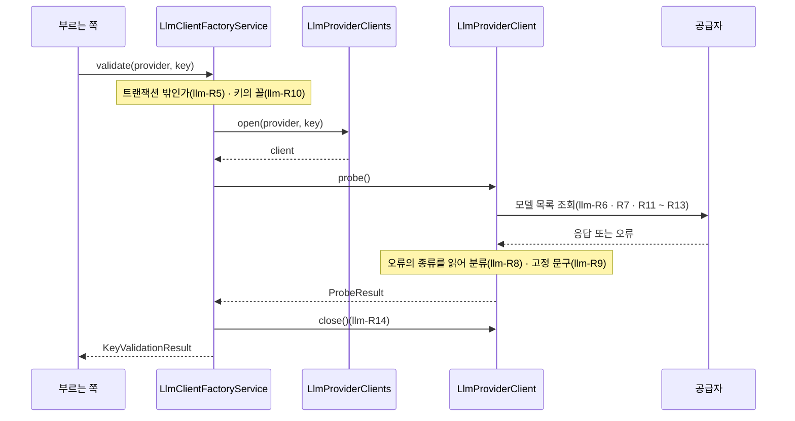

# llm 모듈 Spec

공통 구조와 쓰는 규칙은 [specs/README.md](README.md)에 있다.

## 1. 책임과 범위

`llm` 은 사용자 LLM 키(BYOK)로 하는 모든 LLM 호출의 관문이다. 공급자(OpenAI · Anthropic)와 그 라이브러리를 아는 코드는 이 모듈에만 있다.

- **공급자와 허용 모델 목록** — v1 의 공급자 둘과, 사용자가 고를 수 있는 모델의 목록(모델마다 입력 토큰 예산 · 구조화 출력 지원 여부). 목록은 앱에 든 기본 파일이 정본이고 운영자가 자기 파일로 통째로 바꾼다
- **키 검증** — 주어진 키로 공급자에 가벼운 요청 하나를 보내 키가 쓸 수 있는지 본다. 실패는 종류로 가른다
- **공급자 클라이언트** — 주어진 키로 공급자 클라이언트를 요청마다 만들고 쓰고 닫는다. 주소 · 키 · 로그 수준을 언제나 명시하고, 전송은 이 모듈이 직접 구현한다
- **실패 분류** — 공급자가 답하지 못한 까닭을 종류로 가르는 정본. 검증과 생성 호출이 함께 쓴다
- **로컬 대체물** — 로컬 개발에서 외부 계정 없이 키 검증의 결과를 재현한다
- **저장한 키의 길** — 사용자가 저장한 키를 공급 인터페이스로 받아 호출 직전에만 쓰고, 결과를 그 키에 알린다. 지금 이 길로 하는 일은 저장한 키의 검증이다
- **(미구현)** 프롬프트를 넘겨 결과를 받는 호출 API — 저장한 키의 길에 더한다

하지 않는 것:

- 키를 저장하지 않는다 — 암호화 보관과 복호화는 `credential` 의 것이다. 이 모듈은 공급 인터페이스로 받은 평문을 호출이 끝날 때까지만 쥔다
- 사용자가 고른 공급자 · 모델을 저장하지 않는다 — 사용자 설정은 `user` 의 것이다. 이 모듈은 목록에 그 모델이 있는지만 답한다
- 프롬프트를 만들거나 LLM 출력을 검증하지 않는다 — 다이제스트 · 변화 리포트를 만드는 모듈의 것이다
- 요청 제한을 걸지 않는다 — 키 검증 경로의 요청 제한은 그 경로를 가진 쪽의 것이다
- Spring AI · 공급자 SDK 의 타입을 밖으로 내지 않는다(llm-R15)

다른 모듈과의 의존과 이벤트 흐름은 [overview.md §5](../overview.md#5-모듈-지도)에 있다.

## 2. 용어

| 용어 | 뜻 |
|---|---|
| 공급자 | LLM API 를 내는 곳 — OpenAI · Anthropic |
| 허용 모델 | 이 인스턴스의 사용자가 고를 수 있는 모델. 공급자와 모델 ID 로 가리킨다 |
| 입력 토큰 예산 | 그 모델에 한 번의 생성 요청으로 넣는 입력의 상한(토큰). 모델의 문맥 한도가 아니라 이 서비스가 정한 값이다 |
| 구조화 출력 | 공급자가 응답을 JSON 스키마에 맞게 강제하는 기능 |
| 키 검증 | 키가 쓸 수 있는지 공급자에 물어보는 가벼운 요청 |
| 실패 종류 | 공급자가 답하지 못한 까닭의 갈래(`LlmFailureKind`) |
| 가짜 키 | 로컬 개발에서 로컬 대체물이 받는 정해진 접두의 키 |
| 저장한 키 | 사용자가 등록해 `credential` 이 암호화해 보관하는 키 |
| 공급 인터페이스 | 이 모듈이 저장한 키를 받으려고 선언하고 `credential` 이 구현하는 인터페이스(`StoredKeySource`) — 외부 의존을 가리는 포트가 아니다 |

## 3. 공개 인터페이스

모듈 최상위 패키지 `net.yozmnews.llm` 의 공개 타입은 아홉이다 — 공개 API 둘(`LlmClientFactory` · `LlmModels`), 값 타입 다섯(`Provider` · `LlmModel` · `KeyValidationResult` · `StoredKeyValidation` · `LlmFailureKind`), 그리고 명명 인터페이스 `stored-key` 의 둘(`StoredKeySource` · `StoredKey`)이다. 명명 인터페이스의 둘은 `credential` 에만 열린다(llm-R18). 이 모듈이 내는 HTTP 엔드포인트 · 이벤트는 없다.

### Provider

LLM 공급자.

```java
public enum Provider {
    OPENAI("openai"), ANTHROPIC("anthropic");
    public String key();
    public static Optional<Provider> ofKey(String key);
}
```

| 값 | 키 | 뜻 |
|---|---|---|
| `OPENAI` | `openai` | OpenAI API |
| `ANTHROPIC` | `anthropic` | Anthropic API |

- 계약
  - 키는 허용 모델 목록 파일과 저장 값에 쓰는 이름이다 — 소문자이고 바꾸지 않는다
  - `ofKey` 는 모르는 키에 빈 값을 낸다(대소문자를 가린다)

관련 규칙: llm-R1

### LlmModel

허용 모델 하나.

```java
public record LlmModel(Provider provider, String id, int inputTokenBudget, boolean structuredOutput) { }
```

| 필드 | 뜻 | 제약 |
|---|---|---|
| `provider` | 공급자 | — |
| `id` | 공급자의 모델 ID | 1 ~ 128자 · 출력 가능한 ASCII, 공급자 안에서 유일 |
| `inputTokenBudget` | 입력 토큰 예산 | 1 ~ 10,000,000 |
| `structuredOutput` | 구조화 출력을 지원하는가 | — |

관련 규칙: llm-R2

### LlmModels

허용 모델 목록 조회 — 두 역할 공통이고 트랜잭션과 무관하다(메모리의 값을 읽는다).

```java
public interface LlmModels {
    List<LlmModel> all();
    List<LlmModel> of(Provider provider);
    Optional<LlmModel> find(Provider provider, String id);
}
```

- 계약
  - `all` 은 공급자 선언 순(`Provider` 의 순서), 공급자 안에서는 파일에 적힌 순이다
  - `of` 는 그 공급자의 모델이고, 없으면 빈 목록이다
  - `find` 는 목록에 없는 모델에 빈 값을 낸다 — 목록이 바뀌어 빠진 모델을 가리키는 쪽이 이것으로 안다
  - 목록은 기동 때 정해지고 실행 중에 바뀌지 않는다(llm-R3)

관련 규칙: llm-R2 ~ R4

### LlmClientFactory

모든 LLM 호출이 거치는 관문.

```java
public interface LlmClientFactory {
    KeyValidationResult validate(Provider provider, SecretValue key);
    StoredKeyValidation validateStored(UserId user, Provider provider);
}
```

- 계약
  - `validate` 는 그 키로 공급자에 가벼운 요청 하나를 보내 결과를 낸다. 예상한 실패는 예외가 아니라 `KeyValidationResult.Rejected` 다
  - 트랜잭션 안에서 부르면 `IllegalStateException` 이다 — 외부 호출은 트랜잭션 밖에서 한다(llm-R5)
  - 키를 저장하지 않고, 결과 · 예외 문구 · 로그에 키를 남기지 않는다(llm-R9 · R12)
  - 두 역할 공통이다. 화면 요청 안에서 불러도 되는 길이로 끝난다(llm-R7)
  - `validateStored` 는 그 사용자 · 공급자의 저장한 키를 공급 인터페이스로 받아 같은 확인 요청을 보내고, 결과를 그 키에 알린 뒤 낸다. 저장한 키가 없으면 요청을 보내지 않고 `StoredKeyValidation.Missing` 이다(llm-R17)
  - `validateStored` 도 트랜잭션 안에서 부르면 `IllegalStateException` 이다(llm-R5). 평문은 이 호출 안에만 있고 결과 · 예외 문구 · 로그에 남지 않는다
- **(미구현)** 프롬프트를 넘겨 결과를 받는 호출 API — 저장한 키의 길에 더하고, 이 인터페이스를 거친다

`SecretValue` · `UserId` 는 `platform` 의 공개 타입이다(platform Spec [SecretValue](platform.md#secretvalue) · [UserId](platform.md#userid)).

관련 규칙: llm-R5 ~ R14 · R17

### KeyValidationResult

키 검증의 결과.

```java
public sealed interface KeyValidationResult {
    record Valid() implements KeyValidationResult { }
    record Rejected(LlmFailureKind kind, String message) implements KeyValidationResult { }
}
```

| 갈래 | 뜻 |
|---|---|
| `Valid` | 공급자가 그 키의 요청에 정상으로 답했다 |
| `Rejected` | 답하지 못했다 — `kind` 는 까닭의 종류, `message` 는 운영 로그용 문구 |

- 계약
  - `Rejected.message` 는 고정 문구 · 상태 코드 · 예외 클래스 이름으로만 이루어진다 — 키 · 응답 본문 · 라이브러리 예외의 문구가 없다(llm-R9). 사용자에게 보일 문구는 부르는 쪽이 `kind` 로 정한다
  - `Valid` 는 그 키로 모델 목록을 조회할 수 있다는 뜻이다 — 잔액 · 지출 한도와 특정 모델을 쓸 권한은 확인하지 않는다(llm-R6)

관련 규칙: llm-R6 · R8 · R9

### StoredKeyValidation

저장한 키의 검증 결과.

```java
public sealed interface StoredKeyValidation {
    record Missing() implements StoredKeyValidation { }
    record Checked(KeyValidationResult result) implements StoredKeyValidation { }
}
```

| 갈래 | 뜻 |
|---|---|
| `Missing` | 그 사용자 · 공급자의 저장한 키가 없다 — 공급자에 묻지 않았다 |
| `Checked` | 저장한 키로 물었다 — `result` 는 `validate` 와 같은 결과다 |

관련 규칙: llm-R17

### StoredKeySource

저장한 키의 공급 인터페이스 — 이 모듈이 선언하고 `credential` 이 구현한다. 명명 인터페이스 `stored-key` 에 속한다.

```java
@NamedInterface("stored-key")
public interface StoredKeySource {
    Optional<StoredKey> find(UserId user, Provider provider);
    void checked(long keyId, KeyValidationResult result);
}
```

- 계약
  - `find` 는 그 사용자 · 공급자의 저장한 키를 평문으로 낸다. 없으면 빈 값이다. 키를 열지 못하면 `IllegalStateException` 이고 문구에 키 · 암호문이 없다
  - `checked` 는 `find` 가 낸 키로 공급자에 물은 결과를 그 키에 알린다. 그 키가 그 사이 지워졌거나 바뀌었으면 아무 일도 없다
  - 이 인터페이스를 부르는 것은 이 모듈의 저장한 키의 길뿐이다(llm-R17 · R18)
  - 구현은 하나다. 구현이 없으면 `LlmClientFactory` 의 구현이 서지 않는다

관련 규칙: llm-R17 · R18

### StoredKey

공급 인터페이스가 건네는 저장한 키. 명명 인터페이스 `stored-key` 에 속한다.

```java
@NamedInterface("stored-key")
public record StoredKey(long id, SecretValue value) { }
```

| 필드 | 뜻 | 제약 |
|---|---|---|
| `id` | 저장한 키의 ID — 결과를 알릴 때 그대로 돌려준다 | — |
| `value` | 키의 평문 | — |

관련 규칙: llm-R17

### LlmFailureKind

공급자가 답하지 못한 까닭의 종류 — 검증과 생성 호출이 함께 쓴다.

```java
public enum LlmFailureKind { INVALID_KEY, PERMISSION_DENIED, QUOTA_EXHAUSTED, TRANSIENT, UNEXPECTED }
```

| 값 | 뜻 |
|---|---|
| `INVALID_KEY` | 키가 무효다 — 틀린 꼴 · 폐기 · 만료 |
| `PERMISSION_DENIED` | 키는 맞지만 그 자원을 쓸 권한이 없다 |
| `QUOTA_EXHAUSTED` | 잔액 · 지출 한도가 소진됐다 — 사용자가 결제 · 한도를 고쳐야 풀린다 |
| `TRANSIENT` | 시간이 지나면 풀릴 수 있다 — 연결 · 마감 · 요청 제한 · 서버 오류 · 과부하 |
| `UNEXPECTED` | 예상 밖의 답이다 — 그 밖의 상태 코드 · 읽을 수 없는 응답 · 상한을 넘은 본문 |

- 계약
  - 종류마다 무엇을 할지(저장하지 않음 · 다시 시도 · 사용자에게 알림)는 부르는 쪽이 정한다
  - 값을 더하는 변경은 이 종류를 가르는 쪽 모두에 닿는다 — 가르는 쪽은 `default` 없는 `switch` 로 쓴다

관련 규칙: llm-R8

## 4. 내부 구조

### 개관

| 패키지 | 책임 |
|---|---|
| (최상위) | 공개 타입 아홉 |
| `domain/catalog` | 허용 모델 목록의 값(`ModelCatalog`)과 목록 파일 형식의 정본(`ModelCatalogParser` 와 결과 `ModelCatalogParse`) |
| `domain/failure` | 실패 분류의 정본 — 공급자 오류에서 읽은 것(`ProviderError`)과 공급자마다의 분류(`OpenAiErrors` · `AnthropicErrors`) |
| `domain/provider` | 공급자 클라이언트 포트(`LlmProviderClients` · `LlmProviderClient`)와 결과(`ProbeResult`) |
| `application` | 공개 API 의 구현 둘, 설정(`LlmProperties`), 목록의 기동 적재 |
| `adapter/out/sdk` | 포트의 운영 구현 — 공급자마다의 클라이언트, 전송, 결선 |
| `adapter/out/local` | 로컬 대체물과 그 결선 |

협력 — 키 검증 한 번:



### 들어오는 쪽

- 기동 시 동작 — `ModelCatalogConfiguration` 이 허용 모델 목록 파일을 읽어 검증한다. 틀리면 기동하지 않는다(llm-R3). 두 역할 모두 한다
- 컨트롤러 · 반복 작업 · 이벤트 리스너는 없다 — 이 모듈은 다른 모듈이 공개 API 로 부른다

### `application`

- `LlmClientFactoryService` — `LlmClientFactory` 의 구현. 트랜잭션 밖인지 보고(llm-R5), 키의 꼴을 보고(llm-R10), 포트로 클라이언트를 열어 확인 요청을 하고 닫는다(llm-R14). 포트가 던진 예상 밖의 예외를 `UNEXPECTED` 로 바꾼다(llm-R9). 저장한 키의 검증은 공급 인터페이스로 키를 받아 같은 확인을 하고 결과를 알린다(llm-R17) — 주어진 키의 검증과 확인의 걸음이 하나다. 트랜잭션 · 역할 애너테이션이 없다
- `LlmModelsService` — `LlmModels` 의 구현. `ModelCatalog` 를 그대로 읽는다
- `ModelCatalogConfiguration` — 목록 파일(운영자 파일이 있으면 그것, 없으면 기본 파일)을 읽어 `ModelCatalog` 빈으로 낸다. 역할 애너테이션이 없다
- `LlmProperties` — 설정 `yozmnews.llm`(§7)

### `domain`

- `ModelCatalog` — 검증된 허용 모델 목록. 불변이고 저장하지 않는다
- `ModelCatalogParser` — 목록 파일 원문을 읽어 형식 규칙(llm-R2)을 판정하는 정본. YAML 읽기와 공통 거부는 `platform` 의 `YamlTextReader` · `StrictYamlBinding` 이 한다
- `ProviderError` — 공급자 오류에서 분류에 쓰려고 읽은 것(상태 코드 · 오류 `code` · 오류 `type` · `retry-after` 헤더 유무). 오류 문구는 담지 않는다
- `OpenAiErrors` · `AnthropicErrors` — `ProviderError` 를 `LlmFailureKind` 로 가르는 정본(llm-R8)
- 키의 꼴은 이 모듈이 갖지 않는다 — `platform` 의 `HeaderValueShape` 가 정본이다([platform Spec](platform.md#headervalueshape))

### 나가는 쪽

포트 — 공급자 클라이언트. 외부 의존(공급자 API)을 가린다.

```java
public interface LlmProviderClients {
    LlmProviderClient open(Provider provider, SecretValue key);
}

public interface LlmProviderClient extends AutoCloseable {
    ProbeResult probe();
    @Override void close();
}

public sealed interface ProbeResult {
    record Reachable() implements ProbeResult { }
    record Failed(LlmFailureKind kind, String message) implements ProbeResult { }
}
```

- 계약
  - `open` 은 그 키의 클라이언트를 새로 만든다. 요청을 보내지 않는다. 부른 쪽이 닫는다
  - `probe` 는 가벼운 요청 하나다(llm-R6). 예상한 실패는 `Failed` 로 내고 예외로 던지지 않는다. `Failed.message` 는 llm-R9 를 따른다
  - `close` 는 그 클라이언트가 쥔 연결 · 스레드를 푼다. 여러 번 불러도 되고, 닫은 뒤의 요청은 보내지 않는다(llm-R14)
  - **(미구현)** 생성 호출 — 호출 API 가 생길 때 이 포트에 더한다

v1 구현(`adapter/out/sdk`):

- `SdkProviderClients` — `LlmProviderClients` 의 운영 구현. 공급자마다의 클라이언트를 그 공급자의 기본 주소로 만든다(llm-R11)
- `OpenAiProviderClient` · `AnthropicProviderClient` — `LlmProviderClient` 의 구현. 공급자 SDK 의 클라이언트를 직접 조립해 쥐고(llm-R11 · R12), 모델 목록 조회로 확인하고(llm-R6), SDK 예외에서 분류에 쓸 것만 읽는다(llm-R8 · R9). Spring AI 의 채팅 모델을 그 SDK 클라이언트로 만든다 — **(미구현)** 호출 API 가 생길 때까지 이 채팅 모델을 부르는 길은 없다
- `JdkTransport` — 공급자로 가는 HTTP 전송의 정본(llm-R13). JDK `HttpClient` 로 보내고 응답 본문은 `platform` 의 `CappedBody` 로 받는다
- `OpenAiSdkHttpClient` · `AnthropicSdkHttpClient` — 두 SDK 의 HTTP 클라이언트 인터페이스를 `JdkTransport` 로 구현한다. SDK 의 요청 · 응답을 옮기기만 한다
- `SdkProviderClientsConfiguration` — `SdkProviderClients` 의 결선. 모든 profile, 두 역할 공통

로컬 대체물(`adapter/out/local`):

- `LocalProviderClients` — 가짜 키는 자기가 받아 정해진 결과를 내고, 그 밖의 키는 운영 구현으로 넘긴다(llm-R16)
- `LocalProviderClientsConfiguration` — `@LocalDevelopment` 결선. 로컬 개발에서 포트의 구현이 `LocalProviderClients` 가 된다

공급 인터페이스 `StoredKeySource`(§3)는 포트가 아니다 — 외부 의존이 아니라 `credential` 이 구현하는 모듈 사이의 인터페이스이고, 구현은 [credential Spec](credential.md#application) 의 `StoredKeys` 다.

신뢰할 수 없는 입력: 키(사용자가 넣는다 — llm-R10), 허용 모델 목록의 운영자 파일(llm-R2), 공급자의 응답(llm-R8 · R9 · R13).

## 5. 규칙과 불변식

### 공급자와 허용 모델 목록

판단의 이유는 [ADR-0008](../adr/0008-v1-llm-providers.md) · [ADR-0153](../adr/0153-allowed-llm-models-come-from-a-bundled-file-that-an-operator-file-replaces-as-a-whole.md)에 있다.

- **llm-R1** — 공급자는 OpenAI(`openai`) · Anthropic(`anthropic`) 둘이다. 공급자마다 달라지는 코드(클라이언트 조립 · 실패 분류)는 `Provider` 를 `default` 없는 `switch` 로 가른다 — 공급자를 더하면 가르는 자리가 컴파일 오류로 드러난다
- **llm-R2** — 허용 모델 목록 파일은 YAML 이고 최상위 키는 `providers` 하나다. 그 아래 키는 공급자 키(llm-R1)이고 공급자마다 `models` 목록을 갖는다. 모델은 `id`(1 ~ 128자 · 출력 가능한 ASCII U+0021 ~ U+007E, 공급자 안에서 유일) · `input-token-budget`(정수 1 ~ 10,000,000) · `structured-output`(불리언)을 모두 갖는다. 모르는 키 · 모르는 공급자는 오류다. 공급자는 빠져도 되고 `models` 는 빈 목록이어도 된다 — 그 공급자의 허용 모델이 없다. 전체 모델 수는 1 이상이다. 원문은 65,536자까지다(`ModelCatalogParser.MAX_CHARS`). 문제는 모두 모아 경로 · 줄:열과 함께 낸다
- **llm-R3** — 목록은 기동 때 한 번 읽는다. 설정 `yozmnews.llm.models-file` 이 있으면 그 파일이 목록 전체이고(기본 목록과 합치지 않는다), 없으면 앱에 든 기본 파일 `llm-models/default.yaml` 이 목록이다. 설정 값이 비었거나, 설정이 가리키는 파일이 없거나 읽지 못하거나 형식이 틀리면 기동하지 않는다 — 문구에 설정 이름 · 환경 변수 이름과 문제 목록이 있다. 기본 목록으로 조용히 떨어지지 않는다. 기본 파일이 틀려도 기동하지 않는다. 두 역할 모두 읽는다
- **llm-R4** — 기본 파일의 입력 토큰 예산은 측정 전의 잠정값이다 — 모델의 문맥 한도가 아니라 다이제스트 한 번의 입력 상한으로 잡은 값이고, 생성 호출을 만들 때 측정으로 고친다([open-questions.md](../open-questions.md) "운영하면서 결정" 9번)

### 키 검증

판단의 이유는 [ADR-0154](../adr/0154-key-validation-lists-models-and-failure-kinds-are-sorted-by-one-rule-per-provider-reading-the-error-kind.md)에 있다.

- **llm-R5** — 공급자 호출은 DB 트랜잭션 밖에서 한다. `validate` 를 트랜잭션 안에서 부르면 요청을 보내지 않고 `IllegalStateException` 이다
- **llm-R6** — 키 검증의 요청은 모델 목록 조회 하나다(OpenAI `GET /v1/models`, Anthropic `GET /v1/models`). 과금되지 않는다. 정상 응답이면 `Valid` 다 — 응답의 모델 목록은 읽지 않는다. 잔액 · 지출 한도 소진과 특정 모델을 쓸 권한은 이 요청으로 드러나지 않고 생성 호출에서 드러난다
- **llm-R7** — 키 검증의 마감은 연결 5초(`JdkTransport.CONNECT_TIMEOUT`) · 요청 하나 15초(`JdkTransport.REQUEST_DEADLINE` — 헤더와 본문 전부)이고, 다시 시도하지 않는다(SDK 의 자동 재시도 0). **(미구현)** 생성 호출의 마감 · 재시도는 호출 API 를 만들 때 정한다
- **llm-R8** — 실패 종류는 공급자마다 `domain/failure` 의 함수 하나가 가른다. 입력은 상태 코드, 오류의 `code` · `type`, `retry-after` 헤더 유무다 — 상태 코드만으로는 요청 제한과 한도 소진이 갈리지 않는다

  | 공급자 | 입력 | 종류 |
  |---|---|---|
  | OpenAI | 401 | `INVALID_KEY` |
  | | 403 | `PERMISSION_DENIED` |
  | | 429 이고 `code` 가 `credit_balance_exhausted` · `organization_spend_limit_exceeded` · `project_spend_limit_exceeded` · `organization_usage_limit_exceeded` 이거나 `type` 이 `insufficient_quota` | `QUOTA_EXHAUSTED` |
  | | 그 밖의 429, 408, 409, 500 ~ 599 | `TRANSIENT` |
  | | 그 밖 | `UNEXPECTED` |
  | Anthropic | 401 | `INVALID_KEY` |
  | | 403 | `PERMISSION_DENIED` |
  | | 402 | `QUOTA_EXHAUSTED` |
  | | 429 이고 `retry-after` 헤더가 없다 | `QUOTA_EXHAUSTED` |
  | | 429 이고 `retry-after` 헤더가 있다, 408, 409, 500 ~ 599 | `TRANSIENT` |
  | | 그 밖 | `UNEXPECTED` |

  응답 없이 끝난 실패(연결 · 마감 · 입출력)는 `TRANSIENT`, 읽을 수 없는 응답과 상한을 넘은 본문(llm-R13)은 `UNEXPECTED` 다. 리다이렉트 응답(3xx)은 따르지 않으므로 "그 밖"이다. OpenAI 의 401 은 틀린 키 · 조직 소속 없음 · 허용되지 않은 IP 를 문구로 가르지 않는다. Anthropic 의 400(운영자가 정한 지출 한도 도달 포함)은 종류로 갈리지 않아 `UNEXPECTED` 다
- **llm-R9** — 실패 문구(`KeyValidationResult.Rejected.message` · `ProbeResult.Failed.message`)와 이 모듈이 남기는 로그는 고정 문구 · 상태 코드 · 예외 클래스 이름으로만 이루어진다. 키, 공급자의 응답 본문 · 헤더, 라이브러리 예외의 문구를 담지 않는다 — 공급자는 오류 본문에 키의 앞뒤 조각을 되돌려주고 SDK 예외의 문구가 그 본문을 담는다. 라이브러리 예외를 밖으로 던지지 않는다 — 포트가 던진 예상 밖의 예외는 `LlmClientFactoryService` 가 `UNEXPECTED` 로 바꾸고 경고 로그에 예외 클래스 이름만 남긴다
- **llm-R10** — 키는 요청 헤더에 실을 수 있는 꼴이어야 한다 — `platform` 의 `HeaderValueShape`([platform-R23](platform.md#비밀-값))가 정본이다. 꼴이 틀리면 요청을 보내지 않고 `INVALID_KEY` 다

### 공급자 클라이언트

판단의 이유는 [ADR-0149](../adr/0149-llm-calls-use-spring-ai-2-without-the-starter-and-build-sdk-clients-with-explicit-address-key-and-log-level-and-close-them.md) · [ADR-0150](../adr/0150-user-keys-travel-over-an-own-jdk-transport-for-the-sdks-without-redirects-or-proxy-and-with-a-response-body-cap.md) · [ADR-0151](../adr/0151-spring-ai-and-sdk-types-stay-inside-llm-and-the-gateway-exposes-only-its-own-types.md)에 있다.

- **llm-R11** — 공급자 클라이언트는 요청마다 그 키로 새로 만든다. 주소와 키를 언제나 명시해 넘긴다 — 라이브러리가 값이 비었을 때 프로세스 환경 변수(`OPENAI_BASE_URL` · `OPENAI_API_KEY` · `ANTHROPIC_BASE_URL` · `ANTHROPIC_API_KEY` · `ANTHROPIC_AUTH_TOKEN` 등)에서 대신 읽는 길(Spring AI 의 설정 도우미, SDK 의 `fromEnv()`)을 쓰지 않는다. 공급자의 기본 주소는 코드 상수다(`OpenAiProviderClient.BASE_URL` = `https://api.openai.com/v1`, `AnthropicProviderClient.BASE_URL` = `https://api.anthropic.com`) — 운영 설정으로 바꿀 수 없다. 사용자 키와 프롬프트는 공급자에만 간다. Spring AI 의 스타터 · 자동 구성을 쓰지 않아 전역 채팅 모델 빈과 `spring.ai.*` 설정이 없다
- **llm-R12** — SDK 의 요청 로그를 꺼짐으로 명시한다. SDK 는 로그 수준을 환경 변수(`OPENAI_LOG` · `ANTHROPIC_LOG`)에서 읽고, 켜지면 인증 헤더는 가리지만 요청 · 응답 본문(프롬프트와 키 조각이 든 오류 본문)을 찍는다
- **llm-R13** — 공급자로 가는 전송은 `JdkTransport` 하나다. 리다이렉트를 따르지 않고, 프록시를 쓰지 않고, 응답 본문을 1 MiB(`JdkTransport.MAX_RESPONSE_BYTES`)까지만 받고, 마감(llm-R7)을 헤더와 본문 전부에 건다. 상한을 넘은 본문과 리다이렉트 응답은 실패다(llm-R8)
- **llm-R14** — 만든 클라이언트는 쓰고 나서 닫는다. 닫으면 전송이 쥔 연결 · 스레드가 풀리고, 닫은 뒤의 요청은 보내지 않는다. Spring AI 의 채팅 모델에는 이 모듈이 만든 SDK 클라이언트를 동기 · 비동기 둘 다 넘긴다 — 넘기지 않은 쪽은 Spring AI 가 따로 만들고 닫을 길이 없다
- **llm-R15** — Spring AI · 공급자 SDK 의 타입은 `adapter/out/sdk` 안에만 있다. 모듈의 공개 타입과 `domain` 의 포트에 나타나지 않는다

### 로컬 대체물

판단의 이유는 [ADR-0155](../adr/0155-llm-local-substitute-takes-only-keys-with-a-fixed-prefix-in-the-local-profile.md)에 있다.

- **llm-R16** — 로컬 개발(profile `local` — [platform-R18](platform.md#로컬-개발))에서 포트의 구현은 `LocalProviderClients` 다. 키가 `yozm-local-`(`LocalProviderClients.PREFIX`)로 시작하면 공급자에 묻지 않고, 접두 뒤의 낱말(다음 `-` 또는 끝까지)이 결과를 정한다 — `valid` 는 성공, `invalid` 는 `INVALID_KEY`, `denied` 는 `PERMISSION_DENIED`, `quota` 는 `QUOTA_EXHAUSTED`, `transient` 는 `TRANSIENT`, `unexpected` 는 `UNEXPECTED` 다. 모르는 낱말은 `INVALID_KEY` 다. 그 밖의 키는 로컬 개발에서도 운영 구현이 실제 공급자에 묻는다. 로컬 개발이 아니면 대체물이 등록되지 않아 가짜 키는 실제 공급자에서 무효로 끝난다

### 저장한 키의 길

판단의 이유는 [ADR-0157](../adr/0157-credential-depends-on-llm-and-stored-keys-reach-llm-through-a-supply-interface-that-llm-declares-and-credential-implements.md)에 있다.

- **llm-R17** — 저장한 키의 검증은 한 번에 이 순서다: 트랜잭션 밖인지 본다(llm-R5) → `StoredKeySource.find` 로 키를 받는다 → 없으면 `Missing` 으로 끝난다 → 주어진 키의 검증과 같은 확인(llm-R6 ~ R14 — 키의 꼴 · 요청 · 분류 · 닫기)을 한다 → 결과를 `StoredKeySource.checked` 로 그 키 ID 에 알린다 → `Checked` 로 낸다. 평문은 `find` 의 반환부터 확인이 끝날 때까지만 이 호출 안에 있다. `find` 가 던진 예외는 예상 밖의 예외와 같이 `UNEXPECTED` 로 바꾸고(llm-R9) 이때 `checked` 를 부르지 않는다. `checked` 가 던진 예외는 그대로 올린다 — 결과를 알리지 못한 검증을 끝난 것으로 내지 않는다
- **llm-R18** — `StoredKeySource` · `StoredKey` 는 명명 인터페이스 `stored-key` 이고, 그것을 허용으로 선언한 모듈은 `credential` 뿐이다. `llm` · `credential` 밖의 클래스는 두 타입에 의존하지 않고, `credential` 안에서 두 타입에 의존하는 클래스는 구현 하나다 — 모듈 검증과 구조 시험이 함께 지킨다(의존 선언이 없는 모듈은 구조 시험이 막는다)

## 6. 데이터

해당 없음 — 이 모듈은 자기 테이블이 없다.

## 7. 설정

| 설정 키 | 바꾸는 규칙 |
|---|---|
| `yozmnews.llm.models-file`(환경 변수 `YOZMNEWS_LLM_MODELS_FILE`) | 허용 모델 목록의 운영자 파일 경로. 있으면 그 파일이 목록 전체다(llm-R3). 없으면 기본 파일. 선택 |

## 8. 결정

| ADR | 한 줄 |
|---|---|
| [0003](../adr/0003-byok-personalized-digest.md) | 사용자 BYOK LLM 으로 개인화 종합 다이제스트를 만들고, 사용자 키로 요청마다 클라이언트를 만든다 |
| [0008](../adr/0008-v1-llm-providers.md) | v1 지원 LLM 공급자는 OpenAI 와 Anthropic 이고, 운영자가 허용 모델 목록을 관리한다 |
| [0012](../adr/0012-swappable-external-dependencies.md) | 외부 의존성은 교체 가능하게, 개발 환경에는 로컬 대체물을 둔다 |
| [0057](../adr/0057-local-substitutes-registered-only-in-local-profile-without-operator-switch.md) | 로컬 대체물은 `local` profile 에서만 등록하고, 운영 설정으로 켜는 스위치를 두지 않는다 |
| [0149](../adr/0149-llm-calls-use-spring-ai-2-without-the-starter-and-build-sdk-clients-with-explicit-address-key-and-log-level-and-close-them.md) | LLM 호출은 Spring AI 2.0 을 스타터 없이 쓰고, SDK 클라이언트를 직접 만들어 주소 · 키 · 로그 수준을 명시하고 닫는다 |
| [0150](../adr/0150-user-keys-travel-over-an-own-jdk-transport-for-the-sdks-without-redirects-or-proxy-and-with-a-response-body-cap.md) | 사용자 키가 가는 전송은 SDK 의 HTTP 클라이언트를 JDK `HttpClient` 로 직접 구현한다 — 리다이렉트 · 프록시 없음, 응답 본문 상한 |
| [0151](../adr/0151-spring-ai-and-sdk-types-stay-inside-llm-and-the-gateway-exposes-only-its-own-types.md) | Spring AI · SDK 의 타입은 `llm` 밖으로 나가지 않고, 관문은 자기 타입만 낸다 |
| [0152](../adr/0152-secret-value-is-a-platform-public-type-that-fails-on-serialization.md) | 비밀 값 평문의 래퍼 `SecretValue` 는 `platform` 의 공개 타입이고, 직렬화하면 실패한다 |
| [0153](../adr/0153-allowed-llm-models-come-from-a-bundled-file-that-an-operator-file-replaces-as-a-whole.md) | 허용 모델 목록은 앱에 든 파일이 정본이고, 운영자는 자기 파일로 통째로 바꾼다 |
| [0154](../adr/0154-key-validation-lists-models-and-failure-kinds-are-sorted-by-one-rule-per-provider-reading-the-error-kind.md) | 키 검증은 모델 목록 조회이고, 실패 종류는 공급자마다 오류의 종류까지 읽는 정본 하나가 가른다 |
| [0155](../adr/0155-llm-local-substitute-takes-only-keys-with-a-fixed-prefix-in-the-local-profile.md) | `llm` 의 로컬 대체물은 `local` 에서 정해진 접두의 키만 받는다 |
| [0156](../adr/0156-user-id-is-a-platform-public-type.md) | 사용자 식별자 `UserId` 는 `platform` 의 공개 타입이다 |
| [0157](../adr/0157-credential-depends-on-llm-and-stored-keys-reach-llm-through-a-supply-interface-that-llm-declares-and-credential-implements.md) | `credential` 이 `llm` 에 의존하고, 저장한 키는 `llm` 이 선언한 공급 인터페이스를 `credential` 이 구현해 낸다 |
