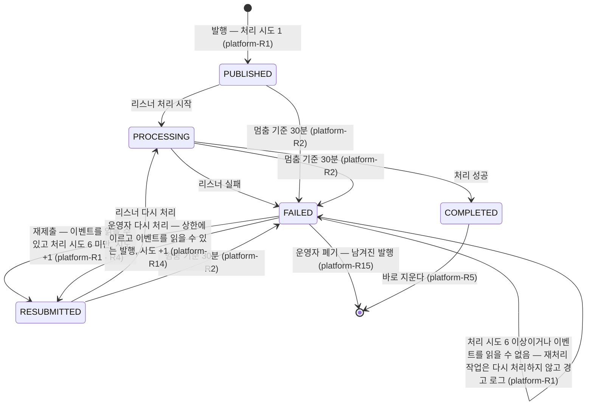

# platform 모듈 Spec

공통 구조와 쓰는 규칙은 [specs/README.md](README.md)에 있다.

## 1. 책임과 범위

`platform` 은 여러 모듈에 걸친 것을 맡는다.

- **이벤트 발행 재처리** — 모듈 사이 이벤트의 리스너가 실패한 발행을 주기적으로 다시 처리하고, 상한을 넘긴 발행을 알린다
- **남겨진 발행의 운영자 처리** — 재처리가 더 이상 다루지 않는 발행을 운영자가 보고 다시 처리하거나 폐기하는 공개 운영 API
- **화면용 API 명세 설정** — 백엔드 코드가 만드는 화면용 API 명세의 고정 값과 속성 규칙, 운영자 경로 · 세션 경로 연산의 거부 응답. 구현은 이 모듈의 `OpenApiConfiguration` · `OpenApiPathsConfiguration` 과 `springdoc` 설정이다. 세션 사용자 인자를 명세에서 빼는 설정은 그 인자 타입을 가진 `user` 가 둔다([user Spec](user.md#화면용-api-의-공개와-세션-사용자) user-R6)(정본 규약은 [overview.md §6](../overview.md#6-횡단-규약) "화면용 API 계약")
- **API 계약 확인 엔드포인트** — 명세 → 프론트엔드 생성 타입의 파이프라인을 확인하는 엔드포인트
- **역할** — 앱 역할 profile(`web` · `worker`)과 구성요소의 역할 표시, 역할이 하나도 켜지지 않았을 때의 기동 검사, 작업 역할의 스케줄링
- **DB 확장 요건** — DB 에 pgvector 확장을 설치하는 마이그레이션과, 설치된 확장이 최소 버전 이상인지 기동 때 확인하는 검사(platform-R19)
- **로컬 개발 표시** — 로컬 대체물의 결선을 개발용 profile `local` 에서만 등록하는 표시(`@LocalDevelopment`)와 그 규칙(platform-R18)
- **화면용 API 경로 규약 · 공개 처리기 표시** — 화면용 API 경로(`/api/**`)와 운영자 경로(`/api/admin/**`)의 상수(`ApiPaths`), 세션 없이 여는 처리기의 표시(`@PublicApi`)와 비밀번호를 바꿔야 하는 세션 사용자에게도 여는 처리기의 표시(`@AllowedBeforePasswordChange`)(platform-R21). 이 표시를 읽어 요청을 인증하는 보안 구성은 `user` 의 것이다([user Spec](user.md#1-책임과-범위))
- **오류 응답 형식** — 화면용 API 의 오류 본문(`ApiProblem`)과 그것을 만드는 정본(`ProblemResponses`), 컨트롤러 오류 · 보안 거부의 문제 응답
- **YAML 원문 읽기** — YAML 원문을 이벤트 API 로 읽어 트리로 옮기고, 문서 종류와 무관한 공통 거부(앵커 · 별칭 · 명시 태그 · 중복 키 · 알 수 없는 키 · 빈 값 · 형 오류 등)를 하는 공개 타입. 수집 프로필(`source`)과 기본 태그 체계(`tag`)가 쓴다
- **코드 포인트 자르기** — 텍스트를 앞 몇 코드 포인트로 자르는 공개 타입(`CodePoints`). 피드 요약문(`source`) · 판정 입력(`evaluation`) · 기사 표현 텍스트(`event`) · 첫 운영자의 표시 이름(`user`)의 길이 상한이 쓴다
- **날짜 범위 변환** — 날짜 범위를 시간대의 자정으로 시각 범위에 옮기고, 시간대 전환 여유를 더한 시각 길이 상한을 내는 공개 타입(`DayRange`). 집계 기간(`tag` 의 `EvaluationPeriod`) · 판정 원본 조회 기간(`evaluation` 의 `JudgementPeriod`) · 사건 조회 기간(`event` 의 `EventPeriod`)이 쓴다
- **운영 설정의 행위자 종류** — 운영 설정을 정한 주체의 종류(`ChangeActor` — 시스템 · 운영자). 태그 기준 · 저장 기준 · 태그 체계 버전(`tag`), 큰 판정 기준(`storyline`), 가입 정책(`user`)의 이력이 쓴다
- **HTTP 응답 본문 상한** — JDK `HttpClient` 의 응답 본문을 상한까지만 받는 공개 타입(`CappedBody`). 외부 API 를 부르는 어댑터(`evaluation` 의 Jev · 외부 임베딩)가 쓴다
- **벡터의 pgvector 텍스트 표현** — 벡터를 pgvector 의 텍스트 표현으로 쓰고 되읽는 공개 타입(`VectorText`). 기사 표현 · 사건 중심(`event`)과 스토리라인 중심(`storyline`)의 저장소가 쓴다

하지 않는 것:

- 다른 모듈의 도메인 규칙을 갖지 않는다. 이벤트를 다시 처리할 뿐, 이벤트를 받아 처리하는 일은 각 리스너 모듈의 것이다
- 화면용 API 명세 파일(`api/openapi.json`)을 소유하지 않는다 — 명세는 각 모듈의 컨트롤러에서 만들어진다
- YAML 문서의 형식(키 목록) · 값 규칙 · 길이 상한 값을 갖지 않는다 — 문서를 가진 모듈의 `domain` 이 정본이고, 이 모듈은 공통 거부만 한다(platform-R17)
- 각 모듈 구성요소의 역할을 정하지 않는다 — 역할 애너테이션은 각 모듈이 자기 구성요소에 단다. 이 모듈은 그 표시와 소속 규칙(platform-R9)을 갖는다
- 로컬 대체물을 갖지 않는다 — 각 모듈이 자기 대체물의 결선에 `@LocalDevelopment` 를 단다(platform-R18)
- 확장을 쓰는 테이블 · 검색은 갖지 않는다 — 쓰는 모듈의 것이다. 이 모듈은 확장이 있고 최소 버전 이상인지만 본다(platform-R19)
- 길이 상한 값을 갖지 않는다 — 상한은 쓰는 모듈의 정본이고, 이 모듈은 자르는 방법만 갖는다

다른 모듈과의 의존과 이벤트 흐름은 [overview.md §5](../overview.md#5-모듈-지도)에 있다.

## 2. 용어

| 용어 | 뜻 |
|---|---|
| 이벤트 발행 | Spring Modulith 이벤트 발행 레지스트리의 한 행 — 이벤트 하나를 리스너 하나에 전달하는 기록 |
| 처리 시도 | 한 발행의 리스너 실행 횟수 — 최초 처리와 재제출 |
| 멈춘 발행 | 발행하고 멈춤 기준 시간이 지나도 끝나지 않은 발행 — 처리 도중 프로세스가 죽은 경우 등 |
| 상한에 이른 발행 | 실패했고 처리 시도가 상한에 이른 발행 — 재처리 작업이 다시 처리하지 않는다 |
| 읽을 수 없는 발행 | 이벤트를 읽을 수 없는 미완료 발행 — 이벤트 클래스를 로드할 수 없거나, 본문을 그 클래스로 읽을 수 없다(예외 또는 값 없음). 클래스가 없는 발행은 Spring Modulith 가 읽을 때 버려 재처리 작업 · 멈춤 감시에 나타나지 않고, 행을 읽을 때마다 알 수 없는 종류의 경고만 남는다. 본문을 읽을 수 없는 발행은 멈춤 감시를 받고, 실패 상태면 재처리 작업이 읽어 보고 건너뛰며 그 경고 줄에 나온다 |
| 남겨진 발행 | 재처리가 더 이상 다루지 않아 운영자가 처리할 발행 — 상한에 이른 발행과 읽을 수 없는 발행 |
| 폐기 | 남겨진 발행을 레지스트리에서 지우는 것 — 되돌릴 수 없다 |
| 공개 처리기 | `@PublicApi` 를 단 화면용 API 처리기 — 세션 없이 연다(platform-R21) |
| 변경 전 허용 처리기 | `@AllowedBeforePasswordChange` 를 단 화면용 API 처리기 — 비밀번호를 바꿔야 하는 세션 사용자에게도 연다(platform-R21) |
| 문제 응답 | 화면용 API 의 오류 응답 — RFC 9457 의 필드 이름을 따르는 `application/problem+json` 본문 |
| 공통 거부 | 문서 종류와 무관하게 거부하는 YAML 문제 — 길이 상한 초과 · 문법 오류 · 최상위가 매핑이 아님 · 여러 문서 · 알 수 없는 키 · 같은 매핑 안 중복 키 · 별칭 · 앵커 · 명시 태그 · 빈 값 · 형 오류(platform-R17) |
| 역할 | 한 프로세스가 맡는 일의 갈래 — 화면 역할(profile `web` — 화면용 API)과 작업 역할(profile `worker` — 백그라운드 작업). 같은 이미지가 켜진 profile 로 역할을 정한다 |

## 3. 공개 인터페이스

모듈 최상위 패키지 `net.yozmnews.platform` 의 공개 타입은 역할 애너테이션 둘, 로컬 개발 애너테이션 하나, 화면용 API 경로 규약 하나(`ApiPaths`), 공개 처리기 표시 하나(`PublicApi`), 변경 전 허용 표시 하나(`AllowedBeforePasswordChange`)와 두 표시의 판정 하나(`PublicApis`), 문제 응답 둘(`ApiProblem` · `ProblemResponses`), 이벤트 발행 운영 API(`EventPublicationAdministration` 과 결과 타입 — 파일 9개, 중첩 레코드를 더하면 타입 11개), YAML 원문 읽기(파일 8개), 코드 포인트 자르기 하나(`CodePoints`), 날짜 범위 변환 하나(`DayRange`), HTTP 응답 본문 수신자 하나(`CappedBody` — 중첩 타입을 더하면 넷), 벡터의 pgvector 텍스트 표현 하나(`VectorText`), 운영 설정의 행위자 종류 하나(`ChangeActor`)다.

| 타입 | 형태 | 용도 |
|---|---|---|
| `WebRole` | `@Target(TYPE)` · `@Retention(RUNTIME)` · `@Documented` · `@Profile(WebRole.PROFILE)` 애너테이션, 상수 `String PROFILE = "web"` | 화면 역할에서만 켜는 구성요소에 단다(platform-R9) |
| `WorkerRole` | 같은 형태, 상수 `String PROFILE = "worker"` | 작업 역할에서만 켜는 구성요소에 단다(platform-R9) |
| `LocalDevelopment` | 같은 형태(`@Profile(LocalDevelopment.PROFILE)`), 상수 `String PROFILE = "local"` | 로컬 대체물의 결선에 단다 — profile `local` 에서만 등록된다(platform-R18) |
| `PublicApi` | `@Target({TYPE, METHOD})` · `@Retention(RUNTIME)` · `@Documented` 애너테이션, 속성 `String reason()` | 세션 없이 여는 화면용 API 처리기(클래스나 메서드)에 단다. `reason` 은 공개인 이유이고 비울 수 없다(platform-R21) |
| `AllowedBeforePasswordChange` | 같은 형태, 속성 `String reason()` | 세션을 요구하는 화면용 API 처리기 가운데 비밀번호를 바꿔야 하는 세션 사용자에게도 여는 것에 단다. 공개 처리기에는 달지 않는다. `reason` 은 비울 수 없다(platform-R21) |

profile 이름의 코드 쪽 정본은 세 상수다.

### ApiPaths

화면용 API 경로 규약 — 경로 패턴 상수의 코드 쪽 정본이다(platform-R21).

```java
public final class ApiPaths {
	public static final String API = "/api/**";
	public static final String ADMIN = "/api/admin/**";
}
```

| 상수 | 뜻 |
|---|---|
| `API` | 화면용 API 경로 — 명세가 담는 경로(platform-R6)이고 `user` 의 세션 체인이 맡는 경로다 |
| `ADMIN` | 운영자 경로 — `user` 의 운영자 체인이 맡고([user Spec](user.md#운영자-접근-통제) user-R1), 명세 설정이 거부 응답을 단다 |

관련 규칙: platform-R6 · platform-R21.

### PublicApis

처리기 표시의 판정 정본 — 메서드나 그 클래스에 `PublicApi` 가 있으면 공개, `AllowedBeforePasswordChange` 가 있으면 변경 전 허용이다(platform-R21). `user` 의 세션 체인 인가 · 명세 설정 · 사용자 격리 등록 가드가 이 판정을 쓴다.

```java
public final class PublicApis {
	public static boolean isPublic(HandlerMethod handler);
	public static boolean allowedBeforePasswordChange(HandlerMethod handler);
}
```

관련 규칙: platform-R21.

### ApiProblem

화면용 API 의 오류 본문 — RFC 9457 Problem Details 의 필드 이름을 따른다.

```java
public record ApiProblem(URI type, String title, int status, String detail, String instance) {}
```

| 필드 | 뜻 | 제약 |
|---|---|---|
| `type` | 문제 유형 — 따로 정하지 않은 문제는 `about:blank` | null 이 아니다 |
| `title` | 유형의 요약 — `about:blank` 면 상태 코드의 표준 문구 | null 이 아니다 |
| `status` | HTTP 상태 코드 | — |
| `detail` | 이 요청에 대한 설명 | null 이 아니다 |
| `instance` | 요청 경로(질의 문자열 제외) | null 이 아니다 |

관련 규칙: platform-R12 · [user Spec](user.md#운영자-접근-통제) user-R3(문제 유형).

### ProblemResponses

문제 응답을 만드는 정본 — 빈(`@Component`)이다. 보안 진입점과 컨트롤러 조언(이 모듈 · 다른 모듈)이 쓴다.

```java
public class ProblemResponses {
    public static final URI BLANK;   // about:blank
    public ProblemResponses(JsonMapper jsonMapper);
    public ResponseEntity<ApiProblem> entity(HttpStatusCode status, String detail, HttpServletRequest request);
    public ResponseEntity<ApiProblem> entity(ApiProblem problem);
    public ApiProblem problem(URI type, String title, HttpStatusCode status, String detail, HttpServletRequest request);
    public void write(HttpServletResponse response, ApiProblem problem) throws IOException;
    public static String standardTitle(HttpStatusCode status);
}
```

| 멤버 | 뜻 |
|---|---|
| `entity(status, detail, request)` | `about:blank` 문제 응답 — 제목은 상태 코드의 표준 문구 |
| `entity(problem)` | 문제 응답 — `application/problem+json`, `Cache-Control: no-store` |
| `problem(…)` | 문제 — 사례는 요청 경로 |
| `write(response, problem)` | 컨트롤러 밖(보안 필터)에서 문제 응답을 쓴다 — 같은 미디어 타입 · 헤더 |
| `standardTitle(status)` | 상태 코드의 표준 문구 |

관련 규칙: platform-R12.

### YamlTextReader · YamlRead · YamlTree · YamlPath · TextLocation · YamlProblem · YamlProblemKind · StrictYamlBinding

YAML 원문 읽기와 공통 거부(platform-R17). 문서를 가진 모듈이 자기 형식의 바인더 · 검증기에서 쓴다.

```java
public final class YamlTextReader {
    public YamlTextReader(int maxChars);
    public YamlRead read(String text);
}

public sealed interface YamlRead {
    record Read(YamlTree.MapNode root) implements YamlRead {}
    record Unreadable(YamlProblem problem) implements YamlRead {}
}

public sealed interface YamlTree {
    TextLocation location();
    @Nullable String anchor();
    @Nullable String tag();
    record MapNode(List<Entry> entries, TextLocation location, @Nullable String anchor, @Nullable String tag) implements YamlTree {}
    record Entry(YamlTree key, YamlTree value) {}
    record ListNode(List<YamlTree> items, TextLocation location, @Nullable String anchor, @Nullable String tag) implements YamlTree {}
    record ScalarNode(ScalarKind kind, String text, TextLocation location, @Nullable String anchor, @Nullable String tag) implements YamlTree {}
    record AliasNode(String anchorName, TextLocation location) implements YamlTree {}
    enum ScalarKind { STRING, INTEGER, DECIMAL, BOOLEAN, NULL }
}

public record YamlPath(List<Segment> segments) {
    public static final YamlPath ROOT;
    public static YamlPath of(String... keys);
    public YamlPath child(String key);
    public YamlPath index(int index);
    public sealed interface Segment {
        record Key(String name) implements Segment {}
        record Index(int value) implements Segment {}
    }
}

public record TextLocation(int line, int column) {
    public static final TextLocation UNKNOWN;
    public @Nullable Integer knownLine();
    public @Nullable Integer knownColumn();
}

public record YamlProblem(YamlPath path, YamlProblemKind kind, String message, TextLocation location) {}

public enum YamlProblemKind {
    TOO_LARGE, SYNTAX_ERROR, NOT_A_MAPPING, MULTIPLE_DOCUMENTS,
    UNKNOWN_KEY, DUPLICATE_KEY, ALIAS_NOT_ALLOWED, ANCHOR_NOT_ALLOWED, TAG_NOT_ALLOWED,
    NULL_NOT_ALLOWED, WRONG_TYPE
}

public final class StrictYamlBinding {
    public StrictYamlBinding(Consumer<YamlProblem> problems);
    public Map<String, YamlTree> entries(YamlTree.MapNode map, YamlPath path, Predicate<String> known);
    public Map<String, YamlTree> entries(YamlTree.MapNode map, YamlPath path, Predicate<String> known, UnknownKey onUnknown);
    public @Nullable YamlTree.MapNode map(@Nullable YamlTree node, YamlPath path);
    public @Nullable YamlTree.ListNode list(@Nullable YamlTree node, YamlPath path);
    public @Nullable Located<String> string(@Nullable YamlTree node, YamlPath path);
    public @Nullable Located<List<Located<String>>> strings(@Nullable YamlTree node, YamlPath path);
    public @Nullable Located<Integer> integer(@Nullable YamlTree node, YamlPath path);
    public @Nullable Located<BigDecimal> decimal(@Nullable YamlTree node, YamlPath path);
    public @Nullable Located<Boolean> bool(@Nullable YamlTree node, YamlPath path);

    @FunctionalInterface
    public interface UnknownKey { void report(YamlPath keyPath, String key, TextLocation location); }

    public record Located<T>(T value, YamlPath path, TextLocation location) {}
}
```

| 타입 · 멤버 | 뜻 | 제약 |
|---|---|---|
| `YamlTextReader` | 원문 → 트리. 키와 값의 앵커 · 태그 · 위치를 그대로 받는다. 스레드 안전 | 상한(문자 수)은 1 이상 — 문서를 가진 모듈이 자기 규칙의 값을 넘긴다 |
| `YamlRead.Read` | 최상위가 매핑인 문서 하나를 읽었다 — 빈 원문 · 내용 없는 문서는 빈 매핑 | — |
| `YamlRead.Unreadable` | 트리로 옮길 수 없다 — 상한 초과 · 문법 오류 · 최상위가 매핑이 아님 · 여러 문서 | — |
| `YamlTree` | 원문을 받은 그대로 옮긴 트리. 같은 매핑 안 중복 키 · 별칭 · 앵커 · 명시 태그도 남긴다. 스칼라 종류는 YAML 1.2 JSON 스키마로 정한다 | — |
| `YamlPath` | 문서 안의 위치. 표시는 `source.name` · `feeds[0].url` 꼴이고 최상위는 빈 문자열 | — |
| `TextLocation` | 줄 · 열(1부터). 모르면 `UNKNOWN`(0, 0) | — |
| `knownLine` · `knownColumn` | 공개 보기에 옮길 줄 · 열 — `UNKNOWN` 이면 null, 그 밖에는 값 그대로 | — |
| `YamlProblem` | 공통 문제 하나 — 경로 · 종류 · 사람이 읽을 문구 · 위치 | — |
| `StrictYamlBinding` | 트리를 엄격하게 읽는 도구 — 문서 하나에 하나. 공통 문제를 찾은 순서대로 생성자의 소비자에게 넘기고, 쓸 수 없는 값은 null 로 돌려준다 | — |
| `entries` | 매핑의 항목을 키 → 값으로 모은다. 키가 문자열 스칼라가 아니거나 앞의 키와 같거나 알 수 없는 키면 문제로 알리고 뺀다. `UnknownKey` 를 넘기면 알 수 없는 키를 호출자가 자기 종류로 알린다 | — |
| `string` · `integer` · `decimal` · `bool` | 스칼라 값 읽기 — 문자열은 문자열 · 수 · 불리언 스칼라의 원문, 정수는 32비트 정수 스칼라, 소수는 정수 · 소수 스칼라(수로 옮길 수 없는 `.inf` · `.nan` · 범위 밖 지수는 형 오류), 불리언은 불리언 스칼라. 아니면 형 오류 | — |

- 계약
  - 문제 문구는 문서 종류를 모른다 — 문서를 가진 모듈은 공통 종류를 자기 문제 코드로 옮길 뿐 문구를 바꾸지 않는다
  - 모듈의 문제 코드가 공통 종류와 같은 이름을 담으면 그 변환은 `default` 없는 망라 `switch` 로 쓴다 — 공통 종류가 늘면 컴파일이 깨진다([ADR-0056](../adr/0056-platform-reads-yaml-text-and-applies-common-rejection.md))

관련 규칙: platform-R17.

### CodePoints

텍스트를 앞 몇 코드 포인트로 자른다 — 빈이 아닌 정적 함수다.

```java
public final class CodePoints {
    public static String prefix(String text, int max);
}
```

- 계약
  - 텍스트가 `max` 코드 포인트 이하면 그 텍스트를 그대로 돌려준다(같은 인스턴스)
  - 넘으면 앞 `max` 코드 포인트를 돌려준다 — 코드 포인트 단위라 서로게이트 쌍을 가르지 않는다. 공백을 걷지 않는다
  - `max` 가 음수면 `IllegalArgumentException`, 텍스트가 null 이면 `NullPointerException`

관련 규칙: 없음. 상한 값은 쓰는 모듈이 갖는다.

### CappedBody

JDK `HttpClient` 의 응답 본문을 상한까지만 모으는 수신자 — 빈이 아니고, 요청마다 새로 만든다.

```java
public final class CappedBody implements HttpResponse.BodySubscriber<CappedBody.Result> {
    public CappedBody(int max);   // 상한(바이트)
    public sealed interface Result {
        record Complete(String text) implements Result {}
        record Overflow() implements Result {}
    }
}
```

- 계약
  - 받은 바이트가 상한 이하로 끝나면 `Complete` — 본문을 UTF-8 로 읽은 문자열
  - 다음 조각을 더하면 상한을 넘을 때 받기를 멈추고(구독 취소) `Overflow` — 입출력 오류와 섞지 않는다
  - 본문 받기가 오류로 끝나면 그 오류로 실패한다
  - 상한이 1 미만이면 `IllegalArgumentException`
- 본문을 끝까지 받아야 완료되므로, 부르는 쪽이 완료를 마감으로 기다리면 마감이 본문 읽기까지 덮는다

관련 규칙: 없음. 상한 값은 쓰는 어댑터가 갖는다.

### DayRange

날짜 범위를 시각 범위로 옮긴다 — 날짜 범위 변환과 시간대 전환 여유의 정본이다. 날짜 수의 상한은 부르는 기간 타입이 갖는다.

```java
public record DayRange(Instant from, Instant to) {
    public static Optional<DayRange> of(LocalDate first, LocalDate last, ZoneId zone, int maxDays);
    public static Duration maxLength(int maxDays);
}
```

| 멤버 | 뜻 |
|---|---|
| 생성자 | `from < to` 가 아니면 `IllegalArgumentException` |
| `of` | `[first 의 그 시간대 자정, last 다음 날의 그 시간대 자정)`. 자정이 없는 날은 그날의 첫 유효 시각이다(`LocalDate#atStartOfDay(ZoneId)`). 날짜 수(`last − first + 1`)가 1 ~ `maxDays` 가 아니거나, `last` 가 `LocalDate.MAX` 이거나, 만든 시각 범위가 `from < to` 가 아니면(하루가 통째로 없는 날) 빈 값. 시간대는 결과에 남지 않는다 |
| `maxLength` | 날짜 `maxDays` 일 범위가 가질 수 있는 시각 길이의 상한 — `maxDays` + 1일(시간대 전환 여유). `maxDays` 가 1 미만이면 `IllegalArgumentException` |

관련 규칙: 없음. 날짜 수의 상한과 기간 규칙은 쓰는 모듈이 갖는다(tag-R28 · evaluation-R39 · event-R20).

### ChangeActor

운영 설정을 정한 행위자의 종류 — 운영 설정의 이력이 남긴다.

```java
public enum ChangeActor { SYSTEM, OPERATOR }
```

| 값 | 뜻 |
|---|---|
| `SYSTEM` | 첫 기동 적재 |
| `OPERATOR` | 공개 운영 API 를 거친 운영자 |

- 계약
  - 사용자를 가리키지 않는다 — 지금 운영자는 토큰 하나라 사람을 구별하지 않는다
  - 저장 값은 상수 이름(`SYSTEM` · `OPERATOR`)이다 — 쓰는 모듈의 이력 테이블이 이 이름으로 저장한다([tag-R13](tag.md#태그-기준--저장-기준) · [storyline-R20](storyline.md#큰-판정) · [user-R32](user.md#가입-정책))

관련 규칙: 없음 — 이력 규칙은 쓰는 모듈이 갖는다.

### VectorText

벡터의 pgvector 텍스트 표현 — 빈이 아닌 정적 함수다. SQL 이 이 텍스트를 `vector` · `halfvec` 로 바꾸고, `::text` 로 되읽은 값을 `parse` 가 읽는다.

```java
public final class VectorText {
    public static String of(float[] values);
    public static float[] parse(String text);
}
```

- 계약
  - `of` 는 `[v1,v2,…]` — 값은 `Float.toString` 이다. 지수 표기(`1.0E-5`)는 pgvector 의 입력 파서가 받는다. 빈 배열이거나 NaN · 무한이 있으면 `IllegalArgumentException`
  - `parse` 는 `[ … ]` 꼴의 쉼표로 나눈 값을 읽는다. 그 꼴이 아니거나 값이 비었으면 `IllegalArgumentException`
  - 벡터 값의 의미(차원 · 정규화)는 갖지 않는다 — 쓰는 모듈이 갖는다

관련 규칙: 없음. 벡터를 쓰는 테이블 · 검색은 쓰는 모듈의 것이다(platform-R19).

### EventPublicationAdministration

남겨진 발행의 목록 · 다시 처리 · 폐기 — `admin` 의 운영자 API 가 부른다. 구현은 `application` 의 `EventPublicationAdministrationService` 다.

```java
public interface EventPublicationAdministration {
    int MAX_BATCH = 500;
    StrandedPublications strandedPublications();
    BatchResult<ResubmissionResult> resubmit(Set<UUID> ids);
    BatchResult<DiscardResult> discard(Set<UUID> ids);
}

public record StrandedPublications(List<StrandedPublication> publications, int total) {}
public record StrandedPublication(UUID id, StrandedReason reason, String eventType, String listenerId,
        Instant publishedAt, int completionAttempts, @Nullable Instant lastResubmittedAt) {}
public enum StrandedReason { EXHAUSTED, UNREADABLE }

public sealed interface BatchResult<T> {
    record Processed<T>(List<T> results) implements BatchResult<T> {}
    record OverLimit<T>(int limit) implements BatchResult<T> {}
}
public record ResubmissionResult(UUID id, ResubmissionOutcome outcome) {}
public enum ResubmissionOutcome { RESUBMITTED, NOT_EXHAUSTED, UNREADABLE, NOT_FOUND }
public record DiscardResult(UUID id, DiscardOutcome outcome) {}
public enum DiscardOutcome { DISCARDED, NOT_STRANDED, CHANGED, NOT_FOUND }
```

| 멤버 · 타입 | 뜻 |
|---|---|
| `MAX_BATCH` | 다시 처리 · 폐기 한 번에 받는 발행 수의 상한이자 목록에 싣는 발행 수의 상한 |
| `strandedPublications()` | 남겨진 발행 — 발행 시각 오름차순(같으면 ID 순) 앞쪽 최대 `MAX_BATCH` 건과 전체 건수(`total`) |
| `resubmit(ids)` | 고른 발행 가운데 상한에 이르고 이벤트를 읽을 수 있는 것을 지금 재제출한다(platform-R14) |
| `discard(ids)` | 고른 발행 가운데 남겨진 발행을 읽은 그대로일 때 지운다(platform-R15) |
| `StrandedPublication` | ID · 까닭 · 이벤트 클래스 이름 · 리스너 ID · 발행 시각 · 처리 시도 · 마지막 재제출 시각. 마지막 재제출 시각은 저장 때 발행 시각으로 채워지므로 재제출된 적 없으면 발행 시각과 같다 |
| `StrandedReason` | `EXHAUSTED` 상한에 이른 발행(다시 처리 · 폐기) · `UNREADABLE` 읽을 수 없는 발행 — 클래스가 없거나 본문이 그 클래스로 읽히지 않음(폐기만) |
| `BatchResult` | `Processed` — 요청 ID 마다 결과 하나, 요청 ID 의 UUID 순(Java `UUID.compareTo`). `OverLimit` — 요청이 `MAX_BATCH` 를 넘어 아무것도 하지 않았다 |
| `ResubmissionOutcome` | `RESUBMITTED` 재제출했다(동시 요청이 먼저 재제출한 경우 포함) · `NOT_EXHAUSTED` 상한에 이른 발행이 아니다(상한 미만 · 처리 중 · 그사이 바뀜) · `UNREADABLE` 이벤트를 읽을 수 없어 재제출할 수 없다 · `NOT_FOUND` 레지스트리에 없다 |
| `DiscardOutcome` | `DISCARDED` 지웠다 · `NOT_STRANDED` 남겨진 발행이 아니다 · `CHANGED` 읽은 뒤 바뀌어 지우지 않았다 · `NOT_FOUND` 레지스트리에 없다 |

결과 타입은 HTTP 모양을 갖지 않는다 — 응답 모양은 `admin` 이 정한다([ADR-0045](../adr/0045-admin-module-serves-operator-api-over-module-public-operation-apis.md)). 관련 규칙: platform-R14 ~ platform-R16.

HTTP 엔드포인트:

| 메서드 · 경로 | 용도 |
|---|---|
| `GET /api/ping` | API 계약 파이프라인(명세 → 프론트엔드 생성 타입) 확인. 화면에는 쓰지 않고 사용자 데이터를 담지 않는다(platform-R7) |

요청 · 응답 형식의 정본은 [`api/openapi.json`](../../api/openapi.json)이다([ADR-0020](../adr/0020-screen-api-contract-from-committed-openapi-spec.md)).

## 4. 내부 구조

### 개관

| 패키지 | 책임 |
|---|---|
| (최상위) | 역할 애너테이션 · 화면용 API 경로 규약 · 공개 처리기 표시와 그 판정 · 문제 응답 · 이벤트 발행 운영 API · YAML 원문 읽기 · 코드 포인트 자르기 · 날짜 범위 변환 · HTTP 응답 본문 상한 · 벡터의 pgvector 텍스트 표현(§3) |
| `adapter/in/job` | 이벤트 발행 재처리 반복 작업 |
| `adapter/in/web` | API 계약 확인 엔드포인트, 화면용 API 명세 설정, 컨트롤러 오류의 문제 응답 |
| `adapter/out/persistence` | 이벤트 발행 레지스트리 행의 읽기 · 조건부 삭제, 설치된 DB 확장의 버전 읽기 |
| `application` | 재처리 유스케이스, 남겨진 발행의 운영 유스케이스, 재처리 설정과 정책 결선, 역할 검사 결선, DB 확장 요건 검사 결선, 작업 역할의 스케줄링, 명세가 담는 경로 |
| `domain` | 재처리 대상 · 남겨진 발행 판정과 그 설정 조건, 이벤트를 읽을 수 있는지의 판정, 레지스트리 행 저장 인터페이스, 역할 판정, pgvector 확장 판정과 설치된 확장 저장 인터페이스 |

협력: `EventResubmissionJob` 이 `EventResubmissionService` 를 부르고, 서비스는 Spring Modulith 의 미완료 발행 전체를 읽어 `EventResubmissionPolicy` 의 판정대로 재제출한다 — 실패 발행은 재제출 전에 `EventReading` 으로 이벤트를 읽어 본다. `admin` 의 운영자 API 는 `EventPublicationAdministrationService` 를 부른다 — 이 서비스는 `RegistryRows`(구현 `JdbcRegistryRows` — 본문은 Spring Modulith 의 `EventSerializer` 로 읽어 `EventReading` 으로 판정한다)로 레지스트리 행을 읽어 같은 정책으로 남겨진 발행을 가르고, 다시 처리는 Spring Modulith 의 재제출 경로로, 폐기는 `RegistryRows` 의 조건부 삭제로 한다. 정책은 `EventResubmissionConfiguration` 이 설정 값(`EventResubmissionProperties`)으로 만든다. `RoleConfiguration` 이 켜진 profile 로 `ActiveRoles` 를 만든다. `VectorExtensionConfiguration` 이 `DatabaseExtensions`(구현 `JdbcDatabaseExtensions`)로 설치된 pgvector 확장의 버전을 읽어 `VectorExtension` 을 만든다. `user` 의 보안 진입점과 이 모듈의 `ProblemResponseAdvice` 는 `ProblemResponses` 로 문제 응답을 쓴다. YAML 원문 읽기는 다른 구성 요소와 협력하지 않는다 — 다른 모듈이 `YamlTextReader` 로 읽은 트리를 `StrictYamlBinding` 으로 바인딩한다. `CodePoints` · `DayRange` 도 협력하지 않는다.

역할: `EventResubmissionJob` 과 `WorkerSchedulingConfiguration` 은 작업 역할, `PingController` · `OpenApiConfiguration` · `ProblemResponseAdvice` 는 화면 역할에서만 켜진다. `EventPublicationAdministrationService` · `JdbcRegistryRows` · `VectorExtensionConfiguration` · `JdbcDatabaseExtensions` 는 공통이다. 나머지는 두 역할 공통이다(platform-R9). YAML 원문 읽기 타입은 빈이 아니다.

#### 발행 상태와 재처리

이벤트 발행의 상태와 그 전이는 Spring Modulith 가 갖는다. 이 모듈의 규칙이 정하는 전이에 식별자를 달았다.



### 들어오는 쪽

| 진입점 | 구성 요소 | 계기 | 내용 |
|---|---|---|---|
| 이벤트 발행 재처리 — 반복 작업 ID `event-publication-resubmission` | `EventResubmissionJob` | 재제출 주기(§7, 기본 5분)마다 | 미완료 발행에서 다시 처리할 것을 재제출하고 상한에 이른 것과 이벤트를 읽을 수 없는 것을 알린다(platform-R1 · R4). 재시도하지 않는다 — 실패한 회차가 재시도를 기다리는 동안 작업 서버가 다음 회차를 건너뛰므로 다음 회차가 곧 재시도다 |
| 남겨진 발행의 운영 기능 | `EventPublicationAdministrationService` | 공개 운영 API 호출(`admin` 의 운영자 요청 — 화면 역할) | 목록 · 다시 처리 · 폐기(platform-R14 ~ R16). 트랜잭션을 열지 않는다 |
| 재처리 설정 검사 | `EventResubmissionConfiguration` | 기동 | 재제출 주기와 멈춤 기준의 조건을 확인한다(platform-R3) |
| 역할 검사 | `RoleConfiguration` | 기동 | 켜진 profile 로 역할을 정하고, 하나도 없으면 기동하지 않는다(platform-R8) |
| DB 확장 요건 검사 | `VectorExtensionConfiguration` | 기동(마이그레이션 뒤) | 설치된 pgvector 확장의 버전을 읽어, 없거나 최소 버전보다 낮으면 기동하지 않는다(platform-R19) |
| 작업 역할의 스케줄링 | `WorkerSchedulingConfiguration` | 기동(작업 역할) | Spring 스케줄링을 켠다 — Spring Modulith 의 멈춤 감시(platform-R2)가 이것으로 돈다(platform-R9) |
| API 계약 확인 | `PingController` | `GET /api/ping` | `{"message": "pong"}` 을 돌려준다(platform-R7). 응답 값 `PingResponse` |
| 화면용 API 명세 | `OpenApiConfiguration` | 명세 생성 | 명세의 고정 값과 속성 규칙, 운영자 경로 연산과 세션 경로 연산의 401 · 403 문제 응답(platform-R6) |
| 컨트롤러 오류 | `ProblemResponseAdvice` | 컨트롤러 예외 | 프레임워크 예외 · 동시 수정 · 처리하지 못한 예외를 문제 응답으로 쓴다. 다른 모듈의 조언이 먼저 받는다(platform-R12) |

### `application`

- `EventResubmissionService` — 미완료 발행 전체를 읽어 정책이 고른 것을 재제출한다. 실패 발행은 필터에서 이벤트를 먼저 읽어 보고(`EventReading`) 읽을 수 없으면 재제출하지 않는다. 상한에 이른 실패 발행과 읽을 수 없는 실패 발행의 ID 를 따로 세어 경고 로그 한 줄로 남긴다. 재제출은 리스너의 처리 끝을 기다리지 않는다. 같은 발행은 여러 인스턴스가 동시에 불러도 한 곳에서만 재제출된다 — Spring Modulith 의 조건부 상태 갱신(platform-R1 · platform-R4). 이 클래스는 트랜잭션을 열지 않는다 — 발행의 상태 갱신은 Spring Modulith 가 한다
- `EventPublicationAdministrationService` — 공개 운영 API `EventPublicationAdministration` 의 구현. 목록은 레지스트리 행 전체를 읽어 정책으로 남겨진 발행을 가른다. 다시 처리는 고른 행을 먼저 읽어 두고(결과의 까닭을 가르는 데만 쓴다), Spring Modulith 의 미완료 발행 재제출을 "고른 ID 이고, 이벤트를 읽어 본 뒤 정책이 상한에 이름으로 판정한 것"만 통과시키는 필터로 부른다. 폐기는 고른 행을 읽어 남겨진 발행만 조건부로 지우고 지운 행마다 경고 로그 한 줄을 남긴다. 상태가 빈 행은 판정에 넘기지 않는다(platform-R14 ~ R16)
- `EventResubmissionConfiguration` — 설정 값으로 정책을 만든다. 설정 조합이 조건을 어기면 기동이 실패한다(platform-R3)
- `EventResubmissionProperties` — 재처리 설정 키(`yozmnews.events` — §7)
- `RoleConfiguration` — 켜진 profile 로 `ActiveRoles` 를 만든다. 활성 profile 이 없으면 기본 profile 이다(platform-R8)
- `VectorExtensionConfiguration` — 설치된 pgvector 확장의 버전을 읽어 `VectorExtension` 을 만들고, 통과하면 버전을 정보 로그 한 줄로 남긴다. 빈을 만들 때 판정하고, 읽기가 받는 `JdbcClient` 가 마이그레이션 뒤에 만들어지므로 첫 기동에서도 마이그레이션이 설치한 확장을 본다(platform-R19)
- `WorkerSchedulingConfiguration` — 작업 역할에서 Spring 스케줄링을 켠다. 스케줄링을 켜는 곳은 이것 하나다(platform-R9)
- `OpenApiPathsConfiguration` — 화면용 API 명세가 담는 경로를 `ApiPaths.API` 로 springdoc 설정에 넣는다. 두 역할 공통이라 작업 역할만 켠 프로세스의 명세도 같은 경로만 담는다(platform-R6 · platform-R21)

### `domain`

- `EventResubmissionPolicy` — 재처리 대상과 남겨진 발행 판정의 정본. 상태 · 처리 시도 · 이벤트를 읽을 수 있는지로 다시 처리 · 상한 · 읽을 수 없음 · 건너뜀과 남겨진 까닭을 정한다 — 읽을 수 있는지는 판정에 필요할 때만 묻는다(실패 발행, 남겨진 까닭은 미완료 발행). 만들 때 재제출 주기와 멈춤 기준의 조건을 확인한다(platform-R1 · platform-R3 · platform-R16). Spring Modulith 의 `EventPublication` 상태를 `default` 없는 망라 `switch` 로 분기한다 — `domain` 이 교체하지 않는 프레임워크의 타입을 쓰는 근거는 [ADR-0037](../adr/0037-domain-may-use-non-replaceable-framework-types.md)이다
- `ActiveRoles` — 이 프로세스가 맡는 역할. 판정의 정본 — 두 역할 모두 아니면 켜는 방법을 알리며 거부한다(platform-R8)
- `VectorExtension` — 설치된 pgvector 확장. 판정의 정본 — 확장 이름 · 최소 버전 상수와 버전 비교 규칙을 갖고, 없음 · 읽을 수 없는 버전 · 최소 버전 미만을 할 일을 알리며 거부한다(platform-R19)
- `DatabaseExtensions` — 설치된 DB 확장의 버전을 읽는 저장 인터페이스. 구현은 `adapter/out/persistence` 의 `JdbcDatabaseExtensions` 다(platform-R19)
- `EventReading` — 이벤트를 읽을 수 있는지의 판정 정본. 읽기가 값을 돌려주면 참, 예외 · 클래스 연결 오류를 던지거나 값이 없으면 거짓이다(platform-R16)
- `RegistryRows` — 이벤트 발행 레지스트리의 행을 읽고(전체 · ID 로), 읽은 그대로일 때만 지우는 저장 인터페이스. 이벤트 내용은 읽을 수 있는지의 판정에만 쓰고 행에 싣지 않는다. 구현은 `adapter/out/persistence` 의 `JdbcRegistryRows` 다(platform-R15 · platform-R16)
- 그 밖의 값: `EventResubmissionPolicy.Decision` · `RegistryRows.RegistryRow`
- 저장 단위: 자기 테이블이 없다(§6)

### 나가는 쪽

해당 없음 — 포트가 없다. 이벤트 발행 레지스트리(Spring Modulith)와 반복 작업(JobRunr)은 프레임워크다. 레지스트리 행은 `adapter/out/persistence` 의 `JdbcRegistryRows` 가 `RegistryRows` 의 구현으로 직접 읽고 지운다(§6). 설치된 확장은 `JdbcDatabaseExtensions` 가 `DatabaseExtensions` 의 구현으로 시스템 카탈로그를 읽는다(§6).

## 5. 규칙과 불변식

### 이벤트 발행 재처리

모듈 사이 이벤트는 Spring Modulith 이벤트 발행 레지스트리(JDBC)에 기록된다([ADR-0023](../adr/0023-jobrunr-oss-framework-schema-and-event-resubmission.md)).

- **platform-R1** — 다시 처리하는 것은 리스너가 실패한(`FAILED`) 발행 가운데 이벤트를 읽을 수 있는 것뿐이다(platform-R16). 한 발행의 총 처리 시도 상한은 6회(최초 처리 1회 + 재제출 5회)다 — 발행의 처리 시도 수는 저장 때 1 이고 재제출마다 1 씩 는다. 재처리 작업은 처리 시도가 상한에 이른 실패 발행을 다시 처리하지 않고 실패로 남기며(운영자 처리는 platform-R14 · R15), 이벤트를 읽을 수 없는 실패 발행도 처리 시도와 상관없이 다시 처리하지 않는다. 남아 있는 동안 재처리 작업이 돌 때마다 두 갈래의 발행 ID 를 따로 세어 경고 로그 한 줄로 알린다
- **platform-R2** — 처리 도중 멈춘 발행은 Spring Modulith 의 멈춤 감시가 발행 시각에서 멈춤 기준 시간(30분)이 지나면 실패로 바꾸고, 그 뒤 platform-R1 의 경로로 다시 처리된다. 감시는 작업 역할에서만 돈다(platform-R9). 멈춤 기준은 발행 · 처리 중 · 재제출 세 상태에 같은 값이다 — 감시는 기간이 하나라도 있으면 세 상태를 모두 판정하고, 비운 상태는 발행 전부를 멈춤으로 본다
- **platform-R3** — 재제출 주기와 멈춤 기준은 0 보다 크고, (처리 시도 상한 − 1) × 재제출 주기가 멈춤 기준보다 짧아야 한다 — 감시는 발행 시각으로 멈춤을 판정하므로, 마지막 재제출이 멈춤 기준 안에 있어야 정상 운영에서 재처리 중인 발행을 멈춤으로 오판하지 않는다. 기동 때 확인하고 어기면 기동하지 않는다
- **platform-R4** — 재처리는 미완료 발행 전체를 읽어 고른다 — 상한에 이른 실패 발행이 쌓여도 새 실패 발행이 밀리지 않는다. 고르는 필터는 조건부 갱신 전에 실패 발행의 이벤트를 읽어 보고, 읽지 못한 발행은 갱신 · 재제출하지 않는다 — 본문을 읽을 수 없는 발행이 재제출 도중 예외로 그 회차의 나머지를 끊지 않고, 처리 시도도 늘지 않는다. 같은 발행은 여러 인스턴스가 동시에 재처리해도 한 곳에서만 재제출된다(Spring Modulith 의 조건부 상태 갱신). 재제출은 리스너의 처리 끝을 기다리지 않는다
- **platform-R20** — 리스너를 다른 패키지로 옮기는 변경은 같은 변경에 Flyway 마이그레이션을 둔다 — 완료되지 않은 발행의 리스너 ID(Spring 의 기본 ID — 클래스 전체 이름 · 메서드 · 인자 타입)를 옛 ID 에서 새 ID 로 바꾸고, 리스너 하나가 둘로 나뉘면 남은 행을 새 리스너마다 하나씩 되도록 복제한다. 옮긴 반복 작업의 남은 예약 · 대기 작업 행은 같은 마이그레이션이 지운다. 재처리 · 운영자의 다시 처리는 발행의 리스너 ID 와 같은 리스너만 부르기 때문이다 — 없으면 발행이 실패로 남는다([ADR-0113](../adr/0113-moving-listeners-or-jobs-between-modules-migrates-pending-publication-listener-ids-and-drops-pending-jobs-of-the-old-class.md))
- **platform-R5** — 완료된 발행은 바로 지운다 — 결과는 각 모듈의 데이터에 남는다. 실패한 발행은 운영자가 폐기할 때까지(platform-R15) 남아 재처리와 원인 조사의 근거가 된다. 이 보존 기간은 [data-model.md "보존 정책"](../data-model.md#보존-정책-초안)의 이벤트 발행 기록 행이다

### 남겨진 발행의 운영자 처리

- **platform-R14** — 운영자는 남겨진 발행을 본다: 발행 시각 오름차순(같으면 ID 순) 앞쪽 최대 500건(`EventPublicationAdministration.MAX_BATCH`)과 전체 건수, 발행마다 ID · 까닭 · 이벤트 종류 · 리스너 · 발행 시각 · 처리 시도 · 마지막 재제출 시각 — 이벤트 내용은 내지 않는다. 다시 처리는 고른 발행 가운데 상한에 이르고 이벤트를 읽을 수 있는 것을 지금 한 번 재제출한다 — 재처리 작업과 같은 재제출 경로 · 조건부 갱신(platform-R4)을 거치고 처리 시도는 1 늘어난다. 처리 시도를 되돌리지 않으므로, 다시 실패한 발행은 곧바로 상한에 이른 발행으로 남고 재처리 작업은 다루지 않는다. 재제출은 리스너의 처리 끝을 기다리지 않는다. 결과는 고른 발행마다 `RESUBMITTED` · `NOT_EXHAUSTED` · `UNREADABLE` · `NOT_FOUND` 다. 재제출 직후의 다시 처리를 막지 않는다 — 멈춤 감시는 발행 시각으로 판정하므로(platform-R2) 운영자가 재제출한 발행은 처리 중이어도 다음 감시 회차에 실패로 바뀔 수 있고, 같은 발행이 동시에 처리되면 리스너 멱등이 결과를 지킨다
- **platform-R15** — 폐기는 고른 발행 가운데 남겨진 발행을, 읽은 상태 · 처리 시도 · 이벤트 종류가 그대로일 때만 레지스트리에서 지운다. 결과는 고른 발행마다 `DISCARDED` · `NOT_STRANDED` · `CHANGED` · `NOT_FOUND` 다. 폐기 기록은 따로 두지 않고, 지운 발행마다 경고 로그 한 줄에 ID · 까닭 · 이벤트 종류 · 리스너 · 발행 시각 · 처리 시도를 남긴다 — 이벤트 내용은 남기지 않는다. 폐기는 되돌릴 수 없다. 다시 처리 · 폐기는 한 번에 500건까지 받고, 넘으면 아무것도 하지 않는다. 트랜잭션을 열지 않는다 — 폐기는 행마다 문장 하나다
- **platform-R16** — 남겨진 발행은 상한에 이른 발행(platform-R1 의 판정)과 읽을 수 없는 발행이다. 읽을 수 없는 발행은 완료되지 않았고, 이벤트 클래스를 Spring Modulith 와 같은 클래스 로더로 로드할 수 없거나, 본문을 그 클래스로 Spring Modulith 와 같은 직렬화기(`EventSerializer`)로 읽을 수 없는(예외 또는 값 없음) 발행이다 — 상태 · 처리 시도와 상관없다. 판정의 정본은 `EventResubmissionPolicy`(뜻)와 `EventReading`(읽기 결과 → 읽을 수 있음)이다. 레지스트리 행의 이벤트 내용은 이 판정에만 읽고 응답 · 로그에 싣지 않는다 — 처리 시도가 비었으면 0 으로 읽고, 상태가 빈 행은 남겨진 발행이 아니다

### 역할

- **platform-R8** — 앱 역할은 Spring profile `web`(화면 역할) · `worker`(작업 역할) 둘이다. 두 profile 을 함께 켜면 한 프로세스가 두 역할을 다 한다. 역할 profile 을 하나도 켜지 않으면(활성 profile 이 없으면) 기본 profile 로 두 역할을 함께 한다. 다른 profile 만 켜 역할이 하나도 켜지지 않으면 기동하지 않고, 켜는 방법(예: `--spring.profiles.active=local,web,worker`)을 알린다
- **platform-R9** — 역할 소속:
  - 화면 역할 — 각 모듈 `adapter/in/web` 의 구성요소(화면용 API 컨트롤러 · 명세 설정). `@WebRole` 을 단다
  - 작업 역할 — 각 모듈 `adapter/in/job` 의 구성요소(작업 진입점 — 반복 작업 등록 포함), JobRunr 작업 서버, 프리셋 기동 대조, 평가기 키 기동 검사 · 임베더 기동 검사, 운영 임베더(`evaluation` 의 로컬 모델 · 외부 구현의 결선), Spring 스케줄링과 멈춤 감시. 구성요소에는 `@WorkerRole` 을 단다
  - 공통 — 애플리케이션 서비스 · 도메인 · 저장소, 작업 등록(`JobScheduler`), 피드 요청 관문과 같은 언론사 요청 예약, 이벤트 리스너, 기본 태그 체계의 기동 검증 · 첫 기동 적재, Flyway 마이그레이션, 관리 엔드포인트(health), 역할 검사, DB 확장 요건 검사, 보안 구성([user Spec](user.md#보안-구성) user-R4). 이벤트 리스너에는 역할을 달지 않는다 — 리스너는 발행한 프로세스에서 돌고 발행 기록도 그 프로세스의 리스너에 대해서만 생기므로, 한 역할에서 빼면 그 역할이 발행한 이벤트가 처리되지 않는다. 재제출한 발행의 리스너는 재제출한 프로세스에서 돈다 — 재처리 작업이면 작업 역할, 운영자의 다시 처리면 화면 역할
  - 한 구성요소가 두 역할을 함께 달지 않는다. 역할이 켜는 설정은 작업 역할 설정 파일(§7)에만 두고 기본은 꺼진 값이다 — 역할 설정 파일은 활성화 순서대로 덮어쓰므로 역할끼리 같은 키를 다르게 쓰지 않는다
  - 주기 실행은 JobRunr 반복 작업으로 둔다. Spring 스케줄링은 작업 역할에서만 켜지므로, 공통 구성요소의 `@Scheduled` 는 화면 역할만 켠 프로세스에서 돌지 않는다

### DB 확장

- **platform-R19** — 앱은 DB 에 pgvector 확장(`vector`)이 설치되어 있고 설치 버전이 0.8(`VectorExtension.MINIMUM_VERSION`) 이상이어야 기동한다 — 최소 버전의 근거는 [ADR-0027](../adr/0027-pgvector-for-vector-storage.md)이다. 버전은 점으로 나눈 숫자 성분을 앞에서부터 견주고, 짧은 쪽의 없는 성분은 0 이다(`0.8` = `0.8.0` < `0.10.0`). 확장이 없거나, 버전을 숫자 성분으로 읽을 수 없거나, 0.8 보다 낮으면 기동하지 않고 할 일(`CREATE EXTENSION vector` 로 설치 · `ALTER EXTENSION vector UPDATE` 로 올림)을 알린다. 확인은 마이그레이션 뒤, 두 역할 모두에서 한다. 설치는 마이그레이션이 `CREATE EXTENSION IF NOT EXISTS vector` 로 한다 — 버전 · 스키마를 정하지 않으며, 앱 계정이 superuser 가 아니면 DBA 가 먼저 설치해 둔다([배포와 운영 "서비스"](../operations/deployment.md#서비스))

### 로컬 개발

판단의 이유는 [ADR-0057](../adr/0057-local-substitutes-registered-only-in-local-profile-without-operator-switch.md)에 있다.

- **platform-R18** — 로컬 대체물(외부 의존 포트의 개발용 구현)의 결선은 `@LocalDevelopment` 를 달아 profile `local` 에서만 등록한다. 로컬 대체물을 켜는 운영 설정(설정 키 · 환경 변수)은 두지 않는다. 등록 조건이 운영에서 대체물을 막는 장치이고, 따로 기동 검사를 두지 않는다. 시험은 대체물을 직접 만들어 시험 구성에 넣는다

### 화면용 API 명세

- **platform-R6** — 백엔드가 만드는 화면용 API 명세는 실행 환경과 무관하게 같다: `info` 는 제목 `요즘뉴스 화면용 API` · 버전 `0`(화면용 API 는 프론트엔드와 함께 바뀌어 버전을 매기지 않는다), `servers` 는 `/`(SPA 와 같은 오리진). 객체 스키마의 속성은 모두 필수로 내고(이름 순) — 응답은 null 인 속성도 키째 쓴다 — null 가능성은 JSpecify `@Nullable` 이 타입으로 남긴다. 운영자 경로(platform-R21)의 모든 연산은 401 · 403 문제 응답(`ApiProblem`)을 담는다. 운영자 경로 밖 화면용 API 연산은 처리기에 `@PublicApi` 가 없으면 401(세션 없음 — [user Spec](user.md#화면용-api-의-공개와-세션-사용자) user-R5)을, 변경 메서드(`POST` · `PUT` · `PATCH` · `DELETE`)면 공개 처리기여도 403(CSRF — user-R10)을, 공개 처리기도 변경 전 허용 처리기도 아니면 403(비밀번호를 바꿔야 한다 — user-R29)을 문제 응답으로 담는다 — 403 은 연산마다 하나라 둘이 겹치는 연산은 설명 하나에 두 까닭을 적는다. 거부 응답은 명세 설정 하나가 처리기의 표시를 읽어 달고, 연산이 따로 적었으면 명세 생성이 실패한다. 세션에서 채우는 사용자 인자(`user` 의 `UserId`)는 요청 인자로 담지 않는다 — 그 설정은 `user` 가 둔다(user-R6). 명세는 `/api/**`(`ApiPaths.API`) 경로만 담고, 출력은 키 순 · 들여쓰기로 고정해 커밋된 명세와 바이트로 비교한다. 실행 중인 앱의 명세 엔드포인트는 기본으로 닫혀 있다. 명세가 정본이라는 규약과 프론트엔드 타입 생성은 [overview.md §6](../overview.md#6-횡단-규약) "화면용 API 계약"이 정한다
- **platform-R7** — `GET /api/ping` 은 `{"message": "pong"}` 을 돌려준다. 화면에는 쓰지 않고 사용자 데이터를 담지 않는다. 세션 없이 여는 공개 처리기다(`@PublicApi` — platform-R21)

### 화면용 API 경로와 공개 처리기

판단의 이유는 [ADR-0124](../adr/0124-security-configuration-lives-in-the-user-module-and-platform-keeps-only-the-screen-api-path-convention.md) · [ADR-0125](../adr/0125-screen-api-handlers-need-a-session-unless-marked-public-and-take-the-user-only-as-a-session-filled-argument.md)에 있다.

- **platform-R10** — (폐지 — 운영자 접근 통제는 [user Spec](user.md#운영자-접근-통제) user-R1 · user-R4 로 옮겼다)
- **platform-R11** — (폐지 — 운영자 토큰은 [user Spec](user.md#운영자-접근-통제) user-R2 로 옮겼다)
- **platform-R21** — 화면용 API 경로는 `/api/**`(`ApiPaths.API`), 운영자 경로는 `/api/admin/**`(`ApiPaths.ADMIN`)다 — 코드 쪽 정본은 이 두 상수이고 보안 구성 · 명세 설정 · 시험이 읽는다. `@PublicApi` 는 화면용 API 처리기(클래스나 메서드)에 달아 세션 없이 연다는 표시이고, 공개인 이유(`reason`)를 비울 수 없다. `@AllowedBeforePasswordChange` 는 세션을 요구하는 처리기에 달아 비밀번호를 바꿔야 하는 세션 사용자에게도 연다는 표시이고, 이유를 비울 수 없으며 공개 처리기에는 달지 않는다. 표시를 읽는 쪽은 `user` 의 세션 체인 인가([user Spec](user.md#화면용-api-의-공개와-세션-사용자) user-R5) · 명세 설정(platform-R6) · 사용자 격리 등록 가드(user-R6)다

### 오류 응답 형식

- **platform-R12** — 화면용 API 의 오류 응답은 `application/problem+json` 의 `ApiProblem`(§3)이고 `Cache-Control: no-store` 다. 다섯 속성 모두 값을 갖는다 — `instance` 는 요청 경로(질의 문자열 제외), `detail` 은 언제나 채운다. 따로 정하지 않은 문제는 `type` 이 `about:blank` 이고 `title` 은 상태 코드의 표준 문구다. 컨트롤러 오류는 화면 역할에서 문제 응답으로 낸다 — 프레임워크 예외(본문 · 경로 값 형식 400, 없는 경로 404, `ResponseStatusException` 의 상태와 이유 등)는 그 상태와 설명으로, 동시 수정(`OptimisticLockingFailureException`)은 409 로, 처리하지 못한 예외는 500 으로 낸다. 요청 본문을 읽지 못한 400(깨진 JSON · 빈 본문 · 칸과 다른 종류의 값)은 설명이 `요청 본문의 형식이 틀렸다` 다. 500 은 예외 문구를 싣지 않고 ERROR 로그를 남긴다. 다른 모듈의 조언이 이 조언보다 먼저 받는다. 판정 결과는 오류가 아니라 200 응답이다([ADR-0044](../adr/0044-screen-api-results-as-flat-discriminated-200-and-rfc9457-problems.md))
  - 요청 본문의 정수 칸에 온 소수(`3.5`, `3.0` 포함)는 버림해 받지 않고 본문 형식 400 이다 — 앱의 JSON 역직렬화 설정(§7 `spring.jackson.deserialization.accept-float-as-int`)이 앱 전체에 건다
- **platform-R13** — (폐지 — 보안 거부의 문제 유형 URI 는 [user Spec](user.md#운영자-접근-통제) user-R3 으로 옮겼다)

### YAML 원문 읽기

판단의 이유는 [ADR-0056](../adr/0056-platform-reads-yaml-text-and-applies-common-rejection.md)에 있다.

- **platform-R17** — YAML 원문은 snakeyaml-engine 의 이벤트 API 로만 읽는다 — 태그로 객체를 만드는 단계가 없다. 해석은 YAML 1.2 JSON 스키마 규칙이다 — 불리언은 소문자 `true` · `false` 뿐이고 `no` · `015` · `~` 와 따옴표 친 값은 문자열이다. 원문 길이 상한(문자 수)은 문서를 가진 모듈이 정해 넘기고, 넘으면 읽지 않는다. 문서는 하나이고 최상위는 매핑이다 — 빈 원문 · 내용 없는 문서는 빈 매핑이다. 공통 거부는 앵커 · 별칭 · 명시 태그, 같은 매핑 안 중복 키, 문자열이 아닌 키, 알 수 없는 키(무엇이 알려진 키인지는 문서를 가진 모듈이 정한다), 빈 값(`null` · 값을 적지 않음), 형 오류다. 별칭은 값을 쓸 수 없고, 앵커 · 태그가 붙은 값은 알린 뒤에도 계속 읽어 다른 문제를 함께 모은다. 문제는 경로 · 줄:열과 함께 찾은 순서대로 한 번에 모두 넘긴다 — 문서를 가진 모듈이 자기 문제와 같은 목록에 넣어 원문 순서를 지킨다

## 6. 데이터

해당 없음 — 이 모듈은 자기 테이블이 없다. 이벤트 발행 레지스트리와 작업 테이블은 프레임워크 테이블이라 [data-model.md](../data-model.md)에 있다.

남겨진 발행의 운영자 처리는 레지스트리 테이블 `event_publication` 을 직접 읽고 지운다(platform-R14 ~ R16). 쓰는 열은 `id` · `event_type` · `listener_id` · `publication_date` · `status` · `completion_attempts` · `last_resubmission_date` · `serialized_event` 이고, 이벤트 내용(`serialized_event`)은 읽을 수 있는지의 판정에만 쓰고 응답 · 로그에 싣지 않는다(platform-R16). 행을 바꾸는 것은 조건부 삭제뿐이다 — 상태 갱신은 Spring Modulith 가 한다.

마이그레이션 `V14` 가 pgvector 확장(`vector`)을 설치한다(platform-R19). 확장은 DB 의 것이고 테이블이 아니다 — 벡터 컬럼은 그것을 쓰는 모듈의 테이블에 있다. DB 확장 요건 검사는 시스템 카탈로그 `pg_extension` 의 `extname` · `extversion` 을 읽기만 한다.

## 7. 설정

| 설정 키 | 바꾸는 규칙 |
|---|---|
| `yozmnews.events.stale-after` | 멈춤 기준 시간(기본 30분 — platform-R2 · R3). 작업 역할 설정 파일의 멈춤 감시(`spring.modulith.events.staleness.*` 세 상태)가 같은 키를 읽는다. 필수 |
| `yozmnews.events.resubmission-interval` | 재제출 주기(기본 5분 — platform-R3, §4). 반복 작업이 같은 키를 읽는다. 필수 |
| `spring.modulith.events.completion-mode` | `delete` — 완료된 발행을 바로 지운다(platform-R5) |
| `spring.profiles.default` | `web,worker` — 역할 profile 을 켜지 않으면 두 역할(platform-R8) |
| `spring.jackson.deserialization.accept-float-as-int` | `false` — 요청 본문의 정수 칸에 온 소수를 본문 형식 400 으로 거부한다(platform-R12). 앱의 JSON 매퍼(요청 본문 · 이벤트 발행 기록 · 문제 응답) 전체에 걸린다 |
| `application-worker.yaml` 의 `jobrunr.background-job-server.enabled` · `spring.modulith.events.staleness.*` | 작업 역할에서만 작업 서버와 멈춤 감시를 켠다. 기본 파일은 작업 서버 `false` · 감시 기간 없음(platform-R9) |
| `spring.modulith.moments.enabled` | `false` — Spring Modulith 의 시간 이벤트를 쓰지 않는다. 스케줄링은 작업 역할이 켠다(platform-R9) |
| `springdoc.api-docs.enabled` · `springdoc.writer-with-*` · `springdoc.model-converters.java-nullable-property-customizer.enabled` | 명세 엔드포인트 기본 꺼짐 · 출력 고정 · `@Nullable` 속성을 null 허용 타입으로(platform-R6). 명세가 담는 경로(`ApiPaths.API`)는 설정 파일이 아니라 `OpenApiPathsConfiguration` 이 springdoc 설정에 넣는다(platform-R21). 역할에 묶지 않는다 — 작업 역할만 켠 `local` 실행에서는 경로 없는 명세가 열린다 |

## 8. 결정

| ADR | 한 줄 |
|---|---|
| [0013](../adr/0013-architecture-patterns.md) | 아키텍처 패턴: 모듈러 모놀리스 + 실용적 헥사고날 |
| [0020](../adr/0020-screen-api-contract-from-committed-openapi-spec.md) | 화면용 API 계약은 커밋된 OpenAPI 명세가 정본이고, 프론트엔드 타입은 그 명세에서 생성한다 |
| [0023](../adr/0023-jobrunr-oss-framework-schema-and-event-resubmission.md) | 백그라운드 작업은 JobRunr OSS 로 돌리고, 프레임워크 스키마는 라이브러리 원문을 Flyway 에 담으며, 실패한 이벤트는 반복 작업이 상한까지 다시 처리한다 |
| [0027](../adr/0027-pgvector-for-vector-storage.md) | 벡터 저장은 PostgreSQL pgvector 확장으로 한다 |
| [0037](../adr/0037-domain-may-use-non-replaceable-framework-types.md) | `domain` 은 교체하지 않는 프레임워크의 타입을 쓸 수 있고, 그 단위 테스트는 스프링 컨텍스트 없이 돈다 |
| [0042](../adr/0042-app-roles-as-web-worker-profiles-marked-by-platform-annotations.md) | 앱 역할은 Spring profile `web` · `worker` 로 나누고, 소속은 `platform` 역할 애너테이션으로 표시하며, 역할이 없으면 기동하지 않는다 |
| [0044](../adr/0044-screen-api-results-as-flat-discriminated-200-and-rfc9457-problems.md) | 화면 API 는 판정 결과를 판별자 하나의 평평한 200 응답으로, 요청의 문제만 RFC 9457 형식의 자체 오류 레코드로 앱 전체에서 낸다 |
| [0045](../adr/0045-admin-module-serves-operator-api-over-module-public-operation-apis.md) | 운영자 API 는 `admin` 모듈이 내고, 각 모듈은 운영 기능과 결과 타입을 최상위 공개 API 로 낸다 |
| [0050](../adr/0050-operator-resubmits-once-or-discards-stranded-event-publications-read-from-registry.md) | 이벤트를 읽을 수 없는 발행은 재제출 전에 거르고, 상한에 이른 · 읽을 수 없는 발행은 운영자가 즉시 1회 재제출하거나 기록 없이 폐기하며, 목록 · 폐기는 `platform` 이 레지스트리 테이블을 직접 다룬다 |
| [0056](../adr/0056-platform-reads-yaml-text-and-applies-common-rejection.md) | YAML 원문 읽기와 공통 거부는 `platform` 이 맡고, 문서별 형식 · 검증은 각 모듈의 `domain` 이 한다 |
| [0057](../adr/0057-local-substitutes-registered-only-in-local-profile-without-operator-switch.md) | 로컬 대체물은 `local` profile 에서만 등록하고, 운영 설정으로 켜는 스위치를 두지 않는다 |
| [0113](../adr/0113-moving-listeners-or-jobs-between-modules-migrates-pending-publication-listener-ids-and-drops-pending-jobs-of-the-old-class.md) | 모듈 사이로 리스너 · 반복 작업을 옮기면 미완료 발행의 리스너 ID 를 마이그레이션으로 옮기고, 옛 클래스의 남은 예약 작업을 지운다 |
| [0124](../adr/0124-security-configuration-lives-in-the-user-module-and-platform-keeps-only-the-screen-api-path-convention.md) | 인증 · 보안 구성은 운영자 토큰 체인까지 `user` 모듈이 갖고, `platform` 은 화면용 API 경로 규약만 갖는다 |
| [0125](../adr/0125-screen-api-handlers-need-a-session-unless-marked-public-and-take-the-user-only-as-a-session-filled-argument.md) | 화면용 API 처리기는 공개 표시가 없으면 세션을 요구하고, 사용자는 세션에서 채운 인자로만 받으며, 등록 가드가 공개 표시나 격리 시험 등록을 강제한다 |
