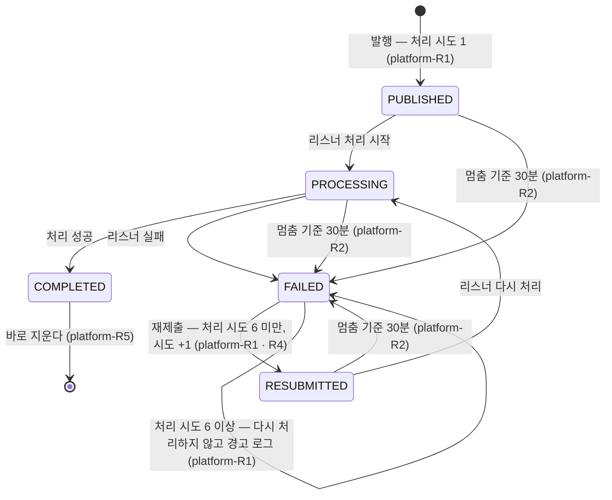

# platform 모듈 Spec

공통 구조와 쓰는 규칙은 [specs/README.md](README.md)에 있다.

## 1. 책임과 범위

`platform` 은 여러 모듈에 걸친 것을 맡는다.

- **이벤트 발행 재처리** — 모듈 사이 이벤트의 리스너가 실패한 발행을 주기적으로 다시 처리하고, 상한을 넘긴 발행을 알린다
- **화면용 API 명세 설정** — 백엔드 코드가 만드는 화면용 API 명세의 고정 값과 속성 규칙. 구현은 이 모듈의 `OpenApiConfiguration` 과 `springdoc` 설정이다(정본 규약은 [overview.md §6](../overview.md#6-횡단-규약) "화면용 API 계약")
- **API 계약 확인 엔드포인트** — 명세 → 프론트엔드 생성 타입의 파이프라인을 확인하는 엔드포인트
- **역할** — 앱 역할 profile(`web` · `worker`)과 구성요소의 역할 표시, 역할이 하나도 켜지지 않았을 때의 기동 검사, 작업 역할의 스케줄링
- **운영자 접근 통제** — 운영자 경로(`/api/admin/**`)를 운영자 토큰으로 막고, 그 밖의 경로는 연다. 보안 구성은 두 역할 공통이다
- **오류 응답 형식** — 화면용 API 의 오류 본문(`ApiProblem`)과 그것을 만드는 정본(`ProblemResponses`), 컨트롤러 오류 · 보안 거부의 문제 응답
- **(미구현)** 공통 타입

하지 않는 것:

- 다른 모듈의 도메인 규칙을 갖지 않는다. 이벤트를 다시 처리할 뿐, 이벤트를 받아 처리하는 일은 각 리스너 모듈의 것이다
- 화면용 API 명세 파일(`api/openapi.json`)을 소유하지 않는다 — 명세는 각 모듈의 컨트롤러에서 만들어진다
- 각 모듈 구성요소의 역할을 정하지 않는다 — 역할 애너테이션은 각 모듈이 자기 구성요소에 단다. 이 모듈은 그 표시와 소속 규칙(platform-R9)을 갖는다

다른 모듈과의 의존과 이벤트 흐름은 [overview.md §5](../overview.md#5-모듈-지도)에 있다.

## 2. 용어

| 용어 | 뜻 |
|---|---|
| 이벤트 발행 | Spring Modulith 이벤트 발행 레지스트리의 한 행 — 이벤트 하나를 리스너 하나에 전달하는 기록 |
| 처리 시도 | 한 발행의 리스너 실행 횟수 — 최초 처리와 재제출 |
| 멈춘 발행 | 발행하고 멈춤 기준 시간이 지나도 끝나지 않은 발행 — 처리 도중 프로세스가 죽은 경우 등 |
| 상한에 이른 발행 | 실패했고 처리 시도가 상한에 이른 발행 — 다시 처리하지 않는다 |
| 운영자 토큰 | 운영자 경로를 여는 비밀 값 하나 — 서버 설정으로 받고, 화면이 `Authorization: Bearer` 로 보낸다. 설정하지 않으면 운영자 기능이 닫힌다 |
| 문제 응답 | 화면용 API 의 오류 응답 — RFC 9457 의 필드 이름을 따르는 `application/problem+json` 본문 |
| 역할 | 한 프로세스가 맡는 일의 갈래 — 화면 역할(profile `web` — 화면용 API)과 작업 역할(profile `worker` — 백그라운드 작업). 같은 이미지가 켜진 profile 로 역할을 정한다 |

## 3. 공개 인터페이스

모듈 최상위 패키지 `net.yozmnews.platform` 의 공개 타입은 역할 애너테이션 둘과 문제 응답 둘(`ApiProblem` · `ProblemResponses`)이다.

| 타입 | 형태 | 용도 |
|---|---|---|
| `WebRole` | `@Target(TYPE)` · `@Retention(RUNTIME)` · `@Documented` · `@Profile(WebRole.PROFILE)` 애너테이션, 상수 `String PROFILE = "web"` | 화면 역할에서만 켜는 구성요소에 단다(platform-R9) |
| `WorkerRole` | 같은 형태, 상수 `String PROFILE = "worker"` | 작업 역할에서만 켜는 구성요소에 단다(platform-R9) |

profile 이름의 코드 쪽 정본은 두 상수다.

### ApiProblem

화면용 API 의 오류 본문 — RFC 9457 Problem Details 의 필드 이름을 따른다.

```java
public record ApiProblem(URI type, String title, int status, String detail, String instance) {}
```

| 필드 | 뜻 | 제약 |
|---|---|---|
| `type` | 문제 유형 — 따로 정하지 않은 문제는 `about:blank` | null 이 아니다 |
| `title` | 유형의 요약 — `about:blank` 면 상태 코드의 표준 문구 | null 이 아니다 |
| `status` | HTTP 상태 코드 | — |
| `detail` | 이 요청에 대한 설명 | null 이 아니다 |
| `instance` | 요청 경로(질의 문자열 제외) | null 이 아니다 |

관련 규칙: platform-R12 · platform-R13.

### ProblemResponses

문제 응답을 만드는 정본 — 빈(`@Component`)이다. 보안 진입점과 컨트롤러 조언(이 모듈 · 다른 모듈)이 쓴다.

```java
public class ProblemResponses {
    public static final URI BLANK;   // about:blank
    public ProblemResponses(JsonMapper jsonMapper);
    public ResponseEntity<ApiProblem> entity(HttpStatusCode status, String detail, HttpServletRequest request);
    public ResponseEntity<ApiProblem> entity(ApiProblem problem);
    public ApiProblem problem(URI type, String title, HttpStatusCode status, String detail, HttpServletRequest request);
    public void write(HttpServletResponse response, ApiProblem problem) throws IOException;
    public static String standardTitle(HttpStatusCode status);
}
```

| 멤버 | 뜻 |
|---|---|
| `entity(status, detail, request)` | `about:blank` 문제 응답 — 제목은 상태 코드의 표준 문구 |
| `entity(problem)` | 문제 응답 — `application/problem+json`, `Cache-Control: no-store` |
| `problem(…)` | 문제 — 사례는 요청 경로 |
| `write(response, problem)` | 컨트롤러 밖(보안 필터)에서 문제 응답을 쓴다 — 같은 미디어 타입 · 헤더 |
| `standardTitle(status)` | 상태 코드의 표준 문구 |

관련 규칙: platform-R12.

HTTP 엔드포인트:

| 메서드 · 경로 | 용도 |
|---|---|
| `GET /api/ping` | API 계약 파이프라인(명세 → 프론트엔드 생성 타입) 확인. 화면에는 쓰지 않고 사용자 데이터를 담지 않는다(platform-R7) |

요청 · 응답 형식의 정본은 [`api/openapi.json`](../../api/openapi.json)이다([ADR-0020](../adr/0020-screen-api-contract-from-committed-openapi-spec.md)).

## 4. 내부 구조

### 개관

| 패키지 | 책임 |
|---|---|
| (최상위) | 역할 애너테이션 · 문제 응답(§3) |
| `adapter/in/job` | 이벤트 발행 재처리 반복 작업 |
| `adapter/in/web` | API 계약 확인 엔드포인트, 화면용 API 명세 설정, 컨트롤러 오류의 문제 응답 |
| `application` | 재처리 유스케이스, 재처리 설정과 정책 결선, 역할 검사 결선, 작업 역할의 스케줄링, 보안 구성과 운영자 토큰 인증 |
| `domain` | 재처리 대상 판정과 그 설정 조건, 역할 판정, 운영자 자격 판정 |

협력: `EventResubmissionJob` 이 `EventResubmissionService` 를 부르고, 서비스는 Spring Modulith 의 미완료 발행 전체를 읽어 `EventResubmissionPolicy` 의 판정대로 재제출한다. 정책은 `EventResubmissionConfiguration` 이 설정 값(`EventResubmissionProperties`)으로 만든다. `RoleConfiguration` 이 켜진 profile 로 `ActiveRoles` 를 만든다. `SecurityConfiguration` 이 설정 값(`AdminSecurityProperties`)으로 `AdminCredential` 을 만들고, 운영자 체인의 `AdminTokenFilter` 가 제시된 토큰을 `AdminTokenAuthenticationProvider` 에 맡겨 대조한다. 보안 진입점과 `ProblemResponseAdvice` 는 `ProblemResponses` 로 문제 응답을 쓴다.

역할: `EventResubmissionJob` 과 `WorkerSchedulingConfiguration` 은 작업 역할, `PingController` · `OpenApiConfiguration` · `ProblemResponseAdvice` 는 화면 역할에서만 켜진다. 보안 구성을 포함한 나머지는 두 역할 공통이다(platform-R9 · platform-R10).

#### 발행 상태와 재처리

이벤트 발행의 상태와 그 전이는 Spring Modulith 가 갖는다. 이 모듈의 규칙이 정하는 전이에 식별자를 달았다.



### 들어오는 쪽

| 진입점 | 구성 요소 | 계기 | 내용 |
|---|---|---|---|
| 이벤트 발행 재처리 — 반복 작업 ID `event-publication-resubmission` | `EventResubmissionJob` | 재제출 주기(§7, 기본 5분)마다 | 미완료 발행에서 다시 처리할 것을 재제출하고 상한에 이른 것을 알린다(platform-R1 · R4). 재시도하지 않는다 — 실패한 회차가 재시도를 기다리는 동안 작업 서버가 다음 회차를 건너뛰므로 다음 회차가 곧 재시도다 |
| 재처리 설정 검사 | `EventResubmissionConfiguration` | 기동 | 재제출 주기와 멈춤 기준의 조건을 확인한다(platform-R3) |
| 역할 검사 | `RoleConfiguration` | 기동 | 켜진 profile 로 역할을 정하고, 하나도 없으면 기동하지 않는다(platform-R8) |
| 작업 역할의 스케줄링 | `WorkerSchedulingConfiguration` | 기동(작업 역할) | Spring 스케줄링을 켠다 — Spring Modulith 의 멈춤 감시(platform-R2)가 이것으로 돈다(platform-R9) |
| API 계약 확인 | `PingController` | `GET /api/ping` | `{"message": "pong"}` 을 돌려준다(platform-R7). 응답 값 `PingResponse` |
| 화면용 API 명세 | `OpenApiConfiguration` | 명세 생성 | 명세의 고정 값과 속성 규칙(platform-R6) |
| 보안 체인 | `SecurityConfiguration` 의 운영자 체인 · 기본 체인 | 모든 HTTP 요청 | 운영자 경로는 운영자 토큰을 요구하고 거부를 문제 응답으로 쓴다. 그 밖의 경로는 연다(platform-R10 · platform-R11) |
| 운영자 자격 검사 | `SecurityConfiguration` | 기동 | 운영자 토큰의 형식을 확인하고, 틀리면 기동하지 않는다(platform-R11) |
| 컨트롤러 오류 | `ProblemResponseAdvice` | 컨트롤러 예외 | 프레임워크 예외 · 동시 수정 · 처리하지 못한 예외를 문제 응답으로 쓴다. 다른 모듈의 조언이 먼저 받는다(platform-R12) |

### `application`

- `EventResubmissionService` — 미완료 발행 전체를 읽어 정책이 고른 것을 재제출하고, 상한에 이른 실패 발행의 ID 를 경고 로그 한 줄로 남긴다. 재제출은 리스너의 처리 끝을 기다리지 않는다. 같은 발행은 여러 인스턴스가 동시에 불러도 한 곳에서만 재제출된다 — Spring Modulith 의 조건부 상태 갱신(platform-R1 · platform-R4). 이 클래스는 트랜잭션을 열지 않는다 — 발행의 상태 갱신은 Spring Modulith 가 한다
- `EventResubmissionConfiguration` — 설정 값으로 정책을 만든다. 설정 조합이 조건을 어기면 기동이 실패한다(platform-R3)
- `EventResubmissionProperties` — 재처리 설정 키(`yozmnews.events` — §7)
- `RoleConfiguration` — 켜진 profile 로 `ActiveRoles` 를 만든다. 활성 profile 이 없으면 기본 profile 이다(platform-R8)
- `WorkerSchedulingConfiguration` — 작업 역할에서 Spring 스케줄링을 켠다. 스케줄링을 켜는 곳은 이것 하나다(platform-R9)
- `SecurityConfiguration` — 보안 구성. 운영자 체인(운영자 경로 — 토큰 필터 · `ADMIN` 역할 인가 · 거부의 문제 응답)과 기본 체인(나머지 — 모두 허용)을 두고, 운영자 자격과 토큰 대조 provider 를 만든다. 운영자 경로와 역할 이름의 정본이다(platform-R10 · platform-R11)
- `AdminTokenFilter` — 운영자 체인 안에서 `Authorization: Bearer` 의 토큰을 provider 에 맡겨 운영자 인증을 둔다. 빈이 아니다(platform-R10)
- `AdminTokenAuthenticationProvider` — 제시된 토큰을 운영자 자격과 대조하는 유일한 자리(platform-R11)
- `ProblemTypes` — 운영자 거부의 문제 유형 URI 와 제목의 정본(platform-R13)
- 그 밖의 값: `AdminSecurityProperties`(설정 `yozmnews.admin` — §7) · `AdminTokenAuthentication`(제시된 토큰 · 운영자 인증)

### `domain`

- `EventResubmissionPolicy` — 재처리 대상 판정의 정본. 발행마다 다시 처리 · 상한 · 건너뜀을 정하고, 만들 때 재제출 주기와 멈춤 기준의 조건을 확인한다(platform-R1 · platform-R3). Spring Modulith 의 `EventPublication` 상태를 `default` 없는 망라 `switch` 로 분기한다 — `domain` 이 교체하지 않는 프레임워크의 타입을 쓰는 근거는 [ADR-0037](../adr/0037-domain-may-use-non-replaceable-framework-types.md)이다
- `ActiveRoles` — 이 프로세스가 맡는 역할. 판정의 정본 — 두 역할 모두 아니면 켜는 방법을 알리며 거부한다(platform-R8)
- `AdminCredential` — 운영자 자격의 판정 정본 — 토큰 형식(최소 · 최대 길이 상수), 열림, 상수 시간 대조. 값은 다이제스트로만 갖는다(platform-R11)
- 그 밖의 값: `EventResubmissionPolicy.Decision`
- 저장 단위: 자기 테이블이 없다(§6)

### 나가는 쪽

해당 없음 — 포트가 없다. 이벤트 발행 레지스트리(Spring Modulith)와 반복 작업(JobRunr)은 프레임워크다.

## 5. 규칙과 불변식

### 이벤트 발행 재처리

모듈 사이 이벤트는 Spring Modulith 이벤트 발행 레지스트리(JDBC)에 기록된다([ADR-0023](../adr/0023-jobrunr-oss-framework-schema-and-event-resubmission.md)).

- **platform-R1** — 다시 처리하는 것은 리스너가 실패한(`FAILED`) 발행뿐이다. 한 발행의 총 처리 시도 상한은 6회(최초 처리 1회 + 재제출 5회)다 — 발행의 처리 시도 수는 저장 때 1 이고 재제출마다 1 씩 는다. 처리 시도가 상한에 이른 실패 발행은 다시 처리하지 않고 실패로 남기며, 남아 있는 동안 재처리 작업이 돌 때마다 그 발행 ID 들을 경고 로그 한 줄로 알린다
- **platform-R2** — 처리 도중 멈춘 발행은 Spring Modulith 의 멈춤 감시가 발행 시각에서 멈춤 기준 시간(30분)이 지나면 실패로 바꾸고, 그 뒤 platform-R1 의 경로로 다시 처리된다. 감시는 작업 역할에서만 돈다(platform-R9). 멈춤 기준은 발행 · 처리 중 · 재제출 세 상태에 같은 값이다 — 감시는 기간이 하나라도 있으면 세 상태를 모두 판정하고, 비운 상태는 발행 전부를 멈춤으로 본다
- **platform-R3** — 재제출 주기와 멈춤 기준은 0 보다 크고, (처리 시도 상한 − 1) × 재제출 주기가 멈춤 기준보다 짧아야 한다 — 감시는 발행 시각으로 멈춤을 판정하므로, 마지막 재제출이 멈춤 기준 안에 있어야 정상 운영에서 재처리 중인 발행을 멈춤으로 오판하지 않는다. 기동 때 확인하고 어기면 기동하지 않는다
- **platform-R4** — 재처리는 미완료 발행 전체를 읽어 고른다 — 상한에 이른 실패 발행이 쌓여도 새 실패 발행이 밀리지 않는다. 같은 발행은 여러 인스턴스가 동시에 재처리해도 한 곳에서만 재제출된다(Spring Modulith 의 조건부 상태 갱신). 재제출은 리스너의 처리 끝을 기다리지 않는다
- **platform-R5** — 완료된 발행은 바로 지운다 — 결과는 각 모듈의 데이터에 남는다. 실패한 발행은 남아 재처리와 원인 조사의 근거가 된다. 이 보존 기간은 [data-model.md "보존 정책"](../data-model.md#보존-정책-초안)의 이벤트 발행 기록 행이다

### 역할

- **platform-R8** — 앱 역할은 Spring profile `web`(화면 역할) · `worker`(작업 역할) 둘이다. 두 profile 을 함께 켜면 한 프로세스가 두 역할을 다 한다. 역할 profile 을 하나도 켜지 않으면(활성 profile 이 없으면) 기본 profile 로 두 역할을 함께 한다. 다른 profile 만 켜 역할이 하나도 켜지지 않으면 기동하지 않고, 켜는 방법(예: `--spring.profiles.active=local,web,worker`)을 알린다
- **platform-R9** — 역할 소속:
  - 화면 역할 — 각 모듈 `adapter/in/web` 의 구성요소(화면용 API 컨트롤러 · 명세 설정). `@WebRole` 을 단다
  - 작업 역할 — 각 모듈 `adapter/in/job` 의 구성요소(작업 진입점 — 반복 작업 등록 포함), JobRunr 작업 서버, 프리셋 기동 대조, Spring 스케줄링과 멈춤 감시. 구성요소에는 `@WorkerRole` 을 단다
  - 공통 — 애플리케이션 서비스 · 도메인 · 저장소, 작업 등록(`JobScheduler`), 피드 요청 관문과 같은 언론사 요청 예약, 이벤트 리스너, Flyway 마이그레이션, 관리 엔드포인트(health), 역할 검사, 보안 구성(platform-R10). 이벤트 리스너에는 역할을 달지 않는다 — 리스너는 발행한 프로세스에서 돌고 발행 기록도 그 프로세스의 리스너에 대해서만 생기므로, 한 역할에서 빼면 그 역할이 발행한 이벤트가 처리되지 않는다
  - 한 구성요소가 두 역할을 함께 달지 않는다. 역할이 켜는 설정은 작업 역할 설정 파일(§7)에만 두고 기본은 꺼진 값이다 — 역할 설정 파일은 활성화 순서대로 덮어쓰므로 역할끼리 같은 키를 다르게 쓰지 않는다
  - 주기 실행은 JobRunr 반복 작업으로 둔다. Spring 스케줄링은 작업 역할에서만 켜지므로, 공통 구성요소의 `@Scheduled` 는 화면 역할만 켠 프로세스에서 돌지 않는다

### 화면용 API 명세

- **platform-R6** — 백엔드가 만드는 화면용 API 명세는 실행 환경과 무관하게 같다: `info` 는 제목 `요즘뉴스 화면용 API` · 버전 `0`(화면용 API 는 프론트엔드와 함께 바뀌어 버전을 매기지 않는다), `servers` 는 `/`(SPA 와 같은 오리진). 객체 스키마의 속성은 모두 필수로 내고(이름 순) — 응답은 null 인 속성도 키째 쓴다 — null 가능성은 JSpecify `@Nullable` 이 타입으로 남긴다. 명세는 `/api/**` 경로만 담고, 출력은 키 순 · 들여쓰기로 고정해 커밋된 명세와 바이트로 비교한다. 실행 중인 앱의 명세 엔드포인트는 기본으로 닫혀 있다. 명세가 정본이라는 규약과 프론트엔드 타입 생성은 [overview.md §6](../overview.md#6-횡단-규약) "화면용 API 계약"이 정한다
- **platform-R7** — `GET /api/ping` 은 `{"message": "pong"}` 을 돌려준다. 화면에는 쓰지 않고 사용자 데이터를 담지 않는다

### 운영자 접근 통제

- **platform-R10** — 운영자 경로(`/api/admin/**`)는 `ADMIN` 역할만 쓴다. 운영자 토큰을 `Authorization: Bearer`(스킴은 대소문자 무시)로 제시해 맞으면 `ADMIN` 역할로 인증한다. 운영자 토큰을 설정하지 않은 인스턴스는 운영자 경로가 어떤 토큰에도 403 `admin-closed` 다. 설정한 인스턴스에서 토큰이 없거나 틀리거나 스킴이 다르면 401 `admin-unauthorized` 이고 `WWW-Authenticate: Bearer` 를 단다. 인증했지만 역할이 없으면 403 `admin-forbidden` 이다. 운영자 경로 밖은 모두 연다. 보안 구성은 두 역할 공통이다 — 어느 프로세스에도 기본 사용자 · 생성 비밀번호가 생기지 않는다. 두 체인 모두 세션을 만들지 않고 폼 로그인 · Basic · 로그아웃 · 요청 저장 · CSRF 를 쓰지 않는다 — 브라우저가 자동으로 붙이는 자격이 없다
- **platform-R11** — 운영자 토큰은 설정 `yozmnews.admin.token`(§7) 하나다. 없거나 빈 값이면 운영자 기능이 닫힌다. 값은 RFC 6750 b64token(영문 대소문자 · 숫자 · `-` `.` `_` `~` `+` `/`, 끝에 `=` 0개 이상)으로 32 ~ 512 자다(`AdminCredential.MIN_LENGTH` · `MAX_LENGTH`) — 어기면 기동하지 않는다. 대조는 SHA-256 다이제스트를 상수 시간으로 견주고, 대조하는 자리는 하나다. 값은 로그 · 예외 문구 · 응답 · 문자열 표현에 남지 않는다(형식 오류의 기동 실패 문구 포함). 틀린 토큰의 요청을 따로 제한하지 않는다

### 오류 응답 형식

- **platform-R12** — 화면용 API 의 오류 응답은 `application/problem+json` 의 `ApiProblem`(§3)이고 `Cache-Control: no-store` 다. 다섯 속성 모두 값을 갖는다 — `instance` 는 요청 경로(질의 문자열 제외), `detail` 은 언제나 채운다. 따로 정하지 않은 문제는 `type` 이 `about:blank` 이고 `title` 은 상태 코드의 표준 문구다. 컨트롤러 오류는 화면 역할에서 문제 응답으로 낸다 — 프레임워크 예외(본문 · 경로 값 형식 400, 없는 경로 404, `ResponseStatusException` 의 상태와 이유 등)는 그 상태와 설명으로, 동시 수정(`OptimisticLockingFailureException`)은 409 로, 처리하지 못한 예외는 500 으로 낸다. 500 은 예외 문구를 싣지 않고 ERROR 로그를 남긴다. 다른 모듈의 조언이 이 조언보다 먼저 받는다. 판정 결과는 오류가 아니라 200 응답이다([ADR-0044](../adr/0044-screen-api-results-as-flat-discriminated-200-and-rfc9457-problems.md))
- **platform-R13** — 문제 유형 URI 는 화면과의 계약이다(명세의 `type` 은 열거가 아니다). 정본은 `ProblemTypes` 다: `urn:yozmnews:problem:admin-closed`(403, 운영자 기능 닫힘) · `urn:yozmnews:problem:admin-unauthorized`(401, 토큰 없음 · 틀림) · `urn:yozmnews:problem:admin-forbidden`(403, 역할 없음). 화면은 `admin-closed` 로 닫힘 안내를 가른다

## 6. 데이터

해당 없음 — 이 모듈은 자기 테이블이 없다. 이벤트 발행 레지스트리와 작업 테이블은 프레임워크 테이블이라 [data-model.md](../data-model.md)에 있다.

## 7. 설정

| 설정 키 | 바꾸는 규칙 |
|---|---|
| `yozmnews.events.stale-after` | 멈춤 기준 시간(기본 30분 — platform-R2 · R3). 작업 역할 설정 파일의 멈춤 감시(`spring.modulith.events.staleness.*` 세 상태)가 같은 키를 읽는다. 필수 |
| `yozmnews.events.resubmission-interval` | 재제출 주기(기본 5분 — platform-R3, §4). 반복 작업이 같은 키를 읽는다. 필수 |
| `spring.modulith.events.completion-mode` | `delete` — 완료된 발행을 바로 지운다(platform-R5) |
| `yozmnews.admin.token` | 운영자 토큰(platform-R10 · platform-R11). 없으면 운영자 기능이 닫힌다. 형식이 틀리면 앱이 뜨지 않는다 |
| `spring.profiles.default` | `web,worker` — 역할 profile 을 켜지 않으면 두 역할(platform-R8) |
| `application-worker.yaml` 의 `jobrunr.background-job-server.enabled` · `spring.modulith.events.staleness.*` | 작업 역할에서만 작업 서버와 멈춤 감시를 켠다. 기본 파일은 작업 서버 `false` · 감시 기간 없음(platform-R9) |
| `spring.modulith.moments.enabled` | `false` — Spring Modulith 의 시간 이벤트를 쓰지 않는다. 스케줄링은 작업 역할이 켠다(platform-R9) |
| `springdoc.api-docs.enabled` · `springdoc.paths-to-match` · `springdoc.writer-with-*` · `springdoc.model-converters.java-nullable-property-customizer.enabled` | 명세 엔드포인트 기본 꺼짐 · `/api/**` 만 · 출력 고정 · `@Nullable` 속성을 null 허용 타입으로(platform-R6). 역할에 묶지 않는다 — 작업 역할만 켠 `local` 실행에서는 경로 없는 명세가 열린다 |

## 8. 결정

| ADR | 한 줄 |
|---|---|
| [0013](../adr/0013-architecture-patterns.md) | 아키텍처 패턴: 모듈러 모놀리스 + 실용적 헥사고날 |
| [0020](../adr/0020-screen-api-contract-from-committed-openapi-spec.md) | 화면용 API 계약은 커밋된 OpenAPI 명세가 정본이고, 프론트엔드 타입은 그 명세에서 생성한다 |
| [0023](../adr/0023-jobrunr-oss-framework-schema-and-event-resubmission.md) | 백그라운드 작업은 JobRunr OSS 로 돌리고, 프레임워크 스키마는 라이브러리 원문을 Flyway 에 담으며, 실패한 이벤트는 반복 작업이 상한까지 다시 처리한다 |
| [0037](../adr/0037-domain-may-use-non-replaceable-framework-types.md) | `domain` 은 교체하지 않는 프레임워크의 타입을 쓸 수 있고, 그 단위 테스트는 스프링 컨텍스트 없이 돈다 |
| [0042](../adr/0042-app-roles-as-web-worker-profiles-marked-by-platform-annotations.md) | 앱 역할은 Spring profile `web` · `worker` 로 나누고, 소속은 `platform` 역할 애너테이션으로 표시하며, 역할이 없으면 기동하지 않는다 |
| [0043](../adr/0043-admin-functions-guarded-by-env-bearer-token-until-account-roles.md) | 운영자 기능은 계정 인증 전까지 환경 변수의 Bearer 토큰으로 막고, 계정 인증이 생기면 같은 경로의 `ADMIN` 역할 판정으로 바꾼다 |
| [0044](../adr/0044-screen-api-results-as-flat-discriminated-200-and-rfc9457-problems.md) | 화면 API 는 판정 결과를 판별자 하나의 평평한 200 응답으로, 요청의 문제만 RFC 9457 형식의 자체 오류 레코드로 앱 전체에서 낸다 |
