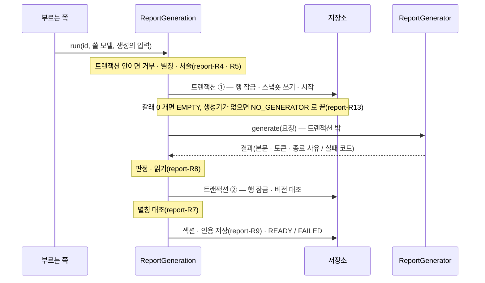

# report 모듈 Spec

공통 구조와 쓰는 규칙은 [specs/README.md](README.md)에 있다.

## 1. 책임과 범위

`report` 는 사용자마다 주간 · 월간 변화 리포트를 만들고 저장하고 조회로 낸다 — 갈래마다 인용 대상(스토리라인 · 사건)과 통계 스냅숏을 담은 생성의 입력에 별칭을 매겨 생성기에 넘기고, 출력을 서술대로 읽어 별칭을 입력과 대조한 뒤 개요 · 섹션 · 인용으로 저장한다([pipeline.md §10](../pipeline.md#10-변화-리포트)).

- **리포트 상태** — 생성을 기다림 · 생성 중 · 끝(내용 있음 · 재료 없음 · 실패)의 전이와, 쓸 모델 · 토큰 · 소요 시간 · 실패 코드 · 생성에 쓴 통계 스냅숏의 기록(report-R1)
- **생성 흐름** — 예약, 행 잠금 뒤 시작, 갈래 · 대상에 별칭 매기기, 생성기를 트랜잭션 밖에서 부르기, 판정, 대조와 저장. 끝났거나 생성 중인 리포트는 건드리지 않는다 — 같은 리포트의 생성기 호출은 하나다(report-R3 · R4 · R8 · R13)
- **출력 서술 · 읽기 · 대조** — 요청마다 그 갈래 집합에서 만든 출력 서술 하나에서 읽기와 생성에 넘길 JSON Schema 문서가 함께 나온다. 서술을 따라 읽는 기구는 `platform` 의 것이고([platform Spec](platform.md#llm-출력-읽기) platform-R31 · R32), 이 모듈은 리포트의 서술(개요 · 갈래를 키로 한 필수 칸) · 상한 · 걸은 값 옮기기 · 별칭 대조를 갖는다(report-R5 ~ R7)
- **생성기 포트 · 로컬 대체물** — 생성기 포트(`ReportGenerator`)와 profile `local` 의 고정 규칙 대체물(`FakeReportGenerator`)(report-R2 · R10)
- **리포트 조회** — 사용자의 리포트 목록과 한 편(섹션 · 인용 · 스냅숏)을 공개 조회(`ReportDirectory`)로 낸다. 합쳐진 사건 · 스토리라인은 남는 것으로 풀고 지운 것은 빼며, 인용을 모두 잃은 섹션은 보이지 않는다. 화면용 API 는 `reader` 가 낸다(report-R11 · R12)
- **(미구현)** 리포트 재료 집계 — 생성의 입력(`ReportInput`)의 갈래 내용과 통계 스냅숏의 꼴. 재료를 만드는 작업이 이 모듈에 둔다
- **(미구현)** 프롬프트 구성 · 실제 생성기(사용자의 저장한 키로 `llm` 의 생성 호출을 부르는 생성기 — profile `local` 밖) · 다시 묻기. 실제 생성기가 서기 전에는 `local` 밖에 생성기가 없어 생성이 실패(`NO_GENERATOR`)로 끝난다(report-R13)
- **(미구현)** 일정과 생성 작업 — 리포트 시점이 된 사용자의 생성 작업을 1시간마다 등록하는 회차(`ScheduleDueReports`)와 생성 작업(`GenerateReport(userId, period)` — 재료 집계 → 스냅숏 → 생성 → 검증 → 저장), 리포트 기간, (사용자, 리포트 기간)마다 한 번의 저장 제약, 거두기 · 실패 알림. 지금은 예약(`ReportGeneration.schedule`)을 부르는 쪽이 시험뿐이다
- **(미구현)** 탈퇴한 사용자의 리포트 지우기

하지 않는 것:

- 다른 모듈을 고치지 않는다 — 공개 조회로 읽기만 한다. 사건 · 스토리라인의 이벤트를 받지도, 이벤트를 내지도 않는다
- 공급자 · Spring AI 를 모르고 키를 다루지 않는다 — LLM 호출과 키 복호화는 `llm` 관문의 것이다([ADR-0151](../adr/0151-spring-ai-and-sdk-types-stay-inside-llm-and-the-gateway-exposes-only-its-own-types.md))
- 출력의 링크 · 기사 정보를 쓰지 않는다 — 인용은 스토리라인 · 사건 ID 로만 저장하고, 화면은 사건의 대표 기사를 `event` 에서 읽는다
- 주제를 인용하지 않는다 — 주제의 값은 통계 스냅숏에 둔다([ADR-0274](../adr/0274-change-reports-cite-only-storylines-and-events-and-keep-topics-in-the-stats-snapshot.md))

다른 모듈과의 의존과 이벤트 흐름은 [overview.md §5](../overview.md#5-모듈-지도)에 있다.

## 2. 용어

| 용어 | 뜻 |
|---|---|
| 갈래 | 리포트가 정리하는 입력의 종류 하나 — 구독한 스토리라인(`STORYLINES`) · 보도량(`COVERAGE`) · 관심 변화(`INTERESTS`) · 새로 나타난 것과 줄어든 것(`RISE_AND_FALL`). 입력에 재료가 있는 갈래만 섹션이 된다(report-R3 · R5) |
| 인용 대상 | 갈래가 인용할 수 있는 스토리라인 · 사건 — 생성의 입력이 갈래마다 싣는다(report-R3) |
| 별칭 | 이번 생성에서만 쓰는 짧은 이름 — 스토리라인 `S1` …, 사건 `E1` …. 출력은 인용 대상을 별칭으로만 가리킨다(report-R4) |
| 통계 스냅숏 | 생성에 쓴 통계 — 생성을 시작할 때 리포트 행에 함께 저장하고, 이전 리포트와 견줄 때 쓴다. 꼴은 재료를 만드는 작업이 정한다(report-R1) |
| 출력 | 생성기가 돌려준 원문(JSON 텍스트) |
| 서술 | 출력 구조(속성 · 필수 · 타입 · 상한 · 처분)를 적은 정본 — 읽기와 JSON Schema 문서가 함께 따른다(report-R5) |
| 섹션 | 저장한 리포트의 한 덩어리 — 개요(`OVERVIEW`) 또는 갈래 하나 |
| 인용 | 갈래 섹션이 인용한 스토리라인 · 사건 한 줄 — 생성 때의 ID 그대로 저장한다(report-R9) |
| 숨긴 섹션 | 인용이 하나 이상 있었는데 조회에서 인용이 하나도 남지 않은 갈래 섹션 — 조회가 보이지 않는다(report-R12) |

## 3. 공개 인터페이스

모듈 최상위 패키지 `net.yozmnews.report` 의 공개 타입은 열하나다 — 공개 조회 하나(`ReportDirectory`)와 그 값 타입 넷(`ReportSummary` · `ReportPage` · `ReportView` · `ReportSectionView`), 값 타입 여섯(`ReportId` · `ReportPeriodKind` · `ReportStatus` · `ReportFailure` · `ReportSectionKind` · `ReportCitation`). 이 모듈이 내는 HTTP 엔드포인트 · 이벤트는 없다.

### ReportDirectory · ReportSummary · ReportPage · ReportView · ReportSectionView

리포트 조회 — 사용자의 리포트 목록과 한 편을 읽는다(report-R11 · R12). 구현은 `application` 의 `ReportDirectoryService` 다. 화면용 처리기는 `reader` 가 낸다([ADR-0192](../adr/0192-reader-screens-are-composed-by-the-reader-module-over-module-public-queries.md)).

```java
public interface ReportDirectory {
    int MAX_PAGE_SIZE = 50;                                 // 목록 한 쪽의 상한 — 정본. 측정 전 목표

    ReportPage list(UserId user, @Nullable ReportId before, int size);
    Optional<ReportView> find(UserId user, ReportId id);
}

public record ReportSummary(ReportId id, ReportPeriodKind periodKind, Instant periodStart, Instant periodEnd,
        ReportStatus status, @Nullable ReportFailure failure, Instant createdAt, @Nullable Instant completedAt) {}
public record ReportPage(List<ReportSummary> reports, @Nullable ReportId next) {}
public record ReportView(ReportSummary summary, @Nullable String provider, @Nullable String model,
        @Nullable Integer inputTokens, @Nullable Integer outputTokens, @Nullable String statsSnapshot,
        List<ReportSectionView> sections) {}
public record ReportSectionView(ReportSectionKind kind, @Nullable String title, String body,
        List<ReportCitation> citations) {}
```

| 메서드 · 필드 | 뜻 | 제약 |
|---|---|---|
| `list` | 그 사용자의 리포트 — ID 내림차순으로 `size` 건, `before` 가 있으면 그보다 작은 ID 만(report-R11) | `size` 가 1 ~ `MAX_PAGE_SIZE` 밖이면 `IllegalArgumentException` |
| `find` | 그 사용자의 리포트 한 편 | 없거나 다른 사용자의 리포트면 빈 값 |
| `ReportPage.next` | 다음 쪽의 `before` — 이 쪽의 마지막 ID. 더 없으면 null | — |
| `ReportSummary.failure` | 실패 코드 — `FAILED` 일 때만 | — |
| `ReportSummary.completedAt` | 끝낸 시각 — 끝난 상태일 때만 | — |
| `ReportView.provider` · `model` | 시작할 때 적은 공급자 키 · 모델 ID — 시작 전이면 null | — |
| `ReportView.inputTokens` · `outputTokens` | 공급자가 센 토큰 — 공급자가 답한 생성일 때만 | — |
| `ReportView.statsSnapshot` | 생성에 쓴 통계 스냅숏(JSON 객체 문자열) — 시작 전이면 null. 저장이 jsonb 라 공백 · 키 순서는 넣은 문자열과 다를 수 있다 | — |
| `ReportView.sections` | 보이는 섹션 — 위치 순. `READY` 가 아니면 빈 목록(report-R12) | — |
| `ReportSectionView.title` | 갈래 섹션의 제목 — 개요는 null | — |
| `ReportSectionView.citations` | 지금 가리키는 인용 — 합쳐진 것은 남는 것, 지운 것은 빠진다, 풀린 뒤 같은 대상은 한 번(report-R11). 개요는 빈 목록 | — |

- 계약
  - 사용자를 인자로 받는 조회다 — 화면 경로에서는 세션 사용자로만 부른다. 모든 질의가 그 사용자의 리포트만 읽는다
  - 쓰지 않는다. 역할 애너테이션이 없다(두 역할 공통)
  - 풀기는 `event` · `storyline` 의 공개 조회로 그 순간의 값이다

### ReportId · ReportPeriodKind · ReportStatus · ReportFailure · ReportSectionKind · ReportCitation

```java
public record ReportId(long value) {}                      // 1 보다 작으면 IllegalArgumentException
public enum ReportPeriodKind { WEEK, MONTH }
public enum ReportStatus {
    SCHEDULED, RUNNING, READY, EMPTY, FAILED;
    public boolean finished();                              // READY · EMPTY · FAILED
}
public enum ReportFailure { NO_GENERATOR, UNREADABLE_OUTPUT, OUTPUT_TRUNCATED, OUTPUT_REFUSED }
public enum ReportSectionKind { OVERVIEW, STORYLINES, COVERAGE, INTERESTS, RISE_AND_FALL }
public sealed interface ReportCitation {
    record Storyline(StorylineId id) implements ReportCitation {}
    record Event(EventId id) implements ReportCitation {}
}
```

| 타입 · 값 | 뜻 |
|---|---|
| `ReportPeriodKind` | 주간 · 월간 |
| `ReportStatus` | 생성을 기다림(`SCHEDULED`) · 생성 중(`RUNNING`) · 내용 있음(`READY`) · 재료 없음(`EMPTY`) · 실패(`FAILED`)(report-R1) |
| `ReportFailure.NO_GENERATOR` | 생성기가 없다 — profile `local` 밖에서 실제 생성기가 서기 전(report-R13) |
| `ReportFailure.UNREADABLE_OUTPUT` | 끝까지 쓴 응답을 서술대로 읽지 못했다(report-R8) |
| `ReportFailure.OUTPUT_TRUNCATED` · `OUTPUT_REFUSED` | 응답이 출력 토큰 상한에 닿아 잘렸다 · 모델이 출력을 거절했다(report-R8) |
| `ReportSectionKind` | 개요와 갈래 넷 — `STORYLINES`(이번 기간 구독한 스토리라인의 변화) · `COVERAGE`(구독 주제 · 큰 스토리라인의 보도량과 직전 기간 비교) · `INTERESTS`(관심도의 변화, 새로 생긴 · 사라진 관심) · `RISE_AND_FALL`(새로 나타난 주제와 보도가 줄어든 스토리라인 · 주제). 개요는 입력 갈래가 아니다([ADR-0273](../adr/0273-change-reports-are-written-in-fixed-sections-per-material-kind-keyed-as-required-fields.md)) |
| `ReportCitation` | 인용 대상 · 인용 — 스토리라인 또는 사건뿐이다([ADR-0274](../adr/0274-change-reports-cite-only-storylines-and-events-and-keep-topics-in-the-stats-snapshot.md)) |

`UserId` 는 `platform`, `StorylineId` 는 `storyline`, `EventId` 는 `event` 의 공개 타입이다.

## 4. 내부 구조

### 개관

| 패키지 | 책임 |
|---|---|
| (최상위) | 모듈 선언(`package-info`), 공개 조회 `ReportDirectory` 와 그 값 타입, 값 타입 · enum(§3) |
| `domain/report` | 상태 aggregate(`Report`)와 저장소(`ReportRepository` — 행 잠금 · 스냅숏 쓰기), 기간 값(`ReportPeriod`), 끝내기의 값(`Completion`) |
| `domain/input` | 생성의 입력(`ReportInput`)과 그 갈래(`InputSection`) |
| `domain/alias` | 별칭의 정본(`ReportAliases`)과 그 값(`AliasedSection`) |
| `domain/output` | 출력 서술 · 상한 · 키 이름의 정본(`ReportOutputSchema`), 읽기(`ReportOutputReader`), 대조의 정본(`ReportCitationCheck`), 값(`ReportDraft` · `SectionDraft` · `ReportOutputRead` · `CitedReport` · `CitedSection`) |
| `domain/generator` | 생성기 포트(`ReportGenerator`)와 그 요청 · 결과(`ReportRequest` · `ReportOutcome` · `TokenUsage`), 생성 한 번의 판정(`ReportVerdict`) |
| `domain/content` | 내용 aggregate(`ReportSection` — 인용 `ReportItem` 을 자식으로)와 저장소(`ReportSectionRepository`) |
| `domain/view` | 조회 판단의 정본(`ReportViews`), 조회 저장소(`ReportViewRepository`), 값(`StoredSection` · `ReportRow`) |
| `application` | 생성 유스케이스(`ReportGeneration`), 조회 공개 조회의 구현(`ReportDirectoryService`) |
| `adapter/out/persistence` | 조회 저장소의 JdbcClient 구현(`JdbcReportViewRepository`) |
| `adapter/out/fake` | 생성기의 로컬 대체물과 그 결선 |

저장은 둘로 나뉜다 — 여러 번 저장되는 상태(`Report`)와 끝날 때 한 번 쓰는 내용(`ReportSection` — 인용을 자식으로). 두 aggregate 는 ID 로 잇는다([ADR-0014](../adr/0014-spring-data-jdbc.md)). 통계 스냅숏은 jsonb 칸이라 aggregate 의 속성이 아니고 저장소의 SQL 문장이 쓴다(report-R1).

협력 — 생성 한 번:



### 들어오는 쪽

- 공개 조회 — `ReportDirectory`(report-R11 · R12). 지금 부르는 쪽은 시험뿐이고, 변화 리포트 화면을 만드는 작업이 `reader` 의 화면용 처리기에서 부른다. 컨트롤러 · 이벤트 리스너 · 반복 작업은 없다
- 생성 유스케이스 — `ReportGeneration.schedule` · `run` 은 모듈 안의 것이다. 지금 부르는 쪽은 시험뿐이고, 일정 · 생성 작업을 만드는 작업이 부른다

### `application`

- `ReportGeneration` — 예약(`schedule(UserId, ReportPeriod)` → `ReportId` — `SCHEDULED` 행)과 생성(`run(ReportId, LlmModel, ReportInput)` → `ReportStatus`). 생성은 트랜잭션 ①(시작) · 생성기 호출과 판정(트랜잭션 밖) · 트랜잭션 ②(대조 · 저장)로 나뉘고, 두 트랜잭션은 리포트 행을 먼저 잠근다(report-R13). 생성기는 생성할 때 `ObjectProvider<ReportGenerator>` 로 찾는다 — profile `local` 은 로컬 대체물이 있고, 그 밖은 실제 생성기가 서기 전까지 없다. 시계는 `platform` 의 `AppClock`(`instant` · 넘긴 시간을 뺀 경과 `elapsedSince` — platform-R28). 역할 애너테이션 없음
- `ReportDirectoryService` — `ReportDirectory` 의 구현. 행 · 섹션 · 인용을 `ReportViewRepository` 로 읽기 전용 트랜잭션 하나에서 읽고, 트랜잭션 밖에서 인용의 사건을 `event` 의 `EventDirectory.currentOf`(`EventDirectory.MAX_RESOLVE_EVENTS` 씩)로, 스토리라인을 `storyline` 의 `StorylineDirectory.findAll` 로 풀어 `ReportViews` 에 넘긴다. 역할 애너테이션 없음(report-R11 · R12)

### `domain`

- `Report` — 상태 aggregate(`reports`) — 상태 전이의 정본(report-R1). 바꾸는 메서드는 새 값을 돌려준다. 버전(`@Version`)을 갖는다
- `ReportRepository` — 상태 저장소. 리포트 행 잠금(`lock`)과 스냅숏 쓰기(`writeSnapshot` — SQL 의 jsonb 캐스트, 버전을 올리지 않는다)
- `ReportInput` — 생성의 입력의 정본 — 갈래와 인용 대상 · 스냅숏(report-R3)
- `ReportAliases` — 별칭의 정본(report-R4)
- `ReportOutputSchema` — 요청마다의 출력 서술(`root(ReportAliases)`) · 상한 · 키 이름의 정본(report-R5 · R6). 서술을 JSON Schema 문서로 그리는 것은 `platform` 의 `StructuredOutputSchema` 다
- `ReportOutputReader` — `platform` 의 `StructuredOutputReader` 로 읽고 걸은 값을 리포트 초안으로 옮긴다(report-R5)
- `ReportCitationCheck` — 별칭 대조의 정본(report-R7)
- `ReportVerdict` — 생성 한 번의 판정의 정본(report-R8)
- `ReportSection` — 내용 aggregate(`report_sections`, 인용 `report_items`) — 대조한 출력에서 섹션을 만드는 규칙(report-R9)
- `ReportSectionRepository` — 내용 저장소
- `ReportViews` — 조회의 풀기 · 숨기기 판단의 정본(report-R11 · R12)
- `ReportViewRepository` — 조회 저장소 — 사용자의 리포트 한 쪽 · 사용자 + ID 의 행 · 그 리포트의 섹션과 인용. 질의마다 사용자 조건이 있다. 쓰지 않는다

### 나가는 쪽

#### ReportGenerator

리포트 생성기 포트 — 외부 의존(LLM)의 경계다([ADR-0013](../adr/0013-architecture-patterns.md)).

```java
public interface ReportGenerator {
    ReportOutcome generate(ReportRequest request);
}

public record ReportRequest(UserId userId, LlmModel model, ReportAliases aliases, String outputSchema) { }
public sealed interface ReportOutcome {
    record Generated(String text, TokenUsage usage, GenerationStop stop) implements ReportOutcome { }
    record Failed(ReportFailure failure, String message) implements ReportOutcome { }
}
public record TokenUsage(int inputTokens, int outputTokens) { }
```

| 타입 · 필드 | 뜻 | 제약 |
|---|---|---|
| `ReportRequest.userId` | 리포트의 사용자 — 그 사용자의 저장한 키로 부른다 | — |
| `ReportRequest.model` | 쓸 모델(`llm` 의 `LlmModel`) | — |
| `ReportRequest.aliases` | 별칭을 매긴 갈래 · 인용 대상(report-R4) | 갈래가 하나 이상이다(갈래 0 개는 `EMPTY` 로 부르지 않는다). 갈래에 대상이 없어도 된다 |
| `ReportRequest.outputSchema` | 이번 요청의 출력 JSON Schema 문서(report-R5) | — |
| `ReportOutcome.Generated` | 공급자가 답했다 — 본문 · 토큰 · 종료 사유(`llm` 의 `GenerationStop`) | 본문은 읽기 · 대조 전이다(report-R7 · R8) |
| `ReportOutcome.Failed` | 공급자가 답하지 못했거나 보내지 않았다 — 리포트 실패 코드와 운영 로그용 문구. 토큰이 없다 | 문구에 키 · 프롬프트 · 응답 본문이 없다 |
| `TokenUsage` | 생성 한 번의 입력 · 출력 토큰 수 | 0 이상 |

- 계약(report-R2)
  - 생성기는 출력을 파싱 · 검증하지 않는다 — 모든 구현의 출력이 같은 읽기 · 대조를 지난다
  - 트랜잭션 밖에서 불린다
  - 예상한 실패는 `Failed` 다. 예외는 예상 밖의 것만이고 그대로 부르는 쪽으로 간다 — 리포트는 생성 중으로 남는다
- 구현
  - `FakeReportGenerator`(`adapter/out/fake`) — 로컬 대체물. 고정 규칙(report-R10)
  - `FakeReportGeneratorConfiguration`(`adapter/out/fake`) — 대체물의 결선. `@LocalDevelopment` — profile `local` 에서 조건 없이 등록한다([platform-R18](platform.md#로컬-개발) · report-R10). 역할 애너테이션이 없다
  - **(미구현)** 실제 생성기 — 사용자의 저장한 키로 `llm` 의 `LlmClientFactory.generateStored` 를 부르는 구현. profile `local` 밖에서만 등록한다. 지시 · 사용자 구획 · 추론 강도는 그 작업이 요청에 더한다
- 어느 프로세스에나 생성기는 많아야 하나다 — `local` 은 로컬 대체물, 그 밖은 실제 생성기가 서기 전까지 없다

`LlmModel` · `GenerationStop` 은 `llm` 의 공개 타입이고([llm Spec](llm.md#llmmodel)), `UserId` 는 `platform` 의 공개 타입이다.

#### 저장소 구현

- `JdbcReportViewRepository` — `ReportViewRepository` 의 JdbcClient 구현. 스냅숏은 `stats_snapshot::text` 로 읽는다
- 상태 · 내용 저장소는 Spring Data JDBC 다. 스냅숏 쓰기는 상태 저장소의 SQL 문장(`cast(:snapshot as jsonb)`)이다

다른 모듈의 공개 조회: 조회의 풀기는 `event` 의 `EventDirectory.currentOf`([event Spec](event.md#eventdirectory))와 `storyline` 의 `StorylineDirectory.findAll`([storyline Spec](storyline.md#storylinedirectory))을 부른다.

신뢰할 수 없는 입력: 생성기의 출력(report-R5 ~ R8). 출력 원문은 로그 · 실패 메시지에 남기지 않는다(report-R8 · R13).

## 5. 규칙과 불변식

### 리포트 상태

- **report-R1** — 상태는 `SCHEDULED`(생성을 기다림) · `RUNNING`(생성 중) · `READY`(내용 있음) · `EMPTY`(재료 없음) · `FAILED`(실패)다. 끝난 상태는 `READY` · `EMPTY` · `FAILED` 다
  - 예약은 `SCHEDULED` 로 만든다 — 사용자 · 기간(종류 `WEEK` · `MONTH`, 끝이 시작보다 뒤 — 아니면 `IllegalArgumentException`) · 만든 시각
  - 시작은 `SCHEDULED` 에서만 `RUNNING` 으로 간다. 쓸 모델의 공급자 키(`Provider.key()`) · 모델 ID · 시작 시각을 적는다. 생성 중 · 끝난 리포트는 시작하지 못한다(`IllegalStateException`)
  - 통계 스냅숏은 시작과 같은 트랜잭션에서 시작 저장 직전에 저장소의 SQL 문장으로 쓴다 — 시작한 행은 언제나 스냅숏이 있다. 스냅숏 쓰기는 버전을 올리지 않는다
  - 끝내기는 `RUNNING` 에서만 한다(`IllegalStateException`) — `READY` 는 토큰 · 소요 시간(밀리초), `EMPTY` 는 결과 칸 없음, `FAILED` 는 실패 코드 · 메시지(앞 500 코드 포인트까지 자름 — `Report.MAX_ERROR_MESSAGE`, `platform` 의 `CodePoints`)와 생성기를 불렀으면 소요 시간, 공급자가 답했으면 토큰이다. 끝낸 시각을 저장 정밀도(마이크로초)로 적는다
  - 기록하는 공급자 · 모델은 요청의 쓸 모델이다 — 로컬 대체물이 만든 리포트도 요청한 모델을 적고 토큰은 0 이다
  - 테이블이 지킨다: 공급자와 모델은 함께 있거나 함께 없다, `SCHEDULED` ⇔ 시작 시각이 없다 ⇔ 공급자가 없다, 시작한 행은 스냅숏이 있다, 끝난 상태 ⇔ 끝낸 시각이 있다, `FAILED` ⇔ 실패 코드가 있다, 입력 · 출력 토큰은 함께 있거나 함께 없다

### 생성기

- **report-R2** — 생성기(`ReportGenerator`)는 요청 하나에 결과 하나를 돌려준다 — 공급자가 답했으면 본문 · 토큰 · 종료 사유(`Generated`), 답하지 못했거나 보내지 않았으면 실패 코드 · 문구(`Failed`). 출력을 파싱 · 검증하지 않고, 트랜잭션 밖에서 불리며, 예상 밖의 것만 예외로 던진다

### 입력과 별칭

- **report-R3** — 생성의 입력(`ReportInput`)은 갈래 목록과 통계 스냅숏이다. 갈래마다 종류와 인용 대상(스토리라인 · 사건) 목록을 싣는다. 아무것도 쓰기 전에 거부한다(`IllegalArgumentException`): 갈래 종류가 `OVERVIEW` 이거나 겹친다, 한 갈래 안에 같은 대상이 두 번 있다, 스냅숏이 JSON 객체 하나가 아니다. 갈래에 대상이 없어도 된다(통계만의 갈래). 갈래는 재료가 있을 때만 입력에 든다 — 무엇이 재료인지는 재료를 만드는 작업이 정한다
- **report-R4** — 별칭(`ReportAliases`): 입력 순서(갈래 → 대상)대로 스토리라인에 `S1`, `S2` …(접두 `ReportAliases.STORYLINE_PREFIX`), 사건에 `E1`, `E2` …(접두 `ReportAliases.EVENT_PREFIX`)를 매긴다. 여러 갈래에 든 같은 대상은 처음 매긴 별칭 하나다. 별칭 대조는 대소문자를 가린다. 갈래가 하나도 없는지(`hasNoSections`)가 `EMPTY` 의 판정이다 — 별칭이 0 개여도 갈래가 하나 이상이면 생성한다

### 출력 서술과 읽기

판단의 이유는 [ADR-0273](../adr/0273-change-reports-are-written-in-fixed-sections-per-material-kind-keyed-as-required-fields.md) · [ADR-0276](../adr/0276-platform-describes-reads-and-draws-llm-output-and-task-modules-keep-their-own-shape-and-value-mapping.md)에 있다.

- **report-R5** — 출력 서술(`ReportOutputSchema.root(ReportAliases)`)은 이번 요청의 갈래 집합에서 만든다 — 같은 갈래 집합이면 같은 서술이다. 서술을 따라 읽는 규칙과 JSON Schema 문서를 그리는 규칙은 `platform` 의 것이다([platform Spec](platform.md#llm-출력-읽기) platform-R31 · R32):
  - `overview` — 문자열, 필수. 비면 · 상한을 넘으면 출력 전체를 읽지 못한 것이다
  - `sections` — 입력 갈래의 키를 입력 순서로 적은 키 꼴(`OutputShape.Keyed`), 필수. 갈래가 없으면 키 없는 빈 객체. 키 이름은 `ReportOutputSchema.key(ReportSectionKind)` 하나가 정한다 — `storylines` · `coverage` · `interests` · `rise_and_fall`(`OVERVIEW` 는 `IllegalArgumentException`). 없는 키 · `null` 인 키는 그 갈래가 빠진 것이다
  - 갈래 칸 — `title`(문자열, 필수 — 비면 출력 전체를 읽지 못한 것, 넘으면 그 칸을 버린다) · `body`(같다) · `refs`(문자열 배열, 필수 — 원소는 비어도 그대로 받고 넘으면 그 원소를 버린다)
  - 읽기(`ReportOutputReader`)는 걸은 값을 초안(`ReportDraft` — 개요와 갈래마다 제목 · 본문 · 별칭 목록)으로 옮긴다. 읽지 못하면 짧은 진단(어느 속성이 왜)을 낸다 — 출력 원문을 싣지 않는다
- **report-R6** — 상한은 측정 전 목표이고 정본은 `ReportOutputSchema` 의 상수다. 문자열은 코드 포인트로 잰다

  | 대상 | 상한 | 넘을 때 |
  |---|---|---|
  | `overview` | 1,500 | 출력 전체를 읽지 못한 것으로 |
  | 갈래 칸 `title` | 200 | 그 갈래 칸을 버린다 |
  | 갈래 칸 `body` | 3,000 | 그 갈래 칸을 버린다 |
  | `refs` 원소 | 16 | 그 원소를 버린다 |

  버린 칸 · 원소의 수를 센다(상한으로 버린 수). 버린 칸의 갈래는 출력에 없는 것이 된다

### 출력 대조

판단의 이유는 [ADR-0274](../adr/0274-change-reports-cite-only-storylines-and-events-and-keep-topics-in-the-stats-snapshot.md)에 있다.

- **report-R7** — 별칭 대조(`ReportCitationCheck`): 입력 갈래를 입력 순서대로 대조한다
  1. 그 갈래 키의 칸을 찾는다 — 없으면 그 섹션은 없다(빠진 섹션으로 센다)
  2. 칸이 있으면 `refs` 를 순서대로 `ReportAliases` 의 대상으로 바꾼다 — 입력에 없는 별칭 · 빈 별칭은 버리고(모르는 별칭으로 센다), 한 섹션 안에서 같은 대상은 처음 것만 둔다. 다른 갈래의 대상이어도 입력에 있는 별칭이면 받는다
  3. 섹션의 제목 · 본문은 그 칸의 것이고, 인용은 바꾼 대상들이다 — 인용이 0 개여도 섹션이다

  모르는 별칭이 있어도 그 섹션은 버리지 않는다. 대조할 섹션이 하나도 없어도(모든 갈래가 빠짐) 개요가 있으므로 실패가 아니다

### 생성 판정

- **report-R8** — 생성 한 번의 판정(`ReportVerdict.judge`):
  - 끝까지 쓴 응답(`COMPLETE`)이면 읽는다(report-R5). 읽지 못하면 `UNREADABLE_OUTPUT` 이고 메시지는 읽기의 진단이다
  - 잘린 응답(`TRUNCATED`)은 `OUTPUT_TRUNCATED`, 거절(`REFUSED`)은 `OUTPUT_REFUSED` 다 — 본문이 읽혀도 읽지 않는다. 메시지는 `ReportVerdict.TRUNCATED` · `REFUSED`
  - 생성기의 실패는 그 코드 · 메시지 그대로다
  - 다시 묻지 않는다 — 다시 묻기는 실제 생성기를 만드는 작업이 정한다

### 내용 저장 꼴

- **report-R9** — 대조한 출력은 섹션으로 저장한다 — 개요(위치 0, 종류 `OVERVIEW`, 제목 없음, 본문 `overview`, 인용 없음), 대조를 지난 갈래 섹션마다 하나(위치 1 …, 입력 순서, 종류 · 제목 · 본문 · 인용). 인용은 위치 0 부터 대조 순서이고, 행마다 스토리라인 ID 또는 사건 ID 하나를 생성 때의 값 그대로 갖는다. 섹션은 끝낼 때 한 번 쓰고 고치지 않는다

### 로컬 대체물

판단의 이유는 [ADR-0187](../adr/0187-the-digest-generators-local-substitute-always-stands-in-the-local-profile-and-real-generators-register-only-outside-it.md) · [ADR-0057](../adr/0057-local-substitutes-registered-only-in-local-profile-without-operator-switch.md)에 있다.

- **report-R10** — 로컬 대체물(`FakeReportGenerator`)은 profile `local` 에서 언제나 생성기다 — 사용자의 키와 무관하다. 그 밖의 profile 에서는 등록되지 않는다. 요청의 별칭 갈래만 쓰고 모델 · 스키마는 보지 않는다. 결과는 언제나 끝까지 쓴 응답이다. 출력 규칙: 갈래가 n 개이면
  - `overview` 는 "로컬 대체물이 만든 리포트다. 섹션 n개."
  - 입력 순서로 k 번째 갈래마다 `sections` 의 그 갈래 키에 칸 하나 — `title` 은 "로컬 섹션 k", `body` 는 "로컬 대체물이 만든 본문이다.", `refs` 는 그 갈래 대상의 별칭(입력 순서 — 대상이 없으면 빈 배열)
  - 토큰은 0 · 0

  출력은 실제 생성기의 출력과 같은 읽기 · 대조를 지난다

### 리포트 조회

판단의 이유는 [ADR-0275](../adr/0275-report-citations-resolve-removed-and-merged-events-and-storylines-when-read-and-a-section-that-lost-every-citation-is-hidden.md)에 있다.

- **report-R11** — 조회는 그 사용자의 리포트만 읽는다 — 다른 사용자의 리포트 ID 는 없는 것과 같다(빈 값). 목록은 ID 내림차순이고 `before` 가 있으면 그보다 작은 ID 만, `size + 1` 개를 읽어 더 있으면 이 쪽의 마지막 ID 를 다음 쪽의 `before` 로 둔다. 한 편의 인용은 저장한 ID 를 풀어 낸다:
  - 사건은 `event` 의 `EventDirectory.currentOf` 로 지금 사건으로 푼다 — 합쳐진 사건은 남는 사건, 지운 사건은 빠진다
  - 스토리라인은 `storyline` 의 `StorylineDirectory.findAll` 로 지금 스토리라인으로 푼다 — 합쳐진 스토리라인은 남는 스토리라인, 지운 스토리라인은 빠진다
  - 풀린 뒤 같은 대상이 된 인용은 한 섹션 안에서 처음 것만 둔다
  - 저장한 행은 고치지 않는다
- **report-R12** — 보이는 섹션(`ReportViews`): `READY` 리포트의 섹션을 위치 순으로 내되,
  - 저장한 인용이 하나 이상인 갈래 섹션의 인용이 풀린 뒤 하나도 남지 않으면 그 섹션을 숨긴다
  - 처음부터 인용이 없던 갈래 섹션은 보인다
  - 갈래 섹션이 하나 이상 저장돼 있었고 모두 숨었으면 개요도 숨긴다 — 갈래 섹션이 처음부터 없던 리포트는 개요를 보인다
  - `READY` 가 아닌 리포트는 섹션이 없다

### 생성 흐름

- **report-R13** — 생성(`run(ReportId, LlmModel, ReportInput)`):
  - 트랜잭션 안에서 부르면 아무것도 쓰기 전에 거부한다(`IllegalStateException`) — 생성기 호출은 트랜잭션 밖이어야 한다
  - 갈래 · 대상에 별칭을 매기고(report-R4) 서술을 만든다(report-R5)
  - 트랜잭션 ① 은 리포트 행을 잠근다(없으면 `IllegalArgumentException`). 끝났거나 생성 중이면 아무것도 하지 않고 그 상태를 돌려준다 — 같은 리포트를 두 실행이 함께 불러도 생성기 호출은 하나다. 스냅숏을 쓰고 시작한다(report-R1). 갈래가 없으면 생성기를 부르지 않고 `EMPTY` 로 끝낸다. 생성기가 없으면 생성기를 부르지 않고 `FAILED`(`NO_GENERATOR`, 메시지 `ReportGeneration.NO_GENERATOR`)로 끝낸다
  - 생성기를 트랜잭션 밖에서 부른다 — 요청은 사용자 · 쓸 모델 · 별칭 · 서술을 그린 JSON Schema 문서다. 생성기가 예외를 던지면 그대로 올라가고 리포트는 `RUNNING` 으로 남는다
  - 결과를 판정한다(report-R8). 소요 시간은 호출 시작부터 끝까지의 경과(시계가 넘긴 시간을 뺀다 — platform-R28)다
  - 트랜잭션 ② 는 리포트 행을 다시 잠가, 이미 끝났거나 버전이 트랜잭션 ① 뒤의 값과 다르면 아무것도 쓰지 않고 지금 상태를 돌려준다. 판정이 실패면 그 코드 · 메시지로 `FAILED`(공급자가 답했으면 토큰과 함께), 읽었으면 대조해(report-R7) 섹션 · 인용을 저장하고(report-R9) `READY` 로 끝낸다 — 인용이 없어도 `READY` 다
  - 빠진 섹션 · 모르는 별칭 · 상한으로 버린 수가 하나라도 있으면 정보 로그 "리포트 출력에서 버린 것이 있다 — 리포트 {ID}, 빠진 섹션 {수}, 모르는 별칭 {수}, 상한으로 버린 수 {수}"를 남긴다 — 출력 원문은 없다
  - 예약(`schedule`)은 같은 사용자 · 기간의 리포트를 막지 않는다 — (사용자, 리포트 기간)마다 한 번의 제약은 일정을 만드는 작업이 정한다

## 6. 데이터

컬럼 타입 · 인덱스 · 제약 문면의 정본은 `backend/src/main/resources/db/migration/V75__reports.sql` 이다.

| 테이블 | 주요 컬럼 | 뜻 |
|---|---|---|
| `reports` | id, user_id, period_kind(`WEEK`/`MONTH`), period_start, period_end, status(`SCHEDULED`/`RUNNING`/`READY`/`EMPTY`/`FAILED`), provider(`openai`/`anthropic`/`openrouter`), model, input_tokens, output_tokens, duration_ms, stats_snapshot(jsonb), error_code, error_message, created_at, started_at, completed_at, version | 리포트 상태(report-R1). `stats_snapshot` 은 생성에 쓴 통계이고 이전 리포트와 견줄 때 쓴다 — 시작한 행은 언제나 있다. `user_id` 는 `user` 의 사용자 ID 를 가리킨다 — 모듈 사이라 FK 가 없다. 목록은 `(user_id, id)` 인덱스로 읽는다. `version` 은 낙관적 잠금이다 |
| `report_sections` | id, report_id, kind(`OVERVIEW`/`STORYLINES`/`COVERAGE`/`INTERESTS`/`RISE_AND_FALL`), position, title, body | 리포트의 섹션(report-R9) — 개요 또는 갈래 하나. 리포트마다 위치 · 종류가 겹치지 않는다. 리포트를 지우면 함께 지워진다 |
| `report_items` | report_section_id, position, storyline_id, event_id | 섹션이 인용한 스토리라인 또는 사건(둘 중 하나 — report-R9). `storyline_id` · `event_id` 는 `storyline` · `event` 의 ID 다 — 모듈 사이라 FK 가 없고, 합쳐지거나 지워진 것은 조회가 푼다(report-R11). 섹션을 지우면 함께 지워진다 |

문자열 칸의 길이 상한은 칸이 아니라 코드가 갖는다(`ReportOutputSchema` · `Report.MAX_ERROR_MESSAGE`).

## 7. 설정

| 설정 | 바꾸는 규칙 |
|---|---|
| profile `local` | 로컬 대체물 `FakeReportGenerator` 를 생성기로 등록한다(report-R10). 로컬 대체물을 켜는 설정 키는 없다 |

## 8. 결정

| ADR | 한 줄 |
|---|---|
| [0013](../adr/0013-architecture-patterns.md) | 아키텍처 패턴: 모듈러 모놀리스 + 실용적 헥사고날 |
| [0014](../adr/0014-spring-data-jdbc.md) | 데이터 접근은 Spring Data JDBC + JdbcClient |
| [0025](../adr/0025-long-term-personal-news-history-in-v1.md) | 장기 개인 뉴스 히스토리를 v1 핵심 가치로 둔다 — 공유 사건 · 사용자별 이슈 · 변화 리포트 |
| [0057](../adr/0057-local-substitutes-registered-only-in-local-profile-without-operator-switch.md) | 로컬 대체물은 `local` profile 에서만 등록하고, 운영 설정으로 켜는 스위치를 두지 않는다 |
| [0060](../adr/0060-article-deletion-announced-by-removed-article-ids-and-followed-by-referencing-modules.md) | 기사 삭제는 지운 기사 ID 이벤트로 알리고, 기사를 가리키는 모듈이 받아 자기 행을 지운다 |
| [0151](../adr/0151-spring-ai-and-sdk-types-stay-inside-llm-and-the-gateway-exposes-only-its-own-types.md) | Spring AI · SDK 의 타입은 `llm` 밖으로 나가지 않고, 관문은 자기 타입만 낸다 |
| [0187](../adr/0187-the-digest-generators-local-substitute-always-stands-in-the-local-profile-and-real-generators-register-only-outside-it.md) | 다이제스트 생성기의 로컬 대체물은 `local` 에서 언제나 서고, 실제 생성기는 `local` 밖에서만 등록된다 |
| [0192](../adr/0192-reader-screens-are-composed-by-the-reader-module-over-module-public-queries.md) | 독자 화면의 응답은 `reader` 모듈이 각 모듈의 공개 조회를 엮어 내고, 뉴스 내용을 보이는 사용자 화면은 모두 `reader` 가 맡는다 |
| [0273](../adr/0273-change-reports-are-written-in-fixed-sections-per-material-kind-keyed-as-required-fields.md) | 변화 리포트는 갈래마다 고정 섹션으로 쓰고, 출력은 갈래를 키로 한 필수 칸이다 |
| [0274](../adr/0274-change-reports-cite-only-storylines-and-events-and-keep-topics-in-the-stats-snapshot.md) | 변화 리포트는 스토리라인 · 사건만 인용하고, 주제는 통계 스냅숏으로 둔다 |
| [0275](../adr/0275-report-citations-resolve-removed-and-merged-events-and-storylines-when-read-and-a-section-that-lost-every-citation-is-hidden.md) | 리포트 인용은 지운 · 합친 사건과 스토리라인을 읽을 때 풀고, 인용을 모두 잃은 섹션은 보이지 않는다 |
| [0276](../adr/0276-platform-describes-reads-and-draws-llm-output-and-task-modules-keep-their-own-shape-and-value-mapping.md) | LLM 출력의 서술 · 읽기 · JSON Schema 그리기는 `platform` 이 맡고, 과제 모듈은 자기 서술과 값 옮기기만 한다 |
