# source 모듈 Spec

공통 구조와 쓰는 규칙은 [specs/README.md](README.md)에 있다.

## 1. 책임과 범위

`source` 는 뉴스 소스(언론사)를 등록하고 그 피드를 수집해, 새 항목마다 정규화한 기사를 넘긴다.

- **등록과 운영 설정** — 소스를 수집 프로필로 등록하고(프리셋 참조 또는 운영자 프로필), 운영자 원문을 고치고, 소스 · 피드를 켜고 끄며, 운영자 수집 주기를 둔다. 피드는 한 번 받아 본 미리보기가 활성화 기준을 넘을 때만 켠다. 기동 때 저장된 피드를 지금의 프로필과 대조한다. 이 운영 기능과 운영 목록을 공개 API(`SourceAdministration`)로 낸다
- **숨김과 삭제** — 소스 · 피드를 숨기고(끄고 목록에서 빼되 행과 받은 기사를 남긴다) 다시 보이며, 지운다(행을 지우고 `SourceDeleted` · `FeedDeleted` 를 발행해 그 소스 · 피드만 가진 기사까지 지우게 한다). 다른 모듈이 피드가 아직 있는지 묻는 공개 조회(`SourceDirectory`)를 낸다
- **출처 이름 기록** — 프로필에서 마지막으로 확인한 소스 이름을 기록해, 프로필을 얻지 못해도 출처를 보일 수 있게 한다. 다른 모듈이 피드의 출처 이름 · 섹션을 읽는 공개 조회(`FeedLabels`)와, 사용자가 고를 소스 목록을 읽는 공개 조회(`SourceNames`)를 낸다. `SourceNames` 는 `user` 의 제외 소스가 쓴다
- **수집 일정** — 수집할 피드를 고르고, 겹치지 않게 점유하고, 같은 언론사에 요청이 몰리지 않게 띄우고, 결과로 다음 수집 시각을 정한다
- **피드 요청** — 조건부 GET 으로 피드를 받고, 내부 주소로 가는 요청을 막고, 한 번의 수집에 마감 · 크기 상한을 건다
- **정규화** — 받은 문서를 수집 프로필대로 보정 · 파싱하고 항목마다 기사 값을 만든다
- **새 항목 판정과 발행** — 그 피드의 직전 성공 수집에 없던 항목만 `ArticleFetched` 로 넘긴다
- **피드 상태** — 수집 결과로 피드를 `ACTIVE` · `DEGRADED` · `STALE` 로 판정하고, 상태가 바뀐 피드가 있는 검사 회차마다 전이를 `FeedStatusesChanged` 로 알린다

하지 않는 것:

- 같은 기사인지 판정하지 않고 기사를 저장하지 않는다. 그 일은 `article` 이 한다. `source` 가 말하는 새 항목은 이 피드에서 직전에 받지 않은 항목일 뿐이다
- 기사를 분류 · 평가하지 않는다
- 기사 본문을 받지 않는다

다른 모듈과의 의존과 주고받는 이벤트는 [overview.md §5](../overview.md#5-모듈-지도)에 있다.

## 2. 용어

| 용어 | 뜻 |
|---|---|
| 소스(Source) | 언론사 등 기사 발행 주체 |
| 피드(Feed) | 소스가 제공하는 RSS/Atom 피드 하나. 한 소스가 여러 피드를 가질 수 있다 |
| 수집 프로필 | 소스의 피드 목록과, 그 피드를 읽고 형식을 보정하는 방법을 선언형으로 적은 것. 형식은 source-R10 이다 |
| 프리셋 | 개발팀이 저장소에서 관리하고 테스트로 검증한 주요 언론사의 수집 프로필. 운영자는 참조해서 켜고 끈다(source-R102) |
| 운영자 프로필 | 운영자가 쓴 완결된 수집 프로필. 프리셋 원문을 복사해 고친 것일 수 있고, 프리셋과의 관계는 source-R103 이다 |
| 프리셋 키 | 프리셋 파일 이름(`{key}.yaml` 의 `{key}`). 소스가 프리셋을 참조할 때 저장하는 값이다 |
| 피드 식별자(feed key) | 수집 프로필 안에서 피드를 가르는 이름. 피드 ID(`FeedId`, `feeds.id`)와 다르다 |
| 이용조건 검토일 | 소스의 RSS 이용조건을 검토한 날짜(프로필의 `termsReviewedAt`). 없으면 소스를 켤 수 없다 |
| 활성화 관문 | 소스 · 피드를 켜기 전의 판정. 소스 켜기는 이용조건 검토일을 보고(source-R4), 피드 켜기는 미리보기와 활성화 기준을 본다(source-R74) |
| 미리보기 | 꺼진 피드를 켜기 전에 한 번 받아 만든 지표와 기사 표본. 저장하지 않는다 |
| 활성화 기준 | 미리보기가 넘어야 피드가 켜지는 기준. 종류는 source-R77 에 있다 |
| 운영 설정 | 운영자가 쓰는 켜짐 여부 · 수집 주기. 수집 상태와 다른 행에 있다(source-R129) |
| 수집 상태 | 수집 작업이 쓰는 일정 · 결과 기록과, 피드 건강 검사가 쓰는 피드 상태(source-R129) |
| 실제 주기 | 운영 설정과 프로필의 권장값에서 정한, 피드를 수집하는 주기(source-R14) |
| 점유 | 한 피드의 한 회차 수집을 한 작업에 묶는 표시. 토큰과 예약 시각으로 이루어진다 |
| 수집 마감 | 한 번의 수집 전체에 거는 시간 상한(source-R28) |
| 사전 보정 | 파싱 전에 받은 원문에 적용하는 보정. 프로필이 닫힌 목록에서 고른다 |
| 읽을 곳 | 기사 값 하나를 피드 항목의 어느 요소에서 읽는지의 목록. `$standard` 는 그 피드 형식의 명세가 정한 요소다 |
| 항목 키 | 같은 피드 안에서 항목을 가르는 키(source-R114) |
| 새 항목 | 그 피드의 직전 성공 수집의 항목 키에 없던 항목 |
| 넘침 의심 | 직전 성공 수집과 이번 수집이 모두 최소 키 수 이상의 키를 싣는데 겹치는 항목이 하나도 없는 수집(source-R21). 수집 간격 동안 피드가 싣는 건수보다 많은 기사가 나와 일부를 놓쳤을 수 있다 |
| 영구 이동 주소 | 처음 URL 에서 끊기지 않고 이어진 영구 이동(301 · 308)의 마지막 대상 |
| 일시 · 영구 실패 | 영구 실패는 사람이 무언가를 바꾸기 전에는 다시 보내도 같은 결과가 날 것으로 보는 실패, 그 밖은 일시 실패다 |
| 피드 상태 | 피드가 기준 안에서 수집되는지(`ACTIVE`), 계속 실패하는지(`DEGRADED`), 응답은 정상이지만 오래 새 기사가 없는지(`STALE`) |
| 연속 영구 실패 수 | 연속 실패 가운데 영구 실패의 수(source-R120) |
| 피드 읽기 설정 | 한 피드를 받아 기사로 만드는 데 쓰이는 프로필 값. 드는 값은 표 아래 목록이고, 정본은 `FeedReading`(§4)이다 |
| 새 항목의 가장 늦은 발행 시각 | 지금까지 새 항목의 발행 시각 가운데 가장 늦은 것(source-R123) |
| 숨김 | 소스 · 피드를 끄고 운영 목록 · 운영 연산에서 빼는 것. 행 · 원문 · 수집 상태 · 받은 기사는 남고 다시 보일 수 있다(source-R53) |
| 삭제 | 소스 · 피드의 행을 지우는 것. 되돌릴 수 없고, 그 소스 · 피드만 가진 기사도 `article` 이 지운다(source-R55) |
| 출처 이름 | `source` 가 프로필에서 마지막으로 확인한 소스 이름. 운영 설정과 다른 행에 기록한다(source-R57) |

피드 읽기 설정에 드는 값:

- 피드 URL
- 소스 언어
- 사전 보정
- 읽을 곳
- 날짜 해석

피드 읽기 설정에 들지 않는 값:

- 소스 이름 · 홈페이지
- 피드 섹션
- 이용조건 검토일
- 수집 주기

## 3. 공개 인터페이스

모듈 최상위 패키지 `net.yozmnews.source` 의 공개 타입은 아래와 같다.

- 식별자 둘(`SourceId` · `FeedId`)
- 수집 이벤트 `ArticleFetched` 와 그 기사 `FetchedArticle`
- 삭제 이벤트 둘(`SourceDeleted` · `FeedDeleted`)
- 피드 상태 변화 이벤트 `FeedStatusesChanged` 와 그 값
- 피드가 있는지 묻는 공개 조회 `SourceDirectory`
- 피드의 출처 이름 · 섹션을 읽는 공개 조회 `FeedLabels` 와 그 값
- 사용자가 고를 소스 목록을 읽는 공개 조회 `SourceNames` 와 그 값
- 운영 기능의 공개 API `SourceAdministration` 과 그 결과 · 목록 타입 · 공개 열거 · 예외

HTTP 엔드포인트: 없음.

### SourceId

소스 식별자 — `sources.id` 다.

```java
public record SourceId(long value) {}
```

| 필드 | 뜻 | 제약 |
|---|---|---|
| `value` | `sources.id` | 1 이상 — 아니면 생성자가 `IllegalArgumentException` 을 던진다 |

관련 규칙: 없음.

### FeedId

피드 ID 다. `feeds.id` 이고, 수집 프로필 안의 피드 식별자(feed key)와 다르다.

```java
public record FeedId(long value) {}
```

| 필드 | 뜻 | 제약 |
|---|---|---|
| `value` | `feeds.id` | 1 이상 — 아니면 생성자가 `IllegalArgumentException` 을 던진다 |

관련 규칙: source-R7 · source-R55. 피드 행을 지우는 길은 source-R68 이다.

### ArticleFetched

수집한 피드의 새 항목 하나(source → article).

```java
public record ArticleFetched(SourceId sourceId, FeedId feedId, Instant fetchedAt, FetchedArticle article) {}
```

| 필드 | 뜻 | 제약 |
|---|---|---|
| `sourceId` | 항목을 받은 소스 | null 이 아니다 |
| `feedId` | 항목을 받은 피드 | null 이 아니다 |
| `fetchedAt` | 그 항목을 받은 수집의 시각(결과를 반영한 시각). 소비자는 이것을 처음 발견한 시각 · 본 시각으로 쓴다 | null 이 아니다 |
| `article` | 정규화한 기사 | null 이 아니다 |

- 계약
  - 수집 작업이 새 항목마다 하나 발행한다. 발행은 그 수집의 결과 반영과 같은 트랜잭션이다(source-R17). 수집 상태의 직전 항목 키가 커밋되면 그 수집의 발행도 커밋된다
  - 어떤 항목이 다시 발행되는지는 source-R114 · source-R115 가 정한다
  - 같은 기사가 다른 피드 · 다른 항목 키로 다시 올 수 있다. 같은 기사인지는 소비자가 판정한다

관련 규칙: source-R16 · source-R17 · source-R20.

### SourceDeleted · FeedDeleted

운영자가 소스 · 피드를 지웠다(`SourceDeleted` 는 source → article · user, `FeedDeleted` 는 source → article).

```java
public record SourceDeleted(SourceId sourceId) {}
public record FeedDeleted(SourceId sourceId, FeedId feedId) {}
```

| 필드 | 뜻 | 제약 |
|---|---|---|
| `sourceId` | 지운 소스 · 지운 피드의 소스 | null 이 아니다 |
| `feedId` | 지운 피드 | null 이 아니다 |

- 계약
  - 소스 · 피드 행을 지운 트랜잭션에서 한 번 발행한다(source-R149 · source-R150). 행 삭제가 커밋되면 발행도 커밋된다
  - 소비자는 그 소스(피드)의 기록을 지운다. 실패한 처리는 이벤트 발행 레지스트리가 다시 처리하므로(source-R151), 소비는 다시 처리해도 결과가 같아야 한다

관련 규칙: source-R55.

### FeedStatusesChanged · FeedStatusTransition

피드 건강 검사가 피드 상태를 바꿨다(source → user).

```java
public record FeedStatusesChanged(Instant judgedAt, List<FeedStatusTransition> transitions) {}
public record FeedStatusTransition(FeedId feedId, FeedStatus from, FeedStatus to) {}
```

| 필드 | 뜻 | 제약 |
|---|---|---|
| `judgedAt` | 검사 회차의 판정 시각. 바뀐 피드에 저장한 바뀐 시각과 같다 | null 이 아니다 |
| `transitions` | 바뀐 피드, 피드 ID 순 | 비지 않고 null 원소가 없다. 어기면 생성자가 `IllegalArgumentException` · `NullPointerException` 을 던진다 |
| `feedId` · `from` · `to` | 피드 · 이전 상태 · 새 상태 | null 이 아니다. `from` 과 `to` 가 같으면 생성자가 `IllegalArgumentException` 을 던진다 |

- 계약
  - 발행 주체 · 시점 · 횟수는 source-R131 이다. 상태 쓰기가 커밋되면 발행도 커밋된다
  - 무엇이 바뀌었는지(이전 → 새 상태)를 싣는다. 받는 쪽이 지금 상태를 다시 읽어서는 이전 상태를 알 수 없다. 복귀(`ACTIVE`)도 전이다
  - 같은 이벤트가 다시 처리되거나 회차의 처리 순서가 바뀔 수 있다(이벤트 발행 레지스트리의 재처리). 받는 쪽은 판정 시각으로 회차를 가린다
  - 검사 둘이 겹치면 판정 시각 순서와 커밋 순서가 어긋날 수 있다. 판정 시각은 트랜잭션 전에 읽는다

관련 규칙: source-R47 · source-R49.

### SourceDirectory

다른 모듈이 피드가 아직 있는지 묻는 조회. 구현은 `application` 의 `SourceDirectoryService` 다.

```java
public interface SourceDirectory {
    boolean feedExists(FeedId id);
}
```

| 멤버 | 뜻 |
|---|---|
| `feedExists` | 피드 행이 있는가(source-R152). 숨긴 피드 · 숨긴 소스의 피드도 있다. 운영자가 지운 피드 · 지운 소스의 피드만 없다 |

- 계약
  - 트랜잭션을 열지 않고 호출자의 트랜잭션에서 읽는다

관련 규칙: source-R55.

### FeedLabels · FeedLabel

다른 모듈이 피드의 출처 이름 · 섹션을 읽는 조회. 평가 입력의 피드 맥락, 기사 헤드라인의 출처 이름(`article` 의 article-R17), 운영자 화면의 기사 상세(`admin`), 알림의 출처 이름(`user`)이 쓴다. 구현은 `application` 의 `FeedLabelService` 다.

```java
public interface FeedLabels {
    Map<FeedId, FeedLabel> labels(Collection<FeedId> feeds);
}

public record FeedLabel(@Nullable String sourceName, @Nullable String section) {}
```

| 타입 · 멤버 | 뜻 |
|---|---|
| `labels` | 피드들의 출처 이름 · 섹션. 없는(지운) 피드는 결과에 없다. 빈 입력이면 빈 맵 |
| `FeedLabel.sourceName` | 출처 이름(source-R161). 없으면 null |
| `FeedLabel.section` | 피드 섹션. 프로필에 그 피드가 있을 때만 있고, 없으면 null |

- 계약
  - 숨긴 소스 · 피드도 낸다
  - 읽기 전용 트랜잭션 하나에서 읽는다
  - 이름 · 섹션의 해석은 운영 목록과 같다. 정본은 `SourceCatalog` 의 해석 하나다

관련 규칙: source-R51 · source-R57.

### SourceNames · SourceName

다른 모듈이 사용자가 고를 소스 목록을 읽는 조회. `user` 의 제외 소스가 쓴다. 구현은 `application` 의 `SourceNameService` 다.

```java
public interface SourceNames {
    List<SourceName> visible();
}

public record SourceName(SourceId id, @Nullable String name) {}
```

| 타입 · 멤버 | 뜻 |
|---|---|
| `visible` | 숨기지 않은 소스 전부(켜짐 무관), 소스 ID 순 |
| `SourceName.name` | 출처 이름. 운영 목록의 이름과 같고(source-R161), 없으면 null |

- 계약
  - 숨긴 소스는 내지 않는다(source-R53). 지운 소스는 없다
  - 읽기 전용 트랜잭션 하나에서 읽는다
  - 이름의 해석은 운영 목록과 같다. 정본은 `SourceCatalog` 의 해석 하나다
  - 피드 · 수집 상태는 읽지 않는다. 그래서 피드의 불변식이 깨져 운영 목록이 실패해도(source-R94) 고를 소스 목록은 낸다

관련 규칙: source-R51 · source-R53 · source-R57.

### FetchedArticle

정규화한 기사 하나. 원문 본문은 담지 않는다.

```java
public record FetchedArticle(String title, URI link, @Nullable String guid, @Nullable String summary,
        Instant publishedAt, boolean publishedAtEstimated, @Nullable String author, List<String> categories,
        @Nullable URI thumbnail) {

    public static final int SUMMARY_MAX_CODE_POINTS = 1_000;

    public static boolean isWebUrl(URI uri);
}
```

생성자는 필수 값(`title` · `link` · `publishedAt` · `categories`)이 null 이면 `NullPointerException`, 제목 · 링크 · 썸네일 · 요약문 길이의 제약을 어기면 `IllegalArgumentException` 을 던진다. 카테고리의 순서 · 같은 값 없음은 정규화가 지킨다(source-R41).

| 필드 | 뜻 | 제약 |
|---|---|---|
| `title` | 보정한 제목 | 비어 있지 않다 |
| `link` | 피드가 준 기사 링크 — 앞뒤 공백을 지우고 URI 에 쓸 수 없는 ASCII 인쇄 문자와 공백을 퍼센트 인코딩한 값(source-R40). 같은 기사 판정용 정규 URL 은 소비자가 만든다 | `isWebUrl` 을 만족한다 |
| `guid` | 피드의 항목 식별자 원문(RSS `guid` · RSS 1.0 `rdf:about` · Atom `id`, 앞뒤 공백 제거) | 없을 수 있다 |
| `summary` | 보정한 요약문 | 최대 `SUMMARY_MAX_CODE_POINTS`(1,000) 코드 포인트, 없을 수 있다 |
| `publishedAt` | 발행 시각 | — |
| `publishedAtEstimated` | 발행 시각을 해석하지 못해 받은 시각으로 채웠는지 | — |
| `author` | 기자명 | 없을 수 있다 |
| `categories` | 피드 카테고리 — 피드 순서 | 같은 값 없음, 비어 있을 수 있다. 바꿀 수 없는 목록이다 |
| `thumbnail` | 썸네일 URL — 기사 링크와 같이 퍼센트 인코딩한 값(source-R40) | 있으면 `isWebUrl` 을 만족한다 |

`isWebUrl(uri)` — 기사 링크 · 썸네일로 받는 주소인가: 절대 URI, 스킴 `http` · `https`(대소문자 무시), 호스트 있음.

관련 규칙: source-R40 · source-R41.

### SourceAdministration

소스 · 피드의 운영 기능 — 운영자 화면이 부른다. 구현은 `application` 의 `SourceAdministrationService` 다.

```java
public interface SourceAdministration {
    int MINIMUM_POLL_INTERVAL_MINUTES = Math.toIntExact(PollInterval.MINIMUM.toMinutes());
    FeedStatusCriteria FEED_STATUS_CRITERIA = new FeedStatusCriteria(FeedStatusRule.DEGRADED_AFTER_FAILURES,
            FeedStatusRule.DEGRADED_AFTER_PERMANENT_FAILURES, FeedStatusRule.STALE_AFTER,
            Duration.parse(FeedStatusRule.RECHECK_INTERVAL));

    List<PresetView> presets();
    List<SourceView> sources();
    List<SourceView> hiddenSources();
    Optional<String> operatorProfileText(SourceId id);
    SourceRegistrationResult registerPreset(String presetKey);
    SourceRegistrationResult registerOperatorProfile(String text);
    ProfileRevisionResult reviseOperatorProfile(SourceId id, String text);
    ProfilePreviewResult previewOperatorProfile(String text, String feedKey);
    SourceEnableResult enableSource(SourceId id);
    void disableSource(SourceId id);
    FeedEnableResult enableFeed(FeedId id);
    void disableFeed(FeedId id);
    boolean changeSourcePollInterval(SourceId id, @Nullable Integer minutes);
    boolean changeFeedPollInterval(FeedId id, @Nullable Integer minutes);
    void hideSource(SourceId id);
    void unhideSource(SourceId id);
    FeedRemovalResult hideFeed(FeedId id);
    void unhideFeed(FeedId id);
    void deleteSource(SourceId id);
    FeedRemovalResult deleteFeed(FeedId id);
}
```

| 멤버 | 뜻 |
|---|---|
| `MINIMUM_POLL_INTERVAL_MINUTES` | 수집 주기의 하한(분). 값의 출처는 프로필 모델의 하한 하나다(source-R14) |
| `FEED_STATUS_CRITERIA` | 피드 상태의 판정 기준값과 재판정 간격. 값의 출처는 피드 상태 판정 규칙 하나다(source-R30 · source-R31 · source-R47) |
| `presets()` · `sources()` · `hiddenSources()` | 운영 목록(source-R51). 소스 목록은 숨기지 않은 소스이고 피드마다 수집 상태를 싣는다. 숨긴 소스는 따로 낸다(source-R53) |
| `operatorProfileText` | 운영자 원문. 프리셋을 참조하는 소스면 비어 있다 |
| `registerPreset` · `registerOperatorProfile` | 소스 등록(source-R1 ~ source-R3) |
| `reviseOperatorProfile` | 운영자 원문 수정(source-R50) |
| `previewOperatorProfile` | 등록 전 원문의 피드 하나 미리보기(source-R9). 측정용 시계에서 받을 피드가 있으면 요청 전에 `platform` 의 `RealTimeRequiredException`(source-R163) |
| `enableSource` · `disableSource` · `enableFeed` · `disableFeed` | 켜기 · 끄기(source-R4 · source-R5 · source-R9). 측정용 시계에서 받아 미리볼 피드를 켜면 요청 전에 `platform` 의 `RealTimeRequiredException`(source-R163) |
| `changeSourcePollInterval` · `changeFeedPollInterval` | 운영자 수집 주기. null 이면 지운다. 하한보다 짧으면 바꾸지 않고 false(source-R14) |
| `hideSource` · `unhideSource` · `hideFeed` · `unhideFeed` | 숨기기 · 다시 보이기(source-R53). 피드는 source-R54 의 대상만 숨긴다 |
| `deleteSource` · `deleteFeed` | 삭제(source-R55). 피드는 숨기기와 같은 대상만 지운다(source-R54) |

- 계약
  - 피드 켜기 · 원문 미리보기는 피드를 받으므로 호출자의 트랜잭션 밖에서 부른다
  - 없는 대상 · 형식이 틀린 입력 · 동시 수정의 신호는 source-R52 다

관련 규칙: source-R1 ~ source-R5 · source-R9 · source-R14 · source-R30 · source-R31 · source-R47 · source-R50 ~ source-R55 · source-R58.

### PresetView · SourceView · FeedView · ProfileState · FeedHealthView · LastFailureView · FeedStatusCriteria

운영 목록(source-R51)의 값.

```java
public record PresetView(String key, String name, URI homepage, LocalDate termsReviewedAt, int feedCount,
        @Nullable SourceId sourceId, boolean sourceHidden) {}

public record SourceView(SourceId id, @Nullable String presetKey, boolean enabled,
        @Nullable Integer pollIntervalMinutes, ProfileState profileState, @Nullable String name,
        @Nullable URI homepage, @Nullable LocalDate termsReviewedAt, List<FeedView> feeds,
        List<FeedView> hiddenFeeds) {}

public record FeedView(FeedId id, String feedKey, boolean enabled, @Nullable Integer pollIntervalMinutes,
        boolean inProfile, @Nullable URI url, @Nullable String section,
        @Nullable Integer effectivePollIntervalMinutes, FeedHealthView health) {}

public enum ProfileState { AVAILABLE, PRESET_MISSING, INVALID }

public record FeedHealthView(FeedStatus status, @Nullable Instant statusChangedAt, @Nullable Instant lastSuccessAt,
        int consecutiveFailures, int consecutivePermanentFailures, @Nullable LastFailureView lastFailure,
        @Nullable Instant lastNewItemAt, @Nullable Instant latestPublishedAt) {}

public record LastFailureView(FetchFailureReason reason, FailurePermanence permanence, String message,
        @Nullable Integer httpStatus, Instant at) {}

public record FeedStatusCriteria(int degradedAfterFailures, int degradedAfterPermanentFailures, Duration staleAfter,
        Duration recheckInterval) {}
```

| 타입 · 필드 | 뜻 |
|---|---|
| `PresetView` | 카탈로그의 프리셋 하나와 그 피드 수. `sourceId` 는 그 프리셋을 참조하는 소스(숨긴 소스 포함)이고, 없으면 null. `sourceHidden` 은 그 소스를 숨겼는지다(source-R61) |
| `SourceView` | 등록된 소스 하나. 운영 설정(켜짐 · 운영자 주기)과 프로필에서 얻은 이름 · 홈페이지 · 검토일을 싣는다. 프로필을 얻지 못했을 때의 값은 source-R91 이다. 프리셋 키가 없으면 운영자 원문 소스다. `feeds` 는 숨기지 않은 피드, `hiddenFeeds` 는 숨긴 피드이고 둘 다 피드 ID 순이다 |
| `FeedView` | 소스의 피드 하나. 운영 설정, 프로필의 값(source-R92), 수집 상태(`health`)를 싣는다. 프로필에 그 피드가 없으면(`inProfile` 거짓) 프로필의 값은 null |
| `ProfileState` | 프로필을 얻었는가. 얻음 · 참조하던 프리셋이 사라짐 · 운영자 원문이 검증에 걸림이다 |
| `FeedHealthView` | 피드의 수집 상태. 싣는 값은 source-R93 이다. 영구 실패 수는 연속 실패 수를 넘지 않는다. 시각은 없으면 null 이고, 상태를 바꾼 시각은 바꾼 적이 없으면 null 이다 |
| `LastFailureView` | 피드의 마지막 수집 실패와 그 확정 시각. `httpStatus` 는 응답이 없었으면 null 이다. 성공한 뒤에도 남는다(source-R26). 분류는 이유의 `permanence()` 다 |
| `FeedStatusCriteria` | 피드 상태의 판정 기준값(연속 실패 · 그 가운데 영구 실패 · 무소식 기간)과 재판정 간격. 화면이 보이는 값이다. 두 수는 1 이상, 두 기간은 양수 |

관련 규칙: source-R8 · source-R14 · source-R26 · source-R30 · source-R31 · source-R47 · source-R51 · source-R53 · source-R57.

### SourceRegistrationResult · ProfileRevisionResult · SourceEnableResult · FeedEnableResult · ProfilePreviewResult · FeedRemovalResult

운영 기능의 결과. 유스케이스가 정상으로 내놓는 판정이다.

```java
public sealed interface SourceRegistrationResult {
    record Registered(SourceId id); record PresetNotFound(String key); record PresetAlreadyRegistered(String key);
    record InvalidProfile(List<ProfileProblemView> problems);
}
public sealed interface ProfileRevisionResult {
    record Revised(List<String> disabledFeedKeys, boolean sourceDisabled, List<String> addedFeedKeys);
    record InvalidProfile(List<ProfileProblemView> problems); record NotOperatorProfile();
}
public sealed interface SourceEnableResult { record Enabled(); record Refused(ActivationRefusal reason); }
public sealed interface FeedEnableResult {
    record Enabled(@Nullable PreviewReport preview); record Refused(ActivationRefusal reason);
    record BelowCriteria(PreviewReport preview, List<CriterionShortfall> shortfalls);
    record Unfetched(FetchFailureView failure); record ReadingChanged();
}
public sealed interface ProfilePreviewResult {
    record InvalidProfile(List<ProfileProblemView> problems); record FeedNotInProfile(String feedKey);
    record Passed(PreviewReport preview); record BelowCriteria(PreviewReport preview, List<CriterionShortfall> shortfalls);
    record Unfetched(FetchFailureView failure);
}
public sealed interface FeedRemovalResult { record Removed(); record Refused(FeedRemovalRefusal reason); }
```

| 결과 | 경우 | 뜻 |
|---|---|---|
| `SourceRegistrationResult` | `Registered` | 등록했다. 소스 · 피드는 꺼진 채다(source-R63) |
| | `PresetNotFound` · `PresetAlreadyRegistered` · `InvalidProfile` | 카탈로그에 없는 프리셋 · 이미 등록된 프리셋 · 원문 검증 실패(source-R61 · source-R62) |
| `ProfileRevisionResult` | `Revised` | 원문을 고쳤다. 싣는 값은 source-R89 이다 |
| | `InvalidProfile` | 새 원문이 검증에 걸려 아무것도 바꾸지 않았다(source-R84) |
| | `NotOperatorProfile` | 프리셋 소스라 원문이 없다(source-R83) |
| `SourceEnableResult` | `Enabled` · `Refused` | 켰다 · 이유와 함께 켜지 않았다(source-R4) |
| `FeedEnableResult` | `Enabled` | 켰다. 꺼진 피드를 켜며 만든 미리보기를 싣고, 이미 켜졌으면 null 이다(source-R66) |
| | `Refused` | 설정 판정에서 거절했다(source-R65) |
| | `BelowCriteria` | 기준에 못 미쳤다. 못 미친 기준은 비어 있지 않다(source-R78) |
| | `Unfetched` | 피드를 받지 못했다(source-R78) |
| | `ReadingChanged` | 미리본 뒤 읽기 설정이 바뀌었다(source-R81) |
| `ProfilePreviewResult` | `InvalidProfile` · `FeedNotInProfile` | 원문 검증 실패 · 원문에 그 피드 식별자 없음(source-R82) |
| | `Passed` · `BelowCriteria` · `Unfetched` | 기준 통과 · 기준 미달 · 받지 못함(source-R82) |
| `FeedRemovalResult` | `Removed` | 피드를 숨겼거나 지웠다. 이미 숨긴 피드를 숨겨도 이 결과다(source-R146) |
| | `Refused` | 아무것도 바꾸지 않았다(source-R54) |

관련 규칙: source-R1 ~ source-R5 · source-R9 · source-R50 · source-R53 ~ source-R55.

### PreviewReport · SkippedItemView · SummaryLengthsView · ArticleSampleView · CriterionShortfall · FetchFailureView · DocumentProblemView · ProfileProblemView

결과에 싣는 미리보기 · 실패 · 원문 문제의 값.

```java
public record PreviewReport(int items, int articles, List<SkippedItemView> skipped, int datedArticles,
        boolean publishedAtUnread, SummaryLengthsView summaries, int replacedCharacters, int decodedCharacters,
        @Nullable Instant latestPublishedAt, @Nullable URI movedTo, List<ArticleSampleView> samples) {}
public record SkippedItemView(int position, SkipReason reason) {}
public record SummaryLengthsView(int present, int absent, @Nullable Integer min, @Nullable Integer median,
        @Nullable Integer max) {}
public record ArticleSampleView(String title, Instant publishedAt, boolean publishedAtEstimated) {}
public record CriterionShortfall(Criterion criterion, double actual, double threshold) {}
public record FetchFailureView(FetchFailureReason reason, FailurePermanence permanence, String message,
        @Nullable Integer httpStatus, @Nullable DocumentProblemView problem) {}
public record DocumentProblemView(DocumentProblemKind kind, String message, @Nullable Integer line,
        @Nullable Integer column) {}
public record ProfileProblemView(String path, String code, String message, @Nullable Integer line,
        @Nullable Integer column) {}
```

| 타입 | 뜻 |
|---|---|
| `PreviewReport` | 미리보기 지표와 기사 표본. 지표는 source-R76 이고, `publishedAtUnread` 는 프로필이 발행 시각을 읽지 않는지다(source-R77). 건너뛴 항목은 문서 순서다 |
| `SkippedItemView` | 건너뛴 항목의 순번(1부터)과 이유 |
| `SummaryLengthsView` | 요약문 길이(코드 포인트). 요약문이 있는 · 없는 기사 수와 최소 · 아래 중앙값 · 최대이고, 요약문이 없으면 셋은 null 이다 |
| `ArticleSampleView` | 표본 기사의 제목 · 발행 시각 · 추정 여부 |
| `CriterionShortfall` | 못 미친 기준과 그 실제 값(기사 수이거나 비율) · 기준값 |
| `FetchFailureView` | 받지 못한 이유. 운영자용 문구는 응답 본문을 옮기지 않는다(source-R37). `problem` 은 `UNREADABLE` 일 때만 있다 |
| `DocumentProblemView` | 문서 전체를 읽지 못한 문제. 문구는 피드에서 이름만 인용한다(source-R46). 줄 · 열은 모르면 null 이다 |
| `ProfileProblemView` | 원문의 문제. `path` 는 최상위면 빈 문자열이고, `code` 는 문제 종류 이름이다. 줄 · 열은 모르면 null 이다 |

관련 규칙: source-R9 · source-R11 · source-R24 · source-R32 · source-R37 · source-R46.

### ActivationRefusal · Criterion · FetchFailureReason · FailurePermanence · SkipReason · DocumentProblemKind · FeedStatus · FeedRemovalRefusal

결과에 싣는 닫힌 집합. 모듈 안의 판정도 같은 열거를 쓴다.

| 열거 | 값 | 뜻 |
|---|---|---|
| `ActivationRefusal` | `PROFILE_UNAVAILABLE` · `TERMS_NOT_REVIEWED` · `FEED_NOT_IN_PROFILE` | 소스 · 피드를 켜지 않은 이유. 피드를 수집하지 않는 이유이기도 하다(source-R4 · source-R5 · source-R19) |
| `Criterion` | `ARTICLES` · `SKIPPED_ITEMS` · `DATED_ARTICLES` · `REPLACED_CHARACTERS` | 활성화 기준의 종류. 기준값의 정본은 `ActivationCriteria` 다(source-R77) |
| `FetchFailureReason` | source-R24 의 표 열여섯 | 수집 실패의 이유. `permanence()` 가 일시 · 영구 분류의 정본이다 |
| `FailurePermanence` | `TEMPORARY` · `PERMANENT` | 수집 실패의 분류(source-R24) |
| `SkipReason` | `MISSING_LINK` · `INVALID_LINK` · `MISSING_TITLE` | 항목을 기사로 넘기지 않은 이유(source-R40) |
| `DocumentProblemKind` | `UNSUPPORTED_ENCODING` · `MALFORMED_XML` · `DTD_DECLARATION` · `NOT_A_FEED` | 문서 전체를 읽지 못한 이유(source-R42 · source-R44) |
| `FeedStatus` | `ACTIVE` · `DEGRADED` · `STALE` | 피드 상태. 기준 안에서 수집됨 · 계속 실패함 · 응답은 정상이지만 오래 새 기사가 없음이다(source-R30 · source-R31) |
| `FeedRemovalRefusal` | `IN_PROFILE` · `PROFILE_UNAVAILABLE` | 피드를 숨기거나 지우지 않은 이유. 프로필에 있는 피드 · 프로필을 얻지 못함이다(source-R54) |

### UnknownSourceException · UnknownFeedException

```java
public final class UnknownSourceException extends RuntimeException { public SourceId id(); }
public final class UnknownFeedException extends RuntimeException { public FeedId id(); }
```

없는 소스 · 피드를 가리켰다. 문구는 "없는 소스: {ID}" · "없는 피드: {ID}" 다. 숨긴 대상도 운영 연산에서는 없는 대상이다(source-R145).

관련 규칙: source-R52 · source-R53.

## 4. 내부 구조

### 개관

패키지와 책임:

- (최상위) — §3 의 공개 타입
- `adapter/in/job` — 반복 작업 둘과 피드 수집 작업. 작업 서버(JobRunr)가 부르고, 작업 역할에서만 켜진다([platform-R9](platform.md#역할))
- `application` — 아래 주제별 유스케이스와 트랜잭션 경계
  - 등록과 원문 수정
  - 운영 설정과 피드 켜기
  - 숨김과 삭제
  - 운영 목록과 공개 조회
  - 점유와 수집 한 회차
  - 기동 대조와 피드 건강 검사
- `domain` — 아래 하위 패키지의 저장 단위와 판단의 정본
- `adapter/out/rss` — 포트 `ArticleSource` 의 v1 구현(Apache HttpClient)
- `adapter/out/persistence` — 수집 상태 · 피드 상태 · 요청 예약 · 출처 이름 저장소와 운영 목록 조회의 JdbcClient 구현

| 하위 패키지 | 책임 |
|---|---|
| `domain/registry` | 소스 · 피드 aggregate 와 그 저장소, 소스의 프로필 얻기, 켜기 · 수집 · 숨김 · 삭제 대상의 판정, 운영 목록 조회 포트 |
| `domain/attribution` | 출처 이름 기록의 저장소 |
| `domain/profile` | 수집 프로필 모델과 그 바인딩 · 검증, 프리셋 카탈로그, 실제 주기, 피드 읽기 설정 |
| `domain/poll` | 수집 상태와 그 전이 · 저장소, 수집 일정 산식, 새 항목 비교, 피드 상태 판정 |
| `domain/fetch` | 피드 요청 관문(포트 `ArticleSource`)과 요청 규칙 |
| `domain/feed` | 정규화(source-R38 ~ source-R42) |
| `domain/gate` | 활성화 관문의 미리보기와 피드 켜기의 판정 순서 |

협력은 과정마다 아래와 같다. 그림이 있는 과정의 호출 순서는 그림에 있다.

- **소스 등록** — `SourceRegistration` 이 카탈로그나 원문 검증으로 프로필을 얻고, 한 트랜잭션에서 소스 · 피드 · 수집 상태 행과 출처 이름을 쓴다(source-R1 ~ source-R3 · source-R57, 그림 "소스 등록")
- **운영자 원문 수정** — `SourceRegistration` 이 한 트랜잭션에서 `ProfileRevision` 으로 끌 피드 · 소스를 판정하고 새로 생긴 피드를 더한다(source-R50, 그림 "운영자 원문 수정")
- **운영 설정** — `SourceOperations` 가 소스 켜기 · 끄기, 피드 끄기, 수집 주기 변경을 연산마다 한 트랜잭션에서 쓴다(source-R4 · source-R14, 그림 "소스 켜기" · "수집 주기 바꾸기")
- **피드 켜기** — `SourceOperations` 가 `FeedGate` 의 판정 사이에 `SourceFetchSlots` 로 요청 시작 시각을 예약하고 포트 `ArticleSource` 로 피드를 받는다(source-R5 · source-R9, 그림 "피드 켜기")
- **등록 전 원문 미리보기** — `ProfilePreviewer` 가 원문을 검증하고 피드 하나를 받아 `FeedGate` 로 판정한다. DB 를 쓰지 않는다(source-R82, 그림 "등록 전 원문 미리보기")
- **숨김과 삭제** — `SourceRemoval` 이 연산마다 한 트랜잭션에서 쓰고, 피드의 대상은 `FeedRemovalRule` 이 판정한다. 삭제는 소스 행을 배타 잠금하고 삭제 이벤트를 발행한다(source-R53 ~ source-R55, 그림 "숨기기" · "다시 보이기" · "소스 삭제" · "피드 삭제")
- **운영 목록과 공개 조회** — `SourceAdministrationService` 가 유스케이스와 `SourceCatalog` 에 맡기고 결과를 공개 타입으로 옮긴다. `FeedLabelService` · `SourceNameService` 는 `SourceCatalog` 에, `SourceDirectoryService` 는 `FeedRepository` 에 묻는다(source-R51 · source-R55 · source-R57)
- **점유와 수집 한 회차** — 1분마다 `PollScheduler` 가 대상을 점유하고 `PollDueFeedsJob` 이 수집 작업을 예약한다. `FeedPoller` 는 트랜잭션 밖에서 받은 결과를 한 트랜잭션에서 반영하고 `ArticleFetched` 를 발행한다(source-R15 ~ source-R21, 그림 "수집 한 회차")
- **피드 요청** — `RssArticleSource` 가 홉마다 요청 규칙(`domain/fetch`)으로 판정하며 리다이렉트를 따라가고, 받은 문서를 `FeedNormalizer`(`domain/feed`)로 정규화한다(source-R22 ~ source-R28 · source-R33 ~ source-R42, 그림 "피드 요청")
- **피드 건강 검사** — 1시간마다 `FeedHealthCheck` 가 한 트랜잭션에서 켜진 피드를 `FeedStatusRule` 로 다시 판정해 바뀐 행을 쓰고 `FeedStatusesChanged` 를 발행한다(source-R47 ~ source-R49, 그림 "피드 건강 검사")
- **기동 대조** — 작업 역할이 뜰 때 `PresetFeedReconciliation` 이 소스마다 한 트랜잭션에서 프로필과 저장된 피드를 대조한다(source-R8, 그림 "기동 대조")
- **프리셋 적재** — 기동 때 `PresetCatalogConfiguration` 이 프리셋 파일을 모두 읽어 카탈로그로 두고, 하나라도 실패하면 기동을 멈춘다(source-R12)

그림 "소스 등록":

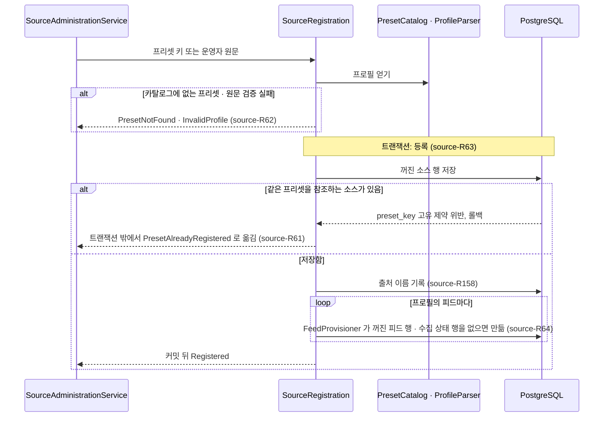

그림 "운영자 원문 수정":

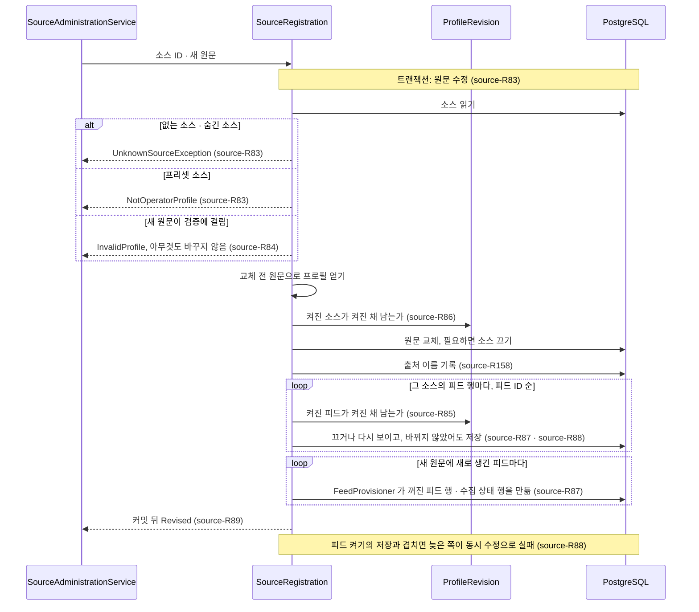

그림 "소스 켜기":

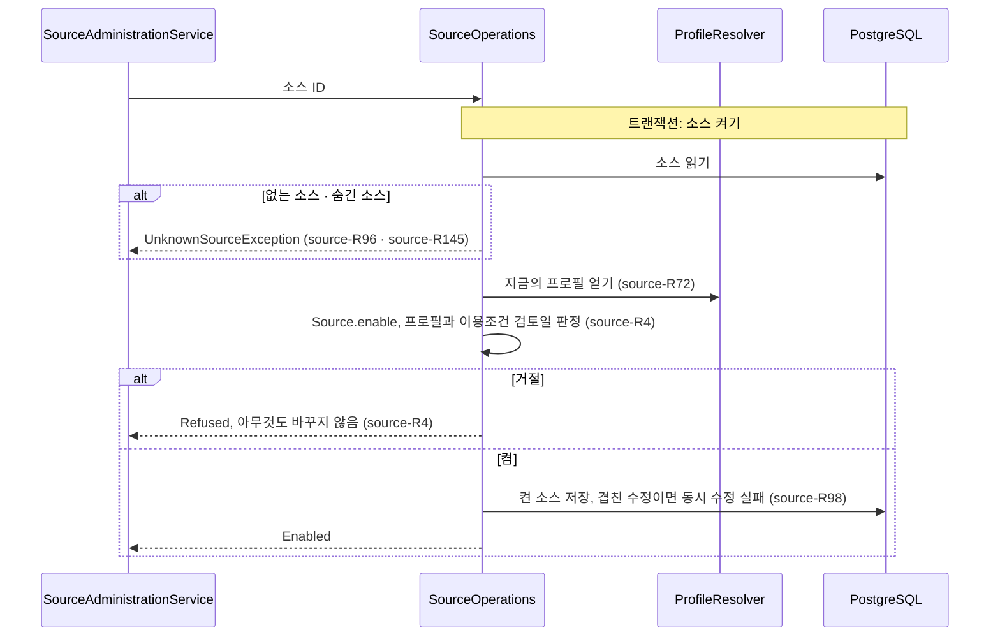

그림 "수집 주기 바꾸기":

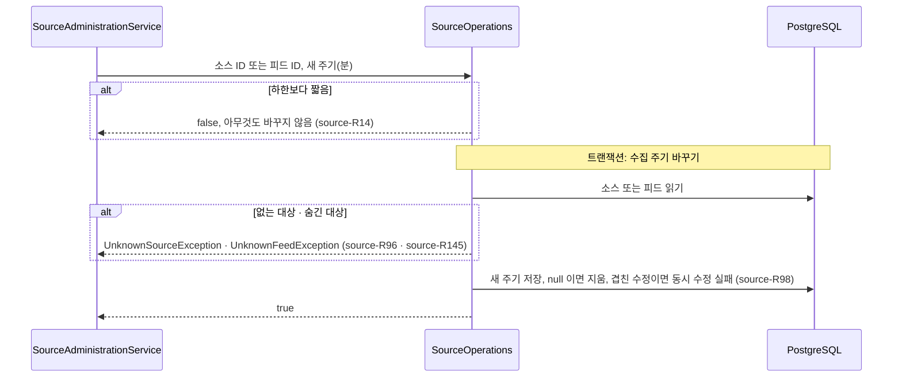

그림 "피드 켜기":

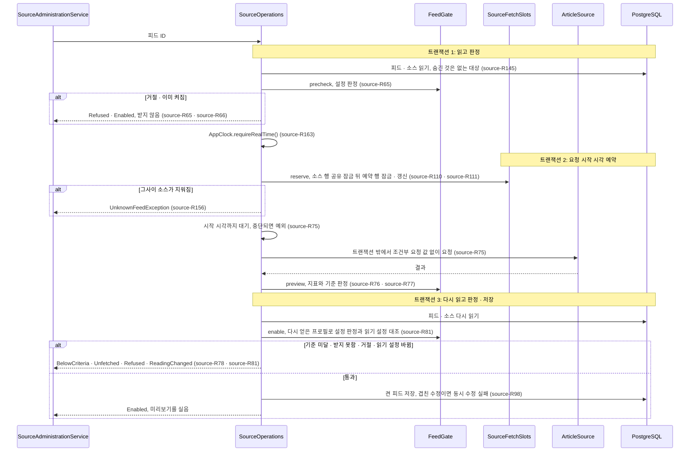

그림 "등록 전 원문 미리보기":

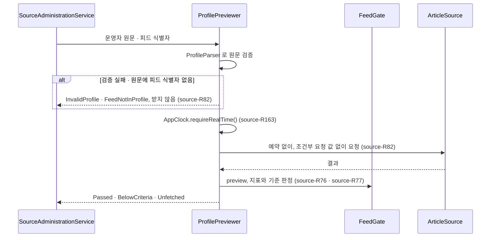

그림 "숨기기":

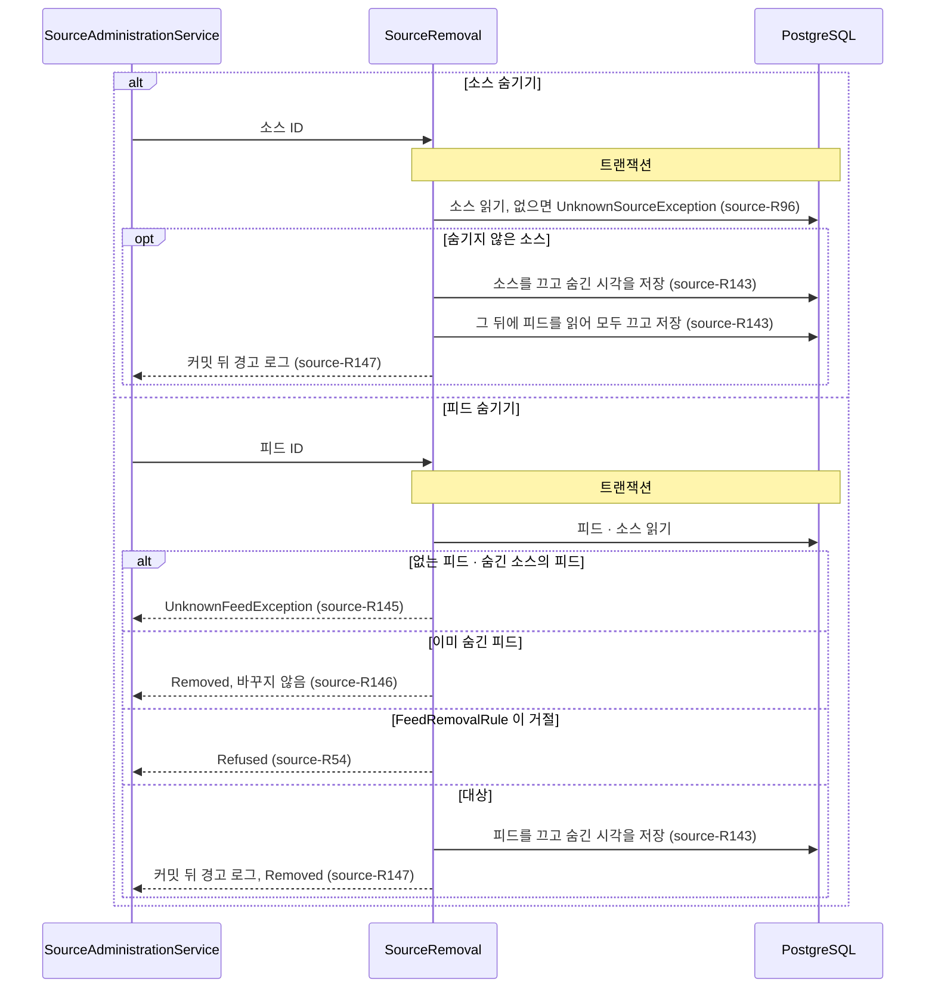

그림 "다시 보이기":

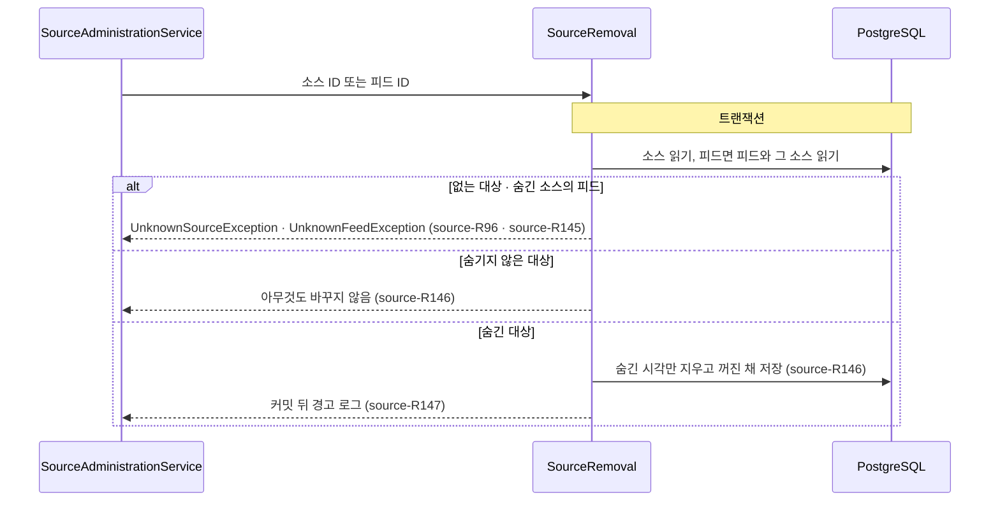

그림 "소스 삭제":

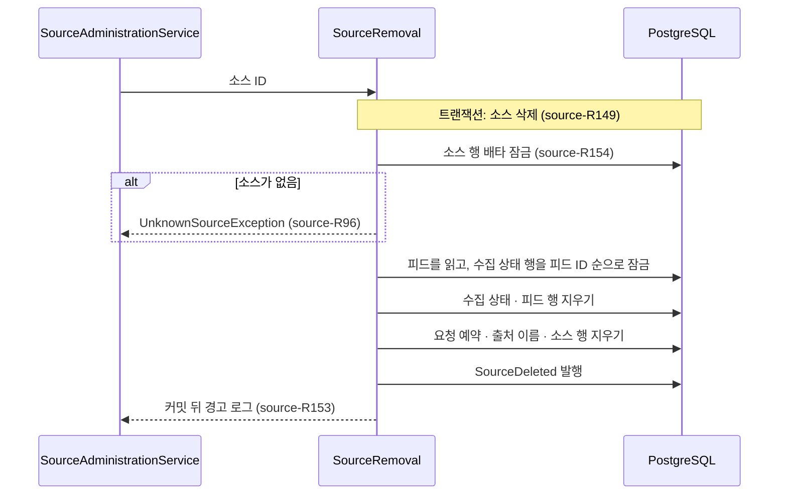

그림 "피드 삭제":

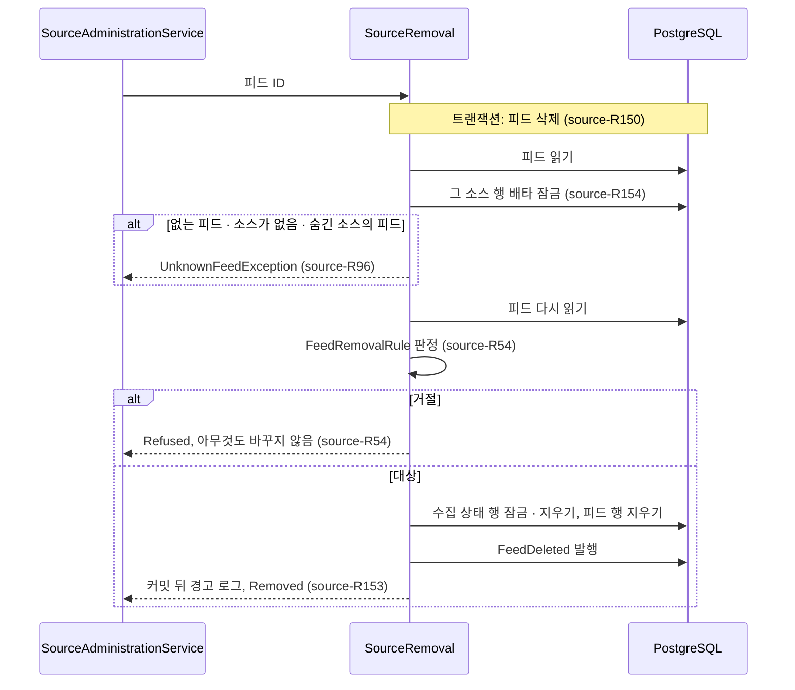

그림 "피드 요청":

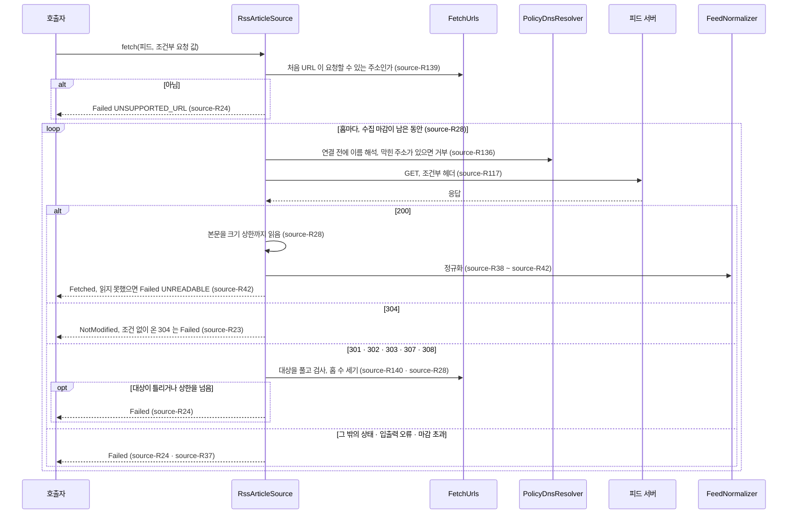

그림 "피드 건강 검사":

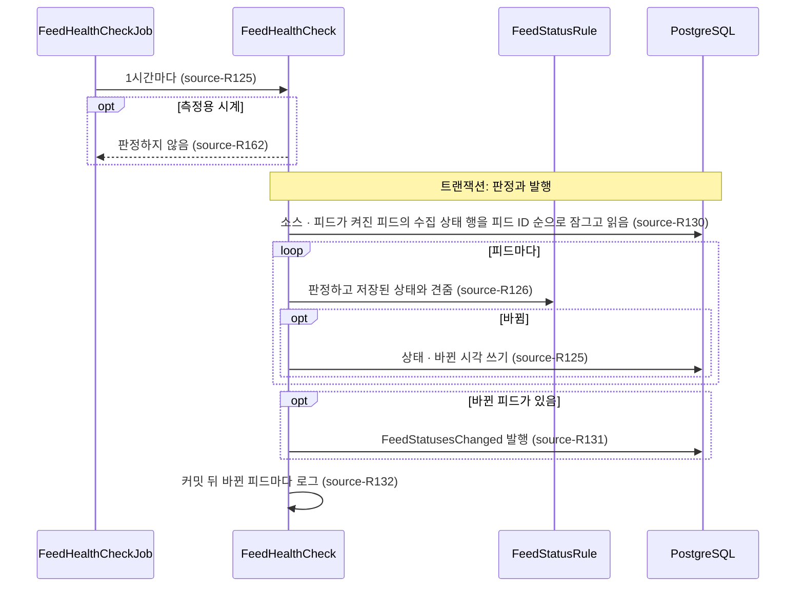

그림 "기동 대조":

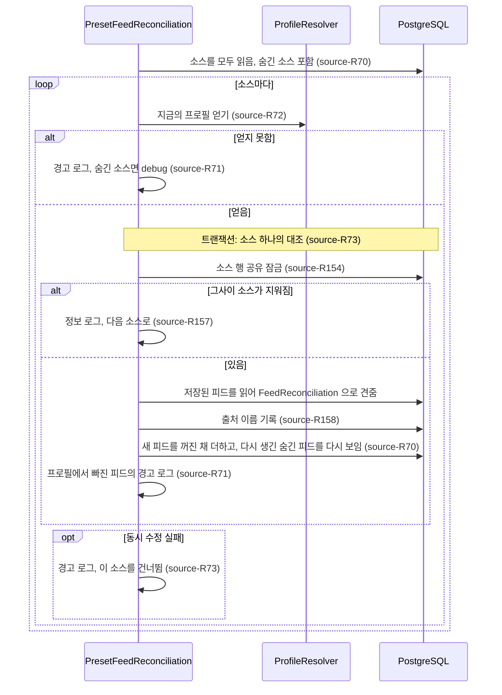

#### 수집 한 회차

그림 "수집 한 회차":

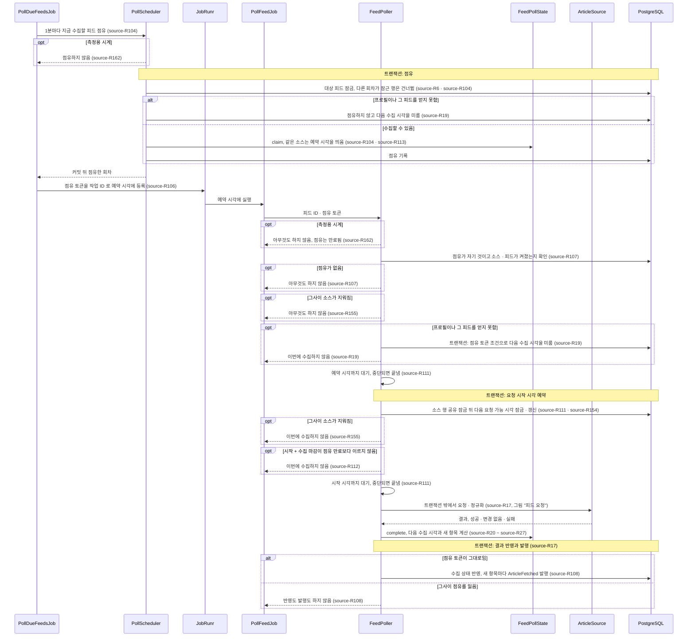

### 들어오는 쪽

| 진입점 | 구성 요소 | 계기와 주기 | 멱등성 · 겹침 방지 | 실패 처리 |
|---|---|---|---|---|
| 수집할 피드 등록(반복 작업 ID `poll-due-feeds`) | `PollDueFeedsJob` → `PollScheduler` | 1분마다 | 다른 회차가 잠근 행은 건너뛴다(source-R104). 같은 점유를 두 번 등록해도 작업 ID 가 같아 작업은 하나다(source-R106) | 재시도하지 않는다. 실패한 회차가 재시도를 기다리는 동안 작업 서버가 다음 회차를 건너뛰므로 다음 회차가 곧 재시도다 |
| 피드 수집(피드 ID, 점유 토큰) | `PollFeedJob` → `FeedPoller` | 위 작업이 점유 토큰을 작업 ID 로 예약 시각에 등록 | 점유 토큰이 그대로일 때만 반영하고 다시 실행해도 결과가 같다(source-R108 · source-R109) | 재시도하지 않는다. 점유 만료가 재시도다(source-R109) |
| 피드 건강 검사(반복 작업 ID `feed-health-check`) | `FeedHealthCheckJob` → `FeedHealthCheck` | 1시간마다(source-R125) | 같은 입력이면 같은 판정이라 다시 실행해도 결과가 같다. 한 회차가 대상 행을 잠가 겹친 회차는 기다린다(source-R130) | 재시도하지 않는다. 다음 회차가 다시 판정한다(source-R125) |
| 기동 대조 | `PresetFeedReconciliation` | 작업 역할의 애플리케이션 준비 완료(`ApplicationReadyEvent`) | 여러 인스턴스가 함께 해도 결과가 같다(source-R73) | 동시 수정에 걸린 소스는 건너뛰고 다음 기동이 다시 대조한다(source-R73) |
| 프리셋 적재 | `PresetCatalogConfiguration` | 기동 때 | 파일을 읽기만 한다 | 하나라도 실패하면 기동하지 않는다(source-R100) |

수집 작업이 동시에 몇 개 도는지는 작업 서버의 동시 실행 수가 정한다([운영 설정 — 백그라운드 작업](../operations/configuration.md#백그라운드-작업)). 수집 작업은 기다리는 동안 DB 연결을 잡지 않는다. 컨트롤러는 없다. 운영 기능은 공개 API `SourceAdministration`(§3)으로 들어온다.

역할에 따른 켜짐([platform-R9](platform.md#역할)):

- 작업 역할(`@WorkerRole`)에서만: 반복 작업 둘(`PollDueFeedsJob` · `FeedHealthCheckJob`)과 수집 작업(`PollFeedJob`)의 진입점, 반복 작업 등록, 기동 대조
- 두 역할 공통: 피드 켜기 · 미리보기 · 등록 같은 운영 유스케이스, 피드 요청 관문, 프리셋 적재

### `application`

- `PollScheduler` — 지금 수집할 피드를 점유한다. 대상 잠금 · 점유 기록은 한 트랜잭션이고, 수집 작업 등록은 커밋 뒤 호출자(`PollDueFeedsJob`)가 한다. 작업 저장소는 그 트랜잭션에 참여하지 않는다(source-R104 · source-R106 · source-R162)
- `FeedPoller` — 점유한 피드를 한 번 수집한다. 요청 시작 시각 예약과 결과 반영 · 발행이 각각 한 트랜잭션이고, 피드 요청은 트랜잭션 밖에서 한다(source-R17 · source-R107 ~ source-R112 · source-R162)
- `SourceFetchSlots` — 같은 소스의 요청 시작 시각을 한 트랜잭션에서 예약하고 그 시각까지 기다린다. 수집 작업과 피드 켜기가 쓴다(source-R110 · source-R111 · source-R154)
- `SourceRegistration` — 소스를 등록하고 운영자 원문을 고친다. 연산마다 한 트랜잭션이다(source-R63 · source-R83)
- `SourceOperations` — 소스 · 피드를 켜고 끄고 수집 주기를 바꾼다. 피드 켜기 밖의 연산은 한 트랜잭션이다. 피드 켜기는 트랜잭션 셋으로 나뉘므로 호출자의 트랜잭션 밖에서 부른다(source-R4 · source-R5 · source-R9 · source-R14)
- `SourceRemoval` — 소스 · 피드를 숨기고 다시 보이고 지운다. 연산마다 한 트랜잭션이다(source-R53 ~ source-R55)
- `SourceDirectoryService` — 공개 조회 `SourceDirectory` 의 구현. 트랜잭션을 열지 않는다(source-R152)
- `FeedLabelService` — 공개 조회 `FeedLabels` 의 구현. `SourceCatalog` 에 맡긴다(source-R161)
- `SourceNameService` — 공개 조회 `SourceNames` 의 구현. `SourceCatalog` 에 맡기고 피드 · 수집 상태는 읽지 않는다(source-R161)
- `ProfilePreviewer` — 등록 전 운영자 프로필 원문의 피드 하나를 미리본다. DB 를 쓰지 않는다(source-R82)
- `SourceAdministrationService` — 공개 API `SourceAdministration` 의 구현. 유스케이스 · `SourceCatalog` 에 맡기고 결과를 공개 타입으로 옮긴다. 트랜잭션을 열지 않는다(source-R51 · source-R52)
- `SourceCatalog` — 운영 목록과 피드의 출처 이름 · 섹션. 이름과 섹션의 해석은 함수 하나씩이고 운영 목록과 공개 조회가 함께 쓴다(source-R90 ~ source-R95 · source-R161)
- `FeedProvisioner` — 피드 행과 그 수집 상태 행을 없으면 함께 만든다. 등록 · 원문 수정 · 기동 대조가 호출자의 트랜잭션 안에서 쓴다(source-R64)
- `PresetFeedReconciliation` — 기동 대조(들어오는 쪽, source-R8)
- `FeedHealthCheck` — 피드 건강 검사(들어오는 쪽, source-R47 ~ source-R49)
- `PresetCatalogConfiguration` — 기동 때 프리셋 파일을 모두 읽어 카탈로그로 둔다(source-R12)
- `SourceRegistryConfiguration` — 프로필 해석기 `ProfileResolver` 를 카탈로그와 검증기로 만든다
- 그 밖의 값: `ClaimedPoll`(점유한 회차) · `Registration`(등록 결과) · `Revision`(원문 수정 결과) · `FeedStatusChange`(건강 검사가 바꾼 피드 하나)

### `domain`

#### `domain/registry`

- `Source` · `Feed` — aggregate(Spring Data JDBC). 운영 설정(켜짐 · 수집 주기 · 숨긴 시각)만 둔다. 이름 · URL · 섹션은 수집 프로필에, 수집 상태는 다른 행(`feed_poll_states`)에 있다. `hide` · `unhide` 의 뜻은 source-R143 · source-R146 이다(source-R1 · source-R7)
- `SourceRepository` · `FeedRepository` — 두 aggregate 의 저장소. 피드 행은 "없으면 넣기"로만 만든다(source-R64). 소스 행의 배타 잠금과 공유 잠금이 삭제와 그 밖의 쓰기를 줄 세운다(source-R154)
- `ProfileResolver` — 소스의 수집 프로필을 얻는다. 프리셋은 카탈로그에서, 운영자 프로필은 저장된 원문을 검증해서 얻는다. 저장된 소스와 운영 목록의 행이 같은 판정을 쓴다(source-R60 · source-R72)
- `ProfileRevision` — 운영자 원문 수정의 판정. 켜진 피드 · 소스가 켜진 채 남는가를 본다(source-R85 · source-R86)
- `SourceListingRepository` — 운영 목록의 조회 포트. 소스 · 피드의 운영 설정 행과 피드의 수집 상태 행을 읽기만 한다(source-R90)
- `PollTarget` — 피드를 지금 수집할 수 있는가. 프로필을 얻었고 그 프로필에 피드가 있는가를 본다(source-R65 · source-R19)
- `FeedReconciliation` — 프로필의 피드와 저장된 피드 행을 견준 결과. 행이 없는 피드, 숨기지 않은 행 가운데 프로필에 없는 피드, 숨긴 행 가운데 프로필에 다시 생긴 피드다(source-R70 · source-R71 · source-R87)
- `FeedRemovalRule` — 피드 숨김 · 삭제의 대상 판정(source-R54)
- 그 밖의 값: `Activation` · `ProfileResolution`. 켜지 않은 이유 `ActivationRefusal` 은 공개 열거다(§3)

#### `domain/attribution`

- `SourceAttributionRepository` — 출처 이름 기록의 저장소(source-R57)

#### `domain/profile`

- `CollectionProfile` — 검증을 통과한 수집 프로필. 프리셋과 운영자 프로필이 같은 모델이고, 검증기만 만든다(source-R10)
- `ProfileParser` — 원문 → 프로필. `platform` 의 `YamlTextReader` → `ProfileBinder` → `ProfileValidator` 를 지나고, 입력 오류는 예외가 아니라 문제 목록으로 돌려준다. 원문 상한 `MAX_CHARS`(65,536)의 정본이다(source-R32)
- `ProfileBinder` — 트리 → 초안. 수집 프로필 형식의 키 목록이 이 클래스에 있다. 공통 거부는 `platform` 의 `StrictYamlBinding` 에 맡기고(source-R32), 피드 식별자 중복 · 알 수 없는 기사 항목은 여기서 판정해 같은 문제 목록에 원문 순서대로 넣는다
- `ProfileValidator` — 초안 → 프로필. 값 규칙의 정본이다(source-R11)
- `PresetCatalog` · `Preset` — 프리셋 키 → 프리셋(source-R12)
- `PollIntervalPolicy` — 실제 주기 산식(source-R14)
- `FeedReading` — 피드 읽기 설정의 정본(§2). `CollectionProfile.reading` 이 피드마다 만든다. 날짜 형식은 패턴 문자열로 비교한다(source-R81 · source-R85)
- 그 밖의 값 · 식별자 타입: `FeedKey` · `PresetKey` · `FeedSpec` · `SourceInfo` · `PollInterval` · `PollIntervalSettings` · `PreCorrection` · `ItemField` · `ValueSource` · `ElementName` · `KnownNamespaces` · `DateParsing` · `DatePattern` · `Identifiers` · `ProfileDraft` · `ProfileParse` · `PresetParse` · `ProfileProblem` · `ProblemCode`. `ProblemCode` 는 공통 문제 종류와 같은 이름을 담고 `of` 가 망라 변환한다

#### `domain/poll`

- `FeedPollState` — 피드 하나의 수집 상태. aggregate 가 아닌 상태 객체로, 전이(`claim` 점유 · `complete` 결과 반영 · `deferForUnavailableProfile` 미룸)가 다음 상태를 계산한다. 저장은 `FeedPollStateRepository` 가 점유 토큰을 조건으로 한다(source-R15 · source-R16 · source-R19 ~ source-R27 · source-R30 · source-R31)
- `PollSchedule` — 수집 일정 산식과 상수의 정본. 상수는 점유 기간 · 같은 소스 요청 간격 · 프로필 재확인 · 백오프 상한이다(source-R15 · source-R18 · source-R19 · source-R25)
- `PollSlots` — 같은 소스에서 이번 회차에 수집할 피드들의 예약 시각을 띄운다(source-R113)
- `ItemComparison` · `ItemKey` — 새 항목 판정과 넘침 의심. 넘침 의심의 최소 키 수 상수의 정본이다(source-R20 · source-R21)
- `FeedStatusRule` — 피드 상태 판정의 규칙과 기준값 상수의 정본. 상수는 연속 실패 · 그 가운데 영구 실패 · 무소식 기간 · 재판정 간격 `RECHECK_INTERVAL` 이고, 반복 작업과 공개 기준값이 이것을 가리킨다. 수집 상태와 지금 시각으로 상태를 판정하고, 저장된 상태에서 바뀌는지 본다(source-R30 · source-R31 · source-R47)
- `FeedPollStateRepository` — 수집 상태 저장소. 수집 작업과 삭제가 쓰고, 피드 상태 열은 쓰지 않는다(source-R129 · source-R149)
- `FeedStatusRepository` — 피드 상태 저장소. 피드 건강 검사만 쓴다(source-R129 · source-R130)
- `SourceFetchSlotRepository` — 소스마다 다음 요청 가능 시각의 저장소(source-R111 · source-R154)
- 그 밖의 값: `Lease` · `LastError` · `PollOutcome` · `FeedPollContext` · `FeedStatusTarget` · `SlotLock` · `PollSchedule.FetchSlot`. 피드 상태 `FeedStatus` 는 공개 열거다(§3)

#### `domain/fetch`

- `ArticleSource` — 피드 요청 관문(포트). 선언은 나가는 쪽에 있다
- `AddressPolicy` · `NetworkRange` — 내부 주소 판정. 대역 표의 정본이다(source-R33 · source-R34)
- `FetchUrls` — 요청할 수 있는 주소와 리다이렉트 대상 풀기(source-R35)
- `StatusRule` — 응답 상태 코드 → 결과(source-R23 · source-R24)
- `FetchState` — 조건부 요청 값과 그 저장 · 재전송 조건(source-R22)
- `FetchLimits` — 수집 마감 · 본문 크기 · 리다이렉트 상한(source-R28)
- `UserAgent` — 요청의 `User-Agent` 와 연락처 형식(source-R29)
- `RedirectTrail` — 따라간 리다이렉트 홉 수와 영구 이동 주소(source-R27 · source-R28)
- `ContentTypeCharset` — `Content-Type` 의 charset 읽기(source-R141)
- 그 밖의 값: `FeedDescriptor` · `FetchResult` · `FetchFailure` · `StatusOutcome`. 실패 이유 `FetchFailureReason` 과 분류 `FailurePermanence` 는 공개 열거다(§3)

#### `domain/feed`

- `FeedNormalizer` — 정규화의 진입. 문자 인코딩 판정 → 사전 보정 → XML 읽기 → 형식 판별 → 항목마다 필드 보정 순이다. 상태가 없고 호출마다 파서를 새로 만든다(source-R38 ~ source-R44)
- `DocumentDecoder` · `KoreanCharsets` — 받은 바이트의 문자 인코딩 판정과 읽기(source-R141)
- `PreCorrector` · `EntityReferences` · `XmlCharacters` — 사전 보정(source-R142)
- `FeedXmlReader` · `IsolatedXmlReaders` · `DeclarationRejectingHandler` — 외부 엔티티 · DTD 선언을 받지 않는 XML 읽기(source-R43 · source-R44)
- `RomeFeed` · `FeedFormat` — Rome 의 형식 판별과 항목별 제목 · 링크(source-R39)
- `ItemNormalizer` · `StandardElements` — 항목 하나 → 기사, 형식마다 읽을 곳 `$standard`(source-R40 · source-R41)
- `PublishedAtResolver` · `Rfc822DateTime` — 발행 시각 해석(source-R40)
- `TextCleaner` — HTML 제거 · 엔티티 해제 · 공백 줄이기(source-R40 · source-R45)
- `LinkText` — 기사 링크 · 썸네일 원문의 퍼센트 인코딩(source-R40)
- 그 밖의 값: `FeedNormalization` · `FeedDocument` · `ItemValues` · `SkippedItem` · `DocumentProblem` · `MarkupScanner`. 건너뛴 이유 `SkipReason` 과 문서 문제 종류 `DocumentProblemKind` 는 공개 열거다(§3)

#### `domain/gate`

- `FeedGate` — 피드 켜기 관문의 판정 순서. 요청 전 설정 판정(`PollTarget`), 받은 결과의 미리보기 · 판정, 저장 직전의 설정 판정과 피드 읽기 설정 대조를 차례로 하고 `Feed` 를 켠다(source-R65 · source-R66 · source-R74 ~ source-R81)
- `ActivationCriteria` — 활성화 기준값과 판정의 정본(source-R77)
- `FeedPreview` · `SummaryLengths` — 받은 결과와 프로필로 만드는 미리보기 지표와 요약문 길이 분포(source-R76)
- 그 밖의 값: `ArticleSample` · `Shortfall` · `PreviewOutcome` · `FeedActivation` · `ProfilePreview`. `FeedActivation` 은 미리본 뒤 읽기 설정이 바뀐 경우(`ReadingChanged`)를 담는다. 기준의 종류 `Criterion` 은 공개 열거다(§3)

### 나가는 쪽

#### `ArticleSource`

모든 피드 수집이 거치는 관문이다. 활성화 전 미리보기도 이 관문을 거친다(source-R75 · source-R82). 모듈 안의 포트(`domain/fetch`)라 공개 인터페이스(§3)가 아니다. 선언의 정본은 이 Spec 이다.

```java
public interface ArticleSource {
    FetchResult fetch(FeedDescriptor feed, FetchState previous);
}

public record FeedDescriptor(URI url, CollectionProfile profile) {}

public record FetchState(@Nullable String etag, @Nullable String lastModified) {}

public sealed interface FetchResult {
    record Fetched(FeedNormalization.Normalized normalization, FetchState state, Instant fetchedAt,
            @Nullable URI movedTo) implements FetchResult {}
    record NotModified(FetchState state, Instant fetchedAt, @Nullable URI movedTo) implements FetchResult {}
    record Failed(FetchFailure failure, Instant attemptedAt) implements FetchResult {}
}
```

- 입출력 실패는 예외가 아니라 `FetchResult.Failed` 다. 인자가 null 이면 `NullPointerException`
- `previous` 는 직전 수집이 남긴 조건부 요청 값이고, 처음이면 `FetchState.NONE`

#### 구현과 로컬 대체물

- `RssArticleSource` — 포트의 v1 구현이고 하나뿐이다. Apache HttpClient 5 로 피드를 받아 `FeedNormalizer` 로 넘긴다. 리다이렉트는 직접 따라가며 홉마다 요청 규칙(`domain/fetch`)으로 판정한다. 내부 주소 차단과 수집 마감 · 크기 상한은 이 구현이 건다(source-R28 · source-R33 ~ source-R37). 정규화는 Rome(형식 판별 · 제목 · 링크), 자체 구성한 SAX 파서 · JDOM(DTD 선언 거부), jsoup(HTML 제거 · 엔티티 표)을 쓴다
- `PolicyDnsResolver` — 이름 해석 결과를 `AddressPolicy` 로 거른다. 연결은 이 해석기가 돌려준 주소로만 하므로 검사한 주소가 곧 연결 주소다(source-R136)
- `BoundedBody` — 응답 본문을 크기 상한까지만 읽는다(source-R28)
- `FeedHttpClients` — 수집용 Apache 클라이언트를 만든다. 구성과 테스트가 같이 쓴다(source-R28 · source-R36)
- `RssArticleSourceConfiguration` · `CollectionProperties` — 수집 설정(§7)으로 구현을 만든다. 연락처가 없거나 설정이 틀리면 기동이 실패한다(source-R29 · source-R34)
- 그 밖: 예외 `BlockedAddressException` · `BodyTooLargeException`
- 로컬 대체물은 없다. 테스트는 실제 구현에 WireMock 피드 서버를 붙인다

#### 저장소 구현

- `JdbcFeedPollStateRepository` · `JdbcFeedStatusRepository` · `JdbcSourceFetchSlotRepository` — 수집 상태 · 피드 상태 · 요청 예약 저장소의 JdbcClient 구현. 쓰기 조건이 점유 토큰 · 행 잠금이라 aggregate 저장 대신 JdbcClient 로 쓴다. 피드 상태 저장소는 수집 상태의 열 목록 · 행 읽기를 함께 쓴다
- `JdbcSourceAttributionRepository` — 출처 이름 저장소의 JdbcClient 구현. 기록은 이름이 다를 때만 쓴다(source-R159)
- `JdbcSourceListingRepository` — 운영 목록 조회 포트의 JdbcClient 구현. 수집 상태 행이 없는 피드도 함께 읽는다(source-R94). 열 목록 · 행 읽기는 수집 상태 저장소의 것을 쓴다
- `SourceRepository` · `FeedRepository` 는 Spring Data JDBC 가 구현한다

#### 수집 프로필 읽기

프로필 원문은 `platform` 의 YAML 원문 읽기로 읽는다. snakeyaml-engine 의 이벤트 API 만 쓴다([platform-R17](platform.md#yaml-원문-읽기) · source-R32).

#### 신뢰할 수 없는 입력

| 입력 | 방어 |
|---|---|
| 운영자 프로필 원문 | [운영자 프로필 입력](#운영자-프로필-입력) — source-R32 |
| 피드 URL · 리다이렉트 | [피드 요청](#피드-요청) — source-R33 ~ source-R37 |
| 피드 문서 | [피드 XML 입력](#피드-xml-입력) — source-R43 ~ source-R46, 크기 상한 source-R28 |

## 5. 규칙과 불변식

### 등록과 켜기

- **source-R1** — 소스를 누가 등록하고 소스의 프로필이 어디서 오는지를 덮는다.
  - source-R59 — 등록하는 사람
  - source-R60 — 프로필의 출처
- **source-R2** — 등록을 받지 않는 경우를 덮는다.
  - source-R61 — 같은 프리셋
  - source-R62 — 없는 프리셋 키와 검증에 걸린 원문
- **source-R3** — 등록이 만드는 행을 덮는다.
  - source-R63 — 등록의 트랜잭션
  - source-R64 — 피드 · 수집 상태 행 만들기
- **source-R4** — 소스는 그 프로필을 얻었고 프로필에 이용조건 검토일이 있어야 켜진다.
  - 거절 이유는 프로필을 얻지 못함(프리셋이 사라졌거나 운영자 원문이 검증에 걸림) · 검토일 없음이다
  - 거절하면 아무것도 바꾸지 않는다
- **source-R5** — 피드 켜기의 조건을 덮는다. 미리보기는 source-R9 이고, 켜진 소스의 원문에서 검토일이 사라지는 수정은 source-R86 이다.
  - source-R65 — 켜지는 조건과 거절
  - source-R66 — 이미 켜진 피드
  - source-R67 — 이용조건 검토일을 보는 때
- **source-R6** — 수집 대상은 소스와 피드가 모두 켜졌고 다음 수집 시각이 지난 피드다
- **source-R7** — 소스 · 피드 행의 수명을 덮는다.
  - source-R68 — 행을 지우는 길
  - source-R69 — 바꾸지 않는 식별자
- **source-R8** — 기동 대조를 덮는다. 기동 대조가 출처 이름을 기록하는 것은 source-R158 이고, 그사이 지워진 소스는 source-R157 이다.
  - source-R70 — 대조의 결과
  - source-R71 — 알리는 로그
  - source-R72 — 프로필을 얻었는지의 판정
  - source-R73 — 트랜잭션과 겹침
- **source-R9** — 활성화 관문의 미리보기를 덮는다.
  - source-R74 — 미리보는 때
  - source-R75 — 미리보기의 요청
  - source-R76 — 지표
  - source-R77 — 활성화 기준
  - source-R78 — 거절의 결과
  - source-R79 — 저장하지 않음
  - source-R80 — 판정하는 때
  - source-R81 — 저장 직전의 다시 판정
  - source-R82 — 등록 전 원문의 미리보기
- **source-R50** — 운영자 원문 수정을 덮는다. 새 원문의 소스 이름을 출처 이름으로 기록하는 것은 source-R158 이다.
  - source-R83 — 대상과 트랜잭션
  - source-R84 — 검증에 걸린 새 원문
  - source-R85 — 켜진 피드
  - source-R86 — 켜진 소스
  - source-R87 — 새 피드와 다시 생긴 숨긴 피드
  - source-R88 — 피드 행의 저장
  - source-R89 — 결과
- **source-R51** — 운영 목록을 덮는다.
  - source-R90 — 순서와 나눔
  - source-R91 — 소스의 프로필 상태와 이름
  - source-R92 — 피드의 프로필 값
  - source-R93 — 피드의 수집 상태
  - source-R94 — 수집 상태 행이 없는 피드
  - source-R95 — 읽는 트랜잭션
- **source-R52** — 공개 운영 API 가 대상과 입력을 받지 않는 신호를 덮는다. 수집 주기의 하한보다 짧은 운영자 설정의 답은 source-R14 다.
  - source-R96 — 없는 대상
  - source-R97 — 형식이 틀린 입력
  - source-R98 — 동시 수정
- **source-R59** — v1 은 운영자만 소스를 등록한다
- **source-R60** — 소스는 프리셋을 참조하거나 운영자 프로필 원문을 갖는다. 둘 중 정확히 하나다.
  - 프리셋을 참조하면 프로필을 DB 에 복사하지 않는다. 프리셋은 저장소 파일이 정본이다
  - 운영자 프로필 원문은 주석까지 그대로 저장하고, 읽을 때마다 지금의 검증기로 검증한다
- **source-R61** — 같은 프리셋을 두 소스가 참조하지 않는다. 두 번째 등록은 "이미 등록된 프리셋"으로 거절한다.
  - 숨긴 소스가 참조하는 프리셋도 같다. 운영자는 그 소스를 다시 보여 되돌린다(source-R146)
  - 지운 소스의 프리셋은 다시 등록할 수 있고 새 소스가 된다(source-R55)
- **source-R62** — 카탈로그에 없는 프리셋 키와 검증을 통과하지 못한 운영자 원문은 등록하지 않는다
- **source-R63** — 소스를 등록하면 한 트랜잭션에서 소스와, 프로필의 피드마다 꺼진 피드와 그 수집 상태를 만든다. 소스도 꺼진 채다
- **source-R64** — 피드 · 수집 상태를 만드는 일은 이미 있으면 아무것도 하지 않는다. 그래서 여러 인스턴스가 함께 해도 피드 하나에 행 하나다
- **source-R65** — 피드는 그 소스의 프로필을 얻었고 프로필에 그 피드가 있어야 켜진다. 꺼진 피드는 여기에 더해 미리보기가 활성화 기준을 넘어야 켜진다(source-R74).
  - 거절 이유는 아래다
    - 프로필을 얻지 못함
    - 프로필에 피드가 없음
    - 피드를 받지 못함
    - 기준에 못 미침
    - 미리본 뒤 그 피드의 읽기 설정이 바뀜
  - 거절하면 바뀌는 것은 피드를 받으려 잡은 요청 시작 시각 예약(source-R110)뿐이다
- **source-R66** — 이미 켜진 피드를 켜면 받지 않고 켜진 결과다
- **source-R67** — 이용조건 검토일은 소스를 켤 때만 본다. 피드를 켤 때는 보지 않는다
- **source-R68** — 소스 · 피드 행은 운영자의 삭제(source-R55)로만 지운다. 받은 기사의 기록이 소스 · 피드 ID 를 가리키므로, 지울 때 그 기록도 `article` 이 지운다. 프로필에서 빠진 피드도 남는다. 운영자는 그 피드를 숨기거나 지울 수 있다(source-R54)
- **source-R69** — 피드 식별자 · 프리셋 키는 저장된 뒤 바꾸지 않는다
- **source-R70** — 기동 때 숨긴 소스를 포함해 소스마다 지금의 프로필과 저장된 피드를 대조한다.
  - 프로필에 새로 생긴 피드는 꺼진 피드로 더한다. 경로는 등록과 같다(source-R64)
  - 숨긴 피드가 프로필에 다시 생겼으면 다시 보인다. 피드는 꺼진 채다(source-R146)
  - 피드는 지우지도 끄지도 않는다. 켜고 끄는 것은 운영자의 선택이다
- **source-R71** — 기동 대조는 사라진 프리셋 · 검증에 걸린 운영자 원문 · 프로필에서 빠진 숨기지 않은 피드를 경고 로그로 알린다. 숨긴 소스면 debug 로 낮춘다
- **source-R72** — 소스가 가리킬 곳을 잃었는지는 저장하지 않고, 부를 때마다 그때의 프리셋 파일 · 검증기로 판정한다
- **source-R73** — 기동 대조는 소스마다 한 트랜잭션이고 소스 행을 공유 잠금한 뒤 한다.
  - 다시 보이기가 다른 쪽의 저장과 겹쳐 동시 수정에 걸리면 그 소스를 경고와 함께 건너뛰고 다음 소스를 대조한다. 다음 기동이 다시 대조한다
  - 여러 인스턴스가 함께 해도 결과가 같다
- **source-R74** — 꺼진 피드를 켤 때 그 피드를 한 번 받아 미리보기를 만들고, 활성화 기준에 못 미치면 켜지 않는다. 소스 켜기는 미리보지 않는다
- **source-R75** — 미리보기의 요청은 피드 요청 관문(`ArticleSource`, §4)으로 조건부 요청 값 없이 보낸다.
  - 같은 소스의 요청 시작 시각 예약(source-R110)을 지킨다. 켜기는 그 소스에 앞서 잡힌 예약 하나당 최대 10초를 더 기다린다
  - 요청은 수집 마감(10초) 안에 끝난다
  - 기다리다 중단되면 예외로 끝나고 예약만 남는다
- **source-R76** — 미리보기의 지표는 아래다. 요약문 · 최신 발행 시각 · 영구 이동 · 표본은 보이기만 하고 판정하지 않는다.
  - 항목 수(기사 + 건너뛴 항목)와 건너뛴 항목
  - 발행 시각을 해석한 기사 수
  - 요약문 길이 분포(코드 포인트). 있는 · 없는 기사 수와 최소 · 아래 중앙값 · 최대다
  - 대체 문자 수와 읽은 문자 수
  - 추정이 아닌 발행 시각의 최댓값
  - 영구 이동 주소
  - 기사 앞 몇 건의 제목 · 발행 시각 · 추정 여부. 수는 `FeedPreview` 가 정한다
- **source-R77** — 활성화 기준은 아래 넷이다. 기준값의 정본은 `ActivationCriteria`(§4)이고, 정한 근거는 [ADR-0041](../adr/0041-activation-gate-previews-a-feed-on-enable-and-judges-by-code-constants.md)에 있다.
  - 기사 수의 하한
  - 항목 수 대비 건너뛴 비율의 상한
  - 기사 수 대비 발행 시각을 해석한 비율의 하한
  - 읽은 문자 수 대비 대체 문자 비율의 상한

  경계 값은 통과다. 비율은 분모가 0 이면 판정하지 않는다. 프로필이 발행 시각의 읽을 곳을 빈 목록으로 선언하면 날짜 해석률은 판정하지 않는다
- **source-R78** — 피드를 받지 못하면 그 수집 실패를 거절 이유로 돌려준다. 304 도 받지 못한 것이다. 조건 없는 요청의 304 는 예상 밖 상태다. 기준에 못 미치면 못 미친 기준마다 실제 값과 기준값을 미리보기와 함께 돌려준다
- **source-R79** — 미리보기는 저장하지 않는다. 기사 · 수집 상태 · 조건부 요청 값을 쓰지 않고, 요청 시작 시각 예약만 남는다
- **source-R80** — 활성화 기준의 판정은 켜는 순간에만 한다. 기준값이 바뀌어도 켜진 피드를 다시 판정하지 않는다
- **source-R81** — 저장 직전에 프로필을 다시 얻어 설정 판정(source-R65)을 다시 한다. 그 피드의 읽기 설정(§2, URL 포함)이 미리본 것과 다르면 켜지 않는다
- **source-R82** — 등록 전 운영자 프로필 원문과 피드 식별자로도 같은 판정의 미리보기를 한다.
  - DB 를 쓰지 않고, 소스 행이 없어 요청 시작 시각을 예약하지 않는다
  - 원문이 검증에 걸리거나 피드 식별자가 원문에 없으면 받지 않는다
- **source-R83** — 운영자 원문 수정은 운영자 프로필 소스의 원문을 새 원문으로 바꾸는 한 트랜잭션이다.
  - 없는 소스 · 숨긴 소스면 원문을 보기 전에 실패한다(source-R96 · source-R145)
  - 프리셋 소스는 원문이 없어 고치지 않는다
- **source-R84** — 새 원문이 검증(source-R10 · source-R11 · source-R32)에 걸리면 아무것도 바꾸지 않고 문제를 돌려준다
- **source-R85** — 켜진 피드는 옛 원문과 새 원문 모두에 있고 두 읽기 설정(§2)이 같을 때만 켜진 채 남고, 아니면 끈다.
  - 옛 원문은 교체 전 원문으로 얻은 프로필이다
  - 원문에서 빠진 피드, 옛 원문이 검증에 걸렸던 소스의 피드도 끈다
  - 꺼진 피드는 그대로 둔다
- **source-R86** — 켜진 소스는 새 원문에 이용조건 검토일이 없으면 끈다(source-R4)
- **source-R87** — 새 원문에 새로 생긴 피드는 꺼진 피드와 그 수집 상태로 더한다. 경로는 등록과 같다(source-R64). 숨긴 피드가 새 원문에 다시 생겼으면 다시 보인다. 피드는 꺼진 채다(source-R146). 피드 행은 지우지 않는다(source-R68)
- **source-R88** — 원문 수정은 그 소스의 피드 행을 바뀌지 않았어도 모두 저장한다. 그래서 피드 켜기의 저장 직전 판정(source-R81)과 겹치면 늦은 쪽이 동시 수정으로 실패한다
- **source-R89** — 원문 수정의 결과는 끈 피드의 식별자(피드 ID 순) · 소스를 껐는지 · 더한 피드의 식별자(원문 순)다
- **source-R90** — 운영 목록의 순서와 나눔은 아래다.
  - 프리셋은 키 순이다. 그 프리셋을 참조하는 소스(숨긴 소스 포함)가 있으면 그 소스 ID 와 그 소스를 숨겼는지를 함께 낸다
  - 소스 목록은 숨기지 않은 소스를 소스 ID 순으로 낸다
  - 숨긴 소스 목록은 숨긴 시각 순, 같으면 소스 ID 순으로 낸다
  - 소스마다 숨기지 않은 피드와 숨긴 피드를 나눠 각각 피드 ID 순으로 낸다
- **source-R91** — 운영 목록은 소스마다 지금의 프로필을 얻어(source-R72) 얻었는지 · 사라진 프리셋인지 · 검증에 걸린 원문인지를 낸다. 얻지 못하면 홈페이지 · 검토일을 비우고 이름은 기록된 출처 이름(source-R161)으로 낸다
- **source-R92** — 운영 목록은 피드마다 프로필에 있는지를 내고, 있으면 URL · 섹션 · 실제 주기(source-R14)를, 없으면 셋을 비운다
- **source-R93** — 운영 목록은 피드마다 수집 상태를 낸다.
  - 저장된 피드 상태와 바뀐 시각(source-R125)
  - 마지막 성공 · 변경 없음 시각
  - 연속 실패 수와 그 가운데 영구 실패 수(source-R119)
  - 마지막 실패와 그 분류(source-R24 · source-R26)
  - 새 항목이 있던 마지막 수집 시각과 새 항목의 가장 늦은 발행 시각(source-R121)
- **source-R94** — 수집 상태 행이 없는 피드는 등록 · 기동 대조의 불변식(source-R64)이 깨진 것이라 운영 목록을 실패시킨다
- **source-R95** — 운영 목록의 행은 읽기 전용 트랜잭션 하나에서 읽는다
- **source-R96** — 공개 운영 API 에서 없는 소스 · 피드는 `UnknownSourceException` · `UnknownFeedException` 이다. 숨긴 대상이 숨김 · 다시 보이기 · 삭제 밖의 연산에서 없는 대상인 것은 source-R145 다
- **source-R97** — 형식이 틀린 프리셋 키는 카탈로그에 없는 프리셋, 형식이 틀린 피드 식별자는 원문에 없는 피드로 답한다
- **source-R98** — 같은 소스 · 피드를 다른 요청이 먼저 바꿨으면 동시 수정 실패(`OptimisticLockingFailureException`)다. 겹친 운영 변경은 소스 · 피드 행의 버전이 가르고 늦은 쪽이 실패한다.
  - 삭제는 버전 조건이 없어 이 실패가 없다
  - 먼저 지운 대상을 다시 지우면 없는 대상이다(source-R96)

### 수집 프로필

- **source-R10** — 수집 프로필은 YAML 문서 하나다. 형식의 정본은 이 모듈의 모델과 검증기다.

  | 키 | 필수 | 뜻 |
  |---|---|---|
  | `source.name` · `source.homepage` · `source.language` | 예 | 이름(공백만 아님) · 홈페이지 · 언어. 언어는 날짜 텍스트(오전/오후 · 요일)를 읽는 로캘이기도 하다 |
  | `termsReviewedAt` | 프리셋만 | 이용조건 검토일(`yyyy-MM-dd`) |
  | `feeds[]` — `key` · `url` · `section` · `pollIntervalMinutes` | `feeds` 와 각 피드의 `key` · `url` · `section` | 피드 하나 이상. `pollIntervalMinutes` 는 그 피드의 권장 주기 |
  | `pollIntervalMinutes` | 아니오 | 소스의 권장 주기(분) |
  | `preCorrections[]` — `rule` · `charset` | 아니오 | 사전 보정, 적용 순서대로(source-R142) |
  | `items` — `publishedAt` · `summary` · `author` · `category` · `thumbnail` | 아니오 | 기사 값마다 읽을 곳 목록(source-R41). 적지 않은 값은 `[$standard]`, 빈 목록은 그 값을 읽지 않는다. `publishedAt` 의 빈 목록이 활성화 기준에 주는 뜻은 source-R77 이다 |
  | `namespaces` | 아니오 | 요소 이름의 접두사 → 이름공간 URI. 기본 접두사 `dc` · `content` · `media` · `atom` 은 다시 정의할 수 없다 |
  | `dates.formats[]` · `dates.timeZone` | 아니오 | 표준 형식 다음에 시도할 날짜 형식, 오프셋 없는 값의 시간대(없으면 `Asia/Seoul`) |
- **source-R11** — 프로필의 값 규칙. 어긋나면 프로필 전체가 무효이고, 문제마다 위치와 함께 알린다.
  - URL(홈페이지 · 피드)은 `http` · `https` 절대 URL 이다. 이름공간은 절대 URI 다
  - 언어는 정규형 BCP 47 태그이고 언어 부분이 ISO 639-1 이다
  - 피드 식별자 · 프리셋 키는 소문자 · 숫자를 하이픈 하나로 이은 40자 이하다. 피드 식별자와 피드 URL 은 프로필 안에서 겹치지 않는다
  - 수집 주기(소스 · 피드)는 15분 이상이다(source-R14)
  - 사전 보정은 닫힌 목록(`replace-undefined-entities` · `strip-invalid-control-chars` · `force-encoding`)에서만 고르고 같은 규칙을 두 번 쓰지 않는다. `force-encoding` 의 `charset` 은 지원하는 문자 인코딩이다
  - 읽을 곳은 `$standard` 또는 `접두사:이름` · `이름` 형식의 요소 이름이고, 접두사는 기본 접두사이거나 `namespaces` 에 정의한 것이다. 한 값의 목록 안에 같은 것을 두 번 쓰지 않는다
  - 날짜 형식은 패턴으로 읽을 수 있고 연월일과 시분을 모두 담는다. 시간대는 알려진 시간대다
- **source-R12** — 프리셋 파일과 그 적재를 덮는다.
  - source-R99 — 프리셋 파일
  - source-R100 — 기동 때의 적재
  - source-R101 — 적재 로그
- **source-R13** — 프리셋과 운영자 프로필이 바뀔 때의 관계를 덮는다.
  - source-R102 — 프리셋을 참조하는 소스
  - source-R103 — 운영자 프로필
- **source-R99** — 프리셋은 `backend/src/main/resources/source-presets/{key}.yaml` 하나가 하나이고, 이용조건 검토일이 반드시 있다
- **source-R100** — 기동 때 모든 프리셋을 운영자 프로필과 같은 읽기기 · 검증기로 읽는다. 아래 가운데 하나라도 있으면 기동하지 않는다.
  - 검증에 실패한 프리셋
  - 그 디렉터리의 `.yaml` 이 아닌 파일
  - 키 형식이 아닌 이름
  - 같은 이름
- **source-R101** — 적재하면 그 수와 키를 정보 로그 `프리셋 {n}개를 적재했다: {키}` 로 남긴다. 배포 구성 스모크(K12)가 이 줄의 수를 저장소의 프리셋 파일 수와 비교하므로, 문구를 바꾸면 `deploy/smoke.sh` 도 함께 바꾼다
- **source-R102** — 프리셋을 참조하는 소스는 운영자가 소스 · 피드를 켜고 끄고 수집 주기를 정할 뿐이다. 프리셋이 바뀌면 다음 배포부터 바뀐 프리셋으로 수집한다
- **source-R103** — 운영자 프로필은 프리셋과 같은 형식의 완결된 프로필이다. 프리셋 원문을 복사해 고친 프로필은 이후 프리셋 수정을 따라가지 않는다

### 수집 일정

- **source-R14** — 실제 주기는 운영자 피드 설정 → 운영자 소스 설정 → 프로필 피드 값 → 프로필 소스 값 → 15분 순으로 처음 있는 값이다.
  - 하한은 15분이고 프로필 권장값과 운영자 설정 모두에 적용한다
  - 하한보다 짧은 운영자 설정(0 · 음수 포함)은 받지 않고 바꾸지 않는다. 공개 운영 API 는 거짓으로 답한다
- **source-R15** — 수집 대상의 점유와 수집 작업의 등록을 덮는다.
  - source-R104 — 점유 회차
  - source-R105 — 점유 기간과 만료
  - source-R106 — 수집 작업의 등록
- **source-R16** — 수집 작업이 점유를 쓰는 방법을 덮는다. 그사이 소스가 지워진 경우는 source-R155 다.
  - source-R107 — 받는 조건
  - source-R108 — 반영하는 조건
  - source-R109 — 재시도
- **source-R17** — 피드 요청은 DB 트랜잭션 밖에서 하고, 결과 반영과 새 항목의 `ArticleFetched` 발행은 한 트랜잭션에서 한다
- **source-R18** — 같은 소스의 요청 간격을 덮는다.
  - source-R110 — 간격과 예약을 쓰는 쪽
  - source-R111 — 수집 작업의 예약
  - source-R112 — 점유 만료를 넘는 예약
  - source-R113 — 간격의 보장 범위
- **source-R19** — 프로필이나 그 안의 피드를 얻지 못한 피드는 수집하지 않는다.
  - 대상을 고를 때 확인해 점유하지 않고, 수집 작업이 시작할 때 다시 확인해 점유를 푼다
  - 어느 쪽이든 다음 수집 시각을 1시간(측정 전) 뒤로 미루고 경고 로그를 남긴다
  - 점유 · 다음 수집 시각 밖의 수집 상태 값은 바꾸지 않는다
- **source-R104** — 1분마다 한 트랜잭션에서 대상 피드를 다음 수집 시각 순으로 최대 100개(측정 전) 잠그고, 피드마다 점유(토큰 · 예약 시각)를 기록해 커밋한다. 다른 회차가 잠근 행은 건너뛴다
- **source-R105** — 점유 중인 피드의 다음 수집 시각은 예약 시각 + 10분(점유 기간, 측정 전)이다. 그래서 점유가 풀리지 않아도 그 시각이 지나면 다시 대상이 된다. 만료된 점유는 새 점유로 덮어쓴다
- **source-R106** — 점유를 커밋한 뒤 점유 토큰을 작업 ID 로 수집 작업을 예약 시각에 등록한다. 등록 전에 멈추면 점유만 남고 만료 뒤 다시 대상이 된다
- **source-R107** — 수집 작업은 점유가 자기 것(토큰 일치)이고 소스 · 피드가 아직 켜져 있을 때만 받는다
- **source-R108** — 수집 결과는 점유 토큰이 그대로일 때만 반영한다. 그사이 점유를 잃었으면 반영도 발행도 하지 않는다
- **source-R109** — 수집 작업은 재시도하지 않는다. 점유 만료가 재시도다. 그래서 한 회차의 결과는 한 번 반영되고, 같은 작업을 다시 실행해도 결과가 같다
- **source-R110** — 같은 소스의 요청 시작 사이는 수집 마감(10초) 이상 띄운다. 수집 작업과 피드 켜기의 미리보기(source-R75)가 같은 예약을 쓴다. 등록 전 원문의 미리보기는 소스 행이 없어 예약하지 않는다
- **source-R111** — 수집 작업은 예약 시각까지 기다린 뒤, 요청 직전에 그 소스의 다음 요청 가능 시각을 잠가 시작 시각을 받는다. 시작 시각은 max(다음 요청 가능 시각, 지금)이고, 다음 요청 가능 시각은 시작 + 10초로 옮긴다. 기다리다 중단되면 수집하지 않는다
- **source-R112** — 받은 시작 + 수집 마감이 점유 만료보다 이르지 않으면 이번에 수집하지 않는다. 점유가 만료되면 다음 회차가 가져간다
- **source-R113** — 같은 소스의 피드끼리 작업 예약 시각도 10초씩 띄운다. 작업 서버가 예약 작업을 poll 간격 단위로 묶어 시작하므로 간격의 보장은 요청 직전 예약(source-R111)이 한다. 이름 해석은 마감 밖이라, 해석이 길면 앞 요청이 끝나기 전에 다음 요청이 시작될 수 있다

### 새 항목

- **source-R20** — 새 항목의 판정을 덮는다.
  - source-R114 — 새 항목과 항목 키
  - source-R115 — 첫 수집과 다시 실린 항목
  - source-R116 — 다음 비교의 직전 키
- **source-R21** — 넘침 의심은 직전 키 수와 이번 키 수가 모두 10 이상이고 겹치는 키가 하나도 없을 때다.
  - 키 수는 서로 다른 항목 키의 수다(source-R114)
  - 첫 수집 · 빈 피드 · 직전이 빈 피드는 키 수가 0 이라 빠진다
  - 수집 상태에 마지막 시각 · 횟수로 남기고 경고 로그를 남긴다
  - 최소 키 수를 정한 근거는 [ADR-0066](../adr/0066-overflow-suspected-only-when-previous-and-current-fetches-both-have-ten-or-more-keys.md)에 있다
- **source-R114** — 새 항목은 그 피드의 직전 성공 수집의 항목 키에 없던 항목이다.
  - 항목 키는 guid 가 있으면 `g:` + guid, 없으면 `l:` + 기사 링크(source-R40 의 값)다. 같은 피드 안의 비교라 정규 URL 을 쓰지 않는다
  - 한 수집 안에서 같은 키는 문서 순서로 처음 것만 쓴다
- **source-R115** — 첫 수집(직전 키 없음)은 받은 항목을 모두 새 항목으로 넘긴다. 피드에서 빠졌다가 다시 실린 항목도 다시 넘어간다
- **source-R116** — 성공한 수집이 이번 키 목록을 다음 비교의 직전 키로 남긴다. 빈 피드면 빈 목록이고, 직전 키 없음과 다르다

### 요청과 결과

- **source-R22** — 조건부 GET 을 덮는다.
  - source-R117 — 보내는 값과 그 꼴
  - source-R118 — 값을 바꾸는 때
- **source-R23** — 304(변경 없음)는 성공으로 다룬다. 연속 실패를 0 으로 하고 조건부 요청 값을 갱신하며, 직전 항목 키는 그대로 둔다. 조건부 헤더를 보내지 않았는데 온 304 는 실패(예상 밖 응답)다
- **source-R24** — 결과는 성공 · 변경 없음 · 실패이고, 실패 이유는 닫힌 목록이다. 일시 · 영구 분류는 이유가 정한다.

  | 이유 | 뜻 | 분류 |
  |---|---|---|
  | `TIMEOUT` | 수집 마감을 넘었다 | 일시 |
  | `CONNECTION_FAILED` | 연결하지 못했거나 끊겼다(그 밖의 입출력 오류 포함) | 일시 |
  | `NAME_NOT_RESOLVED` | 호스트 이름을 해석하지 못했다. "이름 없음"과 "해석기 장애"를 가르지 못한다 | 일시 |
  | `SERVER_ERROR` | 5xx | 일시 |
  | `THROTTLED` | 408 · 429 | 일시 |
  | `ACCESS_DENIED` | 401 · 403 | 영구 |
  | `NOT_FOUND` | 404 · 410 | 영구 |
  | `CLIENT_ERROR` | 그 밖의 4xx | 영구 |
  | `UNEXPECTED_STATUS` | 그 밖의 상태 코드(100~599 밖 포함), 조건부 헤더 없이 온 304 | 영구 |
  | `TOO_MANY_REDIRECTS` | 리다이렉트가 상한을 넘었다 | 영구 |
  | `INVALID_REDIRECT` | `Location` 이 없거나 URI 로 읽을 수 없다 | 영구 |
  | `UNSUPPORTED_URL` | 처음 URL 이나 리다이렉트 대상이 요청할 수 있는 주소가 아니다(source-R139) | 영구 |
  | `BLOCKED_ADDRESS` | 연결 주소가 차단 대역이다(source-R136). 이름이 차단 대역으로 풀렸을 때 설정 문제와 망의 일시 장애를 가르지 못한다 | 일시 |
  | `TLS_FAILURE` | TLS 핸드셰이크 · 인증서 오류 | 영구 |
  | `TOO_LARGE` | 본문이 크기 상한을 넘었다 | 영구 |
  | `UNREADABLE` | 받은 문서를 정규화가 읽지 못했다(source-R42) | 영구 |

  200 은 본문을 읽고, 301 · 308 은 영구 이동 · 302 · 303 · 307 은 임시 이동으로 따라간다
- **source-R25** — 실패하면 다음 수집 시각 = 실패 시각 + max(주기, min(주기 × 2^연속 실패, 상한)) 이다.
  - 연속 실패는 이번 실패를 포함한다
  - 상한은 일시 실패 6시간(측정 전), 영구 실패 24시간(측정 전)이다
  - 실제 주기가 상한보다 길어도 주기보다 이르게 잡지 않는다
  - 영구 실패도 수집을 멈추지 않는다. 그래서 언론사 · 프리셋 쪽이 고쳐지면 운영자 조치 없이 돌아온다
  - 성공 · 변경 없음 뒤의 다음 수집 시각은 결과 시각 + 주기다
- **source-R26** — 마지막 실패(이유 · 문구 · 상태 코드 · 시각)는 성공한 뒤에도 남는다
- **source-R27** — 성공 · 변경 없음 결과가 거친 영구 이동 주소를 수집 상태에 남긴다. 프로필을 고칠 단서다. 그 값이 바뀌어 비어 있지 않은 값이 되면 경고 로그를 남긴다
- **source-R28** — 한 번의 수집에 거는 제한
  - 수집 마감 10초 — 한 번의 수집 전체에 하나다. 이름 해석은 OS 해석기의 시간 상한을 따른다. 마감이 합쳐 재는 단계는 아래다
    - 연결 대기
    - 연결
    - 응답
    - 리다이렉트 홉
    - 본문
  - 본문 크기 상한 5MiB — 압축을 푼 바이트로 센다(같으면 통과, 넘으면 실패). 압축(gzip · deflate)을 요청한다
  - 리다이렉트는 5회까지 따라가고, 홉마다 대상 주소를 다시 검사한다(source-R136 · source-R139)
  - 한 번의 수집 안에서는 다시 보내지 않는다. 다음 수집은 일정이 정한다
- **source-R29** — 요청의 `User-Agent` 는 `YozmNews (+https://github.com/Theia0382/yozm-news; {연락처})` 다.
  - 연락처는 운영 설정(§7)이고, 이메일 주소나 `http` · `https` URL 이다
  - 연락처는 1~200자이고 0x21~0x7E 밖의 문자 · 괄호 · 역슬래시 · 세미콜론이 없다
  - 연락처가 없거나 형식이 틀리면 앱이 뜨지 않는다
- **source-R117** — 조건부 GET 은 수집 상태에 남은 `ETag` · `Last-Modified` 원문을 `If-None-Match` · `If-Modified-Since` 로 그대로 보낸다. 저장 · 재전송하는 값은 공백만이 아니고 1,024자 이하이고 문자가 모두 0x20~0x7E 인 것뿐이고, 아니면 버린다
- **source-R118** — 조건부 요청 값은 결과에 따라 아래처럼 바뀐다.
  - 성공(200 을 정규화한 결과)은 그 응답의 두 값으로 바꾼다
  - 304 는 준 값만 바꾸고 주지 않은 값은 그대로 둔다
  - 실패는 값을 바꾸지 않는다. 200 이어도 문서를 읽지 못하거나 본문을 다 받지 못한 경우가 실패다

### 피드 상태

- **source-R30** — `DEGRADED` 의 판정을 덮는다.
  - source-R119 — `DEGRADED` 조건
  - source-R120 — 연속 영구 실패 수
- **source-R31** — `STALE` 의 판정을 덮는다. 실제로 오래 갱신되지 않은 피드를 판정하게 된 까닭은 [ADR-0040](../adr/0040-feed-status-stored-in-poll-state-and-rejudged-hourly-by-health-check.md)에 있다.
  - source-R121 — `STALE` 조건
  - source-R122 — 기간의 셈
  - source-R123 — 새 항목의 가장 늦은 발행 시각
  - source-R124 — 수집을 미루는 피드
- **source-R47** — 피드 건강 검사의 판정을 덮는다.
  - source-R125 — 검사 대상과 쓰기
  - source-R126 — 판정 순서
  - source-R127 — 꺼진 피드
  - source-R128 — 새 피드의 첫 상태
- **source-R48** — 피드 상태를 쓰는 쪽과 그 잠금을 덮는다. 검사의 재시도는 source-R125 다.
  - source-R129 — 쓰는 쪽
  - source-R130 — 검사의 잠금
- **source-R49** — 피드 상태 변화를 알리는 길을 덮는다.
  - source-R131 — 이벤트 발행
  - source-R132 — 로그
  - source-R133 — 운영자에게 알리는 길
- **source-R119** — 연속 실패가 5회(측정 전, `FeedStatusRule.DEGRADED_AFTER_FAILURES`) 이상이거나, 그 가운데 영구 실패가 2회(측정 전, `FeedStatusRule.DEGRADED_AFTER_PERMANENT_FAILURES`) 이상이면 `DEGRADED` 다. 기준이 횟수라 걸리는 시간은 실제 주기와 백오프(source-R25)에 따라 다르다. 주기 15분에 일시 실패만 이어지면 첫 실패부터 7시간 30분이다
- **source-R120** — 연속 영구 실패 수는 실패마다 그 이유가 영구 실패(source-R24)면 하나 늘고, 성공 · 변경 없음에 0 이 된다. 일시 실패가 끼어도 줄지 않는다
- **source-R121** — 응답은 정상이지만 오래 새 기사가 없으면 `STALE` 이다. 성공 · 변경 없음이 한 번이라도 있었고, 다음 가운데 하나일 때다.
  - 새 항목이 한 번도 없었다
  - 새 항목이 있던 마지막 수집 시각이 7일(측정 전, `FeedStatusRule.STALE_AFTER`) 이상 지났다
  - 새 항목의 가장 늦은 발행 시각이 7일 이상 지났다
- **source-R122** — `STALE` 의 기간은 지금 시각과의 차라 시간대가 없고, 정확히 7일이 지난 순간부터 `STALE` 이다
- **source-R123** — 새 항목의 가장 늦은 발행 시각은 성공 수집의 새 항목으로만 바뀌고, 직전 값보다 늦을 때만 바뀐다.
  - 옛 항목을 돌려 실어도 오르지 않는다. 등록 때 이미 방치된 피드는 첫 수집의 옛 발행 시각이 그대로 남는다
  - 발행 시각을 추정한 항목(source-R40)은 받은 시각으로 센다
- **source-R124** — 프로필을 얻지 못해 수집을 미루는 켜진 피드(source-R19)도 `STALE` 판정의 대상이라 시간이 지나면 `STALE` 이 된다. 원인은 미룸 경고 로그가 알린다
- **source-R125** — 피드 건강 검사는 1시간(`FeedStatusRule.RECHECK_INTERVAL`)마다 소스 · 피드가 모두 켜진 피드 전부를 현재 기준으로 다시 판정한다.
  - 판정이 저장된 상태와 다를 때만 상태와 바뀐 시각(판정 시각)을 쓴다
  - 다시 켠 직후 첫 수집 전에 검사가 돌면 옛 입력으로 판정하고, 다음 수집 · 검사가 맞춘다
  - 기준을 바꿔 배포하면 다음 검사가 모든 대상을 새 기준으로 맞춘다
  - 검사는 재시도하지 않는다. 다음 회차가 다시 판정한다
- **source-R126** — 판정 순서는 `DEGRADED`(source-R119) → `STALE`(source-R121) → `ACTIVE` 다.
  - 성공은 `DEGRADED` 를 풀 뿐이라 `STALE` 조건이 맞으면 `STALE` 이다
  - 기준 미만의 실패는 `STALE` 을 풀지 않는다
  - 판정은 저장된 상태를 보지 않으므로 모든 상태 쌍 사이의 전이가 있다
- **source-R127** — 꺼진 피드는 마지막 상태를 그대로 두고, 켜고 끄는 것은 상태를 바꾸지 않는다
- **source-R128** — 새 피드의 첫 상태는 `ACTIVE` 다
- **source-R129** — 피드 상태와 바뀐 시각은 피드 건강 검사만 쓰고, 그 밖의 수집 상태는 수집 작업만 쓴다. 운영 설정은 다른 행이라 서로를 덮어쓰지 않는다
- **source-R130** — 검사는 한 트랜잭션에서 대상 행을 피드 ID 순으로 잠그고 판정 · 쓰기를 한다. 먼저 잡힌 잠금은 기다린다. 잠근 동안 수집 결과 반영은 기다리고 수집 대상 잠금(source-R104)은 그 행을 건너뛰므로, 옛 입력으로 판정한 상태가 쓰이지 않는다
- **source-R131** — 피드 건강 검사는 상태가 바뀐 피드가 있는 회차에 상태를 쓴 트랜잭션에서 `FeedStatusesChanged` 를 한 번 발행한다. 판정 시각과 바뀐 피드마다 이전 · 새 상태(피드 ID 순, 복귀 포함)를 싣는다. 바뀐 피드가 없는 회차는 발행하지 않는다
- **source-R132** — 상태가 바뀐 피드만 커밋 뒤 로그를 남긴다. `DEGRADED` · `STALE` 진입은 WARN, `ACTIVE` 복귀는 INFO 다. 문구는 피드와 전이, 그 피드의 수집 상태 값을 담는다
- **source-R133** — 운영자에게 알리는 것은 저장된 상태(운영자 화면) · source-R132 의 로그 · `user` 가 이 이벤트로 운영자 계정에 남기는 화면 내 알림이다([ADR-0135](../adr/0135-feed-status-changes-publish-each-check-runs-transitions-and-gather-into-one-unread-notice-per-active-admin-read-up-to-the-seen-revision.md))

### 운영자 프로필 입력

운영자 프로필 원문은 운영자 권한으로 들어오지만 해석기는 그대로 믿지 않는다([ADR-0024](../adr/0024-collection-profile-yaml-and-preset-reference-or-own-profile.md)).

- **source-R32** — 운영자 원문은 아래 방어를 지난다.
  - 원문은 65,536자까지다
  - YAML 읽기와 공통 거부는 [platform-R17](platform.md#yaml-원문-읽기)이다. 공통 거부가 덮는 것은 아래다
    - 이벤트 파서만 쓴다
    - 문서 하나 · 최상위 매핑
    - 앵커 · 별칭 · 명시 태그
    - 알 수 없는 키 · 같은 매핑 안 중복 키
    - 빈 값 · 형 오류
  - 알려진 키와 값은 수집 프로필 형식(source-R10 · source-R11)이 정한다. 사전 보정은 닫힌 목록에서만 고르므로 프로필에 코드를 넣을 수 없다
  - 피드 · 홈페이지 URL 은 `http` · `https` 절대 URL 만 받고, 내부 주소를 가리키는 URL 은 수집이 막는다(source-R134)

### 피드 요청

수집은 운영자가 적은 URL 과 피드가 보낸 리다이렉트를 따라 서버에서 요청한다. 서버 측 요청 위험을 막는다([ADR-0031](../adr/0031-feed-request-blocks-internal-addresses-with-apache-httpclient-deadline.md) · [ADR-0049](../adr/0049-feed-request-blocks-ipv6-reserved-space-and-local-nat64.md)).

- **source-R33** — 내부 주소로 가는 요청의 차단을 덮는다.
  - source-R134 — 막는 대역
  - source-R135 — IPv4 를 품은 IPv6 주소
  - source-R136 — 검사하는 주소
- **source-R34** — 막힌 대역을 여는 길을 덮는다.
  - source-R137 — 여는 자리
  - source-R138 — 주소 계열
- **source-R35** — 요청할 수 있는 주소와 리다이렉트 대상을 덮는다.
  - source-R139 — 요청할 수 있는 주소
  - source-R140 — 리다이렉트 대상
- **source-R36** — 시스템 프록시 설정을 읽지 않는다. 쿠키 · 인증 정보를 보내지 않는다
- **source-R37** — 실패 문구는 응답 본문을 옮기지 않는다.
  - 인용하는 것은 아래다
    - 상태 코드
    - URL
    - 막힌 주소
    - 상한 값
    - 입출력 오류의 종류
  - 입출력 오류의 종류는 예외 클래스 이름이고, 예외 문구는 옮기지 않는다
  - URL 의 userinfo 는 지운다. 질의 문자열은 그대로 인용한다
- **source-R134** — 내부 주소로 가는 요청은 기본으로 막는다. 대역 표의 정본은 이 모듈의 `AddressPolicy` 다. 막는 대역은 아래다.

  | 대역 | IPv4 | IPv6 |
  |---|---|---|
  | 미지정 | | 막음 |
  | 루프백 | 막음 | 막음 |
  | 사설 | 막음 | |
  | 고유 로컬 | | 막음 |
  | 링크 로컬 | 막음 | 막음 |
  | 사이트 로컬 | | 막음 |
  | 공유 | 막음 | |
  | 문서용 | 막음 | 막음 |
  | 벤치마크 | 막음 | 막음 |
  | 멀티캐스트 | 막음 | 막음 |
  | 예약 | 막음 | |
  | 6a44 relay | 막음 | |
  | Teredo | | 막음 |
  | 로컬 NAT64 | | 막음 |
  | IETF 예약 | | 막음 |

  IETF 예약은 폐기 접두 · 더미 · SRv6 SID 를 품는다. 잘 알려진 NAT64 를 품은 `::/8` 은 빼고 막는다
- **source-R135** — IPv4 를 품은 IPv6 주소(IPv4 호환 · 잘 알려진 NAT64 · 6to4)는 품은 IPv4 도 본다
- **source-R136** — 검사는 실제로 연결하는 주소에 한다. 이름을 해석한 결과 가운데 하나라도 막힌 주소면 그 이름 전체를 거부한다. 처음 URL 과 모든 리다이렉트 홉이 같은 검사를 지난다
- **source-R137** — 막힌 대역은 서버 설정(§7 `allowed-networks`)으로만 연다. 화면의 운영자 권한으로는 열 수 없다
- **source-R138** — 허용 목록은 주소 계열이 같은 대역만 본다. 그래서 IPv4 대역을 열어도 그 IPv4 를 품은 IPv6 주소는 열리지 않는다
- **source-R139** — 요청할 수 있는 주소는 `http` · `https`(대소문자 무시), 호스트가 있고, 포트가 없거나 1~65535 이고, userinfo 가 없는 절대 URL 이다
- **source-R140** — 리다이렉트 대상은 현재 주소 기준으로 풀고 점 조각을 지운다(RFC 3986). https → http 로 내려가는 리다이렉트도 따른다. 보내는 비밀 값이 없다

### 정규화

RSS 품질이 피드마다 크게 다르므로 사전 보정 → 파싱 → 필드 보정의 세 단계로 맞춘다([ADR-0030](../adr/0030-feed-xml-own-parser-and-rome-for-format-title-link.md)).

- **source-R38** — 사전 보정을 덮는다.
  - source-R141 — 문자 인코딩
  - source-R142 — 보정의 적용
- **source-R39** — 파싱은 Rome 이 RSS 0.9x · 1.0 · 2.0 · Atom 0.3 · 1.0 의 형식을 판별하고 제목 · 링크를 읽는다. 나머지 값은 항목 요소의 원문을 읽을 곳(source-R41)에 따라 읽는다. 표준 밖 요소(예: RSS 2.0 에서 `pubDate` 대신 `dc:date`)는 프로필의 읽을 곳으로 찾는다
- **source-R40** — 필드 보정

  | 값 | 규칙 |
  |---|---|
  | 기사 링크 | 피드의 링크에서 앞뒤 공백을 지우고, RFC 3986 이 URI 의 어느 자리에도 허용하지 않는 ASCII 인쇄 문자와 공백 열 개(공백 · `"` · `<` · `>` · `\` · `^` · `` ` `` · `{` · `\|` · `}`)를 퍼센트 인코딩(`%XX`)해 넘긴다. 이미 있는 `%` 와 그 밖의 문자는 바꾸지 않는다. 없거나 `http` · `https` 웹 주소가 아니면(상대 링크 · 경로의 `[` · 형식이 틀린 `%` · 제어 문자 포함) 그 항목을 건너뛰고 이유(링크 없음 · 웹 주소 아님)를 남긴다 |
  | 항목 식별자 | RSS `guid` · RSS 1.0 `rdf:about` · Atom `id` 의 원문(앞뒤 공백 제거). 없을 수 있다 |
  | 발행 시각 | RFC 822 → ISO 8601 → 프로필의 날짜 형식(예: `2026-10-25 09:31:38`, 한국어 날짜) 순으로 시도한다. RFC 822 는 4자리 연도만 받고 요일은 날짜와 대조하지 않는다. 오프셋이 없는 값의 시간대는 프로필 값, 없으면 KST. 받은 시각보다 1시간 넘게 미래인 값은 해석 실패로 본다. 모두 실패하면 받은 시각(그 수집의 시각)을 쓰고 `publishedAtEstimated` 를 켠다 |
  | 제목 · 요약문 | HTML 태그 제거, 엔티티 해제, 공백 줄이기. 보정한 제목이 비면 그 항목을 건너뛰고 이유(제목 없음)를 남긴다. 요약문은 최대 1,000 코드 포인트로 자른다. `content:encoded` 처럼 본문 전체가 든 요소를 요약문으로 읽어도 앞부분만 쓰고 나머지는 저장하지 않는다 |
  | 메타데이터 | 기자명, 피드 카테고리(여러 값), 썸네일 URL 은 있으면 넘긴다. 썸네일 요소는 `url` 속성이 있으면 그 값을 쓰고, 기사 링크와 같이 퍼센트 인코딩한 뒤 웹 주소가 아니면 쓰지 않는다 |
- **source-R41** — 읽을 곳은 기사 값마다 앞에서부터 처음으로 쓸 수 있는 값을 쓴다. 텍스트는 보정한 뒤 비지 않은 값, 발행 시각은 해석한 값, 썸네일은 웹 주소다. 카테고리는 쓸 수 있는 값이 하나라도 나온 첫 읽을 곳의 값 전부다(문서 순서, 같은 값은 한 번). `$standard` 는 그 피드 형식의 명세가 정한 요소다:

  | 값 | RSS 0.91~0.94 · 2.0 | RSS 0.90 · 1.0 | Atom |
  |---|---|---|---|
  | 발행 시각 | `pubDate` | `dc:date` | `published` (0.3 은 `issued`) |
  | 요약문 | `description` | `description` | `summary` |
  | 기자명 | `author` | `dc:creator` | `author` 의 `name` |
  | 카테고리 | `category` | `dc:subject` | `category` 의 `term` |
  | 썸네일 | `type` 이 `image/` 로 시작하는 `enclosure` 의 `url` | 없음 | `rel="enclosure"` 이고 `type` 이 `image/` 로 시작하는 `link` 의 `href` |
- **source-R42** — 문서 전체를 읽지 못하면 그 수집은 영구 실패 `UNREADABLE` 이다. 읽지 못하는 경우는 선언한 문자 인코딩 미지원 · XML 형식 오류 · DTD 선언 · RSS · Atom 이 아님이다. 읽은 문서는 기사가 0건일 수 있고, 항목마다 기사이거나 이유와 함께 건너뛴 항목이다
- **source-R141** — 받은 바이트를 문자로 읽는다. 문자 인코딩은 프로필의 `force-encoding` → BOM → XML 선언 → 전송 계층(HTTP `Content-Type`)의 charset → UTF-8 순으로 정한다.
  - 한국어 계열 레이블(`euc-kr` 등)과 강제한 EUC-KR · CP949 는 windows-949 로 읽는다
  - 문서가 선언한 인코딩을 지원하지 않으면 문서를 읽지 않고, 전송 계층의 charset 을 지원하지 않으면 그 값만 버린다
  - 읽을 수 없는 바이트는 U+FFFD 로 바꾸고 그 수와 읽은 문자 수를 결과에 남긴다. 읽은 문자 수는 사전 보정 전 코드 포인트이고 BOM 을 빼고 센다
- **source-R142** — 프로필이 고른 보정을 적힌 순서대로 적용한다. 보정마다 하는 일은 아래다.
  - `replace-undefined-entities` — HTML 이름 엔티티는 같은 문자의 숫자 참조로, 그 밖의 `&` 는 `&amp;` 로 바꾼다. 숫자 참조와 XML 기본 엔티티는 그대로 둔다
  - `strip-invalid-control-chars` — XML 1.0 에 쓸 수 없는 문자와, 그런 문자를 가리키는 숫자 참조를 지운다
  - CDATA · 주석 · 처리 명령 안의 참조는 고치지 않는다

### 피드 XML 입력

피드 문서는 신뢰할 수 없는 입력이다([ADR-0030](../adr/0030-feed-xml-own-parser-and-rome-for-format-title-link.md)).

- **source-R43** — XML 파서는 호출마다 새로 만들고, 외부 엔티티 · 외부 DTD 를 읽지 않는다. 파서에 보안 설정을 적용하지 못하면 수집을 멈춘다
- **source-R44** — DOCTYPE 은 받지만, DTD 선언(요소 · 속성 · 엔티티 · 표기법)이 있거나 선언되지 않은 엔티티를 만나면 문서를 읽지 않는다. 엔티티가 펼쳐지기 전에 멈춘다
- **source-R45** — 제목 · 요약문 · 기자명 · 카테고리는 HTML 로 보고 텍스트만 남긴다
- **source-R46** — 문서를 읽지 못한 이유의 문구는 피드에서 이름(선언한 문자 인코딩 레이블 · DTD 선언 · 엔티티의 이름)만 인용한다

### 숨김과 삭제

숨김은 끄고 목록에서 빼되 남기고 되돌릴 수 있다. 삭제는 그 소스 · 피드만 가진 기사까지 지우고 되돌릴 수 없다. 운영자 화면은 두 기능의 차이를 밝힌다([web-R23](web.md#운영자-화면)). 판단의 이유는 [ADR-0051](../adr/0051-operator-hides-or-deletes-sources-and-feeds-and-deletion-removes-exclusive-articles.md)에 있다.

- **source-R53** — 숨김을 덮는다. 숨긴 소스가 참조하는 프리셋은 source-R61, 다시 생긴 숨긴 피드는 source-R70 · source-R87, 겹친 운영 변경은 source-R98 이다.
  - source-R143 — 숨기기
  - source-R144 — 남는 것
  - source-R145 — 숨긴 것의 자리
  - source-R146 — 다시 보이기
  - source-R147 — 로그
- **source-R54** — 피드 숨김 · 삭제의 대상은 프로필을 얻었고 그 프로필에 없는 피드다. 판정의 정본은 `FeedRemovalRule` 이다.
  - 프로필에 있는 피드는 `IN_PROFILE` 로 거절한다. 숨기거나 지워도 원문 수정 · 기동 대조가 다시 더하기 때문이다
  - 프로필을 얻지 못한 소스(사라진 프리셋 · 검증에 걸린 원문)의 피드는 `PROFILE_UNAVAILABLE` 로 거절한다. 그 피드는 소스 단위로 숨기거나 지운다
  - 거절하면 아무것도 바꾸지 않는다
- **source-R55** — 삭제를 덮는다.
  - source-R148 — 대상과 되돌릴 수 없음
  - source-R149 — 소스 삭제
  - source-R150 — 피드 삭제
  - source-R151 — 기사 쪽 삭제
  - source-R152 — 피드가 있는지 묻기
  - source-R153 — 로그
- **source-R56** — 지워진 소스를 만난 경우를 덮는다.
  - source-R154 — 잠금의 줄
  - source-R155 — 수집 작업
  - source-R156 — 피드 켜기
  - source-R157 — 기동 대조
- **source-R143** — 소스를 숨기면 한 트랜잭션에서 소스와 그 피드를 모두 끄고 숨긴 시각을 남긴다. 소스 행 뒤에 피드를 읽어, 먼저 커밋된 원문 수정이 더한 피드까지 끈다. 피드를 숨기면 그 피드를 끄고 숨긴 시각을 남긴다(대상은 source-R54)
- **source-R144** — 숨겨도 행 · 운영자 원문 · 수집 상태 · 받은 기사는 그대로다. 숨긴 것을 자동으로 지우지 않는다
- **source-R145** — 숨긴 소스 · 피드는 운영 목록에서 빠지고 숨긴 소스는 따로 낸다(source-R90).
  - 숨김 · 다시 보이기 · 삭제 밖의 운영 연산에서는 숨긴 소스 · 숨긴 피드 · 숨긴 소스의 피드가 없는 대상이다(source-R96). 그 연산은 켜기 · 끄기, 수집 주기, 원문 조회 · 수정이다
  - 숨긴 소스의 피드는 피드 단위로 숨기거나 다시 보이거나 지우지 않는다. 소스 단위로 한다
- **source-R146** — 다시 보이면 숨긴 시각만 지운다. 소스 · 피드는 꺼진 채 돌아오고 운영자가 다시 켠다. 이미 숨긴 것을 숨기거나 숨기지 않은 것을 다시 보이면 아무것도 바꾸지 않는다
- **source-R147** — 운영자의 숨기기 · 다시 보이기는 커밋 뒤 소스 ID · 프리셋 키(있으면) · 피드 ID 를 담은 경고 로그로 남긴다
- **source-R148** — 삭제는 되돌릴 수 없다. 켜진 소스 · 피드, 숨긴 소스 · 피드도 지운다
- **source-R149** — 소스 삭제는 한 트랜잭션에서 아래를 차례로 한다.
  - 소스 행을 배타 잠금한다
  - 그 소스의 피드를 읽어 수집 상태 행을 피드 ID 순으로 잠근다
  - 수집 상태 · 피드 행을 지운다
  - 요청 예약 · 출처 이름 · 소스 행을 지운다
  - `SourceDeleted` 를 발행한다
- **source-R150** — 피드 삭제는 한 트랜잭션에서 그 피드의 소스 행을 배타 잠금하고, 피드를 다시 읽어 대상(source-R54)을 판정한 뒤, 수집 상태 · 피드 행을 지우고 `FeedDeleted` 를 발행한다. 소스 잠금이 같은 식별자를 다시 넣는 원문 수정과 줄을 세운다
- **source-R151** — 소비자 `article` 이 그 소스 · 피드의 엔트리와 엔트리가 남지 않은 기사를 지운다([article-R15](article.md#지운-소스--피드)). `user` 는 `SourceDeleted` 를 받아 그 소스의 제외 행을 지운다([user Spec](user.md#관심-설정) user-R49). 그 처리가 실패하면 이벤트 재처리가 다시 처리한다. 남겨진 발행을 폐기하면 기사 쪽 삭제는 일어나지 않는다
- **source-R152** — 다른 모듈은 피드가 아직 있는지를 `SourceDirectory` 로 묻는다. 숨긴 피드는 있다
- **source-R153** — 운영자의 삭제는 커밋 뒤 소스 ID · 프리셋 키(있으면) · 지운 피드 ID 를 담은 경고 로그로 남긴다
- **source-R154** — 소스 삭제는 소스 행의 배타 잠금으로, 요청 시작 시각 예약 · 기동 대조는 공유 잠금으로 줄을 선다. 공유 잠금은 운영자의 다른 변경(키를 바꾸지 않는 갱신)과는 서로 기다리지 않는다
- **source-R155** — 수집 작업이 점유를 확인한 뒤 소스가 지워졌으면 아무것도 하지 않고 끝난다. 예약하는 사이 지워졌으면 예약 행을 만들지 않고 이번에 수집하지 않는다
- **source-R156** — 피드 켜기가 예약하는 사이 소스가 지워졌으면 없는 피드다(source-R96)
- **source-R157** — 기동 대조가 소스 목록을 읽은 뒤 소스가 지워졌으면 그 소스를 정보 로그와 함께 건너뛰고 다음 소스를 대조한다

### 출처 이름

기사의 출처는 소스 이름으로 보인다. 이름의 정본은 프로필이고, 프로필을 얻지 못해도 출처를 보이도록 마지막으로 확인한 이름을 기록한다([ADR-0053](../adr/0053-source-records-last-confirmed-name-apart-from-operating-settings.md)).

- **source-R57** — 출처 이름의 기록과 쓰임을 덮는다. 소스를 지우면 기록도 지우는 것은 source-R149 다.
  - source-R158 — 기록하는 때
  - source-R159 — 같은 이름
  - source-R160 — 운영 설정과 다른 행
  - source-R161 — 기록된 이름을 쓰는 곳
- **source-R158** — 등록 · 운영자 원문 수정 · 기동 대조가 그때 얻은 프로필의 소스 이름을 소스마다 기록한다
- **source-R159** — 기록된 이름과 같으면 쓰지 않는다(기록 시각 포함). 그래서 여러 인스턴스가 함께 해도 결과가 같다
- **source-R160** — 출처 이름은 운영 설정과 다른 행이라 운영자의 변경과 서로를 덮어쓰지 않는다
- **source-R161** — 출처 이름은 프로필의 소스 이름이고, 프로필을 얻지 못한 소스면 기록된 이름이다. 둘 다 없으면 비운다. 운영 목록의 이름(source-R91), 공개 조회 `FeedLabels` 의 출처 이름, `SourceNames` 의 이름이 이 해석을 쓴다

### 측정용 시계

판단의 이유는 [ADR-0253](../adr/0253-the-measurement-clock-does-not-collect-feeds.md)에 있다.

- **source-R58** — 측정용 시계에서 수집을 멈추는 것을 덮는다. 앱의 시각이 실제 시간인지는 `platform` 의 `AppClock.realTime()` 이 알리고, 측정용 시계면 거짓이다([platform Spec](platform.md#앱-시계) platform-R27).
  - source-R162 — 돌지 않는 것
  - source-R163 — 거부하는 운영자 길
  - source-R164 — 거부하지 않는 길
- **source-R162** — 수집은 앱의 시각이 실제 시간일 때만 한다. 측정용 시계에서는 아래가 돌지 않는다. 반복 작업과 예약 작업의 등록은 그대로이고 회차가 아무것도 하지 않는다(debug 로그).
  - 수집 대상 점유(source-R104)
  - 점유한 수집 작업(source-R107). 다른 인스턴스의 덤프에 남은 점유 · 예약 작업도 포함한다
  - 피드 건강 검사(source-R125)

  남은 점유는 바꾸지 않아 만료된다. 그래서 측정 인스턴스는 새 기사를 받지 않고 피드 상태는 덤프 시점 그대로 남는다
- **source-R163** — 실제 피드를 요청하는 운영자 길은 요청 전에 `AppClock.requireRealTime()` 으로 거부한다. 거부는 `platform` 의 `RealTimeRequiredException` 이고 화면용 API 는 409 다(platform-R30). 그 길은 피드 켜기의 미리보기(source-R75)와 등록 전 원문의 미리보기(source-R82)다
- **source-R164** — 받을 피드가 없는 원문 미리보기(`FeedNotInProfile`)와 미리보기가 필요 없는 피드 켜기는 거부하지 않는다

## 6. 데이터

컬럼 타입 · 인덱스 · 제약 문면의 정본은 `backend/src/main/resources/db/migration/V3__sources_and_feeds.sql` · `V4__feed_status.sql` · `V7__source_attributions.sql` · `V8__source_feed_hidden.sql` 이다.

| 테이블 | 주요 컬럼 | 뜻 |
|---|---|---|
| `sources` | id, preset_key(고유), profile(텍스트), enabled, poll_interval_minutes, hidden_at | 소스의 운영 설정. 수집 프로필의 값은 이 행에 없다. 컬럼의 뜻은 아래 표다 |
| `feeds` | id, source_id, feed_key, enabled, poll_interval_minutes, hidden_at | 피드의 운영 설정만 둔다. (source_id, feed_key) 고유. URL · 섹션은 프로필에 있다. 컬럼의 뜻은 아래 표다 |
| `feed_poll_states` | feed_id, next_poll_at, lease_token, lease_scheduled_at, etag, last_modified, last_polled_at, last_success_at, last_new_item_at, latest_published_at, consecutive_failures, consecutive_permanent_failures, last_error_reason · message · status · at, moved_to, last_overflow_at, overflow_count, previous_item_keys, status, status_changed_at | 피드의 수집 상태, 피드당 1행. 등록 · 기동 대조가 첫 행을 만든다(source-R63 · source-R64). 컬럼의 뜻은 아래 표다 |
| `source_fetch_slots` | source_id, next_fetch_at | 소스마다 다음 요청을 시작할 수 있는 시각, 소스당 1행. 처음 예약할 때 만들고 소스를 지우면 함께 지운다(source-R149). 컬럼의 뜻은 아래 표다 |
| `source_attributions` | source_id(기본 키), name, recorded_at | 출처 이름, 소스당 1행. 운영 설정(`sources`)과 다른 행이다(source-R160). 기록이 없는 소스는 다음 기동 대조가 채운다 |

**(미구현)** `sources` 의 본문 추출 허용 여부는 추출을 켤 때 더한다.

`sources` 와 `feeds`:

| 컬럼 | 뜻 |
|---|---|
| `sources.preset_key` · `sources.profile` | 둘 중 하나다(제약, source-R60). `preset_key` 의 고유 제약이 같은 프리셋의 두 번째 소스를 막는다(source-R61) |
| `sources.poll_interval_minutes` · `feeds.poll_interval_minutes` | 운영자 소스 주기 · 피드 주기(분). 정하지 않았으면 비어 있다(source-R14) |
| `hidden_at` | 숨긴 시각. 비어 있으면 숨기지 않았다(source-R143) |
| `feeds` 의 행 | 운영자의 삭제로만 지운다(source-R68). `article` 의 피드별 기록이 `feeds.id` 를 가리킨다 |

`feed_poll_states`:

- `status` · `status_changed_at` 은 피드 건강 검사가, 나머지는 수집 작업이 쓴다(source-R129)
- 운영 설정(`feeds`)과 다른 행이라 서로를 덮어쓰지 않는다

| 컬럼 | 뜻 |
|---|---|
| `lease_token` · `lease_scheduled_at` | 점유. 점유 중이면 둘이 함께 있고(제약), `next_poll_at` 은 예약 시각 + 점유 기간이다(source-R105) |
| `last_polled_at` | 마지막으로 수집을 마친 시각(성공 · 변경 없음 · 실패) |
| `last_success_at` | 마지막 성공 · 변경 없음 시각 |
| `last_new_item_at` | 새 항목이 있던 마지막 수집의 시각 |
| `last_error_*` | 마지막 실패. 이유 · 시각이 함께 있다(제약, source-R26) |
| `moved_to` | 마지막 성공 · 변경 없음 결과가 거친 영구 이동 주소. 실패는 바꾸지 않는다(source-R27) |
| `last_overflow_at` · `overflow_count` | 넘침 의심의 마지막 시각과 횟수(source-R21) |
| `previous_item_keys` | 직전 성공 수집의 항목 키(`text[]`). 비어 있으면(NULL) 아직 성공한 수집이 없다는 뜻이라 빈 배열과 다르다(source-R116) |
| `consecutive_permanent_failures` | 연속 실패 가운데 영구 실패의 수. 연속 실패 수를 넘지 않는다(제약, source-R120) |
| `latest_published_at` | 새 항목의 가장 늦은 발행 시각. 비어 있으면 아직 없다(source-R123) |
| `status` | 피드 상태(`ACTIVE` · `DEGRADED` · `STALE`, 제약). 기본값은 `ACTIVE` 다(source-R128) |
| `status_changed_at` | 피드 건강 검사가 상태를 마지막으로 바꾼 시각. 비어 있으면 바꾼 적이 없다(source-R125) |

`source_fetch_slots` 와 `source_attributions`:

| 컬럼 | 뜻 |
|---|---|
| `source_fetch_slots.next_fetch_at` | 그 소스의 마지막 예약이 정한 다음 요청 가능 시각. 수집 작업과 피드 켜기의 미리보기가 요청 직전에 이 행을 잠근다(source-R110 · source-R111). 예약한 뒤 요청을 건너뛰어도 남는다 |
| `source_attributions.name` · `recorded_at` | 프로필에서 마지막으로 확인한 소스 이름과 그 값을 처음 기록한 시각(source-R159) |

## 7. 설정

| 설정 키 | 바꾸는 규칙 |
|---|---|
| `yozmnews.collection.contact` | 수집 요청 `User-Agent` 의 운영자 연락처(source-R29). 필수이고, 없거나 형식이 틀리면 앱이 뜨지 않는다 |
| `yozmnews.collection.allowed-networks` | 막힌 대역 가운데 수집이 연결해도 되는 대역(CIDR 목록, source-R34). 없으면 내부 주소를 모두 막는다. 형식이 틀리면 앱이 뜨지 않는다 |

환경 변수 이름 · 값 예시는 [운영 설정 — 피드 수집](../operations/configuration.md#피드-수집)에 있다.

## 8. 결정

| ADR | 한 줄 |
|---|---|
| [0001](../adr/0001-news-source-rss.md) | 뉴스 소스는 네이버 검색 API 대신 운영자 큐레이션 RSS |
| [0015](../adr/0015-source-presets-and-collection-profiles.md) | 뉴스 소스는 수집 프로필로 등록하고, 주요 언론사는 프리셋으로 제공한다 |
| [0024](../adr/0024-collection-profile-yaml-and-preset-reference-or-own-profile.md) | 수집 프로필은 YAML 로 쓰고, 소스는 프리셋을 참조하거나 자기 프로필을 갖는다 |
| [0030](../adr/0030-feed-xml-own-parser-and-rome-for-format-title-link.md) | 피드 문서는 자체 구성한 XML 파서로 읽어 DTD 선언을 거부하고, Rome 은 형식 판별 · 제목 · 링크에만 쓴다 |
| [0031](../adr/0031-feed-request-blocks-internal-addresses-with-apache-httpclient-deadline.md) | 피드 요청은 내부 주소를 기본으로 막고, Apache HttpClient 로 한 번의 수집 전체에 마감 · 크기 상한을 건다 |
| [0033](../adr/0033-feed-polling-db-lease-per-feed-new-items-and-per-source-request-spacing.md) | 피드 수집은 DB 점유로 겹침을 막고, 피드별 직전 항목으로 새 항목을 가르며, 같은 언론사 요청 사이는 요청 직전의 DB 예약으로 띄운다 |
| [0040](../adr/0040-feed-status-stored-in-poll-state-and-rejudged-hourly-by-health-check.md) | 피드 상태는 수집 상태 행에 저장하고, 피드 건강 검사가 매시간 켜진 피드를 다시 판정한다 |
| [0041](../adr/0041-activation-gate-previews-a-feed-on-enable-and-judges-by-code-constants.md) | 활성화 관문은 피드를 켤 때 한 번 받아 미리보고, 코드 상수 기준으로 판정한다 |
| [0042](../adr/0042-app-roles-as-web-worker-profiles-marked-by-platform-annotations.md) | 앱 역할은 Spring profile `web` · `worker` 로 나누고, 소속은 `platform` 역할 애너테이션으로 표시하며, 역할이 없으면 기동하지 않는다 |
| [0045](../adr/0045-admin-module-serves-operator-api-over-module-public-operation-apis.md) | 운영자 API 는 `admin` 모듈이 내고, 각 모듈은 운영 기능과 결과 타입을 최상위 공개 API 로 낸다 |
| [0046](../adr/0046-operator-profile-revision-disables-feeds-whose-reading-changed.md) | 운영자 원문을 고치면 읽기 설정이 바뀐 켜진 피드(검토일이 사라지면 소스)를 끄고, 피드 켜기는 저장 직전에 읽기 설정 전체를 다시 대조한다 |
| [0049](../adr/0049-feed-request-blocks-ipv6-reserved-space-and-local-nat64.md) | 피드 요청의 차단 대역을 IPv6 예약 공간과 로컬 NAT64 접두까지 넓힌다 |
| [0051](../adr/0051-operator-hides-or-deletes-sources-and-feeds-and-deletion-removes-exclusive-articles.md) | 운영자는 소스 · 피드를 숨기거나 삭제하고, 숨김은 끄고 남기며 삭제는 그 소스 · 피드만 가진 기사까지 지운다 |
| [0053](../adr/0053-source-records-last-confirmed-name-apart-from-operating-settings.md) | 출처는 source 가 프로필에서 마지막으로 확인한 소스 이름을 운영 설정과 다른 테이블에 기록한다 |
| [0056](../adr/0056-platform-reads-yaml-text-and-applies-common-rejection.md) | YAML 원문 읽기와 공통 거부는 `platform` 이 맡고, 문서별 형식 · 검증은 각 모듈의 `domain` 이 한다 |
| [0065](../adr/0065-blocked-address-fetch-failure-counts-as-temporary.md) | 막힌 주소로 가는 피드 요청은 일시 실패로 센다 |
| [0066](../adr/0066-overflow-suspected-only-when-previous-and-current-fetches-both-have-ten-or-more-keys.md) | 넘침 의심은 직전 · 이번 수집의 키가 모두 10개 이상일 때만 본다 |
| [0135](../adr/0135-feed-status-changes-publish-each-check-runs-transitions-and-gather-into-one-unread-notice-per-active-admin-read-up-to-the-seen-revision.md) | 피드 상태 변화는 검사 회차마다 전이를 실은 이벤트로 알리고, 그때의 운영자 계정마다 안 읽은 알림 하나에 모으며, 읽음은 화면이 받은 판까지다 |
| [0253](../adr/0253-the-measurement-clock-does-not-collect-feeds.md) | 측정용 시계에서는 수집하지 않는다 |
