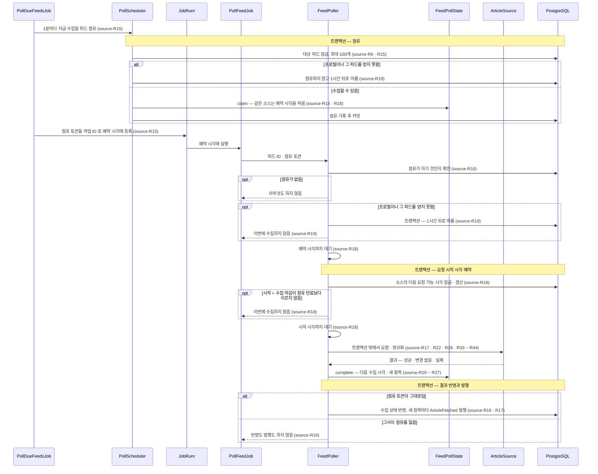

# source 모듈 Spec

공통 구조와 쓰는 규칙은 [specs/README.md](README.md)에 있다.

## 1. 책임과 범위

`source` 는 뉴스 소스(언론사)를 등록하고 그 피드를 수집해, 새 항목마다 정규화한 기사를 넘긴다.

- **등록과 운영 설정** — 소스를 수집 프로필로 등록하고(프리셋 참조 또는 운영자 프로필), 소스 · 피드를 켜고 끄며, 운영자 수집 주기를 둔다. 기동 때 저장된 피드를 지금의 프로필과 대조한다
- **수집 일정** — 수집할 피드를 고르고, 겹치지 않게 점유하고, 같은 언론사에 요청이 몰리지 않게 띄우고, 결과로 다음 수집 시각을 정한다
- **피드 요청** — 조건부 GET 으로 피드를 받고, 내부 주소로 가는 요청을 막고, 한 번의 수집에 마감 · 크기 상한을 건다
- **정규화** — 받은 문서를 수집 프로필대로 보정 · 파싱하고 항목마다 기사 값으로 정리한다
- **새 항목 판정과 발행** — 그 피드의 직전 성공 수집에 없던 항목만 `ArticleFetched` 로 넘긴다

하지 않는 것:

- 같은 기사인지 판정하지 않고 기사를 저장하지 않는다 — `article` 이 한다. `source` 가 말하는 새 항목은 이 피드에서 직전에 받지 않은 항목일 뿐이다
- 기사를 분류 · 평가하지 않는다
- 기사 본문을 받지 않는다

다른 모듈과의 의존과 이벤트 흐름은 [overview.md §5](../overview.md#5-모듈-지도)에 있다.

## 2. 용어

여러 모듈이 쓰는 소스 · 피드 · 수집 프로필 · 프리셋 · 운영자 프로필은 [overview.md §8](../overview.md#8-용어)에 있다.

| 용어 | 뜻 |
|---|---|
| 프리셋 키 | 프리셋 파일 이름(`{key}.yaml` 의 `{key}`). 소스가 프리셋을 참조할 때 저장하는 값이다 |
| 피드 식별자(feed key) | 수집 프로필 안에서 피드를 가르는 이름. 피드 ID(`FeedId` — `feeds.id`)와 다르다 |
| 이용조건 검토일 | 소스의 RSS 이용조건을 검토한 날짜(프로필의 `termsReviewedAt`). 없으면 소스를 켤 수 없다 |
| 운영 설정 · 수집 상태 | 운영 설정은 운영자가 쓰는 켜짐 여부 · 수집 주기, 수집 상태는 수집 작업만 쓰는 일정 · 결과 기록이다. 서로 다른 행에 있다 |
| 실제 주기 | 운영 설정과 프로필의 권장값에서 정한, 피드를 수집하는 주기 |
| 점유 | 한 피드의 한 회차 수집을 한 작업에 묶는 표시 — 토큰과 예약 시각 |
| 수집 마감 | 한 번의 수집 전체(연결 대기 · 연결 · 응답 · 리다이렉트 · 본문)에 거는 시간 상한 |
| 사전 보정 | 파싱 전에 받은 원문에 적용하는 보정 — 프로필이 닫힌 목록에서 고른다 |
| 읽을 곳 | 기사 값 하나를 피드 항목의 어느 요소에서 읽는지의 목록. `$standard` 는 그 피드 형식의 명세가 정한 요소다 |
| 항목 키 | 같은 피드 안에서 항목을 가르는 키 — guid 가 있으면 `g:` + guid, 없으면 `l:` + 링크 원문 |
| 새 항목 | 그 피드의 직전 성공 수집의 항목 키에 없던 항목 |
| 넘침 의심 | 직전 성공 수집과 겹치는 항목이 하나도 없는 수집 — 수집 간격 동안 피드가 싣는 건수보다 많은 기사가 나와 일부를 놓쳤을 수 있다 |
| 영구 이동 주소 | 처음 URL 에서 끊기지 않고 이어진 영구 이동(301 · 308)의 마지막 대상 |
| 일시 · 영구 실패 | 영구 실패는 사람이 무언가를 바꾸기 전에는 다시 보내도 같은 결과가 날 것으로 보는 실패, 그 밖은 일시 실패다 |

## 3. 공개 인터페이스

모듈 최상위 패키지 `net.yozmnews.source` 의 공개 타입은 아래 넷이다. 소스 등록 · 켜기 · 끄기 · 수집 주기 변경의 유스케이스는 모듈 안에서만 보이고(`application` 패키지의 패키지 전용 클래스), 다른 모듈에 공개한 API 는 없다.

HTTP 엔드포인트: 없음.

### SourceId

소스 식별자 — `sources.id` 다.

```java
public record SourceId(long value) {}
```

| 필드 | 뜻 | 제약 |
|---|---|---|
| `value` | `sources.id` | 1 이상 — 아니면 생성자가 `IllegalArgumentException` 을 던진다 |

관련 규칙: 없음.

### FeedId

피드 식별자 — `feeds.id` 다. 수집 프로필 안의 피드 식별자(feed key)와 다르다.

```java
public record FeedId(long value) {}
```

| 필드 | 뜻 | 제약 |
|---|---|---|
| `value` | `feeds.id` | 1 이상 — 아니면 생성자가 `IllegalArgumentException` 을 던진다 |

관련 규칙: source-R7(피드는 지우지 않는다 — 받은 기사의 기록이 피드 ID 를 가리킨다).

### ArticleFetched

수집한 피드의 새 항목 하나(source → article).

```java
public record ArticleFetched(SourceId sourceId, FeedId feedId, Instant fetchedAt, FetchedArticle article) {}
```

| 필드 | 뜻 | 제약 |
|---|---|---|
| `sourceId` | 항목을 받은 소스 | null 이 아니다 |
| `feedId` | 항목을 받은 피드 | null 이 아니다 |
| `fetchedAt` | 그 항목을 받은 수집의 시각(결과를 반영한 시각). 소비자는 이것을 처음 발견한 시각 · 본 시각으로 쓴다 | null 이 아니다 |
| `article` | 정규화한 기사 | null 이 아니다 |

- 계약
  - 수집 작업이 새 항목마다 하나 발행한다. 발행은 그 수집의 결과 반영과 같은 트랜잭션이다(source-R17) — 수집 상태의 직전 항목 키가 커밋되면 그 수집의 발행도 커밋된다
  - 같은 피드의 같은 항목 키는 그 키가 직전 성공 수집에 남아 있는 동안 다시 발행되지 않는다(source-R20). 피드에서 빠졌다가 다시 실린 항목, 첫 수집의 항목은 발행된다. 같은 기사가 다른 피드 · 다른 항목 키로 다시 올 수 있다 — 같은 기사인지는 소비자가 판정한다

관련 규칙: source-R16 · source-R17 · source-R20.

### FetchedArticle

정규화한 기사 하나. 원문 본문은 담지 않는다.

```java
public record FetchedArticle(String title, URI link, @Nullable String guid, @Nullable String summary,
        Instant publishedAt, boolean publishedAtEstimated, @Nullable String author, List<String> categories,
        @Nullable URI thumbnail) {

    public static final int SUMMARY_MAX_CODE_POINTS = 1_000;

    public static boolean isWebUrl(URI uri);
}
```

생성자는 필수 값(`title` · `link` · `publishedAt` · `categories`)이 null 이면 `NullPointerException`, 제목 · 링크 · 썸네일 · 요약문 길이의 제약을 어기면 `IllegalArgumentException` 을 던진다. 카테고리의 순서 · 같은 값 없음은 정규화가 지킨다(source-R41).

| 필드 | 뜻 | 제약 |
|---|---|---|
| `title` | 정리한 제목 | 비어 있지 않다 |
| `link` | 피드가 준 기사 링크(앞뒤 공백만 지운 원문). 같은 기사 판정용 정규 URL 은 소비자가 만든다 | `isWebUrl` 을 만족한다 |
| `guid` | 피드의 항목 식별자 원문(RSS `guid` · RSS 1.0 `rdf:about` · Atom `id`, 앞뒤 공백 제거) | 없을 수 있다 |
| `summary` | 정리한 요약문 | 최대 `SUMMARY_MAX_CODE_POINTS`(1,000) 코드 포인트, 없을 수 있다 |
| `publishedAt` | 발행 시각 | — |
| `publishedAtEstimated` | 발행 시각을 해석하지 못해 받은 시각으로 채웠는지 | — |
| `author` | 기자명 | 없을 수 있다 |
| `categories` | 피드 카테고리 — 피드 순서 | 같은 값 없음, 비어 있을 수 있다. 바꿀 수 없는 목록이다 |
| `thumbnail` | 썸네일 URL | 있으면 `isWebUrl` 을 만족한다 |

`isWebUrl(uri)` — 기사 링크 · 썸네일로 받는 주소인가: 절대 URI, 스킴 `http` · `https`(대소문자 무시), 호스트 있음.

관련 규칙: source-R40 · source-R41.

## 4. 내부 구조

### 개관

| 패키지 | 책임 |
|---|---|
| `adapter/in/job` | 반복 작업과 피드 수집 작업 — 작업 서버(JobRunr)가 부른다 |
| `application` | 유스케이스(등록 · 운영 설정 · 점유 · 수집 한 회차 · 기동 대조)와 트랜잭션 경계 |
| `domain/registry` | 소스 · 피드 aggregate 와 그 저장소, 소스의 프로필 얻기, 켜기 · 수집 가능 판정 |
| `domain/profile` | 수집 프로필 모델과 그 바인딩 · 검증, 프리셋 카탈로그, 실제 주기 |
| `domain/profile/text` | 프로필 원문을 YAML 이벤트로 읽어 트리로 옮긴다 |
| `domain/poll` | 피드의 수집 상태와 그 전이, 수집 일정 산식, 새 항목 비교, 수집 상태 · 요청 예약 저장소 |
| `domain/fetch` | 피드 요청 관문(포트 `ArticleSource`)과 요청 규칙 — 주소 · 리다이렉트 · 상태 코드 · 실패 분류 · 제한 |
| `domain/feed` | 정규화 — 문자 인코딩 · 사전 보정 · XML 읽기 · 형식 판별 · 필드 보정 |
| `adapter/out/rss` | 포트 `ArticleSource` 의 v1 구현(Apache HttpClient) |
| `adapter/out/persistence` | 수집 상태 · 요청 예약 저장소의 JdbcClient 구현 |

협력:

- **등록 · 운영 설정** — `SourceRegistration` · `SourceOperations` 가 `ProfileResolver` 로 소스의 프로필을 얻어(프리셋은 `PresetCatalog`, 운영자 원문은 `ProfileParser`) 판정하고, `SourceRepository` · `FeedRepository` 로 쓴다. 피드 행과 수집 상태 행은 `FeedProvisioner` 가 함께 만든다
- **수집** — `PollScheduler` 가 `FeedPollStateRepository` 로 대상을 잠그고 `FeedPollState` 의 전이로 점유를 기록한다. `FeedPoller` 가 `SourceFetchSlotRepository` · `PollSchedule` 로 요청 시작 시각을 예약하고, 포트 `ArticleSource` 로 받은 결과를 `FeedPollState` 에 반영해 `ArticleFetched` 를 발행한다. `ArticleSource` 의 구현 `RssArticleSource` 는 요청 규칙(`domain/fetch`)으로 요청하고 `FeedNormalizer`(`domain/feed`)로 정규화한다

#### 수집 한 회차



### 들어오는 쪽

| 진입점 | 구성 요소 | 계기 | 내용 |
|---|---|---|---|
| 수집할 피드 등록 — 반복 작업 ID `poll-due-feeds` | `PollDueFeedsJob` | 1분마다 | 대상 피드를 점유하고 점유 토큰을 작업 ID 로 피드마다 수집 작업을 예약 시각에 등록한다(source-R15 · source-R18 · source-R19). 재시도하지 않는다 — 실패한 회차가 재시도를 기다리는 동안 작업 서버가 다음 회차를 건너뛰므로 다음 회차가 곧 재시도다. 같은 점유를 두 번 등록해도 작업 ID 가 같아 작업은 하나다 |
| 피드 수집(피드 ID, 점유 토큰) — 작업 ID 는 점유 토큰 | `PollFeedJob` → `FeedPoller` | 위에서 등록 | 점유 확인 → 예약 시각까지 대기 → 같은 소스의 요청 시작 시각 예약 · 대기 → 트랜잭션 밖에서 요청 · 정규화 → 한 트랜잭션에서 수집 상태 반영과 새 항목마다 `ArticleFetched` 발행(source-R16 ~ source-R21). 재시도하지 않는다 |
| 기동 대조 | `PresetFeedReconciliation`(`application`) | 애플리케이션 준비 완료(`ApplicationReadyEvent`) | 소스마다 프로필과 저장된 피드를 대조한다(source-R8) |
| **(미구현)** 피드 건강 검사 | — | 1시간마다 | 연속 실패 · 장기 무소식 피드 표시, 운영자 알림(source-R30 · source-R31) |

수집 작업이 동시에 몇 개 도는지는 작업 서버의 worker 수가 정한다(§7). 수집 작업은 기다리는 동안 DB 연결을 잡지 않는다. 컨트롤러는 없다.

### `application`

- `PollScheduler` — 지금 수집할 피드를 점유한다. 대상 잠금 · 점유 기록을 한 트랜잭션에서 하고, 수집 작업 등록은 커밋 뒤 호출자(`PollDueFeedsJob`)가 한다 — 작업 저장소는 그 트랜잭션에 참여하지 않는다(source-R15 · source-R19)
- `FeedPoller` — 점유한 피드를 한 번 수집한다. 요청 시작 시각 예약과 결과 반영 · 발행을 각각 한 트랜잭션에서 하고, 피드 요청은 트랜잭션 밖에서 한다. 프로필을 얻지 못한 갈래는 미룸만 한 트랜잭션에서 쓴다(source-R16 ~ source-R19)
- `SourceRegistration` — 소스를 등록한다. 소스 행과 프로필의 피드마다 꺼진 피드 행 · 수집 상태 행을 한 트랜잭션에서 만든다(source-R1 ~ source-R3)
- `SourceOperations` — 소스 · 피드를 켜고 끄고 수집 주기를 바꾼다. 연산마다 한 트랜잭션이다. 켜기는 지금의 프로필로 판정하고, 거절하면 아무것도 저장하지 않는다(source-R4 · source-R5 · source-R14)
- `FeedProvisioner` — 피드 행과 그 수집 상태 행을 함께 만든다. 이미 있으면 아무것도 하지 않는다 — 등록과 기동 대조가 호출자의 트랜잭션 안에서 쓴다(source-R3 · source-R8)
- `PresetFeedReconciliation` — 기동 대조(들어오는 쪽). 프로필을 얻은 소스마다 한 트랜잭션에서 프로필에 새로 생긴 피드를 더한다. 프로필을 얻지 못한 소스는 경고 로그만 남긴다(source-R8)
- `PresetCatalogConfiguration` — 기동 때 프리셋 파일을 모두 읽어 카탈로그로 둔다. 하나라도 검증에 실패하면 기동하지 않는다(source-R12)
- `SourceRegistryConfiguration` — 프로필 해석기 `ProfileResolver` 를 카탈로그와 검증기로 만든다
- 그 밖의 값: `ClaimedPoll`(점유한 회차) · `Registration`(등록 결과)

### `domain`

#### `domain/registry`

- `Source` · `Feed` — aggregate(Spring Data JDBC). 운영 설정(켜짐 · 수집 주기)만 둔다 — 이름 · URL · 섹션은 수집 프로필에, 수집 상태는 다른 행(`feed_poll_states`)에 있다(source-R1 · source-R7)
- `SourceRepository` · `FeedRepository` — 두 aggregate 의 저장소. 피드 행은 "없으면 넣기"로만 만든다(source-R2 · source-R3)
- `ProfileResolver` — 소스의 수집 프로필을 얻는다 — 프리셋은 카탈로그에서, 운영자 프로필은 저장된 원문을 검증해서. 가리킬 곳을 잃었는지는 저장하지 않고 부를 때마다 판정한다(source-R1 · source-R8)
- `PollTarget` — 피드를 지금 수집할 수 있는가 — 프로필을 얻었고 그 프로필에 피드가 있는가(source-R5 · source-R19)
- `FeedReconciliation` — 프로필의 피드와 저장된 피드 행을 견준 결과(source-R8)
- 그 밖의 값: `Activation` · `ActivationRefusal` · `ProfileResolution`

#### `domain/profile`

- `CollectionProfile` — 검증을 통과한 수집 프로필. 프리셋과 운영자 프로필이 같은 모델이고, 검증기만 만든다(source-R10)
- `ProfileParser` — 원문 → 프로필. `text` 의 읽기기 → `ProfileBinder` → `ProfileValidator` 를 지나고, 입력 오류는 예외가 아니라 문제 목록으로 돌려준다
- `ProfileBinder` — 트리 → 초안. 알 수 없는 키 · 같은 매핑 안 중복 키 · 앵커 · 별칭 · 명시 태그 · 빈 값 · 형(type) 오류를 판정한다(source-R32)
- `ProfileValidator` — 초안 → 프로필. 값 규칙의 정본이다(source-R11)
- `PresetCatalog` · `Preset` — 프리셋 키 → 프리셋(source-R12)
- `PollIntervalPolicy` — 실제 주기 산식(source-R14)
- 그 밖의 값 · 식별자 타입: `FeedKey` · `PresetKey` · `FeedSpec` · `SourceInfo` · `PollInterval` · `PollIntervalSettings` · `PreCorrection` · `ItemField` · `ValueSource` · `ElementName` · `KnownNamespaces` · `DateParsing` · `DatePattern` · `Identifiers` · `ProfileDraft` · `ProfileParse` · `PresetParse` · `ProfilePath` · `ProfileProblem` · `ProblemCode`

#### `domain/profile/text`

- `ProfileTextReader` — 프로필 원문을 YAML 이벤트 API 로만 읽어 트리로 옮긴다 — 원문 길이 상한 · 문서 하나 · 최상위 매핑(source-R32)
- `ProfileTree` — 원문을 받은 그대로 옮긴 트리. 판정은 하지 않는다
- 그 밖의 값: `ReadResult` · `TextLocation`

#### `domain/poll`

- `FeedPollState` — 피드 하나의 수집 상태. aggregate 가 아닌 상태 객체로, 전이(`claim` 점유 · `complete` 결과 반영 · `deferForUnavailableProfile` 미룸)가 다음 상태를 계산한다. 저장은 `FeedPollStateRepository` 가 점유 토큰을 조건으로 한다(source-R15 · source-R16 · source-R19 ~ source-R27)
- `PollSchedule` — 수집 일정 산식과 상수의 정본(점유 기간 · 같은 소스 요청 간격 · 프로필 재확인 · 백오프 상한)(source-R15 · source-R18 · source-R19 · source-R25)
- `PollSlots` — 같은 소스에서 이번 회차에 수집할 피드들의 예약 시각을 띄운다(source-R18)
- `ItemComparison` · `ItemKey` — 새 항목 판정과 넘침 의심(source-R20 · source-R21)
- `FeedPollStateRepository` — 수집 상태 저장소. 수집 작업만 쓴다 — 대상 잠금 · 점유 확인 · 토큰 조건 반영(source-R6 · source-R15 · source-R16)
- `SourceFetchSlotRepository` — 소스마다 다음 요청 가능 시각의 저장소. 요청 직전에 그 행을 잠근다(source-R18)
- 그 밖의 값: `Lease` · `LastError` · `PollOutcome` · `FeedPollContext`

#### `domain/fetch`

- `ArticleSource` — 피드 요청 관문(포트). 선언은 나가는 쪽에 있다
- `AddressPolicy` · `NetworkRange` — 내부 주소 판정. 대역 표의 정본이다(source-R33 · source-R34)
- `FetchUrls` — 요청할 수 있는 주소와 리다이렉트 대상 풀기(source-R35)
- `StatusRule` — 응답 상태 코드 → 결과(source-R23 · source-R24)
- `FetchFailureReason` — 실패 이유의 닫힌 목록과 일시 · 영구 분류(source-R24)
- `FetchState` — 조건부 요청 값과 그 저장 · 재전송 조건(source-R22)
- `FetchLimits` — 수집 마감 · 본문 크기 · 리다이렉트 상한(source-R28)
- `UserAgent` — 요청의 `User-Agent` 와 연락처 형식(source-R29)
- `RedirectTrail` — 따라간 리다이렉트 홉 수와 영구 이동 주소(source-R27 · source-R28)
- `ContentTypeCharset` — `Content-Type` 의 charset 읽기(source-R38)
- 그 밖의 값: `FeedDescriptor` · `FetchResult` · `FetchFailure` · `FailurePermanence` · `StatusOutcome`

#### `domain/feed`

- `FeedNormalizer` — 정규화의 진입. 문자 인코딩 판정 → 사전 보정 → XML 읽기 → 형식 판별 → 항목마다 필드 보정. 상태가 없고 호출마다 파서를 새로 만든다(source-R38 ~ source-R44)
- `DocumentDecoder` · `KoreanCharsets` — 받은 바이트의 문자 인코딩 판정과 읽기(source-R38)
- `PreCorrector` · `EntityReferences` · `XmlCharacters` — 사전 보정(source-R38)
- `FeedXmlReader` · `IsolatedXmlReaders` · `DeclarationRejectingHandler` — 외부 엔티티 · DTD 선언을 받지 않는 XML 읽기(source-R43 · source-R44)
- `RomeFeed` · `FeedFormat` — Rome 의 형식 판별과 항목별 제목 · 링크(source-R39)
- `ItemNormalizer` · `StandardElements` — 항목 하나 → 기사, 형식마다 읽을 곳 `$standard`(source-R40 · source-R41)
- `PublishedAtResolver` · `Rfc822DateTime` — 발행 시각 해석(source-R40)
- `TextCleaner` — HTML 제거 · 엔티티 해제 · 공백 정리(source-R40 · source-R45)
- 그 밖의 값: `FeedNormalization` · `FeedDocument` · `ItemValues` · `SkippedItem` · `SkipReason` · `DocumentProblem` · `DocumentProblemKind` · `MarkupScanner`

### 나가는 쪽

#### `ArticleSource`

모든 피드 수집(정기 수집 · 활성화 전 미리보기)이 거치는 관문이다. 모듈 안의 포트(`domain/fetch`)라 공개 인터페이스(§3)가 아니다. 선언의 정본은 이 Spec 이다.

```java
public interface ArticleSource {
    FetchResult fetch(FeedDescriptor feed, FetchState previous);
}

public record FeedDescriptor(URI url, CollectionProfile profile) {}

public record FetchState(@Nullable String etag, @Nullable String lastModified) {}

public sealed interface FetchResult {
    record Fetched(FeedNormalization.Normalized normalization, FetchState state, Instant fetchedAt,
            @Nullable URI movedTo) implements FetchResult {}
    record NotModified(FetchState state, Instant fetchedAt, @Nullable URI movedTo) implements FetchResult {}
    record Failed(FetchFailure failure, Instant attemptedAt) implements FetchResult {}
}
```

- 입출력 실패는 예외가 아니라 `FetchResult.Failed` 다. 인자가 null 이면 `NullPointerException`
- `previous` 는 직전 수집이 남긴 조건부 요청 값이고, 처음이면 `FetchState.NONE`

#### 구현과 로컬 대체물

- `RssArticleSource` — 포트의 v1 구현이고 하나뿐이다. Apache HttpClient 5 로 피드를 받아 `FeedNormalizer` 로 넘긴다. 리다이렉트는 직접 따라가며 홉마다 요청 규칙(`domain/fetch`)으로 판정하고, 한 번의 수집 전체에 마감 하나를 건다. 내부 주소 차단 · 요청 제한은 이 구현이 건다(source-R28 · source-R33 ~ source-R37). 정규화는 Rome(형식 판별 · 제목 · 링크), 자체 구성한 SAX 파서 · JDOM(DTD 선언 거부), jsoup(HTML 제거 · 엔티티 표)을 쓴다
- `PolicyDnsResolver` — 이름 해석 결과를 `AddressPolicy` 로 거른다. 연결은 이 해석기가 돌려준 주소로만 하므로 검사한 주소가 곧 연결 주소다(source-R33)
- `BoundedBody` — 응답 본문을 크기 상한까지만 읽는다(source-R28)
- `FeedHttpClients` — 수집용 Apache 클라이언트를 만든다. 구성과 테스트가 같이 쓴다(source-R36)
- `RssArticleSourceConfiguration` · `CollectionProperties` — 수집 설정(§7)으로 구현을 만든다. 연락처가 없거나 설정이 틀리면 기동이 실패한다(source-R29 · source-R34)
- 그 밖: 예외 `BlockedAddressException` · `BodyTooLargeException`
- 로컬 대체물은 없다 — 테스트는 실제 구현에 WireMock 피드 서버를 붙인다

#### 저장소 구현

- `JdbcFeedPollStateRepository` · `JdbcSourceFetchSlotRepository` — 수집 상태 · 요청 예약 저장소의 JdbcClient 구현. 쓰기 조건이 점유 토큰 · 행 잠금이라 aggregate 저장 대신 SQL 로 쓴다
- `SourceRepository` · `FeedRepository` 는 Spring Data JDBC 가 구현한다

#### 수집 프로필 읽기

프로필 원문은 snakeyaml-engine 의 이벤트 API 로만 읽는다(source-R32).

#### 신뢰할 수 없는 입력

| 입력 | 방어 |
|---|---|
| 운영자 프로필 원문 | [운영자 프로필 입력](#운영자-프로필-입력) — source-R32 |
| 피드 URL · 리다이렉트 | [피드 요청](#피드-요청) — source-R33 ~ source-R37 |
| 피드 문서 | [피드 XML 입력](#피드-xml-입력) — source-R43 ~ source-R46, 크기 상한 source-R28 |

## 5. 규칙과 불변식

### 등록과 켜기

- **source-R1** — v1 은 운영자만 소스를 등록한다. 소스는 프리셋을 참조하거나 운영자 프로필 원문을 갖는다. 둘 중 정확히 하나다. 프리셋을 참조하면 프로필을 DB 에 복사하지 않는다 — 프리셋은 저장소 파일이 정본이다. 운영자 프로필 원문은 주석까지 그대로 저장하고, 읽을 때마다 지금의 검증기로 검증한다
- **source-R2** — 같은 프리셋을 두 소스가 참조하지 않는다. 두 번째 등록은 "이미 등록된 프리셋"으로 거절한다. 카탈로그에 없는 프리셋 키, 검증을 통과하지 못한 운영자 원문도 등록하지 않는다
- **source-R3** — 소스를 등록하면 한 트랜잭션에서 소스와, 프로필의 피드마다 꺼진 피드와 그 수집 상태를 만든다. 소스도 꺼진 채다. 피드 · 수집 상태를 만드는 일은 이미 있으면 아무것도 하지 않는다 — 여러 인스턴스가 함께 해도 피드 하나에 행 하나다
- **source-R4** — 소스는 그 프로필을 얻었고 프로필에 이용조건 검토일이 있어야 켜진다. 거절 이유는 프로필을 얻지 못함(프리셋이 사라졌거나 운영자 원문이 검증에 걸림) · 검토일 없음이고, 거절하면 아무것도 바꾸지 않는다
- **source-R5** — 피드는 그 소스의 프로필을 얻었고 프로필에 그 피드가 있어야 켜진다. 거절 이유는 프로필을 얻지 못함 · 프로필에 피드가 없음이고, 거절하면 아무것도 바꾸지 않는다. 이용조건 검토일은 소스를 켤 때만 본다
- **source-R6** — 수집 대상은 소스와 피드가 모두 켜졌고 다음 수집 시각이 지난 피드다
- **source-R7** — 피드는 지우지 않는다 — 받은 기사의 기록이 피드 ID 를 가리킨다. 프로필에서 빠진 피드도 남는다. 피드 식별자 · 프리셋 키는 저장된 뒤 바꾸지 않는다
- **source-R8** — 기동 때 소스마다 지금의 프로필과 저장된 피드를 대조한다. 프로필에 새로 생긴 피드는 꺼진 피드로 더하고(source-R3 과 같은 경로), 사라진 프리셋 · 검증에 걸린 운영자 원문 · 프로필에서 빠진 피드는 경고 로그로 알린다. 피드는 지우지도 끄지도 않는다 — 켜고 끄는 것은 운영자의 선택이다. 가리킬 곳을 잃었는지는 저장하지 않고 그때의 프리셋 파일 · 검증기로 판정한다. 여러 인스턴스가 함께 해도 결과가 같다
- **source-R9** — **(미구현)** 활성화 관문의 미리보기: 켜기 전에 한 번 받아 미리보기(항목 수 · 날짜 해석률 · 요약문 길이 분포 · 파싱 오류)를 만들고, 기준에 못 미치면 켜지 않는다. 이 미리보기도 피드 요청 관문(`ArticleSource` — §4)을 거친다

### 수집 프로필

- **source-R10** — 수집 프로필은 YAML 문서 하나다. 형식의 정본은 이 모듈의 모델과 검증기다.

  | 키 | 필수 | 뜻 |
  |---|---|---|
  | `source.name` · `source.homepage` · `source.language` | 예 | 이름(공백만 아님) · 홈페이지 · 언어 — 언어는 날짜 텍스트(오전/오후 · 요일)를 읽는 로캘이기도 하다 |
  | `termsReviewedAt` | 프리셋만 | 이용조건 검토일(`yyyy-MM-dd`) |
  | `feeds[]` — `key` · `url` · `section` · `pollIntervalMinutes` | `feeds` 와 각 피드의 `key` · `url` · `section` | 피드 하나 이상. `pollIntervalMinutes` 는 그 피드의 권장 주기 |
  | `pollIntervalMinutes` | 아니오 | 소스의 권장 주기(분) |
  | `preCorrections[]` — `rule` · `charset` | 아니오 | 사전 보정, 적용 순서대로(source-R38) |
  | `items` — `publishedAt` · `summary` · `author` · `category` · `thumbnail` | 아니오 | 기사 값마다 읽을 곳 목록(source-R41). 적지 않은 값은 `[$standard]`, 빈 목록은 그 값을 읽지 않는다 |
  | `namespaces` | 아니오 | 요소 이름의 접두사 → 이름공간 URI. 기본 접두사 `dc` · `content` · `media` · `atom` 은 다시 정의할 수 없다 |
  | `dates.formats[]` · `dates.timeZone` | 아니오 | 표준 형식 다음에 시도할 날짜 형식, 오프셋 없는 값의 시간대(없으면 `Asia/Seoul`) |
- **source-R11** — 프로필의 값 규칙. 어긋나면 프로필 전체가 무효이고, 문제마다 위치와 함께 알린다.
  - URL(홈페이지 · 피드)은 `http` · `https` 절대 URL 이다. 이름공간은 절대 URI 다
  - 언어는 정규형 BCP 47 태그이고 언어 부분이 ISO 639-1 이다
  - 피드 식별자 · 프리셋 키는 소문자 · 숫자를 하이픈 하나로 이은 40자 이하다. 피드 식별자와 피드 URL 은 프로필 안에서 겹치지 않는다
  - 수집 주기(소스 · 피드)는 15분 이상이다(source-R14)
  - 사전 보정은 닫힌 목록(`replace-undefined-entities` · `strip-invalid-control-chars` · `force-encoding`)에서만 고르고 같은 규칙을 두 번 쓰지 않는다. `force-encoding` 의 `charset` 은 지원하는 문자 인코딩이다
  - 읽을 곳은 `$standard` 또는 `접두사:이름` · `이름` 형식의 요소 이름이고, 접두사는 기본 접두사이거나 `namespaces` 에 정의한 것이다. 한 값의 목록 안에 같은 것을 두 번 쓰지 않는다
  - 날짜 형식은 패턴으로 읽을 수 있고 연 · 월 · 일 · 시 · 분을 모두 담는다. 시간대는 알려진 시간대다
- **source-R12** — 프리셋은 `backend/src/main/resources/source-presets/{key}.yaml` 하나가 하나이고, 이용조건 검토일이 반드시 있다. 기동 때 모든 프리셋을 운영자 프로필과 같은 읽기기 · 검증기로 읽는다. 하나라도 검증에 실패하거나, 그 디렉터리에 `.yaml` 이 아닌 파일 · 키 형식이 아닌 이름 · 같은 이름이 있으면 기동하지 않는다
- **source-R13** — 프리셋을 참조하는 소스는 운영자가 소스 · 피드를 켜고 끄고 수집 주기를 정할 뿐이다. 프리셋이 바뀌면 다음 배포부터 바뀐 프리셋으로 수집한다. 운영자 프로필은 프리셋과 같은 형식의 완결된 프로필이고, 프리셋 원문을 복사해 고친 프로필은 이후 프리셋 수정을 따라가지 않는다

### 수집 일정

- **source-R14** — 실제 주기는 운영자 피드 설정 → 운영자 소스 설정 → 프로필 피드 값 → 프로필 소스 값 → 15분 순으로 처음 있는 값이다. 하한은 15분이고 프로필 권장값과 운영자 설정 모두에 적용한다 — 하한보다 짧은 운영자 설정(0 · 음수 포함)은 받지 않고 바꾸지 않는다
- **source-R15** — 1분마다 한 트랜잭션에서 대상 피드를 다음 수집 시각 순으로 최대 100개 잠그고(다른 회차가 잠근 행은 건너뛴다), 피드마다 점유(토큰 · 예약 시각)를 기록해 커밋한다. 점유 중인 피드의 다음 수집 시각은 예약 시각 + 10분(점유 기간)이라, 점유가 풀리지 않아도 그 시각이 지나면 다시 대상이 된다. 만료된 점유는 새 점유로 덮어쓴다. 커밋한 뒤 점유 토큰을 작업 ID 로 수집 작업을 예약 시각에 등록한다 — 등록 전에 멈추면 점유만 남고 만료 뒤 다시 대상이 된다
- **source-R16** — 수집 작업은 점유가 자기 것(토큰 일치)이고 소스 · 피드가 아직 켜져 있을 때만 받는다. 결과는 토큰이 그대로일 때만 반영하고, 그사이 점유를 잃었으면 반영도 발행도 하지 않는다. 작업은 재시도하지 않는다 — 점유 만료가 재시도다. 그래서 한 회차의 결과는 한 번 반영되고, 같은 작업을 다시 실행해도 결과가 같다
- **source-R17** — 피드 요청은 DB 트랜잭션 밖에서 하고, 결과 반영과 새 항목의 `ArticleFetched` 발행은 한 트랜잭션에서 한다
- **source-R18** — 같은 소스의 요청 시작 사이는 수집 마감(10초) 이상 띄운다. 수집 작업은 예약 시각까지 기다린 뒤, 요청 직전에 그 소스의 다음 요청 가능 시각을 잠가 시작 시각(max(다음 요청 가능 시각, 지금))을 받고 다음 요청 가능 시각을 시작 + 10초로 옮긴다. 받은 시작 + 수집 마감이 점유 만료보다 이르지 않으면 이번에 수집하지 않는다(점유가 만료되면 다음 회차가 가져간다). 같은 소스의 피드끼리 작업 예약 시각도 10초씩 띄우지만, 작업 서버가 예약 작업을 poll 간격 단위로 묶어 시작하므로 간격의 보장은 요청 직전 예약이 한다. 이름 해석은 마감 밖이라, 해석이 길면 앞 요청이 끝나기 전에 다음 요청이 시작될 수 있다
- **source-R19** — 프로필이나 그 안의 피드를 얻지 못한 피드는 수집하지 않는다. 대상을 고를 때 확인해 점유하지 않고, 수집 작업이 시작할 때 다시 확인해 점유를 푼다. 어느 쪽이든 다음 수집 시각을 1시간 뒤로 미루고 경고 로그를 남긴다. 점유 · 다음 수집 시각 밖의 수집 상태 값은 바꾸지 않는다

### 새 항목

- **source-R20** — 새 항목은 그 피드의 직전 성공 수집의 항목 키에 없던 항목이다. 항목 키는 guid 가 있으면 `g:` + guid, 없으면 `l:` + 링크 원문이다 — 같은 피드 안의 비교라 정규 URL 을 쓰지 않는다. 한 수집 안에서 같은 키는 문서 순서로 처음 것만 쓴다. 첫 수집(직전 키 없음)은 받은 항목을 모두 새 항목으로 넘긴다. 피드에서 빠졌다가 다시 실린 항목도 다시 넘어간다. 성공한 수집이 이번 키 목록을 다음 비교의 직전 키로 남긴다(빈 피드면 빈 목록 — 직전 키 없음과 다르다)
- **source-R21** — 넘침 의심은 직전 키가 있고 비어 있지 않고, 이번 키가 있고, 겹치는 키가 하나도 없을 때다(첫 수집 · 빈 피드 · 직전이 빈 피드는 제외). 수집 상태에 마지막 시각 · 횟수로 남기고 경고 로그를 남긴다 — 수집 주기를 다시 판단하는 운영 데이터다

### 요청과 결과

- **source-R22** — 조건부 GET — 수집 상태에 남은 `ETag` · `Last-Modified` 원문을 `If-None-Match` · `If-Modified-Since` 로 그대로 보낸다. 저장 · 재전송하는 값은 공백만이 아니고 1,024자 이하이고 문자가 모두 0x20~0x7E 인 것뿐이고, 아니면 버린다. 성공(200 을 정규화한 결과)은 그 응답의 두 값으로 바꾸고, 304 는 준 값만 바꾸고 주지 않은 값은 그대로 둔다. 실패(200 이어도 문서를 읽지 못하거나 본문을 다 받지 못한 경우 포함)는 값을 바꾸지 않는다
- **source-R23** — 304(변경 없음)는 성공으로 다룬다 — 연속 실패를 0 으로 하고 조건부 요청 값을 갱신하며, 직전 항목 키는 그대로 둔다. 조건부 헤더를 보내지 않았는데 온 304 는 실패(예상 밖 응답)다
- **source-R24** — 결과는 성공 · 변경 없음 · 실패이고, 실패 이유는 닫힌 목록이다. 일시 · 영구 분류는 이유가 정한다.

  | 이유 | 뜻 | 분류 |
  |---|---|---|
  | `TIMEOUT` | 수집 마감을 넘었다 | 일시 |
  | `CONNECTION_FAILED` | 연결하지 못했거나 끊겼다(그 밖의 입출력 오류 포함) | 일시 |
  | `NAME_NOT_RESOLVED` | 호스트 이름을 해석하지 못했다("이름 없음"과 "해석기 장애"를 가르지 못한다) | 일시 |
  | `SERVER_ERROR` | 5xx | 일시 |
  | `THROTTLED` | 408 · 429 | 일시 |
  | `ACCESS_DENIED` | 401 · 403 | 영구 |
  | `NOT_FOUND` | 404 · 410 | 영구 |
  | `CLIENT_ERROR` | 그 밖의 4xx | 영구 |
  | `UNEXPECTED_STATUS` | 그 밖의 상태 코드(100~599 밖 포함), 조건부 헤더 없이 온 304 | 영구 |
  | `TOO_MANY_REDIRECTS` | 리다이렉트가 상한을 넘었다 | 영구 |
  | `INVALID_REDIRECT` | `Location` 이 없거나 URI 로 읽을 수 없다 | 영구 |
  | `UNSUPPORTED_URL` | 처음 URL 이나 리다이렉트 대상이 요청할 수 있는 주소가 아니다(source-R35) | 영구 |
  | `BLOCKED_ADDRESS` | 연결 주소가 차단 대역이다(source-R33) | 영구 |
  | `TLS_FAILURE` | TLS 핸드셰이크 · 인증서 오류 | 영구 |
  | `TOO_LARGE` | 본문이 크기 상한을 넘었다 | 영구 |
  | `UNREADABLE` | 받은 문서를 정규화가 읽지 못했다(source-R42) | 영구 |

  200 은 본문을 읽고, 301 · 308 은 영구 이동 · 302 · 303 · 307 은 임시 이동으로 따라간다
- **source-R25** — 실패하면 다음 수집 시각 = 실패 시각 + max(주기, min(주기 × 2^연속 실패, 상한)) 이다(연속 실패는 이번 실패를 포함). 상한은 일시 실패 6시간, 영구 실패 24시간이다. 실제 주기가 상한보다 길어도 주기보다 이르게 잡지 않는다. 영구 실패도 수집을 멈추지 않으므로, 언론사 · 프리셋 쪽이 고쳐지면 운영자 조치 없이 돌아온다. 성공 · 변경 없음 뒤의 다음 수집 시각은 결과 시각 + 주기다
- **source-R26** — 마지막 실패(이유 · 문구 · 상태 코드 · 시각)는 성공한 뒤에도 남는다
- **source-R27** — 성공 · 변경 없음 결과가 거친 영구 이동 주소를 수집 상태에 남긴다 — 프로필을 고칠 단서다. 그 값이 바뀌어 비어 있지 않은 값이 되면 경고 로그를 남긴다
- **source-R28** — 한 번의 수집에 거는 제한
  - 수집 마감 10초 — 연결 대기 · 연결 · 응답 · 리다이렉트 홉 · 본문을 합친 한 번의 수집 전체에 하나다. 이름 해석은 OS 해석기의 시간 상한을 따른다
  - 본문 크기 상한 5MiB — 압축을 푼 바이트로 센다(같으면 통과, 넘으면 실패). 압축(gzip · deflate)을 요청한다
  - 리다이렉트는 5회까지 따라가고, 홉마다 대상 주소를 다시 검사한다(source-R33 · source-R35)
  - 한 번의 수집 안에서는 다시 보내지 않는다. 다음 수집은 일정이 정한다
- **source-R29** — 요청의 `User-Agent` 는 `YozmNews (+https://github.com/Theia0382/yozm-news; {연락처})` 다. 연락처는 운영 설정(§7)이고, 이메일 주소나 `http` · `https` URL 이며, 1~200자에 0x21~0x7E 밖의 문자 · 괄호 · 역슬래시 · 세미콜론이 없다. 없거나 형식이 틀리면 앱이 뜨지 않는다
- **source-R30** — **(미구현)** 연속 실패가 기준 이상이면 피드를 `DEGRADED` 로 바꾸고 운영자에게 알린다
- **source-R31** — **(미구현)** 방치된 피드: 응답은 정상이지만 일정 기간 새 기사가 없으면 `STALE` 로 표시한다. 실제로 2024년 이후 갱신되지 않은 피드가 있었다([조사 자료](../research/2026-10-rss-survey.md))

### 운영자 프로필 입력

운영자 프로필 원문은 운영자 권한으로 들어오지만 해석기는 그대로 믿지 않는다([ADR-0024](../adr/0024-collection-profile-yaml-and-preset-reference-or-own-profile.md)).

- **source-R32** — 원문은 65,536자까지다. YAML 은 이벤트 파서로만 읽는다 — 태그로 객체를 만드는 단계가 없다. 문서는 하나이고 최상위는 매핑이다. 앵커 · 별칭 · 명시 태그, 알 수 없는 키, 같은 매핑 안 중복 키, 빈 값(`null` · 값을 적지 않음)은 오류다. 사전 보정은 닫힌 목록에서만 고른다 — 프로필에 코드를 넣을 수 없다. 피드 · 홈페이지 URL 은 `http` · `https` 절대 URL 만 받고, 내부 주소를 가리키는 URL 은 수집이 막는다(source-R33)

### 피드 요청

수집은 운영자가 적은 URL 과 피드가 보낸 리다이렉트를 따라 서버에서 요청한다. 서버 측 요청 위험을 막는다([ADR-0031](../adr/0031-feed-request-blocks-internal-addresses-with-apache-httpclient-deadline.md)).

- **source-R33** — 내부 주소(IPv4 의 루프백 · 사설 · 링크 로컬 · 공유 · 문서용 · 벤치마크 · 멀티캐스트 · 예약 대역, IPv6 의 미지정 · 루프백 · 고유 로컬 · 링크 로컬 · 사이트 로컬 · 문서용 · 멀티캐스트 · Teredo · 폐기 접두)로 가는 요청은 기본으로 막는다. IPv4 를 품은 IPv6 주소(IPv4 호환 · NAT64 · 6to4)는 품은 IPv4 도 본다. 대역 표의 정본은 이 모듈의 `AddressPolicy` 다. 검사는 실제로 연결하는 주소에 한다 — 이름을 해석한 결과 가운데 하나라도 막힌 주소면 그 이름 전체를 거부한다. 처음 URL 과 모든 리다이렉트 홉이 같은 검사를 지난다
- **source-R34** — 막힌 대역은 서버 설정(§7 `allowed-networks`)으로만 연다. 화면의 운영자 권한으로는 열 수 없다. IPv4 대역을 열어도 그 IPv4 를 품은 IPv6 주소는 열리지 않는다 — 허용 목록은 주소 계열이 같은 대역만 본다
- **source-R35** — 요청할 수 있는 주소는 `http` · `https`(대소문자 무시), 호스트가 있고, 포트가 없거나 1~65535 이고, userinfo 가 없는 절대 URL 이다. 리다이렉트 대상은 현재 주소 기준으로 풀고 점 조각을 지운다(RFC 3986). https → http 로 내려가는 리다이렉트도 따른다 — 보내는 비밀 값이 없다
- **source-R36** — 시스템 프록시 설정을 읽지 않는다. 쿠키 · 인증 정보를 보내지 않는다
- **source-R37** — 실패 문구는 응답 본문을 옮기지 않는다. 인용하는 것은 상태 코드 · URL · 막힌 주소 · 상한 값이고, URL 의 userinfo 는 지운다(질의 문자열은 그대로 인용한다)

### 정규화

RSS 품질이 피드마다 크게 다르므로 사전 보정 → 파싱 → 필드 보정의 세 단계로 맞춘다([ADR-0030](../adr/0030-feed-xml-own-parser-and-rome-for-format-title-link.md)).

- **source-R38** — 사전 보정 — 받은 바이트를 문자로 읽고, 프로필이 고른 보정을 적힌 순서대로 적용한다
  - 문자 인코딩은 프로필의 `force-encoding` → BOM → XML 선언 → 전송 계층(HTTP `Content-Type`)의 charset → UTF-8 순으로 정한다. 한국어 계열 레이블(`euc-kr` 등)과 강제한 EUC-KR · CP949 는 windows-949 로 읽는다. 문서가 선언한 인코딩을 지원하지 않으면 문서를 읽지 않고, 전송 계층의 charset 을 지원하지 않으면 그 값만 버린다. 읽을 수 없는 바이트는 U+FFFD 로 바꾸고 그 수를 결과에 남긴다
  - `replace-undefined-entities` — HTML 이름 엔티티는 같은 문자의 숫자 참조로, 그 밖의 `&` 는 `&amp;` 로 바꾼다. 숫자 참조와 XML 기본 엔티티는 그대로 둔다
  - `strip-invalid-control-chars` — XML 1.0 에 쓸 수 없는 문자와, 그런 문자를 가리키는 숫자 참조를 지운다
  - CDATA · 주석 · 처리 명령 안의 참조는 고치지 않는다
- **source-R39** — 파싱 — Rome 이 RSS 0.9x · 1.0 · 2.0 · Atom 0.3 · 1.0 의 형식을 판별하고 제목 · 링크를 읽는다. 나머지 값은 항목 요소의 원문을 읽을 곳(source-R41)에 따라 읽는다. 표준 밖 요소(예: RSS 2.0 에서 `pubDate` 대신 `dc:date`)는 프로필의 읽을 곳으로 찾는다
- **source-R40** — 필드 보정

  | 값 | 규칙 |
  |---|---|
  | 기사 링크 | 피드의 링크를 앞뒤 공백만 지우고 넘긴다. 없거나 `http` · `https` 웹 주소가 아니면(상대 링크 포함) 그 항목을 건너뛰고 이유(링크 없음 · 웹 주소 아님)를 남긴다 |
  | 항목 식별자 | RSS `guid` · RSS 1.0 `rdf:about` · Atom `id` 의 원문(앞뒤 공백 제거). 없을 수 있다 |
  | 발행 시각 | RFC 822 → ISO 8601 → 프로필의 날짜 형식(예: `2026-10-25 09:31:38`, 한국어 날짜) 순으로 시도한다. RFC 822 는 4자리 연도만 받고 요일은 날짜와 대조하지 않는다. 오프셋이 없는 값의 시간대는 프로필 값, 없으면 KST. 받은 시각보다 1시간 넘게 미래인 값은 해석 실패로 본다. 모두 실패하면 받은 시각(그 수집의 시각)을 쓰고 `publishedAtEstimated` 를 켠다 |
  | 제목 · 요약문 | HTML 태그 제거, 엔티티 해제, 공백 정리. 정리한 제목이 비면 그 항목을 건너뛰고 이유(제목 없음)를 남긴다. 요약문은 최대 1,000 코드 포인트로 자른다 — `content:encoded` 처럼 본문 전체가 든 요소를 요약문으로 읽어도 앞부분만 쓰고 나머지는 저장하지 않는다 |
  | 메타데이터 | 기자명, 피드 카테고리(여러 값), 썸네일 URL 은 있으면 넘긴다. 썸네일 요소는 `url` 속성이 있으면 그 값을 쓰고, 웹 주소가 아니면 쓰지 않는다 |
- **source-R41** — 읽을 곳 — 기사 값마다 앞에서부터 처음으로 쓸 수 있는 값을 쓴다. 텍스트는 정리한 뒤 비지 않은 값, 발행 시각은 해석한 값, 썸네일은 웹 주소다. 카테고리는 쓸 수 있는 값이 하나라도 나온 첫 읽을 곳의 값 전부다(문서 순서, 같은 값은 한 번). `$standard` 는 그 피드 형식의 명세가 정한 요소다:

  | 값 | RSS 0.91~0.94 · 2.0 | RSS 0.90 · 1.0 | Atom |
  |---|---|---|---|
  | 발행 시각 | `pubDate` | `dc:date` | `published` (0.3 은 `issued`) |
  | 요약문 | `description` | `description` | `summary` |
  | 기자명 | `author` | `dc:creator` | `author` 의 `name` |
  | 카테고리 | `category` | `dc:subject` | `category` 의 `term` |
  | 썸네일 | `type` 이 `image/` 로 시작하는 `enclosure` 의 `url` | 없음 | `rel="enclosure"` 이고 `type` 이 `image/` 로 시작하는 `link` 의 `href` |
- **source-R42** — 문서 전체를 읽지 못하면(선언한 문자 인코딩 미지원 · XML 형식 오류 · DTD 선언 · RSS · Atom 이 아님) 그 수집은 영구 실패 `UNREADABLE` 이다. 읽은 문서는 기사가 0건일 수 있고, 항목마다 기사이거나 이유와 함께 건너뛴 항목이다

### 피드 XML 입력

피드 문서는 신뢰할 수 없는 입력이다([ADR-0030](../adr/0030-feed-xml-own-parser-and-rome-for-format-title-link.md)).

- **source-R43** — XML 파서는 호출마다 새로 만들고, 외부 엔티티 · 외부 DTD 를 읽지 않는다. 파서에 보안 설정을 적용하지 못하면 수집을 멈춘다
- **source-R44** — DOCTYPE 은 받지만, DTD 선언(요소 · 속성 · 엔티티 · 표기법)이 있거나 선언되지 않은 엔티티를 만나면 문서를 읽지 않는다. 엔티티가 펼쳐지기 전에 멈춘다
- **source-R45** — 제목 · 요약문 · 기자명 · 카테고리는 HTML 로 보고 텍스트만 남긴다
- **source-R46** — 문서를 읽지 못한 이유의 문구는 피드에서 이름(선언한 문자 인코딩 레이블 · DTD 선언 · 엔티티의 이름)만 인용한다

## 6. 데이터

컬럼 타입 · 인덱스 · 제약 문면의 정본은 `backend/src/main/resources/db/migration/V3__sources_and_feeds.sql` 이다.

| 테이블 | 주요 컬럼 | 뜻 |
|---|---|---|
| `sources` | id, preset_key(고유), profile(텍스트), enabled, poll_interval_minutes | 소스의 운영 설정. 이름 · 홈페이지 · 언어 · 이용조건 검토일 · 피드 목록 · 권장 수집 주기는 수집 프로필에 있다. `preset_key` 와 `profile` 은 둘 중 하나다(제약 — source-R1). `preset_key` 의 고유 제약이 같은 프리셋의 두 번째 소스를 막는다(source-R2). `poll_interval_minutes` 는 운영자 소스 주기(분, 정하지 않았으면 비어 있다 — source-R14). **(미구현)** 본문 추출 허용 여부는 추출을 켤 때 더한다 |
| `feeds` | id, source_id, feed_key, enabled, poll_interval_minutes | 피드의 운영 설정만 둔다. (source_id, feed_key) 고유. URL · 섹션은 프로필에 있다. `poll_interval_minutes` 는 운영자 피드 주기. 행은 지우지 않는다(source-R7) — `article` 의 피드별 기록이 `feeds.id` 를 가리킨다 |
| `feed_poll_states` | feed_id, next_poll_at, lease_token, lease_scheduled_at, etag, last_modified, last_polled_at, last_success_at, last_new_item_at, consecutive_failures, last_error_reason · message · status · at, moved_to, last_overflow_at, overflow_count, previous_item_keys | 피드의 수집 상태 — 피드당 1행. 등록 · 기동 대조가 첫 행을 만들고(source-R3), 그 뒤에는 수집 작업만 쓴다. 운영 설정(`feeds`)과 다른 행이라 서로를 덮어쓰지 않는다. 점유 중이면 `lease_token` · `lease_scheduled_at` 이 함께 있고(제약) `next_poll_at` 은 예약 시각 + 점유 기간이다(source-R15). `last_polled_at` 은 마지막으로 수집을 마친 시각(성공 · 변경 없음 · 실패), `last_success_at` 은 마지막 성공 · 변경 없음, `last_new_item_at` 은 새 항목이 있던 마지막 수집의 시각이다. `last_error_*` 는 마지막 실패이고 이유 · 시각이 함께 있다(제약 — source-R26). `moved_to` 는 마지막 성공 · 변경 없음 결과가 거친 영구 이동 주소이고 실패는 바꾸지 않는다(source-R27). `last_overflow_at` · `overflow_count` 는 넘침 의심(source-R21). `previous_item_keys` 는 직전 성공 수집의 항목 키(`text[]`)이고, 비어 있으면(NULL) 아직 성공한 수집이 없다는 뜻이라 빈 배열과 다르다(source-R20) |
| `source_fetch_slots` | source_id, next_fetch_at | 소스마다 다음 요청을 시작할 수 있는 시각 — 소스당 1행, 처음 예약할 때 만든다. 같은 언론사의 요청 시작 사이를 띄우는 예약이고, 요청 직전에 이 행을 잠근다(source-R18). 값은 그 소스의 마지막 예약이 정한 다음 요청 가능 시각이고, 예약한 뒤 요청을 건너뛰어도 남는다 |

**(미구현)** 피드의 수집 상태 값(`ACTIVE` · `DEGRADED` · `STALE` — source-R30 · source-R31)을 담을 컬럼은 아직 없다.

## 7. 설정

| 설정 키 | 바꾸는 규칙 |
|---|---|
| `yozmnews.collection.contact` | 수집 요청 `User-Agent` 의 운영자 연락처(source-R29). 필수 — 없거나 형식이 틀리면 앱이 뜨지 않는다 |
| `yozmnews.collection.allowed-networks` | 막힌 대역 가운데 수집이 연결해도 되는 대역(CIDR 목록 — source-R34). 없으면 내부 주소를 모두 막는다. 형식이 틀리면 앱이 뜨지 않는다 |
| `jobrunr.background-job-server.worker-count` | 동시에 실행하는 백그라운드 작업 수 — 동시에 도는 피드 수집 수의 상한이다 |

환경 변수 이름 · 값 예시는 [infrastructure.md "수집 설정"](../infrastructure.md#수집-설정)에 있다.

## 8. 결정

| ADR | 한 줄 |
|---|---|
| [0001](../adr/0001-news-source-rss.md) | 뉴스 소스는 네이버 검색 API 대신 운영자 큐레이션 RSS |
| [0015](../adr/0015-source-presets-and-collection-profiles.md) | 뉴스 소스는 수집 프로필로 등록하고, 주요 언론사는 프리셋으로 제공한다 |
| [0024](../adr/0024-collection-profile-yaml-and-preset-reference-or-own-profile.md) | 수집 프로필은 YAML 로 쓰고, 소스는 프리셋을 참조하거나 자기 프로필을 갖는다 |
| [0030](../adr/0030-feed-xml-own-parser-and-rome-for-format-title-link.md) | 피드 문서는 자체 구성한 XML 파서로 읽어 DTD 선언을 거부하고, Rome 은 형식 판별 · 제목 · 링크에만 쓴다 |
| [0031](../adr/0031-feed-request-blocks-internal-addresses-with-apache-httpclient-deadline.md) | 피드 요청은 내부 주소를 기본으로 막고, Apache HttpClient 로 한 번의 수집 전체에 마감 · 크기 상한을 건다 |
| [0033](../adr/0033-feed-polling-db-lease-per-feed-new-items-and-per-source-request-spacing.md) | 피드 수집은 DB 점유로 겹침을 막고, 피드별 직전 항목으로 새 항목을 가르며, 같은 언론사 요청 사이는 요청 직전의 DB 예약으로 띄운다 |
