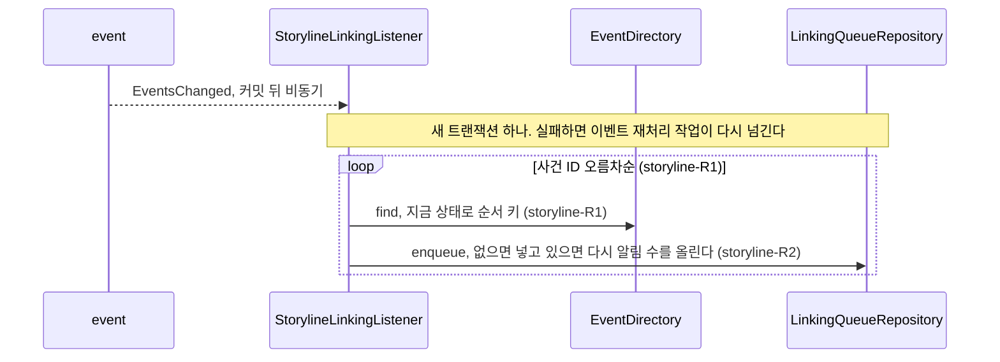
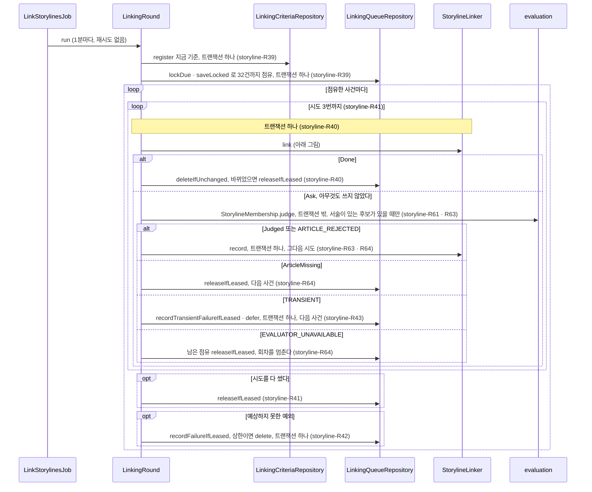
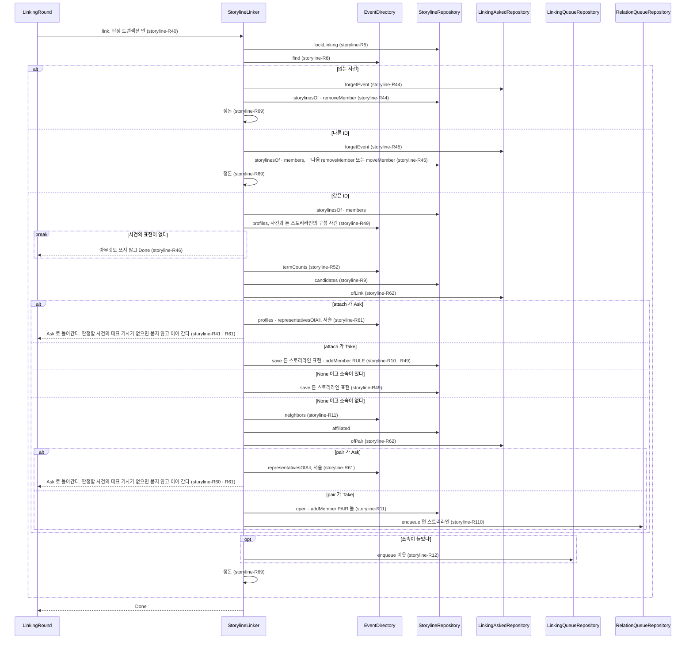
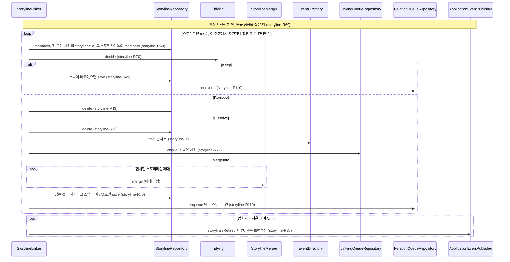
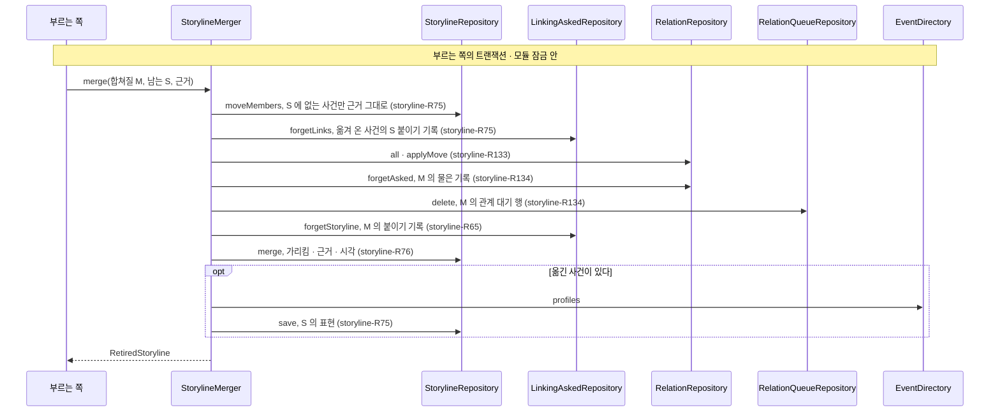
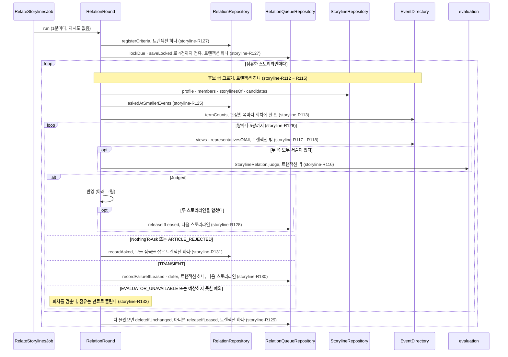
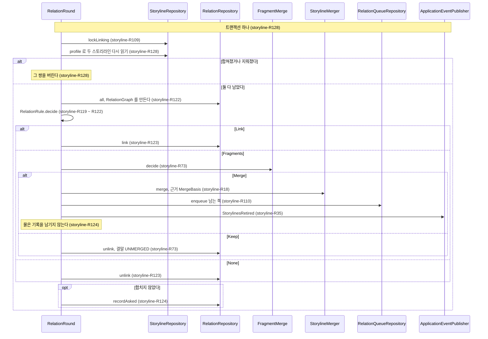
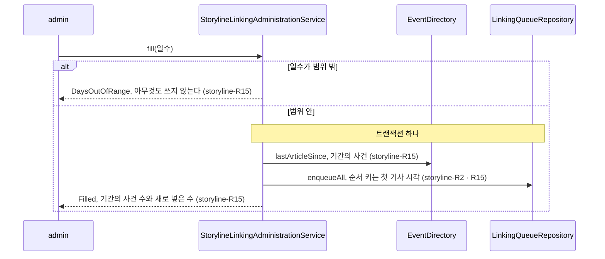
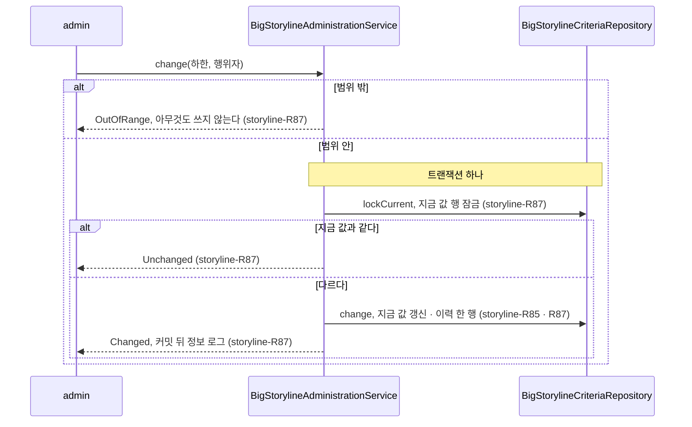

# storyline 모듈 Spec

공통 구조와 쓰는 규칙은 [specs/README.md](README.md)에 있다.

## 1. 책임과 범위

`storyline` 은 사건들을 모든 사용자가 공유하는 스토리라인으로 잇는다. 사용자를 모르고, 생성형 LLM 을 쓰지 않으며, 비용은 운영자가 낸다([ADR-0101](../adr/0101-shared-storylines-connect-events-and-the-personal-side-is-storyline-subscriptions-and-interests.md)). 맡는 일은 아래와 같다.

- **사건 변화 따르기** — `event` 가 바뀐 사건 ID 를 알리면(`EventsChanged`) 그 사건을 잇기 대기에 넣는다. 작업 역할의 반복 작업이 대기를 사건의 시각 순으로 점유해, 사건마다 지금 상태를 읽어 판정한다. 기간을 통째로 다시 묶지 않는다(storyline-R1 ~ R5, [ADR-0105](../adr/0105-storylines-link-incrementally-from-event-change-notifications-and-events-publish-changed-event-ids.md))
- **소속 맞추기** — 사건이 지워지면 그 소속을 지우고, 다른 사건에 합쳐지면 소속을 남는 사건으로 옮긴다(storyline-R6)
- **잇기** — 사건 중심의 코사인과 무게를 준 핵심 말 겹침으로 점수를 매겨, 사건을 스토리라인에 더 붙이거나 다른 사건과 짝을 지어 새 스토리라인을 연다. 소속을 빼지 않고, 소속이 늘면 기다리는 이웃 사건을 다시 본다(storyline-R7 ~ R12, [ADR-0106](../adr/0106-provisional-storyline-linking-opens-only-with-a-partner-event-and-adds-the-single-best-storyline-without-removal.md) · [ADR-0121](../adr/0121-storyline-linking-scores-centroid-cosine-plus-idf-weighted-key-term-overlap-without-time-decay-jev-or-topic-tags.md))
  - 점수가 애매한 띠 안 후보는 `evaluation` 의 스토리라인 소속 판정(Jev)에 같은 사안의 전개인지 물어 확률로 고른다. 물은 확률은 쌍마다 기록해 다시 쓴다(storyline-R36, [ADR-0194](../adr/0194-storyline-linking-asks-jev-only-for-band-candidates-and-reuses-recorded-probabilities-until-either-side-doubles.md))
  - 스토리라인 하나가 담는 범위 — 포럼 · 박람회 같은 행사는 스토리라인이다. 강연 · 발표 · 행사 자체를 다룬 보도는 각각 사건이고 그 행사의 스토리라인에 든다. 발표 사건은 그 내용의 스토리라인에도 들 수 있다([ADR-0101](../adr/0101-shared-storylines-connect-events-and-the-personal-side-is-storyline-subscriptions-and-interests.md)). 잇기는 이 범위를 점수와 띠 안 판정으로 따르고, 행사를 따로 가려 다루는 갈래는 없다
- **정돈** — 소속이 바뀐 스토리라인을 정돈한다. 합쳐진 스토리라인은 남는 스토리라인을 가리키고, 합치거나 지운 스토리라인은 이벤트로 알린다(storyline-R13 · R17 · R18 · R35, [ADR-0108](../adr/0108-storylines-with-the-same-events-merge-and-a-storyline-left-with-one-event-merges-or-dissolves.md) · [ADR-0188](../adr/0188-storyline-subscriptions-follow-retired-storylines-by-event-and-before-each-use-and-notices-point-to-the-remaining-event.md)). 정돈의 처분은 아래다
  - 구성 사건이 없으면 지운다
  - 구성 사건이 같은 스토리라인은 하나로 합친다
  - 사건 하나만 남으면 그 사건을 가진 다른 스토리라인에 합치거나, 풀어 그 사건을 다시 판정한다
- **상태** — 스토리라인의 상태(진행 · 잠잠 · 끝남)를 저장하지 않고 조회 때 마지막 기사 시각으로 정한다. 끝나도 잇기를 막지 않는다(storyline-R16, [ADR-0107](../adr/0107-storyline-state-is-judged-at-query-time-from-the-last-article-and-an-ended-storyline-still-links.md))
- **판정 근거** — 소속마다 정한 것 · 점수 · 판정에 쓴 기준을 남긴다(storyline-R14)
- **스토리라인 사이 관계** — 포함(상위 스토리라인과 그 하위 스토리라인)과 이어짐(앞 스토리라인이 뒤 스토리라인을 낳음)을 스토리라인 둘의 고리로 둔다. 소속이 바뀐 스토리라인의 후보 쌍을 `evaluation` 의 관계 판정(Jev)에 물어 종류 · 방향을 정하고, 확률이 기준 이상인 것만 맺는다. 포함은 상위 하나의 나무이고 순환을 이루지 않는다(storyline-R25 ~ R32, [ADR-0131](../adr/0131-storyline-relations-are-explicit-links-with-containment-as-a-single-parent-tree-gathered-at-query-time.md) · [ADR-0132](../adr/0132-storyline-relations-are-judged-by-jev-on-candidate-pairs-and-linked-only-above-a-probability-threshold.md))
- **조각 합치기** — 관계 판정이 두 스토리라인을 같은 사안의 조각(둘로 기록된 한 사안)으로 답하고 그 확률이 합치기 확률 기준 이상이면 ID 가 작은 쪽에 합친다. 소속은 근거 그대로 옮기고 어디서 왔는지와 합친 판정 · 기준을 남긴다. 기준 미만이면 둘로 두고 관계를 맺지 않는다. 되돌리는 길은 두지 않는다(storyline-R17 · R18 · R29, [ADR-0234](../adr/0234-fragments-of-one-matter-are-recognised-by-the-relation-judgement-and-merged-above-a-merge-probability-without-a-way-back.md))
- **채우기** — 운영자가 기간을 정해, 그 기간에 마지막 기사가 있는 사건을 잇기 대기에 넣는다(storyline-R15)
- **공개 조회** — 다른 모듈이 스토리라인을 읽는다(`StorylineDirectory`, storyline-R21 ~ R24 · R33 · R37 · R38). 스토리라인의 사건 · 집계는 포함을 따라 하위의 사건까지 세고, 직접 든 것인지 물려받은 것인지 표시한다. 합쳐진 스토리라인 · 사건의 ID 는 남는 쪽을 따르고, 꼭대기 조회는 합쳐진 사건을 뺀다. 읽는 것은 아래다
  - ID 로 찾은 스토리라인(하나 · 여럿)
  - 스토리라인의 사건(타임라인)과 사건의 스토리라인
  - 사건마다 포함 나무의 꼭대기(소속 점수 순, 점수는 싣지 않는다)와 스토리라인마다 포함 나무의 꼭대기
  - 스토리라인마다 그 꼭대기에서 이어짐으로 닿는 꼭대기
  - 조회 기간의 스토리라인 목록 · 큰 스토리라인 · 소속 없는 사건
  - 스토리라인 집합마다의 기간 집계
  - 스토리라인의 관계
- **운영자 조회** — 운영자 화면이 판정 근거를 읽는다(`StorylineReview`, storyline-R34). 읽는 것은 아래다
  - 스토리라인과 그 하위의 소속마다 판정 근거. 합치기로 옮겨 온 소속은 어디서 왔는지도 읽는다
  - 관계의 확률 · 판정 원본 ID · 기준
  - 물은 기록
  - 이 스토리라인에 합쳐진 스토리라인과 그 합치기의 판정 · 기준
  - 지금 잇기 기준 · 관계 기준
- **큰 판정** — 구독과 무관하게 알릴 만한 스토리라인을 조회할 때 지금 기준으로 고른다. 큰 스토리라인은 보도 강도가 기준 이상인 스토리라인이다. 보도 강도는 조회 기간 안 기사의 중요도 합을 그 기간에 기사가 있는 소스 수와 기간의 일수로 나눈 값이다. 기간 집계는 `event` 가 사건 집합 단위로 센다. 큰 스토리라인은 포함 나무마다 한 행으로 내고, 그 아래의 큰 스토리라인은 행에 싣는다(storyline-R19, [ADR-0235](../adr/0235-the-big-list-has-one-row-per-containment-tree-carrying-the-big-storylines-under-it.md) · [ADR-0147](../adr/0147-storyline-big-judgement-compares-importance-weighted-coverage-per-source-and-day-with-one-criterion-at-query-time.md) · [ADR-0116](../adr/0116-storyline-big-judgement-starts-with-a-provisional-rule-of-distinct-sources-and-mean-importance-judged-at-query-time.md) · [ADR-0117](../adr/0117-big-judgement-materials-are-tallied-by-event-per-group-of-events-and-storyline-passes-only-event-ids.md))
- **큰 판정 기준** — 운영자 설정(지금 값 한 행)과 추가 전용 이력으로 둔다. 기동 때 처음 값을 적재하고, 공개 운영 API(`BigStorylineAdministration`)로 지금 값 · 변경 · 이력 · 미리보기를 낸다(storyline-R20, [ADR-0118](../adr/0118-big-judgement-criteria-are-storyline-operator-settings-and-do-not-inherit-event-criteria-values-or-history.md))

하지 않는 것:

- 사용자를 모른다. 사용자 스토리라인과 스토리라인 구독은 `user` 가, 사용자마다 달라지는 스토리라인 정보와 관심사는 `digest` 가 갖는다
- 기사를 가리키지 않고 사건 ID 만 저장한다
  - 기사 삭제는 `event` 가 사건을 줄이거나 지워 알리는 것으로 따른다(storyline-R44)
  - 관계 판정에 넘길 사건의 대표 기사 ID 는 `event` 에서 받아 `evaluation` 에 넘기기만 하고 저장하지 않는다(storyline-R118)
- 기사를 세지 않는다. 큰 판정의 재료(기간 안 기사의 중요도 합, 기간에 기사가 있는 소스 수)는 `event` 의 사건 집합 집계와 기간 전체 집계로 받는다(storyline-R79 · R81)
- 스토리라인에 주제 · 지역 태그를 주지 않는다. 스토리라인 구독은 주제별 관심도에 넣지 않고 사용자 스토리라인마다의 스토리라인 관심에 넣는다([미결 사항](../open-questions.md) 34)
- 같은 원인에서 나온 나란한 스토리라인을 묶는 상위 스토리라인을 여는 법은 아직 없다 — **(미설계)**. 관계 판정에도 나란한 스토리라인이라는 답이 없어, 나란한 두 스토리라인은 관계 없이 따로 남는다([미결 사항](../open-questions.md) 37)
- 운영자가 관계를 하나씩 넣거나 빼거나 종류를 바꾸는 길을 두지 않는다. 관계는 관계 판정만 맺고 바꾸며, 운영자는 관계 기준(§7)으로 조정한다(storyline-R143, [ADR-0137](../adr/0137-storyline-relations-are-not-edited-one-by-one-by-operators-and-are-tuned-through-relation-criteria.md))
- 스토리라인에 들지 않은 사건은 큰 판정에 들지 않는다. 그 수만 낸다(storyline-R23)
- 사건을 스토리라인에 잇는 데 주제 태그를 쓰지 않고, 주 소속을 두지 않는다([ADR-0121](../adr/0121-storyline-linking-scores-centroid-cosine-plus-idf-weighted-key-term-overlap-without-time-decay-jev-or-topic-tags.md)). Jev 는 잇기 점수가 애매한 띠 안 후보의 스토리라인 소속 판정(storyline-R36, [ADR-0194](../adr/0194-storyline-linking-asks-jev-only-for-band-candidates-and-reuses-recorded-probabilities-until-either-side-doubles.md))과 스토리라인 사이 관계의 판정에 쓴다
- 정돈은 표현만 비슷한 두 스토리라인, 사건 둘 이상이 다른 스토리라인에 포함된 스토리라인을 합치지 않는다. 같은 스토리라인인지 하위 스토리라인인지 구조로 가를 수 없다(storyline-R70). 한 사안이 둘로 열린 스토리라인은 관계 판정의 조각 답으로 알아보고 합친다(storyline-R73)
- 따로 도는 정비 작업이 없다. 상태는 조회 때 정하고, 정돈은 판정 트랜잭션에서 한다. 따로 도는 것은 관계 판정의 반복 작업뿐이다(storyline-R31)

알려진 한계는 아래와 같다.

- 띠 밖의 소속은 점수만으로 정한다. 그래서 위 기준보다 높은 점수의 분야 모음 소속은 남고, 아래 기준보다 낮은 점수의 소속은 되찾지 못한다. 잇기 점수가 같은 분야와 같은 사안을 가르지 못한다([미결 사항](../open-questions.md) 35)
- 조각 답의 확률이 합치기 확률 기준에 못 미치면 조각이어도 둘로 남는다. 같은 요청도 판정의 확률이 실행마다 흔들려, 기준 근처의 쌍은 합쳐지기도 하고 아니기도 하다([미결 사항](../open-questions.md) 38)

기본값을 고른 근거는 [ADR-0195](../adr/0195-storyline-linking-band-and-probability-defaults-chosen-for-precision-by-simulator-grid-evaluation-instance-and-operator-sample-review.md)(잇기 기준) · [ADR-0174](../adr/0174-big-judgement-criterion-first-value-kept-by-operator-daily-preview-review-where-the-evaluation-set-cannot-separate-neighbours.md)(큰 판정 기준) · [ADR-0121](../adr/0121-storyline-linking-scores-centroid-cosine-plus-idf-weighted-key-term-overlap-without-time-decay-jev-or-topic-tags.md)(핵심 말 가중치) · [ADR-0132](../adr/0132-storyline-relations-are-judged-by-jev-on-candidate-pairs-and-linked-only-above-a-probability-threshold.md)(관계 기준) · [ADR-0234](../adr/0234-fragments-of-one-matter-are-recognised-by-the-relation-judgement-and-merged-above-a-merge-probability-without-a-way-back.md)(합치기 확률 기준)에 있다. 값은 §5 · §7 에 있다.

다른 모듈과의 의존과 주고받는 이벤트는 [overview.md §5](../overview.md#5-모듈-지도)에 있다.

## 2. 용어

사건 · 스토리라인 · 꼭대기는 [overview.md §8](../overview.md#8-용어)에 있다. 조회 기간과 기간 집계는 `event` 가 소유한 말이고 [event Spec §2](event.md#2-용어)에 있다.

| 용어 | 뜻 |
|---|---|
| 소속 | 사건 하나가 스토리라인 하나에 든 것(`storyline_members` 한 행). 사건은 스토리라인 0개 이상에 든다. 판정 근거를 갖는다(storyline-R55) |
| 구성 사건 | 스토리라인에 소속이 있는 사건 |
| 잇기 대기 | 판정할 사건의 목록(`storyline_linking_queue`, 사건마다 한 행). 칸은 §6 에 있다(storyline-R2 · R43) |
| 다시 알림 수 | 대기에 있는 사건에 알림이 다시 온 횟수. 처리 중에 다시 온 알림을 놓치지 않게 한다(storyline-R2 · R40) |
| 순서 키 | 대기를 점유하는 순서. 사건의 첫 기사 시각이고, 지워졌거나 합쳐진 사건이면 없다(맨 앞)(storyline-R1 · R39) |
| 회차 | 반복 작업이 한 번 돌 때 하는 일. 대기를 점유해 사건마다 판정한다(storyline-R39) |
| 점유 | 회차가 대기 행을 가져갔다는 표시. 토큰과 만료 시각이다(storyline-R39) |
| 스토리라인 표현 | 구성 사건으로 정한 스토리라인의 중심 · 기사 수 · 시각 범위 · 핵심 말과 대표 사건(storyline-R47) |
| 대표 사건 | 스토리라인을 알아보게 하는 구성 사건 하나. 기사 수가 가장 많은 사건이다(storyline-R48) |
| 말의 무게 | 핵심 말이 얼마나 드문지. 판정할 사건의 시각 ± 시간 창 안의 사건 가운데 그 말을 가진 사건이 적을수록 크다(storyline-R52) |
| 잇기 기준 | 시간 창 · 아래 기준 · 위 기준 · 확률 기준. 설정이다(storyline-R9 · §7) |
| 띠 | 아래 기준 이상 · 위 기준 미만인 점수. 이 구간의 후보만 스토리라인 소속 판정에 묻는다. 아래 기준이 위 기준과 같으면 띠가 비어 점수만으로 정한다(storyline-R58) |
| 스토리라인 소속 판정 | 판정할 사건이 후보마다 같은 사안의 전개인지 묻는 `evaluation` 의 판정(`StorylineMembership`). 후보마다 확률을 낸다(storyline-R58) |
| 잇기 물은 기록 | 띠 안 후보에 물은 확률. 붙이기는 (사건, 스토리라인), 짝은 (사건, 이웃 사건)마다 한 행이다(`storyline_link_asked` · `storyline_pair_asked`). 확률의 정본이고, 크기가 두 배가 될 때까지 다시 쓴다(storyline-R62) |
| 기준 이력 | 회차가 판정에 쓴 잇기 기준 값의 목록(`storyline_linking_criteria`). 같은 값이면 한 행이고, 소속이 그 ID 를 가리킨다(storyline-R56) |
| 짝 | 붙일 스토리라인이 없는 사건과 함께 새 스토리라인을 여는 사건. 소속이 없어야 한다(storyline-R11) |
| 이웃 사건 | 판정할 사건과 같은 모델 버전이고 창 안에 있으며 코사인이 하한 이상인 사건. `event` 의 `EventDirectory.neighbors` 가 낸다(storyline-R11) |
| 다시 넣기 | 소속이 는 사건의 이웃 가운데 아래 기준 이상이고 소속 없는 사건을 대기에 다시 넣는 것(storyline-R12) |
| 채우기 | 운영자가 정한 기간에 마지막 기사가 있는 사건을 잇기 대기에 넣는 운영 기능(storyline-R15) |
| 정돈 | 소속이 바뀐 스토리라인을 지우거나 · 합치거나 · 풀거나 그대로 두는 것(storyline-R13 · R70) |
| 합쳐진 스토리라인 | 정돈이나 조각 합치기로 다른 스토리라인에 합쳐진 스토리라인. 소속 · 핵심 말이 없고, 행이 남아 남는 스토리라인을 가리킨다(storyline-R76) |
| 같은 사안의 조각 | 한 사안이 두 스토리라인으로 기록된 것. 두 스토리라인은 같은 주체와 같은 경로로 같은 사안을 따른다. 관계 판정의 답 하나다(storyline-R119) |
| 합치기 확률 기준 | 조각 답의 확률이 이 이상이면 두 스토리라인을 합친다. 관계 기준의 하나다(storyline-R73 · §7) |
| 남는 스토리라인 | 합칠 때 남는 쪽. 구성 사건이 같으면 ID 가 가장 작은 것이고, 사건 하나만 남은 스토리라인이면 그 사건을 가진 스토리라인 가운데 ID 가 가장 작은 것이다(storyline-R70). 조각 합치기는 ID 가 작은 쪽이다(storyline-R73) |
| 풀기 | 사건 하나만 남았고 그 사건이 다른 스토리라인에 없는 스토리라인을 지우고, 그 사건을 잇기 대기에 다시 넣는 것(storyline-R71) |
| 상태 | 스토리라인 마지막 기사 시각으로 조회 때 정하는 진행 · 잠잠 · 끝남(storyline-R67) |
| 잠잠 기간 · 끝남 기간 | 마지막 기사 뒤 이만큼 지나면 잠잠 · 끝남이다. 설정이다(storyline-R67 · §7) |
| 기간의 스토리라인 | 조회 기간 안 기사가 있는 구성 사건이 하나라도 있는, 합쳐지지 않은 스토리라인(storyline-R94) |
| 보도 강도 | 기간 집계의 중요도 합 ÷ (조회 기간에 기사가 있는 서로 다른 소스 수 × 조회 기간의 길이(일)). 소수 둘째 자리로 보인다(storyline-R78 · R80) |
| 보도량 | 스토리라인의 닫은 사건 집합의 조회 기간 안 기사 수. 기간 집계의 기사 수다(storyline-R97) |
| 큰 판정 | 보도 강도가 큰 판정 기준에 이르는지. 조회할 때 정한다(storyline-R77) |
| 큰 판정 기준 | 보도 강도의 하한. 운영자 설정이다(storyline-R85) |
| 소속 없는 사건 | 조회 기간 안 기사가 있는데 어느 스토리라인에도 소속이 없는 사건(storyline-R23) |
| 관계 | 스토리라인 둘 사이의 고리(`storyline_relations` 한 행). 종류(포함 · 이어짐)와 방향, 맺은 확률 · 판정 원본 · 기준 · 시각을 갖는다(storyline-R106 · R123) |
| 포함 | 상위 스토리라인과 그 하위 스토리라인의 관계. 하위 스토리라인은 상위의 큰 사안을 중심으로 도는 반응, 알아볼 수 있는 부분(차례 · 단계), 한 줄기다. 앞(`source`)이 상위, 뒤(`target`)가 하위다 |
| 이어짐 | 앞 스토리라인이 뒤 스토리라인을 낳은 관계. 뒤 스토리라인은 자기 주체와 절차로 따로 굴러가는 다른 사안이다. 앞(`source`)이 낳은 쪽이다 |
| 상위 · 하위 | 포함의 앞 · 뒤. 스토리라인은 상위를 하나까지 갖는다(storyline-R107) |
| 직접 소속 · 물려받은 소속 | 사건이 그 스토리라인에 소속 행으로 든 것이 직접 소속이다. 하위 스토리라인의 구성 사건이라 상위에 든 것으로 보는 것이 물려받은 소속이고, 저장하지 않는다(storyline-R135) |
| 닫은 사건 집합 | 스토리라인의 직접 소속과, 포함을 따라 내려간 모든 하위의 직접 소속을 사건 ID 로 합친 것. 공개 조회가 센다(storyline-R135) |
| 관계 대기 | 관계를 판정할 스토리라인의 목록(`storyline_relation_queue`, 스토리라인마다 한 행). 칸은 §6 에 있다(storyline-R111 · R130) |
| 후보 쌍 | 관계를 물을 스토리라인 쌍. 사건을 함께 가졌거나 점수가 후보 점수 기준 이상이고, 두 스토리라인 모두 사건 수가 하한 이상인 쌍이다(storyline-R112) |
| 서술 사건 | 관계 판정에 제목(일부는 요약문)을 싣는 사건. 직접 소속 가운데 기사 수가 많은 순으로 고른다(storyline-R117) |
| 물은 기록 | 쌍마다 마지막으로 물은 결말(`storyline_relation_asked` 한 행). 그때의 작은 쪽 사건 수 · 결말 · 판정 원본 · 기준을 두고, 다시 물을 때를 정한다(storyline-R124 · R125) |
| 관계 기준 | 관계 판정에 쓰는 설정(`yozmnews.storyline-relation.*`, §7). 판정에 쓴 값은 관계 기준 이력(`storyline_relation_criteria`)에 남는다(storyline-R112 · R120 · R127) |
| 운영자 조회 | 운영자 화면이 읽는 판정 근거(`StorylineReview`, storyline-R34). 사용자 쪽 공개 조회(`StorylineDirectory`)는 판정 근거를 싣지 않는다(storyline-R92) |

## 3. 공개 인터페이스

이 모듈은 `event` 의 `EventsChanged` 를 받고, 아래를 낸다.

- 공개 조회 둘: `StorylineDirectory` 와 운영자 조회 `StorylineReview`
- 공개 운영 API 둘: `StorylineLinkingAdministration` · `BigStorylineAdministration`
- 이벤트 하나: `StorylinesRetired`. `user` 가 받아 스토리라인 구독을 따른다

잇기의 띠 판정은 `evaluation` 의 공개 API `StorylineMembership` 을, 관계 판정은 `StorylineRelation` 을 부른다. `StorylineDirectory` 는 `digest` · `report` · `admin` · `user` · `reader` 가 쓴다. `StorylineReview` 와 운영 API 는 `admin` 이 운영자 요청으로 부른다([ADR-0045](../adr/0045-admin-module-serves-operator-api-over-module-public-operation-apis.md)).

### StorylineLinkingAdministration · LinkingFillResult

스토리라인 잇기 채우기의 운영(storyline-R15). 구현은 `application` 의 `StorylineLinkingAdministrationService` 다.

```java
public interface StorylineLinkingAdministration {
    int MAX_DAYS = 180;                      // 채울 기간의 상한(일) — 정본
    LinkingFillResult fill(int days);
}

public sealed interface LinkingFillResult {
    record Filled(int events, int enqueued) implements LinkingFillResult {}
    record DaysOutOfRange(int max) implements LinkingFillResult {}
}
```

| 타입 · 멤버 | 뜻 |
|---|---|
| `fill` | 기간에 마지막 기사가 있는, 합쳐지지 않은 사건(열림 · 닫힘)을 잇기 대기에 넣는다(storyline-R15) |
| `Filled.events` | 기간의 사건 수 |
| `Filled.enqueued` | 그 가운데 새로 대기에 넣은 사건 수. 이미 대기에 있던 사건은 세지 않는다 |
| `DaysOutOfRange.max` | 일수가 1 ~ `max` 밖이라 아무것도 하지 않았다. `max` 는 `MAX_DAYS` 다 |

- 계약
  - 역할 애너테이션이 없다(두 역할 공통)
  - 사건 고르기는 `event` 의 공개 조회 하나(`EventDirectory.lastArticleSince`)다
  - 넣은 사건은 반복 작업의 회차가 판정한다

### StorylineDirectory

스토리라인 조회. 다른 모듈이 스토리라인과 그 사건 · 꼭대기 · 관계를 읽고, 기간의 목록과 집계를 읽는다(storyline-R19 · R21 ~ R24 · R33 · R37 · R38). 구현은 `application` 의 `StorylineDirectoryService` 다.

```java
public interface StorylineDirectory {
    int MAX_PAGE_SIZE = 100;                              // 목록 한 쪽의 상한의 정본(측정 전)
    int MAX_TOP_EVENTS = 1000;                            // 꼭대기 조회 한 번에 묻는 서로 다른 사건 수의 상한의 정본(측정 전)
    int MAX_TOP_STORYLINES = 1000;                        // 스토리라인 여럿을 묻는 조회(꼭대기 · 이어짐 · 집합 집계) 한 번의 서로 다른 스토리라인 수의 상한의 정본(측정 전)

    Optional<StorylineView> find(StorylineId id);
    Map<StorylineId, StorylineView> findAll(Collection<StorylineId> ids);
    List<StorylineEvent> events(StorylineId id);
    List<EventStoryline> storylinesOf(EventId event);
    Map<EventId, List<StorylineId>> topsOf(Collection<EventId> events);
    Map<StorylineId, StorylineId> topsOfStorylines(Collection<StorylineId> storylines);
    Map<StorylineId, Set<StorylineId>> continuationsOf(Collection<StorylineId> storylines);
    StorylinePage list(EventPeriod period, @Nullable StorylineCursor after, int size);
    List<BigStoryline> bigStorylines(EventPeriod period);
    UnlinkedEvents unlinked(EventPeriod period);
    <K> Map<K, EventTally> tallies(Map<K, ? extends Collection<StorylineId>> groups, EventPeriod period);
    List<StorylineRelationView> relationsOf(StorylineId id);
}
```

| 메서드 | 뜻 |
|---|---|
| `find` | 스토리라인 하나. 합쳐진 스토리라인이면 남는 스토리라인을 낸다(storyline-R89). 없는 스토리라인이면 빈 값 |
| `findAll` | 스토리라인 여럿. 키는 받은 ID, 값은 그 ID 가 가리키는 스토리라인이다(storyline-R89). 받은 ID 여럿이 같은 남는 스토리라인을 가리키면 그 값이 여러 키에 실린다. 지웠거나 처음부터 없는 ID 는 결과에 없고, 빈 입력이면 빈 맵 |
| `events` | 스토리라인의 닫은 사건 집합(타임라인). 사건마다 한 번씩 첫 기사 시각 · 사건 ID 순으로 내고, 직접 소속인지 싣는다(storyline-R91 · R137). 없는 스토리라인이면 빈 목록 |
| `storylinesOf` | 사건이 든 스토리라인. 직접 든 스토리라인과 그 상위 전부를 한 번씩 스토리라인 ID 순으로 내고, 직접 든 것인지 싣는다(storyline-R90 · R137). 없는 사건이면 빈 목록 |
| `topsOf` | 사건마다 그 사건이 걸친 포함 나무의 꼭대기를 소속 점수 순으로 낸다. 점수는 싣지 않는다(storyline-R98 ~ R100) |
| `topsOfStorylines` | 스토리라인마다 그 포함 나무의 꼭대기(storyline-R101 · R104) |
| `continuationsOf` | 스토리라인마다 그 포함 나무의 꼭대기에서 이어짐을 앞에서 뒤로 끝까지 따라 닿는 꼭대기(storyline-R102 ~ R104) |
| `list` | 기간의 스토리라인 한 쪽(storyline-R94 · R95). 집계 · 큰 여부는 그 기간 · 지금 기준이다. `size` 가 1 ~ `MAX_PAGE_SIZE` 밖이면 `IllegalArgumentException` |
| `bigStorylines` | 기간의 큰 스토리라인을 지금 기준으로 판정해 포함 나무마다 한 행으로 낸다(storyline-R77 · R82 · R83) |
| `unlinked` | 조회 기간 안 기사가 있는 사건 가운데 소속 없는 사건의 수와 그 사건들의 기간 안 기사 수(storyline-R23) |
| `tallies` | 스토리라인 집합마다 기간 집계(storyline-R96 · R104). 입력의 모든 키가 있다. 남는 스토리라인이 없거나 기간 안 기사가 없는 집합은 기사 0 · 소스 0 · 중요도 없음이다 |
| `relationsOf` | 스토리라인이 앞이거나 뒤인 관계를 종류(포함 먼저) · 앞 ID · 뒤 ID 순으로 낸다(storyline-R106). 합쳐진 스토리라인이면 남는 스토리라인의 것이고, 없는 스토리라인이면 빈 목록 |

- 계약
  - 사용자 정보를 받지 않는다. 트랜잭션 · 역할 애너테이션이 없다(두 역할 공통)
  - 각 질의는 그 순간의 값이다(storyline-R105)
  - `bigStorylines` · `list` 는 큰 판정 기준의 처음 값을 적재하기 전이면 `IllegalStateException` 이다. `list` 는 쪽에 스토리라인이 있을 때만이다
  - 쪽 사이에 마지막 기사 시각이 바뀐 스토리라인은 건너뛰거나 다시 나올 수 있다

### StorylineId · StorylineState · StorylineView · StorylineEvent · EventStoryline · StorylineRelationKind · StorylineRelationView · StorylineSummary · StorylineCursor · StorylinePage · BigStoryline · UnlinkedEvents

```java
public record StorylineId(long value) {}                  // 1 보다 작으면 IllegalArgumentException
public enum StorylineState { ACTIVE, QUIET, ENDED }
public record StorylineView(StorylineId id, StorylineState state, int eventCount, int articleCount,
        Instant firstArticleAt, Instant lastArticleAt, EventId representativeEvent, Instant createdAt,
        @Nullable StorylineId parent) {}
public record StorylineEvent(EventView event, boolean direct) {}
public record EventStoryline(StorylineView storyline, boolean direct) {}
public enum StorylineRelationKind { CONTAINS, FOLLOWS }
public record StorylineRelationView(StorylineRelationKind kind, StorylineId source, StorylineId target, Instant linkedAt) {}
public record StorylineSummary(StorylineView storyline, EventTally tally, BigDecimal intensity, boolean big) {}
public record StorylineCursor(Instant lastArticleAt, StorylineId id) {}
public record StorylinePage(List<StorylineSummary> storylines, @Nullable StorylineCursor next) {}
public record BigStoryline(StorylineView storyline, EventTally tally, BigDecimal intensity,
        List<BigStoryline> branches) {              // 아래 행이 다시 아래 행을 가지면 IllegalArgumentException
    public BigStoryline(StorylineView storyline, EventTally tally, BigDecimal intensity);  // 아래 행 없음
}
public record UnlinkedEvents(int events, int articles) {}
```

| 타입 · 멤버 | 뜻 |
|---|---|
| `StorylineState` | 진행(`ACTIVE`) · 잠잠(`QUIET`) · 끝남(`ENDED`). 조회할 때 정한다(storyline-R67) |
| `StorylineView.state` | 조회 시각의 상태 |
| `StorylineView.eventCount` | 닫은 사건 집합의 사건 수. 기간과 무관한 스토리라인 전체의 수다(storyline-R136) |
| `StorylineView.articleCount` · `firstArticleAt` · `lastArticleAt` | 닫은 사건 집합의 기사 수 합과 첫 · 마지막 기사 시각. 기간과 무관하다(storyline-R136) |
| `StorylineView.representativeEvent` | 대표 사건(storyline-R48). 직접 소속에서 고른다. 대표 기사는 `event` 의 `EventDirectory.representativesOfAll` 로 읽는다 |
| `StorylineView.parent` | 포함의 상위. 없으면 null(storyline-R107) |
| `StorylineEvent.direct` | 그 스토리라인의 직접 소속이면 true, 하위에서 물려받은 사건이면 false. 둘 다면 true(storyline-R137) |
| `EventStoryline.direct` | 사건이 직접 든 스토리라인이면 true, 그 상위라서 든 것이면 false. 둘 다면 true(storyline-R137) |
| `StorylineRelationKind` | 포함(`CONTAINS`, `source` 가 `target` 을 포함) · 이어짐(`FOLLOWS`, `target` 이 `source` 에 이어짐) |
| `StorylineRelationView.linkedAt` | 그 관계를 맺은(마지막으로 고친) 시각. 확률 · 판정 원본은 싣지 않는다 |
| `StorylineSummary.tally` · `BigStoryline.tally` | 조회 기간의 기간 집계. `event` 의 `EventTally` 다(storyline-R81) |
| `StorylineSummary.intensity` · `BigStoryline.intensity` | 조회 기간의 보도 강도. 소수 둘째 자리로 반올림한 값이다(storyline-R80) |
| `BigStoryline.branches` | 이 행 아래 포함 나무의 큰 스토리라인. 같은 꼴이고 그 `branches` 는 비어 있다(storyline-R82 · R83) |
| `StorylineSummary.big` | 목록 기간 · 지금 기준으로 큰 스토리라인인가 |
| `StorylinePage.next` | 다음 쪽의 커서. 앞 쪽 마지막 스토리라인의 (마지막 기사 시각, 스토리라인 ID)이고, 더 없으면 null |
| `UnlinkedEvents` | 소속 없는 사건의 수(`events`)와 그 사건들의 조회 기간 안 기사 수(`articles`) |

### StorylinesRetired · RetiredStoryline

정돈이나 조각 합치기가 합치거나 정돈이 지운 스토리라인의 알림. `user` 가 받아 사용자 스토리라인과 스토리라인 구독을 따른다(storyline-R35).

```java
public record StorylinesRetired(List<RetiredStoryline> storylines) {}  // 비었거나 같은 스토리라인이 두 번이면 IllegalArgumentException
public record RetiredStoryline(StorylineId id, @Nullable EventId remainingEvent) {}
```

| 타입 · 멤버 | 뜻 |
|---|---|
| `StorylinesRetired.storylines` | 더 이상 자기를 가리키지 않는 스토리라인. 합쳐진 것(남는 스토리라인을 가리킨다)과 지운 것(풀기 포함)이다 |
| `RetiredStoryline.remainingEvent` | 풀기에서 남은 사건. 풀기가 아니면 null 이다. 지운 스토리라인은 받는 쪽이 읽을 행이 없어, 무엇이 사라졌는지 가리킬 재료로 싣는다. 이미 지워졌거나 합쳐졌는데 아직 따르지 않은 사건일 수 있다 |

- 계약
  - 무엇이 일어났는지는 싣지 않는다. 받는 쪽이 `StorylineDirectory.findAll` 로 지금 상태를 읽어 남는 쪽을 찾고, 없으면 지워졌다. 그래서 받는 순서가 바뀌어도 같은 상태로 수렴한다
  - 발행 시점과 횟수는 storyline-R35 다. 조각 합치기는 풀기가 아니라 `remainingEvent` 가 없다
  - 사용자 정보는 싣지 않는다

### StorylineReview · StorylineMembershipView · LinkScore · LinkedBy · StorylineLinkingCriteria · StorylineRelationDetail · StorylineRelationAsked · RelationOutcome · StorylineRelationCriteria · MergedStoryline

운영자 조회. 운영자 화면이 스토리라인의 판정 근거를 읽는다(storyline-R34). 구현은 `application` 의 `StorylineReviewService` 다.

```java
public interface StorylineReview {
    List<StorylineMembershipView> memberships(StorylineId id);
    List<StorylineRelationDetail> relations(StorylineId id);
    List<StorylineRelationAsked> asked(StorylineId id);
    List<MergedStoryline> merged(StorylineId id);
    StorylineLinkingCriteria linkingCriteria();
    StorylineRelationCriteria relationCriteria();
}

public enum LinkedBy { RULE, PAIR, MERGE }
public enum RelationOutcome { LINKED, NOT_RELATED, LOW_PROBABILITY, NOT_ONE_MATTER, CYCLE, SECOND_PARENT, UNMERGED,
        NOTHING_TO_ASK, REJECTED }
public record StorylineLinkingCriteria(Duration window, double lower, double upper, @Nullable Double probability) {}
public record StorylineRelationCriteria(double probability, double oneMatter, int minEvents, double candidateScore,
        Duration window, double mergeProbability) {}
public record LinkScore(double score, double cosine, double keyTermOverlap) {}
public record StorylineMembershipView(StorylineId storyline, EventId event, LinkedBy linkedBy, @Nullable LinkScore score,
        @Nullable StorylineLinkingCriteria criteria, @Nullable Double probability,
        @Nullable StorylineMembershipJudgementId judgement, Instant linkedAt, @Nullable StorylineId mergedFrom) {}
public record StorylineRelationDetail(StorylineRelationView relation, double probability, RelationJudgementId judgement,
        StorylineRelationCriteria criteria) {}
public record StorylineRelationAsked(StorylineId other, int smallerEvents, RelationOutcome outcome,
        @Nullable RelationJudgementId judgement, StorylineRelationCriteria criteria, Instant askedAt) {}
public record MergedStoryline(StorylineId id, Instant mergedAt, @Nullable RelationJudgementId judgement,
        @Nullable StorylineRelationCriteria criteria) {}   // 판정과 기준 가운데 하나만 있으면 IllegalArgumentException
```

| 메서드 · 타입 · 멤버 | 뜻 |
|---|---|
| `memberships` | 스토리라인과 그 모든 하위의 직접 소속 전부와 저마다의 판정 근거(storyline-R139). 스토리라인 ID · 사건 ID 순이고, 같은 사건이 가족 안 여러 스토리라인에 직접 들었으면 그만큼 낸다. 없는 스토리라인이면 빈 목록 |
| `relations` | `StorylineDirectory.relationsOf` 와 같은 관계 · 같은 순서에 맺은 확률 · 판정 원본 ID · 그때의 관계 기준을 단다(storyline-R140) |
| `asked` | 이 스토리라인이 든 물은 기록. 상대 ID 순이고, 쌍마다 마지막 한 번이다(storyline-R141). 없는 스토리라인이면 빈 목록 |
| `merged` | 이 스토리라인에 합쳐진 스토리라인을 ID 순으로 낸다(storyline-R142). 없는 스토리라인이면 빈 목록 |
| `linkingCriteria` · `relationCriteria` | 지금 설정 값인 잇기 기준 · 관계 기준(storyline-R143 · §7) |
| `LinkedBy` | 소속을 정한 것. 붙이기(`RULE`) · 짝으로 엶(`PAIR`) · 합쳐진 사건의 소속을 옮김(`MERGE`)이다(storyline-R55) |
| `StorylineMembershipView.score` · `criteria` | 점수 · 코사인 · 핵심 말 겹침(무게를 준 값)과 그 판정에 쓴 잇기 기준. `MERGE` 면 둘 다 null 이고, 그 밖이면 둘 다 있다 |
| `StorylineMembershipView.mergedFrom` | 스토리라인 합치기로 옮겨 온 소속이면 그 사건을 직전에 가졌던 합쳐진 스토리라인. 근거(정한 것 · 점수 · 기준 · 확률)는 그 스토리라인에서의 것 그대로다. 옮겨 오지 않았으면 null(storyline-R75) |
| `StorylineMembershipView.probability` · `judgement` | 띠 안에서 스토리라인 소속 판정으로 정했으면 그 확률과 판정 원본 ID(`evaluation` 의 `StorylineMembershipJudgementId`). 둘은 함께 있거나 함께 없다. 위 기준 이상으로 정했거나 `MERGE` 면 둘 다 null(storyline-R55) |
| `StorylineLinkingCriteria` | 시간 창 · 아래 기준 · 위 기준 · 확률 기준. 확률 기준은 null 일 수 있고, 그런 기준 이력은 아래 기준 = 위 기준이다(storyline-R56) |
| `StorylineRelationDetail.judgement` | 그 관계를 맺은 판정 원본 ID. 원본은 먼저 지워졌을 수 있다(`evaluation` 의 `RelationJudgementLog` 가 찾는다) |
| `StorylineRelationCriteria.mergeProbability` | 합치기 확률 기준(storyline-R73). 조각 합치기가 없던 기준의 이력은 1.0 이다 |
| `MergedStoryline.judgement` · `criteria` | 같은 사안의 조각으로 합쳤으면 그 관계 판정 원본 ID 와 그때의 관계 기준. 둘은 함께 있거나 함께 없다. 정돈이 합쳤으면 둘 다 null 이다. 원본은 먼저 지워졌을 수 있다 |
| `StorylineRelationAsked.other` | 쌍의 상대 스토리라인 |
| `StorylineRelationAsked.smallerEvents` | 물었을 때 작은 쪽의 구성 사건 수 |
| `StorylineRelationAsked.judgement` | 판정 원본 ID. 판정 원본이 남지 않은 결말(`NOTHING_TO_ASK` · `REJECTED`)이면 null |
| `RelationOutcome` | 마지막으로 물은 결말. 값마다의 뜻은 아래 목록이다(storyline-R120 · R122 · R124 · R131) |

`RelationOutcome` 의 값:

- `LINKED` — 맺음
- `NOT_RELATED` — 해당 없음
- `LOW_PROBABILITY` — 확률 기준 미달
- `NOT_ONE_MATTER` — 한 사안 기준 미달
- `CYCLE` — 순환
- `SECOND_PARENT` — 둘째 상위
- `UNMERGED` — 조각이지만 합치기 확률 기준 미달
- `NOTHING_TO_ASK` — 물을 것 없음
- `REJECTED` — 평가기의 입력 거부

- 계약
  - 사용자 정보를 받지 않는다. 트랜잭션 · 역할 애너테이션이 없다(두 역할 공통)
  - ID 로 찾는 메서드는 합쳐진 스토리라인이면 남는 스토리라인의 것을 낸다(storyline-R89)
  - 각 질의는 그 순간의 값이다(storyline-R105)

### BigStorylineAdministration · BigStorylineCriteria · BigStorylineCriteriaChange · BigStorylineCriteriaChangeResult

큰 판정 기준의 운영(storyline-R20). 운영자 화면이 부른다. 구현은 `application` 의 `BigStorylineAdministrationService` 다.

```java
public interface BigStorylineAdministration {
    BigStorylineCriteria criteria();
    BigStorylineCriteriaChangeResult change(BigDecimal minIntensity, ChangeActor actor);
    List<BigStorylineCriteriaChange> changes();
    List<BigStoryline> preview(BigStorylineCriteria proposed, EventPeriod period);
}

public record BigStorylineCriteria(BigDecimal minIntensity) {
    public static final int INTENSITY_SCALE = 2;                          // 보도 강도 하한의 소수 자릿수 — 정본
    public static final BigDecimal MAX_INTENSITY;                         // 9999.99 — 상한의 정본
    public static final BigStorylineCriteria DEFAULT;                     // 14.00 — 처음 값의 정본
    public static Optional<BigStorylineCriteria> of(BigDecimal minIntensity);
}

public record BigStorylineCriteriaChange(@Nullable BigStorylineCriteria previous, BigStorylineCriteria current,
        ChangeActor actor, Instant changedAt) {}

public sealed interface BigStorylineCriteriaChangeResult {
    record Changed(BigStorylineCriteria previous, BigStorylineCriteria current) implements BigStorylineCriteriaChangeResult {}
    record Unchanged(BigStorylineCriteria current) implements BigStorylineCriteriaChangeResult {}
    record OutOfRange() implements BigStorylineCriteriaChangeResult {}
}
```

| 타입 · 멤버 | 뜻 |
|---|---|
| `criteria` | 지금 기준. 처음 값을 적재하기 전이면 `IllegalStateException` 이다 |
| `change` | 기준을 바꾼다(storyline-R87). 범위 밖이면 `OutOfRange`, 지금 값과 같으면 `Unchanged` 이고 둘 다 아무것도 쓰지 않는다. 범위 안의 값인데 처음 값을 적재하기 전이면 `IllegalStateException` 이다 |
| `changes` | 이력. 최근 것부터, 같은 시각이면 나중에 쓴 것부터다 |
| `preview` | 제안 기준으로 판정한 조회 기간의 큰 스토리라인(storyline-R88). 판정 · 순서는 `StorylineDirectory.bigStorylines` 와 같다 |
| `BigStorylineCriteria` | 생성자는 보도 강도의 하한이 범위(storyline-R85) 밖이면 `IllegalArgumentException` 이다. 둘째 자리로 맞춰 같은 값이면 같다. `of` 는 범위 밖이면 빈 값이다 |
| `BigStorylineCriteriaChange.previous` | 바꾸기 전 값. 처음 값이면 null |

- 계약
  - 역할 애너테이션이 없다(두 역할 공통)
  - 큰 판정은 조회할 때 지금 기준으로 하므로, 바꾸면 다음 조회부터 반영된다(storyline-R88)
  - 행위자의 종류는 `platform` 의 `ChangeActor` 다

## 4. 내부 구조

### 개관

| 패키지 | 책임 |
|---|---|
| (최상위) | 모듈 선언(`package-info`), §3 의 공개 조회 · 운영자 조회 · 공개 운영 API · 이벤트와 그 값 타입 |
| `adapter/in/job` | 잇기 대기 · 관계 대기 반복 작업(작업 역할) |
| `adapter/out/persistence` | `domain` 의 저장소 인터페이스의 JdbcClient 구현(아래 "나가는 쪽") |
| `application` | 리스너와 회차, 판정 · 정돈 · 합치기의 실행, 공개 조회 · 운영자 조회 · 공개 운영 API 의 구현, 설정 결선(아래 "`application`") |
| `domain` | 저장 단위와 판단의 정본. 하위 패키지는 아래 목록이다 |

`domain` 의 하위 패키지:

- `domain/linking` — 잇기의 판단과 잇기 기준, 기준 이력 · 잇기 물은 기록 저장소
- `domain/storyline` — 스토리라인과 소속의 판정 근거, 정돈 · 상태 · 닫은 사건 집합의 판단, 스토리라인 저장소와 조회 저장소
- `domain/relation` — 스토리라인 사이 관계와 그 판단, 관계 기준, 관계 대기, 관계 · 관계 대기 저장소
- `domain/big` — 큰 판정의 규칙과 목록의 꼴, 큰 판정 기준 저장소
- `domain/queue` — 잇기 대기 행과 점유, 순서 키 규칙, 대기 상수, 대기 저장소

과정마다의 협력은 아래와 같다. 트랜잭션 경계 · 잠금 · 외부 호출 · 실패 갈림이 있는 과정은 그림으로 그렸다.

**사건 변화 받기** — `StorylineLinkingListener` 가 `event` 의 `EventsChanged` 를 받아, 사건마다 지금 상태로 순서 키를 정해 잇기 대기에 넣는다(storyline-R1 · R2).



**잇기 회차** — 작업 역할의 `LinkStorylinesJob` 이 1분마다 `LinkingRound` 를 돌린다. 회차는 대기를 점유해 사건마다 `StorylineLinker` 로 판정하고, 띠 안 후보는 트랜잭션 밖에서 `evaluation` 에 물어 기록한 뒤 다시 판정한다(storyline-R3 · R4 · R36).



**사건 하나의 판정** — `StorylineLinker.link` 가 모듈 잠금 안에서 사건의 지금 상태를 가른다. 소속을 맞추거나 잇고, 소속이 늘면 이웃을 다시 넣은 뒤 정돈한다. 띠 안 후보를 물어야 하면 아무것도 쓰지 않고 돌아간다(storyline-R5 ~ R14 · R36).



**정돈과 합치기** — `StorylineLinker` 가 `Tidying` 의 처분대로 스토리라인을 지우거나 풀거나 `StorylineMerger` 로 합친다. 합치거나 지운 스토리라인은 정돈 끝에 `StorylinesRetired` 로 알린다(storyline-R17 · R18 · R35).



합치기(`StorylineMerger.merge`)는 정돈과 조각 합치기가 함께 쓴다. 부르는 쪽의 트랜잭션 · 모듈 잠금 안에서 소속 · 관계 · 기록을 옮기거나 지우고 합쳐진 행을 적는다(storyline-R18 · R32).



**관계 회차** — 작업 역할의 `RelateStorylinesJob` 이 1분마다 `RelationRound` 를 돌린다. 회차는 관계 대기를 점유해 스토리라인마다 후보 쌍을 고르고, 트랜잭션 밖에서 `evaluation` 의 관계 판정에 물어 쌍마다 반영한다(storyline-R26 ~ R31).



**관계 반영과 조각 합치기** — 관계 판정의 답을 받으면 모듈 잠금을 잡은 짧은 트랜잭션에서 두 스토리라인을 다시 읽고 `RelationRule` 로 판정해 쓴다. 조각 답이면 `FragmentMerge` 로 합칠지 정해, 같은 트랜잭션에서 합치고 남는 쪽을 관계 대기에 넣고 알린다(storyline-R17 · R29 · R30 · R35).



**채우기** — `StorylineLinkingAdministrationService` 가 기간의 사건을 `event` 에서 읽어 한 트랜잭션에서 잇기 대기에 넣는다(storyline-R15).



**공개 조회** — `StorylineDirectoryService` 가 저장소와 `event` 의 공개 조회를 엮어 낸다. 닫은 사건 집합은 `ClosedMembers` 로 만들고, 꼭대기는 `StorylineTops`, 이어짐으로 닿는 꼭대기는 `TopContinuations`, 큰 판정은 `BigStorylineRule` · `BigTrees` 가 정한다(storyline-R19 · R21 ~ R24 · R33 · R37 · R38).

**운영자 조회** — `StorylineReviewService` 가 가족(`ClosedMembers.families`)의 소속 근거와 기준 이력 값, 관계 · 물은 기록 · 합쳐진 스토리라인을 저장소에서 읽어 낸다(storyline-R34).

**큰 판정 기준** — 기동 때 `BigStorylineCriteriaSeeding` 이 처음 값을 넣고, `BigStorylineAdministrationService` 가 지금 값 행을 잠가 기준을 바꾼다(storyline-R20).



### 들어오는 쪽

| 진입점 | 구성 요소 | 계기와 주기 | 멱등성과 겹침 방지 | 실패 처리 |
|---|---|---|---|---|
| `EventsChanged` 리스너 | `StorylineLinkingListener`(`application`) | `event` 의 `EventsChanged`. 비동기 · 새 트랜잭션이다(Spring Modulith `@ApplicationModuleListener`) | 다시 처리해도 다시 알림 수만 는다. 판정은 지금 상태를 읽는다(storyline-R1) | 이벤트 발행 레지스트리에 기록되고, 실패한 발행은 `platform` 의 이벤트 재처리 작업이 다시 처리한다 |
| 잇기 대기 반복 작업 | `LinkStorylinesJob`(`adapter/in/job`, 작업 역할) | JobRunr 반복 작업 `storyline-linking`, 1분마다 | 이전 실행이 대기 · 처리 중이면 건너뛴다. 대기 행은 점유로 나눈다(storyline-R39) | 재시도 없음. 아래 목록 |
| 관계 대기 반복 작업 | `RelateStorylinesJob`(`adapter/in/job`, 작업 역할) | JobRunr 반복 작업 `storyline-relation`, 1분마다. 잇기 작업과 따로 돈다 | 이전 실행이 대기 · 처리 중이면 건너뛴다. 대기 행은 점유로 나눈다(storyline-R127) | 재시도 없음. 일시 실패는 미루고(storyline-R130), 그 밖은 회차를 멈춘다(storyline-R132) |
| 채우기 | `StorylineLinkingAdministrationService`(`application`) | `admin` 의 운영자 요청(`StorylineLinkingAdministration.fill`). 두 역할 공통 | 이미 대기에 있는 사건은 다시 알림으로 센다(storyline-R15) | 예외는 부르는 쪽으로 나간다 |
| 스토리라인 조회 | `StorylineDirectoryService`(`application`) | 다른 모듈의 `StorylineDirectory` 호출. 두 역할 공통 | 읽기만 한다 | 예외는 부르는 쪽으로 나간다 |
| 운영자 조회 | `StorylineReviewService`(`application`) | `admin` 의 `StorylineReview` 호출. 두 역할 공통 | 읽기만 한다 | 예외는 부르는 쪽으로 나간다 |
| 큰 판정 기준 운영 | `BigStorylineAdministrationService`(`application`) | `admin` 의 운영자 요청(`BigStorylineAdministration`). 두 역할 공통 | 변경은 지금 값 행의 잠금으로 줄 선다(storyline-R87) | 예외는 부르는 쪽으로 나간다 |
| 큰 판정 기준 처음 값 | `BigStorylineCriteriaSeeding`(`application`) | 기동(`SmartInitializingSingleton`). 두 역할 공통 | 지금 값이 없을 때만 넣는다(storyline-R86) | 예외면 기동하지 않는다 |

잇기 대기 반복 작업의 실패 처리:

- 판정의 예외는 사건마다 실패 수로 센다(storyline-R42). 평가기 일시 실패는 미룬다(storyline-R43)
- 평가기를 쓸 수 없으면 회차를 멈춘다(storyline-R64)
- 기준 등록 · 점유 · 실패 기록의 DB 예외는 회차 밖으로 나간다. 기준 등록 · 점유가 실패하면 점유한 사건이 없어 다음 회차가 가져간다. 실패 기록이 실패하면 그 회차가 점유한 사건(아직 판정하지 않은 사건 포함)이 점유가 만료된 뒤 다시 판정된다

컨트롤러는 없다.

### `application`

- `StorylineLinkingListener` — 사건 변화 리스너(storyline-R1). 시각은 `platform` 의 앱 시계(`InstantSource`, platform-R26)에서 얻는다
- `LinkingRound` — 잇기 회차 하나(storyline-R3 · R4 · R36). 트랜잭션은 `TransactionTemplate` 으로 짧게 열고, 스토리라인 소속 판정은 트랜잭션 밖에서 부른다. 시각과 임대 만료 상한은 `platform` 의 앱 시계(`AppClock`, platform-R28)에서 얻는다. 트랜잭션 · 역할 애너테이션이 없다
- `LinkingOutcome` — 판정 시도 하나의 결말. 마침(`Done`)과 물을 것(`Ask`)이다. 패키지 비공개
- `StorylineLinker` — 사건 하나의 따르기 · 판정 · 정돈 · 쓰기와 물은 확률의 기록(storyline-R5 ~ R14 · R17 · R36). 트랜잭션 안에서 부르고, 시각 · 기준 · 기준 ID 는 회차가 넘긴다
- `StorylineMerger` — 스토리라인 하나를 다른 스토리라인에 합치는 실행의 정본(storyline-R18 · R32). 정돈과 조각 합치기가 함께 쓰고, 트랜잭션 · 모듈 잠금 안에서 부른다
- `RelationRound` — 관계 회차 하나(storyline-R17 · R27 ~ R31). 트랜잭션은 `TransactionTemplate` 으로 짧게 열고, 관계 판정은 트랜잭션 밖에서 부른다. 시각과 임대 만료 상한은 `platform` 의 앱 시계(`AppClock`, platform-R28)에서 얻는다. 트랜잭션 · 역할 애너테이션이 없다
- `StorylineLinkingAdministrationService` — 공개 운영 API `StorylineLinkingAdministration` 의 구현(storyline-R15). 시각은 앱 시계(`InstantSource`, platform-R26)에서 얻는다
- `StorylineDirectoryService` — 공개 조회 `StorylineDirectory` 의 구현(storyline-R19 · R21 ~ R24 · R33 · R37 · R38). 시각은 앱 시계(`InstantSource`, platform-R26)에서 얻는다. 트랜잭션 · 역할 애너테이션이 없다. 조회들이 함께 쓰는 길은 아래다
  - 닫은 사건 집합(`ClosedMembers`)을 만드는 길 하나. 스토리라인 값 · 타임라인 · 사건의 스토리라인 · 기간 집계가 쓴다
  - 스토리라인 집합마다 닫은 사건 집합의 합집합을 `event` 에 넘기는 길 하나. 목록 · 큰 판정의 기간 집계와 집합마다의 기간 집계가 쓴다
  - 큰 판정의 길 하나(패키지 비공개). 공개 조회는 지금 기준으로, 미리보기는 제안 기준으로 부른다. 기간의 스토리라인이 비면 기간 전체 집계를 읽지 않는다
- `RelationViews` — 읽은 관계를 공개 값으로 옮기는 정본. 공개 조회와 운영자 조회가 함께 쓴다. 패키지 비공개
- `StorylineReviewService` — 운영자 조회 `StorylineReview` 의 구현(storyline-R34). 트랜잭션 · 역할 애너테이션이 없다
- `BigStorylineAdministrationService` — 공개 운영 API `BigStorylineAdministration` 의 구현(storyline-R20). 지금 값 읽기와 미리보기는 `StorylineDirectoryService` 의 것을 쓴다. 시각은 앱 시계(`InstantSource`, platform-R26)에서 얻는다
- `BigStorylineCriteriaSeeding` — 기동 때 한 트랜잭션에서 처음 값을 넣는다(storyline-R86)
- `LinkingProperties` · `LinkingConfiguration` — 잇기 기준 설정(`yozmnews.storyline-linking`)과 그것을 검증된 `LinkingCriteria` 빈으로 바꾸는 결선(§7)
- `StorylineStateProperties` · `StorylineStateConfiguration` — 상태 기간 설정(`yozmnews.storyline-state`)과 그것을 검증된 `StateCriteria` 빈으로 바꾸는 결선(§7). 역할 애너테이션이 없다(두 역할 공통)
- `RelationProperties` · `RelationConfiguration` — 관계 기준 설정(`yozmnews.storyline-relation`)과 그것을 검증된 `RelationCriteria` 빈으로 바꾸는 결선(§7). 역할 애너테이션이 없다

### `domain`

#### `domain/linking`

- `LinkingCriteria` — 잇기 기준(storyline-R9 · §7). `inBand` 가 띠의 정본이다(storyline-R58)
- `LinkingScoring` — 점수 산식 · 코사인 하한과 그 상수의 정본(storyline-R50 ~ R54). 판정할 것(`Subject`)과 견줄 것(`Compared`)을 견준 점수(`Score`)를 낸다
- `TermWeights` — 말의 무게의 정본(storyline-R52)
- `Cosine` — 두 벡터의 코사인 유사도. 어느 한쪽이 영 벡터면 NaN 이다
- `LinkingRule` — 붙이기 · 짝 · 다시 넣기와 띠 고르기의 정본(storyline-R10 ~ R12 · R59). 결과는 `LinkingRule.Choice` 이고, 점수를 매긴 것은 `Scored` 다
- `Asked` · `AskedRecord` — 띠 후보 하나에 물은 결과와, 물은 기록 한 행(storyline-R62)
- `LinkingAsk` — 띠 후보의 서술 고르기와 다시 물을 때의 정본(storyline-R61 · R62)
- `Representation` — 스토리라인 표현과 대표 사건의 정본(storyline-R47 · R48)
- `LinkingAskedRepository` — 잇기 물은 기록 저장소(storyline-R62 · R65)
- `LinkingCriteriaRepository` — 기준 이력 저장소(storyline-R56). 운영자 조회에 기록된 값을 낸다

#### `domain/storyline`

- `LinkJudgement` — 소속 하나의 판정 근거(storyline-R55)
- `MergeBasis` · `MergedRow` — 조각 합치기의 근거와, 읽은 합쳐진 행(storyline-R76)
- `ClosedMembers` — 닫은 사건 집합과 가족(자기와 모든 하위)의 정본(storyline-R135)
- `StorylineSnapshot` — 후보로 읽은 스토리라인
- `Tidying` — 정돈 처분의 정본(storyline-R70)
- `StateCriteria` — 상태 판정의 정본(storyline-R67)
- `StorylineRepository` — 스토리라인 · 소속 · 핵심 말의 쓰기 저장소와 모듈 잠금(storyline-R5)
- `StorylineProfile` — 관계 후보가 읽는 스토리라인 하나의 표현과 구성 사건 수(직접 소속)
- `StoredStoryline` · `DirectMembership` — 조회로 읽은 스토리라인과, 사건의 직접 소속 하나와 그 소속 점수
- `StorylineQueryRepository` — 공개 조회의 읽기 전용 저장소. 남는 쪽 풀기의 정본(`findAll`)을 갖는다(storyline-R89)

#### `domain/relation`

- `RelationKind` · `Relation` — 저장하는 관계의 종류와 관계 하나. `RelationKind` 는 공개 값 `StorylineRelationKind` 와 하나씩 짝이다
- `StoredRelation` · `StoredAsked` — 읽은 관계와, 읽은 물은 기록
- `RelationCriteria` — 관계 기준(§7)
- `RelationGraph` — 구조 제약의 정본(storyline-R106 ~ R109). 지금 관계의 목록으로 만들어 상위 · 하위 · 순환 여부를 답한다
- `StorylineTops` — 꼭대기와 그 순서의 정본(storyline-R98 · R99 · R101)
- `TopContinuations` — 이어짐으로 닿는 꼭대기의 정본(storyline-R102 · R103)
- `RelationCandidates` — 후보 쌍과 다시 물을 때, 요청의 first 의 정본(storyline-R112 ~ R116 · R125)
- `RelationRule` — 관계 판정의 정본(storyline-R119 ~ R122). 판정의 결말(`RelationOutcome`)도 정한다
- `FragmentMerge` — 조각을 합칠지의 정본(storyline-R73)
- `RelationMove` — 합칠 때 관계를 옮기는 계획의 정본(storyline-R133)
- `RelationDescription` — 서술 사건 고르기의 정본(storyline-R117)
- `PendingStoryline` — 관계 대기 행 하나와 그 점유
- `RelationSchedule` — 관계 대기 상수의 정본(storyline-R127 · R128)
- `RelationRepository` — 관계 · 물은 기록 · 관계 기준 이력 저장소
- `RelationQueueRepository` — 관계 대기 저장소(storyline-R110 · R111)

#### `domain/big`

- `BigStorylineRule` — 큰 판정 · 보도 강도 · 순서의 정본(storyline-R77 ~ R80 · R83). 식을 바꾸는 자리는 이 타입 하나다
- `BigTrees` — 목록의 꼴의 정본(storyline-R82)
- `BigBasis` — 판정의 분모(storyline-R79)
- 저장 단위: aggregate 가 없다. 지금 값 한 행과 추가 전용 이력을 `BigStorylineCriteriaRepository` 가 부르는 쪽 트랜잭션 안에서 쓴다(storyline-R85)

#### `domain/queue`

- `PendingEvent` — 잇기 대기 행 하나와 그 점유. 순서 키 규칙의 정본(`orderAt`)을 갖는다(storyline-R1)
- `LinkingLease` — 점유(토큰 · 만료 시각)
- `LinkingSchedule` — 잇기 대기 상수의 정본(storyline-R39 · R41 · R42)
- `LinkingQueueRepository` — 잇기 대기 저장소(storyline-R2)

### 나가는 쪽

포트가 없다. Jev 는 `evaluation` 의 공개 API `StorylineMembership`([evaluation Spec](evaluation.md#스토리라인-소속-판정)) · `StorylineRelation`([evaluation Spec](evaluation.md#관계-판정))으로 묻는다. `event` 는 공개 조회 `EventDirectory` 로 읽는다.

- 잇기: `find` · `profiles` · `neighbors` · `termCounts` · `lastArticleSince`
- 조회: `find` · `views` · `articleCountsIn` · `tallies`
- 관계 판정: `views` · `representativesOfAll` · `termCounts`

`article` 은 기사 ID 타입(`ArticleId`)만 쓴다. 받아서 넘긴다.

#### 저장소 구현

- `JdbcLinkingQueueRepository` — 잇기 대기. 넣기는 행이 있으면 다시 알림 수를 올리고 순서 키를 바꾸며, 여럿을 넣을 때는 사건 ID 순이다. 점유한 회차의 반영은 점유 토큰(지우기는 다시 알림 수도)을 조건으로 한 갱신 · 삭제다
- `JdbcStorylineRepository` — 중심은 `halfvec` 이고 `platform` 의 `VectorText` 로 쓰고 읽는다. 후보의 코사인은 스토리라인마다 인덱스 없이 세고, 거리가 NaN(영 벡터)인 행은 뺀다. 핵심 말 순은 바이트 순이다. 모듈 잠금은 트랜잭션 advisory 잠금이다(storyline-R5)
- `JdbcLinkingAskedRepository` — 잇기 물은 기록 둘을 덮어쓴다. 스토리라인 행이 지워지면 붙이기 기록은 FK 로 함께 지워진다
- `JdbcLinkingCriteriaRepository` — 기준 이력. 같은 값의 행을 먼저 읽고 없을 때만 넣는다. 창은 초로 적는다
- `JdbcStorylineQueryRepository` — 행의 투영(구성 사건 수는 소속 행 수)이 한 벌이다. 합쳐진 행이면 남는 행을 한 번 따른다. 쪽은 (마지막 기사 시각, ID) 커서다
- `JdbcRelationRepository` — 쌍의 고유는 두 ID 의 작은 쪽 · 큰 쪽으로 본다. 관계를 둘 때는 그 쌍의 행을 지우고 넣는다. 모든 관계를 읽을 때는 두 끝이 모두 합쳐지지 않은 행만 낸다. 관계 기준 이력은 같은 값의 행을 먼저 읽고 없을 때만 넣는다
- `JdbcRelationQueueRepository` — `JdbcLinkingQueueRepository` 와 같은 꼴이다
- `JdbcBigStorylineCriteriaRepository` — 지금 값은 ID 1 인 한 행이다. 처음 값은 넣었을 때만 이력을 쓴다. 보도 강도의 하한은 `BigDecimal` 로 읽고 쓴다

## 5. 규칙과 불변식

### 잇기 대기와 회차

판단의 이유는 [ADR-0105](../adr/0105-storylines-link-incrementally-from-event-change-notifications-and-events-publish-changed-event-ids.md)와 [ADR-0255](../adr/0255-storyline-linking-and-relation-queues-defer-transient-failures-until-a-retry-time-and-never-drop-them.md)(일시 실패한 사건의 미룸), [ADR-0259](../adr/0259-evaluator-timing-is-owned-by-one-evaluation-type-and-judging-queues-derive-their-leases-from-the-longest-judgement.md)(점유 기간)에 있다.

- **storyline-R1** — 알림 받기: `EventsChanged` 의 사건마다 `EventDirectory.find` 로 지금 상태를 읽어 순서 키를 정하고 대기에 넣는다(storyline-R2). 순서 키를 정하는 규칙의 정본은 `PendingEvent.orderAt` 이고 풀기(storyline-R71)도 쓴다
  - 그대로인 사건이면 순서 키는 그 사건의 첫 기사 시각이다
  - 지워졌거나(빈 값) 합쳐졌으면(다른 ID) 순서 키가 없다
  - 한 알림의 사건은 사건 ID 오름차순으로 넣는다
  - 다시 처리해도 다시 알림 수만 는다
- **storyline-R2** — 잇기 대기: 사건마다 한 행이다. 리스너(storyline-R1) · 다시 넣기(storyline-R12) · 풀기(storyline-R71) · 채우기(storyline-R15)가 같은 넣기를 쓴다
  - 행이 없으면 다시 알림 수 0 으로 넣는다
  - 행이 있으면 다시 알림 수를 하나 올리고 순서 키를 새 값으로 바꾼다. 점유 · 실패 수 · 일시 실패 수 · 판정 가능 시각은 그대로다
  - 알림을 받은 적이 없는 사건은 운영자가 채우기 전까지 대기에 들지 않는다
- **storyline-R3** — 잇기 회차의 점유와 사건마다의 처리를 정한다. 하위 규칙: storyline-R39 · storyline-R40 · storyline-R41
- **storyline-R4** — 잇기 판정의 실패를 정한다. 하위 규칙: storyline-R42 · storyline-R43
- **storyline-R5** — 직렬화: 판정 트랜잭션은 처음에 모듈 잠금(트랜잭션 advisory 잠금 하나)을 잡는다. 판정은 한 번에 하나다. 리스너 · 채우기는 잡지 않는다
- **storyline-R39** — 점유: 반복 작업(1분, 재시도 없음)의 회차는 지금 기준을 기준 이력에 등록한다(storyline-R56). 그다음 아래 대기 행을 순서 키(없음이 먼저) · 사건 ID 순으로 32건(`LinkingSchedule.BATCH_SIZE`, 측정 전)까지 잠가 점유를 쓰고 커밋한다
  - 대상은 점유가 없거나 만료됐고 판정 가능 시각이 없거나 지난(≤ 지금) 행이다. 만료는 만료 시각 ≤ `AppClock.expiredBy(50분)` 이다. 곧 점유한 뒤 시계가 넘긴 시간을 뺀 경과가 임대 이상이다(platform-R28)
  - 다른 트랜잭션이 잡은 행은 건너뛴다
  - 점유는 토큰과 만료(지금 + 50분, `LinkingSchedule.LEASE`)다. 50분은 판정 한 번의 가장 긴 시간(`EvaluatorTiming.LONGEST_JUDGEMENT`)에 32와 시도 상한(storyline-R41)을 곱하고 여유 2분(측정 전)을 더한 값이다. 사건마다 시도 상한만큼 판정을 가장 길게 기다려도 그 안에 든다([evaluation-R53](evaluation.md#평가기-시간))
  - 반복 작업은 이전 실행이 대기 · 처리 중이면 그 회차를 건너뛴다
  - 회차 도중 프로세스가 죽으면 점유가 만료된 뒤 다른 회차가 가져간다
- **storyline-R40** — 사건마다의 처리: 사건마다 한 트랜잭션에서 판정 · 정돈하고(storyline-R5 ~ R14 · R17 · R18), 같은 트랜잭션에서 대기 행을 마무리한다
  - 점유 토큰과 다시 알림 수가 점유할 때와 같으면 대기 행을 지운다
  - 다시 알림 수가 달라졌으면(처리 중에 그 사건이 또 바뀌었다) 점유만 풀어 다음 회차가 다시 판정한다
- **storyline-R41** — 묻는 시도: 판정이 띠 안 후보를 물어야 하면(storyline-R36) 그 트랜잭션은 아무것도 쓰지 않는다. 회차가 트랜잭션 밖에서 묻고 기록한 뒤(storyline-R63) 다시 판정한다
  - 사건 하나에 3번(`LinkingSchedule.MAX_ATTEMPTS_PER_CLAIM`, 측정 전)까지 시도한다
  - 시도를 다 쓰면 점유만 풀어 다음 회차가 잇는다
- **storyline-R42** — 예상하지 못한 예외: 판정이 예상하지 못한 예외를 내면 그 판정의 쓰기는 롤백된다
  - 새 트랜잭션에서 토큰이 맞을 때 실패 수를 하나 올리고 점유를 푼 뒤 다음 사건으로 넘어간다(오류)
  - 올린 실패 수가 상한(5, `LinkingSchedule.MAX_FAILURES`, 측정 전)에 이르면 그 대기 행을 지운다(오류)
  - 뺀 사건은 운영자 채우기(storyline-R15)가 실패 수 0 으로 다시 넣을 수 있다
- **storyline-R43** — 일시 실패: 스토리라인 소속 판정의 평가기 일시 실패(storyline-R64)는 실패 수가 아니라 일시 실패 수를 센다
  - 한 트랜잭션에서 토큰이 맞을 때 일시 실패 수를 하나 올리고 점유를 푼다. 판정 가능 시각은 지금 + 1분 × 2^(일시 실패 수 − 1)로 미룬다. 미룸은 1시간에서 멈추고, 정본은 `EvaluatorTiming.retryDelay` 다([evaluation-R53](evaluation.md#평가기-시간)). 로그는 남기지 않는다
  - 일시 실패 수에는 상한이 없어 대기에서 빼지 않는다. 평가기가 일시 실패로만 답하는 장애가 길어도 사건은 대기에 남는다. 장애가 풀리면 그 사건이 바뀌지 않아도 늦어도 1시간 안에 다시 묻는다
  - 미룬 동안 점유하지 않아 다른 사건의 판정을 막지 않는다
  - 실패 수 · 일시 실패 수 · 판정 가능 시각은 대기 행을 지울 때까지 남는다

### 사건 변화 따르기

판단의 이유는 [ADR-0105](../adr/0105-storylines-link-incrementally-from-event-change-notifications-and-events-publish-changed-event-ids.md)에 있다.

- **storyline-R6** — 판정은 사건의 지금 상태(`EventDirectory.find`)로 가른다. 없는 사건 · 다른 ID · 같은 ID 의 처리를 하위 규칙이 정한다. 하위 규칙: storyline-R44 · storyline-R45 · storyline-R46
- **storyline-R44** — 지워진 사건: `find` 가 빈 값이면 그 사건의 소속을 모두 지우고, 그 사건이 판정할 쪽 · 이웃 쪽인 잇기 물은 기록을 지운다(storyline-R65). 소속을 지운 스토리라인은 정돈한다(storyline-R69)
  - 기사 삭제는 따로 받지 않는다. `event` 가 사건을 줄이거나 지우고 알린다(event-R8 · event-R23)
- **storyline-R45** — 합쳐진 사건: `find` 가 다른 ID(남는 사건 S)를 내면 그 사건의 잇기 물은 기록을 지운다(storyline-R65). S 와는 다시 묻는다. 그 사건이 든 스토리라인마다 아래처럼 하고, 그 스토리라인들을 정돈한다(storyline-R69)
  - S 가 이미 구성 사건이면 그 사건의 소속을 지운다
  - 아니면 소속의 사건을 S 로 바꾸고 근거를 `MERGE` 로 다시 적는다. 점수 · 기준은 없고 시각은 지금이다
  - S 의 판정은 S 자신의 알림이 한다
  - 옮기기는 다시 넣기(storyline-R12)의 계기가 아니다
- **storyline-R46** — 그대로인 사건: `find` 가 같은 ID 를 내면 잇기(storyline-R7 ~ R12)를 하고, 소속이 바뀐 스토리라인을 정돈한다(storyline-R69)
  - 표현을 읽을 수 없으면(그사이 지워지거나 합쳐짐) 아무것도 하지 않는다. 그 변화의 알림이 다시 넣는다

### 잇기 규칙

판단의 이유는 [ADR-0106](../adr/0106-provisional-storyline-linking-opens-only-with-a-partner-event-and-adds-the-single-best-storyline-without-removal.md)(붙이기 · 짝 · 다시 넣기의 꼴)과 [ADR-0121](../adr/0121-storyline-linking-scores-centroid-cosine-plus-idf-weighted-key-term-overlap-without-time-decay-jev-or-topic-tags.md)(점수), [ADR-0105](../adr/0105-storylines-link-incrementally-from-event-change-notifications-and-events-publish-changed-event-ids.md)(표현 · 빈 스토리라인 · 판정 근거)에 있다.

- **storyline-R7** — 스토리라인 표현을 정한다. 하위 규칙: storyline-R47 · storyline-R48 · storyline-R49
- **storyline-R8** — 잇기 점수를 정한다. 정본은 `LinkingScoring` 이다. 하위 규칙: storyline-R50 ~ R54
- **storyline-R9** — 후보: 시간 창 W 의 구간은 판정할 사건 E 의 시각을 기준으로 한 [E 의 첫 기사 시각 − W, E 의 마지막 기사 시각 + W] 다. 후보 스토리라인은 아래를 모두 만족하는 스토리라인이다
  - E 와 모델 버전이 같다
  - 시각 범위가 그 구간과 겹친다
  - 코사인이 하한(storyline-R54) 이상이다
  - E 가 이미 든 스토리라인은 E 를 뺀 표현(`Representation.without`)과 견준다. E 를 빼면 남는 구성 사건이 없는 스토리라인은 후보가 아니다
  - 점수가 아래 기준 이상인 것만 판정에 쓴다
- **storyline-R10** — 붙이기(`LinkingRule.attach`): 위 기준 이상인 후보가 있으면 그 가운데 점수가 가장 높은 것(같으면 스토리라인 ID 가 작은 것)을 고른다. 없으면 띠 안 후보를 물은 확률로 고른다(storyline-R59)
  - 고른 것이 E 의 소속이 아니면 그 스토리라인에 붙인다(`RULE`)
  - 고른 것이 이미 소속이거나 고른 것이 없으면 아무것도 하지 않는다
  - 소속을 빼지 않는다. 지금 소속인 스토리라인도 띠 안이면 묻고, 거절돼도 빼지 않는다
- **storyline-R11** — 짝(`LinkingRule.pair`): 붙일 곳이 없고 E 에 소속이 없으면 이웃 사건에 점수를 매겨 짝 P 를 고르고, E · P 로 새 스토리라인을 연다. 짝이 없으면 E 는 소속 없이 남는다
  - 이웃 사건은 `EventDirectory.neighbors` 가 낸다. E 와 모델 버전이 같고, 합쳐지지 않았으며(열림 · 닫힘), 시각 범위가 storyline-R9 의 구간과 겹치고, 코사인이 하한 이상인 사건 가운데 코사인 순 상위 50개(`LinkingScoring.NEIGHBORS`, 측정 전)다
  - P 는 소속 없는 이웃 가운데 위 기준 이상이면 점수가 가장 높은 것(같으면 사건 ID 가 작은 것)이다. 없으면 띠 안 이웃을 물은 확률로 고른 것이다(storyline-R59)
  - 표현은 E · P 로 정한다. 두 소속의 근거는 `PAIR` 와 E · P 사이 점수이고, 확률로 골랐으면 그 확률 · 판정 원본 ID 도 남긴다
- **storyline-R12** — 다시 넣기(`LinkingRule.requeue`): 판정으로 소속이 는 사건(붙은 E, 또는 짝으로 연 E · P)마다 그 사건의 이웃을 읽는다. 아래 기준 이상이고 소속 없는 이웃을 사건 ID 오름차순으로 대기에 넣는다(storyline-R2). 순서 키는 그 이웃의 첫 기사 시각이다
  - 소속이 는 사건은 넣지 않는다
  - 계기는 소속이 늘 때뿐이다. 구성 사건이 자라 표현이 움직여도 다시 넣지 않는다
  - 다시 넣기는 끝난다. 소속은 사건 삭제 · 합쳐짐과 정돈(storyline-R17)으로만 줄고, 합치기 · 풀기는 되돌리지 않아 한 방향이다
- **storyline-R13** — 빈 스토리라인: 구성 사건이 남지 않은 스토리라인은 표현 · 핵심 말과 함께 지운다. 정돈의 한 경우다(storyline-R70). 스토리라인 ID 는 다시 쓰지 않는다
- **storyline-R14** — 소속의 판정 근거를 정한다. 하위 규칙: storyline-R55 · storyline-R56 · storyline-R57
- **storyline-R47** — 표현 셈(`Representation` 이 정본): 스토리라인은 모델 버전 하나(구성 사건의 모델 버전)를 갖는다. 표현은 구성 사건으로 아래처럼 정한다
  - 중심: 구성 사건 중심의 기사 수 가중 평균
  - 기사 수: 구성 사건 기사 수의 합
  - 첫 · 마지막 기사 시각: 구성 사건의 최소 · 최대
  - 핵심 말: 구성 사건마다 상위 20개(`LinkingScoring.KEY_TERMS`, 측정 전)의 기사 수를 말마다 합한 것
- **storyline-R48** — 대표 사건: 기사 수가 가장 많은 구성 사건이다. 같으면 사건 ID 가 작은 것이다
- **storyline-R49** — 표현을 다시 정하는 때: 구성 사건이 바뀔 때마다 그 사건들의 지금 표현(`EventDirectory.profiles`)으로 다시 정해 저장한다. 합쳐진 사건 · 없는 사건은 빠진다
  - 읽을 수 있는 구성 사건이 하나도 없으면 저장한 표현을 그대로 둔다. 그 사건들의 알림이 대기에 있다
- **storyline-R50** — 점수 = (1 − w) × max(코사인, 0) + w × 핵심 말 겹침이고 0 ~ 1 이다. w 는 0.11(`LinkingScoring.KEY_TERM_WEIGHT`, 측정 전)이다
  - 코사인은 판정할 사건의 중심과 견줄 것(스토리라인 표현 · 이웃 사건)의 중심의 코사인 유사도다
  - 어느 한쪽이 영 벡터면 점수를 셀 수 없어(NaN) 어느 판정에도 들지 않는다
- **storyline-R51** — 핵심 말 겹침 = Σ 무게(판정할 사건 상위 핵심 말 ∩ 견줄 것 상위 핵심 말) ÷ Σ 무게(판정할 사건 상위 핵심 말)
  - 분모가 0 이면(핵심 말이 없거나 무게가 모두 0) 0 이다
  - 상위는 기사 수가 많은 순(같으면 바이트 순) 20개(`LinkingScoring.KEY_TERMS`)다
- **storyline-R52** — 말의 무게(`TermWeights` 가 정본) = ln((N + 1) ÷ (n + 1))이고 0 이상이다. 많은 사건에 있는 말일수록 작다
  - N 은 첫 ~ 마지막 기사 시각이 판정할 사건의 구간(storyline-R9)과 겹치는 합쳐지지 않은 사건 수다
  - n 은 그 가운데 그 말을 핵심 말로 가진 사건 수다(`EventDirectory.termCounts`). 판정할 사건의 상위 핵심 말만 묻는다
  - 무게는 판정할 사건마다 그 사건의 구간과 말로 센다. 다시 넣기(storyline-R12)에서 짝으로 연 상대 사건도 같다
- **storyline-R53** — 시각 차 Δ 는 두 시각 범위(첫 ~ 마지막 기사 시각)의 간격이다. 겹치면 0 이다
  - Δ 가 시간 창보다 크면 견줄 것이 아니다. 같으면 견준다
  - 창 안이면 시각 차는 점수를 바꾸지 않는다
- **storyline-R54** — 코사인 하한(`LinkingScoring.cosineFloor`) = (아래 기준 − w) ÷ (1 − w) − 0.01 이다. 0.01 은 반 정밀도 여유(`LinkingScoring.COSINE_MARGIN`, 측정 전)다
  - 아래 기준이 w 이하면 하한은 −1 이다. 거르지 않는다
  - 겹침 ≤ 1 이라 하한 밑의 것은 아래 기준에 닿을 수 없다
- **storyline-R55** — 소속의 근거: 소속마다 아래를 남긴다
  - 정한 것(`RULE` · `PAIR` · `MERGE`)과 시각
  - 점수 · 코사인 · 핵심 말 겹침(무게를 준 값, storyline-R51)과 판정에 쓴 기준 이력 ID. `MERGE` 는 넷 다 없고, 나머지는 넷 다 있다
  - 띠 안에서 물은 확률로 골랐으면 그 확률 · 판정 원본 ID(storyline-R59). `MERGE` 는 없다
  - 스토리라인 합치기로 옮겨 온 소속은 근거를 그대로 두고 어디서 왔는지(합쳐진 스토리라인 ID)만 더한다(storyline-R75)
- **storyline-R56** — 기준 이력: (창, 아래 기준, 위 기준, 확률 기준) 값마다 한 행이다. 같은 값이면 같은 ID 다
  - 확률 기준이 없는 행은 띠가 없는 기준이다. 그 행은 아래 기준 = 위 기준이다
- **storyline-R57** — 기준을 바꿔도 지난 소속을 다시 판정하지 않는다. 바꾼 잇기 기준은 그 뒤 판정에만 쓴다

### 띠 판정

판단의 이유는 [ADR-0194](../adr/0194-storyline-linking-asks-jev-only-for-band-candidates-and-reuses-recorded-probabilities-until-either-side-doubles.md)에 있다.

- **storyline-R36** — 띠 안 후보를 스토리라인 소속 판정으로 정하는 방법과 잇기 물은 기록을 정한다. 하위 규칙: storyline-R58 ~ R66
- **storyline-R58** — 띠: 붙이기(storyline-R10) · 짝(storyline-R11)의 후보 가운데 점수가 띠(아래 기준 이상 위 기준 미만, `LinkingCriteria.inBand`)인 것은 `evaluation` 의 스토리라인 소속 판정(`StorylineMembership`)으로 정한다. 아래 기준이 위 기준과 같으면 띠가 비어 이 판정은 돌지 않는다
- **storyline-R59** — 고르기(`LinkingRule` 이 정본): 위 기준 이상이 있으면 묻지 않는다. 없으면 아래 차례로 정한다
  1. 띠 후보를 점수 순(같으면 ID 순) `LinkingRule.MAX_ASKED`(5, 측정 전)개까지 본다
  2. 그 가운데 쓸 수 있는 물은 기록이 없는 것이 있으면 그것들을 묻는다
  3. 모두 기록이 있으면 확률이 확률 기준 이상인 것 가운데 확률이 가장 높은 것(같으면 점수, 그다음 ID)을 고른다
  4. 그런 것이 없으면 고르지 않는다. 확률 없는 기록으로는 고르지 않는다
- **storyline-R60** — 짝 띠는 붙이기가 고른 것이 없고 E 에 소속이 없을 때만 본다. 붙이기 띠의 답을 받은 뒤 묻는다
- **storyline-R61** — 서술: 판정할 사건은 대표 기사(`EventDirectory.representativesOfAll`)로 넘긴다
  - 붙이기 후보는 판정할 사건과 중심 코사인이 큰 구성 사건 5개(`LinkingAsk.DESCRIBED_EVENTS`, 측정 전)의 대표 기사로 서술한다. 판정할 사건 자신은 빼고 같은 모델 버전만 본다
  - 5개는 `evaluation` 의 서술 기사 상한(`EventDescriptor.MAX_ARTICLES`) 이하다
  - 짝 이웃은 그 사건의 대표 기사로 서술한다
  - 대표 기사가 없는 사건은 서술에서 빠진다. 서술이 모두 빠진 후보는 묻지 않고 확률 없이 기록한다
  - 판정할 사건의 대표 기사가 없으면 묻지 못한다. 그 판정에서 띠 후보는 고르지 않는다
- **storyline-R62** — 물은 기록(정본): 붙이기는 (E, 스토리라인), 짝은 (E, 이웃 사건)마다 한 행이다
  - 행은 확률 · 판정 원본 ID 와 물었을 때의 두 쪽 크기, 시각을 둔다. 두 쪽 크기는 E 의 기사 수와 상대의 크기다. 상대의 크기는 스토리라인이면 구성 사건 수, 이웃이면 기사 수다
  - 방향이 있다. (P, E) 는 (E, P) 를 대신하지 않는다
  - 다시 물을 때(`LinkingAsk.due`)는 E 의 기사 수나 상대의 크기가 물었을 때의 두 배 이상일 때다. 그 기록은 쓰지 않고 다시 묻고, 다시 물으면 덮어쓴다
  - 잇기 기준을 바꿔도 기록은 그대로 쓴다. 확률 기준은 기록을 읽을 때 쓴다
- **storyline-R63** — 묻기와 기록: 묻기는 DB 트랜잭션 밖이다(storyline-R41). 답은 짧은 트랜잭션에서 모듈 잠금을 잡고 기록한 뒤, 지금 상태로 다시 판정한다
  - 그사이 E 가 지워졌거나 합쳐졌으면 기록하지 않는다. 그 변화의 알림이 다시 판정한다
  - 그사이 합쳐졌거나 지워진 후보 스토리라인의 답은 버린다
- **storyline-R64** — 결말: 판정의 결말마다 아래처럼 한다
  - 확률을 받으면 기록한다
  - 평가기가 판정할 기사를 거부하면 물은 후보를 확률 없이 기록하고 판정을 잇는다. 같은 기사라 다시 보내도 같고, 다시 물을 때가 되면 다시 묻는다
  - 판정할 기사가 지워졌으면 점유만 푼다. 사건 변화의 알림이 다시 넣는다
  - 평가기 일시 실패면 일시 실패를 세고 판정 가능 시각을 미룬다(storyline-R43). 대기에서 빼지 않는다
  - 평가기를 쓸 수 없으면 남은 점유를 풀고 회차를 멈춘다(오류)
- **storyline-R65** — 따르기: 잇기 물은 기록은 스토리라인 · 사건의 변화를 따른다
  - 스토리라인이 지워지면 그 붙이기 기록이 함께 지워진다(FK)
  - 스토리라인이 합쳐지면 합쳐질 쪽의 기록을 지운다(storyline-R76)
  - 사건이 지워지거나 합쳐지면 그 사건이 판정할 쪽 · 이웃 쪽인 기록을 지운다(storyline-R44 · R45)
- **storyline-R66** — 문구: 질문 문구는 `evaluation` 이 갖는다(evaluation-R51). 잇기 물은 기록에는 문구 버전이 없다. 문구 버전을 바꾸는 변경은 마이그레이션으로 잇기 물은 기록 둘을 비운다

### 운영자 채우기

- **storyline-R15** — 채우기: 운영자가 일수(1 ~ 180, `StorylineLinkingAdministration.MAX_DAYS`)를 정하면 기간의 사건을 순서 키(첫 기사 시각)와 함께 SQL 한 문장으로 잇기 대기에 넣는다(storyline-R2). 기간의 사건은 마지막 기사 시각이 지금 − 일수 × 24시간 이후(그 시각 포함)인 합쳐지지 않은 사건(`EventDirectory.lastArticleSince`)이다
  - 이미 대기에 있으면 다시 알림으로 세고, 새로 넣은 수에는 세지 않는다
  - 일수가 범위 밖이면 아무것도 하지 않는다
  - 판정은 회차가 한다. 기준 시각이 판정할 사건의 시각이라(storyline-R9) 지난 사건도 그 둘레의 사건과 견준다

### 상태

판단의 이유는 [ADR-0107](../adr/0107-storyline-state-is-judged-at-query-time-from-the-last-article-and-an-ended-storyline-still-links.md)에 있다.

- **storyline-R16** — 스토리라인의 상태와, 상태가 잇기에 미치는 영향을 정한다. 하위 규칙: storyline-R67 · storyline-R68
- **storyline-R67** — 상태(`StateCriteria` 가 정본): 상태는 저장하지 않고 조회 때 정한다. Δ = 지금 − 스토리라인 마지막 기사 시각(storyline-R47)이다
  - Δ ≥ 끝남 기간이면 끝남(`ENDED`), Δ ≥ 잠잠 기간이면 잠잠(`QUIET`), 그 밖은 진행(`ACTIVE`)이다. 경계를 포함하고, 마지막 기사 시각이 지금보다 뒤이면 진행이다
  - 재료는 기사 발행 시각이다. 판정 시각 · 구성 사건의 열림 · 닫힘은 쓰지 않는다. 채우기로 지난 사건이 붙어도 그 기사들의 발행 시각만큼만 반영된다
  - 기간은 설정이다(§7). 바꾸면 모든 스토리라인에 바로 적용된다
- **storyline-R68** — 끝남은 잇기를 막지 않는다. 후보(storyline-R9)는 상태를 보지 않는다
  - 끝난 스토리라인에 뒤 기사가 있는 사건이 붙으면 마지막 기사 시각이 늘고, 상태도 그 시각으로 다시 정해진다. 늘어난 시각에서 잠잠 기간이 지나지 않았으면 다시 진행이다

### 정돈

판단의 이유는 [ADR-0108](../adr/0108-storylines-with-the-same-events-merge-and-a-storyline-left-with-one-event-merges-or-dissolves.md)(정돈)과 [ADR-0234](../adr/0234-fragments-of-one-matter-are-recognised-by-the-relation-judgement-and-merged-above-a-merge-probability-without-a-way-back.md)(조각 합치기), [ADR-0188](../adr/0188-storyline-subscriptions-follow-retired-storylines-by-event-and-before-each-use-and-notices-point-to-the-remaining-event.md)(합치거나 지운 스토리라인의 알림)에 있다.

- **storyline-R17** — 정돈과 조각 합치기를 정한다. 정돈에서 남은 스토리라인을 관계 대기에 넣는 것은 storyline-R110, 합칠 때 관계를 옮기는 것은 storyline-R133 이 정한다. 하위 규칙: storyline-R69 ~ R74
- **storyline-R18** — 합치기의 실행(`StorylineMerger` 가 정본)과 합쳐진 스토리라인을 정한다. 합치기가 한 방향인 것은 storyline-R74 가 정한다. 하위 규칙: storyline-R75 · storyline-R76
- **storyline-R35** — 합치거나 지운 스토리라인의 알림: 정돈(storyline-R17)이 스토리라인을 합치거나 지우면 정돈 끝에 같은 트랜잭션에서 `StorylinesRetired` 를 한 번 발행한다
  - 합쳐진 스토리라인 · 지운 스토리라인마다 하나씩 싣는다. 남는 스토리라인은 싣지 않는다
  - 풀기면 남은 사건을 함께 싣는다
  - 조각 합치기(storyline-R73)는 그 관계 반영 트랜잭션에서 합쳐진 스토리라인 하나를 실어 발행한다
  - 판정이 되돌아가면 발행도 없다
  - 지운 스토리라인을 가리키던 합쳐진 행은 함께 지워지지만 싣지 않는다. 합칠 때 이미 실렸고, 받는 쪽은 지금 상태를 읽어 사라짐을 가른다
- **storyline-R69** — 정돈의 대상과 차례: 판정(storyline-R6 ~ R12)이 끝나면 같은 트랜잭션에서 스토리라인을 ID 순으로 정돈한다
  - 대상은 소속이 바뀐 스토리라인(지워진 사건 · 합쳐진 사건이 든 것, 사건을 붙인 것)과, 그대로인 사건이 이미 든 스토리라인이다
  - 한 정돈에서 이미 지웠거나 합친 스토리라인은 건너뛴다
  - 스토리라인 L 의 처분(storyline-R70)은 L 의 구성 사건과, L 의 첫 구성 사건(사건 ID 가 가장 작은 것)을 가진 다른 합쳐지지 않은 스토리라인의 구성 사건으로 정한다
  - 정돈은 판정할 때만 돈다. 사건 하나만 남았거나 구성 사건이 같은 스토리라인도 그 구성 사건이 다시 판정될 때 정돈된다. 운영자는 채우기(storyline-R15)로 다시 판정할 수 있다
- **storyline-R70** — 정돈의 처분(`Tidying` 이 정본): L 의 구성 사건에 따라 아래 가운데 하나를 한다. 정돈은 구성 사건만 보고 기준값이 없다
  1. 구성 사건이 없으면 지운다(storyline-R13)
  2. 사건 하나(e)만 남았고 e 를 가진 다른 스토리라인이 있으면, 그 가운데 ID 가 가장 작은 것에 L 을 합친다(storyline-R18)
  3. 사건 하나(e)만 남았고 e 를 가진 다른 스토리라인이 없으면 L 을 푼다(storyline-R71)
  4. 사건 둘 이상이고 구성 사건이 L 과 같은 다른 스토리라인이 있으면, L 과 그것들 가운데 ID 가 가장 작은 것에 나머지를 합친다(storyline-R18). 남는 것이 L 이고 L 의 소속이 바뀌었으면 L 의 표현을 다시 정한다(storyline-R49)
  5. 그 밖은 그대로 둔다. 소속이 바뀐 것이면 표현을 다시 정한다(storyline-R49). 사건 둘 이상이 다른 스토리라인에 포함된 경우, 표현만 비슷한 경우는 합치지 않는다
- **storyline-R71** — 풀기: L 을 지우고 남은 사건 e 를 대기에 넣는다(storyline-R2). 순서 키는 storyline-R1 의 규칙으로 정한다
  - 풀기가 판정 중인 사건 자신을 다시 넣으면 다시 알림 수가 오른다. 그래서 회차가 점유만 풀고 다음 회차가 다시 판정한다(storyline-R40)
- **storyline-R72** — 정돈은 끝난다: 합치기는 소속을 늘리지 않아 다시 넣기(storyline-R12)의 계기가 아니다. 풀기도 되풀이되지 않는다
  - 사건 하나만 남는 것은 사건 쪽 병합 · 삭제가 있어야 생긴다. 짝은 둘로 열고, 판정은 소속을 빼지 않는다
  - 사건의 병합 · 삭제는 한 방향이다(event-R8 · event-R13). 풀린 사건이 다시 짝을 지어 열어도, 그 스토리라인이 다시 풀리려면 새 병합 · 삭제가 있어야 한다
- **storyline-R73** — 조각 합치기(`FragmentMerge` 가 정본): 정돈 밖에서 두 스토리라인을 합치는 길은 관계 판정의 조각 답(storyline-R29) 하나다
  - 조각 답의 확률이 합치기 확률 기준(§7) 이상이면(경계 포함) ID 가 작은 쪽에 큰 쪽을 합친다(storyline-R18)
  - 미만이면 둘로 두고 그 쌍의 관계를 지운다. 결말은 `UNMERGED` 다
  - 정돈과 달리 두 스토리라인의 구성 사건이 다르다. 합쳐질 쪽의 소속을 남는 쪽으로 옮긴다(storyline-R75)
  - 구조 제약(조상 · 자손이거나 서로 다른 상위 아래)으로 합치기를 막지 않는다. 관계는 storyline-R133 대로 옮긴다
- **storyline-R74** — 합치기는 한 방향이다: 정돈의 합치기와 조각 합치기 모두, 잘못 합친 것을 되돌리거나 다시 나누는 길은 두지 않는다. 조각 합치기는 근거(판정 원본 · 기준)를 합쳐진 행에 남기고(storyline-R76), 조정은 합치기 확률 기준으로 한다
- **storyline-R75** — 소속 옮기기: 합칠 때 합쳐질 스토리라인 M 의 소속 가운데 남는 스토리라인 S 에 없는 사건의 소속을 S 로 옮긴다
  - 근거(storyline-R55)는 그대로 두고 어디서 왔는지(M)를 적는다
  - 옮겨 온 사건의 (사건, S) 잇기 물은 기록은 지운다. 이제 소속이다
  - 옮긴 사건이 있으면 S 의 표현을 다시 정한다(storyline-R49)
  - 정돈의 합치기는 같은 사건이 S 에 이미 있어 옮길 것이 없다. S 의 소속 · 표현이 바뀌지 않는다
- **storyline-R76** — 합쳐진 행: 소속을 옮긴 뒤 M 의 소속 · 핵심 말을 지우고, M 의 행은 남겨 S 를 가리킨다
  - 합친 시각을 적고, 조각 합치기면 그 관계 판정 원본 ID 와 관계 기준 이력 ID 도 적는다
  - 가리킴은 평평하다. M 을 가리키던 행도 S 를 가리키게 바꾼다
  - S 를 지우면 S 를 가리키는 행도 함께 지운다
  - 합쳐진 행은 후보 · 소속 · 표현 조회에서 빠진다
  - M 의 관계는 S 로 옮기고(storyline-R133), M 의 잇기 물은 기록을 지운다(storyline-R65). S 와는 다시 묻는다

### 큰 판정

판단의 이유는 [ADR-0116](../adr/0116-storyline-big-judgement-starts-with-a-provisional-rule-of-distinct-sources-and-mean-importance-judged-at-query-time.md) · [ADR-0117](../adr/0117-big-judgement-materials-are-tallied-by-event-per-group-of-events-and-storyline-passes-only-event-ids.md) · [ADR-0118](../adr/0118-big-judgement-criteria-are-storyline-operator-settings-and-do-not-inherit-event-criteria-values-or-history.md) · [ADR-0147](../adr/0147-storyline-big-judgement-compares-importance-weighted-coverage-per-source-and-day-with-one-criterion-at-query-time.md) · [ADR-0174](../adr/0174-big-judgement-criterion-first-value-kept-by-operator-daily-preview-review-where-the-evaluation-set-cannot-separate-neighbours.md) · [ADR-0235](../adr/0235-the-big-list-has-one-row-per-containment-tree-carrying-the-big-storylines-under-it.md) · [ADR-0299](../adr/0299-the-big-judgement-criterion-first-value-is-fourteen-to-keep-its-strictness-on-the-four-level-importance-scale.md)에 있다.

- **storyline-R19** — 큰 판정과 큰 스토리라인 목록을 정한다. 하위 규칙: storyline-R77 ~ R84
- **storyline-R20** — 큰 판정 기준을 정한다. 하위 규칙: storyline-R85 ~ R88
- **storyline-R77** — 큰 판정(`BigStorylineRule` 이 정본): 조회할 때 지금 기준(storyline-R85)으로 판정하고 결과를 저장하지 않는다. 기간의 스토리라인(storyline-R94)마다 보도 강도가 기준 이상이면 큰 스토리라인이다. 경계를 포함한다
- **storyline-R78** — 보도 강도 = 기간 집계의 중요도 합 ÷ (조회 기간에 기사가 있는 서로 다른 소스 수 × 조회 기간의 길이(일)) (측정 전). 중요도가 없는 기사는 합에 들지 않는다
- **storyline-R79** — 분모: 소스 수와 길이는 아래처럼 센다
  - 소스 수는 기간 전체 집계의 소스 수다. 기간 전체 집계는 조회 기간 안 기사가 있는 모든 사건(스토리라인에 들지 않은 사건 포함)의 기사를 한데 모은 `EventDirectory.total` 이다([event-R15](event.md#대표-기사--기간-집계))
  - 소스 수가 0 이면 아무것도 크지 않고 보도 강도는 0 이다
  - 조회 기간의 길이(일)는 길이 ÷ 24시간이다. 초 아래까지 버리지 않고 센다. 하루가 23 · 25시간인 날과 임의 시각 범위에서도 같은 식이다
- **storyline-R80** — 견주기와 표시: 판정은 나누지 않고 곱으로 견준다(중요도 합 × 하루 ≥ 기준 × 소스 수 × 길이). 행에 싣는 보도 강도는 소수 둘째 자리로 반올림한 값이라, 보이는 값이 기준과 같아도 크지 않을 수 있다
- **storyline-R81** — 기간 집계: 스토리라인의 닫은 사건 집합(storyline-R135)의 조회 기간 안 기사를 한데 모아 센 것이다
  - `event` 의 `EventDirectory.tallies` 가 사건 집합마다 세고([event-R15](event.md#대표-기사--기간-집계)), `storyline` 은 사건 ID 만 넘긴다
  - 하위가 크면 그 상위도 언제나 큰 스토리라인이다. 상위의 닫은 사건 집합이 하위의 것을 품는다
  - 합쳐진 사건의 소속을 아직 옮기지 않은 동안(storyline-R45, 다음 회차까지) 그 사건의 기사는 스토리라인의 기간 집계에서 빠진다. 합쳐진 사건에는 배정이 없다([event-R20](event.md#대표-기사--기간-집계)). 분모의 소스 수에는 남는 사건의 기사로 세어진다
- **storyline-R82** — 목록의 꼴(`BigTrees` 가 정본): 큰 스토리라인 목록은 포함 나무마다 한 행이다
  - 큰 스토리라인마다 조상 가운데 큰 것의 가장 위가 머리이고, 없으면 자기 자신이다
  - 머리마다 한 행을 내고, 그 아래의 큰 스토리라인은 행의 아래 행(`branches`)에 싣는다. 아래 행은 다시 아래 행을 갖지 않는다
  - 이어짐은 나무가 아니다. 무엇이 큰가는 바꾸지 않는다
- **storyline-R83** — 순서: 행과 아래 행 모두 보도 강도(행에 싣는 값) 내림차순, 스토리라인 ID 오름차순이다(`BigStorylineRule.ORDER`). 몇 개를 쓸지는 부르는 쪽이 정한다
  - 큰 여부보다 잘게 나눈 등급은 없다. 보도 강도를 큰 스토리라인과 목록의 행에 싣는다
- **storyline-R84** — 판정의 범위: 스토리라인의 상태(storyline-R67) · 모델 버전과 무관하다. 끝난 스토리라인도 그 기간에 기사가 있으면 같은 규칙이다
  - 스토리라인에 들지 않은 사건은 판정에 들지 않는다(storyline-R23)
- **storyline-R85** — 기준의 꼴: 큰 판정 기준은 보도 강도의 하한이고 운영자 설정이다. 0 보다 크고 9999.99 이하이며 소수 둘째 자리까지다(`BigStorylineCriteria` 가 정본)
  - 지금 값 한 행과 추가 전용 이력으로 둔다. 이력은 이전 값 · 새 값 · 행위자 종류 · 시각이다
- **storyline-R86** — 처음 값: `BigStorylineCriteria.DEFAULT`(14.00)이다. 기동 때 지금 값이 없으면 넣고, 그때만 행위자 `SYSTEM` 의 이력 한 행과 정보 로그를 남긴다
  - 두 역할이 동시에 떠도 한 행이다
- **storyline-R87** — 변경: 지금 값 행을 잠근 한 트랜잭션이다. 동시 변경이 줄을 서, 이력의 이전 값이 바로 앞 변경의 새 값이다
  - 같은 값이면 바꾸지 않고, 범위 밖이면 거부한다. 둘 다 이력을 남기지 않는다
  - 바꿨으면 정보 로그를 남긴다
- **storyline-R88** — 적용: 바꾸면 다음 조회부터 모든 기간에 적용된다. 재판정은 없다
  - 미리보기는 제안 기준으로 같은 판정을 하고 아무것도 쓰지 않는다

### 공개 조회

판단의 이유는 [ADR-0264](../adr/0264-the-storyline-tops-query-gives-each-event-its-containment-tree-roots-in-membership-score-order-without-the-scores.md)(꼭대기 조회)와 [ADR-0281](../adr/0281-a-user-storyline-is-a-flow-that-received-interest-signals-and-tracks-the-tops-reached-forward-along-follows-from-its-seeds-as-one-group.md)(이어짐으로 닿는 꼭대기), [ADR-0148](../adr/0148-storyline-coverage-is-the-article-count-in-the-period-over-the-closed-event-set.md)(보도량)에 있다.

- **storyline-R21** — ID 로 찾는 조회가 남는 쪽을 따르는 법과, 공개 조회가 싣지 않는 것을 정한다. 하위 규칙: storyline-R89 ~ R92
- **storyline-R22** — 조회 기간과 기간의 스토리라인 목록을 정한다. 하위 규칙: storyline-R93 · storyline-R94 · storyline-R95
- **storyline-R23** — 소속 없는 사건: 조회 기간 안 기사가 있는 사건 가운데 어느 스토리라인에도 소속이 없는 사건의 수와, 그 사건들의 기간 안 기사 수의 합을 낸다(`unlinked`). 소스 · 중요도는 세지 않는다
  - 붙일 곳도 짝도 없는 사건(storyline-R11), 풀린 사건(storyline-R71), 아직 판정을 기다리는 사건이 여기에 든다
  - 알림을 받은 적이 없고 운영자가 채우지 않은 사건(storyline-R2)도 여기에 든다
  - 합쳐진 사건의 소속을 아직 옮기지 않은 동안에는 남는 사건이 소속 없는 사건으로 세어질 수 있다
- **storyline-R24** — 여러 스토리라인의 합계와 보도량을 정한다. 하위 규칙: storyline-R96 · storyline-R97 · storyline-R104
- **storyline-R37** — 꼭대기 조회를 정한다. 정본은 `StorylineTops` 다. 하위 규칙: storyline-R98 ~ R101 · storyline-R104 · storyline-R105
- **storyline-R38** — 이어짐으로 닿는 꼭대기 조회를 정한다. 정본은 `TopContinuations` 다. 하위 규칙: storyline-R102 ~ R105
- **storyline-R89** — 스토리라인 ID 로 찾는 조회(`find` · `findAll` · `events`)는 합쳐진 스토리라인이면 남는 스토리라인을 낸다. 가리킴이 평평해 한 번 따른다(storyline-R76)
  - `findAll` 은 받은 ID 마다 그 값을 싣고, 없는 ID 는 뺀다
- **storyline-R90** — 사건의 스토리라인(`storylinesOf`)은 `EventDirectory.find` 로 남는 사건을 얻어 그 소속을 찾는다
  - 합쳐진 사건의 소속을 아직 옮기지 않은 동안에는 옛 사건 ID 의 소속이 나오지 않는다
- **storyline-R91** — 타임라인(`events`)은 닫은 사건 집합(storyline-R135)을 `EventDirectory.views` 로 읽어 첫 기사 시각 · 사건 ID 순으로 낸다
  - 합쳐졌거나 지워졌는데 아직 소속을 따르지 않은 사건은 빠진다
- **storyline-R92** — 공개 조회는 소속의 판정 근거(storyline-R55)를 싣지 않는다. 운영자 조회가 낸다(storyline-R34)
- **storyline-R93** — 조회 기간: `event` 의 `EventPeriod` 다. 시작 포함 · 끝 제외이고 날짜 31일까지다. 기간 안 기사는 사건 배정의 발행 시각으로 고른다([event-R20](event.md#대표-기사--기간-집계))
- **storyline-R94** — 기간의 스토리라인: 닫은 사건 집합에 조회 기간 안 기사가 있는 사건(`EventDirectory.articleCountsIn`)이 하나라도 있는, 합쳐지지 않은 스토리라인이다. 목록 · 큰 판정이 같은 뜻을 쓴다
  - 하위에만 기간 안 사건이 있어도 상위가 든다(storyline-R135)
  - 첫 ~ 마지막 기사 시각이 기간과 겹쳐도 그 기간에 기사가 없으면 들지 않는다
- **storyline-R95** — 목록: 직접 소속의 마지막 기사 시각(저장된 표현, storyline-R47) · 스토리라인 ID 내림차순으로 한 쪽 100건(`StorylineDirectory.MAX_PAGE_SIZE`, 측정 전)까지 낸다
  - 행에 실리는 마지막 기사 시각은 닫은 값이라 순서와 다를 수 있다
  - 행은 스토리라인 값(storyline-R136)과 그 기간의 기간 집계 · 큰 여부(storyline-R77)를 싣는다
  - 기간 안 기사가 없으면 빈 목록이다
- **storyline-R96** — 집합마다의 기간 집계(`tallies`): 여러 스토리라인의 합계는 사건 ID 의 합집합으로 센다. 스토리라인마다 닫은 사건 집합(storyline-R135)을 쓴다
  - 같은 사건을 한 번만 세고, 기사는 사건 하나에만 배정되므로 기사도 한 번이다
  - 받은 스토리라인을 storyline-R104 대로 풀고, 스토리라인 집합마다 그 합집합을 `EventDirectory.tallies` 의 사건 집합 하나로 넘긴다
  - 포함 관계의 상위와 그 하위를 함께 넣으면 하위의 사건이 상위의 집합에 이미 있어 한 번만 세어진다
  - 변화 리포트의 스토리라인 보도량이 쓴다([report Spec](report.md#재료) report-R16)
- **storyline-R97** — 보도량: 스토리라인의 보도량은 닫은 사건 집합의 조회 기간 안 기사 수다. 기간 집계의 기사 수이고 중요도로 무게를 주지 않는다
  - 상위의 보도량은 하위의 것을 품는다. 상위와 하위의 보도량은 그대로 더하지 않고 합집합으로 센다(storyline-R96)
  - 기간 안 기사는 사건 배정의 발행 시각으로 고른다(storyline-R93). 주제별 보도량은 기사의 첫 평가 시각으로 기간에 넣으므로([tag Spec](tag.md)) 두 보도량의 기간 시각이 다르다
- **storyline-R98** — 사건의 꼭대기(`topsOf`): 사건마다 그 사건이 직접 든 합쳐지지 않은 스토리라인에서 포함의 상위(`RelationGraph.ancestors`)를 끝까지 따른 뿌리를 낸다. 상위가 없으면 자기다
  - 포함의 상위는 하나라(storyline-R107) 스토리라인마다 꼭대기가 하나다
  - 이어짐은 따르지 않는다. 한 나무 안의 소속 여럿은 꼭대기 하나로 모인다
  - 큰 판정 행의 머리(`BigStoryline.storyline`)는 그 나무의 꼭대기와 같다. 하위가 크면 상위도 크다(storyline-R81)
- **storyline-R99** — 꼭대기의 순서: 그 꼭대기 아래 직접 소속의 가장 높은 소속 점수(storyline-R55) 내림차순이다
  - 점수 없는 소속(`MERGE`)만 있는 꼭대기는 점수 있는 꼭대기(점수 0 포함) 뒤다. 같으면 꼭대기 ID 오름차순이다
  - 점수는 순서를 정하는 데만 쓰고 싣지 않는다(storyline-R92)
- **storyline-R100** — 사건의 꼭대기 조회가 빼는 것과 상한
  - 합쳐졌거나 없는 사건 ID 는 결과에 없다. ID 로 찾는 다른 조회(storyline-R89 · R90)와 달리 남는 사건을 따르지 않는다(`EventDirectory.views` 로 거른다)
  - 소속이 없는 사건도 결과에 없다. 합쳐진 스토리라인에 남은 소속 행은 꼭대기가 되지 않는다
  - 서로 다른 사건이 `StorylineDirectory.MAX_TOP_EVENTS`(1,000, 측정 전)를 넘으면 `IllegalArgumentException` 이다. 같은 사건이 여러 번 와도 한 번 센다
  - 빈 입력이면 빈 맵이다
- **storyline-R101** — 스토리라인의 꼭대기(`topsOfStorylines`): 받은 스토리라인을 남는 스토리라인으로 풀고(storyline-R104), 그 스토리라인에서 포함의 상위를 끝까지 따른다(`StorylineTops.rootOf`)
- **storyline-R102** — 꼭대기 사이의 이어짐(`continuationsOf`): 이어짐은 아무 스토리라인 둘 사이에 맺히므로, 두 끝을 포함 나무의 꼭대기(`StorylineTops.rootOf`, storyline-R98)로 올려 꼭대기 사이의 고리로 본다
  - 두 끝의 꼭대기가 같은 고리(한 나무 안의 이어짐)는 버린다
  - 순환 금지(storyline-R108)는 같은 종류의 원래 스토리라인 사이에서만 확인한다. 그래서 꼭대기로 올린 고리는 순환을 이룰 수 있고, 이미 본 꼭대기는 다시 가지 않는다
- **storyline-R103** — 따르는 방향: 스토리라인마다 그 포함 나무의 꼭대기에서 이어짐을 앞에서 뒤로 끝까지 따라 닿는 꼭대기를 낸다
  - 뒤 스토리라인에서 앞 스토리라인은 닿지 않는다
  - 닿는 것은 이행 닫힘이다. 뒤의 뒤도 닿는다
  - 자기 꼭대기는 결과에 없다. 닿는 것이 없으면 빈 집합이다
- **storyline-R104** — 스토리라인 여럿을 묻는 조회(`topsOfStorylines` · `continuationsOf` · `tallies`): 받은 스토리라인을 남는 스토리라인으로 푼다. `findAll` 과 같은 길이다(storyline-R89)
  - 꼭대기 · 이어짐 조회의 키는 받은 ID 이고, 없는 스토리라인은 결과에 없다
  - 서로 다른 스토리라인이 `StorylineDirectory.MAX_TOP_STORYLINES`(1,000, 측정 전)를 넘으면 `IllegalArgumentException` 이다. 같은 스토리라인이 여러 번 와도 한 번 센다
  - 빈 입력이면 빈 맵이다
- **storyline-R105** — 조회의 일관성: 공개 조회(`StorylineDirectory`)와 운영자 조회(`StorylineReview`)는 모듈 잠금(storyline-R5)을 잡지 않는다. 질의마다 그 순간의 값이다
  - 한 질의 안에서도 사건 · 소속 · 관계를 따로 읽어 한 스냅숏이 아니다. 사건 · 기간 집계는 `event` 의 공개 조회로 따로 읽는다
  - 질의 사이에 소속 · 관계가 바뀔 수 있다

### 스토리라인 사이 관계

판단의 이유는 [ADR-0131](../adr/0131-storyline-relations-are-explicit-links-with-containment-as-a-single-parent-tree-gathered-at-query-time.md)(관계의 표현 · 구조 · 조회)과 [ADR-0132](../adr/0132-storyline-relations-are-judged-by-jev-on-candidate-pairs-and-linked-only-above-a-probability-threshold.md)(판정 방법), [ADR-0255](../adr/0255-storyline-linking-and-relation-queues-defer-transient-failures-until-a-retry-time-and-never-drop-them.md)(일시 실패한 스토리라인의 미룸), [ADR-0236](../adr/0236-raising-the-relation-wording-version-clears-asked-records-and-asks-every-storyline-again.md)(문구 버전을 올린 뒤 다시 묻기)에 있다. 관계 판정의 요청 · 문구 · 판정 원본은 [evaluation Spec](evaluation.md#관계-판정)에 있다.

- **storyline-R25** — 관계의 꼴과 구조 제약을 정한다. 정본은 `RelationGraph` 다. 하위 규칙: storyline-R106 ~ R109
- **storyline-R26** — 관계 대기를 정한다. 하위 규칙: storyline-R110 · storyline-R111
- **storyline-R27** — 후보 쌍을 정한다. 정본은 `RelationCandidates.partners` 다. 하위 규칙: storyline-R112 ~ R115
- **storyline-R28** — 관계 판정에 묻는 요청을 정한다. 하위 규칙: storyline-R116 · storyline-R117 · storyline-R118
- **storyline-R29** — 관계 판정의 답을 관계로 옮기는 판정을 정한다. 정본은 `RelationRule.decide` 다. 하위 규칙: storyline-R119 ~ R123
- **storyline-R30** — 물은 기록과 다시 묻기를 정한다. 하위 규칙: storyline-R124 · storyline-R125 · storyline-R126
- **storyline-R31** — 관계 회차를 정한다. 하위 규칙: storyline-R127 ~ R132
- **storyline-R32** — 합치거나 지운 스토리라인의 관계를 따르는 법을 정한다. 하위 규칙: storyline-R133 · storyline-R134
- **storyline-R33** — 닫은 사건 집합과, 그것을 쓰는 조회와 쓰지 않는 판정을 정한다. 하위 규칙: storyline-R135 ~ R138
- **storyline-R106** — 관계의 꼴: 관계는 합쳐지지 않은 스토리라인 둘의 고리이고 종류는 포함 · 이어짐 둘이다. 포함은 앞이 상위 · 뒤가 하위이고, 이어짐은 앞이 뒤를 낳았다
  - 스토리라인은 자기 자신과 관계를 갖지 않는다
  - 한 쌍의 관계는 하나다. 종류 · 방향과 무관하다
  - 나란한 스토리라인(같은 원인에서 나온 별개의 스토리라인)은 종류가 아니다. 같은 상위의 하위들로만 드러난다
- **storyline-R107** — 포함의 상위: 포함의 하위는 상위를 하나만 갖는다. 깊이는 제한하지 않는다. 이어짐은 앞 · 뒤가 여럿일 수 있다
- **storyline-R108** — 순환 금지: 포함끼리 · 이어짐끼리 순환을 이루지 않는다. 넣을 관계의 뒤에서 같은 종류의 고리를 따라 앞에 닿으면 넣지 않는다
- **storyline-R109** — 지키는 자리: 자기 자신 · 쌍마다 하나 · 상위 하나는 DB 제약이 함께 막는다. 순환은 판정이 모듈 잠금 안에서 확인한다. 관계를 쓰는 트랜잭션은 한 번에 하나다(storyline-R5)
- **storyline-R110** — 관계 대기에 넣는 계기: 아래 스토리라인을 관계 대기에 넣는다
  - 판정 트랜잭션(storyline-R6 ~ R12)의 정돈(storyline-R70)에서 남은 스토리라인. 그대로 둔 것과 합치기의 남는 쪽이다
  - 짝으로 연 스토리라인
  - 조각을 합친 관계 반영(storyline-R73)의 남는 쪽. 다음 회차가 지금 구성으로 후보를 다시 고른다
  - 관계 대기에 든 적이 없는 스토리라인은 그 구성 사건이 다시 판정될 때 들어간다. 운영자는 채우기(storyline-R15)로 다시 판정할 수 있다
- **storyline-R111** — 관계 대기 행: 스토리라인마다 한 행이다. 이미 있으면 다시 알림 수를 하나 올린다. 점유 · 실패 수 · 판정 가능 시각은 그대로다
- **storyline-R112** — 상대: 스토리라인 S 의 상대는 S 와 사건을 함께 가진 합쳐지지 않은 스토리라인과, 점수가 후보 점수 기준 이상인 스토리라인이다. 상대는 아래를 모두 만족해야 한다
  - S 와 상대 모두 구성 사건 수가 사건 수 하한 이상이다
  - 다시 물을 때(storyline-R125)가 된 쌍이다
  - 모델 버전이 같다
  - 사건을 함께 가진 상대는 창 밖이거나 점수를 셀 수 없어도 후보다
- **storyline-R113** — 점수: 점수는 잇기의 산식 그대로다(`LinkingScoring`, storyline-R8)
  - 쌍 가운데 구성 사건 수가 적은 스토리라인(같으면 ID 가 큰 쪽)을 판정할 쪽으로, 다른 쪽을 견줄 것으로 둔다. 판정할 쪽이 S 가 아닌 쌍은 그 상대의 표현을 읽어 같은 식으로 매긴다
  - 점수 후보는 판정할 쪽과 모델 버전이 같고, 시각 범위가 [판정할 쪽의 첫 기사 시각 − 창, 마지막 기사 시각 + 창] 과 겹치고, 코사인이 `LinkingScoring.cosineFloor(후보 점수 기준)` 이상인 스토리라인이다(`StorylineRepository.candidates`). 창은 관계 기준의 시간 창이다
  - 말의 무게는 같은 구간의 말 수로 센다(`EventDirectory.termCounts`). 회차 안에서 판정할 쪽 스토리라인마다 한 번만 읽는다
  - 점수는 물을 수 있는 상대(`RelationCandidates.askable`)에만 매긴다. 물을 수 있는 상대는 두 쪽 모두 사건 수 하한 이상이고 다시 물을 때인 상대다. 그 밖의 상대는 말 수를 읽지 않는다
  - 점수 후보의 구성 사건 수는 `StorylineRepository.members` 한 번으로 센다
- **storyline-R114** — 순서: 사건을 함께 가진 쌍이 먼저다(함께 가진 사건 수 내림차순, 같으면 스토리라인 ID 순). 그다음은 점수 내림차순(같으면 ID 순)이다
- **storyline-R115** — 직접 소속: 후보 쌍의 구성 사건 수 · 표현 · 시각은 모두 직접 소속의 것이다. 닫은 사건 집합(storyline-R135)이 아니다
- **storyline-R116** — 묻기와 first: 쌍마다 `evaluation` 의 `StorylineRelation.judge` 에 DB 트랜잭션 밖에서 묻는다. 요청의 first 는 먼저 시작한 스토리라인(첫 기사 시각이 이른 쪽, 같으면 ID 가 작은 쪽)이다(`RelationCandidates.firstIs` 가 정본)
- **storyline-R117** — 서술 사건(`RelationDescription` 이 정본): 스토리라인의 직접 소속 사건 가운데 기사 수가 많은 순(같으면 사건 ID 가 작은 순) 10개(`StorylineDescriptor.MAX_DESCRIBED`)를 첫 기사 시각 순으로 싣는다. 그 가운데 같은 순서로 앞선 3개(`StorylineDescriptor.MAX_SUMMARIZED`)에 요약문을 싣는다
- **storyline-R118** — 넘기는 값: 사건마다 대표 기사(`EventDirectory.representativesOfAll`)의 ID 와 사건의 첫 기사 시각을 넘긴다
  - 대표 기사가 없는 사건은 서술에서 뺀다. 기사 ID 는 저장하지 않는다
  - 스토리라인의 사건 수 · 첫 · 마지막 기사 시각은 스토리라인의 직접 소속의 값이다
- **storyline-R119** — 답 고르기: 답 여섯(해당 없음 · 같은 사안의 조각 · 포함 두 방향 · 이어짐 두 방향) 가운데 확률이 가장 높은 답으로 정한다
  - 확률이 같으면 `RelationAnswer` 의 선언 순서로 앞의 답이다. 해당 없음이 맨 앞이라 같으면 맺지 않고, 조각이 관계보다 앞이다
  - 같은 원인에서 나온 나란한 스토리라인은 선택지에 없다. 해당 없음에 들거나 다른 답으로 기운다([미결 사항](../open-questions.md) 37)
- **storyline-R120** — 맺지 않는 답: 아래 가운데 하나면 맺지 않는다. 기준의 경계는 포함한다
  - 가장 높은 답이 해당 없음이다(`NOT_RELATED`)
  - 그 확률이 확률 기준 미만이다(`LOW_PROBABILITY`). 조각 답도 같다
  - 두 스토리라인의 "한 사안" 확률 가운데 작은 쪽이 한 사안 기준 미만이다(`NOT_ONE_MATTER`)
- **storyline-R121** — 답과 관계: 기준을 지난 답은 아래 관계가 된다

  | 답 | 관계 |
  |---|---|
  | second 가 first 의 부분 | 포함(first → second) |
  | first 가 second 의 부분 | 포함(second → first) |
  | first 가 second 를 낳음 | 이어짐(first → second) |
  | second 가 first 를 낳음 | 이어짐(second → first) |

- **storyline-R122** — 구조 제약: 넣으면 순환이 되면 맺지 않는다(`CYCLE`). 포함의 하위가 될 스토리라인에 이미 다른 상위가 있으면 맺지 않는다(`SECOND_PARENT`)
  - 구조 제약은 이 쌍의 지금 관계를 뺀 관계들로 본다
  - 순환을 먼저 본다. 둘 다 걸리면 결말은 `CYCLE` 이다
- **storyline-R123** — 반영: 맺으면 그 쌍의 관계를 이것으로 둔다. 관계의 종류 · 방향과, 맺은 확률 · 판정 원본 ID · 기준 이력 ID · 시각을 쓴다
  - 맺지 않으면 그 쌍의 지금 관계를 지운다. 마지막 판정을 따른다
  - 기준들을 지난 답이 조각이면 관계를 맺지 않고 조각 합치기(storyline-R73)로 간다
- **storyline-R124** — 물은 기록: 물은 쌍마다 한 행을 남기고, 다시 물으면 덮어쓴다. 행은 물었을 때 작은 쪽의 구성 사건 수와 결말, 판정 원본 ID, 기준 이력 ID, 시각이다(§6 의 `storyline_relation_asked`)
  - 판정 원본 ID 는 없을 수 있다
  - 합친 쌍은 물은 기록을 남기지 않는다. 한쪽이 사라졌고, 근거는 합쳐진 행이 갖는다(storyline-R76)
- **storyline-R125** — 다시 묻기(`RelationCandidates.due` 가 정본): 물은 적이 없는 쌍은 묻는다. 물은 쌍은 지금 작은 쪽의 구성 사건 수가 물었을 때의 두 배 이상일 때 다시 묻는다
  - 기준을 바꿔도 물은 쌍을 곧바로 다시 묻지 않는다. 바꾼 기준은 그 뒤의 판정에 쓴다
- **storyline-R126** — 문구 버전을 올리면: 관계 판정의 문구 버전을 올리면 물은 기록을 모두 비우고, 합쳐지지 않은 스토리라인을 모두 관계 대기에 넣는다. 마이그레이션(`V64`)이 한다
  - 지금 관계 · 스토리라인 행은 지우지 않는다. 다시 물은 쌍의 판정이 고쳐 쓴다
- **storyline-R127** — 점유: 반복 작업(1분, 재시도 없음)의 회차는 지금 기준을 관계 기준 이력에 등록한다. 그다음 아래 관계 대기 행을 스토리라인 ID 순으로 4건(`RelationSchedule.BATCH_SIZE`, 측정 전)까지 잠가 점유를 쓰고 커밋한다
  - 대상은 점유가 없거나 만료됐고 판정 가능 시각이 없거나 지난(≤ 지금) 행이다. 만료는 점유한 뒤의 경과가 임대 이상인 것이다(platform-R28)
  - 다른 트랜잭션이 잡은 행은 건너뛴다
  - 점유는 토큰과 만료(지금 + 20분, `RelationSchedule.LEASE`)다. 스토리라인마다 쌍 상한만큼 판정을 가장 길게 기다려도 그 안에 든다([evaluation-R53](evaluation.md#평가기-시간))
  - 회차 하나의 판정은 많아야 4 × 5 번이다. 20분은 판정 한 번의 가장 긴 시간(`EvaluatorTiming.LONGEST_JUDGEMENT`)에 이 수를 곱하고 여유 10분(측정 전)을 더한 값이다
- **storyline-R128** — 쌍마다 묻고 반영: 스토리라인마다 후보 쌍을 5쌍(`RelationSchedule.MAX_PAIRS`, 측정 전)까지 순서대로 묻는다(storyline-R112 ~ R118). 쌍마다 모듈 잠금을 잡은 짧은 트랜잭션에서 반영한다(storyline-R119 ~ R125)
  - 반영 전에 두 스토리라인을 다시 읽어 합쳐졌거나 지워졌으면 그 쌍은 버린다
  - 반영이 두 스토리라인을 합쳤으면 그 스토리라인의 남은 쌍은 묻지 않고 점유를 푼다. 남은 쌍은 합치기 전의 구성으로 고른 쌍이다
- **storyline-R129** — 마무리: 스토리라인마다 아래처럼 대기 행을 마무리한다
  - 스토리라인이 없거나 합쳐졌거나 구성 사건 수가 하한 미만이면 후보가 없다
  - 후보를 모두 물었고 토큰과 다시 알림 수가 점유할 때와 같으면 대기 행을 지운다
  - 후보가 남았거나 다시 알림 수가 달라졌으면 점유만 풀어 다음 회차가 잇는다
- **storyline-R130** — 일시 실패: 평가기 일시 실패면 그 스토리라인의 남은 쌍을 묻지 않는다
  - 한 트랜잭션에서 토큰이 맞을 때 실패 수를 하나 올리고 점유를 푼다. 판정 가능 시각은 지금 + 1분 × 2^(실패 수 − 1)로 미룬다. 미룸은 1시간에서 멈추고, 정본은 `EvaluatorTiming.retryDelay` 다([evaluation-R53](evaluation.md#평가기-시간)). 로그는 남기지 않는다
  - 실패 수에는 상한이 없어 대기에서 빼지 않는다. 평가기가 일시 실패로만 답하는 장애가 길어도 스토리라인은 대기에 남는다. 장애가 풀리면 그 스토리라인이 바뀌지 않아도 늦어도 1시간 안에 다시 묻는다
  - 그 스토리라인 탓으로 거듭 실패해도 1시간에 한 번 묻는다. 미룬 동안 점유하지 않아 다른 스토리라인의 판정을 막지 않는다
  - 실패 수 · 판정 가능 시각은 대기 행을 지울 때까지 남는다
- **storyline-R131** — 물을 것 없음과 입력 거부: 물을 서술이 없거나(`NothingToAsk`) 평가기가 기사를 거부하면, 물은 기록에 그 결말(`NOTHING_TO_ASK` · `REJECTED`)을 남기고 다음 쌍으로 간다. 관계는 건드리지 않는다
- **storyline-R132** — 멈춤: 평가기 사용 불가 · 예상 못한 예외면 회차를 멈춘다(오류). 점유는 만료로 풀려 다음 회차가 가져간다
- **storyline-R133** — 관계 옮기기(`RelationMove` 가 정본): 스토리라인 M 이 S 에 합쳐질 때(storyline-R18, 정돈 · 조각 합치기 모두) 같은 트랜잭션에서 M 의 관계를 S 로 옮긴다
  - 옮기면 자기 자신이 되는 관계(M 과 S 사이의 관계)는 지운다
  - 옮길 쌍에 S 가 이미 관계를 가졌으면 S 의 것을 남기고 M 의 것을 지운다
  - 옮기면 순환이 되거나 하위에 둘째 상위가 생기면 M 의 것을 지운다. 구조 제약(storyline-R25)이 이긴다
- **storyline-R134** — 관계 쪽 기록 지우기: 합칠 때 M 의 물은 기록과 관계 대기 행을 지우고, S 를 관계 대기에 넣는다(storyline-R110)
  - 스토리라인을 지우면(빈 스토리라인 · 풀기) 그 관계 · 물은 기록 · 관계 대기 행이 함께 지워진다
- **storyline-R135** — 닫은 사건 집합: 공개 조회는 스토리라인의 사건을 닫은 사건 집합으로 본다. 직접 소속과, 포함을 따라 내려간 모든 하위의 직접 소속을 사건 ID 로 합친 것이다
  - 저장하지 않고 조회할 때 관계와 소속에서 만든다
- **storyline-R136** — 스토리라인 값: 스토리라인 값(`StorylineView`)의 사건 수 · 기사 수 · 첫 · 마지막 기사 시각은 닫은 사건 집합의 사건(`EventDirectory.views`)으로 센다
  - 사건 수는 집합의 크기, 기사 수는 합, 시각은 최소 · 최대다
  - 하위가 없으면 저장된 표현의 값이다. 하위가 있어도 닫은 사건 집합에 읽히는 사건이 하나도 없으면 기사 수 · 시각은 저장된 표현의 값으로 둔다
  - 상태(storyline-R67)는 그 마지막 기사 시각으로 정한다
  - 대표 사건은 직접 소속의 것이다
- **storyline-R137** — 직접인지의 표시: 타임라인(`events`)은 닫은 사건 집합이고, 사건마다 직접 소속인지 싣는다. 직접 소속이면서 하위에도 든 사건은 직접이다
  - 사건의 스토리라인(`storylinesOf`)은 사건이 직접 든 스토리라인과 그 상위 전부다. 스토리라인마다 직접 든 것인지 싣는다
- **storyline-R138** — 닫은 사건 집합을 쓰는 곳: 기간의 스토리라인 · 기간 집계 · 큰 판정(storyline-R19 · R22)은 닫은 사건 집합으로 센다
  - 잇기(storyline-R7 ~ R12) · 정돈(storyline-R17) · 관계 후보(storyline-R27)는 직접 소속만 본다. 스토리라인 표현은 포함으로 바뀌지 않는다
  - 합쳐진 사건의 소속을 아직 옮기지 않은 동안 그 사건이 빠지는 것(storyline-R91)은 닫은 사건 집합에서도 같다

### 운영자 조회

- **storyline-R34** — 운영자 조회(`StorylineReview`)가 내는 판정 근거를 정한다. 사용자 쪽 공개 조회는 이 근거를 싣지 않는다(storyline-R92). ID 로 찾는 조회는 남는 쪽을 따른다(storyline-R89). 하위 규칙: storyline-R139 ~ R143
- **storyline-R139** — 소속 근거: 스토리라인과 포함을 따라 내려간 모든 하위(닫은 사건 집합의 가족, storyline-R135)의 직접 소속마다 낸다
  - 사건이 어느 스토리라인에 직접 들었고 무엇으로 붙었는지 낸다. 정한 것, 점수와 그 두 성분, 그 판정에 쓴 잇기 기준 값, 시각이다(storyline-R55)
  - 합쳐진 사건의 소속을 옮긴 것(`MERGE`)은 점수 · 기준이 없다
  - 스토리라인 합치기로 옮겨 온 소속은 어디서 왔는지(합쳐진 스토리라인)를 함께 낸다(storyline-R75)
- **storyline-R140** — 관계: 공개 조회의 관계(storyline-R106)에 맺은 확률 · 판정 원본 ID · 그 판정에 쓴 관계 기준 값을 단다
  - 판정 원본(답마다의 확률 · 모델)은 `evaluation` 의 `RelationJudgementLog` 가 원본 ID 로 낸다. 원본은 먼저 지워졌을 수 있다
- **storyline-R141** — 물은 기록: 그 스토리라인이 든 쌍마다 마지막으로 물은 기록(storyline-R124)을 낸다. 기준 이력 ID 대신 그 관계 기준 값을 싣는다
  - 판정 원본 ID 는 물을 것 없음 · 입력 거부면 없다
- **storyline-R142** — 합쳐진 스토리라인: 이 스토리라인에 합쳐진 스토리라인마다 합친 시각을 낸다
  - 조각 합치기면 그 판정 원본 ID 와 그때의 관계 기준 값도 낸다. 정돈의 합치기면 없다
- **storyline-R143** — 지금 기준: 지금 잇기 기준 · 관계 기준(§7)을 낸다
  - 운영자는 관계를 하나씩 고치지 않는다. 조회한 근거로 기준(§7)을 고른다([ADR-0137](../adr/0137-storyline-relations-are-not-edited-one-by-one-by-operators-and-are-tuned-through-relation-criteria.md))

## 6. 데이터

컬럼 타입 · 인덱스 · 제약 문면의 정본은 아래 마이그레이션이다(`backend/src/main/resources/db/migration/`). `V28` 이 만든 큰 판정 기준 테이블 둘은 `V40` 이 지우고 다시 만든다.

- `V24__storylines.sql` · `V25__storyline_merges.sql` · `V28__storyline_big_criteria.sql` · `V35__storyline_relations.sql` · `V40__storyline_big_criteria_intensity.sql` · `V49__storyline_link_asked.sql`
- `V62__storyline_relation_fragments.sql` — 물은 기록의 결말
- `V63__storyline_fragment_merge.sql` — 조각 합치기
- `V64__storyline_relation_reask.sql` — 문구 버전을 올린 뒤 다시 묻기(storyline-R126)
- `V68__storyline_relation_queue_retry.sql` — 관계 대기의 판정 가능 시각(storyline-R130)
- `V69__storyline_linking_queue_transient_failures.sql` — 잇기 대기의 일시 실패 수(storyline-R43)

`event_id` · `representative_event_id` 는 `event` 의 사건을 가리키지만 FK 를 두지 않는다. 모듈 사이는 ID 로만 참조한다. 보존 기간은 [data-model.md "보존 정책"](../data-model.md#보존-정책-초안)에 있다.

| 테이블 | 주요 컬럼 | 뜻 |
|---|---|---|
| `storyline_linking_criteria` | id, window_seconds(0 보다 큼), lower, upper(0 < lower ≤ upper ≤ 1), probability(0 보다 크고 1 이하 · 없을 수 있음), created_at | 기준 이력(storyline-R56) |
| `storylines` | id, model_version, centroid(`halfvec`), article_count(1 이상), first_article_at, last_article_at, representative_event_id, created_at, updated_at, merged_into, merged_at, merge_judgement_id, merge_criteria_id | 공유 스토리라인과 그 표현(storyline-R47). 정돈이 지우거나 합친다(storyline-R70) |
| `storyline_key_terms` | storyline_id, term, article_count(1 이상) | 스토리라인 핵심 말(storyline-R47) |
| `storyline_members` | storyline_id, event_id, linked_by(`RULE`/`PAIR`/`MERGE`), score, cosine, key_term_overlap, criteria_id, probability, judgement_id, linked_at, merged_from | 소속(storyline-R55) |
| `storyline_link_asked` | event_id, storyline_id, probability(0 ~ 1 · 없을 수 있음), judgement_id, event_articles(1 이상), storyline_events(1 이상), asked_at | 붙이기 띠의 잇기 물은 기록(storyline-R62) |
| `storyline_pair_asked` | event_id, partner_id, probability(0 ~ 1 · 없을 수 있음), judgement_id, event_articles(1 이상), partner_articles(1 이상), asked_at | 짝 띠의 잇기 물은 기록(storyline-R62) |
| `storyline_linking_queue` | event_id(기본 키), order_at, notifications(0 이상), failures(0 이상), transient_failures(0 이상), enqueued_at, lease_token, lease_expires_at, retry_at | 잇기 대기. 사건마다 한 행이다(storyline-R2) |
| `storyline_relation_criteria` | id, probability, one_matter, min_events, candidate_score, window_seconds, merge_probability, created_at | 관계 기준 이력. 관계 · 물은 기록이 그 ID 를 가리킨다 |
| `storyline_relations` | id, kind(`CONTAINS`/`FOLLOWS`), source_id, target_id, probability, judgement_id, criteria_id, linked_at | 스토리라인 사이 관계(storyline-R106) |
| `storyline_relation_asked` | low_id, high_id, smaller_events(1 이상), outcome, judgement_id, criteria_id, asked_at | 물은 기록(storyline-R124) |
| `storyline_relation_queue` | storyline_id(기본 키), notifications(0 이상), failures(0 이상), enqueued_at, lease_token, lease_expires_at, retry_at | 관계 대기. 스토리라인마다 한 행이다(storyline-R111) |
| `storyline_big_criteria` | id(1 고정), min_intensity(`NUMERIC(6, 2)`, 0 초과), changed_at | 큰 판정 기준의 지금 값. 한 행이다(storyline-R85) |
| `storyline_big_criteria_changes` | id, previous_min_intensity, min_intensity, actor(`SYSTEM`/`OPERATOR`), changed_at | 큰 판정 기준 이력. 추가만 한다(storyline-R85) |

`storyline_linking_criteria`:

- 네 값이 고유하다. 없음끼리 같다(storyline-R56)
- 확률 기준이 없으면 아래 기준 = 위 기준이다(제약)

`storylines`:

- `centroid` 는 차원을 정하지 않은 `halfvec` 이다. 같은 모델 버전끼리만 비교한다
- 첫 기사 시각 ≤ 마지막 기사 시각이다(제약)
- 후보는 합쳐지지 않은 행의 `(model_version, last_article_at)` 부분 인덱스로 거른다(storyline-R9)
- `merged_into` 는 합쳐진 행이 가리키는 남는 스토리라인이다(자기 FK `ON DELETE CASCADE`). `merged_at` 과 함께 있거나 함께 없고, 자기를 가리키지 않는다(제약)
- 합쳐진 행의 표현 칸은 합칠 때의 값이다(storyline-R76)
- `merge_judgement_id`(관계 판정 원본, FK 없음) · `merge_criteria_id`(관계 기준 이력 FK)는 조각 합치기의 근거다. 함께 있거나 함께 없고 합쳐진 행에만 있다(제약)

`storyline_key_terms`:

- (storyline_id, term)이 기본 키다
- 스토리라인을 지우면 함께 지워진다(FK `ON DELETE CASCADE`)

`storyline_members`:

- (storyline_id, event_id)가 기본 키다
- `MERGE` 면 `score` · `cosine` · `key_term_overlap` · `criteria_id` · `probability` 가 없고, 그 밖이면 `score` · `cosine` · `key_term_overlap` · `criteria_id` 가 모두 있다(제약)
- 확률(0 ~ 1)과 판정 원본 ID 는 함께 있거나 함께 없다(제약). 띠 안 판정의 값이다(storyline-R59)
- `judgement_id` 는 `evaluation` 의 스토리라인 소속 판정 원본이고 FK 가 없다. `criteria_id` 는 기준 이력 FK 다
- 사건의 소속은 `event_id` 인덱스로 찾는다
- 스토리라인을 지우면 함께 지워진다(FK `ON DELETE CASCADE`)
- `merged_from` 은 스토리라인 합치기로 옮겨 온 소속의 합쳐진 스토리라인이고 FK 가 없다(storyline-R75)

`storyline_link_asked` · `storyline_pair_asked`:

- 기본 키는 (event_id, storyline_id) · (event_id, partner_id)다. 짝 띠의 두 ID 는 다르다(제약)
- 확률과 판정 원본 ID 는 함께 있거나 함께 없다(제약)
- `storyline_link_asked.storyline_id` 는 스토리라인 FK `ON DELETE CASCADE` 이고 인덱스로 찾는다. `event_id` · `judgement_id` 는 FK 가 없다
- `storyline_pair_asked.partner_id` 는 인덱스로 찾는다. 이 테이블에는 FK 가 없다

`storyline_linking_queue`:

- `order_at` 은 순서 키이고 없을 수 있다
- `failures` 는 판정의 예상 못한 예외의 수, `transient_failures` 는 평가기 일시 실패의 수다
- `retry_at` 은 판정 가능 시각이고 없을 수 있다(storyline-R43)
- 점유 둘은 함께 있거나 함께 없다(제약)
- 회차의 잠금은 `(order_at NULLS FIRST, event_id)` 인덱스로 찾는다(storyline-R39)

`storyline_relation_criteria`:

- 여섯 값이 고유하다(storyline-R127)
- 합치기 확률 기준은 확률 기준 이상 1 이하다(제약). 조각 합치기가 없던 기준의 행은 1.0 이다

`storyline_relations`:

- `source_id` · `target_id` 는 스토리라인 FK `ON DELETE CASCADE` 이고 서로 다르다(제약)
- 쌍마다 한 행이다. 두 ID 의 작은 쪽 · 큰 쪽의 고유 인덱스가 막는다
- 포함의 하위는 상위 하나다. `target_id` 의 부분 고유 인덱스(포함만)가 막는다
- `judgement_id` 는 `evaluation` 의 관계 판정 원본을 가리키지만 FK 가 없다. 원본은 먼저 지워질 수 있다
- `criteria_id` 는 관계 기준 이력 FK 다

`storyline_relation_asked`:

- (low_id, high_id)가 기본 키이고 `low_id < high_id` 다(제약). 두 ID 는 스토리라인 FK `ON DELETE CASCADE` 다(storyline-R124)
- `outcome` 은 `LINKED`/`NOT_RELATED`/`LOW_PROBABILITY`/`NOT_ONE_MATTER`/`CYCLE`/`SECOND_PARENT`/`UNMERGED`/`NOTHING_TO_ASK`/`REJECTED` 다
- `judgement_id` 는 판정 원본이 남지 않은 결말(`NOTHING_TO_ASK` · `REJECTED`)이면 없다

`storyline_relation_queue`:

- 스토리라인 FK `ON DELETE CASCADE` 다
- 점유 둘은 함께 있거나 함께 없다(제약)
- `retry_at` 은 일시 실패 뒤 판정 가능 시각이고 없을 수 있다(storyline-R130)

`storyline_big_criteria` · `storyline_big_criteria_changes`:

- 지금 값의 처음 값은 기동 때 앱이 넣는다(storyline-R86)
- 이력의 이전 값은 처음 값이면 없다

## 7. 설정

| 설정 | 바꾸는 규칙 |
|---|---|
| `yozmnews.storyline-linking.window` | 시간 창(`Duration`, 예 `14d`). 기본 14일(측정 전)(storyline-R9 · R52 · R53) |
| `yozmnews.storyline-linking.lower` | 아래 기준. 띠의 아래 끝 · 다시 넣기 · 코사인 하한에 쓴다. 기본 0.84(storyline-R9 ~ R12 · R54 · R58) |
| `yozmnews.storyline-linking.upper` | 위 기준. 이 이상이면 묻지 않고 붙인다. 기본 0.88(storyline-R10 · R11 · R58). 아래 기준과 같으면 띠가 비어 점수만으로 정한다 |
| `yozmnews.storyline-linking.probability` | 확률 기준. 띠 안 후보를 고르는 스토리라인 소속 판정 확률의 하한이다. 기본 0.70(storyline-R59) |
| `yozmnews.storyline-state.quiet-after` | 잠잠 기간(`Duration`). 기본 7일(측정 전)(storyline-R67) |
| `yozmnews.storyline-state.ended-after` | 끝남 기간(`Duration`). 기본 30일(측정 전)(storyline-R67) |
| `yozmnews.storyline-relation.probability` | 관계를 맺는 확률 기준. 기본 0.60(측정 전)(storyline-R120) |
| `yozmnews.storyline-relation.one-matter` | 한 사안 기준. 두 스토리라인의 "한 사안" 확률 가운데 작은 쪽의 하한이다. 기본 0.20(측정 전)(storyline-R120) |
| `yozmnews.storyline-relation.min-events` | 후보가 되는 스토리라인의 구성 사건 수 하한. 기본 3(측정 전)(storyline-R112) |
| `yozmnews.storyline-relation.candidate-score` | 점수 후보의 기준. 기본 0.88(측정 전)(storyline-R112 · R113) |
| `yozmnews.storyline-relation.window` | 점수 후보를 찾고 말 수를 세는 시간 창(`Duration`). 기본 14일(측정 전)(storyline-R113) |
| `yozmnews.storyline-relation.merge-probability` | 합치기 확률 기준. 조각 답의 확률이 이 이상이면 두 스토리라인을 합친다(storyline-R73). 정하지 않으면 0.65 와 확률 기준 가운데 큰 값이다(정본 `RelationProperties.DEFAULT_MERGE_PROBABILITY`) |

잇기 기준과 상태 기간:

- 기본값의 정본은 `LinkingProperties` · `StorylineStateProperties` 의 `@DefaultValue` 이고, `application.yaml` 에는 키가 없다
- 아래 · 위 · 확률 기준의 기본값은 기본 임베딩 모델의 코사인 범위와 스토리라인 소속 판정의 문구 버전에 맞춘 값이다. 임베딩 모델이나 문구 버전을 바꾸면 다시 정한다. 고른 근거는 [ADR-0195](../adr/0195-storyline-linking-band-and-probability-defaults-chosen-for-precision-by-simulator-grid-evaluation-instance-and-operator-sample-review.md)에 있다
- 띠가 있으면 잇기에 Jev 비용(운영자 비용)이 든다. 아래 기준을 위 기준과 같게 두면 Jev 를 묻지 않는다
- 옛 키 `yozmnews.storyline-linking.threshold` 가 설정돼 있으면 기동하지 않고, 오류에 새 키 셋을 적는다([ADR-0194](../adr/0194-storyline-linking-asks-jev-only-for-band-candidates-and-reuses-recorded-probabilities-until-either-side-doubles.md))
- 운영자는 환경 변수(`YOZMNEWS_STORYLINE_LINKING_WINDOW` · `YOZMNEWS_STORYLINE_LINKING_LOWER` · `YOZMNEWS_STORYLINE_LINKING_UPPER` · `YOZMNEWS_STORYLINE_LINKING_PROBABILITY` · `YOZMNEWS_STORYLINE_STATE_QUIET_AFTER` · `YOZMNEWS_STORYLINE_STATE_ENDED_AFTER`)로 바꾼다
- 아래 경우에는 기동하지 않는다
  - 창이 0 이하이거나 초 단위가 아니다
  - 0 < 아래 기준 ≤ 위 기준 ≤ 1 이 아니다
  - 확률 기준이 0 보다 크고 1 이하가 아니다
  - 잠잠 · 끝남 기간이 0 이하이거나 초 단위가 아니거나, 잠잠 기간 ≥ 끝남 기간이다
- 바꾼 잇기 기준은 그 뒤 판정에만 쓴다. 지난 소속을 다시 판정하지 않는다(storyline-R57)
- 바꾼 상태 기간은 조회 때 바로 쓴다(storyline-R67)

관계 기준:

- 기본값의 정본은 `RelationProperties` 의 `@DefaultValue` 다. 스토리라인 쌍을 직접 판정한 세트로 고른 값이다([흐름 평가하기](../operations/storyline-evaluation.md#관계를-쌍-판정으로-재기))
- 운영자는 환경 변수(`YOZMNEWS_STORYLINE_RELATION_PROBABILITY` · `YOZMNEWS_STORYLINE_RELATION_ONE_MATTER` · `YOZMNEWS_STORYLINE_RELATION_MIN_EVENTS` · `YOZMNEWS_STORYLINE_RELATION_CANDIDATE_SCORE` · `YOZMNEWS_STORYLINE_RELATION_WINDOW`)로 바꾼다
- 아래 경우에는 기동하지 않는다
  - 확률 기준 · 후보 점수 기준이 0 보다 크고 1 이하가 아니다
  - 한 사안 기준이 0 ~ 1 밖이다
  - 사건 수 하한이 2 미만이다
  - 창이 0 이하이거나 초 단위가 아니다
  - 합치기 확률 기준이 확률 기준 이상 1 이하가 아니다
- 바꾼 관계 기준은 그 뒤 판정에만 쓴다(storyline-R125)
- 후보 점수 기준은 잇기의 아래 · 위 기준과 같은 눈금이다. 임베딩 모델을 바꾸면 함께 다시 정한다

그 밖의 설정 키는 없다. 큰 판정 기준은 설정이 아니라 운영자 설정이고, 운영자가 화면에서 바꾼다(storyline-R85).

## 8. 결정

| ADR | 한 줄 |
|---|---|
| [0013](../adr/0013-architecture-patterns.md) | 아키텍처 패턴: 모듈러 모놀리스 + 실용적 헥사고날 |
| [0042](../adr/0042-app-roles-as-web-worker-profiles-marked-by-platform-annotations.md) | 앱 역할은 Spring profile `web` · `worker` 로 나누고, 소속은 `platform` 역할 애너테이션으로 표시하며, 역할이 없으면 기동하지 않는다 |
| [0045](../adr/0045-admin-module-serves-operator-api-over-module-public-operation-apis.md) | 운영자 API 는 `admin` 모듈이 내고, 각 모듈은 운영 기능과 결과 타입을 최상위 공개 API 로 낸다 |
| [0101](../adr/0101-shared-storylines-connect-events-and-the-personal-side-is-storyline-subscriptions-and-interests.md) | 사건을 잇는 일은 모든 사용자가 공유하는 스토리라인이 맡고, 개인 쪽은 스토리라인 구독과 관심사로 나눈다(개인 쪽의 나눔은 ADR-0281 이 부분 대체) |
| [0105](../adr/0105-storylines-link-incrementally-from-event-change-notifications-and-events-publish-changed-event-ids.md) | 스토리라인은 사건 변화 알림으로 증분으로 잇고, `event` 는 바뀐 사건 ID 를 발행한다 |
| [0106](../adr/0106-provisional-storyline-linking-opens-only-with-a-partner-event-and-adds-the-single-best-storyline-without-removal.md) | 스토리라인의 임시 잇기 규칙 — 다른 사건과 이어질 때만 열고, 기준 이상 가운데 가장 높은 하나를 더하며 빼지 않는다(가장 높은 하나를 더하는 것은 ADR-0194 가 부분 대체) |
| [0107](../adr/0107-storyline-state-is-judged-at-query-time-from-the-last-article-and-an-ended-storyline-still-links.md) | 스토리라인 상태는 저장하지 않고 조회 때 마지막 기사 시각으로 진행 · 잠잠 · 끝남을 가르며, 끝나도 잇기를 막지 않는다 |
| [0108](../adr/0108-storylines-with-the-same-events-merge-and-a-storyline-left-with-one-event-merges-or-dissolves.md) | 구성 사건이 같은 스토리라인은 합치고, 사건 하나만 남은 스토리라인은 그 사건을 가진 스토리라인에 합치거나 풀며, 합쳐진 스토리라인은 남는 쪽을 가리킨다 |
| [0116](../adr/0116-storyline-big-judgement-starts-with-a-provisional-rule-of-distinct-sources-and-mean-importance-judged-at-query-time.md) | 스토리라인의 큰 판정은 기간 안 서로 다른 소스 수와 중요도 평균이 둘 다 기준 이상인지를 조회할 때 판정하는 임시 산식으로 시작한다(큰 판정의 식은 ADR-0147 이 부분 대체) |
| [0117](../adr/0117-big-judgement-materials-are-tallied-by-event-per-group-of-events-and-storyline-passes-only-event-ids.md) | 큰 판정의 재료는 `event` 가 사건 집합 단위로 세고 `storyline` 은 사건 ID 만 넘긴다 |
| [0118](../adr/0118-big-judgement-criteria-are-storyline-operator-settings-and-do-not-inherit-event-criteria-values-or-history.md) | 큰 판정 기준은 `storyline` 의 운영자 설정으로 두고 사건 기준의 값 · 이력을 이어받지 않는다 |
| [0121](../adr/0121-storyline-linking-scores-centroid-cosine-plus-idf-weighted-key-term-overlap-without-time-decay-jev-or-topic-tags.md) | 스토리라인 잇기의 점수는 사건 중심 코사인과 IDF 로 가중한 핵심 말 겹침이고, 시각 감쇠 · Jev · 주제 태그를 쓰지 않는다(Jev 를 쓰지 않는 것은 ADR-0194 가 부분 대체) |
| [0131](../adr/0131-storyline-relations-are-explicit-links-with-containment-as-a-single-parent-tree-gathered-at-query-time.md) | 스토리라인 사이 관계는 명시 고리로 두고, 포함은 상위 하나의 나무이며 조회 때 하위를 따라 모은다 |
| [0132](../adr/0132-storyline-relations-are-judged-by-jev-on-candidate-pairs-and-linked-only-above-a-probability-threshold.md) | 스토리라인 관계는 후보 쌍을 Jev 에 물어 종류와 방향을 정하고 확률이 높은 것만 맺는다 |
| [0137](../adr/0137-storyline-relations-are-not-edited-one-by-one-by-operators-and-are-tuned-through-relation-criteria.md) | 스토리라인 관계는 운영자가 하나씩 고치지 않고 관계 기준으로 조정한다 |
| [0147](../adr/0147-storyline-big-judgement-compares-importance-weighted-coverage-per-source-and-day-with-one-criterion-at-query-time.md) | 큰 판정은 기간에 기사가 있는 소스 수와 일수로 나눈 중요도 가중 보도량이 기준 이상인지를 조회할 때 판정한다 |
| [0148](../adr/0148-storyline-coverage-is-the-article-count-in-the-period-over-the-closed-event-set.md) | 스토리라인의 보도량은 닫은 사건 집합의 기간 안 기사 수로 센다 |
| [0173](../adr/0173-storyline-linking-threshold-default-chosen-for-precision-on-an-evaluation-set-grid-and-operator-sample-review.md) | 스토리라인 잇기 기준 점수의 기본값은 평가 세트의 격자와 운영자 표본 검수로 정밀도를 앞세워 정한다 |
| [0174](../adr/0174-big-judgement-criterion-first-value-kept-by-operator-daily-preview-review-where-the-evaluation-set-cannot-separate-neighbours.md) | 큰 판정 기준의 처음 값은 평가 세트가 이웃한 값을 가르지 못해 운영자의 날마다 미리보기 검수로 정한다(처음 값은 ADR-0299 가 부분 대체) |
| [0188](../adr/0188-storyline-subscriptions-follow-retired-storylines-by-event-and-before-each-use-and-notices-point-to-the-remaining-event.md) | 스토리라인 구독은 `storyline` 이 알리는 합침 · 지움과 사용자의 조회 · 저장 앞에서 따라가고, 사라진 구독은 남은 사건을 가리켜 알린다(구독 행을 고쳐 쓰는 따라가기는 ADR-0282 가 부분 대체) |
| [0194](../adr/0194-storyline-linking-asks-jev-only-for-band-candidates-and-reuses-recorded-probabilities-until-either-side-doubles.md) | 스토리라인 잇기는 띠 안 후보만 Jev 에 같은 사안의 전개인지 묻고, 물은 확률을 쌍마다 기록해 크기가 두 배가 될 때까지 다시 쓴다 |
| [0195](../adr/0195-storyline-linking-band-and-probability-defaults-chosen-for-precision-by-simulator-grid-evaluation-instance-and-operator-sample-review.md) | 스토리라인 잇기의 띠와 확률 기준의 처음 값은 시뮬레이터 격자로 좁히고 평가 인스턴스와 운영자 표본 검수로 정밀도를 앞세워 정한다 |
| [0234](../adr/0234-fragments-of-one-matter-are-recognised-by-the-relation-judgement-and-merged-above-a-merge-probability-without-a-way-back.md) | 같은 사안의 조각은 관계 판정의 조각 답으로 알아보고 합치기 확률 기준 이상이면 하나로 합치며, 되돌리는 길은 두지 않는다 |
| [0235](../adr/0235-the-big-list-has-one-row-per-containment-tree-carrying-the-big-storylines-under-it.md) | 큰 판정 목록은 포함 나무마다 한 행으로 내고 그 아래의 큰 스토리라인을 행에 싣는다 |
| [0236](../adr/0236-raising-the-relation-wording-version-clears-asked-records-and-asks-every-storyline-again.md) | 관계 판정의 문구 버전을 올리면 물은 기록을 비우고 모든 스토리라인을 관계 대기에 넣어 다시 묻는다 |
| [0252](../adr/0252-the-stall-and-duration-of-work-in-progress-are-measured-as-elapsed-time-without-the-jumps-of-the-clock.md) | 진행 중 작업의 멈춤과 걸린 시간은 시계가 넘긴 시간을 뺀 경과로 잰다 |
| [0255](../adr/0255-storyline-linking-and-relation-queues-defer-transient-failures-until-a-retry-time-and-never-drop-them.md) | 스토리라인 잇기 · 관계 판정이 일시 실패한 대상은 대기 행의 판정 가능 시각까지 미루고, 일시 실패 수로 대기에서 빼지 않는다 |
| [0259](../adr/0259-evaluator-timing-is-owned-by-one-evaluation-type-and-judging-queues-derive-their-leases-from-the-longest-judgement.md) | 평가기 요청 마감 · 판정 한 번의 가장 긴 시간 · 일시 실패 뒤 간격은 `evaluation` 의 공개 타입 하나가 정본이고, 판정을 부르는 대기의 점유 기간은 판정 한 번의 가장 긴 시간에서 계산한다 |
| [0264](../adr/0264-the-storyline-tops-query-gives-each-event-its-containment-tree-roots-in-membership-score-order-without-the-scores.md) | 스토리라인 꼭대기 조회는 사건마다 포함 나무 뿌리를 소속 점수 순으로 내고 점수는 싣지 않는다 |
| [0281](../adr/0281-a-user-storyline-is-a-flow-that-received-interest-signals-and-tracks-the-tops-reached-forward-along-follows-from-its-seeds-as-one-group.md) | 사용자 스토리라인은 관심 신호를 받은 스토리라인이고, 씨앗에서 이어짐을 앞에서 뒤로 따라 닿는 꼭대기를 한 묶음으로 추적한다 |
| [0299](../adr/0299-the-big-judgement-criterion-first-value-is-fourteen-to-keep-its-strictness-on-the-four-level-importance-scale.md) | 큰 판정 기준의 처음 값은 네 단계 중요도 척도에서 같은 엄격함을 지키도록 14.00 으로 둔다 |
| [0326](../adr/0326-development-names-call-a-shared-storyline-storyline-a-user-storyline-user-storyline-and-a-judgement-candidate-of-unknown-kind-candidate.md) | 개발 이름은 공유 스토리라인을 `Storyline`, 사용자 스토리라인을 `UserStoryline` 으로 부르고, 종류를 모르는 판정 후보는 `Candidate` 로 부른다 |
