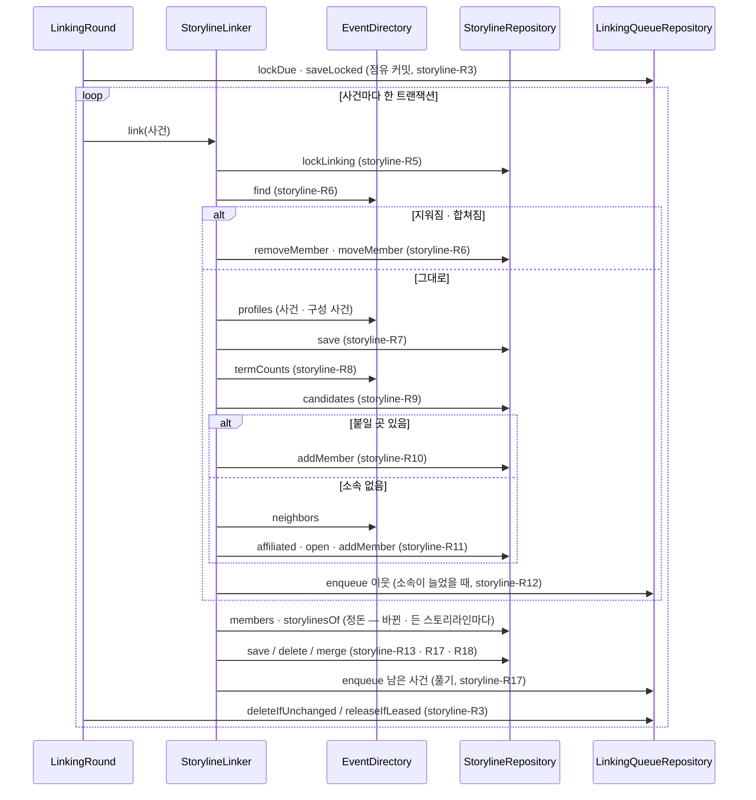

# storyline 모듈 Spec

공통 구조와 쓰는 규칙은 [specs/README.md](README.md)에 있다.

## 1. 책임과 범위

`storyline` 은 사건들을 모든 사용자가 공유하는 흐름(스토리라인)으로 잇는다. 사용자를 모르고, 생성형 LLM 을 쓰지 않으며, 비용은 운영자가 낸다([ADR-0101](../adr/0101-shared-storylines-connect-events-and-the-personal-side-is-storyline-subscriptions-and-interests.md)).

- **사건 변화 따르기** — `event` 가 바뀐 사건 ID 를 알리면(`EventsChanged`) 그 사건을 잇기 대기에 넣는다. 작업 역할의 반복 작업이 대기를 사건의 시각 순으로 점유해 사건마다 지금 상태를 읽어 판정한다 — 기간을 통째로 다시 묶지 않는다(storyline-R1 ~ R5, [ADR-0105](../adr/0105-storylines-link-incrementally-from-event-change-notifications-and-events-publish-changed-event-ids.md))
- **소속 맞추기** — 사건이 지워지면 그 소속을 지우고, 다른 사건에 합쳐지면 소속을 남는 사건으로 옮긴다(storyline-R6)
- **잇기** — 사건 중심의 코사인과 무게를 준 핵심 말 겹침으로 점수를 매겨, 사건을 스토리라인에 더 붙이거나 다른 사건과 짝을 지어 새 스토리라인을 연다. 소속을 빼지 않는다. 소속이 늘면 기다리는 이웃 사건을 다시 본다(storyline-R7 ~ R12, [ADR-0106](../adr/0106-provisional-storyline-linking-opens-only-with-a-partner-event-and-adds-the-single-best-storyline-without-removal.md) · [ADR-0121](../adr/0121-storyline-linking-scores-centroid-cosine-plus-idf-weighted-key-term-overlap-without-time-decay-jev-or-topic-tags.md))
- **정돈** — 소속이 바뀐 스토리라인을 정돈한다. 구성 사건이 없으면 지우고, 구성 사건이 같은 스토리라인은 하나로 합치며, 사건 하나만 남으면 그 사건을 가진 다른 스토리라인에 합치거나 풀어 그 사건을 다시 판정한다. 합쳐진 스토리라인은 남는 스토리라인을 가리킨다(storyline-R13 · R17 · R18, [ADR-0108](../adr/0108-storylines-with-the-same-events-merge-and-a-storyline-left-with-one-event-merges-or-dissolves.md))
- **상태** — 스토리라인의 상태(진행 · 잠잠 · 끝남)를 저장하지 않고 조회 때 마지막 기사 시각으로 정한다. 끝나도 잇기를 막지 않는다(storyline-R16, [ADR-0107](../adr/0107-storyline-state-is-judged-at-query-time-from-the-last-article-and-an-ended-storyline-still-links.md))
- **판정 근거** — 소속마다 정한 것 · 점수 · 판정에 쓴 기준을 남긴다(storyline-R14)
- **스토리라인 사이 관계** — 포함(큰 흐름과 그 갈래)과 이어짐(앞 흐름이 뒤 흐름을 낳음)을 스토리라인 둘의 고리로 둔다. 소속이 바뀐 스토리라인의 후보 쌍을 `evaluation` 의 관계 판정(Jev)에 물어 종류 · 방향을 정하고, 확률이 기준 이상인 것만 맺는다. 포함은 상위 하나의 나무이고 순환을 이루지 않는다(storyline-R25 ~ R32, [ADR-0131](../adr/0131-storyline-relations-are-explicit-links-with-containment-as-a-single-parent-tree-gathered-at-query-time.md) · [ADR-0132](../adr/0132-storyline-relations-are-judged-by-jev-on-candidate-pairs-and-linked-only-above-a-probability-threshold.md))
- **채우기** — 운영자가 기간을 정해, 그 기간에 마지막 기사가 있는 사건을 잇기 대기에 넣는다(storyline-R15)
- **공개 조회** — 다른 모듈이 스토리라인을 읽는다(`StorylineDirectory`) — ID 로 찾기, 스토리라인의 사건(타임라인), 사건의 스토리라인, 조회 기간의 스토리라인 목록 · 큰 스토리라인 · 소속 없는 사건, 스토리라인의 관계. 스토리라인의 사건 · 집계는 포함을 따라 하위의 사건까지 세고, 직접 든 것인지 물려받은 것인지 표시한다. 합쳐진 스토리라인 · 사건의 ID 는 남는 쪽을 따른다(storyline-R21 ~ R24 · R33)
- **큰 판정** — 구독과 무관하게 알릴 만한 스토리라인을 조회할 때 지금 기준으로 고른다. 조회 기간 안 구성 사건 기사의 서로 다른 소스 수와 중요도 평균을 두 기준과 견주는 임시 산식이고, 기간 집계는 `event` 가 사건 묶음 단위로 센다(storyline-R19, [ADR-0116](../adr/0116-storyline-big-judgement-starts-with-a-provisional-rule-of-distinct-sources-and-mean-importance-judged-at-query-time.md) · [ADR-0117](../adr/0117-big-judgement-materials-are-tallied-by-event-per-group-of-events-and-storyline-passes-only-event-ids.md))
- **큰 판정 기준** — 운영자 설정(지금 값 한 행)과 추가 전용 이력으로 두고, 기동 때 처음 값을 적재하고, 공개 운영 API(`BigStorylineAdministration`)로 지금 값 · 변경 · 이력 · 미리보기를 낸다(storyline-R20, [ADR-0118](../adr/0118-big-judgement-criteria-are-storyline-operator-settings-and-do-not-inherit-event-criteria-values-or-history.md))

하지 않는 것:

- 사용자를 모른다. 스토리라인 구독은 `user` 가, 사용자마다 달라지는 스토리라인 정보와 관심사는 `digest` 가 갖는다
- 기사를 가리키지 않는다 — 사건 ID 만 저장한다. 기사 삭제는 `event` 가 사건을 줄이거나 지워 알리는 것으로 따른다(storyline-R6). 관계 판정에 넘길 사건의 대표 기사 ID 는 `event` 에서 받아 `evaluation` 에 넘기기만 하고 저장하지 않는다(storyline-R28)
- 기사를 세지 않는다 — 큰 판정의 재료(기간 안 기사의 소스 · 중요도)는 `event` 의 사건 묶음 집계로 받는다(storyline-R19)
- 큰 판정의 식(지금은 임시 산식이다), 스토리라인의 주제 · 지역 태그, 스토리라인 목록 · 타임라인 · 관계를 보이는 운영자 화면, 운영자가 관계를 넣고 고치는 길, 같은 원인에서 나온 나란한 흐름을 묶는 상위 스토리라인을 여는 법은 아직 없다 — **(미설계)**
- 스토리라인에 들지 않은 사건은 큰 판정에 들지 않는다 — 그 수만 낸다(storyline-R23)
- 사건을 스토리라인에 잇는 데는 Jev 판정 · 주제 태그를 쓰지 않고, 주 소속을 두지 않는다 — Jev 는 스토리라인 사이 관계의 판정에만 쓴다([ADR-0121](../adr/0121-storyline-linking-scores-centroid-cosine-plus-idf-weighted-key-term-overlap-without-time-decay-jev-or-topic-tags.md))
- 표현만 비슷한 두 스토리라인, 사건 둘 이상이 다른 스토리라인에 포함된 스토리라인은 합치지 않는다 — 같은 흐름인지 갈래인지 구조로 가를 수 없다(storyline-R17). 한 사안이 둘로 열린 스토리라인은 관계로도 잇지 않는다(storyline-R29)
- 따로 도는 정리 작업이 없다 — 상태는 조회 때 정하고, 정돈은 판정 트랜잭션에서 한다. 따로 도는 것은 관계 판정의 반복 작업뿐이다(storyline-R31)

기준 점수의 기본값(§7)과 핵심 말 가중치(storyline-R8)는 기본 임베딩 모델에 맞춰 평가 세트에서 고른 값이다 — 평가 세트가 며칠치라 몇 주에 걸친 전개는 재지 못했고, 운영하면서 다시 본다([미결 사항](../open-questions.md) 35). 이 값들과 시간 창 · 상태 기간(§7), 큰 판정의 식 · 기준의 처음 값(storyline-R19 · R20), 목록 한 쪽의 상한(storyline-R22)은 측정 전 목표다. 큰 판정 · 목록 조회의 시간은 재지 않았다. 관계 기준(§7)은 스토리라인 쌍을 직접 판정한 세트로 고른 값이고 측정 전 목표다 — 같은 쌍으로 고르고 잰 값이라 다른 기간에서의 품질, 시간 창보다 멀리 떨어진 흐름, 실제 토큰은 재지 못했다([미결 사항](../open-questions.md)).

다른 모듈과의 의존과 이벤트 흐름은 [overview.md §5](../overview.md#5-모듈-지도)에 있다.

## 2. 용어

사건 · 스토리라인은 [overview.md §8](../overview.md#8-용어)에 있다.

| 용어 | 뜻 |
|---|---|
| 소속 | 사건 하나가 스토리라인 하나에 든 것(`storyline_members` 한 행). 사건은 스토리라인 0개 이상에 든다. 정한 것 · 점수 · 기준 · 시각을 갖는다(storyline-R14) |
| 구성 사건 | 스토리라인에 소속이 있는 사건 |
| 잇기 대기 | 판정할 사건의 목록(`storyline_linking_queue` — 사건마다 한 행). 순서 키 · 다시 알림 수 · 실패 수 · 점유를 갖는다(storyline-R2) |
| 다시 알림 수 | 대기에 있는 사건에 알림이 다시 온 횟수 — 처리 중에 다시 온 알림을 놓치지 않게 한다(storyline-R2 · R3) |
| 순서 키 | 대기를 점유하는 순서 — 사건의 첫 기사 시각, 지워졌거나 합쳐진 사건이면 없다(맨 앞)(storyline-R1 · R3) |
| 회차 | 반복 작업이 한 번 돌 때 하는 일 — 대기를 점유해 사건마다 판정한다(storyline-R3) |
| 점유 | 회차가 대기 행을 가져갔다는 표시 — 토큰 · 만료 시각(storyline-R3) |
| 스토리라인 표현 | 구성 사건으로 정한 스토리라인의 중심 · 기사 수 · 시각 범위 · 핵심 말 · 대표 사건(storyline-R7) |
| 대표 사건 | 스토리라인을 알아보게 하는 구성 사건 하나 — 기사 수가 가장 많은 사건(storyline-R7) |
| 말의 무게 | 핵심 말이 얼마나 드문지 — 판정할 사건의 시각 ± 시간 창 안의 사건 가운데 그 말을 가진 사건이 적을수록 크다(storyline-R8) |
| 잇기 기준 | 시간 창과 기준 점수 — 설정(storyline-R9 · §7) |
| 기준 이력 | 회차가 판정에 쓴 잇기 기준 값의 목록(`storyline_linking_criteria`) — 같은 값이면 한 행이고, 소속이 그 ID 를 가리킨다(storyline-R14) |
| 짝 | 붙일 스토리라인이 없는 사건과 함께 새 스토리라인을 여는 사건 — 소속이 없어야 한다(storyline-R11) |
| 이웃 사건 | 판정할 사건과 같은 모델 버전이고 창 안에 있으며 코사인이 하한 이상인 사건 — `event` 의 `EventDirectory.neighbors` 가 낸다(storyline-R11) |
| 다시 넣기 | 소속이 는 사건의 이웃 가운데 기준 이상이고 소속 없는 사건을 대기에 다시 넣는 것(storyline-R12) |
| 채우기 | 운영자가 정한 기간에 마지막 기사가 있는 사건을 잇기 대기에 넣는 운영 기능(storyline-R15) |
| 정돈 | 소속이 바뀐 스토리라인을 지우거나 · 합치거나 · 풀거나 그대로 두는 것(storyline-R13 · R17) |
| 합쳐진 스토리라인 | 정돈으로 다른 스토리라인에 합쳐진 스토리라인 — 소속 · 핵심 말이 없고, 행이 남아 남는 스토리라인을 가리킨다(storyline-R18) |
| 남는 스토리라인 | 합칠 때 남는 쪽 — 구성 사건이 같으면 ID 가 가장 작은 것, 사건 하나만 남은 스토리라인이면 그 사건을 가진 스토리라인 가운데 ID 가 가장 작은 것(storyline-R17) |
| 풀기 | 사건 하나만 남았고 그 사건이 다른 스토리라인에 없는 스토리라인을 지우고, 그 사건을 잇기 대기에 다시 넣는 것(storyline-R17) |
| 상태 | 스토리라인 마지막 기사 시각으로 조회 때 정하는 진행 · 잠잠 · 끝남(storyline-R16) |
| 잠잠 기간 · 끝남 기간 | 마지막 기사 뒤 이만큼 지나면 잠잠 · 끝남이다 — 설정(storyline-R16 · §7) |
| 조회 기간 | 스토리라인 목록 · 큰 판정 · 소속 없는 사건 조회가 받는 기간 — `event` 의 `EventPeriod`(시작 포함 · 끝 제외, 날짜 31일까지). 기간 안 기사는 사건 배정의 발행 시각으로 고른다(storyline-R22) |
| 기간의 스토리라인 | 조회 기간 안 기사가 있는 구성 사건이 하나라도 있는, 합쳐지지 않은 스토리라인(storyline-R22) |
| 기간 집계 | 스토리라인의 구성 사건들의 조회 기간 안 기사 수 · 서로 다른 소스 수 · 중요도 평균 — `event` 의 `EventTally`(storyline-R19) |
| 큰 판정 | 기간 집계가 큰 판정 기준 둘에 모두 이르는지 — 조회할 때 정한다(storyline-R19) |
| 큰 판정 기준 | 소스 기준(서로 다른 소스 수의 하한)과 중요도 기준(중요도 평균의 하한) — 운영자 설정(storyline-R20) |
| 소속 없는 사건 | 조회 기간 안 기사가 있는데 어느 스토리라인에도 소속이 없는 사건(storyline-R23) |
| 관계 | 스토리라인 둘 사이의 고리(`storyline_relations` 한 행) — 종류(포함 · 이어짐)와 방향, 맺은 확률 · 판정 원본 · 기준 · 시각을 갖는다(storyline-R25) |
| 포함 | 큰 흐름과 그 갈래 — 갈래는 큰 흐름을 중심으로 도는 반응, 알아볼 수 있는 부분(회차 · 단계), 한 갈래다. 앞(`source`)이 상위, 뒤(`target`)가 하위다 |
| 이어짐 | 앞 흐름이 뒤 흐름을 낳음 — 뒤 흐름은 자기 주체와 절차로 따로 굴러가는 다른 사안이다. 앞(`source`)이 낳은 쪽이다 |
| 상위 · 하위 | 포함의 앞 · 뒤. 스토리라인은 상위를 하나까지 갖는다(storyline-R25) |
| 직접 소속 · 물려받은 소속 | 사건이 그 스토리라인에 소속 행으로 든 것이 직접 소속, 하위 스토리라인의 구성 사건이라 상위에 든 것으로 보는 것이 물려받은 소속이다. 물려받은 소속은 저장하지 않는다(storyline-R33) |
| 닫은 사건 집합 | 스토리라인의 직접 소속과, 포함을 따라 내려간 모든 하위의 직접 소속을 사건 ID 로 합친 것 — 공개 조회가 센다(storyline-R33) |
| 관계 대기 | 관계를 판정할 스토리라인의 목록(`storyline_relation_queue` — 스토리라인마다 한 행)(storyline-R26) |
| 후보 쌍 | 관계를 물을 스토리라인 쌍 — 사건을 함께 가졌거나 점수가 후보 기준 이상이고, 두 스토리라인 모두 사건 수가 하한 이상인 쌍(storyline-R27) |
| 서술 사건 | 관계 판정에 제목(일부는 요약문)을 싣는 사건 — 직접 소속 가운데 기사 수가 많은 순으로 고른다(storyline-R28) |
| 물은 기록 | 쌍마다 마지막으로 물은 결말(`storyline_relation_asked` 한 행) — 그때의 작은 쪽 사건 수 · 결말 · 판정 원본 · 기준. 다시 물을 때를 정한다(storyline-R30) |
| 관계 기준 | 확률 기준 · 한 사안 기준 · 사건 수 하한 · 후보 점수 기준 · 시간 창 — 설정(storyline-R27 · R29 · §7). 판정에 쓴 값은 관계 기준 이력(`storyline_relation_criteria`)에 남는다 |

## 3. 공개 인터페이스

이 모듈은 `event` 의 `EventsChanged` 를 받고, 공개 조회 하나(`StorylineDirectory`)와 공개 운영 API 둘(`StorylineLinkingAdministration` · `BigStorylineAdministration`)을 낸다. 관계 판정은 `evaluation` 의 공개 API `FlowRelation` 을 부른다. `StorylineDirectory` 는 `digest` · `report` · `admin` 이 쓰고, 운영 API 는 `admin` 이 운영자 요청으로 부른다([ADR-0045](../adr/0045-admin-module-serves-operator-api-over-module-public-operation-apis.md)). 발행하는 이벤트는 없다.

### StorylineLinkingAdministration · LinkingFillResult

스토리라인 잇기 채우기의 운영(storyline-R15). 구현은 `application` 의 `StorylineLinkingAdministrationService` 다.

```java
public interface StorylineLinkingAdministration {
    int MAX_DAYS = 180;                      // 채울 기간의 상한(일) — 정본
    LinkingFillResult fill(int days);
}

public sealed interface LinkingFillResult {
    record Filled(int events, int enqueued) implements LinkingFillResult {}
    record DaysOutOfRange(int max) implements LinkingFillResult {}
}
```

| 타입 · 멤버 | 뜻 |
|---|---|
| `fill` | 마지막 기사 시각이 지금 − 일수 × 24시간 이후(그 시각 포함)인, 합쳐지지 않은 사건(열림 · 닫힘)을 잇기 대기에 넣는다. 이미 대기에 있으면 다시 알림으로 센다(storyline-R2) |
| `Filled.events` | 기간의 사건 수 |
| `Filled.enqueued` | 그 가운데 새로 대기에 넣은 사건 수 — 이미 대기에 있던 사건은 세지 않는다 |
| `DaysOutOfRange.max` | 일수가 1 ~ `max` 밖이라 아무것도 하지 않았다 — `max` 는 `MAX_DAYS` |

- 계약
  - 역할 애너테이션이 없다(두 역할 공통). 사건 고르기는 `event` 의 공개 조회 하나(`EventDirectory.lastArticleSince`)이고, 넣기는 SQL 한 문장이다
  - 넣은 사건은 반복 작업의 회차가 판정한다

### StorylineDirectory

스토리라인 조회 — 다른 모듈이 스토리라인 · 스토리라인의 사건 · 사건의 스토리라인 · 조회 기간의 스토리라인 목록 · 큰 스토리라인 · 소속 없는 사건 · 스토리라인의 관계를 읽는다(storyline-R19 · R21 ~ R23 · R33). 구현은 `application` 의 `StorylineDirectoryService` 다.

```java
public interface StorylineDirectory {
    int MAX_PAGE_SIZE = 100;                              // 목록 한 쪽의 상한 — 정본. 측정 전 목표

    Optional<StorylineView> find(StorylineId id);
    List<StorylineEvent> events(StorylineId id);
    List<EventStoryline> storylinesOf(EventId event);
    StorylinePage list(EventPeriod period, @Nullable StorylineCursor after, int size);
    List<BigStoryline> bigStorylines(EventPeriod period);
    UnlinkedEvents unlinked(EventPeriod period);
    List<StorylineRelationView> relationsOf(StorylineId id);
}
```

| 메서드 | 뜻 |
|---|---|
| `find` | 스토리라인 하나 — 합쳐진 스토리라인이면 남는 스토리라인을 낸다(storyline-R18 · R21). 없는 스토리라인이면 빈 값 |
| `events` | 스토리라인의 닫은 사건 집합(타임라인) — 직접 소속과 하위의 소속을 사건마다 한 번씩, 첫 기사 시각 · 사건 ID 순. 사건마다 직접 소속인지 싣는다(storyline-R33). 합쳐진 스토리라인이면 남는 스토리라인의 것이고, 없는 스토리라인이면 빈 목록. 합쳐졌거나 지워졌는데 아직 소속을 따르지 않은 사건은 빠진다(storyline-R21) |
| `storylinesOf` | 사건이 든 스토리라인 — 직접 든 스토리라인과 그 상위 전부를 한 번씩, 스토리라인 ID 순. 스토리라인마다 직접 든 것인지 싣는다(storyline-R33). 합쳐진 사건이면 남는 사건의 것이고, 없는 사건이면 빈 목록(storyline-R21) |
| `list` | 기간의 스토리라인 — 직접 소속의 마지막 기사 시각 내림차순, 스토리라인 ID 내림차순으로 `size` 건. 집계 · 큰 여부는 그 기간 · 지금 기준이고 닫은 사건 집합으로 센다(storyline-R22 · R33). `size` 가 1 ~ `MAX_PAGE_SIZE` 밖이면 `IllegalArgumentException` |
| `bigStorylines` | 기간의 스토리라인 가운데 큰 스토리라인 — 지금 기준으로 판정한다(storyline-R19). 소스 수 내림차순, 중요도 평균 내림차순, 스토리라인 ID 순 |
| `unlinked` | 조회 기간 안 기사가 있는 사건 가운데 소속 없는 사건의 수와 그 사건들의 기간 안 기사 수(storyline-R23) |
| `relationsOf` | 스토리라인이 앞이거나 뒤인 관계 — 종류(포함 먼저) · 앞 ID · 뒤 ID 순. 합쳐진 스토리라인이면 남는 스토리라인의 것이고, 없는 스토리라인이면 빈 목록(storyline-R21 · R25) |

- 계약
  - 사용자 정보를 받지 않는다. 트랜잭션 · 역할 애너테이션이 없다(두 역할 공통)
  - 각 질의는 그 순간의 값이다 — 사건 · 기간 집계는 `event` 의 공개 조회로 따로 읽어 한 스냅숏이 아니고, 모듈 잠금(storyline-R5)을 잡지 않아 질의 사이에 소속이 바뀔 수 있다
  - `bigStorylines` · `list` 는 큰 판정 기준의 처음 값을 적재하기 전이면 `IllegalStateException`(`list` 는 쪽에 스토리라인이 있을 때)
  - 쪽 사이에 마지막 기사 시각이 바뀐 스토리라인은 건너뛰거나 다시 나올 수 있다

### StorylineId · StorylineState · StorylineView · StorylineEvent · EventStoryline · StorylineRelationKind · StorylineRelationView · StorylineSummary · StorylineCursor · StorylinePage · BigStoryline · UnlinkedEvents

```java
public record StorylineId(long value) {}                  // 1 보다 작으면 IllegalArgumentException
public enum StorylineState { ACTIVE, QUIET, ENDED }
public record StorylineView(StorylineId id, StorylineState state, int eventCount, int articleCount,
        Instant firstArticleAt, Instant lastArticleAt, EventId representativeEvent, Instant createdAt,
        @Nullable StorylineId parent) {}
public record StorylineEvent(EventView event, boolean direct) {}
public record EventStoryline(StorylineView storyline, boolean direct) {}
public enum StorylineRelationKind { CONTAINS, FOLLOWS }
public record StorylineRelationView(StorylineRelationKind kind, StorylineId source, StorylineId target, Instant linkedAt) {}
public record StorylineSummary(StorylineView storyline, EventTally tally, boolean big) {}
public record StorylineCursor(Instant lastArticleAt, StorylineId id) {}
public record StorylinePage(List<StorylineSummary> storylines, @Nullable StorylineCursor next) {}
public record BigStoryline(StorylineView storyline, EventTally tally) {}
public record UnlinkedEvents(int events, int articles) {}
```

| 타입 · 멤버 | 뜻 |
|---|---|
| `StorylineState` | 진행(`ACTIVE`) · 잠잠(`QUIET`) · 끝남(`ENDED`) — 조회할 때 정한다(storyline-R16) |
| `StorylineView.state` | 조회 시각의 상태 |
| `StorylineView.eventCount` | 닫은 사건 집합의 사건 수 — 기간과 무관한 스토리라인 전체. 하위가 없으면 구성 사건 수다(storyline-R33) |
| `StorylineView.articleCount` · `firstArticleAt` · `lastArticleAt` | 닫은 사건 집합의 기사 수 합 · 첫 · 마지막 기사 시각 — 기간과 무관하다. 하위가 없으면 스토리라인 표현의 값(storyline-R7)과 같다. 상태도 이 마지막 기사 시각으로 정한다(storyline-R16 · R33) |
| `StorylineView.representativeEvent` | 대표 사건(storyline-R7) — 직접 소속에서 고른다. 대표 기사는 `event` 의 `EventDirectory.representativesOfAll` 로 읽는다 |
| `StorylineView.parent` | 포함의 상위 — 없으면 null(storyline-R25) |
| `StorylineEvent.direct` | 그 스토리라인의 직접 소속이면 true, 하위에서 물려받은 사건이면 false. 둘 다면 true(storyline-R33) |
| `EventStoryline.direct` | 사건이 직접 든 스토리라인이면 true, 그 상위라서 든 것이면 false. 둘 다면 true(storyline-R33) |
| `StorylineRelationKind` | 포함(`CONTAINS` — `source` 가 `target` 을 포함) · 이어짐(`FOLLOWS` — `target` 이 `source` 에 이어짐) |
| `StorylineRelationView.linkedAt` | 그 관계를 맺은(마지막으로 고친) 시각. 확률 · 판정 원본은 싣지 않는다 |
| `StorylineSummary.tally` · `BigStoryline.tally` | 조회 기간의 기간 집계 — `event` 의 `EventTally`(storyline-R19) |
| `StorylineSummary.big` | 목록 기간 · 지금 기준으로 큰 스토리라인인가 |
| `StorylinePage.next` | 다음 쪽의 커서 — 앞 쪽 마지막 스토리라인의 (마지막 기사 시각, 스토리라인 ID). 더 없으면 null |
| `UnlinkedEvents` | 소속 없는 사건의 수(`events`)와 그 사건들의 조회 기간 안 기사 수(`articles`) |

### BigStorylineAdministration · BigStorylineCriteria · BigStorylineCriteriaChange · BigStorylineCriteriaChangeResult

큰 판정 기준의 운영(storyline-R20) — 운영자 화면이 부른다. 구현은 `application` 의 `BigStorylineAdministrationService` 다.

```java
public interface BigStorylineAdministration {
    BigStorylineCriteria criteria();
    BigStorylineCriteriaChangeResult change(int minSources, BigDecimal minImportance, ChangeActor actor);
    List<BigStorylineCriteriaChange> changes();
    List<BigStoryline> preview(BigStorylineCriteria proposed, EventPeriod period);
}

public record BigStorylineCriteria(int minSources, BigDecimal minImportance) {
    public static final int IMPORTANCE_SCALE = 2;                         // 중요도 기준의 소수 자릿수 — 정본
    public static final BigStorylineCriteria DEFAULT;                     // (3, 3.00) — 처음 값의 정본. 측정 전 목표
    public static Optional<BigStorylineCriteria> of(int minSources, BigDecimal minImportance);
}

public record BigStorylineCriteriaChange(@Nullable BigStorylineCriteria previous, BigStorylineCriteria current,
        ChangeActor actor, Instant changedAt) {}

public sealed interface BigStorylineCriteriaChangeResult {
    record Changed(BigStorylineCriteria previous, BigStorylineCriteria current) implements BigStorylineCriteriaChangeResult {}
    record Unchanged(BigStorylineCriteria current) implements BigStorylineCriteriaChangeResult {}
    record OutOfRange() implements BigStorylineCriteriaChangeResult {}
}
```

| 타입 · 멤버 | 뜻 |
|---|---|
| `criteria` | 지금 기준 — 처음 값을 적재하기 전이면 `IllegalStateException` |
| `change` | 기준을 바꾼다 — 한 트랜잭션. 범위 밖이면 `OutOfRange`, 지금 값과 같으면 `Unchanged` — 둘 다 아무것도 쓰지 않는다. 범위 안의 값인데 처음 값을 적재하기 전이면 `IllegalStateException` |
| `changes` | 이력 — 최근 것부터(같은 시각이면 나중에 쓴 것부터) |
| `preview` | 제안 기준으로 판정한 조회 기간의 큰 스토리라인 — 판정 · 순서는 `StorylineDirectory.bigStorylines` 와 같고 아무것도 쓰지 않는다 |
| `BigStorylineCriteria` | 생성자는 소스 기준 1 이상, 중요도 기준이 중요도 수준의 범위(`evaluation` 의 `ImportanceScale.MIN_LEVEL` ~ `MAX_LEVEL`) 안 · 소수 둘째 자리까지가 아니면 `IllegalArgumentException`. 중요도 기준은 둘째 자리로 맞춘다 — 같은 값이면 같다. `of` 는 범위 밖이면 빈 값 |
| `BigStorylineCriteriaChange.previous` | 바꾸기 전 값 — 처음 값이면 null |

- 계약
  - 역할 애너테이션이 없다(두 역할 공통). 큰 판정은 조회할 때 지금 기준으로 하므로 바꾸면 다음 조회부터 반영된다
  - 행위자의 종류는 `platform` 의 `ChangeActor` 다

## 4. 내부 구조

### 개관

| 패키지 | 책임 |
|---|---|
| (최상위) | 모듈 선언(`package-info`), 공개 조회 `StorylineDirectory` 와 그 값 타입(스토리라인 ID · 상태 포함), 공개 운영 API `StorylineLinkingAdministration` · `BigStorylineAdministration` 과 그 결과 · 값 타입 |
| `domain/linking` | 잇기의 판단 — 점수 산식 · 말의 무게 · 코사인 하한, 판정(붙이기 · 짝 · 다시 넣기), 스토리라인 표현과 대표 사건, 잇기 기준, 기준 이력 저장소 |
| `domain/storyline` | 스토리라인과 소속 — 소속의 판정 근거와 정한 것, 후보로 읽는 스토리라인, 정돈 판정, 상태 판정, 스토리라인 저장소, 조회로 읽는 스토리라인과 조회 저장소 |
| `domain/big` | 큰 판정 — 판정 규칙 · 순서, 큰 판정 기준 저장소 |
| `domain/queue` | 잇기 대기 — 대기 행과 그 점유, 순서 키 규칙, 대기 상수 · 실패 상한, 대기 저장소 |
| `domain/relation` | 스토리라인 사이 관계 — 관계와 종류, 구조 제약(상위 하나 · 순환), 후보 쌍 · 다시 물을 때 · 요청의 순서, 판정, 병합 때 옮기기, 서술 사건 고르기, 관계 기준, 관계 대기 행과 상수, 관계 · 관계 대기 저장소 |
| `application` | 사건 변화 리스너, 회차, 사건 하나의 판정 · 정돈, 관계 회차, 공개 조회 · 공개 운영 API 의 구현, 큰 판정 기준의 처음 값 적재, 잇기 기준 · 상태 기간 · 관계 기준 설정과 결선 |
| `adapter/in/job` | 잇기 대기 반복 작업 · 관계 대기 반복 작업(작업 역할) |
| `adapter/out/persistence` | 대기 · 스토리라인 · 기준 이력 · 조회 · 큰 판정 기준 · 관계 · 관계 대기 저장소의 JdbcClient 구현 |

협력: `StorylineLinkingListener` 가 `EventsChanged` 를 받아 사건마다 `event` 의 `EventDirectory.find` 로 지금 상태를 읽어 `PendingEvent.orderAt` 으로 순서 키를 정하고 `LinkingQueueRepository.enqueue` 로 넣는다. 작업 역할의 `LinkStorylinesJob` 이 1분마다 `LinkingRound` 를 돌린다. 회차는 `LinkingCriteriaRepository` 에 지금 기준(`LinkingCriteria` — `LinkingConfiguration` 이 `LinkingProperties` 로 만든 빈)을 등록하고, `LinkingQueueRepository` 로 대기를 점유한 뒤(`PendingEvent.claim` · `LinkingSchedule`), 사건마다 한 트랜잭션에서 `StorylineLinker.link` 를 부르고 `deleteIfUnchanged` · `releaseIfLeased` 로 대기 행을 마무리한다. 예외면 `recordFailureIfLeased` 로 실패를 세고 상한(`LinkingSchedule.failuresExhausted`)이면 `delete` 로 뺀다.

`StorylineLinker` 는 먼저 `StorylineRepository.lockLinking` 으로 모듈 잠금을 잡고, `EventDirectory.find` 로 사건의 지금 상태를 가른다. 지워졌거나 합쳐졌으면 `StorylineRepository.storylinesOf` 의 스토리라인마다 `removeMember` · `moveMember` 로 소속을 맞추고 그 스토리라인들을 정돈한다. 그대로면 `EventDirectory.profiles` 로 사건과 그 사건이 든 스토리라인의 구성 사건 표현을 읽어 `Representation.of` 로 표현을 다시 저장하고(`save`), `Representation.without` 으로 그 사건을 뺀 비교 대상을 만든다. `EventDirectory.termCounts` 로 그 사건 상위 핵심 말의 사건 수를 읽어 말의 무게(`TermWeights`)를 만든다. `StorylineRepository.candidates` 로 창 안 후보 스토리라인을 읽어 `LinkingScoring` 으로 점수를 매기고 `LinkingRule.attach` 로 붙일 곳을 정한다(`addMember`). 붙일 곳이 없고 소속이 없으면 `EventDirectory.neighbors` 로 이웃을 읽어 `StorylineRepository.affiliated` 와 `LinkingRule.pair` 로 짝을 정해 `open` · `addMember` 로 연다. 소속이 늘었으면 `LinkingRule.requeue` 로 고른 이웃을 `LinkingQueueRepository.enqueue` 로 다시 넣는다 — 짝으로 연 상대 사건의 이웃은 그 사건의 말의 무게를 따로 읽어 점수를 매긴다. 끝으로 그 사건이 든 스토리라인과 붙인 스토리라인을 정돈한다.

정돈은 스토리라인마다 `StorylineRepository.members` 로 구성 사건을, `storylinesOf`(첫 구성 사건) · `members` 로 그 사건을 가진 다른 스토리라인의 구성 사건을 읽어 `Tidying.decide` 로 정하고, 결과에 따라 표현을 다시 정하거나(`save`) · 지우거나(`delete`) · 합치거나(`merge`) · 풀어 그 사건을 `PendingEvent.orderAt` 의 순서 키로 다시 넣는다(`delete` · `enqueue`). 한 정돈에서 이미 지웠거나 합친 스토리라인은 건너뛴다.

상태는 `StateCriteria.stateOf`(`StorylineStateConfiguration` 이 `StorylineStateProperties` 로 만든 빈)가 정한다 — 공개 조회가 스토리라인을 낼 때마다 지금 시각으로 부른다.

조회: `StorylineDirectoryService` 가 `StorylineQueryRepository` 로 스토리라인(합쳐진 스토리라인이면 남는 스토리라인) · 사건들이 직접 든 스토리라인 · 주어진 스토리라인들과 그 쪽을 읽고, `StorylineRepository.members` · `affiliated` 로 직접 소속 · 소속 여부를 읽는다. 기간의 스토리라인은 `event` 의 `EventDirectory.articleCountsIn` 이 낸 기간 안 사건이 직접 든 스토리라인과 그 상위이고, 기간 집계는 스토리라인마다 닫은 사건 집합을 `EventDirectory.tallies` 에 넘겨 받는다(아래 "닫은 조회"). 큰 판정은 `BigStorylineCriteriaRepository` 의 지금 기준으로 `BigStorylineRule` 이 판정 · 정렬한다. 타임라인은 닫은 사건 집합을 `EventDirectory.views` 로 읽어 첫 기사 시각 순으로 놓고, 사건의 스토리라인은 `EventDirectory.find` 로 남는 사건을 얻어 찾는다. 스토리라인의 관계는 남는 스토리라인을 찾은 뒤 `RelationRepository.of` 로 읽는다. 큰 판정 기준은 `BigStorylineCriteriaSeeding` 이 기동 때 처음 값을 넣고, `BigStorylineAdministrationService` 가 변경 · 이력을 저장소로 쓰며 지금 값 읽기와 미리보기는 `StorylineDirectoryService` 의 것을 쓴다.

채우기는 `StorylineLinkingAdministrationService` 가 `EventDirectory.lastArticleSince` 와 `LinkingQueueRepository.enqueueAll` 로 한다.

관계: `StorylineLinker` 는 정돈에서 남은 스토리라인과 짝으로 연 스토리라인을 `RelationQueueRepository.enqueue` 로 관계 대기에 넣고, 합칠 때는 `StorylineRepository.merge` 앞에서 `RelationMove.plan` 을 `RelationRepository.applyMove` 로 적용하고 합쳐질 스토리라인의 물은 기록(`forgetAsked`) · 관계 대기 행(`RelationQueueRepository.delete`)을 지운다. 작업 역할의 `RelateStorylinesJob` 이 1분마다 `RelationRound` 를 돌린다. 회차는 지금 기준(`RelationCriteria` — `RelationConfiguration` 이 `RelationProperties` 로 만든 빈)을 `RelationRepository.registerCriteria` 로 등록하고 관계 대기를 점유한 뒤(`PendingStoryline.claim` · `RelationSchedule`), 스토리라인마다 `StorylineRepository.profile` 로 표현을 읽고 `StorylineRepository.members` · `storylinesOf` 로 사건을 함께 가진 스토리라인을, `StorylineRepository.candidates` · `EventDirectory.termCounts` · `LinkingScoring` 으로 점수 후보를 얻어 `RelationCandidates.partners` 로 후보 쌍을 고른다. 쌍마다 `EventDirectory.views` 로 두 스토리라인의 직접 소속 사건을 읽어 `RelationDescription.of` 로 서술 사건을 고르고 `EventDirectory.representativesOfAll` 로 대표 기사를 얻어 `evaluation` 의 `FlowRelation.judge` 에 묻는다 — 트랜잭션 밖이다. 결과는 모듈 잠금(`StorylineRepository.lockLinking`)을 잡은 짧은 트랜잭션에서 두 스토리라인을 다시 읽고 `RelationRepository.all` 로 만든 `RelationGraph` 와 `RelationRule.decide` 로 판정해 `link` · `unlink` · `recordAsked` 로 쓴다.

닫은 조회: `StorylineDirectoryService` 는 `RelationRepository.all` 로 `RelationGraph` 를 만들어 스토리라인의 하위(`descendants`) · 상위(`ancestors` · `parentOf`)를 얻고, `StorylineRepository.members` 로 그 스토리라인들의 직접 소속을 읽어 닫은 사건 집합을 만든다 — 스토리라인 값 · 타임라인 · 사건의 스토리라인 · 기간 집계가 이 한 길을 쓴다.

#### 판정 흐름



### 들어오는 쪽

| 진입점 | 구성 요소 | 계기 | 내용 |
|---|---|---|---|
| `EventsChanged` 리스너 | `StorylineLinkingListener`(`application`) | `event` 의 `EventsChanged` | 사건마다 순서 키를 읽어 잇기 대기에 넣는다(storyline-R1 · R2). 비동기 · 새 트랜잭션이고 이벤트 발행 레지스트리에 기록된다(Spring Modulith `@ApplicationModuleListener`). 실패한 발행은 `platform` 의 이벤트 재처리 작업이 다시 처리하고, 다시 처리해도 다시 알림 수만 는다 — 판정은 지금 상태를 읽는다 |
| 잇기 대기 반복 작업 | `LinkStorylinesJob`(`adapter/in/job`, 작업 역할) | JobRunr 반복 작업 `storyline-linking` — 1분마다, 재시도 없음 | `LinkingRound` 를 돌린다(storyline-R3). 이전 실행이 대기 · 처리 중이면 그 실행은 건너뛴다 |
| 관계 대기 반복 작업 | `RelateStorylinesJob`(`adapter/in/job`, 작업 역할) | JobRunr 반복 작업 `storyline-relation` — 1분마다, 재시도 없음 | `RelationRound` 를 돌린다(storyline-R31). 이전 실행이 대기 · 처리 중이면 그 실행은 건너뛴다. 잇기 작업과 따로 돈다 |
| 채우기 | `StorylineLinkingAdministrationService`(`application`) | `admin` 의 운영자 요청(`StorylineLinkingAdministration.fill`) | 기간에 마지막 기사가 있는, 합쳐지지 않은 사건을 잇기 대기에 넣는다(storyline-R15). 두 역할 공통 |
| 스토리라인 조회 | `StorylineDirectoryService`(`application`) | 다른 모듈의 `StorylineDirectory` 호출 | 스토리라인 · 타임라인 · 사건의 스토리라인 · 목록 · 큰 스토리라인 · 소속 없는 사건(storyline-R19 · R21 ~ R23). 두 역할 공통 |
| 큰 판정 기준 운영 | `BigStorylineAdministrationService`(`application`) | `admin` 의 운영자 요청(`BigStorylineAdministration`) | 지금 값 · 변경 · 이력 · 미리보기(storyline-R20). 두 역할 공통 |
| 큰 판정 기준 처음 값 | `BigStorylineCriteriaSeeding`(`application`) | 기동(`SmartInitializingSingleton`) | 지금 값이 없으면 처음 값과 이력 한 행을 넣는다(storyline-R20). 두 역할 공통 |

컨트롤러는 없다.

### `application`

- `StorylineLinkingListener` — 리스너(들어오는 쪽). 시각은 `InstantSource` 에서 얻는다. 알림 하나의 사건을 사건 ID 오름차순으로 넣는다
- `LinkingRound` — 회차 하나(storyline-R3 · R4). 시각은 `InstantSource` 에서 얻는다. 점유 · 판정 · 실패 기록은 `TransactionTemplate` 의 짧은 트랜잭션이다. 판정의 예외를 밖으로 던지지 않는다 — 기준 등록 · 점유 · 실패 기록의 DB 예외는 회차 밖으로 나간다. 기준 등록 · 점유가 실패하면 점유한 사건이 없어 다음 회차가 가져가고, 실패 기록이 실패하면 그 회차가 점유한 사건(아직 판정하지 않은 사건 포함)이 점유가 만료된 뒤 다시 판정된다. 트랜잭션 · 역할 애너테이션이 없다. 로그: `스토리라인 잇기 판정이 예상하지 못한 오류로 실패했다 — 사건 {ID}, 실패 {n}회`(오류, 예외와 함께) · `스토리라인 잇기 판정이 거듭 실패해 대기에서 뺐다 — 사건 {ID}, 실패 {n}회`(오류)
- `StorylineLinker` — 사건 하나의 따르기 · 판정 · 정돈 · 쓰기(storyline-R5 ~ R14 · R17 · R18)와 관계 대기에 넣기 · 합칠 때 관계 옮기기(storyline-R26 · R32). 트랜잭션 안에서 부른다. 시각 · 기준 · 기준 ID 는 회차가 넘긴다
- `RelationRound` — 관계 회차 하나(storyline-R27 ~ R31). 시각은 `InstantSource` 에서 얻는다. 점유 · 후보 읽기 · 반영 · 실패 기록은 `TransactionTemplate` 의 짧은 트랜잭션이고, 관계 판정은 트랜잭션 밖이다. 판정 · 실패 갈래는 `default` 없는 `switch` 식이다. 평가기 사용 불가 · 예상 못한 예외면 회차를 멈춘다 — 점유는 만료로 풀린다. 트랜잭션 · 역할 애너테이션이 없다. 로그: `스토리라인 관계 판정이 거듭 실패해 대기에서 뺐다 — 스토리라인 {ID}, 실패 {n}회`(오류) · `스토리라인 관계 판정을 멈췄다 — 평가기를 쓸 수 없다: {문구}`(오류)
- `RelationProperties` · `RelationConfiguration` — 관계 기준 설정(`yozmnews.storyline-relation`, 기본값의 정본은 레코드 컴포넌트의 `@DefaultValue`)과 그것을 검증된 `RelationCriteria` 빈으로 바꾸는 결선. 값이 틀리면 기동하지 않는다. 역할 애너테이션이 없다
- `StorylineLinkingAdministrationService` — 공개 운영 API `StorylineLinkingAdministration` 의 구현(storyline-R15). 시각은 `InstantSource` 에서 얻는다
- `StorylineDirectoryService` — 공개 조회 `StorylineDirectory` 의 구현(storyline-R19 · R21 ~ R23 · R33). 닫은 사건 집합을 만드는 길 하나를 스토리라인 값 · 타임라인 · 사건의 스토리라인 · 기간 집계가 함께 쓴다. 큰 판정은 패키지 비공개 `bigStorylines(EventPeriod, BigStorylineCriteria)` 하나를 공개 조회(지금 기준)와 미리보기(제안 기준)가 함께 쓰고, 기간의 스토리라인에 기간 집계를 다는 길 하나를 목록과 큰 판정이 함께 쓴다. `list` 는 한 건 더 읽어 다음 커서를 정한다. 시각은 `InstantSource` 에서 얻는다. 트랜잭션 · 역할 애너테이션이 없다
- `BigStorylineAdministrationService` — 공개 운영 API `BigStorylineAdministration` 의 구현(storyline-R20). 변경은 지금 값 행을 잠근 한 트랜잭션이고, 바꿨으면 정보 로그 `큰 판정 기준을 바꿨다 — 소스 {a} → {b}, 중요도 {x} → {y}, {행위자}` 를 남긴다. 시각은 `InstantSource` 에서 얻는다
- `BigStorylineCriteriaSeeding` — 기동 때 한 트랜잭션에서 처음 값(`BigStorylineCriteria.DEFAULT`)을 넣는다(storyline-R20). 넣었으면 정보 로그 `큰 판정 기준의 처음 값을 적재했다 — 소스 {n} · 중요도 {x}`
- `LinkingProperties` · `LinkingConfiguration` — 잇기 기준 설정(`yozmnews.storyline-linking`, 기본값의 정본은 레코드 컴포넌트의 `@DefaultValue`)과 그것을 검증된 `LinkingCriteria` 빈으로 바꾸는 결선. 값이 틀리면 기동하지 않는다
- `StorylineStateProperties` · `StorylineStateConfiguration` — 상태 기간 설정(`yozmnews.storyline-state`, 기본값의 정본은 레코드 컴포넌트의 `@DefaultValue`)과 그것을 검증된 `StateCriteria` 빈으로 바꾸는 결선. 값이 틀리면 기동하지 않는다. 역할 애너테이션이 없다(두 역할 공통)

### `domain`

#### `domain/linking`

- `LinkingCriteria(Duration window, double threshold)` — 잇기 기준. 창은 0 보다 큰 초 단위, 기준은 0 보다 크고 1 이하(storyline-R9)
- `LinkingScoring` — 점수 산식 · 코사인 하한의 정본(storyline-R8). 상수 `KEY_TERM_WEIGHT` · `KEY_TERMS` · `NEIGHBORS` · `COSINE_MARGIN`. 판정할 사건(`Subject`)과 견줄 것(`Compared`)을 시간 창 · 말의 무게로 견준 점수(`Score` — 점수 · 코사인 · 핵심 말 겹침)
- `TermWeights` — 말의 무게의 정본(storyline-R8) — `of(사건 수, 말마다 그 말을 가진 사건 수)` · `weight(말)`
- `Cosine` — 두 벡터의 코사인 유사도 — 어느 한쪽이 영 벡터면 NaN
- `LinkingRule` — 판정의 정본(storyline-R10 ~ R12) — `attach` · `pair` · `requeue`. 점수를 매긴 것은 `Scored(id, Score)`
- `Representation` — 스토리라인 표현과 대표 사건의 정본(storyline-R7) — `of(구성 사건 표현)` · `without(구성 사건 표현, 뺄 사건)` · `topTerms(n)`
- 기준 이력 저장소 `LinkingCriteriaRepository` — `long register(LinkingCriteria criteria, Instant now)`(같은 값의 행이 있으면 그 ID)

#### `domain/storyline`

- `LinkJudgement(LinkedBy linkedBy, @Nullable Score score, @Nullable Long criteriaId, Instant linkedAt)` — 소속 하나의 판정 근거(storyline-R14). 정한 것 `LinkedBy` 는 `RULE`(붙이기) · `PAIR`(짝으로 엶) · `MERGE`(합쳐진 사건의 소속을 옮김)
- `StorylineSnapshot(long id, float[] centroid, Instant firstArticleAt, Instant lastArticleAt, List<String> keyTerms)` — 후보로 읽은 스토리라인
- `Tidying` — 정돈 판정의 정본(storyline-R13 · R17). `decide(스토리라인 ID, 구성 사건, 첫 구성 사건을 가진 다른 스토리라인의 구성 사건)` 이 `Keep` · `Remove` · `Dissolve(사건 ID)` · `MergeInto(남는 스토리라인 ID, 합쳐질 스토리라인 ID 목록)` 가운데 하나를 낸다(sealed)
- `StateCriteria(Duration quietAfter, Duration endedAfter)` — 상태 판정의 정본(storyline-R16). 두 기간은 0 보다 큰 초 단위이고 잠잠 기간 < 끝남 기간이다. `stateOf(마지막 기사 시각, 지금)` 이 상태(최상위 `StorylineState`)를 낸다

  ```java
  public interface StorylineRepository {
      void lockLinking();                                                    // 모듈 잠금 — 트랜잭션 끝까지(storyline-R5)
      List<Long> storylinesOf(long eventId);                                 // 사건이 든 합쳐지지 않은 스토리라인 — ID 순
      Map<Long, List<Long>> members(Collection<Long> storylineIds);          // 구성 사건 — 스토리라인 ID 순, 사건 ID 순
      Set<Long> affiliated(Collection<Long> eventIds);                       // 이 가운데 소속이 있는 사건
      List<StorylineSnapshot> candidates(String modelVersion, float[] vector, Instant from, Instant to,
              double minCosine, int keyTerms);                              // storyline-R9, 합쳐진 스토리라인은 빠진다, ID 순
      long open(Representation representation, Instant now);
      void save(long storylineId, Representation representation, Instant now);   // 핵심 말은 통째로 바꾼다
      void addMember(long storylineId, long eventId, LinkJudgement judgement);
      void moveMember(long storylineId, long fromEventId, long toEventId, Instant now);  // MERGE 근거로 다시 적는다
      void removeMember(long storylineId, long eventId);
      void merge(long merged, long survivor, Instant now);                   // storyline-R18 — 소속 · 핵심 말을 지우고 가리킴을 평평하게 적는다
      void delete(long storylineId);                                         // 스토리라인 · 핵심 말 · 소속, 이것을 가리키는 합쳐진 행. 관계 · 물은 기록 · 관계 대기 행은 FK 로 함께 지워진다
      Optional<StorylineProfile> profile(long storylineId, int keyTerms);    // 합쳐지지 않은 스토리라인의 표현과 구성 사건 수 — 관계 후보의 판정할 쪽(storyline-R27)
  }
  ```

- `StorylineProfile(long id, String modelVersion, float[] centroid, Instant firstArticleAt, Instant lastArticleAt, List<String> keyTerms, int events)` — 스토리라인 하나의 표현과 구성 사건 수(직접 소속)
- `StoredStoryline(long id, int eventCount, int articleCount, Instant firstArticleAt, Instant lastArticleAt, long representativeEventId, Instant createdAt)` — 조회로 읽은 스토리라인(직접 소속의 저장된 표현). 상태는 싣지 않는다 — 조회 시각으로 정한다
- 조회 저장소 — 공개 조회의 읽기 전용 질의다. 쓰기용 `StorylineRepository` 와 나누고, 구성 사건 · 소속 여부는 `StorylineRepository.members` · `affiliated` 를 쓴다

  ```java
  public interface StorylineQueryRepository {
      Optional<StoredStoryline> find(long storylineId);                 // 합쳐진 행이면 남는 행, 없으면 빈 값
      List<StoredStoryline> having(Collection<Long> eventIds);          // 이 사건 가운데 하나라도 직접 든, 합쳐지지 않은 스토리라인 — ID 순
      List<StoredStoryline> byIds(Collection<Long> storylineIds);       // 합쳐지지 않은 것만 — ID 순
      List<StoredStoryline> pageOf(Collection<Long> storylineIds, @Nullable Instant afterLast, @Nullable Long afterId,
              int limit);                                               // 그 스토리라인들 — 마지막 기사 시각 · ID 내림차순
  }
  ```

#### `domain/relation`

- `RelationKind` — 저장하는 종류 `CONTAINS` · `FOLLOWS`. 공개 값 `StorylineRelationKind` 와 하나씩 짝이다(`default` 없는 `switch`)
- `Relation(long sourceId, long targetId, RelationKind kind)` — 관계 하나. `source` 는 포함의 상위 · 이어짐의 앞, `target` 은 하위 · 뒤다. 두 ID 가 같으면 `IllegalArgumentException`
- `StoredRelation(Relation relation, Instant linkedAt)` — 읽은 관계
- `RelationCriteria(double probability, double oneMatter, int minEvents, double candidateScore, Duration window)` — 관계 기준. 확률 기준 · 후보 점수 기준은 0 보다 크고 1 이하, 한 사안 기준은 0 ~ 1, 사건 수 하한은 2 이상, 창은 0 보다 큰 초 단위(storyline-R27 · R29)
- `RelationGraph` — 구조 제약의 정본(storyline-R25). 지금 관계의 목록으로 만들고, 상위(`parentOf`) · 하위 전부(`descendants`) · 상위들(`ancestors` — 가까운 순) · 넣으면 순환이 되는가(`closesCycle` — 같은 종류의 고리를 따라 `target` 에서 `source` 로 닿는가)를 답한다. 그 쌍의 관계(`between`)와 그 쌍의 관계를 뺀 그래프(`without`)도 낸다
- `RelationCandidates` — 후보 쌍의 정본(storyline-R27 · R28 · R30) — `partners` · `due` · `firstIs` · `subjectIs`
- `RelationRule` — 판정의 정본(storyline-R29). `decide` 가 `Link(관계, 확률)` 이나 `None(사유)` 를 낸다(sealed). 사유는 `NOT_RELATED` · `LOW_PROBABILITY` · `NOT_ONE_MATTER` · `CYCLE` · `SECOND_PARENT`
- `RelationMove` — 합칠 때 관계를 옮기는 계획의 정본(storyline-R32). `plan(지금 관계, 합쳐질 스토리라인, 남는 스토리라인)` 이 지울 관계와 끝을 바꿀 관계(`Moved(from, to)` — 확률 · 판정 원본 · 기준은 그대로 간다)를 낸다. 옮길 관계는 종류 · 앞 · 뒤 순으로 하나씩 본다
- `RelationDescription` — 서술 사건 고르기의 정본(storyline-R28). `of(직접 소속 사건)` 이 서술 사건(사건 ID · 첫 기사 시각 · 요약문을 싣는가)을 시각 순으로 낸다
- `PendingStoryline(long storylineId, int notifications, int failures, @Nullable LinkingLease lease)` — 관계 대기 행 하나. `claim(토큰, 지금)` 이 점유(만료 = 지금 + `RelationSchedule.LEASE`)
- `RelationSchedule` — 관계 대기 상수(점유 기간 · 묶음 크기 · 스토리라인마다 쌍 수 · 실패 상한)의 정본(storyline-R31)

  ```java
  public final class RelationCandidates {
      /** 물을 상대 — 사건을 함께 가진 쌍 먼저(함께 가진 사건 수 내림차순, 같으면 ID 순), 그다음 점수 내림차순(같으면 ID 순) */
      public static List<Long> partners(long storylineId, int events, Map<Long, Integer> sharing, List<Scored> scored,
              Map<Long, Integer> eventCounts, Map<Long, Integer> askedAtSmallerEvents, RelationCriteria criteria);
      public static boolean due(@Nullable Integer askedAtSmallerEvents, int smallerEventsNow);
      public static boolean firstIs(long a, Instant aFirst, long b, Instant bFirst);   // a 가 요청의 first 인가
      public static boolean subjectIs(long a, int aEvents, long b, int bEvents);        // a 가 점수의 판정할 쪽인가
  }

  public final class RelationRule {
      public static Decision decide(long first, long second, Map<RelationAnswer, Double> probabilities,
              double firstOneMatter, double secondOneMatter, RelationGraph graph, RelationCriteria criteria);
  }

  public interface RelationRepository {
      List<Relation> all();                                              // 합쳐지지 않은 스토리라인 사이의 모든 관계
      List<StoredRelation> of(long storylineId);                         // 앞이거나 뒤인 관계 — 종류 · 앞 ID · 뒤 ID 순
      void link(Relation relation, double probability, long judgementId, long criteriaId, Instant now);  // 그 쌍의 관계를 이것으로 둔다
      void unlink(long a, long b);                                       // 그 쌍의 관계를 지운다 — 방향과 무관, 없으면 아무것도 하지 않는다
      Map<Long, Integer> askedAtSmallerEvents(long storylineId);         // 이 스토리라인과 물은 상대 → 물었을 때 작은 쪽 사건 수
      void recordAsked(long a, long b, int smallerEvents, @Nullable Long judgementId, long criteriaId,
              RelationOutcome outcome, Instant now);                     // 쌍마다 한 행 — 덮어쓴다
      long registerCriteria(RelationCriteria criteria, Instant now);     // 같은 값의 행이 있으면 그 ID
      void applyMove(RelationMove.Plan plan, Instant now);               // 계획의 지우기 · 옮기기 — 옮긴 관계의 시각은 now
      void forgetAsked(long storylineId);                                // 그 스토리라인의 물은 기록
  }

  public interface RelationQueueRepository {
      void enqueue(long storylineId, Instant now);                       // 이미 있으면 다시 알림 + 1
      List<PendingStoryline> lockDue(Instant now, int limit);            // 스토리라인 ID 순 FOR UPDATE SKIP LOCKED
      void saveLocked(PendingStoryline next);
      boolean deleteIfUnchanged(long storylineId, UUID token, int notifications);
      boolean releaseIfLeased(long storylineId, UUID token);
      OptionalInt recordFailureIfLeased(long storylineId, UUID token);
      void delete(long storylineId);
  }
  ```

- `RelationOutcome` — 물은 결말: `LINKED` · `NOT_RELATED` · `LOW_PROBABILITY` · `NOT_ONE_MATTER` · `CYCLE` · `SECOND_PARENT` · `NOTHING_TO_ASK` · `REJECTED`. 판정의 결말은 `of(판정)` 이 정한다(`default` 없는 `switch`)

#### `domain/big`

- `BigStorylineRule` — 큰 판정 규칙의 정본(storyline-R19) — `isBig(EventTally, BigStorylineCriteria)`, 순서 `ORDER`(소스 수 · 중요도 평균 내림차순, 스토리라인 ID 오름차순). 식을 바꾸는 자리는 이 타입 하나다
- 저장 단위: aggregate 가 없다 — 지금 값 한 행과 추가 전용 이력을 저장소 `BigStorylineCriteriaRepository` 가 쓴다(부르는 쪽 트랜잭션 안)

  ```java
  public interface BigStorylineCriteriaRepository {
      boolean seedIfAbsent(BigStorylineCriteria criteria, Instant now);   // 없으면 지금 값 · 이력(SYSTEM, 이전 값 없음) — 넣었으면 true
      Optional<BigStorylineCriteria> current();
      BigStorylineCriteria lockCurrent();                                  // FOR UPDATE — 없으면 IllegalStateException
      void change(BigStorylineCriteria previous, BigStorylineCriteria next, ChangeActor actor, Instant now);  // 지금 값 갱신 + 이력 한 행
      List<BigStorylineCriteriaChange> changes();                          // 최근 것부터, 같은 시각이면 나중에 넣은 것부터
  }
  ```

#### `domain/queue`

- `PendingEvent(long eventId, @Nullable Instant orderAt, int notifications, int failures, @Nullable LinkingLease lease)` — 대기 행 하나. `claim(토큰, 지금)` 이 점유(만료 = 지금 + `LinkingSchedule.LEASE`). 정적 `orderAt(사건 ID, 지금 상태)` 가 지금 상태로 순서 키를 정하는 규칙의 정본이다(storyline-R1 — 리스너와 풀기가 쓴다)
- `LinkingLease(UUID token, Instant expiresAt)` — 점유
- `LinkingSchedule` — 대기 상수(점유 기간 · 묶음 크기 · 실패 상한)의 정본(storyline-R3 · R4)

  ```java
  public interface LinkingQueueRepository {
      void enqueue(long eventId, @Nullable Instant orderAt, Instant now);   // 이미 있으면 다시 알림 + 1 · 순서 키를 새 값으로(storyline-R2)
      int enqueueAll(Map<Long, Instant> orderAtByEvent, Instant now);       // 같은 넣기 — 새로 넣은 행 수
      List<PendingEvent> lockDue(Instant now, int limit);                    // 순서 키(없음 먼저) · 사건 ID 순 FOR UPDATE SKIP LOCKED
      void saveLocked(PendingEvent next);
      boolean deleteIfUnchanged(long eventId, UUID token, int notifications);  // 토큰 · 다시 알림 수가 모두 맞을 때만
      boolean releaseIfLeased(long eventId, UUID token);
      OptionalInt recordFailureIfLeased(long eventId, UUID token);          // 실패 + 1 · 점유 해제 — 올린 뒤의 수
      void delete(long eventId);
  }
  ```

### 나가는 쪽

포트가 없다 — Jev 는 `evaluation` 의 공개 API `FlowRelation` 으로 묻는다([evaluation Spec](evaluation.md#관계-판정)). `event` 는 공개 조회 `EventDirectory` 로 읽는다 — 잇기는 `find` · `profiles` · `neighbors` · `termCounts` · `lastArticleSince`, 조회는 `find` · `views` · `articleCountsIn` · `tallies`, 관계 판정은 `views` · `representativesOfAll` · `termCounts`. `article` 은 기사 ID 타입(`ArticleId`)만 쓴다 — 받아서 넘긴다.

#### 저장소 구현

- `JdbcLinkingQueueRepository` — 넣기는 `INSERT … ON CONFLICT (event_id) DO UPDATE` 로 다시 알림 수를 올리고 순서 키를 바꾼다. 여럿을 넣을 때는 사건 ID 순이다. 잠금은 `FOR UPDATE SKIP LOCKED`, 점유한 회차의 반영은 점유 토큰(지우기는 다시 알림 수도)을 조건으로 한 갱신 · 삭제다
- `JdbcStorylineRepository` — 중심은 `halfvec` 이고 `platform` 의 `VectorText` 로 쓰고 읽는다. 후보는 합쳐지지 않은 행만 보고, 코사인은 `1 − (중심 <=> cast(벡터 as halfvec))` 를 스토리라인마다 센다(인덱스 없음) — 거리가 NaN(영 벡터)인 행은 뺀다. 합치기는 합쳐질 행을 가리키던 행을 먼저 남는 행으로 돌리고, 합쳐질 행의 소속 · 핵심 말을 지운 뒤 가리킴을 적는다. 핵심 말 상위 수는 매개변수이고 말 순은 바이트 순(`COLLATE "C"`)이다. 모듈 잠금은 `pg_advisory_xact_lock(:namespace, 0)` 이고 namespace 는 `0x53545259`('STRY')다
- `JdbcLinkingCriteriaRepository` — 같은 값의 행을 먼저 읽고, 없을 때만 `INSERT … ON CONFLICT … DO UPDATE … RETURNING id`. 창은 초로 적는다
- `JdbcStorylineQueryRepository` — 행의 투영(구성 사건 수는 소속 행 수)이 한 벌이다. 찾기는 합쳐진 행이면 `merged_into` 를 한 번 따른다. 쪽은 주어진 스토리라인 ID 가운데 `(last_article_at, id)` 커서다
- `JdbcRelationRepository` — 쌍의 고유는 두 ID 의 작은 쪽 · 큰 쪽으로 본다. `link` 는 그 쌍의 행을 지우고 넣는다. `all` 은 두 끝이 모두 합쳐지지 않은 행만 낸다. 기준 이력은 같은 값의 행을 먼저 읽고 없을 때만 넣는다. 물은 기록은 `INSERT … ON CONFLICT (low_id, high_id) DO UPDATE` 다
- `JdbcRelationQueueRepository` — `JdbcLinkingQueueRepository` 와 같은 꼴이다. 잠금은 스토리라인 ID 순 `FOR UPDATE SKIP LOCKED`
- `JdbcBigStorylineCriteriaRepository` — 지금 값은 ID 1 인 한 행이다. 처음 값은 `INSERT … ON CONFLICT (id) DO NOTHING` 이 넣었을 때만 이력을 쓴다(동시에 떠도 한 행). 중요도는 `NUMERIC(3, 2)` 를 `BigDecimal` 로 읽고 쓴다

## 5. 규칙과 불변식

### 잇기 대기와 회차

판단의 이유는 [ADR-0105](../adr/0105-storylines-link-incrementally-from-event-change-notifications-and-events-publish-changed-event-ids.md)에 있다.

- **storyline-R1** — 알림 받기: `EventsChanged` 의 사건마다 `EventDirectory.find` 로 지금 상태를 읽어 순서 키를 정하고 대기에 넣는다(storyline-R2). 그대로인 사건이면 그 사건의 첫 기사 시각이다. 지워졌거나(빈 값) 합쳐졌으면(다른 ID) 순서 키가 없다(`PendingEvent.orderAt` — 정본, 풀기(storyline-R17)도 쓴다). 한 알림의 사건은 사건 ID 오름차순으로 넣는다. 다시 처리해도 다시 알림 수만 는다
- **storyline-R2** — 잇기 대기: 사건마다 한 행이다. 넣을 때 행이 없으면 다시 알림 수 0 으로 넣고, 있으면 다시 알림 수를 하나 올리고 순서 키를 새 값으로 바꾼다(점유 · 실패 수는 그대로). 리스너(storyline-R1) · 다시 넣기(storyline-R12) · 풀기(storyline-R17) · 채우기(storyline-R15)가 같은 넣기를 쓴다. 이 기능이 켜지기 전의 사건은 운영자가 채우기 전까지 대기에 들어가지 않는다
- **storyline-R3** — 회차: 반복 작업(1분, 재시도 없음)의 회차는 지금 기준을 기준 이력에 등록하고(storyline-R14), 점유가 없거나 만료된(만료 시각 ≤ 지금) 대기 행을 순서 키(없음이 먼저) · 사건 ID 순으로 64건(`LinkingSchedule.BATCH_SIZE`)까지 잠가(다른 트랜잭션이 잡은 행은 건너뛴다) 점유(토큰 · 만료 = 지금 + 10분, `LinkingSchedule.LEASE`)를 쓰고 커밋한다. 반복 작업은 이전 실행이 대기 · 처리 중이면 그 회차를 건너뛴다.
  - 사건마다 한 트랜잭션에서 판정 · 정돈하고(storyline-R5 ~ R14 · R17 · R18), 같은 트랜잭션에서 점유 토큰과 다시 알림 수가 점유할 때와 같으면 대기 행을 지운다. 다시 알림 수가 달라졌으면(처리 중에 그 사건이 또 바뀌었다) 점유만 풀어 다음 회차가 다시 판정한다
  - 회차 도중 프로세스가 죽으면 점유가 만료된 뒤 다른 회차가 가져간다
- **storyline-R4** — 실패: 판정이 예상하지 못한 예외를 내면 그 판정의 쓰기는 롤백된다. 새 트랜잭션에서 토큰이 맞을 때 실패 수를 하나 올리고 점유를 푼 뒤 다음 사건으로 넘어간다(오류). 올린 실패 수가 상한(3, `LinkingSchedule.MAX_FAILURES`)에 이르면 그 대기 행을 지운다(오류). 뺀 사건은 운영자 채우기(storyline-R15)가 실패 수 0 으로 다시 넣을 수 있다
- **storyline-R5** — 직렬화: 판정 트랜잭션은 처음에 모듈 잠금(트랜잭션 advisory 잠금 하나)을 잡는다 — 판정은 한 번에 하나다. 리스너 · 채우기는 잡지 않는다

### 사건 변화 따르기

판단의 이유는 [ADR-0105](../adr/0105-storylines-link-incrementally-from-event-change-notifications-and-events-publish-changed-event-ids.md)에 있다.

- **storyline-R6** — 판정은 사건의 지금 상태(`EventDirectory.find`)로 가른다.
  - 없는 사건(지워짐): 그 사건의 소속을 모두 지운다
  - 다른 ID(합쳐짐 — 남는 사건 S): 그 사건이 든 스토리라인마다, S 가 이미 구성 사건이면 그 사건의 소속을 지우고, 아니면 소속의 사건을 S 로 바꾸고 근거를 `MERGE` 로 다시 적는다(점수 · 기준 없음, 시각은 지금). S 의 판정은 S 자신의 알림이 한다. 옮기기는 다시 넣기(storyline-R12)의 계기가 아니다
  - 같은 ID(그대로): 아래 잇기(storyline-R7 ~ R12)를 한다. 표현을 읽을 수 없으면(그사이 지워지거나 합쳐짐) 아무것도 하지 않는다 — 그 변화의 알림이 다시 넣는다
  - 소속이 바뀐 스토리라인은 정돈한다(storyline-R17)
  - 기사 삭제는 따로 받지 않는다 — `event` 가 사건을 줄이거나 지우고 알린다(event-R8 · event-R23)

### 잇기 규칙

판단의 이유는 [ADR-0106](../adr/0106-provisional-storyline-linking-opens-only-with-a-partner-event-and-adds-the-single-best-storyline-without-removal.md)(붙이기 · 짝 · 다시 넣기의 꼴)과 [ADR-0121](../adr/0121-storyline-linking-scores-centroid-cosine-plus-idf-weighted-key-term-overlap-without-time-decay-jev-or-topic-tags.md)(점수)에 있다.

- **storyline-R7** — 표현(`Representation` — 정본): 스토리라인은 모델 버전 하나를 갖는다(구성 사건의 모델 버전). 중심은 구성 사건 중심의 기사 수 가중 평균, 기사 수는 합, 첫 · 마지막 기사 시각은 구성 사건의 최소 · 최대, 핵심 말은 구성 사건마다 상위 20개(`LinkingScoring.KEY_TERMS`)의 기사 수를 말마다 합한 것이다. 대표 사건은 기사 수가 가장 많은 구성 사건(같으면 사건 ID 가 작은 것)이다([ADR-0105](../adr/0105-storylines-link-incrementally-from-event-change-notifications-and-events-publish-changed-event-ids.md)). 표현은 구성 사건이 바뀔 때마다 그 사건들의 지금 표현(`EventDirectory.profiles` — 합쳐진 사건 · 없는 사건은 빠진다)으로 다시 정해 저장한다. 읽을 수 있는 구성 사건이 하나도 없으면 저장한 표현을 그대로 둔다 — 그 사건들의 알림이 대기에 있다
- **storyline-R8** — 점수(`LinkingScoring` — 정본) = (1 − w) × max(코사인, 0) + w × 핵심 말 겹침, 0 ~ 1. w 는 0.11(`KEY_TERM_WEIGHT`)이다.
  - 코사인은 판정할 사건의 중심과 견줄 것(스토리라인 표현 · 이웃 사건)의 중심의 코사인 유사도다. 어느 한쪽이 영 벡터면 점수를 셀 수 없어(NaN) 어느 판정에도 들지 않는다
  - 핵심 말 겹침은 Σ 무게(판정할 사건 상위 핵심 말 ∩ 견줄 것 상위 핵심 말) ÷ Σ 무게(판정할 사건 상위 핵심 말)이다 — 분모가 0 이면(핵심 말이 없거나 무게가 모두 0) 0 이다. 상위는 기사 수가 많은 순(같으면 바이트 순) 20개(`KEY_TERMS`)다
  - 말의 무게(`TermWeights` — 정본) = ln((N + 1) ÷ (n + 1)), 0 이상. N 은 첫 ~ 마지막 기사 시각이 판정할 사건의 구간(storyline-R9)과 겹치는 합쳐지지 않은 사건 수, n 은 그 가운데 그 말을 핵심 말로 가진 사건 수다(`EventDirectory.termCounts` — 판정할 사건의 상위 핵심 말만 묻는다). 많은 사건에 있는 말일수록 작다. 무게는 판정할 사건마다 그 사건의 구간과 말로 센다 — 다시 넣기(storyline-R12)에서 짝으로 연 상대 사건도 같다
  - 시각 차 Δ 는 두 시각 범위(첫 ~ 마지막 기사 시각)의 간격이다 — 겹치면 0. Δ 가 시간 창보다 크면 견줄 것이 아니다(같으면 견준다). 창 안이면 시각 차는 점수를 바꾸지 않는다
  - 코사인 하한(`cosineFloor`) = (기준 − w) ÷ (1 − w) − 0.01(`COSINE_MARGIN` — 반 정밀도 여유). 기준이 w 이하면 −1(거르지 않는다). 겹침 ≤ 1 이라 하한 밑의 것은 기준에 닿을 수 없다
- **storyline-R9** — 후보: 시간 창 W 는 판정할 사건 E 의 시각을 기준으로 한다 — [E 의 첫 기사 시각 − W, E 의 마지막 기사 시각 + W]. 후보 스토리라인은 E 와 모델 버전이 같고, 시각 범위가 그 구간과 겹치고, 코사인이 하한 이상인 스토리라인이다. E 가 이미 든 스토리라인은 E 를 뺀 표현(`Representation.without`)과 견준다 — E 를 빼면 남는 구성 사건이 없는 스토리라인은 후보가 아니다. 점수가 기준 이상인 것만 판정에 쓴다
- **storyline-R10** — 붙이기(`LinkingRule.attach`): 기준 이상인 후보 가운데 점수가 가장 높은 것(같으면 스토리라인 ID 가 작은 것)이 E 의 소속이 아니면 그 스토리라인에 붙인다(`RULE`). 가장 높은 것이 이미 소속이면 아무것도 하지 않는다. 소속을 빼지 않는다
- **storyline-R11** — 짝(`LinkingRule.pair`): 붙일 곳이 없고 E 에 소속이 없으면, 이웃 사건(`EventDirectory.neighbors` — E 와 같은 모델 버전 · 합쳐지지 않은 사건(열림 · 닫힘) · 시각 범위가 R9 의 구간과 겹침 · 코사인이 하한 이상, 코사인 순 상위 50개 — `LinkingScoring.NEIGHBORS`)에 점수를 매겨, 기준 이상인 이웃을 점수 순(같으면 사건 ID 순)으로 보아 소속 없는 첫 사건 P 와 새 스토리라인을 연다 — 표현은 E · P 로 정하고, 두 소속의 근거는 `PAIR` 와 E · P 사이 점수다. 짝이 없으면 E 는 소속 없이 남는다
- **storyline-R12** — 다시 넣기(`LinkingRule.requeue`): 판정으로 소속이 는 사건(붙은 E, 또는 짝으로 연 E · P)마다 그 사건의 이웃을 읽어, 기준 이상이고 소속 없는 이웃(소속이 는 사건은 빼고)을 사건 ID 오름차순으로 대기에 넣는다(storyline-R2 — 순서 키는 그 이웃의 첫 기사 시각). 계기는 소속이 늘 때뿐이다 — 구성 사건이 자라 표현이 움직여도 다시 넣지 않는다. 소속은 사건 삭제 · 합쳐짐과 정돈(storyline-R17 — 합치기 · 풀기는 되돌리지 않는다)으로만 줄어 한 방향이라 다시 넣기는 끝난다
- **storyline-R13** — 빈 스토리라인: 구성 사건이 남지 않은 스토리라인은 표현 · 핵심 말과 함께 지운다(정돈의 한 갈래 — storyline-R17). 스토리라인 ID 는 다시 쓰지 않는다([ADR-0105](../adr/0105-storylines-link-incrementally-from-event-change-notifications-and-events-publish-changed-event-ids.md))
- **storyline-R14** — 판정 근거: 소속마다 정한 것(`RULE` · `PAIR` · `MERGE`), 점수 · 코사인 · 핵심 말 겹침(무게를 준 값 — storyline-R8), 판정에 쓴 기준 이력 ID, 시각을 남긴다. `MERGE` 는 점수 · 코사인 · 겹침 · 기준이 없고, 나머지는 넷이 모두 있다. 기준 이력은 (창, 기준) 값마다 한 행이다 — 같은 값이면 같은 ID 다. 기준을 바꿔도 지난 소속을 다시 판정하지 않는다([ADR-0105](../adr/0105-storylines-link-incrementally-from-event-change-notifications-and-events-publish-changed-event-ids.md))

### 운영자 채우기

- **storyline-R15** — 채우기: 운영자가 일수(1 ~ 180, `StorylineLinkingAdministration.MAX_DAYS`)를 정하면, 마지막 기사 시각이 지금 − 일수 × 24시간 이후(그 시각 포함)인 합쳐지지 않은 사건(`EventDirectory.lastArticleSince`)을 순서 키(첫 기사 시각)와 함께 SQL 한 문장으로 잇기 대기에 넣는다(storyline-R2). 이미 대기에 있으면 다시 알림으로 세고, 새로 넣은 수에는 세지 않는다. 범위 밖이면 아무것도 하지 않는다. 판정은 회차가 한다 — 기준 시각이 판정할 사건의 시각이라(storyline-R9) 지난 사건도 그 둘레의 사건과 견준다

### 상태

판단의 이유는 [ADR-0107](../adr/0107-storyline-state-is-judged-at-query-time-from-the-last-article-and-an-ended-storyline-still-links.md)에 있다.

- **storyline-R16** — 상태(`StateCriteria` — 정본): 상태는 저장하지 않고 조회 때 정한다. Δ = 지금 − 스토리라인 마지막 기사 시각(storyline-R7)이다.
  - Δ ≥ 끝남 기간이면 끝남(`ENDED`), Δ ≥ 잠잠 기간이면 잠잠(`QUIET`), 그 밖(마지막 기사 시각이 지금보다 뒤인 경우 포함)은 진행(`ACTIVE`)이다 — 경계 포함
  - 재료는 기사 발행 시각이다. 판정 시각 · 구성 사건의 열림 · 닫힘은 쓰지 않는다 — 채우기로 지난 사건이 붙어도 그 기사들의 발행 시각만큼만 반영된다
  - 끝남은 잇기를 막지 않는다 — 후보(storyline-R9)는 상태를 보지 않는다. 끝난 스토리라인에 뒤 기사가 있는 사건이 붙으면 마지막 기사 시각이 늘고 상태도 그 시각으로 다시 정해진다 — 늘어난 시각에서 잠잠 기간이 지나지 않았으면 다시 진행이다
  - 기간은 설정이다(§7). 바꾸면 모든 스토리라인에 바로 적용된다

### 정돈

판단의 이유는 [ADR-0108](../adr/0108-storylines-with-the-same-events-merge-and-a-storyline-left-with-one-event-merges-or-dissolves.md)에 있다.

- **storyline-R17** — 정돈(`Tidying` — 정본): 판정(storyline-R6 ~ R12)이 끝나면 같은 트랜잭션에서 스토리라인을 ID 순으로 정돈한다. 대상은 소속이 바뀐 스토리라인(지워진 사건 · 합쳐진 사건이 든 것, 사건을 붙인 것)과, 그대로인 사건이 이미 든 스토리라인이다. 한 정돈에서 이미 지웠거나 합친 스토리라인은 건너뛴다. 스토리라인 L 의 구성 사건과, L 의 첫 구성 사건(사건 ID 가 가장 작은 것)을 가진 다른 합쳐지지 않은 스토리라인의 구성 사건으로 정한다.
  - 구성 사건이 없으면 지운다(storyline-R13)
  - 사건 하나(e)만 남았고 e 를 가진 다른 스토리라인이 있으면, 그 가운데 ID 가 가장 작은 것에 L 을 합친다(storyline-R18)
  - 사건 하나(e)만 남았고 e 를 가진 다른 스토리라인이 없으면 L 을 지우고(풀기) e 를 대기에 넣는다(storyline-R2 — 순서 키는 storyline-R1 의 규칙)
  - 사건 둘 이상이고 구성 사건이 L 과 같은 다른 스토리라인이 있으면, L 과 그것들 가운데 ID 가 가장 작은 것에 나머지를 합친다(storyline-R18). 남는 것이 L 이고 L 의 소속이 바뀌었으면 L 의 표현을 다시 정한다(storyline-R7)
  - 그 밖은 그대로 둔다 — 소속이 바뀐 것이면 표현을 다시 정한다(storyline-R7). 사건 둘 이상이 다른 스토리라인에 포함된 경우, 표현만 비슷한 경우는 합치지 않는다
  - 정돈은 구성 사건만 보고 기준값이 없다. 합치기는 소속을 늘리지 않아 다시 넣기(storyline-R12)의 계기가 아니다
  - 풀기는 끝난다: 사건 하나만 남는 것은 사건 쪽 병합 · 삭제가 있어야 생기고(짝은 둘로 열고, 판정은 소속을 빼지 않는다), 사건의 병합 · 삭제는 한 방향이다(event-R8 · event-R13). 풀린 사건이 다시 짝을 지어 열어도, 그 스토리라인이 다시 풀리려면 새 병합 · 삭제가 있어야 한다
  - 정돈에서 남은 스토리라인은 관계 대기에 넣고(storyline-R26), 합칠 때는 관계를 옮긴다(storyline-R32)
  - 풀기가 판정 중인 사건 자신을 다시 넣으면 다시 알림 수가 올라 회차가 점유만 풀고 다음 회차가 다시 판정한다(storyline-R3)
  - 이 기능 전에 남은 사건 하나짜리 · 구성 사건이 같은 스토리라인은 그 구성 사건이 다시 판정될 때 정돈된다 — 운영자는 채우기(storyline-R15)로 다시 판정할 수 있다
- **storyline-R18** — 합쳐진 스토리라인: 합칠 때 합쳐질 스토리라인 M 의 소속 · 핵심 말을 지우고(같은 사건이 남는 스토리라인 S 에 있다), M 의 행은 남겨 S 를 가리킨다(합친 시각과 함께). S 의 소속 · 표현은 바꾸지 않는다. 가리킴은 평평하다 — M 을 가리키던 행도 S 를 가리키게 바꾼다. S 를 지우면 S 를 가리키는 행도 함께 지운다. 합쳐진 행은 후보 · 소속 · 표현 조회에서 빠지고, 합치기는 한 방향이다 — 다시 나누지 않는다. M 의 관계는 S 로 옮긴다(storyline-R32)

### 큰 판정

판단의 이유는 [ADR-0116](../adr/0116-storyline-big-judgement-starts-with-a-provisional-rule-of-distinct-sources-and-mean-importance-judged-at-query-time.md) · [ADR-0117](../adr/0117-big-judgement-materials-are-tallied-by-event-per-group-of-events-and-storyline-passes-only-event-ids.md) · [ADR-0118](../adr/0118-big-judgement-criteria-are-storyline-operator-settings-and-do-not-inherit-event-criteria-values-or-history.md)에 있다. 식은 스토리라인 사이 관계와 잇는 방법을 정한 뒤 평가 세트로 정하기 전의 임시 산식이다.

- **storyline-R19** — 큰 판정(`BigStorylineRule` — 정본): 조회할 때 지금 기준(storyline-R20)으로 판정하고 결과를 저장하지 않는다. 기간의 스토리라인(storyline-R22)마다 기간 집계의 서로 다른 소스 수가 소스 기준 이상이고, 중요도 평균이 있고 중요도 기준 이상이면 큰 스토리라인이다(경계 포함).
  - 기간 집계는 스토리라인의 닫은 사건 집합(storyline-R33 — 하위의 사건 포함)의 조회 기간 안 기사를 한데 모아 센 것이다 — `event` 의 `EventDirectory.tallies` 가 사건 묶음마다 세고([event-R15](event.md#대표-기사--기간-집계)), `storyline` 은 사건 ID 만 넘긴다. 사건 둘이 같은 소스를 가져도 소스는 한 번 센다. 하위가 크면 그 상위도 큰 스토리라인일 수 있다 — 둘 다 내고, 무엇을 쓸지는 부르는 쪽이 `StorylineView.parent` 로 정한다
  - 순서는 소스 수 · 중요도 평균 내림차순, 스토리라인 ID 오름차순(`BigStorylineRule.ORDER`). 몇 개를 쓸지는 부르는 쪽이 정한다
  - 스토리라인의 상태(storyline-R16) · 모델 버전과 무관하다 — 끝난 스토리라인도 그 기간에 기사가 있으면 같은 규칙이다
  - 합쳐진 사건의 소속을 아직 옮기지 않은 동안(storyline-R6 — 다음 회차까지) 그 사건의 기사는 집계에서 빠진다 — 합쳐진 사건에는 배정이 없다([event-R20](event.md#대표-기사--기간-집계))
  - 스토리라인에 들지 않은 사건은 판정에 들지 않는다(storyline-R23)
- **storyline-R20** — 큰 판정 기준: 소스 기준(1 이상)과 중요도 기준(중요도 수준 범위 안, 소수 둘째 자리까지)은 운영자 설정이다 — 지금 값 한 행과 추가 전용 이력(이전 값 · 새 값 · 행위자 종류 · 시각).
  - 처음 값은 `BigStorylineCriteria.DEFAULT`(소스 3 · 중요도 3.00 — 측정 전 목표)이고, 기동 때 지금 값이 없으면 넣고 그때만 행위자 `SYSTEM` 의 이력 한 행을 남긴다. 두 역할이 동시에 떠도 한 행이다
  - 변경은 지금 값 행을 잠근 한 트랜잭션이다 — 동시 변경이 줄을 서 이력의 이전 값이 바로 앞 변경의 새 값이다. 같은 값이면 바꾸지 않고, 범위 밖이면 거부한다. 둘 다 이력을 남기지 않는다
  - 바꾸면 다음 조회부터 모든 기간에 적용된다 — 재판정이 없다. 미리보기는 제안 기준으로 같은 판정을 하고 아무것도 쓰지 않는다

### 공개 조회

- **storyline-R21** — ID 로 찾는 조회는 남는 쪽을 따른다.
  - 스토리라인 ID 로 찾는 조회(`find` · `events`)는 합쳐진 스토리라인이면 남는 스토리라인을 낸다 — 가리킴이 평평해 한 번 따른다(storyline-R18)
  - 사건의 스토리라인(`storylinesOf`)은 `EventDirectory.find` 로 남는 사건을 얻어 그 소속을 찾는다. 합쳐진 사건의 소속을 아직 옮기지 않은 동안에는 옛 사건 ID 의 소속이 나오지 않는다
  - 타임라인(`events`)은 닫은 사건 집합(storyline-R33)을 `EventDirectory.views` 로 읽어 첫 기사 시각 · 사건 ID 순으로 낸다. 합쳐졌거나 지워졌는데 아직 소속을 따르지 않은 사건은 빠진다
  - 소속의 판정 근거(storyline-R14)는 싣지 않는다
- **storyline-R22** — 조회 기간과 목록: 조회 기간은 `event` 의 `EventPeriod` 다 — 시작 포함 · 끝 제외, 날짜 31일까지, 기간 안 기사는 사건 배정의 발행 시각으로 고른다([event-R20](event.md#대표-기사--기간-집계)).
  - 기간의 스토리라인은 닫은 사건 집합에 조회 기간 안 기사가 있는 사건(`EventDirectory.articleCountsIn`)이 하나라도 있는, 합쳐지지 않은 스토리라인이다 — 하위에만 기간 안 사건이 있어도 상위가 든다(storyline-R33). 첫 ~ 마지막 기사 시각이 기간과 겹쳐도 그 기간에 기사가 없으면 들지 않는다. 목록 · 큰 판정이 같은 뜻을 쓴다
  - 목록은 직접 소속의 마지막 기사 시각(저장된 표현 — storyline-R7) · 스토리라인 ID 내림차순으로 한 쪽 100건(`StorylineDirectory.MAX_PAGE_SIZE`)까지 낸다. 행에 실리는 마지막 기사 시각은 닫은 값이라 순서와 다를 수 있다. 행은 스토리라인 값(상태 · 닫은 사건 집합의 사건 수 · 기사 수 · 시각, 대표 사건 · 상위 — storyline-R33)과 그 기간의 기간 집계 · 큰 여부(storyline-R19)를 싣는다
  - 기간 안 기사가 없으면 빈 목록이다
- **storyline-R23** — 소속 없는 사건: 조회 기간 안 기사가 있는 사건 가운데 어느 스토리라인에도 소속이 없는 사건의 수와, 그 사건들의 기간 안 기사 수의 합을 낸다(`unlinked`). 소스 · 중요도는 세지 않는다.
  - 붙일 곳도 짝도 없는 사건(storyline-R11), 풀린 사건(storyline-R17), 아직 판정을 기다리는 사건, 이 기능이 켜지기 전의 사건 가운데 운영자가 채우지 않은 것(storyline-R2)이 여기에 든다
  - 합쳐진 사건의 소속을 아직 옮기지 않은 동안에는 남는 사건이 소속 없는 사건으로 세어질 수 있다
- **storyline-R24** — 합계: 여러 스토리라인의 합계는 구성 사건 ID 의 합집합으로 센다 — 같은 사건을 한 번만 세고, 기사는 사건 하나에만 배정되므로 기사도 한 번이다. `EventDirectory.tallies` 의 묶음 하나가 이 합집합이다. 합계를 내는 공개 조회는 없다 — **(미구현)** 그것을 쓰는 기능(변화 리포트의 보도량)을 만들 때 둔다. 포함 관계의 상위는 하위의 사건을 닫은 사건 집합으로 센다(storyline-R33) — 상위와 그 하위를 함께 합치면 하위의 사건이 상위의 집합에 이미 있어 한 번만 세어진다

### 스토리라인 사이 관계

판단의 이유는 [ADR-0131](../adr/0131-storyline-relations-are-explicit-links-with-containment-as-a-single-parent-tree-gathered-at-query-time.md)(관계의 표현 · 구조 · 조회)과 [ADR-0132](../adr/0132-storyline-relations-are-judged-by-jev-on-candidate-pairs-and-linked-only-above-a-probability-threshold.md)(판정 방법)에 있다. 관계 판정의 요청 · 문구 · 판정 원본은 [evaluation Spec](evaluation.md#관계-판정)에 있다.

- **storyline-R25** — 관계와 구조 제약(`RelationGraph` — 정본): 관계는 합쳐지지 않은 스토리라인 둘의 고리이고 종류는 포함 · 이어짐 둘이다. 포함은 앞이 상위 · 뒤가 하위, 이어짐은 앞이 뒤를 낳았다.
  - 스토리라인은 자기 자신과 관계를 갖지 않는다. 한 쌍의 관계는 하나다(종류 · 방향과 무관)
  - 포함의 하위는 상위를 하나만 갖는다. 깊이는 제한하지 않는다. 이어짐은 앞 · 뒤가 여럿일 수 있다
  - 포함끼리 · 이어짐끼리 순환을 이루지 않는다 — 넣을 관계의 뒤에서 같은 종류의 고리를 따라 앞에 닿으면 넣지 않는다
  - 자기 자신 · 쌍마다 하나 · 상위 하나는 DB 제약이 함께 막고, 순환은 판정이 모듈 잠금 안에서 확인한다(storyline-R5 — 관계를 쓰는 트랜잭션은 한 번에 하나다)
  - 나란한 흐름(같은 원인에서 나온 별개의 흐름)은 종류가 아니다 — 같은 상위의 하위들로만 드러난다
- **storyline-R26** — 관계 대기: 판정 트랜잭션(storyline-R6 ~ R12)이 정돈(storyline-R17)에서 남은 스토리라인 — 그대로 둔 것과 합치기의 남는 쪽 — 과 짝으로 연 스토리라인을 관계 대기에 넣는다. 스토리라인마다 한 행이고, 이미 있으면 다시 알림 수를 하나 올린다. 관계 대기에 든 적이 없는 스토리라인은 그 구성 사건이 다시 판정될 때 들어간다 — 운영자는 채우기(storyline-R15)로 다시 판정할 수 있다
- **storyline-R27** — 후보 쌍(`RelationCandidates.partners` — 정본): 스토리라인 S 의 상대는 S 와 사건을 함께 가진 합쳐지지 않은 스토리라인과, 점수가 후보 점수 기준 이상인 스토리라인이다. S 와 상대 모두 구성 사건 수가 사건 수 하한 이상이어야 하고, 다시 물을 때(storyline-R30)가 된 쌍만 든다.
  - 점수는 잇기의 산식 그대로다(`LinkingScoring` — storyline-R8). 쌍 가운데 구성 사건 수가 적은 스토리라인(같으면 ID 가 큰 쪽)을 판정할 쪽으로, 다른 쪽을 견줄 것으로 둔다. 판정할 쪽이 S 가 아닌 쌍은 그 상대의 표현을 읽어 같은 식으로 매긴다
  - 점수 후보는 판정할 쪽과 모델 버전이 같고, 시각 범위가 [판정할 쪽의 첫 기사 시각 − 창, 마지막 기사 시각 + 창] 과 겹치고, 코사인이 `LinkingScoring.cosineFloor(후보 점수 기준)` 이상인 스토리라인이다(`StorylineRepository.candidates`). 말의 무게는 같은 구간의 말 수로 센다(`EventDirectory.termCounts`). 창은 관계 기준의 시간 창이다
  - 사건을 함께 가진 상대는 창 밖이거나 점수를 셀 수 없어도 후보다. 모델 버전이 다르면 후보가 아니다
  - 순서는 사건을 함께 가진 쌍이 먼저(함께 가진 사건 수 내림차순, 같으면 스토리라인 ID 순), 그다음 점수 내림차순(같으면 ID 순)이다
  - 구성 사건 수 · 표현 · 시각은 모두 직접 소속의 것이다 — 닫은 사건 집합(storyline-R33)이 아니다
- **storyline-R28** — 묻기: 쌍마다 `evaluation` 의 `FlowRelation.judge` 에 묻는다 — DB 트랜잭션 밖이다.
  - 요청의 first 는 먼저 시작한 스토리라인(첫 기사 시각이 이른 쪽, 같으면 ID 가 작은 쪽)이다(`RelationCandidates.firstIs` — 정본)
  - 서술 사건(`RelationDescription` — 정본)은 스토리라인의 직접 소속 사건 가운데 기사 수가 많은 순(같으면 사건 ID 가 작은 순) 10개(`FlowDescriptor.MAX_DESCRIBED`)이고 첫 기사 시각 순으로 싣는다. 그 가운데 같은 순서로 앞선 3개(`FlowDescriptor.MAX_SUMMARIZED`)에 요약문을 싣는다
  - 사건마다 대표 기사(`EventDirectory.representativesOfAll`)의 ID 와 사건의 첫 기사 시각을 넘긴다. 대표 기사가 없는 사건은 서술에서 뺀다. 기사 ID 는 저장하지 않는다
  - 흐름의 사건 수 · 첫 · 마지막 기사 시각은 스토리라인의 직접 소속의 값이다
- **storyline-R29** — 판정(`RelationRule.decide` — 정본): 답 다섯(해당 없음 · 포함 두 방향 · 이어짐 두 방향) 가운데 확률이 가장 높은 답으로 정한다. 확률이 같으면 `RelationAnswer` 의 선언 순서로 앞의 답이다 — 해당 없음이 맨 앞이라 같으면 맺지 않는다.
  - 가장 높은 답이 해당 없음이면 맺지 않는다(`NOT_RELATED`). 그 확률이 확률 기준 미만이면 맺지 않는다(`LOW_PROBABILITY`). 두 스토리라인의 "한 사안" 확률 가운데 작은 쪽이 한 사안 기준 미만이면 맺지 않는다(`NOT_ONE_MATTER`). 경계는 포함한다
  - 답과 관계 — second 가 first 의 부분이면 포함(first → second), first 가 second 의 부분이면 포함(second → first), first 가 second 를 낳았으면 이어짐(first → second), second 가 first 를 낳았으면 이어짐(second → first)이다
  - 넣으면 순환이 되면 맺지 않는다(`CYCLE`). 포함의 하위가 될 스토리라인에 이미 다른 상위가 있으면 맺지 않는다(`SECOND_PARENT`). 구조 제약은 이 쌍의 지금 관계를 뺀 관계들로 본다
  - 맺으면 그 쌍의 관계를 이것으로 둔다 — 종류 · 방향 · 확률 · 판정 원본 ID · 기준 이력 ID · 시각. 맺지 않으면 그 쌍의 지금 관계를 지운다(마지막 판정을 따른다)
  - 한 사안이 둘로 열린 스토리라인은 선택지에 없어 해당 없음에 든다 — 관계로 잇지 않는다
- **storyline-R30** — 물은 기록과 다시 묻기(`RelationCandidates.due` — 정본): 물은 쌍마다 한 행을 남긴다 — 그때의 작은 쪽 구성 사건 수, 결말, 판정 원본 ID(없을 수 있다), 기준 이력 ID, 시각. 다시 물으면 덮어쓴다.
  - 물은 적이 없는 쌍은 묻는다. 물은 쌍은 지금 작은 쪽의 구성 사건 수가 물었을 때의 두 배 이상일 때 다시 묻는다
  - 기준을 바꿔도 물은 쌍을 곧바로 다시 묻지 않는다 — 바꾼 기준은 그 뒤의 판정에 쓴다
- **storyline-R31** — 관계 회차: 반복 작업(1분, 재시도 없음)의 회차는 지금 기준을 관계 기준 이력에 등록하고, 점유가 없거나 만료된 관계 대기 행을 스토리라인 ID 순으로 4건(`RelationSchedule.BATCH_SIZE`)까지 잠가 점유(토큰 · 만료 = 지금 + 20분, `RelationSchedule.LEASE`)를 쓰고 커밋한다.
  - 스토리라인마다 후보 쌍을 5쌍(`RelationSchedule.MAX_PAIRS`)까지 순서대로 묻고(storyline-R27 · R28), 쌍마다 모듈 잠금을 잡은 짧은 트랜잭션에서 반영한다(storyline-R29 · R30). 반영 전에 두 스토리라인을 다시 읽어 합쳐졌거나 지워졌으면 그 쌍은 버린다
  - 스토리라인이 없거나 합쳐졌거나 구성 사건 수가 하한 미만이면 후보가 없다. 후보를 모두 물었고 토큰과 다시 알림 수가 점유할 때와 같으면 대기 행을 지운다. 후보가 남았거나 다시 알림 수가 달라졌으면 점유만 풀어 다음 회차가 잇는다
  - 일시 실패면 그 스토리라인의 실패 수를 하나 올리고 점유를 푼다(오류 로그 없음). 올린 실패 수가 상한(3, `RelationSchedule.MAX_FAILURES`)에 이르면 대기 행을 지운다(오류)
  - 물을 서술이 없거나(`NothingToAsk`) 기사 거부면 물은 기록에 그 결말(`NOTHING_TO_ASK` · `REJECTED`)을 남기고 다음 쌍으로 간다 — 관계는 건드리지 않는다
  - 평가기 사용 불가 · 예상 못한 예외면 회차를 멈춘다(오류). 점유는 만료로 풀려 다음 회차가 가져간다
  - 회차 하나의 판정은 많아야 4 × 5 번이다 — 요청 마감(`evaluation` 의 Jev 요청 마감)으로도 점유 기간 안에 끝난다
- **storyline-R32** — 병합 · 삭제 따르기(`RelationMove` — 정본): 스토리라인 M 이 S 에 합쳐질 때(storyline-R18) 같은 트랜잭션에서 M 의 관계를 S 로 옮긴다.
  - 옮기면 자기 자신이 되는 관계(M 과 S 사이의 관계)는 지운다
  - 옮길 쌍에 S 가 이미 관계를 가졌으면 S 의 것을 남기고 M 의 것을 지운다
  - 옮기면 순환이 되거나 하위에 둘째 상위가 생기면 M 의 것을 지운다 — 구조 제약(storyline-R25)이 이긴다
  - M 의 물은 기록과 관계 대기 행을 지우고, S 를 관계 대기에 넣는다(storyline-R26 — S 는 정돈에서 남는 쪽이다)
  - 스토리라인을 지우면(빈 스토리라인 · 풀기) 그 관계 · 물은 기록 · 관계 대기 행이 함께 지워진다
- **storyline-R33** — 닫은 사건 집합(조회): 공개 조회는 스토리라인의 사건을 닫은 사건 집합으로 본다 — 직접 소속과, 포함을 따라 내려간 모든 하위의 직접 소속을 사건 ID 로 합친 것이다. 저장하지 않고 조회할 때 관계와 소속에서 만든다.
  - 스토리라인 값(`StorylineView`)의 사건 수 · 기사 수 · 첫 · 마지막 기사 시각은 닫은 사건 집합의 사건(`EventDirectory.views`)으로 센다 — 사건 수는 집합의 크기, 기사 수는 합, 시각은 최소 · 최대다. 하위가 없으면 저장된 표현의 값이다. 하위가 있어도 닫은 사건 집합에 읽히는 사건이 하나도 없으면 기사 수 · 시각은 저장된 표현의 값으로 둔다. 상태(storyline-R16)는 그 마지막 기사 시각으로 정한다. 대표 사건은 직접 소속의 것이다
  - 타임라인(`events`)은 닫은 사건 집합이고, 사건마다 직접 소속인지 싣는다 — 직접 소속이면서 하위에도 든 사건은 직접이다
  - 사건의 스토리라인(`storylinesOf`)은 사건이 직접 든 스토리라인과 그 상위 전부다 — 스토리라인마다 직접 든 것인지 싣는다
  - 기간의 스토리라인 · 기간 집계 · 큰 판정(storyline-R19 · R22)은 닫은 사건 집합으로 센다
  - 잇기(storyline-R7 ~ R12) · 정돈(storyline-R17) · 관계 후보(storyline-R27)는 직접 소속만 본다 — 스토리라인 표현은 포함으로 바뀌지 않는다
  - 합쳐진 사건의 소속을 아직 옮기지 않은 동안 그 사건이 빠지는 것(storyline-R21)은 닫은 사건 집합에서도 같다

## 6. 데이터

컬럼 타입 · 인덱스 · 제약 문면의 정본은 `backend/src/main/resources/db/migration/V24__storylines.sql` · `V25__storyline_merges.sql` · `V28__storyline_big_criteria.sql` · `V32__storyline_relations.sql` 이다. `event_id` · `representative_event_id` 는 `event` 의 사건을 가리키지만 FK 를 두지 않는다 — 모듈 사이는 ID 로만 참조한다. 보존 기간은 [data-model.md "보존 정책"](../data-model.md#보존-정책-초안)에 있다.

| 테이블 | 주요 컬럼 | 뜻 |
|---|---|---|
| `storyline_linking_criteria` | id, window_seconds(0 보다 큼), threshold(0 보다 크고 1 이하), created_at | 기준 이력 — 두 값이 고유하다(storyline-R14) |
| `storylines` | id, model_version, centroid(`halfvec`), article_count(1 이상), first_article_at, last_article_at, representative_event_id, created_at, updated_at, merged_into, merged_at | 공유 스토리라인과 그 표현(storyline-R7). `centroid` 는 차원을 정하지 않은 `halfvec` 이다 — 같은 모델 버전끼리만 비교한다. 첫 기사 시각 ≤ 마지막 기사 시각(제약). 후보는 합쳐지지 않은 행의 `(model_version, last_article_at)` 부분 인덱스로 거른다(storyline-R9). 정돈이 지우거나 합친다(storyline-R17). `merged_into` 는 합쳐진 행이 가리키는 남는 스토리라인(자기 FK `ON DELETE CASCADE`)이고 `merged_at` 과 함께 있거나 함께 없으며, 자기를 가리키지 않는다(제약). 합쳐진 행의 표현 칸은 합칠 때의 값이다(storyline-R18) |
| `storyline_key_terms` | storyline_id, term, article_count(1 이상) | 스토리라인 핵심 말 — (storyline_id, term) 기본 키(storyline-R7). 스토리라인을 지우면 함께 지워진다(FK `ON DELETE CASCADE`) |
| `storyline_members` | storyline_id, event_id, linked_by(`RULE`/`PAIR`/`MERGE`), score, cosine, key_term_overlap, criteria_id, linked_at | 소속 — (storyline_id, event_id) 기본 키(storyline-R14). `MERGE` 면 점수 · 코사인 · 겹침 · 기준이 없고 그 밖이면 넷 모두 있다(제약). `criteria_id` 는 기준 이력 FK 다. 사건의 소속은 `event_id` 인덱스로 찾는다. 스토리라인을 지우면 함께 지워진다(FK `ON DELETE CASCADE`) |
| `storyline_linking_queue` | event_id(기본 키), order_at, notifications(0 이상), failures(0 이상), enqueued_at, lease_token, lease_expires_at | 잇기 대기 — 사건마다 한 행(storyline-R2). `order_at` 은 순서 키이고 없을 수 있다. 점유 둘은 함께 있거나 함께 없다(제약). 회차의 잠금은 `(order_at NULLS FIRST, event_id)` 인덱스로 찾는다(storyline-R3) |
| `storyline_relation_criteria` | id, probability, one_matter, min_events, candidate_score, window_seconds, created_at | 관계 기준 이력 — 다섯 값이 고유하다(storyline-R31). 관계 · 물은 기록이 그 ID 를 가리킨다 |
| `storyline_relations` | id, kind(`CONTAINS`/`FOLLOWS`), source_id, target_id, probability, judgement_id, criteria_id, linked_at | 스토리라인 사이 관계(storyline-R25). `source_id` · `target_id` 는 스토리라인 FK `ON DELETE CASCADE` 이고 서로 다르다(제약). 쌍마다 한 행 — 두 ID 의 작은 쪽 · 큰 쪽의 고유 인덱스. 포함의 하위는 상위 하나 — `target_id` 의 부분 고유 인덱스(포함만). `judgement_id` 는 `evaluation` 의 관계 판정 원본을 가리키지만 FK 가 없다 — 원본은 먼저 지워질 수 있다. `criteria_id` 는 관계 기준 이력 FK 다 |
| `storyline_relation_asked` | low_id, high_id, smaller_events(1 이상), outcome, judgement_id, criteria_id, asked_at | 물은 기록 — (low_id, high_id) 기본 키, `low_id < high_id`(제약), 두 ID 는 스토리라인 FK `ON DELETE CASCADE`(storyline-R30). `outcome` 은 `LINKED`/`NOT_RELATED`/`LOW_PROBABILITY`/`NOT_ONE_MATTER`/`CYCLE`/`SECOND_PARENT`/`NOTHING_TO_ASK`/`REJECTED`. `judgement_id` 는 평가기를 부르지 않았으면 없다 |
| `storyline_relation_queue` | storyline_id(기본 키), notifications(0 이상), failures(0 이상), enqueued_at, lease_token, lease_expires_at | 관계 대기 — 스토리라인마다 한 행(storyline-R26). 스토리라인 FK `ON DELETE CASCADE`. 점유 둘은 함께 있거나 함께 없다(제약) |
| `storyline_big_criteria` | id(1 고정), min_sources(1 이상), min_importance(`NUMERIC(3, 2)`, 1 ~ 5), changed_at | 큰 판정 기준의 지금 값 — 한 행(storyline-R20). 처음 값은 기동 때 앱이 넣는다 |
| `storyline_big_criteria_changes` | id, previous_min_sources, previous_min_importance, min_sources, min_importance, actor(`SYSTEM`/`OPERATOR`), changed_at | 큰 판정 기준 이력 — 추가만 한다(storyline-R20). 이전 값 둘은 함께 있거나 함께 없다(제약) — 처음 값이면 없다 |

## 7. 설정

| 설정 | 바꾸는 규칙 |
|---|---|
| `yozmnews.storyline-linking.window` | 시간 창(`Duration` — 예 `14d`), 기본 14일(storyline-R8 · R9) |
| `yozmnews.storyline-linking.threshold` | 기준 점수, 기본 0.84(storyline-R8 ~ R12) |
| `yozmnews.storyline-state.quiet-after` | 잠잠 기간(`Duration`), 기본 7일(storyline-R16) |
| `yozmnews.storyline-state.ended-after` | 끝남 기간(`Duration`), 기본 30일(storyline-R16) |
| `yozmnews.storyline-relation.probability` | 관계를 맺는 확률 기준, 기본 0.60(storyline-R29) |
| `yozmnews.storyline-relation.one-matter` | 한 사안 기준 — 두 스토리라인의 "한 사안" 확률 가운데 작은 쪽의 하한, 기본 0.20(storyline-R29) |
| `yozmnews.storyline-relation.min-events` | 후보가 되는 스토리라인의 구성 사건 수 하한, 기본 3(storyline-R27) |
| `yozmnews.storyline-relation.candidate-score` | 점수 후보의 기준, 기본 0.88(storyline-R27) |
| `yozmnews.storyline-relation.window` | 점수 후보를 찾고 말 수를 세는 시간 창(`Duration`), 기본 14일(storyline-R27) |

기본값의 정본은 `LinkingProperties` · `StorylineStateProperties` 의 `@DefaultValue` 이고 `application.yaml` 에는 키가 없다. 기본값은 측정 전 목표다. 기준 점수의 기본값은 기본 임베딩 모델의 코사인 범위에 맞춰 평가 세트에서 고른 값이다 — 임베딩 모델을 바꾸면 다시 정한다. 운영자는 환경 변수(`YOZMNEWS_STORYLINE_LINKING_WINDOW` · `YOZMNEWS_STORYLINE_LINKING_THRESHOLD` · `YOZMNEWS_STORYLINE_STATE_QUIET_AFTER` · `YOZMNEWS_STORYLINE_STATE_ENDED_AFTER`)로 바꾼다. 창이 0 이하이거나 초 단위가 아니거나 기준이 0 보다 크고 1 이하가 아니면 기동하지 않는다. 잠잠 · 끝남 기간이 0 이하이거나 초 단위가 아니거나 잠잠 기간 ≥ 끝남 기간이면 기동하지 않는다. 바꾼 잇기 기준은 그 뒤 판정에만 쓴다 — 지난 소속을 다시 판정하지 않는다(storyline-R14). 바꾼 상태 기간은 조회 때 바로 쓴다(storyline-R16). 관계 기준의 기본값의 정본은 `RelationProperties` 의 `@DefaultValue` 이고, 스토리라인 쌍을 직접 판정한 세트로 고른 측정 전 목표다([스토리라인 평가하기](../operations/storyline-evaluation.md#관계를-쌍-판정으로-재기)). 운영자는 환경 변수(`YOZMNEWS_STORYLINE_RELATION_PROBABILITY` · `YOZMNEWS_STORYLINE_RELATION_ONE_MATTER` · `YOZMNEWS_STORYLINE_RELATION_MIN_EVENTS` · `YOZMNEWS_STORYLINE_RELATION_CANDIDATE_SCORE` · `YOZMNEWS_STORYLINE_RELATION_WINDOW`)로 바꾼다. 확률 기준 · 후보 점수 기준이 0 보다 크고 1 이하가 아니거나, 한 사안 기준이 0 ~ 1 밖이거나, 사건 수 하한이 2 미만이거나, 창이 0 이하이거나 초 단위가 아니면 기동하지 않는다. 바꾼 관계 기준은 그 뒤 판정에만 쓴다(storyline-R30). 후보 점수 기준은 잇기의 기준 점수와 같은 눈금이다 — 임베딩 모델을 바꾸면 함께 다시 정한다. 그 밖의 설정 키는 없다. 큰 판정 기준은 설정이 아니라 운영자 설정이다 — 운영자가 화면에서 바꾼다(storyline-R20).

## 8. 결정

| ADR | 한 줄 |
|---|---|
| [0013](../adr/0013-architecture-patterns.md) | 아키텍처 패턴: 모듈러 모놀리스 + 실용적 헥사고날 |
| [0042](../adr/0042-app-roles-as-web-worker-profiles-marked-by-platform-annotations.md) | 앱 역할은 Spring profile `web` · `worker` 로 나누고, 소속은 `platform` 역할 애너테이션으로 표시하며, 역할이 없으면 기동하지 않는다 |
| [0045](../adr/0045-admin-module-serves-operator-api-over-module-public-operation-apis.md) | 운영자 API 는 `admin` 모듈이 내고, 각 모듈은 운영 기능과 결과 타입을 최상위 공개 API 로 낸다 |
| [0101](../adr/0101-shared-storylines-connect-events-and-the-personal-side-is-storyline-subscriptions-and-interests.md) | 사건을 잇는 흐름은 모든 사용자가 공유하는 스토리라인이 맡고, 개인 쪽은 스토리라인 구독과 관심사로 나눈다 |
| [0105](../adr/0105-storylines-link-incrementally-from-event-change-notifications-and-events-publish-changed-event-ids.md) | 스토리라인은 사건 변화 알림으로 증분으로 잇고, `event` 는 바뀐 사건 ID 를 발행한다 |
| [0106](../adr/0106-provisional-storyline-linking-opens-only-with-a-partner-event-and-adds-the-single-best-storyline-without-removal.md) | 스토리라인의 임시 잇기 규칙 — 다른 사건과 이어질 때만 열고, 기준 이상 가운데 가장 높은 하나를 더하며 빼지 않는다 |
| [0107](../adr/0107-storyline-state-is-judged-at-query-time-from-the-last-article-and-an-ended-storyline-still-links.md) | 스토리라인 상태는 저장하지 않고 조회 때 마지막 기사 시각으로 진행 · 잠잠 · 끝남을 가르며, 끝나도 잇기를 막지 않는다 |
| [0108](../adr/0108-storylines-with-the-same-events-merge-and-a-storyline-left-with-one-event-merges-or-dissolves.md) | 구성 사건이 같은 스토리라인은 합치고, 사건 하나만 남은 스토리라인은 그 사건을 가진 스토리라인에 합치거나 풀며, 합쳐진 스토리라인은 남는 쪽을 가리킨다 |
| [0116](../adr/0116-storyline-big-judgement-starts-with-a-provisional-rule-of-distinct-sources-and-mean-importance-judged-at-query-time.md) | 스토리라인의 큰 판정은 기간 안 서로 다른 소스 수와 중요도 평균이 둘 다 기준 이상인지를 조회할 때 판정하는 임시 산식으로 시작한다 |
| [0117](../adr/0117-big-judgement-materials-are-tallied-by-event-per-group-of-events-and-storyline-passes-only-event-ids.md) | 큰 판정의 재료는 `event` 가 사건 묶음 단위로 세고 `storyline` 은 사건 ID 만 넘긴다 |
| [0118](../adr/0118-big-judgement-criteria-are-storyline-operator-settings-and-do-not-inherit-event-criteria-values-or-history.md) | 큰 판정 기준은 `storyline` 의 운영자 설정으로 두고 사건 기준의 값 · 이력을 이어받지 않는다 |
| [0121](../adr/0121-storyline-linking-scores-centroid-cosine-plus-idf-weighted-key-term-overlap-without-time-decay-jev-or-topic-tags.md) | 스토리라인 잇기의 점수는 사건 중심 코사인과 IDF 로 가중한 핵심 말 겹침이고, 시각 감쇠 · Jev · 주제 태그를 쓰지 않는다 |
| [0131](../adr/0131-storyline-relations-are-explicit-links-with-containment-as-a-single-parent-tree-gathered-at-query-time.md) | 스토리라인 사이 관계는 명시 고리로 두고, 포함은 상위 하나의 나무이며 조회 때 하위를 따라 모은다 |
| [0132](../adr/0132-storyline-relations-are-judged-by-jev-on-candidate-pairs-and-linked-only-above-a-probability-threshold.md) | 스토리라인 관계는 후보 쌍을 Jev 에 물어 종류와 방향을 정하고 확률이 높은 것만 맺는다 |
