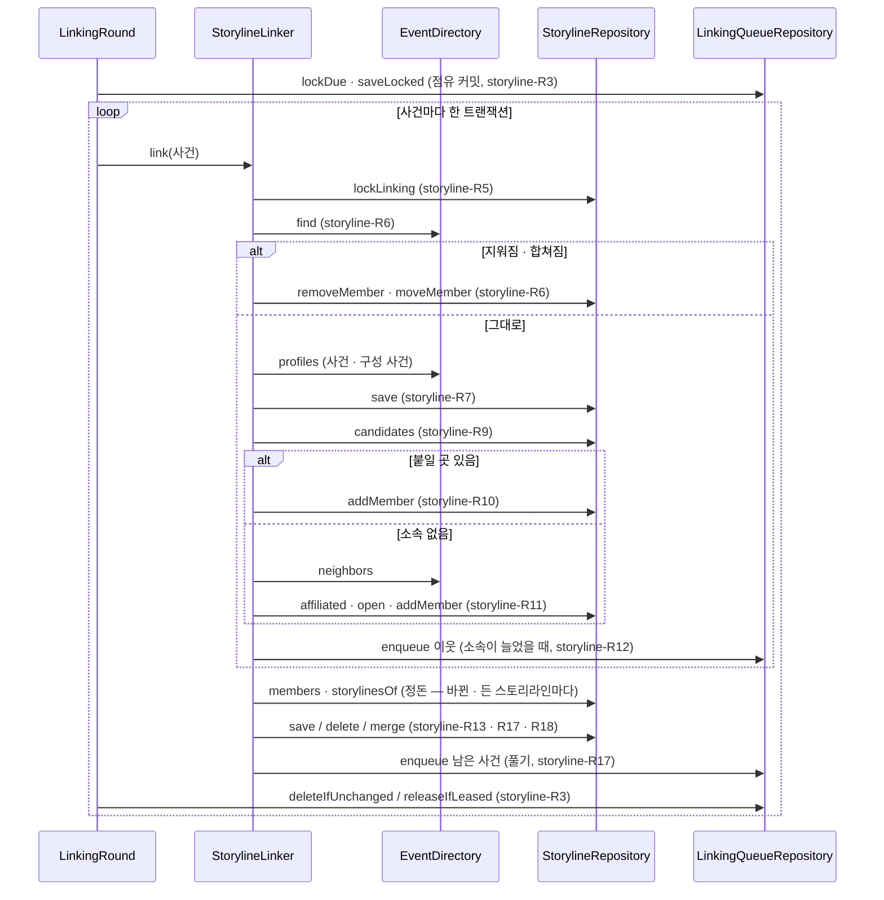

# storyline 모듈 Spec

공통 구조와 쓰는 규칙은 [specs/README.md](README.md)에 있다.

## 1. 책임과 범위

`storyline` 은 사건들을 모든 사용자가 공유하는 흐름(스토리라인)으로 잇는다. 사용자를 모르고, 생성형 LLM 을 쓰지 않으며, 비용은 운영자가 낸다([ADR-0101](../adr/0101-shared-storylines-connect-events-and-the-personal-side-is-storyline-subscriptions-and-interests.md)).

- **사건 변화 따르기** — `event` 가 바뀐 사건 ID 를 알리면(`EventsChanged`) 그 사건을 잇기 대기에 넣는다. 작업 역할의 반복 작업이 대기를 사건의 시각 순으로 점유해 사건마다 지금 상태를 읽어 판정한다 — 기간을 통째로 다시 묶지 않는다(storyline-R1 ~ R5, [ADR-0105](../adr/0105-storylines-link-incrementally-from-event-change-notifications-and-events-publish-changed-event-ids.md))
- **소속 맞추기** — 사건이 지워지면 그 소속을 지우고, 다른 사건에 합쳐지면 소속을 남는 사건으로 옮긴다(storyline-R6)
- **잇기** — 임시 잇기 규칙으로 사건을 스토리라인에 더 붙이거나, 다른 사건과 짝을 지어 새 스토리라인을 연다. 소속을 빼지 않는다. 소속이 늘면 기다리는 이웃 사건을 다시 본다(storyline-R7 ~ R12, [ADR-0106](../adr/0106-provisional-storyline-linking-opens-only-with-a-partner-event-and-adds-the-single-best-storyline-without-removal.md))
- **정돈** — 소속이 바뀐 스토리라인을 정돈한다. 구성 사건이 없으면 지우고, 구성 사건이 같은 스토리라인은 하나로 합치며, 사건 하나만 남으면 그 사건을 가진 다른 스토리라인에 합치거나 풀어 그 사건을 다시 판정한다. 합쳐진 스토리라인은 남는 스토리라인을 가리킨다(storyline-R13 · R17 · R18, [ADR-0108](../adr/0108-storylines-with-the-same-events-merge-and-a-storyline-left-with-one-event-merges-or-dissolves.md))
- **상태** — 스토리라인의 상태(진행 · 잠잠 · 끝남)를 저장하지 않고 조회 때 마지막 기사 시각으로 정한다. 끝나도 잇기를 막지 않는다(storyline-R16, [ADR-0107](../adr/0107-storyline-state-is-judged-at-query-time-from-the-last-article-and-an-ended-storyline-still-links.md))
- **판정 근거** — 소속마다 정한 것 · 점수 · 판정에 쓴 기준을 남긴다(storyline-R14)
- **채우기** — 운영자가 기간을 정해, 그 기간에 마지막 기사가 있는 사건을 잇기 대기에 넣는다(storyline-R15)

하지 않는 것:

- 사용자를 모른다. 스토리라인 구독은 `user` 가, 사용자마다 달라지는 스토리라인 정보와 관심사는 `digest` 가 갖는다
- 기사를 가리키지 않는다 — 사건 ID 만 저장한다. 기사 삭제는 `event` 가 사건을 줄이거나 지워 알리는 것으로 따른다(storyline-R6)
- 스토리라인 사이 관계(포함 · 이어짐), 타임라인 · 공개 조회, 큰 판정, 운영자 화면은 아직 없다 — **(미설계)**. 상태를 보이는 조회도 아직 없다 — 상태 판정은 공개 조회가 쓴다
- 잇는 방법의 최종(주 소속 · 판정 시점 · 새 스토리라인을 여는 조건 · Jev 판정)은 정하지 않았다 — 지금 규칙은 평가 세트로 견줄 기준선이다([ADR-0106](../adr/0106-provisional-storyline-linking-opens-only-with-a-partner-event-and-adds-the-single-best-storyline-without-removal.md))
- 표현만 비슷한 두 스토리라인, 사건 둘 이상이 다른 스토리라인에 포함된 스토리라인은 합치지 않는다 — 같은 흐름인지 갈래인지 구조로 가를 수 없다(storyline-R17)
- 따로 도는 정리 작업이 없다 — 상태는 조회 때 정하고, 정돈은 판정 트랜잭션에서 한다

잇기 기준 · 상태 기간(§7)과 산식 상수(storyline-R8)는 측정 전 목표다.

다른 모듈과의 의존과 이벤트 흐름은 [overview.md §5](../overview.md#5-모듈-지도)에 있다.

## 2. 용어

사건 · 스토리라인은 [overview.md §8](../overview.md#8-용어)에 있다.

| 용어 | 뜻 |
|---|---|
| 소속 | 사건 하나가 스토리라인 하나에 든 것(`storyline_members` 한 행). 사건은 스토리라인 0개 이상에 든다. 정한 것 · 점수 · 기준 · 시각을 갖는다(storyline-R14) |
| 구성 사건 | 스토리라인에 소속이 있는 사건 |
| 잇기 대기 | 판정할 사건의 목록(`storyline_linking_queue` — 사건마다 한 행). 순서 키 · 다시 알림 수 · 실패 수 · 점유를 갖는다(storyline-R2) |
| 다시 알림 수 | 대기에 있는 사건에 알림이 다시 온 횟수 — 처리 중에 다시 온 알림을 놓치지 않게 한다(storyline-R2 · R3) |
| 순서 키 | 대기를 점유하는 순서 — 사건의 첫 기사 시각, 지워졌거나 합쳐진 사건이면 없다(맨 앞)(storyline-R1 · R3) |
| 회차 | 반복 작업이 한 번 돌 때 하는 일 — 대기를 점유해 사건마다 판정한다(storyline-R3) |
| 점유 | 회차가 대기 행을 가져갔다는 표시 — 토큰 · 만료 시각(storyline-R3) |
| 스토리라인 표현 | 구성 사건으로 정한 스토리라인의 중심 · 기사 수 · 시각 범위 · 핵심 말 · 대표 사건(storyline-R7) |
| 대표 사건 | 스토리라인을 알아보게 하는 구성 사건 하나 — 기사 수가 가장 많은 사건(storyline-R7) |
| 잇기 기준 | 시간 창과 기준 점수 — 설정(storyline-R9 · §7) |
| 기준 이력 | 회차가 판정에 쓴 잇기 기준 값의 목록(`storyline_linking_criteria`) — 같은 값이면 한 행이고, 소속이 그 ID 를 가리킨다(storyline-R14) |
| 짝 | 붙일 스토리라인이 없는 사건과 함께 새 스토리라인을 여는 사건 — 소속이 없어야 한다(storyline-R11) |
| 이웃 사건 | 판정할 사건과 같은 모델 버전이고 창 안에 있으며 코사인이 하한 이상인 사건 — `event` 의 `EventDirectory.neighbors` 가 낸다(storyline-R11) |
| 다시 넣기 | 소속이 는 사건의 이웃 가운데 기준 이상이고 소속 없는 사건을 대기에 다시 넣는 것(storyline-R12) |
| 채우기 | 운영자가 정한 기간에 마지막 기사가 있는 사건을 잇기 대기에 넣는 운영 기능(storyline-R15) |
| 정돈 | 소속이 바뀐 스토리라인을 지우거나 · 합치거나 · 풀거나 그대로 두는 것(storyline-R13 · R17) |
| 합쳐진 스토리라인 | 정돈으로 다른 스토리라인에 합쳐진 스토리라인 — 소속 · 핵심 말이 없고, 행이 남아 남는 스토리라인을 가리킨다(storyline-R18) |
| 남는 스토리라인 | 합칠 때 남는 쪽 — 구성 사건이 같으면 ID 가 가장 작은 것, 사건 하나만 남은 스토리라인이면 그 사건을 가진 스토리라인 가운데 ID 가 가장 작은 것(storyline-R17) |
| 풀기 | 사건 하나만 남았고 그 사건이 다른 스토리라인에 없는 스토리라인을 지우고, 그 사건을 잇기 대기에 다시 넣는 것(storyline-R17) |
| 상태 | 스토리라인 마지막 기사 시각으로 조회 때 정하는 진행 · 잠잠 · 끝남(storyline-R16) |
| 잠잠 기간 · 끝남 기간 | 마지막 기사 뒤 이만큼 지나면 잠잠 · 끝남이다 — 설정(storyline-R16 · §7) |

## 3. 공개 인터페이스

이 모듈은 `event` 의 `EventsChanged` 를 받고, 공개 운영 API 하나(`StorylineLinkingAdministration`)를 낸다. 운영 API 는 `admin` 이 운영자 요청으로 부른다([ADR-0045](../adr/0045-admin-module-serves-operator-api-over-module-public-operation-apis.md)). 발행하는 이벤트와 공개 조회는 없다.

### StorylineLinkingAdministration · LinkingFillResult

스토리라인 잇기 채우기의 운영(storyline-R15). 구현은 `application` 의 `StorylineLinkingAdministrationService` 다.

```java
public interface StorylineLinkingAdministration {
    int MAX_DAYS = 180;                      // 채울 기간의 상한(일) — 정본
    LinkingFillResult fill(int days);
}

public sealed interface LinkingFillResult {
    record Filled(int events, int enqueued) implements LinkingFillResult {}
    record DaysOutOfRange(int max) implements LinkingFillResult {}
}
```

| 타입 · 멤버 | 뜻 |
|---|---|
| `fill` | 마지막 기사 시각이 지금 − 일수 × 24시간 이후(그 시각 포함)인, 합쳐지지 않은 사건(열림 · 닫힘)을 잇기 대기에 넣는다. 이미 대기에 있으면 다시 알림으로 센다(storyline-R2) |
| `Filled.events` | 기간의 사건 수 |
| `Filled.enqueued` | 그 가운데 새로 대기에 넣은 사건 수 — 이미 대기에 있던 사건은 세지 않는다 |
| `DaysOutOfRange.max` | 일수가 1 ~ `max` 밖이라 아무것도 하지 않았다 — `max` 는 `MAX_DAYS` |

- 계약
  - 역할 애너테이션이 없다(두 역할 공통). 사건 고르기는 `event` 의 공개 조회 하나(`EventDirectory.lastArticleSince`)이고, 넣기는 SQL 한 문장이다
  - 넣은 사건은 반복 작업의 회차가 판정한다

## 4. 내부 구조

### 개관

| 패키지 | 책임 |
|---|---|
| (최상위) | 모듈 선언(`package-info`), 공개 운영 API `StorylineLinkingAdministration` 과 그 결과 |
| `domain/linking` | 잇기의 판단 — 점수 산식 · 코사인 하한, 판정(붙이기 · 짝 · 다시 넣기), 스토리라인 표현과 대표 사건, 잇기 기준, 기준 이력 저장소 |
| `domain/storyline` | 스토리라인과 소속 — 소속의 판정 근거와 정한 것, 후보로 읽는 스토리라인, 정돈 판정, 상태 판정, 스토리라인 저장소 |
| `domain/queue` | 잇기 대기 — 대기 행과 그 점유, 순서 키 규칙, 대기 상수 · 실패 상한, 대기 저장소 |
| `application` | 사건 변화 리스너, 회차, 사건 하나의 판정 · 정돈, 공개 운영 API 의 구현, 잇기 기준 · 상태 기간 설정과 결선 |
| `adapter/in/job` | 잇기 대기 반복 작업(작업 역할) |
| `adapter/out/persistence` | 대기 · 스토리라인 · 기준 이력 저장소의 JdbcClient 구현 |

협력: `StorylineLinkingListener` 가 `EventsChanged` 를 받아 사건마다 `event` 의 `EventDirectory.find` 로 지금 상태를 읽어 `PendingEvent.orderAt` 으로 순서 키를 정하고 `LinkingQueueRepository.enqueue` 로 넣는다. 작업 역할의 `LinkStorylinesJob` 이 1분마다 `LinkingRound` 를 돌린다. 회차는 `LinkingCriteriaRepository` 에 지금 기준(`LinkingCriteria` — `LinkingConfiguration` 이 `LinkingProperties` 로 만든 빈)을 등록하고, `LinkingQueueRepository` 로 대기를 점유한 뒤(`PendingEvent.claim` · `LinkingSchedule`), 사건마다 한 트랜잭션에서 `StorylineLinker.link` 를 부르고 `deleteIfUnchanged` · `releaseIfLeased` 로 대기 행을 마무리한다. 예외면 `recordFailureIfLeased` 로 실패를 세고 상한(`LinkingSchedule.failuresExhausted`)이면 `delete` 로 뺀다.

`StorylineLinker` 는 먼저 `StorylineRepository.lockLinking` 으로 모듈 잠금을 잡고, `EventDirectory.find` 로 사건의 지금 상태를 가른다. 지워졌거나 합쳐졌으면 `StorylineRepository.storylinesOf` 의 스토리라인마다 `removeMember` · `moveMember` 로 소속을 맞추고 그 스토리라인들을 정돈한다. 그대로면 `EventDirectory.profiles` 로 사건과 그 사건이 든 스토리라인의 구성 사건 표현을 읽어 `Representation.of` 로 표현을 다시 저장하고(`save`), `Representation.without` 으로 그 사건을 뺀 비교 대상을 만든다. `StorylineRepository.candidates` 로 창 안 후보 스토리라인을 읽어 `LinkingScoring` 으로 점수를 매기고 `LinkingRule.attach` 로 붙일 곳을 정한다(`addMember`). 붙일 곳이 없고 소속이 없으면 `EventDirectory.neighbors` 로 이웃을 읽어 `StorylineRepository.affiliated` 와 `LinkingRule.pair` 로 짝을 정해 `open` · `addMember` 로 연다. 소속이 늘었으면 `LinkingRule.requeue` 로 고른 이웃을 `LinkingQueueRepository.enqueue` 로 다시 넣는다. 끝으로 그 사건이 든 스토리라인과 붙인 스토리라인을 정돈한다.

정돈은 스토리라인마다 `StorylineRepository.members` 로 구성 사건을, `storylinesOf`(첫 구성 사건) · `members` 로 그 사건을 가진 다른 스토리라인의 구성 사건을 읽어 `Tidying.decide` 로 정하고, 결과에 따라 표현을 다시 정하거나(`save`) · 지우거나(`delete`) · 합치거나(`merge`) · 풀어 그 사건을 `PendingEvent.orderAt` 의 순서 키로 다시 넣는다(`delete` · `enqueue`). 한 정돈에서 이미 지웠거나 합친 스토리라인은 건너뛴다.

상태는 `StateCriteria.stateOf`(`StorylineStateConfiguration` 이 `StorylineStateProperties` 로 만든 빈)가 정한다. 상태를 보이는 조회가 아직 없다.

채우기는 `StorylineLinkingAdministrationService` 가 `EventDirectory.lastArticleSince` 와 `LinkingQueueRepository.enqueueAll` 로 한다.

#### 판정 흐름



### 들어오는 쪽

| 진입점 | 구성 요소 | 계기 | 내용 |
|---|---|---|---|
| `EventsChanged` 리스너 | `StorylineLinkingListener`(`application`) | `event` 의 `EventsChanged` | 사건마다 순서 키를 읽어 잇기 대기에 넣는다(storyline-R1 · R2). 비동기 · 새 트랜잭션이고 이벤트 발행 레지스트리에 기록된다(Spring Modulith `@ApplicationModuleListener`). 실패한 발행은 `platform` 의 이벤트 재처리 작업이 다시 처리하고, 다시 처리해도 다시 알림 수만 는다 — 판정은 지금 상태를 읽는다 |
| 잇기 대기 반복 작업 | `LinkStorylinesJob`(`adapter/in/job`, 작업 역할) | JobRunr 반복 작업 `storyline-linking` — 1분마다, 재시도 없음 | `LinkingRound` 를 돌린다(storyline-R3). 이전 실행이 대기 · 처리 중이면 그 실행은 건너뛴다 |
| 채우기 | `StorylineLinkingAdministrationService`(`application`) | `admin` 의 운영자 요청(`StorylineLinkingAdministration.fill`) | 기간에 마지막 기사가 있는, 합쳐지지 않은 사건을 잇기 대기에 넣는다(storyline-R15). 두 역할 공통 |

컨트롤러는 없다.

### `application`

- `StorylineLinkingListener` — 리스너(들어오는 쪽). 시각은 `InstantSource` 에서 얻는다. 알림 하나의 사건을 사건 ID 오름차순으로 넣는다
- `LinkingRound` — 회차 하나(storyline-R3 · R4). 시각은 `InstantSource` 에서 얻는다. 점유 · 판정 · 실패 기록은 `TransactionTemplate` 의 짧은 트랜잭션이다. 판정의 예외를 밖으로 던지지 않는다 — 기준 등록 · 점유 · 실패 기록의 DB 예외는 회차 밖으로 나간다. 기준 등록 · 점유가 실패하면 점유한 사건이 없어 다음 회차가 가져가고, 실패 기록이 실패하면 그 회차가 점유한 사건(아직 판정하지 않은 사건 포함)이 점유가 만료된 뒤 다시 판정된다. 트랜잭션 · 역할 애너테이션이 없다. 로그: `스토리라인 잇기 판정이 예상하지 못한 오류로 실패했다 — 사건 {ID}, 실패 {n}회`(오류, 예외와 함께) · `스토리라인 잇기 판정이 거듭 실패해 대기에서 뺐다 — 사건 {ID}, 실패 {n}회`(오류)
- `StorylineLinker` — 사건 하나의 따르기 · 판정 · 정돈 · 쓰기(storyline-R5 ~ R14 · R17 · R18). 트랜잭션 안에서 부른다. 시각 · 기준 · 기준 ID 는 회차가 넘긴다
- `StorylineLinkingAdministrationService` — 공개 운영 API `StorylineLinkingAdministration` 의 구현(storyline-R15). 시각은 `InstantSource` 에서 얻는다
- `LinkingProperties` · `LinkingConfiguration` — 잇기 기준 설정(`yozmnews.storyline-linking`, 기본값의 정본은 레코드 컴포넌트의 `@DefaultValue`)과 그것을 검증된 `LinkingCriteria` 빈으로 바꾸는 결선. 값이 틀리면 기동하지 않는다
- `StorylineStateProperties` · `StorylineStateConfiguration` — 상태 기간 설정(`yozmnews.storyline-state`, 기본값의 정본은 레코드 컴포넌트의 `@DefaultValue`)과 그것을 검증된 `StateCriteria` 빈으로 바꾸는 결선. 값이 틀리면 기동하지 않는다. 역할 애너테이션이 없다(두 역할 공통)

### `domain`

#### `domain/linking`

- `LinkingCriteria(Duration window, double threshold)` — 잇기 기준. 창은 0 보다 큰 초 단위, 기준은 0 보다 크고 1 이하(storyline-R9)
- `LinkingScoring` — 점수 산식 · 코사인 하한의 정본(storyline-R8). 상수 `KEY_TERM_WEIGHT` · `HALF_LIFE` · `KEY_TERMS` · `NEIGHBORS` · `COSINE_MARGIN`. 판정할 사건(`Subject`)과 견줄 것(`Compared`)의 점수(`Score` — 점수 · 코사인 · 핵심 말 겹침)
- `Cosine` — 두 벡터의 코사인 유사도 — 어느 한쪽이 영 벡터면 NaN
- `LinkingRule` — 판정의 정본(storyline-R10 ~ R12) — `attach` · `pair` · `requeue`. 점수를 매긴 것은 `Scored(id, Score)`
- `Representation` — 스토리라인 표현과 대표 사건의 정본(storyline-R7) — `of(구성 사건 표현)` · `without(구성 사건 표현, 뺄 사건)` · `topTerms(n)`
- 기준 이력 저장소 `LinkingCriteriaRepository` — `long register(LinkingCriteria criteria, Instant now)`(같은 값의 행이 있으면 그 ID)

#### `domain/storyline`

- `LinkJudgement(LinkedBy linkedBy, @Nullable Score score, @Nullable Long criteriaId, Instant linkedAt)` — 소속 하나의 판정 근거(storyline-R14). 정한 것 `LinkedBy` 는 `RULE`(붙이기) · `PAIR`(짝으로 엶) · `MERGE`(합쳐진 사건의 소속을 옮김)
- `StorylineSnapshot(long id, float[] centroid, Instant firstArticleAt, Instant lastArticleAt, List<String> keyTerms)` — 후보로 읽은 스토리라인
- `Tidying` — 정돈 판정의 정본(storyline-R13 · R17). `decide(스토리라인 ID, 구성 사건, 첫 구성 사건을 가진 다른 스토리라인의 구성 사건)` 이 `Keep` · `Remove` · `Dissolve(사건 ID)` · `MergeInto(남는 스토리라인 ID, 합쳐질 스토리라인 ID 목록)` 가운데 하나를 낸다(sealed)
- `StorylineState` — 상태 `ACTIVE`(진행) · `QUIET`(잠잠) · `ENDED`(끝남)
- `StateCriteria(Duration quietAfter, Duration endedAfter)` — 상태 판정의 정본(storyline-R16). 두 기간은 0 보다 큰 초 단위이고 잠잠 기간 < 끝남 기간이다. `stateOf(마지막 기사 시각, 지금)` 이 상태를 낸다

  ```java
  public interface StorylineRepository {
      void lockLinking();                                                    // 모듈 잠금 — 트랜잭션 끝까지(storyline-R5)
      List<Long> storylinesOf(long eventId);                                 // 사건이 든 합쳐지지 않은 스토리라인 — ID 순
      Map<Long, List<Long>> members(Collection<Long> storylineIds);          // 구성 사건 — 스토리라인 ID 순, 사건 ID 순
      Set<Long> affiliated(Collection<Long> eventIds);                       // 이 가운데 소속이 있는 사건
      List<StorylineSnapshot> candidates(String modelVersion, float[] vector, Instant from, Instant to,
              double minCosine, int keyTerms);                              // storyline-R9, 합쳐진 스토리라인은 빠진다, ID 순
      long open(Representation representation, Instant now);
      void save(long storylineId, Representation representation, Instant now);   // 핵심 말은 통째로 바꾼다
      void addMember(long storylineId, long eventId, LinkJudgement judgement);
      void moveMember(long storylineId, long fromEventId, long toEventId, Instant now);  // MERGE 근거로 다시 적는다
      void removeMember(long storylineId, long eventId);
      void merge(long merged, long survivor, Instant now);                   // storyline-R18 — 소속 · 핵심 말을 지우고 가리킴을 평평하게 적는다
      void delete(long storylineId);                                         // 스토리라인 · 핵심 말 · 소속, 이것을 가리키는 합쳐진 행
  }
  ```

#### `domain/queue`

- `PendingEvent(long eventId, @Nullable Instant orderAt, int notifications, int failures, @Nullable LinkingLease lease)` — 대기 행 하나. `claim(토큰, 지금)` 이 점유(만료 = 지금 + `LinkingSchedule.LEASE`). 정적 `orderAt(사건 ID, 지금 상태)` 가 지금 상태로 순서 키를 정하는 규칙의 정본이다(storyline-R1 — 리스너와 풀기가 쓴다)
- `LinkingLease(UUID token, Instant expiresAt)` — 점유
- `LinkingSchedule` — 대기 상수(점유 기간 · 묶음 크기 · 실패 상한)의 정본(storyline-R3 · R4)

  ```java
  public interface LinkingQueueRepository {
      void enqueue(long eventId, @Nullable Instant orderAt, Instant now);   // 이미 있으면 다시 알림 + 1 · 순서 키를 새 값으로(storyline-R2)
      int enqueueAll(Map<Long, Instant> orderAtByEvent, Instant now);       // 같은 넣기 — 새로 넣은 행 수
      List<PendingEvent> lockDue(Instant now, int limit);                    // 순서 키(없음 먼저) · 사건 ID 순 FOR UPDATE SKIP LOCKED
      void saveLocked(PendingEvent next);
      boolean deleteIfUnchanged(long eventId, UUID token, int notifications);  // 토큰 · 다시 알림 수가 모두 맞을 때만
      boolean releaseIfLeased(long eventId, UUID token);
      OptionalInt recordFailureIfLeased(long eventId, UUID token);          // 실패 + 1 · 점유 해제 — 올린 뒤의 수
      void delete(long eventId);
  }
  ```

### 나가는 쪽

포트가 없다 — 외부 의존이 없다. `event` 는 공개 조회 `EventDirectory`(`find` · `profiles` · `neighbors` · `lastArticleSince`)로 읽는다.

#### 저장소 구현

- `JdbcLinkingQueueRepository` — 넣기는 `INSERT … ON CONFLICT (event_id) DO UPDATE` 로 다시 알림 수를 올리고 순서 키를 바꾼다. 여럿을 넣을 때는 사건 ID 순이다. 잠금은 `FOR UPDATE SKIP LOCKED`, 점유한 회차의 반영은 점유 토큰(지우기는 다시 알림 수도)을 조건으로 한 갱신 · 삭제다
- `JdbcStorylineRepository` — 중심은 `halfvec` 이고 `platform` 의 `VectorText` 로 쓰고 읽는다. 후보는 합쳐지지 않은 행만 보고, 코사인은 `1 − (중심 <=> cast(벡터 as halfvec))` 를 스토리라인마다 센다(인덱스 없음) — 거리가 NaN(영 벡터)인 행은 뺀다. 합치기는 합쳐질 행을 가리키던 행을 먼저 남는 행으로 돌리고, 합쳐질 행의 소속 · 핵심 말을 지운 뒤 가리킴을 적는다. 핵심 말 상위 수는 매개변수이고 말 순은 바이트 순(`COLLATE "C"`)이다. 모듈 잠금은 `pg_advisory_xact_lock(:namespace, 0)` 이고 namespace 는 `0x53545259`('STRY')다
- `JdbcLinkingCriteriaRepository` — 같은 값의 행을 먼저 읽고, 없을 때만 `INSERT … ON CONFLICT … DO UPDATE … RETURNING id`. 창은 초로 적는다

## 5. 규칙과 불변식

### 잇기 대기와 회차

판단의 이유는 [ADR-0105](../adr/0105-storylines-link-incrementally-from-event-change-notifications-and-events-publish-changed-event-ids.md)에 있다.

- **storyline-R1** — 알림 받기: `EventsChanged` 의 사건마다 `EventDirectory.find` 로 지금 상태를 읽어 순서 키를 정하고 대기에 넣는다(storyline-R2). 그대로인 사건이면 그 사건의 첫 기사 시각이다. 지워졌거나(빈 값) 합쳐졌으면(다른 ID) 순서 키가 없다(`PendingEvent.orderAt` — 정본, 풀기(storyline-R17)도 쓴다). 한 알림의 사건은 사건 ID 오름차순으로 넣는다. 다시 처리해도 다시 알림 수만 는다
- **storyline-R2** — 잇기 대기: 사건마다 한 행이다. 넣을 때 행이 없으면 다시 알림 수 0 으로 넣고, 있으면 다시 알림 수를 하나 올리고 순서 키를 새 값으로 바꾼다(점유 · 실패 수는 그대로). 리스너(storyline-R1) · 다시 넣기(storyline-R12) · 풀기(storyline-R17) · 채우기(storyline-R15)가 같은 넣기를 쓴다. 이 기능이 켜지기 전의 사건은 운영자가 채우기 전까지 대기에 들어가지 않는다
- **storyline-R3** — 회차: 반복 작업(1분, 재시도 없음)의 회차는 지금 기준을 기준 이력에 등록하고(storyline-R14), 점유가 없거나 만료된(만료 시각 ≤ 지금) 대기 행을 순서 키(없음이 먼저) · 사건 ID 순으로 64건(`LinkingSchedule.BATCH_SIZE`)까지 잠가(다른 트랜잭션이 잡은 행은 건너뛴다) 점유(토큰 · 만료 = 지금 + 10분, `LinkingSchedule.LEASE`)를 쓰고 커밋한다. 반복 작업은 이전 실행이 대기 · 처리 중이면 그 회차를 건너뛴다.
  - 사건마다 한 트랜잭션에서 판정 · 정돈하고(storyline-R5 ~ R14 · R17 · R18), 같은 트랜잭션에서 점유 토큰과 다시 알림 수가 점유할 때와 같으면 대기 행을 지운다. 다시 알림 수가 달라졌으면(처리 중에 그 사건이 또 바뀌었다) 점유만 풀어 다음 회차가 다시 판정한다
  - 회차 도중 프로세스가 죽으면 점유가 만료된 뒤 다른 회차가 가져간다
- **storyline-R4** — 실패: 판정이 예상하지 못한 예외를 내면 그 판정의 쓰기는 롤백된다. 새 트랜잭션에서 토큰이 맞을 때 실패 수를 하나 올리고 점유를 푼 뒤 다음 사건으로 넘어간다(오류). 올린 실패 수가 상한(3, `LinkingSchedule.MAX_FAILURES`)에 이르면 그 대기 행을 지운다(오류). 뺀 사건은 운영자 채우기(storyline-R15)가 실패 수 0 으로 다시 넣을 수 있다
- **storyline-R5** — 직렬화: 판정 트랜잭션은 처음에 모듈 잠금(트랜잭션 advisory 잠금 하나)을 잡는다 — 판정은 한 번에 하나다. 리스너 · 채우기는 잡지 않는다

### 사건 변화 따르기

판단의 이유는 [ADR-0105](../adr/0105-storylines-link-incrementally-from-event-change-notifications-and-events-publish-changed-event-ids.md)에 있다.

- **storyline-R6** — 판정은 사건의 지금 상태(`EventDirectory.find`)로 가른다.
  - 없는 사건(지워짐): 그 사건의 소속을 모두 지운다
  - 다른 ID(합쳐짐 — 남는 사건 S): 그 사건이 든 스토리라인마다, S 가 이미 구성 사건이면 그 사건의 소속을 지우고, 아니면 소속의 사건을 S 로 바꾸고 근거를 `MERGE` 로 다시 적는다(점수 · 기준 없음, 시각은 지금). S 의 판정은 S 자신의 알림이 한다. 옮기기는 다시 넣기(storyline-R12)의 계기가 아니다
  - 같은 ID(그대로): 아래 잇기(storyline-R7 ~ R12)를 한다. 표현을 읽을 수 없으면(그사이 지워지거나 합쳐짐) 아무것도 하지 않는다 — 그 변화의 알림이 다시 넣는다
  - 소속이 바뀐 스토리라인은 정돈한다(storyline-R17)
  - 기사 삭제는 따로 받지 않는다 — `event` 가 사건을 줄이거나 지우고 알린다(event-R8 · event-R23)

### 임시 잇기 규칙

판단의 이유는 [ADR-0106](../adr/0106-provisional-storyline-linking-opens-only-with-a-partner-event-and-adds-the-single-best-storyline-without-removal.md)에 있다. 이 절의 규칙은 잇는 방법을 평가 세트로 정하기 전의 기준선이다.

- **storyline-R7** — 표현(`Representation` — 정본): 스토리라인은 모델 버전 하나를 갖는다(구성 사건의 모델 버전). 중심은 구성 사건 중심의 기사 수 가중 평균, 기사 수는 합, 첫 · 마지막 기사 시각은 구성 사건의 최소 · 최대, 핵심 말은 구성 사건마다 상위 20개(`LinkingScoring.KEY_TERMS`)의 기사 수를 말마다 합한 것이다. 대표 사건은 기사 수가 가장 많은 구성 사건(같으면 사건 ID 가 작은 것)이다([ADR-0105](../adr/0105-storylines-link-incrementally-from-event-change-notifications-and-events-publish-changed-event-ids.md)). 표현은 구성 사건이 바뀔 때마다 그 사건들의 지금 표현(`EventDirectory.profiles` — 합쳐진 사건 · 없는 사건은 빠진다)으로 다시 정해 저장한다. 읽을 수 있는 구성 사건이 하나도 없으면 저장한 표현을 그대로 둔다 — 그 사건들의 알림이 대기에 있다
- **storyline-R8** — 점수(`LinkingScoring` — 정본) = 감쇠 × ((1 − w) × max(코사인, 0) + w × 핵심 말 겹침), 0 ~ 1. w 는 0.3(`KEY_TERM_WEIGHT`)이다.
  - 코사인은 판정할 사건의 중심과 견줄 것(스토리라인 표현 · 이웃 사건)의 중심의 코사인 유사도다. 어느 한쪽이 영 벡터면 점수를 셀 수 없어(NaN) 어느 판정에도 들지 않는다
  - 핵심 말 겹침은 |판정할 사건 상위 핵심 말 ∩ 견줄 것 상위 핵심 말| ÷ |판정할 사건 상위 핵심 말|(판정할 사건의 핵심 말이 없으면 0)이다. 상위는 기사 수가 많은 순(같으면 바이트 순) 20개(`KEY_TERMS`)다
  - 시각 차 Δ 는 두 시각 범위(첫 ~ 마지막 기사 시각)의 간격이다 — 겹치면 0. 감쇠는 2^(−Δ ÷ 14일)(반감기 `HALF_LIFE`)이고, Δ 가 시간 창보다 크면 견줄 것이 아니다(같으면 견준다)
  - 코사인 하한(`cosineFloor`) = (기준 − w) ÷ (1 − w) − 0.01(`COSINE_MARGIN` — 반 정밀도 여유). 기준이 w 이하면 −1(거르지 않는다). 감쇠 ≤ 1 · 겹침 ≤ 1 이라 하한 밑의 것은 기준에 닿을 수 없다
- **storyline-R9** — 후보: 시간 창 W 는 판정할 사건 E 의 시각을 기준으로 한다 — [E 의 첫 기사 시각 − W, E 의 마지막 기사 시각 + W]. 후보 스토리라인은 E 와 모델 버전이 같고, 시각 범위가 그 구간과 겹치고, 코사인이 하한 이상인 스토리라인이다. E 가 이미 든 스토리라인은 E 를 뺀 표현(`Representation.without`)과 견준다 — E 를 빼면 남는 구성 사건이 없는 스토리라인은 후보가 아니다. 점수가 기준 이상인 것만 판정에 쓴다
- **storyline-R10** — 붙이기(`LinkingRule.attach`): 기준 이상인 후보 가운데 점수가 가장 높은 것(같으면 스토리라인 ID 가 작은 것)이 E 의 소속이 아니면 그 스토리라인에 붙인다(`RULE`). 가장 높은 것이 이미 소속이면 아무것도 하지 않는다. 소속을 빼지 않는다
- **storyline-R11** — 짝(`LinkingRule.pair`): 붙일 곳이 없고 E 에 소속이 없으면, 이웃 사건(`EventDirectory.neighbors` — E 와 같은 모델 버전 · 합쳐지지 않은 사건(열림 · 닫힘) · 시각 범위가 R9 의 구간과 겹침 · 코사인이 하한 이상, 코사인 순 상위 50개 — `LinkingScoring.NEIGHBORS`)에 점수를 매겨, 기준 이상인 이웃을 점수 순(같으면 사건 ID 순)으로 보아 소속 없는 첫 사건 P 와 새 스토리라인을 연다 — 표현은 E · P 로 정하고, 두 소속의 근거는 `PAIR` 와 E · P 사이 점수다. 짝이 없으면 E 는 소속 없이 남는다
- **storyline-R12** — 다시 넣기(`LinkingRule.requeue`): 판정으로 소속이 는 사건(붙은 E, 또는 짝으로 연 E · P)마다 그 사건의 이웃을 읽어, 기준 이상이고 소속 없는 이웃(소속이 는 사건은 빼고)을 사건 ID 오름차순으로 대기에 넣는다(storyline-R2 — 순서 키는 그 이웃의 첫 기사 시각). 계기는 소속이 늘 때뿐이다 — 구성 사건이 자라 표현이 움직여도 다시 넣지 않는다. 소속은 사건 삭제 · 합쳐짐과 정돈(storyline-R17 — 합치기 · 풀기는 되돌리지 않는다)으로만 줄어 한 방향이라 다시 넣기는 끝난다
- **storyline-R13** — 빈 스토리라인: 구성 사건이 남지 않은 스토리라인은 표현 · 핵심 말과 함께 지운다(정돈의 한 갈래 — storyline-R17). 스토리라인 ID 는 다시 쓰지 않는다([ADR-0105](../adr/0105-storylines-link-incrementally-from-event-change-notifications-and-events-publish-changed-event-ids.md))
- **storyline-R14** — 판정 근거: 소속마다 정한 것(`RULE` · `PAIR` · `MERGE`), 점수 · 코사인 · 핵심 말 겹침, 판정에 쓴 기준 이력 ID, 시각을 남긴다. `MERGE` 는 점수 · 코사인 · 겹침 · 기준이 없고, 나머지는 넷이 모두 있다. 기준 이력은 (창, 기준) 값마다 한 행이다 — 같은 값이면 같은 ID 다. 기준을 바꿔도 지난 소속을 다시 판정하지 않는다([ADR-0105](../adr/0105-storylines-link-incrementally-from-event-change-notifications-and-events-publish-changed-event-ids.md))

### 운영자 채우기

- **storyline-R15** — 채우기: 운영자가 일수(1 ~ 180, `StorylineLinkingAdministration.MAX_DAYS`)를 정하면, 마지막 기사 시각이 지금 − 일수 × 24시간 이후(그 시각 포함)인 합쳐지지 않은 사건(`EventDirectory.lastArticleSince`)을 순서 키(첫 기사 시각)와 함께 SQL 한 문장으로 잇기 대기에 넣는다(storyline-R2). 이미 대기에 있으면 다시 알림으로 세고, 새로 넣은 수에는 세지 않는다. 범위 밖이면 아무것도 하지 않는다. 판정은 회차가 한다 — 기준 시각이 판정할 사건의 시각이라(storyline-R9) 지난 사건도 그 둘레의 사건과 견준다

### 상태

판단의 이유는 [ADR-0107](../adr/0107-storyline-state-is-judged-at-query-time-from-the-last-article-and-an-ended-storyline-still-links.md)에 있다.

- **storyline-R16** — 상태(`StateCriteria` — 정본): 상태는 저장하지 않고 조회 때 정한다. Δ = 지금 − 스토리라인 마지막 기사 시각(storyline-R7)이다.
  - Δ ≥ 끝남 기간이면 끝남(`ENDED`), Δ ≥ 잠잠 기간이면 잠잠(`QUIET`), 그 밖(마지막 기사 시각이 지금보다 뒤인 경우 포함)은 진행(`ACTIVE`)이다 — 경계 포함
  - 재료는 기사 발행 시각이다. 판정 시각 · 구성 사건의 열림 · 닫힘은 쓰지 않는다 — 채우기로 지난 사건이 붙어도 그 기사들의 발행 시각만큼만 반영된다
  - 끝남은 잇기를 막지 않는다 — 후보(storyline-R9)는 상태를 보지 않는다. 끝난 스토리라인에 뒤 기사가 있는 사건이 붙으면 마지막 기사 시각이 늘고 상태도 그 시각으로 다시 정해진다 — 늘어난 시각에서 잠잠 기간이 지나지 않았으면 다시 진행이다
  - 기간은 설정이다(§7). 바꾸면 모든 스토리라인에 바로 적용된다

### 정돈

판단의 이유는 [ADR-0108](../adr/0108-storylines-with-the-same-events-merge-and-a-storyline-left-with-one-event-merges-or-dissolves.md)에 있다.

- **storyline-R17** — 정돈(`Tidying` — 정본): 판정(storyline-R6 ~ R12)이 끝나면 같은 트랜잭션에서 스토리라인을 ID 순으로 정돈한다. 대상은 소속이 바뀐 스토리라인(지워진 사건 · 합쳐진 사건이 든 것, 사건을 붙인 것)과, 그대로인 사건이 이미 든 스토리라인이다. 한 정돈에서 이미 지웠거나 합친 스토리라인은 건너뛴다. 스토리라인 L 의 구성 사건과, L 의 첫 구성 사건(사건 ID 가 가장 작은 것)을 가진 다른 합쳐지지 않은 스토리라인의 구성 사건으로 정한다.
  - 구성 사건이 없으면 지운다(storyline-R13)
  - 사건 하나(e)만 남았고 e 를 가진 다른 스토리라인이 있으면, 그 가운데 ID 가 가장 작은 것에 L 을 합친다(storyline-R18)
  - 사건 하나(e)만 남았고 e 를 가진 다른 스토리라인이 없으면 L 을 지우고(풀기) e 를 대기에 넣는다(storyline-R2 — 순서 키는 storyline-R1 의 규칙)
  - 사건 둘 이상이고 구성 사건이 L 과 같은 다른 스토리라인이 있으면, L 과 그것들 가운데 ID 가 가장 작은 것에 나머지를 합친다(storyline-R18). 남는 것이 L 이고 L 의 소속이 바뀌었으면 L 의 표현을 다시 정한다(storyline-R7)
  - 그 밖은 그대로 둔다 — 소속이 바뀐 것이면 표현을 다시 정한다(storyline-R7). 사건 둘 이상이 다른 스토리라인에 포함된 경우, 표현만 비슷한 경우는 합치지 않는다
  - 정돈은 구성 사건만 보고 기준값이 없다. 합치기는 소속을 늘리지 않아 다시 넣기(storyline-R12)의 계기가 아니다
  - 풀기는 끝난다: 사건 하나만 남는 것은 사건 쪽 병합 · 삭제가 있어야 생기고(짝은 둘로 열고, 판정은 소속을 빼지 않는다), 사건의 병합 · 삭제는 한 방향이다(event-R8 · event-R13). 풀린 사건이 다시 짝을 지어 열어도, 그 스토리라인이 다시 풀리려면 새 병합 · 삭제가 있어야 한다
  - 풀기가 판정 중인 사건 자신을 다시 넣으면 다시 알림 수가 올라 회차가 점유만 풀고 다음 회차가 다시 판정한다(storyline-R3)
  - 이 기능 전에 남은 사건 하나짜리 · 구성 사건이 같은 스토리라인은 그 구성 사건이 다시 판정될 때 정돈된다 — 운영자는 채우기(storyline-R15)로 다시 판정할 수 있다
- **storyline-R18** — 합쳐진 스토리라인: 합칠 때 합쳐질 스토리라인 M 의 소속 · 핵심 말을 지우고(같은 사건이 남는 스토리라인 S 에 있다), M 의 행은 남겨 S 를 가리킨다(합친 시각과 함께). S 의 소속 · 표현은 바꾸지 않는다. 가리킴은 평평하다 — M 을 가리키던 행도 S 를 가리키게 바꾼다. S 를 지우면 S 를 가리키는 행도 함께 지운다. 합쳐진 행은 후보 · 소속 · 표현 조회에서 빠지고, 합치기는 한 방향이다 — 다시 나누지 않는다

## 6. 데이터

컬럼 타입 · 인덱스 · 제약 문면의 정본은 `backend/src/main/resources/db/migration/V24__storylines.sql` · `V25__storyline_merges.sql` 이다. `event_id` · `representative_event_id` 는 `event` 의 사건을 가리키지만 FK 를 두지 않는다 — 모듈 사이는 ID 로만 참조한다. 보존 기간은 [data-model.md "보존 정책"](../data-model.md#보존-정책-초안)에 있다.

| 테이블 | 주요 컬럼 | 뜻 |
|---|---|---|
| `storyline_linking_criteria` | id, window_seconds(0 보다 큼), threshold(0 보다 크고 1 이하), created_at | 기준 이력 — 두 값이 고유하다(storyline-R14) |
| `storylines` | id, model_version, centroid(`halfvec`), article_count(1 이상), first_article_at, last_article_at, representative_event_id, created_at, updated_at, merged_into, merged_at | 공유 스토리라인과 그 표현(storyline-R7). `centroid` 는 차원을 정하지 않은 `halfvec` 이다 — 같은 모델 버전끼리만 비교한다. 첫 기사 시각 ≤ 마지막 기사 시각(제약). 후보는 합쳐지지 않은 행의 `(model_version, last_article_at)` 부분 인덱스로 거른다(storyline-R9). 정돈이 지우거나 합친다(storyline-R17). `merged_into` 는 합쳐진 행이 가리키는 남는 스토리라인(자기 FK `ON DELETE CASCADE`)이고 `merged_at` 과 함께 있거나 함께 없으며, 자기를 가리키지 않는다(제약). 합쳐진 행의 표현 칸은 합칠 때의 값이다(storyline-R18) |
| `storyline_key_terms` | storyline_id, term, article_count(1 이상) | 스토리라인 핵심 말 — (storyline_id, term) 기본 키(storyline-R7). 스토리라인을 지우면 함께 지워진다(FK `ON DELETE CASCADE`) |
| `storyline_members` | storyline_id, event_id, linked_by(`RULE`/`PAIR`/`MERGE`), score, cosine, key_term_overlap, criteria_id, linked_at | 소속 — (storyline_id, event_id) 기본 키(storyline-R14). `MERGE` 면 점수 · 코사인 · 겹침 · 기준이 없고 그 밖이면 넷 모두 있다(제약). `criteria_id` 는 기준 이력 FK 다. 사건의 소속은 `event_id` 인덱스로 찾는다. 스토리라인을 지우면 함께 지워진다(FK `ON DELETE CASCADE`) |
| `storyline_linking_queue` | event_id(기본 키), order_at, notifications(0 이상), failures(0 이상), enqueued_at, lease_token, lease_expires_at | 잇기 대기 — 사건마다 한 행(storyline-R2). `order_at` 은 순서 키이고 없을 수 있다. 점유 둘은 함께 있거나 함께 없다(제약). 회차의 잠금은 `(order_at NULLS FIRST, event_id)` 인덱스로 찾는다(storyline-R3) |

## 7. 설정

| 설정 | 바꾸는 규칙 |
|---|---|
| `yozmnews.storyline-linking.window` | 시간 창(`Duration` — 예 `14d`), 기본 14일(storyline-R8 · R9) |
| `yozmnews.storyline-linking.threshold` | 기준 점수, 기본 0.65(storyline-R8 ~ R12) |
| `yozmnews.storyline-state.quiet-after` | 잠잠 기간(`Duration`), 기본 7일(storyline-R16) |
| `yozmnews.storyline-state.ended-after` | 끝남 기간(`Duration`), 기본 30일(storyline-R16) |

기본값의 정본은 `LinkingProperties` · `StorylineStateProperties` 의 `@DefaultValue` 이고 `application.yaml` 에는 키가 없다. 기본값은 측정 전 목표다. 운영자는 환경 변수(`YOZMNEWS_STORYLINE_LINKING_WINDOW` · `YOZMNEWS_STORYLINE_LINKING_THRESHOLD` · `YOZMNEWS_STORYLINE_STATE_QUIET_AFTER` · `YOZMNEWS_STORYLINE_STATE_ENDED_AFTER`)로 바꾼다. 창이 0 이하이거나 초 단위가 아니거나 기준이 0 보다 크고 1 이하가 아니면 기동하지 않는다. 잠잠 · 끝남 기간이 0 이하이거나 초 단위가 아니거나 잠잠 기간 ≥ 끝남 기간이면 기동하지 않는다. 바꾼 잇기 기준은 그 뒤 판정에만 쓴다 — 지난 소속을 다시 판정하지 않는다(storyline-R14). 바꾼 상태 기간은 조회 때 바로 쓴다(storyline-R16). 그 밖의 설정 키는 없다.

## 8. 결정

| ADR | 한 줄 |
|---|---|
| [0013](../adr/0013-architecture-patterns.md) | 아키텍처 패턴: 모듈러 모놀리스 + 실용적 헥사고날 |
| [0042](../adr/0042-app-roles-as-web-worker-profiles-marked-by-platform-annotations.md) | 앱 역할은 Spring profile `web` · `worker` 로 나누고, 소속은 `platform` 역할 애너테이션으로 표시하며, 역할이 없으면 기동하지 않는다 |
| [0045](../adr/0045-admin-module-serves-operator-api-over-module-public-operation-apis.md) | 운영자 API 는 `admin` 모듈이 내고, 각 모듈은 운영 기능과 결과 타입을 최상위 공개 API 로 낸다 |
| [0101](../adr/0101-shared-storylines-connect-events-and-the-personal-side-is-storyline-subscriptions-and-interests.md) | 사건을 잇는 흐름은 모든 사용자가 공유하는 스토리라인이 맡고, 개인 쪽은 스토리라인 구독과 관심사로 나눈다 |
| [0105](../adr/0105-storylines-link-incrementally-from-event-change-notifications-and-events-publish-changed-event-ids.md) | 스토리라인은 사건 변화 알림으로 증분으로 잇고, `event` 는 바뀐 사건 ID 를 발행한다 |
| [0106](../adr/0106-provisional-storyline-linking-opens-only-with-a-partner-event-and-adds-the-single-best-storyline-without-removal.md) | 스토리라인의 임시 잇기 규칙 — 다른 사건과 이어질 때만 열고, 기준 이상 가운데 가장 높은 하나를 더하며 빼지 않는다 |
| [0107](../adr/0107-storyline-state-is-judged-at-query-time-from-the-last-article-and-an-ended-storyline-still-links.md) | 스토리라인 상태는 저장하지 않고 조회 때 마지막 기사 시각으로 진행 · 잠잠 · 끝남을 가르며, 끝나도 잇기를 막지 않는다 |
| [0108](../adr/0108-storylines-with-the-same-events-merge-and-a-storyline-left-with-one-event-merges-or-dissolves.md) | 구성 사건이 같은 스토리라인은 합치고, 사건 하나만 남은 스토리라인은 그 사건을 가진 스토리라인에 합치거나 풀며, 합쳐진 스토리라인은 남는 쪽을 가리킨다 |
