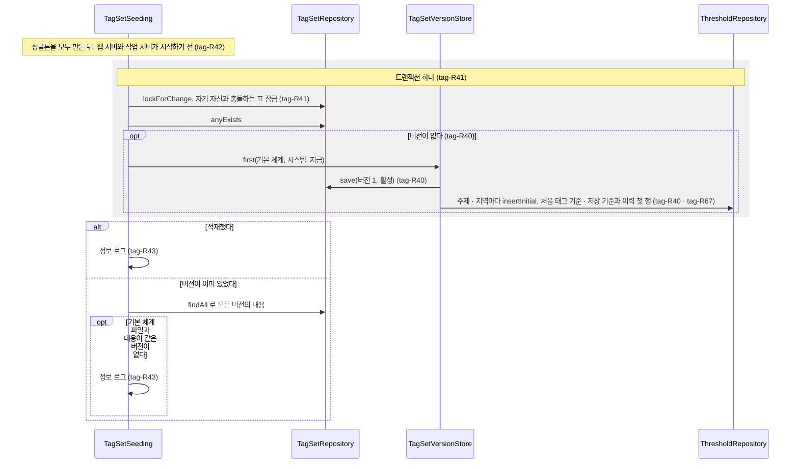
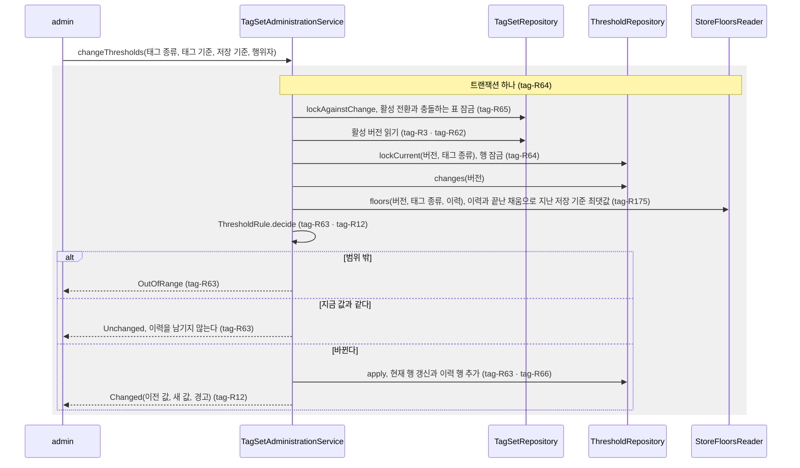
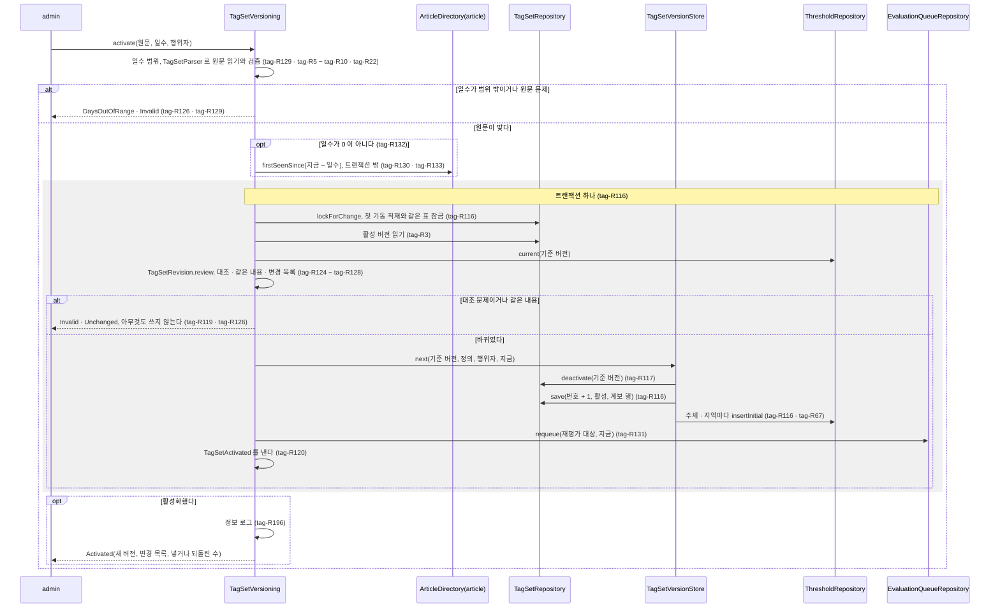
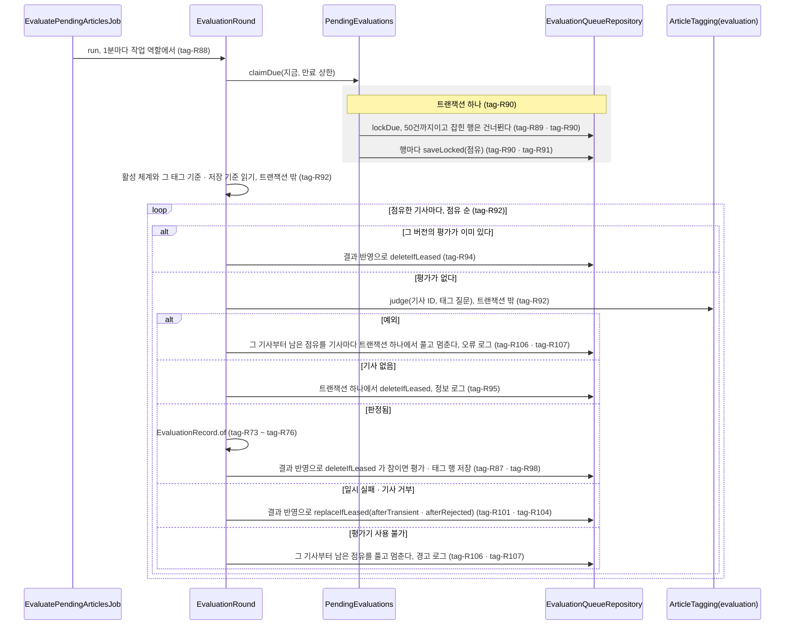
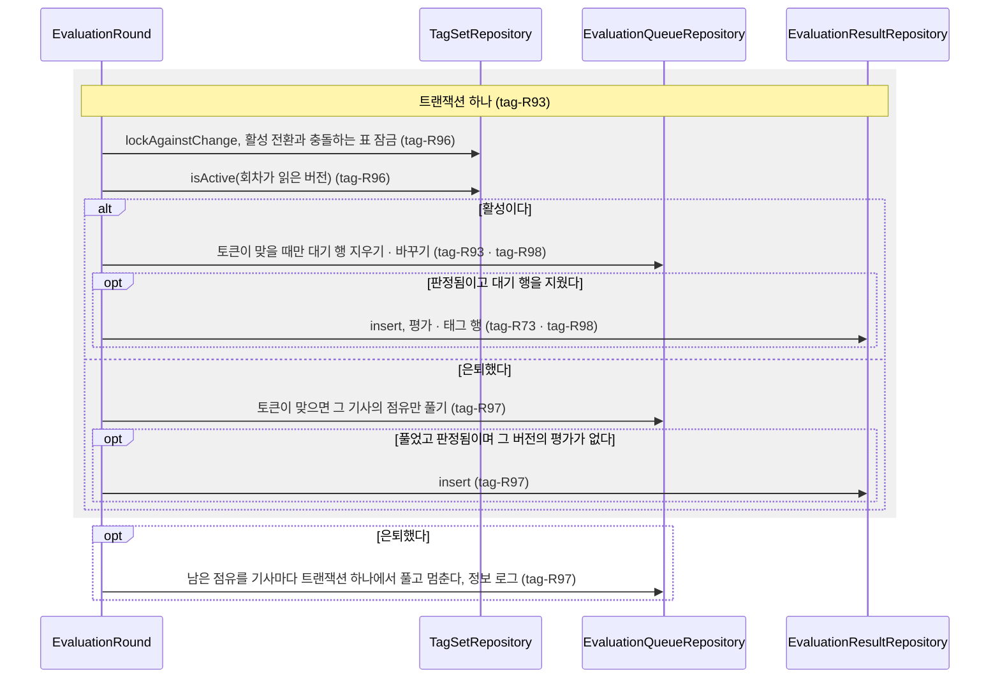
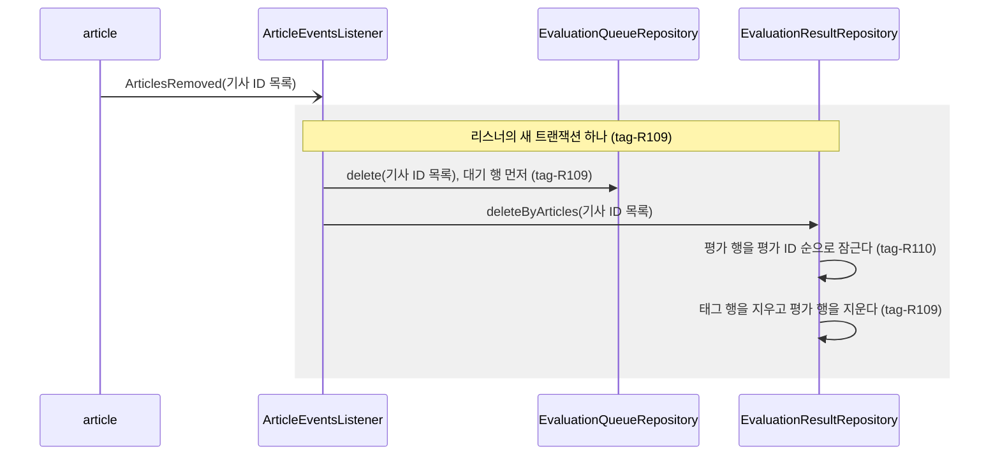
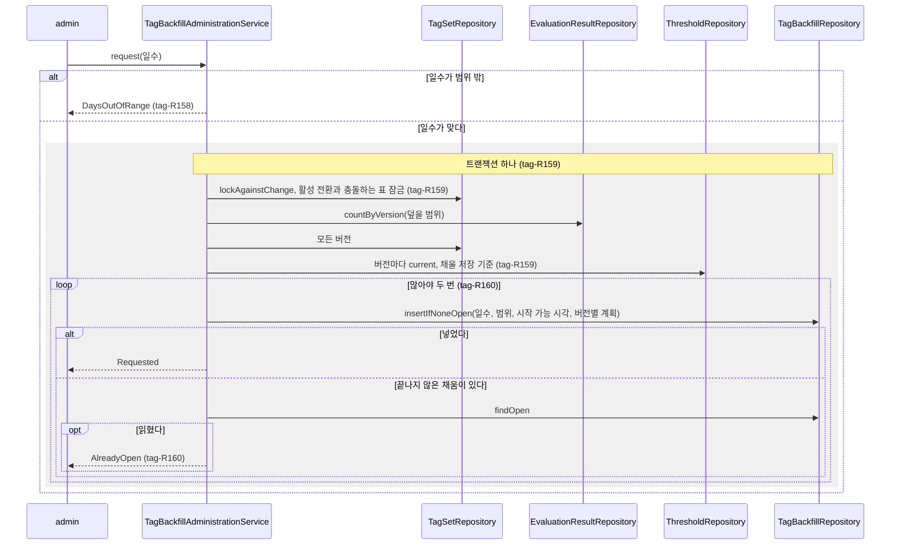
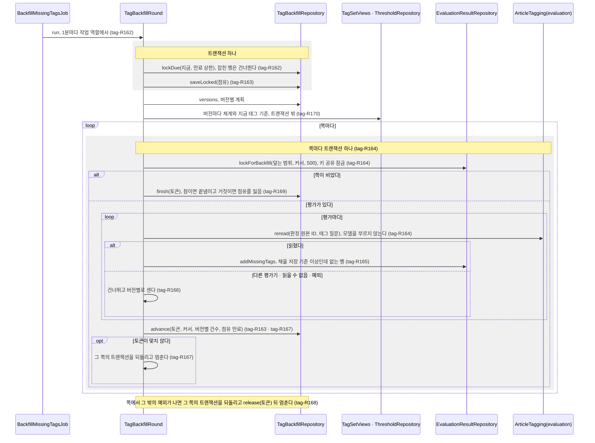

# tag 모듈 Spec

공통 구조와 쓰는 규칙은 [specs/README.md](README.md)에 있다.

## 1. 책임과 범위

`tag` 는 기사에 붙일 태그의 체계(태그 체계)를 갖는다. 사용자와 무관하게 기사마다 한 번 `evaluation` 의 태그 판정으로 평가해 그 결과를 저장하고, 조회할 때 판정한다.

- **태그 체계** — 주제(대분류 · 중분류) · 지역 · 형식 태그와 중요도 기준, 질문 문구를 버전으로 저장한다. 버전 내용은 만든 뒤 바꾸지 않는다(tag-R4)
- **첫 기동 적재** — 저장소의 기본 체계 파일을 기동 때 검증하고, 버전이 하나도 없으면 버전 1 로 들인다(tag-R1 · R2)
- **태그 기준 · 저장 기준** — 주제 · 지역마다 태그 기준 · 저장 기준을 두고 운영자의 변경을 이력과 함께 받는다. 앱은 태그 기준 · 저장 기준의 관계를 막지 않고, 이전 기사와 어긋날 수 있는 변경에 경고한다. 바꾸기 전에 고른 기간의 평가로 미리 보이고, 지금 값의 어긋난 상태를 낸다(tag-R10 ~ R13 · R35 · R36)
- **활성 체계 조회** — 평가 · 후보 선별이 쓰는 활성 버전과 태그 기준 · 저장 기준을 공개 API `TagSetDirectory` 로 낸다
- **공유 평가** — 새 기사를 평가 대기에 넣고 1분마다 대기를 점유해 평가한다. 기사마다 `evaluation` 의 태그 판정(`ArticleTagging.judge`)에 기사 ID 와 활성 버전의 태그 질문을 넘기고, 돌려받은 태그 · 형식 · 중요도 분포를 판정 원본 ID 와 함께 저장한다(tag-R14 · R15 · R18 ~ R20). 요청 조립 · 모델 호출 · 판정 원본 기록은 `evaluation` 이 한다
- **평가 결과 조회** — 기사의 붙은 태그 · 형식 · 중요도를 조회 시점의 태그 기준 · 저장 기준으로 판정해 공개 API `ArticleEvaluations` 로 낸다(tag-R15). 대기 · 일시 실패를 겪은 대기 · 실패 건수는 공개 운영 API `EvaluationAdministration` 으로 낸다(tag-R20)
- **평가 검수** — 공개 운영 API `EvaluationReview` 로 아래를 낸다(tag-R33 · R34)
  - 버전 하나의 평가 가운데 평가 시각이 기간 안이고 거르기에 맞는 것을 최근 것부터
  - 씨앗으로 다시 뽑을 수 있는 표본
  - 평가 하나의 저장 행 전부와 분포, 판정 원본의 평가기 · 모델 · 토큰
- **평가 현황** — 버전 하나의 평가 가운데 평가 시각이 집계 기간 안인 것의 평가 품질 지표를 공개 운영 API `EvaluationAdministration.overview` 로 낸다. 입력 토큰은 판정 원본에서 읽는다(tag-R28 · R29)
- **주제별 보도량** — 첫 평가 시각이 집계 기간 안인 기사를 최신 평가의 조회 시점 판정과 태그 키 계보로 활성 버전의 주제마다 세어 공개 조회 `TopicCoverage` 로 낸다(tag-R28 · R30)
- **지운 기사 따르기** — `article` 이 기사를 지우면 그 기사의 대기 · 평가 · 태그 행을 지운다(tag-R21). 판정 원본은 `evaluation` 이 지운다
- **빠진 태그 채움** — 저장 기준을 낮추기 전에 평가된 평가에는 낮춘 구간의 태그 행이 없다. 운영자가 정한 기간에 평가된 평가의 판정 원본을 `evaluation` 이 다시 읽어(`ArticleTagging.reread`), 지금 저장 기준 이상인데 없는 태그 행만 더한다. 모델을 부르지 않는다. 확인 · 요청 · 목록은 공개 운영 API `TagBackfillAdministration` 으로 내고, 작업 역할의 반복 작업이 실행한다(tag-R31)
- **저장 바닥** — 이력과 끝난 채움으로 평가 시각마다 어느 확률까지 저장돼 있는지를 계산한다. 태그 기준 · 저장 기준의 경고(지난 저장 기준 최댓값)와 평가 현황의 "저장 기준이 섞였다" 표시가 이것으로 나온다(tag-R12 · R29 · R32)
- **체계 변경** — 운영자 원문을 지금 활성 버전과 대조해 확인하거나, 새 버전으로 저장해 곧바로 활성으로 바꾼다. 버전은 앞으로만 켠다. 활성으로 바꿀 때 운영자가 정한 일수 안에 처음 본 기사를 재평가 대기에 넣는다. 버전 목록과 버전의 원문은 공개 운영 API `TagSetAdministration` 으로 낸다(tag-R16 · R22 ~ R25 · R27)
- **태그 키 계보** — 키 이름 변경 · 분할 · 병합을 새 버전과 함께 기록하고, 옛 버전의 키를 활성 버전의 키로 푸는 표를 공개 API `TagKeyLineage` 로 낸다(tag-R22 · R23 · R26)

하지 않는 것:

- 사용자를 모른다. 사용자 태그 선호 · 구독은 `user` 가, 후보 선별은 `digest` 가 한다. 태그 기준 · 저장 기준의 변경을 기록할 때도 행위자 종류(시스템 · 운영자)만 남기고 사용자를 가리키지 않는다(tag-R13)
- 인증을 모른다. 운영자 요청인지는 부르는 쪽(`admin`)이 정해 넘긴다
- 모델을 부르지 않고 기사 내용을 읽지 않는다. 태그 판정의 입력(기사 제목 · 요약 · 피드 맥락)은 `evaluation` 이 기사 ID 로 읽는다. 요청 조립 · 모델 호출 · 판정 원본(원본 응답 · 평가기 · 모델 버전 · 입력 토큰)도 `evaluation` 이 갖는다([evaluation Spec](evaluation.md)). 이 모듈은 질문 문장을 체계 데이터로 넘긴다
- 기사를 수집하거나 같은 기사를 판정하지 않는다. `source` · `article` 이 한다

다른 모듈과의 의존과 주고받는 이벤트는 [overview.md §5](../overview.md#5-모듈-지도)에 있다.

## 2. 용어

태그 판정 · 태그 질문 · 실패 종류 · 판정 원본은 [evaluation Spec §2](evaluation.md#2-용어)에 있다.

| 용어 | 뜻 |
|---|---|
| 태그 체계(Tag set) | 운영자가 관리하는 통제 어휘. 주제(2단계) · 지역 · 형식의 태그 종류로 나뉘고 버전을 가진다. 기사에는 여러 태그가 붙을 수 있다 |
| 태그 종류 | 태그 체계를 나누는 구분인 주제 · 지역 · 형식. 기사는 종류마다 따로 태그를 받는다. 주제 · 지역은 여러 태그가, 형식은 하나가 붙는다 |
| 주제 | 태그 체계의 주제 태그(대분류 · 중분류). 보도량과 관심도를 세는 단위이고, Topic 이라는 별도 용어를 두지 않는다 |
| 공유 평가 | 사용자와 무관하게 기사마다 한 번만 하는 평가(태그 · 형식 · 중요도). 비용은 운영자가 부담한다(tag-R14) |
| 버전 | 태그 체계 한 벌(`tag_sets` 한 행과 그 태그 · 기준). 번호는 1 부터 늘고, 활성 버전은 언제나 하나다 |
| 대분류 · 중분류 | 주제 태그의 두 단계. 대분류는 모델에 묻지 않고, 중분류가 붙으면 그 대분류도 붙은 것으로 본다(tag-R53) |
| 태그 키 | 태그를 가리키는 값. 대분류 · 지역 · 형식은 조각 하나(`politics` · `domestic` · `straight`)이고, 중분류는 대분류 키를 붙인 전체 키(`politics.executive`)다(tag-R6). 사용자 선호와 평가 결과가 이 키로 태그를 가리킨다 |
| 질문 틀 | 주제 · 지역의 Yes/No 질문 문장의 틀. 자리표시자 `{description}` 에 태그 설명을 끼워 태그마다 질문을 만든다(tag-R9) |
| 태그 기준 | 주제 · 지역 태그가 기사에 붙었는지 가르는 확률 값. 조회할 때 적용하므로 바꿔도 다시 평가하지 않는다(tag-R77) |
| 저장 기준 | 평가 때 태그 확률을 저장할지 가르는 값. 이 값 이상인 확률만 저장한다(tag-R74) |
| 빠진 태그 채움 | 운영자가 정한 기간에 평가된 평가의 판정 원본을 `evaluation` 이 다시 읽어, 그 버전의 채울 저장 기준 이상인데 없는 태그 행을 더하는 것(tag-R31). 새 버전으로 태그 판정을 다시 부르는 체계 변경 때의 재평가(tag-R25)와 다르다 |
| 덮는 범위 | 채움 하나가 다루는 평가 시각 `[요청 시각 − 일수 × 24시간, 요청 시각)`(tag-R158) |
| 채울 저장 기준 | 채움을 요청한 순간 버전마다의 지금 저장 기준. 요청이 기록하고, 실행은 이 값까지 채운다(tag-R159) |
| 저장 바닥 | 평가 시각 t 의 평가에 저장돼 있다고 볼 수 있는 확률의 하한. 그때 쓰였을 수 있는 저장 기준과 t 를 덮은 끝난 채움의 채울 저장 기준 가운데 작은 것이다(tag-R32) |
| 기본 제외 | 형식 태그의 속성이고, 사용자의 형식 제외의 초깃값이다. 계정을 만들 때 활성 버전의 기본 제외 형식이 형식 제외로 들어가고, 그 형식이 새로 생긴 버전을 켤 때 기존 사용자의 형식 제외에 더해진다. 이미 있던 형식의 기본 제외가 바뀌어도 기존 사용자의 제외는 바뀌지 않는다([user Spec](user.md#관심-설정) user-R82 · R89). 다이제스트 후보 선별이 형식 제외에 든 형식의 기사를 뺀다([digest Spec](digest.md#후보-선별) digest-R114). 배경은 [ADR-0010](../adr/0010-tag-taxonomy.md) · [ADR-0177](../adr/0177-formats-newly-excluded-by-default-on-activation-are-added-to-existing-users-exclusions.md) |
| 기본 체계 파일 | 저장소의 `backend/src/main/resources/tag-sets/default.yaml`. 첫 기동에 버전 1 로 들어간다(tag-R1 · R2). 첫 체계의 바탕은 [조사 초안](../research/2026-10-news-categories.md) 3.2 이고, 중요도 문구의 판단 원칙은 [ADR-0099](../adr/0099-importance-judged-by-what-the-matter-changes-and-its-reach-with-levels-written-as-reach-without-article-type-examples.md) · [ADR-0285](../adr/0285-importance-asks-what-the-matter-now-changes-and-levels-run-to-society-wide-in-four-steps-without-field-words.md)에 있다 |
| 첫 기동 적재 | 버전이 하나도 없을 때 기본 체계 파일을 버전 1 로 저장하는 기동 시 동작(tag-R2) |
| 행위자 | 태그 기준 · 저장 기준을 정하거나 버전을 만든 주체의 종류. 시스템(첫 기동 적재)과 운영자(공개 운영 API)다(tag-R68) |
| 기준 버전 | 새 버전을 대조하는 버전. 확인 · 활성화 때의 활성 버전이다. 버전은 만들 때 바로 활성이 되므로 버전 n 의 기준 버전은 n − 1 이다(tag-R118) |
| 태그 키 계보 | 기준 버전의 키가 새 버전의 어느 키로 이어지는지의 기록. 종류는 이름 변경(`rename`, 하나 → 하나) · 분할(`split`, 하나 → 여럿) · 병합(`merge`, 여럿 → 하나)이다. 운영자 원문의 `lineage` 절에 적고 새 버전과 함께 저장한다(tag-R22 · R23) |
| 계보 없이 지운 키 | 기준 버전에 있고 새 버전에 없으며 어느 계보 항목의 이전 키도 아닌 키. 사용자 선호의 해제 대상이다(tag-R127) |
| 확인 | 운영자 원문을 검증하고 기준 버전과 대조해 변경 목록과 재평가 대상 기사 수를 돌려주는 연산. 아무것도 쓰지 않는다(tag-R115) |
| 활성화 | 운영자 원문을 확인과 같은 판정으로 대조해 새 버전으로 저장하고 활성으로 바꾸는 연산(tag-R116) |
| 재평가 기간 | 활성화 요청이 정하는 일수. 활성화 시각에서 그 일수 안에 처음 본 기사를 재평가 대기에 넣는다(tag-R25) |
| 평가 대기 | 평가할 기사의 목록(`evaluation_queue`, 기사마다 한 행). 평가 가능 시각 · 일시 실패 수 · 점유 · 실패 까닭을 갖는다(tag-R18). 실패로 남는 것은 기사 거부뿐이고, 일시 실패는 상한 없이 미룬다(tag-R20) |
| 정착 시간 | 대기에 넣은 뒤 평가할 수 있기까지의 시간. 같은 기사의 다른 피드 엔트리가 붙기를 기다린다(tag-R85) |
| 회차 | 반복 작업 한 번. 대기를 점유하고 차례로 평가한다(tag-R19) |
| 점유 | 회차가 대기 행을 가져갔다는 표시(토큰 · 만료). 결과는 토큰이 맞을 때만 반영한다(tag-R93) |
| 회차 멈춤 | 그 기사부터 남은 점유를 풀고 회차를 끝내는 것. 기사는 대기에 그대로 남는다. 멈추는 때는 tag-R97 · R106 이다 |
| `low_confidence` | 주제 태그가 태그 기준을 하나도 넘지 못해, 저장 기준 이상인 가장 높은 확률의 주제 태그 하나를 붙인 판정. 조회 때 정한다(tag-R78) |
| 미분류 | 저장 기준 이상인 주제 태그가 없는 판정. 조회 때 정한다(tag-R78) |
| 대표 형식 · 중요도 기대값 | 형식 분포에서 확률이 가장 큰 선택지와, 중요도 분포의 확률 가중 평균. 분포와 함께 저장한다(tag-R75 · R76) |
| 집계 기간 | 평가 현황 · 주제별 보도량이 세는 시각 범위 `[from, to)`. 시간대가 없고, 날짜 범위는 부르는 쪽 시간대의 자정으로 옮긴다(tag-R28) |
| 첫 평가 시각 | 기사의 평가 행 가운데 가장 이른 평가 시각. 평가 행은 갱신하지 않고 버전 단위로 지우지 않으므로 기사가 남아 있는 한 바뀌지 않는다(tag-R157) |
| 평가 현황 | 버전 하나 · 집계 기간 하나의 평가 품질 지표(tag-R29). 지표는 주제 판정마다의 평가 수와 tag-R141 ~ R147 이다 |
| 주제별 보도량 | 첫 평가 시각이 집계 기간 안인 기사를 활성 버전의 대분류 · 중분류마다 센 수(tag-R30) |
| 평가 목록 | 버전 하나의 평가 가운데 평가 시각이 집계 기간 안이고 거르기에 맞는 것. 평가 시각 · 평가 ID 내림차순이고, 커서로 이어 받는다(tag-R33) |
| 거르기 | 평가 목록의 조건. 태그 여럿과 주제 판정을 고르고, 고른 것이 모두 맞아야 한다. 조회 시점 판정으로 본다(tag-R180 · R181) |
| 커서 | 평가 목록에서 이어 받을 자리. 마지막으로 받은 평가의 평가 시각과 평가 ID 다(tag-R179) |
| 표본 · 씨앗 | 표본은 버전 하나 · 집계 기간의 평가에서 씨앗으로 고른 일정 수의 평가다. 같은 씨앗이면 같은 평가를 같은 순서로 고른다(tag-R34) |
| 기준 미리보기 | 한 태그 종류의 태그 기준 · 저장 기준을 바꾸면 고른 기간의 활성 버전 평가에서 판정이 어떻게 달라지는지 보이는 것. 아무것도 쓰지 않는다(tag-R35) |
| 조회 시점 판정 | 저장된 확률을 그 버전의 지금 태그 기준 · 저장 기준으로 가르는 것(`TagJudgement`, tag-R77). 모델에 묻는 `evaluation` 의 태그 판정과 다르다 |
| 어긋난 상태 | 지금 태그 기준 · 저장 기준과 그 이력 · 끝난 채움 때문에 태그 기준을 넘는 확률이 저장되지 않아 태그가 붙지 않을 수 있는 상태. 경고(tag-R12)는 변경할 때 한 번 나오고, 상태는 남아 있는 동안 나온다(tag-R36) |

## 3. 공개 인터페이스

모듈 최상위 패키지 `net.yozmnews.tag` 의 공개 타입은 아래와 그 값 · 결과 타입이다.

- 활성 체계 · 버전 내용 · 버전의 이름 조회 `TagSetDirectory`(이름은 `TagSetNames`)
- 활성 전환 이벤트 `TagSetActivated`
- 태그 체계의 운영 API `TagSetAdministration`(태그 기준 · 저장 기준 · 버전)
- 태그 키 계보 조회 `TagKeyLineage`
- 평가 결과 조회 `ArticleEvaluations`
- 평가 대기 · 평가 현황의 운영 API `EvaluationAdministration`
- 평가 검수의 운영 API `EvaluationReview`
- 빠진 태그 채움의 운영 API `TagBackfillAdministration`
- 주제별 보도량 조회 `TopicCoverage`
- 집계 기간 `EvaluationPeriod`

내는 이벤트는 활성 전환 `TagSetActivated` 하나다. 평가 결과를 알리는 이벤트는 두지 않는다 — 평가를 쓰는 모듈은 공개 조회로 읽는다([ADR-0342](../adr/0342-there-is-no-article-evaluated-event-and-modules-using-evaluations-read-them-by-query.md)).

받는 이벤트는 `article` 의 `ArticleStored` · `ArticlesRemoved` 이고, 재평가 대상은 `article` 의 공개 조회 `ArticleDirectory.firstSeenSince` 로 읽는다([article Spec §3](article.md#3-공개-인터페이스)). 태그 판정은 `evaluation` 의 공개 API `ArticleTagging` 으로 한다([evaluation Spec §3](evaluation.md#3-공개-인터페이스)). 태그 질문(`TagQuestions`)과 그 값 타입(`TopicCategory` · `AskedTag` · `FormatChoice` · `FormatOption` · `ImportanceScale` · `ImportanceLevel`)은 `evaluation` 의 공개 타입이고, 이 모듈의 `TagSetView` 가 그것으로 체계 내용을 담는다. 태그 기준 · 저장 기준의 이력과 버전의 행위자 종류는 `platform` 의 `ChangeActor` 다.

HTTP 엔드포인트는 없다. 운영자 HTTP API 는 `admin` 이 이 모듈의 공개 운영 API 를 불러 낸다([ADR-0045](../adr/0045-admin-module-serves-operator-api-over-module-public-operation-apis.md)).

### TagSetDirectory

활성 체계 · 버전 내용 조회. 평가 · 후보 선별 · 사용자 선호가 쓴다. 구현은 `application` 의 `TagSetDirectoryService` 다.

```java
public interface TagSetDirectory {
    TagSetView activeTagSet();
    TagSetThresholds activeThresholds();
    TagSetView tagSet(TagSetId id);
    TagSetNames names(TagSetId id);
}

public record TagSetNames(TagSetId id, List<TagName> categories, List<TagName> subtopics, List<TagName> regions) {
    Optional<String> topicName(String key);
    Optional<String> categoryOf(String subtopicKey);
    Optional<String> regionName(String key);
    Map<String, Integer> topicOrder();
    Map<String, Integer> regionOrder();
}
```

| 멤버 | 뜻 |
|---|---|
| `activeTagSet()` | 활성 버전의 내용(태그 · 질문 문장 · 중요도 기준) |
| `activeThresholds()` | 활성 버전의 주제 · 지역의 태그 기준 · 저장 기준 |
| `tagSet(id)` | 버전 하나의 내용. 활성이 아닌 버전도 낸다. 사용자 선호가 옛 버전의 구조(대분류 · 중분류)와 이름을 읽는다 |
| `names(id)` | 버전 하나의 키와 이름(`TagSetNames`). `tagSet` 과 같은 버전 내용에서 이름만 낸다. 태그 질문을 읽지 않는 쪽(다이제스트의 프롬프트 · 독자 화면의 관심사 히스토리)이 쓴다 |
| `TagSetNames.categories` · `subtopics` · `regions` | 주제 대분류(대분류 키) · 주제 중분류(중분류 전체 키) · 지역의 키와 이름(`TagName`). 체계 파일에 적힌 순서이고, 중분류는 대분류 순서 안에서 그 순서다 |
| `TagSetNames.topicName` · `regionName` | 키의 이름. 주제는 대분류 키와 중분류 전체 키를 받는다. 이 버전에 없는 키면 빈 값 |
| `TagSetNames.categoryOf` | 중분류 전체 키의 대분류 키. 이 버전의 중분류 키가 아니면(대분류 키 · 없는 키 · 지역 키) 빈 값. 키 형식은 tag-R6 이다 |
| `TagSetNames.topicOrder` · `regionOrder` | 키에서 체계 순서의 위치로 가는 표. 주제는 대분류 먼저, 그다음 중분류다. 이름을 체계 순서로 늘어놓을 때 쓴다 |

- 계약
  - 활성 버전은 언제나 하나다. 없으면 `IllegalStateException` 이다(tag-R3)
  - 내용과 태그 기준 · 저장 기준은 다른 조회다. 내용은 바뀌지 않고 태그 기준 · 저장 기준은 바뀐다. 둘 다 버전 ID 를 싣는다. 두 조회를 이어 부르면 그 사이 활성 전환으로 버전이 갈릴 수 있으니 버전 ID 로 맞춘다
  - 트랜잭션을 열지 않는다. 각 조회는 그 순간의 값이다
  - `tagSet` · `names` 는 없는 버전에 `IllegalArgumentException` 이다. 버전 내용은 바뀌지 않으므로(tag-R4) 같은 ID 는 언제나 같은 내용이다

관련 규칙: tag-R3 · tag-R4 · tag-R9 · tag-R10.

### TagSetActivated

태그 체계의 활성 전환을 알리는 이벤트(tag → user).

```java
public record TagSetActivated(TagSetId previous, TagSetId activated) {}
```

| 필드 | 뜻 |
|---|---|
| `previous` | 활성화가 끈 기준 버전 |
| `activated` | 새로 켠 버전 |

- 계약
  - 발행 주체 · 시점 · 횟수는 tag-R120 이다. 그 트랜잭션이 커밋되면 발행도 커밋된다
  - 사용자를 모르고 버전 ID 둘만 싣는다. 소비자(`user`)는 이벤트 발행 레지스트리에서 다시 처리될 수 있어, 두 ID 를 믿지 않고 지금 활성 버전과 자기 기록을 대조한다

관련 규칙: tag-R16.

### TagSetView · TagSetId

체계 버전의 내용(활성 버전 · 버전 하나의 조회가 낸다). 주제 · 지역 · 형식 · 중요도의 값 타입(`TopicCategory` · `AskedTag` · `FormatChoice` · `FormatOption` · `ImportanceScale` · `ImportanceLevel`)은 태그 판정이 묻는 태그 질문의 타입이라 `evaluation` 이 소유한다([evaluation Spec §3](evaluation.md#3-공개-인터페이스)). 이 모듈은 그 타입으로 체계 내용을 담는다.

```java
public record TagSetId(long value) {}

public record TagSetView(TagSetId id, int number, List<TopicCategory> topics, List<AskedTag> regions,
        FormatChoice format, ImportanceScale importance) {
    public TagQuestions questions();
}
```

| 타입 · 필드 | 뜻 | 제약 |
|---|---|---|
| `TagSetId` | `tag_sets.id` | 1 이상 |
| `TagSetView.number` | 버전 번호 | 1 이상 |
| `TagSetView.topics` | 주제 대분류와 그 중분류. 파일에 적힌 순서다. 대분류는 질문이 없고(모델에 묻지 않는다), 중분류의 키는 전체 키다 | 대분류 1개 이상, 대분류마다 중분류 1개 이상(tag-R7) |
| `TagSetView.regions` | 지역 태그. 파일에 적힌 순서다 | 1개 이상(tag-R7) |
| `TagSetView.format` | 형식 Choice 질문과 그 선택지. 파일에 적힌 순서다. `excludedByDefault` 는 기본 제외 형식인가다 | 선택지 2개 이상(tag-R7) |
| `TagSetView.importance` | 중요도 Score 질문과 수준별 기준. 수준 순이다 | 수준이 `ImportanceScale.MIN_LEVEL`(1) 부터 빈 곳 없이 하나씩, 2 ~ `MAX_LEVEL`(5) 개(tag-R7) |
| `AskedTag.question` | 질문 틀에 설명을 끼운 질문 문장. 이 모듈이 만든다(tag-R9) | — |
| `questions()` | 이 버전의 태그 질문(`evaluation` 의 `TagQuestions`). 태그 판정 · 다시 읽기에 넘긴다 | — |

관련 규칙: tag-R6 ~ tag-R9.

### MultiTagKind · TagThresholds · TagSetThresholds

태그 기준 · 저장 기준의 값.

```java
public enum MultiTagKind { TOPIC, REGION }

public record TagThresholds(MultiTagKind kind, BigDecimal tagThreshold, BigDecimal storeThreshold) {}

public record TagSetThresholds(TagSetId versionId, TagThresholds topic, TagThresholds region) {}
```

| 타입 · 필드 | 뜻 | 제약 |
|---|---|---|
| `MultiTagKind` | 태그 기준 · 저장 기준이 있는 태그 종류. 여러 태그가 붙는 주제 · 지역이고, 형식은 하나를 고르므로 없다 | — |
| `TagThresholds.tagThreshold` | 태그 기준. 저장된 확률이 이 값 이상이면 태그가 붙는다 | 0 이상 1 이하, 소수 셋째 자리까지(tag-R10) |
| `TagThresholds.storeThreshold` | 저장 기준. 평가 때 이 값 이상인 확률만 저장한다 | 같음 |
| `TagSetThresholds` | 한 버전의 주제 · 지역의 태그 기준 · 저장 기준 | — |

관련 규칙: tag-R10.

### TagSetAdministration

태그 체계의 운영(태그 기준 · 저장 기준과 버전). `admin` 이 운영자 요청으로 부른다. 구현은 `application` 의 `TagSetAdministrationService` 이고, 버전 연산은 `TagSetVersioning` 에 맡긴다.

```java
public interface TagSetAdministration {
    int MAX_REEVALUATION_DAYS = 30;

    ThresholdChangeResult changeThresholds(MultiTagKind kind, BigDecimal tagThreshold, BigDecimal storeThreshold,
            ChangeActor actor);
    List<ThresholdChangeView> thresholdChanges();
    ThresholdStatusView thresholdStatus();
    ThresholdPreviewResult previewThresholds(MultiTagKind kind, BigDecimal tagThreshold, BigDecimal storeThreshold,
            EvaluationPeriod period);
    List<TagSetVersionView> versions();
    Optional<String> versionText(TagSetId id);
    TagSetReviewResult review(String text, int recentDays);
    TagSetActivationResult activate(String text, int recentDays, ChangeActor actor);
}
```

| 멤버 | 뜻 |
|---|---|
| `MAX_REEVALUATION_DAYS` | 재평가 기간의 상한(일). 정본이다(tag-R129) |
| `changeThresholds` | 활성 버전의 한 태그 종류의 태그 기준 · 저장 기준을 바꾼다(tag-R11 · R12) |
| `thresholdChanges()` | 활성 버전의 태그 기준 · 저장 기준의 이력. 최근 것부터다(tag-R13) |
| `thresholdStatus()` | 활성 버전의 지금 태그 기준 · 저장 기준, 태그 종류마다 지난 저장 기준 최댓값과 어긋난 상태, 이력(tag-R36) |
| `previewThresholds` | 기준 미리보기. 활성 버전 · 한 태그 종류의 제안 값으로 기간 안 평가의 판정이 어떻게 달라지는지 낸다. 아무것도 쓰지 않는다(tag-R35) |
| `versions()` | 버전 목록. 번호가 큰 것부터다 |
| `versionText` | 버전의 원문. 없는 버전이면 빈 값이다(tag-R27) |
| `review` | 확인(tag-R16 · R22 ~ R25) |
| `activate` | 활성화(tag-R16 · R25) |

- 계약
  - `changeThresholds` 의 트랜잭션과 줄 서기는 tag-R64 · R65 다. 결과는 tag-R63 이고, 범위 밖이면 `OutOfRange`, 지금 값과 같으면 `Unchanged` 이며 둘 다 아무것도 쓰지 않는다
  - 경고는 변경을 막지 않고 `Changed` 에 실린다(tag-R12). `Changed` · `Unchanged` 는 변경을 판정한 활성 버전을 싣는다. 미리보기 뒤 활성 전환이 끼었으면 부르는 쪽이 이 버전으로 안다
  - `thresholdStatus` 는 읽기 전용 `REPEATABLE READ` 트랜잭션 하나(한 스냅숏)에서 읽는다(tag-R194)
  - `previewThresholds` 의 트랜잭션과 판정은 tag-R189 · R192 다. 값의 범위 · 같은 값 판정은 `changeThresholds` 와 같다(`OutOfRange` · `Unchanged`)
  - 운영자 요청은 `ChangeActor.OPERATOR` 로 부른다. `SYSTEM` 은 첫 기동 적재가 쓴다. `activate` 의 행위자는 새 버전과 그 처음 태그 기준 · 저장 기준 이력 행의 행위자다(tag-R67)
  - `review` · `activate` 의 재평가 기간 범위는 tag-R129, 원문 문제의 판정 순서는 tag-R126 이다. 원문의 태그 기준 · 저장 기준만 다르면 `Unchanged` 이고(tag-R119), 그 변경은 `changeThresholds` 로 한다
  - `review` 의 트랜잭션은 tag-R115, `activate` 의 트랜잭션은 tag-R116 이다
  - `versions` · `versionText` 는 트랜잭션을 열지 않는다
  - 활성 버전이 없으면 `IllegalStateException` 이다(tag-R3)

관련 규칙: tag-R10 ~ tag-R13 · tag-R16 · tag-R22 ~ tag-R25 · tag-R27 · tag-R35 · tag-R36.

### ThresholdChangeResult · ThresholdWarning · ThresholdChangeView

```java
public sealed interface ThresholdChangeResult {
    record Changed(TagSetId version, TagThresholds previous, TagThresholds current, Set<ThresholdWarning> warnings)
            implements ThresholdChangeResult {}
    record Unchanged(TagSetId version, TagThresholds current) implements ThresholdChangeResult {}
    record OutOfRange() implements ThresholdChangeResult {}
}

public enum ThresholdWarning { STORE_THRESHOLD_LOWERED, TAG_BELOW_PAST_STORE, TAG_BELOW_STORE }

public record ThresholdChangeView(MultiTagKind kind, @Nullable BigDecimal previousTagThreshold,
        @Nullable BigDecimal previousStoreThreshold, BigDecimal tagThreshold, BigDecimal storeThreshold,
        ChangeActor actor, Instant changedAt) {}
```

| 타입 · 값 | 뜻 |
|---|---|
| `Changed` | 바꿨다. 그 활성 버전, 이전 값 · 새 값과 경고(없으면 빈 집합)를 싣는다 |
| `Unchanged` | 지금 값과 같아 바꾸지 않았다. 그 활성 버전과 지금 값을 싣는다 |
| `OutOfRange` | 값이 0 ~ 1 · 소수 셋째 자리 밖이라 바꾸지 않았다 |
| `STORE_THRESHOLD_LOWERED` | 저장 기준을 지금 값보다 낮췄다. 이전 기사에는 낮춘 구간의 확률이 없다 |
| `TAG_BELOW_PAST_STORE` | 태그 기준을 내렸고 새 값이 지난 저장 기준 최댓값(tag-R175)보다 낮다. 그보다 높은 저장 기준으로 저장된 평가에는 그 구간 태그가 붙지 않는다 |
| `TAG_BELOW_STORE` | 이번 변경으로 태그 기준이 저장 기준보다 낮아졌다. 그 구간 확률은 저장되지 않아 붙지 않는다 |
| `actor` · `createdBy` | 운영 설정을 정한 행위자(`platform` 의 `ChangeActor`, 시스템 · 운영자) |
| `ThresholdChangeView` | 이력 한 행. 이전 값(처음 값이면 null) · 새 값 · 행위자 · 시각이다 |

관련 규칙: tag-R11 ~ tag-R13.

### ThresholdStatusView · ThresholdKindStatus · ThresholdCondition

```java
public record ThresholdStatusView(TagSetId version, int versionNumber, ThresholdKindStatus topic,
        ThresholdKindStatus region, List<ThresholdChangeView> changes) {}

public record ThresholdKindStatus(TagThresholds current, BigDecimal pastMaxStoreThreshold,
        Set<ThresholdCondition> conditions) {}

public enum ThresholdCondition { TAG_BELOW_STORE, TAG_BELOW_PAST_STORE, STORE_THRESHOLD_CHANGED }
```

| 타입 · 값 | 뜻 |
|---|---|
| `ThresholdStatusView` | 활성 버전 하나의 기준 상태. 버전 ID · 번호, 태그 종류마다 상태, 이력(최근 것부터)이다 |
| `pastMaxStoreThreshold` | 지난 저장 기준 최댓값(tag-R175) |
| `TAG_BELOW_STORE` | 태그 기준이 저장 기준보다 낮다. 그 구간 확률은 저장되지 않아 붙지 않는다 |
| `TAG_BELOW_PAST_STORE` | 태그 기준이 지난 저장 기준 최댓값보다 낮고, 그 최댓값이 지금 저장 기준보다 높다. 그보다 높은 저장 기준으로 저장된 평가에는 그 구간 태그가 없다 |
| `STORE_THRESHOLD_CHANGED` | 버전 전체에서 저장 바닥이 둘 이상이다. 평가마다 저장된 확률 범위가 다르다(tag-R177) |

관련 규칙: tag-R36.

### ThresholdPreviewResult

```java
public sealed interface ThresholdPreviewResult {
    record Previewed(TagSetId version, TagThresholds current, TagThresholds proposed,
            Set<ThresholdWarning> warnings, long evaluations, long changed, EvaluationOverview before,
            EvaluationOverview after) implements ThresholdPreviewResult {}
    record Unchanged(TagSetId version, TagThresholds current) implements ThresholdPreviewResult {}
    record OutOfRange() implements ThresholdPreviewResult {}
}
```

| 타입 · 필드 | 뜻 |
|---|---|
| `Previewed` | 제안 값이 지금 값과 다르다. 싣는 것은 아래 목록이다 |
| `after` | 그 태그 종류만 제안 값으로 바꾼 기준의 평가 현황. 확률 분포 칸의 저장 범위는 제안 저장 기준으로 정한다. `storeThresholdChanged` 는 지금 저장 바닥 그대로이고, 제안을 이력에 더하지 않는다 |
| `Unchanged` | 제안 값이 지금 값과 같다 |
| `OutOfRange` | 제안 값이 0 ~ 1 · 소수 셋째 자리 밖이다 |

`Previewed` 가 싣는 것:

- 그 활성 버전, 지금 값과 제안 값
- 그 변경이 낼 경고(tag-R12)
- 기간 안 평가 수와 그 태그 종류의 판정이 달라지는 평가 수(`changed`)
- 지금 기준 · 제안 기준의 평가 현황(`before` · `after`)

관련 규칙: tag-R35.

### TagSetReviewResult · TagSetActivationResult

```java
public sealed interface TagSetReviewResult {
    record Ready(TagSetChanges changes, long recentArticles) implements TagSetReviewResult {}
    record Unchanged() implements TagSetReviewResult {}
    record Invalid(List<TagSetProblemView> problems) implements TagSetReviewResult {}
    record DaysOutOfRange() implements TagSetReviewResult {}
}

public sealed interface TagSetActivationResult {
    record Activated(TagSetVersionView version, TagSetChanges changes, long requeued)
            implements TagSetActivationResult {}
    record Unchanged() implements TagSetActivationResult {}
    record Invalid(List<TagSetProblemView> problems) implements TagSetActivationResult {}
    record DaysOutOfRange() implements TagSetActivationResult {}
}
```

| 타입 · 값 | 뜻 |
|---|---|
| `Ready` | 활성화할 수 있다. 변경 목록과 재평가 기간에 처음 본 기사 수(`recentArticles`)를 싣는다 |
| `Activated` | 새 버전을 활성으로 바꿨다. 새 버전, 변경 목록, 재평가 대기에 넣거나 되돌린 행 수(`requeued`)를 싣는다. 이미 대기 중 · 점유 중인 행은 세지 않는다 |
| `Unchanged` | 내용이 기준 버전과 같아 아무것도 하지 않았다 |
| `Invalid` | 원문 문제나 기준 버전 대조 문제가 있어 아무것도 하지 않았다. 문제는 찾은 순서대로 모두 싣는다 |
| `DaysOutOfRange` | 재평가 기간이 0 ~ `MAX_REEVALUATION_DAYS` 밖이라 아무것도 하지 않았다 |

관련 규칙: tag-R16 · tag-R22 ~ tag-R25.

### TagKind · LineageKind · TagRef · TagLineageView · ThresholdDifference · TagSetChanges · TagSetProblemView · TagSetVersionView

```java
public enum TagKind { TOPIC, REGION, FORMAT }

public enum LineageKind { RENAME, SPLIT, MERGE }

public record TagRef(TagKind kind, String key) {}

public record TagLineageView(TagKind kind, LineageKind change, List<String> from, List<String> to) {}

public record ThresholdDifference(TagThresholds current, TagThresholds proposed) {}

public record TagSetChanges(List<TagRef> added, List<TagRef> removed, List<TagRef> revised,
        List<TagLineageView> lineage, boolean questionsRevised, boolean importanceRevised,
        List<ThresholdDifference> thresholds) {}

public record TagSetProblemView(String path, String code, String message, @Nullable Integer line,
        @Nullable Integer column) {}

public record TagSetVersionView(TagSetId id, int number, boolean active, ChangeActor createdBy,
        Instant createdAt) {}
```

| 타입 · 필드 | 뜻 |
|---|---|
| `TagKind` | 태그 종류(주제 · 지역 · 형식). 주제는 대분류 · 중분류를 함께 가리킨다. 태그 행 · 계보 행의 종류다 |
| `LineageKind` | 계보 종류(이름 변경 · 분할 · 병합, tag-R22) |
| `TagRef` | 태그 하나. 태그 종류와 키(중분류는 전체 키)다 |
| `TagLineageView` | 계보 항목 하나. 이전 키 · 새 키 목록이다 |
| `ThresholdDifference` | 원문의 태그 기준 · 저장 기준(`proposed`)이 기준 버전의 지금 값(`current`)과 크기가 다른 태그 종류 하나 |
| `TagSetChanges` | 기준 버전 대비 변경 목록(tag-R24) |
| `TagSetProblemView` | 원문의 문제. `path`(최상위는 빈 문자열) · `code`(문제 종류 이름) · `message`(운영자용 문구) · `line` · `column`(모르면 null)이다 |
| `TagSetVersionView` | 버전 하나. 번호 · 활성인가 · 만든 행위자 · 시각이다 |

관련 규칙: tag-R22 ~ tag-R24.

### ArticleEvaluations

평가 결과 조회. 다른 모듈이 기사의 붙은 태그 · 형식 · 중요도를 읽는다. 구현은 `application` 의 `ArticleEvaluationsService` 다.

```java
public interface ArticleEvaluations {
    int MAX_ARTICLES = 1000;                                  // findAll 한 번에 묻는 기사 수의 상한의 정본(측정 전)
    Optional<ArticleEvaluationView> find(ArticleId articleId);
    Map<ArticleId, Double> importances(Collection<ArticleId> articleIds);
    Map<ArticleId, ArticleEvaluationView> findAll(Collection<ArticleId> articleIds);
    List<ArticleId> firstEvaluatedIn(EvaluationPeriod period);
}
```

| 멤버 | 뜻 |
|---|---|
| `find` | 기사의 평가. 평가하지 않은 기사면 빈 값이다. 평가가 여러 버전이면 tag-R82 의 평가를 고른다. 태그 키는 그 평가 버전의 키이고, 활성 버전의 키로 풀려면 `TagKeyLineage` 를 쓴다 |
| `findAll` | 기사들의 평가. 기사마다 `find` 와 같은 평가 · 같은 판정이다. 다이제스트 후보 선별이 읽는다 |
| `firstEvaluatedIn` | 첫 평가 시각(tag-R157)이 집계 기간 안인 기사. 기사 ID 순이고 한 번씩이다. 다이제스트 후보 선별이 그 기간에 새로 평가된 기사를 고른다 |
| `importances` | 기사들의 중요도 기대값(1 ~ 5). `find` 와 같은 평가의 값이다. `event` 가 기간 집계의 중요도 평균을 센다(질의 하나) |

- 계약
  - 붙었는지는 조회할 때 판정한다(tag-R77)
  - 트랜잭션을 열지 않는다. 사용자 정보를 받지 않는다(공유 평가)
  - `findAll` 은 평가를 질의 하나로 읽고, 판정에 쓰는 버전 내용 · 태그 기준은 버전마다 한 번 읽는다(기사 수와 무관)
  - `findAll` · `importances` 는 평가하지 않은 기사를 뺀다. 빈 입력이면 빈 맵이다
  - `findAll` 은 서로 다른 기사가 `MAX_ARTICLES` 개를 넘으면 `IllegalArgumentException` 이다. 부르는 쪽이 나눈다
  - `importances` 는 그 평가의 중요도가 없는 기사도 뺀다. 이전 버전의 값으로 내려가지 않는다

관련 규칙: tag-R15.

### ArticleEvaluationView · TopicStatus · TagProbability

```java
public record ArticleEvaluationView(ArticleId articleId, TagSetId tagSetId, TopicStatus topicStatus,
        List<TagProbability> topics, List<String> topicCategories, List<TagProbability> regions, String format,
        @Nullable Double importance) {}

public enum TopicStatus { TAGGED, LOW_CONFIDENCE, UNCLASSIFIED }

public record TagProbability(String key, double probability) {}
```

| 타입 · 필드 | 뜻 |
|---|---|
| `tagSetId` | 평가한 태그 체계 버전 |
| `topicStatus` | 주제 판정(tag-R78). `TAGGED` 는 태그 기준을 넘은 주제가 있다, `LOW_CONFIDENCE` 는 없어서 저장 기준 이상인 최고 확률 하나를 붙였다, `UNCLASSIFIED` 는 저장 기준 이상인 주제가 없다는 뜻이다 |
| `topics` | 붙은 주제 중분류(전체 키)와 확률. 체계 순서다. `LOW_CONFIDENCE` 면 하나, `UNCLASSIFIED` 면 빈 목록이다 |
| `topicCategories` | 붙은 중분류의 대분류 키. 체계 순서이고 중복이 없다 |
| `regions` | 붙은 지역과 확률. 체계 순서다 |
| `format` | 대표 형식 키 |
| `importance` | 중요도 기대값(1 ~ 5). 확률 합이 0 이었으면 null 이다 |

관련 규칙: tag-R15.

### EvaluationPeriod

집계 기간. 평가 현황 · 주제별 보도량이 받는다.

```java
public record EvaluationPeriod(Instant from, Instant to) {
    public static final int MAX_DAYS = 31;
    public static final Duration MAX_LENGTH = DayRange.maxLength(MAX_DAYS);
    public static Optional<EvaluationPeriod> of(Instant from, Instant to);
    public static Optional<EvaluationPeriod> ofDays(LocalDate first, LocalDate last, ZoneId zone);
}
```

| 멤버 | 뜻 |
|---|---|
| `from` · `to` | `[from, to)`. 시작 포함 · 끝 제외이고 시간대가 없다 |
| `MAX_DAYS` | 날짜 범위의 상한(일). 정본이다(tag-R136) |
| `MAX_LENGTH` | 시각 범위의 상한. 날짜 `MAX_DAYS` 일 범위의 시각 길이 상한이다(`platform` 의 `DayRange.maxLength`, 시간대 전환 여유로 하루를 더한다) |
| 생성자 | tag-R136 을 어기면 `IllegalArgumentException` 이다. 범위 밖 기간은 만들어지지 않는다 |
| `of` | 시각 범위. 범위 밖이면 빈 값이다 |
| `ofDays` | 날짜 범위(tag-R137 · R138). 변환은 `platform` 의 `DayRange.of` 다([platform Spec §3](platform.md#3-공개-인터페이스)). 시간대는 결과에 남지 않는다 |

관련 규칙: tag-R28.

### EvaluationAdministration · EvaluationQueueCounts

평가 대기 · 평가 현황의 운영. 운영자 화면이 부른다. 구현은 `application` 의 `EvaluationAdministrationService` 다.

```java
public interface EvaluationAdministration {
    EvaluationQueueCounts queueCounts();
    Optional<EvaluationOverview> overview(TagSetId version, EvaluationPeriod period);
}

public record EvaluationQueueCounts(long waiting, long rejected, long retrying) {}
```

| 멤버 · 필드 | 뜻 |
|---|---|
| `queueCounts()` | 지금의 대기 · 일시 실패를 겪은 대기 · 실패 건수. 질의 하나로 세고 트랜잭션을 열지 않는다 |
| `overview` | 그 버전의 평가 가운데 평가 시각이 기간 안인 것의 평가 현황. 없는 버전이면 빈 값이다. 트랜잭션은 tag-R149 다 |
| `waiting` | 실패로 남지 않은 대기. 점유 중인 것도 든다 |
| `rejected` | 기사 거부로 실패로 남은 대기(tag-R104) |
| `retrying` | 실패로 남지 않은 대기 가운데 일시 실패를 한 번 이상 겪은 것(시도 수 1 이상). `waiting` 에 든다. `waiting` 보다 크면 `IllegalArgumentException` 이다 |

`retrying` 은 평가기가 일시 실패로 답하는 장애 동안 늘고, 줄지 않으면 그 기사 탓으로 거듭 실패하는 기사가 있다(tag-R101 · R102).

관련 규칙: tag-R18 · tag-R20 · tag-R29.

### EvaluationOverview · TopicStatusCounts · Share · TagShare · CountBucket · ProbabilityHistogram · ProbabilityBucket · StoredRange · ValueBucket · TokenSummary · TokenBucket

```java
public record EvaluationOverview(TagSetId version, Instant from, Instant to, long evaluations,
        TopicStatusCounts topicStatus, List<TagShare> topics, List<TagShare> topicCategories, List<TagShare> regions,
        List<TagShare> formats, List<CountBucket> topicsPerArticle, List<CountBucket> regionsPerArticle,
        ProbabilityHistogram topicProbabilities, ProbabilityHistogram regionProbabilities,
        ProbabilityHistogram formatProbabilities, List<ValueBucket> importance, long importanceMissing,
        TokenSummary inputTokens) {}

public record TopicStatusCounts(Share tagged, Share lowConfidence, Share unclassified) {}
public record Share(long count, @Nullable Double ratio) {}
public record TagShare(String key, String name, Share share) {}
public record CountBucket(int tags, boolean orMore, Share share) {}
public record ProbabilityHistogram(@Nullable BigDecimal storeThreshold, boolean storeThresholdChanged,
        List<ProbabilityBucket> buckets) {}
public record ProbabilityBucket(BigDecimal lower, BigDecimal upper, boolean upperInclusive, long count,
        StoredRange stored) {}
public enum StoredRange { ALL, PART, NONE }
public record ValueBucket(BigDecimal lower, BigDecimal upper, boolean upperInclusive, Share share) {}
public record TokenSummary(@Nullable Double mean, @Nullable Integer min, @Nullable Integer max,
        List<TokenBucket> buckets) {}
public record TokenBucket(int lower, int upper, long count) {}
```

| 타입 · 필드 | 뜻 |
|---|---|
| `evaluations` | 그 버전의 평가 가운데 평가 시각이 기간 안인 것의 수. 비율의 분모다(tag-R140) |
| `topicStatus` | 주제 판정(`TopicStatus`)마다 평가 수 |
| `Share` | 수와 비율(tag-R148) |
| `topics` · `topicCategories` · `regions` · `formats` | 태그 분포(tag-R141) |
| `topicsPerArticle` · `regionsPerArticle` | 붙은 태그 수 칸(tag-R142). 마지막 칸이 `orMore` 다 |
| `ProbabilityHistogram` | 확률 분포(tag-R143). `storeThreshold` 는 지금 저장 기준(형식은 null)이고, `storeThresholdChanged` 는 저장 기준 섞임(tag-R145, 형식은 거짓)이다 |
| `ProbabilityBucket` | 확률 칸 하나. `[lower, upper)` 이고 마지막 칸만 `[lower, upper]`(`upperInclusive`)다. `stored` 는 그 칸의 저장 여부(tag-R144)다 |
| `importance` · `importanceMissing` | 중요도 기대값의 칸과 기대값이 없는 평가 수(tag-R146) |
| `TokenSummary` | 요청 하나의 입력 토큰의 평균 · 최소 · 최대(평가 0 이면 null)와 칸 `[lower, upper)`(tag-R147) |

관련 규칙: tag-R29.

### EvaluationReview

평가 검수. 운영자 화면이 평가 결과를 한 건씩 보고 표본을 검수하고, 기사 하나의 평가를 버전마다 본다. 구현은 `application` 의 `EvaluationReviewService` 다.

```java
public interface EvaluationReview {
    int MAX_PAGE_SIZE = 50;
    int MAX_FILTER_TAGS = 10;
    int DEFAULT_SAMPLE_SIZE = 100;
    int MAX_SAMPLE_SIZE = 200;
    long MAX_SEED = (1L << 53) - 1;

    EvaluationListResult list(TagSetId version, EvaluationPeriod period, EvaluationFilter filter,
            @Nullable EvaluationCursor after, int limit);
    EvaluationSampleResult sample(TagSetId version, EvaluationPeriod period, long seed, int size);
    Optional<EvaluationDetailView> detail(EvaluationId id);
    List<VersionedEvaluationRow> ofArticle(ArticleId articleId);
}

public record VersionedEvaluationRow(TagSetId version, int versionNumber, EvaluationRow evaluation) {}
```

| 멤버 | 뜻 |
|---|---|
| `MAX_PAGE_SIZE` | 목록 한 번에 받는 평가 수의 상한. 정본이다(tag-R183) |
| `MAX_FILTER_TAGS` | 목록 거르기의 태그 수 상한. 같은 태그는 한 번으로 센다. 정본이다(tag-R181) |
| `DEFAULT_SAMPLE_SIZE` · `MAX_SAMPLE_SIZE` | 표본 크기의 기본값 · 상한. 정본이다(tag-R187) |
| `MAX_SEED` | 씨앗의 상한. 화면(JavaScript 수)이 정확히 나타내는 2^53 − 1 이다. 정본이다(tag-R187) |
| `list` | 평가 목록. `after` 다음부터 거르기에 맞는 것 `limit` 건이다(tag-R33) |
| `sample` | 표본. 씨앗으로 고른 `size` 건이다(tag-R34) |
| `detail` | 평가 하나. 저장 행 전부와 그 버전의 지금 기준으로 붙었는지, 분포 · 모델 · 토큰을 낸다. 없는 평가면 빈 값이고, 판정 원본이 없는 평가(tag-R113)도 빈 값이다 |
| `ofArticle` | 기사 하나의 평가. 버전마다 하나이고 버전 번호 내림차순이다. 첫째가 `ArticleEvaluations.find` 와 같은 평가다. 평가하지 않은 기사면 빈 목록이다 |
| `VersionedEvaluationRow` | 기사의 평가 가운데 한 버전의 것. 그 버전 · 번호와 평가 한 건의 판정(`EvaluationRow`, 그 버전의 지금 기준으로 판정)이다 |

- 계약
  - 연산마다 읽기 전용 `REPEATABLE READ` 트랜잭션 하나에서 읽는다. 사용자 정보를 받지 않는다
  - 판정은 조회 때 한다(tag-R77). 태그 키 · 이름 · 순서는 그 평가 버전의 것이다
  - 기사 내용 · 출처 이름은 싣지 않는다. 부르는 쪽이 `article` · `source` 의 공개 조회로 맞붙인다

관련 규칙: tag-R33 · tag-R34.

### EvaluationId · EvaluationCursor · EvaluationFilter · EvaluationListResult · EvaluationSampleResult · EvaluationListing · EvaluationSampleView · EvaluationRow · NamedTag · TagName · EvaluationDetailView · StoredTagView · DistributionShare

```java
public record EvaluationId(long value) {}

public record EvaluationCursor(Instant evaluatedAt, EvaluationId id) {}

public record EvaluationFilter(List<TagRef> tags, @Nullable TopicStatus topicStatus) {
    public static final EvaluationFilter NONE = new EvaluationFilter(List.of(), null);
}

public sealed interface EvaluationListResult {
    record Listed(EvaluationListing listing) implements EvaluationListResult {}
    record UnknownVersion() implements EvaluationListResult {}
    record UnknownTags(List<TagRef> tags) implements EvaluationListResult {}
    record TooManyTags() implements EvaluationListResult {}
    record MultipleFormats() implements EvaluationListResult {}
    record LimitOutOfRange() implements EvaluationListResult {}
}

public sealed interface EvaluationSampleResult {
    record Sampled(EvaluationSampleView sample) implements EvaluationSampleResult {}
    record UnknownVersion() implements EvaluationSampleResult {}
    record SizeOutOfRange() implements EvaluationSampleResult {}
    record SeedOutOfRange() implements EvaluationSampleResult {}
}

public record EvaluationListing(TagSetId version, Instant from, Instant to, List<EvaluationRow> rows,
        @Nullable EvaluationCursor next) {}

public record EvaluationSampleView(TagSetId version, Instant from, Instant to, long seed, long population,
        List<EvaluationRow> rows) {}

public record EvaluationRow(EvaluationId id, ArticleId articleId, Instant evaluatedAt, TopicStatus topicStatus,
        List<NamedTag> topics, List<TagName> topicCategories, List<NamedTag> regions, NamedTag format,
        @Nullable Double importance) {}

public record NamedTag(String key, String name, double probability) {}

public record TagName(String key, String name) {}

public record EvaluationDetailView(EvaluationId id, ArticleId articleId, TagSetId version, int versionNumber,
        String evaluator, String modelVersion, Instant evaluatedAt, int inputTokens, TagSetThresholds thresholds,
        TopicStatus topicStatus, List<StoredTagView> topics, List<TagName> topicCategories,
        List<StoredTagView> regions, List<DistributionShare> formats, String format,
        List<DistributionShare> importanceLevels, @Nullable Double importance) {}

public record StoredTagView(String key, String name, double probability, boolean attached) {}

public record DistributionShare(String key, String name, double probability) {}
```

| 타입 · 필드 | 뜻 | 제약 |
|---|---|---|
| `EvaluationId` | `article_evaluations.id` | 1 이상 |
| `EvaluationCursor` | 마지막으로 받은 평가의 평가 시각 · ID | — |
| `EvaluationFilter.tags` | 거를 태그. 주제는 대분류 키 · 중분류 전체 키, 지역은 지역 키, 형식은 대표 형식 키다. 고른 순서이고 같은 태그는 처음 자리 하나만 남는다. 비면 태그로 거르지 않는다 | 원소는 null 이 아니다 |
| `EvaluationFilter.topicStatus` | 거를 주제 판정. 없으면 거르지 않는다 | — |
| `UnknownTags` | 거를 태그 가운데 그 버전의 그 태그 종류에 없는 것(tag-R184) | 하나 이상 |
| `TooManyTags` · `MultipleFormats` | 거를 태그가 너무 많거나 형식 태그가 둘 이상이다(tag-R181) | — |
| `LimitOutOfRange` | `limit` 이 1 ~ `MAX_PAGE_SIZE` 밖이다 | — |
| `SizeOutOfRange` · `SeedOutOfRange` | `size` 가 1 ~ `MAX_SAMPLE_SIZE` 밖이다 · `seed` 가 0 ~ `MAX_SEED` 밖이다 | — |
| `UnknownVersion` | 없는 버전이다 | — |
| `EvaluationListing.next` | 더 있으면 마지막 행의 커서, 없으면 null(tag-R183) | — |
| `EvaluationSampleView.population` | 표본을 고른 평가의 수(버전 · 기간) | — |
| `EvaluationRow` | 평가 한 건의 판정. 붙은 주제 중분류 · 대분류 · 지역(체계 순), 대표 형식과 그 확률, 중요도 기대값이다 | — |
| `TagName` | 대분류. 모델에 묻지 않아 확률이 없다 | — |
| `EvaluationDetailView` | 평가 하나. 담는 것은 아래 목록이다 | — |
| `DistributionShare` | 분포의 선택지 하나. 형식은 키 · 이름, 중요도는 수준 · 수준 기준이다 | — |

`EvaluationDetailView` 가 담는 것:

- 평가기 이름 · 모델 버전 · 평가 시각 · 입력 토큰. 평가기 · 모델 버전 · 입력 토큰은 판정 원본의 값이다
- 그 버전의 지금 기준과 주제 판정
- 저장 행 전부(체계 순)와 붙었는지, 붙은 대분류
- 형식 분포(체계 순)와 대표 형식
- 중요도 분포(수준 순)와 기대값

관련 규칙: tag-R33 · tag-R34.

### TagBackfillAdministration · TagBackfillReviewResult · TagBackfillRequestResult

빠진 태그 채움의 운영. 운영자 요청으로 `admin` 이 부른다. 구현은 `application` 의 `TagBackfillAdministrationService` 다. 실행은 작업 역할의 반복 작업이 한다(§4 들어오는 쪽).

```java
public interface TagBackfillAdministration {
    int MAX_DAYS = 180;

    TagBackfillReviewResult review(int days);
    TagBackfillRequestResult request(int days);
    List<TagBackfillRunView> runs();
}

public sealed interface TagBackfillReviewResult {
    record Ready(Instant from, Instant to, long evaluations, List<TagBackfillVersionCount> versions)
            implements TagBackfillReviewResult {}
    record DaysOutOfRange() implements TagBackfillReviewResult {}
}

public sealed interface TagBackfillRequestResult {
    record Requested(TagBackfillRunView run) implements TagBackfillRequestResult {}
    record AlreadyOpen(TagBackfillRunView run) implements TagBackfillRequestResult {}
    record DaysOutOfRange() implements TagBackfillRequestResult {}
}
```

| 멤버 · 값 | 뜻 |
|---|---|
| `MAX_DAYS` | 채울 기간의 상한(일). 정본이다(tag-R158) |
| `review` | 확인(tag-R161). 덮을 범위 `[지금 − 일수 × 24시간, 지금)` 의 평가 수를 버전별로 센다 |
| `request` | 요청(tag-R159 · R160). 채움 하나와 모든 버전의 채울 저장 기준을 기록한다. 실행은 시작 가능 시각(tag-R162) 뒤 작업 역할이 한다 |
| `runs` | 채움 목록. 최근 것부터 모두다 |
| `Ready` | 덮을 범위(`from` 포함 · `to` 제외, `to` 는 확인한 시각), 그 범위의 평가 수, 평가가 있는 버전마다 수(버전 번호 순) |
| `Requested` · `AlreadyOpen` | 기록한 채움, 또는 끝나지 않은 채움이 있어 아무것도 쓰지 않았을 때의 그 채움 |
| `DaysOutOfRange` | 일수가 1 ~ `MAX_DAYS` 밖이라 아무것도 하지 않았다 |

- 계약
  - `request` 는 한 트랜잭션이다. 끝나지 않은 채움과 동시 요청은 tag-R160 이다
  - `review` · `runs` 는 트랜잭션을 열지 않는다. 사용자 정보를 받지 않는다

관련 규칙: tag-R31.

### TagBackfillRunView · TagBackfillVersionView · TagBackfillVersionCount · TagBackfillState

```java
public record TagBackfillRunView(long id, int days, Instant from, Instant to, Instant requestedAt,
        TagBackfillState state, @Nullable Instant startedAt, @Nullable Instant finishedAt, long evaluations,
        long processed, long tagsAdded, long skippedOtherEvaluator, long skippedUnreadable,
        List<TagBackfillVersionView> versions) {}

public record TagBackfillVersionView(TagSetId version, int number, BigDecimal topicStoreThreshold,
        BigDecimal regionStoreThreshold, long evaluations, long processed, long tagsAdded, long skippedOtherEvaluator,
        long skippedUnreadable) {}

public record TagBackfillVersionCount(TagSetId version, int number, long evaluations) {}

public enum TagBackfillState { WAITING, RUNNING, DONE }
```

| 타입 · 필드 | 뜻 |
|---|---|
| `TagBackfillRunView` | 채움 하나. 덮는 범위(`to` = `requestedAt`), 상태, 시작 · 끝 시각(없으면 null), 버전별 건수의 합과 버전마다(버전 번호 순) 건수다 |
| `evaluations` | 요청 때 센 대상 평가 수 |
| `processed` | 처리한 평가 수. 건너뛴 평가도 든다 |
| `tagsAdded` | 더한 태그 행 수 |
| `skippedOtherEvaluator` · `skippedUnreadable` | 다른 평가기 · 읽을 수 없음으로 건너뛴 평가 수(tag-R166) |
| `TagBackfillVersionView` | 버전 하나. 채울 저장 기준(주제 · 지역)과 건수다 |
| `TagBackfillState` | `WAITING` 은 시작 전, `RUNNING` 은 시작했고 끝나지 않음, `DONE` 은 끝남이다. 끝난 채움이 저장 바닥 계산에 드는 조건은 tag-R174 다 |

관련 규칙: tag-R31 · tag-R32.

### TopicCoverage · TopicCoverageResult · TopicCoverageView · CategoryCoverage · SubtopicCoverage

주제별 보도량. 운영자 화면이 쓴다. 구현은 `application` 의 `TopicCoverageService` 다.

```java
public interface TopicCoverage {
    TopicCoverageResult count(EvaluationPeriod period, Set<String> topics);
}

public sealed interface TopicCoverageResult {
    record Counted(TopicCoverageView view) implements TopicCoverageResult {}
    record UnknownTopics(Set<String> keys) implements TopicCoverageResult {}
}

public record TopicCoverageView(TagSetId activeVersion, Instant from, Instant to, long articles,
        long withoutActiveTopic, List<CategoryCoverage> categories) {}
public record CategoryCoverage(String key, String name, long articles, List<SubtopicCoverage> subtopics) {}
public record SubtopicCoverage(String key, String name, long articles) {}
```

| 멤버 · 필드 | 뜻 |
|---|---|
| `count` | 기간의 보도량. `topics` 는 활성 버전의 대분류 · 중분류(전체 키) 키이고, 빈 집합이면 모든 주제다(tag-R154) |
| `UnknownTopics.keys` | 고른 키 가운데 활성 버전에 없는 것(tag-R155). 사전 순이고 비어 있지 않다 |
| `activeVersion` | 키 · 이름 · 순서를 정한 활성 버전 |
| `articles` | 첫 평가 시각이 기간 안인 기사 수(tag-R151) |
| `withoutActiveTopic` | 그 가운데 활성 주제에 하나도 이어지지 않은 기사 수(tag-R153) |
| `categories` | 고른 주제(tag-R154). 체계 순서이고 0 인 주제도 든다 |
| `CategoryCoverage.articles` | 하위 중분류 어느 것이든 붙은 기사 수(tag-R153). 중분류만 골라도 대분류 전체의 수다 |

- 계약
  - 트랜잭션과 계보 표의 불변식은 tag-R156 이다. 사용자 정보를 받지 않는다

관련 규칙: tag-R28 · tag-R30.

### TagKeyLineage · TagKeyMapping

태그 키 계보 조회. 옛 버전의 키를 활성 버전의 키로 푼다. 후보 선별 · 주제별 시계열 · 사용자 선호가 쓴다. 구현은 `application` 의 `TagKeyLineageService` 다.

```java
public interface TagKeyLineage {
    TagKeyMapping toActive(TagSetId from);
}

public record TagKeyMapping(TagSetId from, TagSetId to, Map<TagKind, Map<String, Set<String>>> keys) {
    public Set<String> resolve(TagKind kind, String key);
}
```

| 멤버 · 필드 | 뜻 |
|---|---|
| `toActive` | `from` 버전의 모든 키를 활성 버전 키의 집합으로 옮긴 표. 태그 종류마다 대분류 · 중분류 · 지역 · 형식 키 전부를 담는다(tag-R26) |
| `TagKeyMapping.to` | 표가 기준으로 삼은 활성 버전 |
| `TagKeyMapping.keys` | 태그 종류에서 `from` 버전의 키로, 그 키에서 활성 버전의 키 집합으로 가는 표. 계보 없이 지운 키는 빈 집합, 그대로인 키는 자기 하나다 |
| `resolve` | 키 하나를 푼다. `from` 버전의 그 태그 종류에 없는 키면 `IllegalArgumentException` 이다 |

- 계약
  - 없는 버전이면 `IllegalArgumentException` 이다. `from` 이 활성 버전이면 항등 표다
  - 트랜잭션을 열지 않는다. 표를 만든 뒤 활성 전환이 커밋되면 `to` 가 방금 은퇴한 버전일 수 있고, 소비자는 `to` 로 안다
  - 버전 단위로 한 번에 받는다. 여러 기사를 이을 때 호출은 버전 수만큼이다

관련 규칙: tag-R26.

## 4. 내부 구조

### 개관

패키지와 책임:

- (최상위) — §3 의 공개 타입
- `domain/tagset` — 태그 체계 버전과 그 원문. 아래를 갖는다
  - 정의의 읽기 · 검증 · 원문 쓰기
  - 질문 틀
  - 기준 버전 대조
  - 태그 키 계보 해석
  - 버전 aggregate 와 그 저장소
- `domain/threshold` — 태그 기준 · 저장 기준의 값 규칙과 변경 판정, 저장 바닥 계산, 어긋난 상태 판정, 태그 기준 · 저장 기준의 저장소
- `domain/backfill` — 빠진 태그 채움 행과 그 점유 · 일정, 채움 저장소
- `domain/queue` — 평가 대기의 일정(정착 · 점유 · 재시도)과 대기 행의 전이, 대기 저장소
- `domain/result` — 결과 해석, 조회 시점 판정, 결과 저장소
- `domain/overview` — 평가 현황 · 주제별 보도량의 집계 판단
- `domain/review` — 평가 검수 · 기준 미리보기의 판단
- `application` — 유스케이스와 트랜잭션 경계. 아래 주제를 맡는다
  - 기본 체계 파일의 기동 검증과 첫 기동 적재
  - 태그 기준 · 저장 기준의 변경 · 상태 · 미리보기
  - 확인 · 활성화와 버전 조회
  - 기사 이벤트 리스너
  - 대기 점유와 평가 회차
  - 채움 요청과 채움 회차
  - 공개 조회 · 집계 · 검수의 구현
- `adapter/in/job` — 평가 반복 작업과 채움 반복 작업(작업 역할)
- `adapter/out/persistence` — `ThresholdRepository` · `EvaluationQueueRepository` · `EvaluationResultRepository` · `TagBackfillRepository` 의 JdbcClient 구현

나가는 쪽 포트는 없다. 태그 판정은 `evaluation` 의 공개 API `ArticleTagging` 을 부른다(§4 나가는 쪽).

협력은 과정마다 아래와 같다. 그림이 있는 과정의 호출 순서는 그림에 있다.

- **기본 체계 파일 검증** — 컨텍스트를 만들 때 `DefaultTagSetConfiguration` 이 기본 체계 파일을 `TagSetParser` 로 읽어 `TagSetDefinition` 을 빈으로 둔다. 문제가 있으면 기동을 멈춘다(tag-R1)
- **첫 기동 적재** — `TagSetSeeding` 이 한 트랜잭션에서 표를 잠그고, 버전이 없으면 `TagSetVersionStore` 로 버전 1 과 처음 태그 기준 · 저장 기준을 쓴다(tag-R2, 그림 "첫 기동")
- **활성 체계 조회** — `TagSetDirectoryService` 가 `TagSetRepository` 로 버전을 읽어 `TagSetViews` 로 공개 타입으로 옮기고, 태그 기준 · 저장 기준은 `ThresholdRepository` 로 읽는다(tag-R3 · R9)
- **기준 변경** — `TagSetAdministrationService` 가 한 트랜잭션에서 표와 태그 기준 · 저장 기준의 행을 잠그고, `StoreFloorsReader` 의 지난 저장 기준 최댓값으로 `ThresholdRule` 이 판정한 값을 쓴다(tag-R11 · R12, 그림 "기준 변경")
- **기준 상태 · 기준 미리보기** — `TagSetAdministrationService` 가 읽기 전용 트랜잭션에서 `ThresholdStanding` 으로 어긋난 상태를 내고, 미리보기는 `ThresholdPreviews` 에 맡긴다. 둘 다 읽기만 한다(tag-R35 · R36)
- **확인 · 활성화** — `TagSetVersioning` 이 원문을 `TagSetParser` 로 읽고 `TagSetRevision` 으로 기준 버전과 대조한다. 활성화는 한 트랜잭션에서 `TagSetVersionStore` 로 새 버전을 쓰고 재평가 대기를 넣은 뒤 `TagSetActivated` 를 낸다(tag-R16 · R22 ~ R25, 그림 "활성화")
- **버전 목록 · 원문 내보내기** — `TagSetVersioning` 이 버전을 읽고, 원문은 `TagSetWriter` 가 쓴다(tag-R27)
- **태그 키 계보** — `TagKeyLineageService` 가 버전을 번호 순으로 읽어 `KeyLineage` 로 푼다(tag-R26)
- **평가 대기 넣기** — `ArticleEventsListener` 가 `ArticleStored` 를 받아 기사를 대기에 넣는다(tag-R18)
- **평가 회차** — 작업 역할의 `EvaluatePendingArticlesJob` 이 1분마다 `EvaluationRound` 를 돌린다. 회차는 `PendingEvaluations` 로 대기를 점유하고, 기사마다 트랜잭션 밖에서 `ArticleTagging.judge` 를 불러 결과를 기사마다 한 트랜잭션에서 반영한다(tag-R19 · R20, 그림 "평가 회차" · "결과 반영")
- **지운 기사 따르기** — `ArticleEventsListener` 가 `ArticlesRemoved` 를 받아 한 트랜잭션에서 대기 행과 평가 · 태그 행을 지운다(tag-R21, 그림 "지운 기사 따르기")
- **평가 결과 조회** — `ArticleEvaluationsService` 가 평가를 읽어 그 버전의 체계와 태그 기준 · 저장 기준으로 `TagJudgement` 가 판정한다(tag-R15)
- **빠진 태그 채움** — `TagBackfillAdministrationService` 가 한 트랜잭션에서 채움을 기록하고, 작업 역할의 `BackfillMissingTagsJob` 이 1분마다 `TagBackfillRound` 를 돌려 쪽마다 판정 원본을 다시 읽어 태그 행을 더한다(tag-R31, 그림 "채움 요청" · "채움 회차")
- **평가 현황 · 주제별 보도량** — `EvaluationAdministrationService` · `TopicCoverageService` 가 각자 읽기 전용 트랜잭션 하나에서 평가를 흘려 받아 `OverviewTally` · `CoverageTally` 에 넣는다. 평가 현황의 입력 토큰은 `JudgedSamples` 가 `ArticleTagging.find` 로 붙이고, 주제별 보도량의 계보 표는 `TagKeyLineage.toActive` 로 얻는다(tag-R29 · R30)
- **평가 검수** — `EvaluationReviewService` 가 읽기 전용 트랜잭션 하나에서 `ReviewFilter` 로 거르거나 `EvaluationSampler` 로 표본을 골라 `EvaluationReviewViews` 로 옮긴다. 상세에는 `ArticleTagging.find` 로 판정 원본의 평가기 · 모델 버전 · 입력 토큰을 붙인다(tag-R33 · R34)

#### 첫 기동



#### 기준 변경



#### 활성화



#### 평가 회차

그림 "평가 회차":



그림 "결과 반영" — 위 그림의 "결과 반영"이 기사마다 하는 트랜잭션이다(tag-R93 · R96 · R97):



#### 지운 기사 따르기



#### 빠진 태그 채움

그림 "채움 요청":



그림 "채움 회차":



### 들어오는 쪽

- 기동 시 동작 — `DefaultTagSetConfiguration`(두 역할)
  - 계기: 컨텍스트를 만들 때 한 번 기본 체계 파일을 읽어 검증하고 정의를 빈으로 둔다(tag-R37)
  - 실패 처리: 문제가 있으면 기동하지 않는다(tag-R38 · R39)
- 기동 시 동작 — `TagSetSeeding`(두 역할)
  - 계기: 싱글톤을 모두 만든 뒤 한 번이다(tag-R42)
  - 멱등성과 겹침 방지: 여러 프로세스가 동시에 떠도 하나만 적재하고, 다시 기동해도 결과가 같다(tag-R41)
- 이벤트 리스너 — `ArticleEventsListener`
  - 계기: `article` 의 `ArticleStored` 로 대기에 넣고(tag-R18), `ArticlesRemoved` 로 대기 · 평가 · 태그 행을 지운다(tag-R21). 판정 원본은 `evaluation` 의 리스너가 지운다
  - 비동기이고 리스너마다 새 트랜잭션이다. 이벤트 발행 레지스트리에 기록된다(Spring Modulith `@ApplicationModuleListener`)
  - 멱등성: 다시 처리해도 결과가 같다(tag-R84 · R111)
  - 실패 처리: 실패한 발행은 `platform` 의 이벤트 재처리 작업이 다시 처리한다
- 반복 작업 — `EvaluatePendingArticlesJob`(작업 역할, JobRunr 반복 작업 `evaluate-pending-articles`)
  - 계기와 주기: 1분마다 `EvaluationRound` 를 돌린다(tag-R88)
  - 겹침 방지: 이전 실행이 대기 · 처리 중이면 그 회차는 건너뛴다(tag-R88)
  - 실패 처리: 재시도하지 않고 다음 회차가 잇는다(tag-R88). 작업 역할의 평가기 요건은 tag-R108 이다
- 반복 작업 — `BackfillMissingTagsJob`(작업 역할, JobRunr 반복 작업 `backfill-missing-tags`)
  - 계기와 주기: 1분마다 `TagBackfillRound` 를 돌린다(tag-R162)
  - 겹침 방지: 이전 실행이 대기 · 처리 중이면 그 회차는 건너뛴다(tag-R162)
  - 실패 처리: 재시도하지 않고 다음 회차가 커서부터 잇는다(tag-R168)
- 컨트롤러는 없다

### `application`

- `DefaultTagSetConfiguration` — 기본 체계 파일의 기동 검증. 읽기 · 판정은 정적 `load(Resource, TagSetParser)` 에 있다(tag-R37 ~ R39)
- `TagSetSeeding` — 첫 기동 적재(tag-R40 ~ R43). 트랜잭션 하나다(tag-R41)
- `TagSetVersionStore` — 새 버전 쓰기(버전 행과 그 버전의 처음 태그 기준 · 저장 기준 · 이력 첫 행)의 정본(tag-R40 · R116). 첫 적재는 버전 1 을, 활성화는 기준 버전을 끈 뒤 다음 버전을 쓴다. 트랜잭션을 열지 않고 부르는 쪽의 트랜잭션 · 표 잠금 안에서 쓴다. 빈이 아니다
- `TagSetDirectoryService` — `TagSetDirectory` 의 구현. 트랜잭션을 열지 않는다(tag-R3)
- `TagSetViews` — 체계 버전을 공개 타입(`TagSetView`)으로 옮기는 정본(tag-R9). 활성 버전 조회와 평가 결과의 버전 조회(`of(TagSetId)`, 없는 버전이면 `IllegalStateException`)가 함께 쓴다
- `TagSetAdministrationService` — `TagSetAdministration` 의 구현. 기준 변경은 트랜잭션 하나다(tag-R64 · R65). 기준 상태는 읽기 전용 `REPEATABLE READ` 트랜잭션 하나다(tag-R194). 버전 연산은 `TagSetVersioning` 에, 미리보기는 `ThresholdPreviews` 에 맡긴다
- `TagSetVersioning` — 버전 목록 · 원문 내보내기 · 확인 · 활성화(tag-R16 · R22 ~ R25 · R27). 활성화의 트랜잭션은 tag-R116, 로그는 tag-R196 이다
- `ThresholdPreviews` — 기준 미리보기(tag-R35). 트랜잭션은 tag-R192 다
- `StoreFloorsReader` — 저장 바닥 결선(tag-R32). 아래를 받아 `StoreFloors` 를 만든다. 트랜잭션을 열지 않고 부르는 쪽의 트랜잭션 안에서 읽는다. 기준 변경 · 기준 상태 · 기준 미리보기 · 평가 현황이 쓴다
  - 그 버전 · 태그 종류의 이력(부르는 쪽이 같은 트랜잭션에서 읽어 넘긴다)
  - 끝난 채움의 덮음(`TagBackfillRepository.coverages`)
  - `platform` 의 앱 시계(`AppClock`)로 만든 읽기 지연(`ReadLag`)
- `TagKeyLineageService` — `TagKeyLineage` 의 구현(tag-R26). 트랜잭션을 열지 않는다
- `ArticleEventsListener` — 기사 이벤트 리스너(tag-R18 · R21). 넣기의 시각은 `platform` 의 앱 시계(`InstantSource`, platform-R26)에서 얻는다
- `PendingEvaluations` — 대기 점유. `claimDue(now, expiredBy)` 가 트랜잭션 하나에서 점유를 써 커밋한다(tag-R89 · R90)
- `EvaluationRound` — 평가 회차 하나(tag-R18 · R19 · R20). 시각과 임대 만료 상한은 `platform` 의 앱 시계(`AppClock.expiredBy(EvaluationSchedule.LEASE)`, platform-R28)에서 얻는다
- `ArticleEvaluationsService` — `ArticleEvaluations` 의 구현(tag-R15). 트랜잭션을 열지 않는다
- `EvaluationAdministrationService` — `EvaluationAdministration` 의 구현. 평가 현황의 트랜잭션은 tag-R149 다
- `TopicCoverageService` — `TopicCoverage` 의 구현(tag-R30). 트랜잭션은 tag-R156 이다. 평가에 나온 버전마다 체계 · 지금 기준 · 계보 표를 호출 하나 안에서 한 번씩 읽는다
- `JudgedSamples` — 흘려 받은 평가에 판정 원본의 입력 토큰을 붙여 `EvaluationSample` 로 넘기는 정본(tag-R150). 평가 현황 · 기준 미리보기가 쓰고, 부르는 쪽 트랜잭션 안에서 읽는다. 한 번에 묻는 평가 수 `JudgedSamples.BATCH` 는 tag-R150 이다
- `EvaluationReviewService` — `EvaluationReview` 의 구현(tag-R33 · R34). 연산마다 읽기 전용 `REPEATABLE READ` 트랜잭션 하나다
- `EvaluationReviewViews` — 저장된 평가와 판정을 검수의 공개 값(`EvaluationRow` · `EvaluationDetailView`)으로 옮기는 정본
- `TagBackfillAdministrationService` — `TagBackfillAdministration` 의 구현(tag-R31). 요청은 트랜잭션 하나다(tag-R159 · R160). 시각은 `platform` 의 앱 시계(`InstantSource`, platform-R26)에서 얻는다
- `TagBackfillRound` — 채움 회차 하나(tag-R31). 시각과 임대 만료 상한은 `platform` 의 앱 시계(`AppClock.expiredBy(BackfillSchedule.LEASE)`, platform-R28)에서 얻는다

역할 애너테이션이 있는 것은 `adapter/in/job` 의 두 작업뿐이고, `application` 의 구성 요소는 두 역할 공통이다. 점유 · 회차 · 집계 · 채움 요청은 `TransactionTemplate` 으로 트랜잭션을 연다.

### `domain`

#### `domain/tagset`

- `TagSet` — 버전 하나의 aggregate(`tag_sets`)와 그 자식 행(태그 `TagRow` · 중요도 기준 `ImportanceRubricRow` · 계보 `LineageRow`). 버전 내용과 계보를 바꾸는 메서드가 없다(tag-R4). `TagSet.first` 가 번호 1 의 활성 버전을, `TagSet.next` 가 다음 번호의 활성 버전과 계보 행을 만든다. 활성 표시는 aggregate 를 다시 저장하지 않고 저장소의 조건부 갱신으로 끈다
- `TagSetRepository` — 버전 저장소(Spring Data JDBC). 표 잠금 두 모드(`lockForChange` · `lockAgainstChange`)와 활성 끄기(`deactivate`)를 갖는다(tag-R41 · R65 · R96 · R116)
- `TagSetParser` — 원문을 정의로 읽는다. `YamlTextReader` → `TagSetBinder` → `TagSetValidator` 를 지나고, 입력 오류는 예외가 아니라 문제 목록으로 돌려준다. 원문 상한 `MAX_CHARS` 의 정본이다(tag-R44)
- `TagSetBinder` — 트리를 초안으로 묶는다. 파일 형식의 키 목록이 이 클래스에 있다. 공통 거부는 `platform` 의 `StrictYamlBinding` 이 한다(tag-R45 · R46)
- `TagSetValidator` — 초안을 정의로 검증한다. 원문 검증 규칙(tag-R6 ~ R8 · R10 · R22)의 정본이다
- `TagSetDefinition.lineageProblemForDefault()` — 기본 체계 파일의 계보 거부(tag-R39)
- `TagSetRevision` — 기준 버전 대조 · 같은 내용 판정 · 변경 목록의 정본(tag-R23 · R24)
- `KeyLineage` — 태그 키 계보 해석의 정본(tag-R26). 입력은 번호 순의 `KeyLineage.Version`(버전 ID · 내용 · 계보)이다
- `TagSetWriter` — 원문 쓰기의 정본(tag-R27). 형식의 키 이름은 `TagSetBinder` 의 것을 쓴다
- `TagSetContent.keys(TagKind)` — 태그 종류별 키 집합의 정본(주제는 대분류 키와 중분류 전체 키). 대조 · 해석 · 원문 검증이 쓴다
- `QuestionTemplate` — 질문 틀과 질문 문장 만들기의 정본(tag-R8 · R9)
- `TagKey` — 태그 키 형식(tag-R6)
- 그 밖의 값: `TagSetContent` · `TagSetDefinition` · `TopicCategoryDef` · `TagDef` · `FormatDef` · `ImportanceLevelDef` · `LineageDef` · `LineageRow` · `TagSetDraft` · `TagSetParse` · `TagSetProblem` · `TagSetProblemCode`. 태그 종류 `TagKind` 와 계보 종류 `LineageKind` 는 공개 타입이다(§3)

#### `domain/threshold`

- `ThresholdRule` — 태그 기준 · 저장 기준의 변경 판정과 경고의 정본(tag-R11 · R12)
- `StoreFloors` — 저장 바닥 계산의 정본(tag-R32). 이력(저장소 순서 그대로)과 끝난 채움의 덮음(`StoreCoverage`)으로 아래를 낸다. 세 연산은 표본점의 바닥 모으기를 함께 쓴다. 세 인자 `of` 는 넘긴 기록이 없는 지연(`ReadLag.fixed(EvaluationSchedule.LEASE)`)이다
  - 지난 저장 기준 최댓값(`pastMax`)
  - 기간 안 바닥이 섞였는지(`mixed(from, to)`)
  - 버전 전체의 바닥이 섞였는지(`mixed()`)
- `ReadLag` — 저장 바닥의 읽기 지연(tag-R173). 평가가 저장 기준을 읽었을 수 있는 가장 이른 시각(`readFrom`)과, 바뀐 저장 기준을 모든 평가가 읽었다고 볼 가장 이른 평가 시각(`settledAt`)을 낸다. `fixed(Duration)` 은 넘긴 기록이 없는 지연이다
- `ThresholdValues` — 태그 기준 · 저장 기준 한 쌍과 값 규칙(tag-R10). 공개 값 `TagThresholds` 로 옮기는 것도 이것이 한다
- `ThresholdStanding` — 어긋난 상태 판정의 정본(`of`, tag-R36). 지금 값과 그 태그 종류의 `StoreFloors` 를 받는다
- `ThresholdRepository` — 태그 기준 · 저장 기준의 저장소. aggregate 가 없다. 태그 기준 · 저장 기준은 상태 전이가 아니라 값 갱신과 이력 추가이고, 판정은 `ThresholdRule` 이 한다. 처음 값 넣기 · 현재 행 잠금 · 갱신과 이력 추가를 한다(tag-R64 · R66)
- 그 밖의 값: `ThresholdDecision` · `StoreCoverage`

#### `domain/backfill`

- `TagBackfill` — 채움 행 하나와 그 점유. `claim` 이 점유와 처음 점유의 시작 시각을 쓰고, `state()` 가 시작 · 끝 시각으로 상태를 정한다. 끝난 채움은 점유가 없다(tag-R162 · R163)
- `BackfillSchedule` — 시작 지연(`START_DELAY`) · 점유 기간(`LEASE`) · 쪽 크기(`BATCH`)의 정본(tag-R162 ~ R164)
- `TagBackfillRepository` — 채움 저장소. aggregate 가 없다. 채움 행은 요청이 넣고, 회차가 점유 토큰을 조건으로 한 갱신으로 진행을 쓴다(평가 대기와 같은 모양). 점유 갱신은 진행 쓰기가 함께 한다. 끝난 채움을 지우는 연산은 없다(tag-R32)
- 그 밖의 값: `BackfillVersionPlan`(버전 · 채울 저장 기준 둘 · 요청 때 센 평가 수) · `BackfillCounts`(쪽 하나의 버전별 처리 · 더한 태그 · 건너뜀 둘)

#### `domain/queue`

- `EvaluationSchedule` — 정착 시간(`SETTLE_DELAY`) · 회차의 점유 상한(`BATCH_SIZE`) · 점유 기간(`LEASE`)의 정본(tag-R85 · R90 · R91). 재평가로 넣은 행의 평가 가능 시각(`eligibleAfterRequeue`)도 이것이 정한다(tag-R86). 재시도 간격은 `evaluation` 의 `EvaluatorTiming.retryDelay` 가 정본이다(tag-R101)
- `PendingEvaluation` — 대기 행 하나와 그 전이 `claim` · `afterTransient` · `afterRejected` · `released`. 실패로 남은 행은 점유가 없고 다시 전이하지 않는다(tag-R105)
- `EvaluationQueueRepository` — 대기 저장소. aggregate 가 없다. 대기 행의 전이는 `PendingEvaluation` 이 계산하고, 점유 토큰을 조건으로 한 갱신 · 삭제로 쓴다(수집 상태와 같은 모양, [ADR-0033](../adr/0033-feed-polling-db-lease-per-feed-new-items-and-per-source-request-spacing.md))
- 그 밖의 값: `EvaluationLease` · `QueueFailure`(`ARTICLE_REJECTED`)

#### `domain/result`

- `EvaluationRecord` — 저장할 평가 한 건(태그 판정의 답 `TagAnswers` 와 판정 원본 ID)과 결과 해석(`of`)의 정본(tag-R73 ~ R76). 저장 기준 거르기는 `storedTags` 로 꺼내 빠진 태그 채움도 쓴다(tag-R165)
- `ImportanceScore` — 중요도 기대값의 정본(tag-R76)
- `TagJudgement` — 조회 시점 판정의 정본(tag-R77 ~ R80). `evaluation` 의 `TagJudgementId` · `TagJudgementView`(모델에 물은 태그 판정의 원본)와 다르다. 저장 행을 그 버전의 체계 순으로 늘어놓기(`ordered`)도 이것이 하고, 판정과 검수 상세(`EvaluationReviewViews`)가 함께 쓴다
- `VersionMatch` — 태그 기준 · 저장 기준과 체계의 버전이 같다는 사전 조건의 정본. `EvaluationRecord` · `TagJudgement` · `OverviewTally` 가 써서 공개 클래스다
- `Probabilities` — 확률과 기준의 비교의 정본(tag-R81). 저장 거르기와 판정이 함께 쓴다
- `EvaluationResultRepository` — 평가 · 태그 행 저장소. aggregate 가 없다. 평가 · 태그 행은 넣기 한 번이고 갱신하지 않는다(tag-R157). 채움의 잠금 읽기 · 태그 더하기와 지운 기사 따르기의 지우기도 한다(tag-R110 · R164 · R165)
- 그 밖의 값: `StoredTag` · `StoredEvaluation` · `SampleRow`(저장된 평가 · 대표 형식의 확률 · 판정 원본 ID) · `ListedEvaluation`(평가 ID · 평가 시각 · `SampleRow`) · `StoredEvaluationDetail`(평가 하나의 저장 행 전부) · `BackfillTarget`(채움이 다시 읽을 평가의 평가 ID · 기사 · 버전 · 판정 원본 ID)

평가기 · 모델 버전 · 원본 응답 · 입력 토큰은 이 저장소에 없다. 판정 원본(`evaluation`)에 있고, 평가 행은 판정 원본 ID(`judgement_id`)만 갖는다. 입력 토큰이 필요한 집계는 `application` 의 `JudgedSamples` 가 붙인다(tag-R150).

#### `domain/overview`

집계 판단. 스프링 없이 평가를 하나씩 받아 세고, 메모리는 평가 수에 비례하지 않는다.

- `OverviewTally` — 평가 현황 집계(tag-R29). 입력은 버전의 `TagSetView` · 지금 기준 · 태그 종류별 `StoreFloors` · 기간이고, `add(EvaluationSample)` 마다 `TagJudgement` 로 판정해 세고 그 판정을 돌려준다. 기준 미리보기가 두 집계의 판정을 견준다. 붙은 태그 수 칸의 상한 `TAGS_PER_ARTICLE_CAP` 의 정본이다(tag-R142)
- `CoverageTally` — 주제별 보도량 집계(tag-R30). `add(Judged, TagKeyMapping)` 마다 판정이 붙인 주제를 계보 표로 활성 중분류 집합에 잇는다. 고른 주제 거르기 · 활성 버전에 없는 키(`unknownTopics`) · 계보 표의 기준 버전 불변식의 정본이다
- `ProbabilityBins` — 확률 칸의 칸 고르기 · 저장된 범위 판정의 정본(tag-R143 · R144). 칸 고르기는 `Probabilities.atLeast` 로 한다
- `ImportanceBins` — 중요도 기대값 칸의 정본(tag-R146)
- `TokenHistogram` — 입력 토큰 칸 폭 사다리(`WIDTHS`)와 칸 수 상한(`MAX_BUCKETS`)의 정본(tag-R147). 폭이 정해지기 전에는 모든 폭의 약수 50 눈금으로 센다
- `Shares` — 비율의 정본(tag-R148)
- 그 밖의 값: `EvaluationSample`(저장된 평가 · 대표 형식의 확률 · 판정 원본에서 붙인 입력 토큰)
- 패키지 의존: `domain/overview` 는 `domain/result` 의 판정 · 비교 · 저장 값을 쓴다

#### `domain/review`

검수 · 미리보기의 판단. 스프링 없이 평가를 하나씩 받는다.

- `ReviewFilter` — 거르기의 정본(tag-R180 ~ R182 · R184). `storedKeys` · `formatKey` · `matches` 는 `unknown` · `multipleFormats` 를 지난 거르기만 받고, 아니면 `IllegalArgumentException` 이다. 연산은 아래다
  - `unknown` — 그 버전에 없는 태그(고른 순서)
  - `multipleFormats` — 형식 태그가 둘 이상인가
  - `storedKeys` — 저장소가 좁힐 필요조건 `StoredKeys`
  - `formatKey` — 형식 태그로 거를 때 저장소가 좁힐 대표 형식
  - `matches` — 판정 · 대표 형식이 고른 태그 · 주제 판정에 모두 맞는가
- `EvaluationSampler` — 표집의 정본(tag-R185 · R186). 메모리는 `size` 에 비례한다
- `ThresholdImpactTally` — 기준 미리보기 집계의 정본(tag-R190). 지금 기준 · 제안 기준의 `OverviewTally` 둘에 평가를 넣는다
- 그 밖의 값: `StoredKeys`
- 패키지 의존: `domain/review` 는 `domain/result` 의 판정 · 비교 · 저장 값과 `domain/overview` 의 `OverviewTally` · `EvaluationSample` 을 쓴다. `domain/result` 의 결과 저장소는 거르기의 필요조건 `StoredKeys` 를 쓴다. 그래서 두 패키지(`domain/review` · `domain/result`)가 서로를 가리킨다

### 나가는 쪽

외부 의존 포트가 없다. 태그 판정 · 다시 읽기 · 판정 원본 조회는 `evaluation` 의 공개 API `ArticleTagging` 을 부른다([evaluation Spec §3](evaluation.md#3-공개-인터페이스)). 모델(Jev · 로컬 대체물)은 `evaluation` 의 포트 `ArticleEvaluator` 뒤에 있다.

| 부름 | 쓰는 곳 | 계약 |
|---|---|---|
| `judge(TaggingQuery)` | `EvaluationRound` | 트랜잭션 밖 · 작업 역할에서 부른다. 결과는 판정됨(판정 원본 ID · 답) · 실패(종류 · 문구) · 기사 없음이다. 판정 결과가 태그 질문과 어긋나면 `IllegalStateException` 이고 회차가 멈춘다(tag-R106) |
| `reread(TagJudgementId, TagQuestions)` | `TagBackfillRound` | 외부 호출이 없고 채움 쪽의 트랜잭션 안에서 부른다. 결과는 읽힘(답) · 못 읽음(다른 평가기 · 읽을 수 없음)이다(tag-R166) |
| `find(ids)` | `JudgedSamples` · `EvaluationReviewService` | 판정 원본의 평가기 · 모델 버전 · 입력 토큰 · 판정 시각. 평가기 없이 동작하고 부르는 쪽 트랜잭션 안에서 읽는다 |

#### 저장소 구현

- `JdbcThresholdRepository` — `ThresholdRepository` 의 PostgreSQL 구현(JdbcClient). 현재 행 잠금은 행 잠금이고, 갱신과 이력 추가는 같은 트랜잭션의 두 문장이다
- `TagSetRepository` — Spring Data JDBC 저장소. 표 잠금 두 모드는 PostgreSQL 의 표 잠금이고, 활성 끄기는 조건부 갱신이다. 행 잠금을 쓰지 않는 까닭은 Javadoc 에 있다
- `JdbcTagBackfillRepository` — `TagBackfillRepository` 의 PostgreSQL 구현(JdbcClient). 끝나지 않은 채움이 하나뿐인 것은 부분 고유 인덱스로 판정하고, 위반 예외 없이 넣었는지를 돌려받는다(tag-R160). 회차의 잠금은 잡힌 행을 건너뛰고, 쓰기는 점유 토큰을 조건으로 한 갱신이다
- `JdbcEvaluationQueueRepository` — `EvaluationQueueRepository` 의 PostgreSQL 구현(JdbcClient). 넣기 · 재평가는 한 문장이고(tag-R84 · R131), 회차의 잠금은 잡힌 행을 건너뛴다(tag-R90). 회차의 반영은 점유 토큰을 조건으로 한 갱신 · 삭제다. 평가 가능 시각의 정착 시간은 `EvaluationSchedule` 이 정하고 SQL 에 값을 두지 않는다
- `JdbcEvaluationResultRepository` — `EvaluationResultRepository` 의 PostgreSQL 구현(JdbcClient). 분포는 `jsonb` 로 쓴다. 흘려 받기는 SQL 한 문장을 `STREAM_FETCH_SIZE`(1,000행) 커서로 받아 결과를 담아 두지 않고, 트랜잭션 밖에서 부르면 `IllegalStateException` 이다(tag-R149). 최신 평가 고르기와 첫 평가 시각 고르기는 조회마다 같은 정렬 · 같은 질의 조각을 쓴다(tag-R82 · R151)

#### 신뢰할 수 없는 입력

| 입력 | 방어 |
|---|---|
| 기본 체계 파일 | 저장소 파일이라 PR 로 리뷰되지만 읽기는 엄격하다. YAML 공통 거부([platform Spec YAML 원문 읽기](platform.md#yaml-원문-읽기)) · tag-R5 ~ R8 · R10 |
| 운영자 원문(확인 · 활성화) | 운영자 경로 뒤의 입력이지만 기본 체계 파일과 같은 엄격한 읽기다. tag-R5 ~ R8 · R10 · R22 · R23 |
| 다시 읽은 판정 원본(빠진 태그 채움) | `evaluation` 이 평가기의 자기 형식으로만 다시 읽고 태그 질문과 대조한다. 읽을 수 없거나 어긋나면 못 읽음으로 돌려주고, 이 모듈은 건너뛰고 센다(tag-R166) |

## 5. 규칙과 불변식

### 기본 체계와 첫 기동

판단의 이유는 [ADR-0054](../adr/0054-tag-set-seeded-from-default-yaml-on-first-start-with-immutable-versions-and-question-templates.md)에 있다.

- **tag-R1** — 기본 체계 파일을 기동 때 읽어 검증하는 것과 그 실패를 덮는다. 하위: tag-R37 ~ R39
- **tag-R2** — 첫 기동 적재의 조건 · 트랜잭션 · 때 · 로그를 덮는다. 하위: tag-R40 ~ R43
- **tag-R3** — 활성 버전은 언제나 정확히 하나다. DB 제약(활성 행 하나)이 지킨다. 활성 버전이 없으면 조회 · 변경이 `IllegalStateException` 으로 실패한다. 첫 기동 적재의 불변식이 깨진 경우다
- **tag-R4** — 버전 내용은 만든 뒤 바뀌지 않는다. 문구 하나를 바꿔도 새 버전이다. 태그 기준 · 저장 기준만 버전의 설정으로 바뀐다(tag-R11). 버전 내용은 아래다.
  - 질문 틀과 질문
  - 태그와 그 이름 · 설명
  - 중요도 기준
  - 기본 제외
- **tag-R37** — 기본 체계는 `backend/src/main/resources/tag-sets/default.yaml` 하나다. 기동 때 두 역할 모두 이 파일을 읽어 검증한다
- **tag-R38** — 파일이 없거나 읽을 수 없거나 검증에 걸리면 기동하지 않는다. 기동 실패에는 문제가 경로 · 줄:열과 함께 모두 담긴다
- **tag-R39** — 기본 체계 파일에는 계보 항목(`lineage`, tag-R22)을 둘 수 없다. 항목이 있으면 tag-R38 과 같이 기동하지 않는다. 빈 절은 계보가 없는 것과 같다(정본 `TagSetDefinition.lineageProblemForDefault`)
- **tag-R40** — 버전이 하나도 없을 때만 기본 체계를 번호 1 · 활성 · 행위자 시스템의 버전으로 저장한다. 주제 · 지역의 처음 태그 기준 · 저장 기준과 그 이력 첫 행을 함께 쓴다. 버전이 이미 있으면 파일이 바뀌어도 적재하지 않고, 이미 적재한 인스턴스는 체계 변경(tag-R16)으로 새 버전을 들인다
- **tag-R41** — 적재는 한 트랜잭션이고 `tag_sets` 표 잠금(자기 자신과 충돌하는 모드) 안에서 한다. 그래서 여러 프로세스가 동시에 떠도 하나만 적재하고, 다시 기동해도 결과가 같다
- **tag-R42** — 두 역할 모두 적재하고, 싱글톤을 모두 만든 뒤(`SmartInitializingSingleton`) 웹 서버 · 작업 서버가 시작하기 전에 한다. 어느 역할의 프로세스도 활성 버전 없이 요청 · 작업을 받지 않는다. 기동 때 활성 체계를 읽는 다른 모듈의 작업(`user` 의 기존 계정 채우기)은 그 뒤의 기동 단계(`SmartLifecycle`)에서 돌며 이 순서에 기댄다([ADR-0182](../adr/0182-startup-work-reading-the-active-tag-set-runs-in-a-lifecycle-phase-after-first-start-seeding-and-before-the-web-server.md) · [user Spec](user.md#관심-설정) user-R44)
- **tag-R43** — 첫 기동 적재는 아래 때 정보 로그를 남긴다.
  - 적재했다
  - 버전이 이미 있고 기본 체계 파일과 내용이 같은 버전이 하나도 없다. 내용은 버전 내용(tag-R4)이고 태그 기준 · 저장 기준은 비교하지 않는다(정본 `TagSetContent.matchesAny`)

### 체계 파일 형식과 검증

- **tag-R5** — 원문의 읽기 상한과 공통 거부, 키 구조와 순서, 문제 보고를 덮는다. 하위: tag-R44 ~ R48
- **tag-R6** — 태그 키의 형식과 겹침을 덮는다. 하위: tag-R49 ~ R51
- **tag-R7** — 태그 종류의 구성과, 코드가 특정 태그 키를 모르는 것을 덮는다. 하위: tag-R52 ~ R54
- **tag-R8** — 문구의 꼴 · 길이 · 자리표시자를 덮는다. 하위: tag-R55 ~ R57
- **tag-R9** — 주제 중분류 · 지역 태그의 질문 문장은 그 태그 종류의 질문 틀에서 `{description}` 을 태그 설명으로 바꾼 것이다. 설명은 틀에 끼울 수 있는 명사구로 쓴다
- **tag-R44** — 원문은 65,536자까지다(`TagSetParser.MAX_CHARS`)
- **tag-R45** — YAML 공통 거부는 [platform-R17](platform.md#yaml-원문-읽기)이다
- **tag-R46** — 원문의 키는 아래 표다. 필수 최상위 키는 모두 있어야 한다. 선택 키 `excludedByDefault` 는 없으면 거짓이다.

  | 최상위 키 | 필수 | 아래 키 |
  |---|---|---|
  | `questions` | 필수 | `topic` · `region` · `format` · `importance` |
  | `thresholds` | 필수 | `topic` · `region`, 각각 `tagThreshold` · `storeThreshold` |
  | `topics` | 필수 | 항목마다 `key` · `name` · `description` · `subtopics`(중분류마다 `key` · `name` · `description`) |
  | `regions` | 필수 | 항목마다 `key` · `name` · `description` |
  | `formats` | 필수 | 항목마다 `key` · `name` · `description`, 선택 `excludedByDefault` |
  | `importance` | 필수 | 항목마다 `level` · `description` |
  | `lineage` | 선택 | 항목마다 `kind` · `change` · `from` · `to`(tag-R22) |

- **tag-R47** — 순서는 파일에 적힌 순서다
- **tag-R48** — 문제는 경로 · 줄:열과 함께 한 번에 모두 돌려준다
- **tag-R49** — 키의 조각은 영문 소문자 · 숫자를 하이픈 하나로 이은 40자 이하다
- **tag-R50** — 중분류는 원문에 짧은 조각만 적고, 저장 키는 대분류 키를 점으로 붙인 전체 키(`politics.executive`)다
- **tag-R51** — 키는 태그 종류 안에서 겹치지 않는다. 대분류끼리, 같은 대분류의 중분류끼리, 지역끼리, 형식끼리 본다. 다른 대분류의 같은 조각(`world.politics` · `economy.politics`)은 전체 키가 달라 겹치지 않는다
- **tag-R52** — 태그 종류의 구성은 아래다. 중요도 수준 수의 판단은 [ADR-0286](../adr/0286-the-number-of-importance-levels-is-set-by-the-tag-set-from-one-without-gaps-two-to-five.md)에 있다.
  - 주제 대분류 1개 이상
  - 대분류마다 중분류 1개 이상
  - 지역 1개 이상
  - 형식 2개 이상(Choice 선택지)
  - 중요도 수준은 1 부터 빈 곳 없이 하나씩 2 ~ 5 개
- **tag-R53** — 대분류는 모델에 묻지 않고, 중분류가 붙으면 그 대분류도 붙은 것으로 본다
- **tag-R54** — 코드 · 설정은 특정 태그 키를 알지 않는다. 어느 형식이 기본 제외인지도 체계 데이터다
- **tag-R55** — 문구는 공백만이 아니고 한 줄이다(줄바꿈 없음)
- **tag-R56** — 문구의 길이는 문자 수로 아래까지다.
  - 이름 40자
  - 설명 · 중요도 기준 120자
  - 질문(틀 포함) 200자
- **tag-R57** — 주제 · 지역 질문 틀은 자리표시자 `{description}` 을 정확히 하나 갖는다. 형식 · 중요도 질문은 자리표시자를 갖지 않는다

### 태그 기준 · 저장 기준

판단의 이유는 [ADR-0055](../adr/0055-tag-and-store-thresholds-change-with-history-and-warn-instead-of-blocking.md)에 있다.

- **tag-R10** — 태그 기준 · 저장 기준을 두는 태그 종류와 값의 꼴, 처음 값을 덮는다. 하위: tag-R58 ~ R61
- **tag-R11** — 태그 기준 · 저장 기준 변경의 대상과 결과, 줄 서기를 덮는다. 하위: tag-R62 ~ R65
- **tag-R12** — 이번 변경이 이전 기사와 어긋남을 만들 때만 경고를 결과에 담는다. 이미 어긋난 상태에서 다른 값만 바꾸는 변경에는 다시 알리지 않는다. 경고는 아래다(정본 `ThresholdRule`).
  - `STORE_THRESHOLD_LOWERED` — 새 저장 기준 < 지금 저장 기준
  - `TAG_BELOW_PAST_STORE` — 새 태그 기준 < 지금 태그 기준이고, 새 태그 기준 < 그 버전 · 그 태그 종류의 지난 저장 기준 최댓값이다. 최댓값은 이 변경 전까지의 이력과 끝난 빠진 태그 채움으로 계산한다(tag-R175)
  - `TAG_BELOW_STORE` — 새 태그 기준 < 새 저장 기준이고, 지금 태그 기준 ≥ 지금 저장 기준
- **tag-R13** — 태그 기준 · 저장 기준의 이력과 행위자, 보존을 덮는다. 하위: tag-R66 ~ R69
- **tag-R58** — 태그 기준 · 저장 기준은 주제 · 지역에만 있다. 형식은 Choice 의 단일 결과로, 중요도는 분포로 저장한다
- **tag-R59** — 값은 0 이상 1 이하이고 소수 셋째 자리까지다. 끝의 0 은 세지 않는다(0.1000 은 0.1)
- **tag-R60** — 같은 값인지는 크기로 비교한다(0.5 와 0.50 은 같다)
- **tag-R61** — 첫 기동 적재의 처음 값은 기본 체계 파일이 정한다
- **tag-R62** — 변경은 활성 버전의 한 태그 종류에 한다
- **tag-R63** — 값이 범위 밖이면 바꾸지 않는다. 지금 값과 같으면 바꾸지 않고 이력도 남기지 않는다. 그 밖에는 바꾸고 이력을 남긴다. 앱은 저장 기준 · 태그 기준의 관계를 막지 않는다
- **tag-R64** — 변경은 한 트랜잭션이고 그 태그 종류의 현재 행을 잠근 뒤 한다. 그래서 같은 태그 종류의 동시 변경은 줄을 서고, 뒤 변경의 이전 값이 앞 변경의 새 값이다
- **tag-R65** — 변경은 활성 전환과도 줄을 선다. 활성 버전을 읽기 전에 `tag_sets` 표를 활성 전환과 충돌하는 모드(`SHARE`)로 잠가, 전환 직후의 변경이 방금 은퇴한 버전에 들어가지 않는다
- **tag-R66** — 태그 기준 · 저장 기준의 이력은 추가만 한다. 행마다 아래를 남긴다.
  - 버전과 태그 종류
  - 이전 값과 새 값
  - 행위자와 시각
- **tag-R67** — 처음 값이 이력의 첫 행이다. 이전 값이 없고, 행위자는 그 버전을 만든 행위자다(첫 기동 적재는 시스템, 활성화는 요청의 행위자)
- **tag-R68** — 행위자는 시스템(첫 기동 적재)과 운영자(공개 운영 API) 둘이다. 운영자 계정 세션과 운영자 토큰을 가리지 않고 운영자 하나로 남긴다([ADR-0183](../adr/0183-admin-paths-open-with-admin-account-sessions-and-keep-the-operator-token-as-an-optional-script-bearer-with-csrf-only-for-sessions.md))
- **tag-R69** — 이력은 무기한 보존한다

### 공유 평가

- **tag-R14** — 평가의 단위와 태그 판정에 넘기는 것, 태그 질문을 덮는다. 하위: tag-R70 ~ R72
- **tag-R15** — 평가 결과의 저장과 조회 시점 판정을 덮는다. 하위: tag-R73 ~ R83
- **tag-R70** — 기사마다 사용자 정보 없이 한 번 평가하고, 결과는 모든 사용자의 후보 선별에 공통으로 쓴다
- **tag-R71** — 평가는 `evaluation` 의 태그 판정(`ArticleTagging.judge`)에 기사 ID 와 활성 버전의 태그 질문(`TagSetView.questions()`)을 넘겨 한다. 요청 하나에 묶는 방식 · state · 모델 호출은 [evaluation-R40](evaluation.md#태그-판정)이다
- **tag-R72** — 태그 질문은 활성 버전에서 읽고, 코드에 문구를 두지 않는다. 태그 질문은 아래다.

  | 태그 종류 · 항목 | 질문 | 형식 | 다중 |
  |---|---|---|---|
  | 주제 | 중분류마다 그 질문 문장(tag-R9) | Yes/No | 다중 |
  | 지역 | 지역마다 그 질문 문장 | Yes/No | 다중 |
  | 형식 | 형식 질문과 선택지 | Choice | 단일 |
  | 중요도 | 중요도 질문과 수준별 기준(체계의 수준 수만큼) | Score | 단일 값 |

- **tag-R73** — 평가는 태그 체계 버전과 판정 원본 ID 를 저장한다. 원본 응답 · 평가기 이름 · 모델 버전 · 입력 토큰은 판정 원본에 있다([evaluation-R41](evaluation.md#태그-판정)). 기사 하나에 체계 버전마다 평가 하나이고, 평가 하나에 판정 원본 하나다(정본 `EvaluationRecord`)
- **tag-R74** — 주제 · 지역 태그는 확률이 평가 때 그 태그 종류의 저장 기준 이상이면 확률과 함께 저장한다. 빠진 태그 채움은 그 뒤 채울 저장 기준 이상인데 없는 행을 더한다(tag-R165)
- **tag-R75** — 형식은 분포 전체와 대표 형식, 그 확률을 저장한다. 대표 형식은 확률이 가장 큰 선택지이고, 같으면 체계 순서가 앞선 것이다
- **tag-R76** — 중요도는 분포 전체와 기대값을 저장한다(정본 `ImportanceScore`).
  - 기대값은 Σ(수준 × 확률) ÷ Σ확률이고, 확률 합이 0 이면 없다
  - 분포의 합이 1 이 아니어도 정의된다
  - 기대값은 확률이 있는 수준의 최솟값 ~ 최댓값으로 맞춰, 부동소수 오차로 그 범위를 벗어나지 않는다
- **tag-R77** — 판정은 저장하지 않고 조회할 때 한다. 그 평가의 체계 버전과 그 버전의 지금 태그 기준 · 저장 기준으로 한다. 태그 기준 · 저장 기준을 바꿔도 다시 평가하거나 데이터를 다시 쓰지 않는다. 낮춘 저장 기준의 빠진 태그는 운영자가 채운다(tag-R31). 정본은 `TagJudgement` 다
- **tag-R78** — 주제는 태그 기준 이상인 저장 태그가 붙는다.
  - 하나도 없으면 저장 태그 가운데 확률이 가장 높은 것(같으면 체계 순서가 앞선 것)이 지금 저장 기준 이상일 때 그 하나를 붙이고 `low_confidence` 로 표시한다. 후보 선별이 이 표시로 가중치를 낮춘다([digest Spec](digest.md#후보-선별) digest-R18)
  - 그 확률마저 지금 저장 기준 미만이거나 저장 태그가 없으면 미분류다
- **tag-R79** — 지역은 태그 기준 이상인 저장 태그가 붙는다
- **tag-R80** — 붙은 대분류는 붙은 중분류의 대분류(`parent_key`)다
- **tag-R81** — 확률과 기준은 확률의 십진 표현으로 비교하고 경계를 포함한다(0.1 은 0.100 이상이다). 정본은 `Probabilities` 다
- **tag-R82** — 조회는 기사의 평가 가운데 체계 버전 번호가 가장 큰 것을 쓴다. 버전은 앞으로만 켜므로(tag-R118) 기사를 평가한 버전 가운데 가장 최근에 활성이던 것이다. 태그 키는 그 평가 버전의 키이고, 활성 버전의 키로는 tag-R26 으로 푼다
- **tag-R83** — `low_confidence` 판정을 다른 LLM 으로 다시 평가하지 않는다([ADR-0002](../adr/0002-shared-evaluation-with-jev.md)). 체계를 바꿀 때의 재평가는 tag-R25 다

### 평가 대기와 평가 작업

판단의 이유는 [ADR-0059](../adr/0059-evaluation-job-limits-concurrency-and-retries-with-db-leases-on-queue-rows.md) · [ADR-0254](../adr/0254-evaluation-queue-defers-transient-failures-without-an-attempt-limit-and-counts-retrying-rows-for-the-operator.md) · [ADR-0259](../adr/0259-evaluator-timing-is-owned-by-one-evaluation-type-and-judging-queues-derive-their-leases-from-the-longest-judgement.md) · [ADR-0060](../adr/0060-article-deletion-announced-by-removed-article-ids-and-followed-by-referencing-modules.md) · [ADR-0061](../adr/0061-worker-role-does-not-run-without-an-evaluator.md)에 있다.

- **tag-R18** — 평가 대기에 넣는 것 · 평가 가능 시각 · 대기 행을 지우는 때를 덮는다. 하위: tag-R84 ~ R87 · R197
- **tag-R19** — 회차의 점유와 판정 호출, 결과 반영과 버전 확인을 덮는다. 하위: tag-R88 ~ R98
- **tag-R20** — 태그 판정의 결과 종류마다의 처리와 재시도 · 로그를 덮는다. 하위: tag-R99 ~ R108
- **tag-R21** — 지운 기사 따르기를 덮는다. 하위: tag-R109 ~ R113
- **tag-R84** — 새 기사(`ArticleStored`)를 평가 대기에 넣는다. 기사마다 한 행이고 이미 있으면 그대로다. 그래서 같은 이벤트를 다시 처리해도 결과가 같다
- **tag-R85** — 평가 가능 시각은 넣은 시각 + 정착 시간 30분(측정 전)이다(정본 `EvaluationSchedule.SETTLE_DELAY`)
- **tag-R86** — 재평가(tag-R25)로 넣거나 되돌린 행의 평가 가능 시각은 그 시각이다. 정착 시간을 두지 않는다(정본 `EvaluationSchedule.eligibleAfterRequeue`)
- **tag-R87** — 대기 행은 기사에 지금 활성 버전의 평가가 있게 된 트랜잭션에서만 지운다. 지운 기사는 예외다(tag-R95 · R109)
- **tag-R88** — 회차는 작업 역할의 반복 작업으로 1분마다 돌고 재시도하지 않는다. 이전 실행이 대기 · 처리 중이면 그 회차를 건너뛴다
- **tag-R89** — 회차가 점유하는 대기 행은 아래를 모두 만족한다.
  - 실패로 남지 않았다
  - 평가 가능 시각이 지났다
  - 점유가 없거나 만료됐다. 만료는 점유한 뒤 시계가 넘긴 시간을 뺀 경과가 임대 이상인 것이다(platform-R28)
- **tag-R90** — 회차는 대상 행을 평가 가능 시각 · 기사 ID 순으로 `EvaluationSchedule.BATCH_SIZE` 50(측정 전)건까지 잠근다. 다른 트랜잭션이 잡은 행은 건너뛴다. 잠근 행에 점유(토큰 · 만료 = 지금 + 점유 기간)를 쓰고 커밋한다. 재평가 행도 같은 순서다(tag-R134)
- **tag-R91** — 점유 기간(`EvaluationSchedule.LEASE`)은 `evaluation` 의 `EvaluatorTiming.LONGEST_JUDGEMENT` × `BATCH_SIZE` + 여유 5분 = 30분(측정 전)이다. 기사마다 판정 한 번을 가장 길게 기다려도 점유 안에 든다([evaluation-R53](evaluation.md#평가기-시간))
- **tag-R92** — 회차는 활성 버전과 그 버전의 태그 기준 · 저장 기준을 트랜잭션 밖에서 읽는다. 점유 순으로 기사마다 태그 판정(`ArticleTagging.judge`)을 트랜잭션 밖에서 차례로 부르므로, 평가는 작업 서버 worker 가운데 많아야 하나를 쓴다. 기사 내용 · 피드 맥락은 `evaluation` 이 판정할 때 기사 ID 로 읽는다([evaluation-R40](evaluation.md#태그-판정))
- **tag-R93** — 결과는 기사마다 새 트랜잭션에서 점유 토큰이 맞을 때만 반영한다. 점유가 만료돼 다른 회차가 가져갔거나 기사가 지워져 대기 행이 없으면 늦은 결과를 버린다
- **tag-R94** — 점유한 기사에 그 버전의 평가가 이미 있으면 판정하지 않고 대기 행을 지운다
- **tag-R95** — 태그 판정이 기사 없음을 돌려주면 대기 행을 지우고 정보 로그를 남긴다. 기사 없음은 지워진 기사이고, 그때 평가기를 부르지 않았다
- **tag-R96** — 결과를 반영하는 트랜잭션은 먼저 `tag_sets` 표를 `SHARE` 로 잠그고 회차가 읽은 버전이 아직 활성인지 본다. 이 트랜잭션은 성공 · 일시 실패 · 기사 거부와 그 버전의 평가가 이미 있어 지우는 경우다. 지운 기사를 대기에서 빼는 것은 버전과 무관해 확인하지 않는다
- **tag-R97** — 회차가 읽은 버전이 활성이 아니면 아래와 같이 하고 회차를 멈춘다. 다음 회차가 새 활성 버전으로 평가한다.
  - 그 기사의 점유만 푼다. 시도 수 · 평가 가능 시각은 그대로다
  - 성공이었으면 그 기사 · 그 버전의 평가가 아직 없을 때 평가 · 태그 행을 저장한다. 옛 버전의 평가도 유효하다
  - 남은 점유를 풀고 정보 로그를 남긴다
- **tag-R98** — 결과를 반영하는 트랜잭션은 대기 행을 먼저 고치고 결과 행을 나중에 쓴다. 지운 기사 따르기(tag-R109)와 같은 순서다
- **tag-R99** — 태그 판정의 결과 종류(판정됨 · 기사 없음 · 실패)와 실패 종류의 분기에는 `default` 가 없다
- **tag-R100** — 판정됐으면 저장한다(tag-R15). 결과가 태그 질문과 맞는지는 `evaluation` 이 판정할 때 대조했다
- **tag-R101** — 일시 실패면 시도 수를 하나 늘리고, 결과를 받은 시각 + min(1분 × 2^(시도 − 1), 1시간) 뒤로 미룬다. 간격은 1 · 2 · 4 · 8 · 16 · 32분이고 그 뒤로는 1시간이다(측정 전). 정본은 `EvaluatorTiming.retryDelay` 다([evaluation-R53](evaluation.md#평가기-시간))
- **tag-R102** — 시도 수에는 상한이 없다. 일시 실패로는 실패로 남지 않고, 기사는 대기에 남는다
- **tag-R103** — 일시 실패는 로그를 남기지 않는다. 일시 실패를 겪은 대기는 운영 API 가 센다(§3 `EvaluationQueueCounts.retrying`)
- **tag-R104** — 기사 거부면 바로 실패(`ARTICLE_REJECTED`)로 남긴다. 실패로 남는 까닭은 이것 하나다
- **tag-R105** — 실패로 남은 행은 회차가 다시 평가하지 않는다. 마지막 실패 문구와 함께 남아 운영 API 가 센다. 체계를 활성으로 바꿀 때 재평가 기간 안의 실패 행은 대기로 되돌린다(tag-R131)
- **tag-R106** — 평가기 사용 불가이거나 태그 판정이 예외를 던지면, 그 기사부터 남은 점유를 풀고 회차를 멈춘다. 시도 수 · 평가 가능 시각은 그대로라 기사를 잃지 않고 다음 회차가 다시 가져간다. 예외는 결과가 태그 질문과 어긋난 것과 평가기의 예상 못한 예외다([evaluation-R41](evaluation.md#태그-판정))
- **tag-R107** — 평가기 사용 불가로 멈추면 경고 로그를, 예외로 멈추면 오류 로그를 기사 ID 와 함께 남긴다
- **tag-R108** — 작업 역할은 평가기 없이 운영하지 않는다. 그 기동 검사는 `evaluation` 이 한다([evaluation-R43](evaluation.md#태그-판정))
- **tag-R109** — `article` 이 기사를 지우면(`ArticlesRemoved`) 한 트랜잭션에서 그 기사들의 대기 행을 먼저, 평가 · 태그 행을 나중에 지운다. 진행 중인 저장이 대기 행을 잡고 있으면 그 커밋을 기다린 뒤 결과 행을 지우므로, 커밋 직전의 평가를 놓치지 않는다. 평가 · 태그 행은 태그 행부터 지운다
- **tag-R110** — 평가 · 태그 행을 지우기 전에 평가 행을 평가 ID 순으로 잠근다.
  - 그 평가를 잠근 빠진 태그 채움이 있으면 그 커밋을 기다려, 채움이 더한 태그 행까지 지운다
  - 채움은 지우기를 기다렸다가 지운 평가를 보지 않는다
  - 두 쪽 모두 평가 ID 순으로 잠가 서로 엇갈려 기다리지 않는다
- **tag-R111** — 지운 기사 따르기는 다시 처리해도 결과가 같다
- **tag-R112** — 이벤트보다 먼저 대기에 들어와, 이벤트를 받기 전에 회차가 만난 지운 기사는 tag-R95 가 지운다
- **tag-R113** — 지운 기사의 판정 원본(평가 행이 가리키는 태그 판정 원본 포함)은 `evaluation` 이 자기 리스너의 다른 트랜잭션에서 지운다([evaluation-R44](evaluation.md#태그-판정)). 그 사이 원본 없는 평가가 보이면 아래와 같다.
  - 채움은 못 읽음으로 센다(tag-R166)
  - 평가 현황은 그 평가를 세지 않는다(tag-R150)
  - 검수 상세는 없는 평가로 낸다(§3 `EvaluationReview`)
- **tag-R197** — 평가 대기 테이블을 만드는 마이그레이션(§6 의 V10)은 적용할 때 이미 저장된 기사를 대기에 한 번 넣는다. 그 행의 평가 가능 시각은 넣은 시각이라 바로 평가할 수 있다

### 체계 변경

판단의 이유는 [ADR-0062](../adr/0062-tag-set-versions-from-operator-text-activated-forward-with-key-lineage-and-recent-reevaluation.md)에 있다.

- **tag-R16** — 확인 · 활성화로 새 버전을 들이는 것과 그 이벤트 · 로그를 덮는다. 하위: tag-R114 ~ R121 · R196
- **tag-R22** — 계보 절의 형식과 원문 하나 안의 검사를 덮는다. 기본 체계 파일의 계보는 tag-R39 다. 하위: tag-R122 · R123
- **tag-R23** — 기준 버전과의 대조와 그 문제 · 판정 순서를 덮는다. 하위: tag-R124 ~ R126
- **tag-R24** — 변경 목록의 항목과 순서를 덮는다. 하위: tag-R127 · R128
- **tag-R25** — 재평가의 기간 · 대상 · 넣기 · 순서를 덮는다. 하위: tag-R129 ~ R135
- **tag-R26** — 태그 키 계보는 아래와 같이 푼다(정본 `KeyLineage`).
  - 버전 n − 1 → n 마다, 키 k 에 버전 n 의 계보 행(이전 키 = k)이 있으면 그 새 키들로 바꾼다. 없고 버전 n 에 k 가 있으면 그대로이고, 둘 다 아니면 버린다(계보 없이 지운 키)
  - 이를 받은 버전 다음 번호부터 활성 번호까지 차례로 한다. 받은 버전이 활성이면 항등이다
  - 키는 그 키가 속한 버전과 함께 푼다. 지운 키를 뒤 버전이 다시 써도 옛 기록이 새 키로 이어지지 않는다
- **tag-R27** — 버전의 원문은 그 버전의 내용과 그 버전의 지금 태그 기준 · 저장 기준으로 만든다(정본 `TagSetWriter`).
  - 계보 절 · 주석은 없다
  - 최상위 키 순서는 기본 체계 파일과 같다
  - 문자열은 모두 큰따옴표로 쓴다(`\` · `"` · 제어 문자는 이스케이프)
  - 만든 원문을 다시 읽으면 내용 · 태그 기준 · 저장 기준이 같다
- **tag-R114** — 체계를 바꾸면 새 버전을 만든다. 태그를 더하거나 지우든, 키를 이어 바꾸든(tag-R22), 문구 하나를 바꾸든 같다. 운영자는 원문(tag-R5 형식)으로 낸다
- **tag-R115** — 확인은 원문을 검증하고(tag-R5 ~ R10 · R22) 그 순간의 활성 버전(기준 버전)과 대조해(tag-R23) 변경 목록(tag-R24)과 재평가 기간에 처음 본 기사 수를 돌려준다. 트랜잭션을 열지 않고 아무것도 쓰지 않는다
- **tag-R116** — 활성화는 재평가 대상 기사를 트랜잭션 밖에서 읽은 뒤(tag-R133), 한 트랜잭션에서 `tag_sets` 표를 잠그고(`SHARE ROW EXCLUSIVE`, 첫 기동 적재와 같은 잠금) 그 순간의 활성 버전과 확인과 같은 판정을 다시 한다. 그래서 확인 결과가 낡았어도 틀린 버전을 켜지 않는다. 바뀌었으면 같은 트랜잭션에서 아래를 쓴다.
  - 기준 버전을 끄고, 번호 = 기준 버전 + 1 인 새 버전을 활성 · 요청의 행위자로 저장한다
  - 계보 행
  - 처음 태그 기준 · 저장 기준과 그 이력 첫 행. 값은 원문 `thresholds` 의 값이고 행위자는 같은 행위자다
  - 재평가 대기(tag-R131)
- **tag-R117** — 기준 버전 끄기와 새 버전 넣기가 한 트랜잭션이라, 다른 트랜잭션은 활성 버전이 없는 순간을 보지 않는다(tag-R3)
- **tag-R118** — 버전은 앞으로만 켠다. 예전 버전을 다시 활성으로 바꾸지 않고, 되돌리려면 그 버전의 원문(tag-R27)을 새 버전으로 낸다. 그래서 활성 버전은 언제나 번호가 가장 크고, 버전 n 의 기준 버전은 n − 1 이다
- **tag-R119** — 원문의 내용이 기준 버전과 같으면 아무것도 하지 않는다. 원문의 태그 기준 · 저장 기준만 달라도 같다. 그 변경은 tag-R11 이다
- **tag-R120** — 새 버전을 쓰면 같은 트랜잭션에서 `TagSetActivated`(기준 버전 · 새 버전)를 한 번 낸다. 아무것도 쓰지 않은 활성화와 첫 기동 적재(tag-R2)는 내지 않는다. 받는 `user` 는 사용자 선호를 계보대로 활성 키로 고쳐 쓰고, 계보 없이 지운 키의 선호는 해제해 사용자에게 알리고, 새로 생긴 기본 제외 형식을 기존 사용자의 제외로 넣는다([user Spec](user.md#관심-설정) user-R47 · [ADR-0175](../adr/0175-tag-preferences-follow-tag-set-activation-events-and-are-rewritten-to-active-keys.md) · [ADR-0177](../adr/0177-formats-newly-excluded-by-default-on-activation-are-added-to-existing-users-exclusions.md))
- **tag-R121** — **(미구현)** 새 주제 태그의 과거 보도량이 필요하면 운영자가 정한 기간의 과거 기사에 그 태그 질문만 다시 물을 수 있다(운영자 비용)
- **tag-R122** — 원문의 계보 절(`lineage`)은 선택이다. 항목마다 `kind`(`topic` · `region` · `format`) · `change`(`rename` · `split` · `merge`) · `from` · `to`(키 목록)를 적는다
- **tag-R123** — 계보 절은 원문 하나 안에서 아래를 검사한다(정본 `TagSetValidator`).
  - 키는 tag-R6 의 형식이고, 중분류는 전체 키다
  - 수는 `rename` 1 → 1 · `split` 1 → 2 이상 · `merge` 2 이상 → 1 이다
  - 한 목록 안에 같은 키가 없고, `rename` 의 이전 키와 새 키는 다르다
  - 같은 태그 종류에서 한 키는 많아야 한 항목의 `from` 이고, 많아야 한 항목의 `to` 다
  - `to` 는 그 원문의 같은 태그 종류에 있다
  - 주제 계보는 같은 층끼리 잇는다. 이전 키 · 새 키가 모두 대분류이거나 모두 중분류다
  - 대분류 키가 바뀌어 중분류의 전체 키가 바뀌면 바뀐 전체 키마다 따로 적는다. 계보를 추론하지 않는다
- **tag-R124** — 계보 항목은 기준 버전과 아래와 같이 맞아야 한다(정본 `TagSetRevision`).
  - `from` 키는 기준 버전의 같은 태그 종류에 있다
  - `from` 키가 새 버전에도 있으면 그 항목의 `to` 에 있다. 이전 키를 남기는 분할 · 병합만 허용한다
  - `rename` 의 `to` 는 기준 버전에 없다
  - `split` 의 `to` 가운데 기준 버전에 있는 것은 `from` 자신뿐이다
  - `merge` 의 `to` 는 기준 버전에 없거나 `from` 가운데 하나다
- **tag-R125** — 대조 문제는 그 계보 항목의 경로 · 줄:열로 돌려준다
- **tag-R126** — 판정 순서는 원문 검증 → 대조 → 같은 내용 → 변경 목록이다. 원문 문제가 있으면 그것만 돌려주고, 없으면 대조 문제를 돌려준다. 내용이 같고 계보 절이 있는 원문은 대조 문제다
- **tag-R127** — 변경 목록의 항목은 아래다(정본 `TagSetRevision`).
  - `added` — 새 버전에만 있고 계보의 새 키가 아닌 키. 앞 버전에서 지운 키를 다시 쓰면 여기에 나온다
  - `removed` — 계보 없이 지운 키. 기준 버전에만 있고 계보의 이전 키가 아닌 키다
  - `revised` — 두 버전에 다 있고 이름 · 설명 · 기본 제외 가운데 하나가 다른 키
  - `lineage` — 계보 항목
  - `questionsRevised` · `importanceRevised` — 질문 틀 · 질문, 중요도 기준이 바뀌었는가
  - `thresholds` — 원문의 태그 기준 · 저장 기준이 기준 버전의 지금 값과 크기가 다른 태그 종류
- **tag-R128** — 목록은 태그 종류 순, 그 안에서 체계 순이다. 추가 · 문구 변경은 새 버전의 순서, 삭제는 기준 버전의 순서다. 순서만 바뀌어도 내용이 다르므로 목록이 모두 빌 수 있다
- **tag-R129** — 활성화 요청이 재평가 기간을 정한다. 0 ~ 30일(`TagSetAdministration.MAX_REEVALUATION_DAYS`)이고 기본 0 이다. 범위 밖이면 확인 · 활성화는 `DaysOutOfRange` 이고 아무것도 하지 않는다
- **tag-R130** — 대상은 `article` 이 활성화 시각 − 기간 × 24시간 이후(그 시각 포함)에 처음 본 기사다. 요약문이 없는 기사도 대상이고, 제목만으로 평가한다
- **tag-R131** — 재평가 대기는 활성화 트랜잭션에서 넣는다. 대기 행이 없으면 넣고, 실패로 남은 행(`ARTICLE_REJECTED`)은 실패 · 시도 수 · 마지막 문구를 지우고 되돌린다. 평가 가능 시각은 활성화 시각이다(tag-R86). 대기 중 · 점유 중인 행은 그대로 두고, 회차가 새 활성 버전으로 평가한다
- **tag-R132** — 기간이 0 이면 기사를 읽지도 넣지도 않는다. 기간 밖 기사는 이전 버전 결과를 유지한다
- **tag-R133** — 기사는 활성화 트랜잭션 밖에서 읽는다. 그 사이 처음 본 기사는 `ArticleStored` 로 들어오고(tag-R84), 그 사이 지운 기사는 회차가 대기에서 뺀다(tag-R95)
- **tag-R134** — 재평가 행도 평가 가능 시각 순이라(tag-R90), 활성화 시각에 넣은 재평가 행은 그 뒤에 들어온 새 기사(평가 가능 시각 = 넣은 시각 + 정착 시간)보다 앞선다. 새 기사가 늦어지는 정도의 추정은 [ADR-0062](../adr/0062-tag-set-versions-from-operator-text-activated-forward-with-key-lineage-and-recent-reevaluation.md)에 있다
- **tag-R135** — **(미구현)** 보존 정책으로 요약문을 지운 기사는 재평가에서 뺀다([ADR-0029](../adr/0029-indefinite-summary-retention-with-optional-deletion.md)). 요약문 자동 삭제를 만드는 작업이 지운 요약문을 구별해 뺀다
- **tag-R196** — 활성화하면 새 버전의 번호와 재평가 대기에 넣거나 되돌린 수를 정보 로그로 남긴다

### 평가 현황 · 주제별 보도량

판단의 이유와 처리 시간의 측정은 [ADR-0064](../adr/0064-topic-coverage-counts-articles-by-first-evaluation-time-with-query-time-judgement-over-key-lineage-in-the-app.md)에 있다.

- **tag-R28** — 집계 기간의 시각 범위와 날짜 범위를 덮는다(정본 `EvaluationPeriod`). 하위: tag-R136 ~ R139
- **tag-R29** — 평가 현황의 대상 · 지표 · 트랜잭션을 덮는다(정본 `OverviewTally`). 하위: tag-R140 ~ R150
- **tag-R30** — 주제별 보도량의 대상과 세는 방법, 트랜잭션을 덮는다(정본 `CoverageTally`). 하위: tag-R151 ~ R157
- **tag-R136** — 집계 기간은 시간대 없는 `[from, to)` 시각 범위다. `from < to` 이고 길이가 `MAX_DAYS`(31) + 1일(`MAX_LENGTH`) 이하다. 범위 밖 기간은 만들어지지 않는다
- **tag-R137** — 날짜 범위(`ofDays`)는 날짜 수(끝 포함)가 1 ~ 31 일 때 `[시작일의 그 시간대 자정, 종료일 다음 날의 그 시간대 자정)` 이다. 날짜 수가 그 밖이면 빈 값이다. 자정이 없는 날은 그날의 첫 유효 시각이다. 시간대 전환이 든 31일도 상한 안이다
- **tag-R138** — 하루가 통째로 없는 날(두 자정이 같은 시각)의 날짜 범위는 tag-R136 을 어겨 빈 값이다
- **tag-R139** — 시간대는 부르는 쪽이 정하고 결과에 남지 않는다
- **tag-R140** — 평가 현황의 대상은 그 버전의 평가 가운데 평가 시각이 기간 안인 것이다. 그 수가 비율의 분모다. 판정은 조회 때 한다(tag-R77)
- **tag-R141** — 태그 분포는 그 버전의 키마다 판정이 그 태그를 붙인 평가 수다. 체계 순서이고 0 인 키도 든다. 주제는 중분류와 대분류를 따로 세고, 형식은 대표 형식이 그것인 평가를 센다
- **tag-R142** — 붙은 태그 수는 판정이 붙인 태그 수 0 ~ 4 와 마지막 칸 "5 이상"의 평가 수다(상한 `OverviewTally.TAGS_PER_ARTICLE_CAP` 5). 주제의 0 은 미분류이고 `low_confidence` 는 1 이다
- **tag-R143** — 확률 분포는 0.1 폭 10칸이고 마지막 칸만 끝을 포함한다. 칸은 확률의 십진 표현으로 고른다(tag-R81). 주제 · 지역은 저장된 태그 행 전부를, 형식은 대표 형식의 확률을 넣는다
- **tag-R144** — 확률 칸마다 지금 저장 기준 이상인가를 낸다. 형식에는 저장 기준이 없어 모든 칸이 전부(`ALL`)다. 주제 · 지역은 아래와 같다.
  - 위 끝이 저장 기준 이하면(끝을 포함하는 칸은 미만이면) 저장하지 않음(`NONE`)
  - 아래 끝이 저장 기준 이상이면 전부(`ALL`)
  - 그 밖은 일부(`PART`)
- **tag-R145** — 집계 기간 안 평가의 저장 바닥이 둘 이상이면(tag-R176) 저장 기준이 섞였다고 함께 알린다. 저장 기준 근처 칸은 평가마다 다른 기준으로 저장됐다는 뜻이다. 형식은 언제나 거짓이다
- **tag-R146** — 중요도는 기대값의 0.5 폭 8칸(`[1, 1.5)` … `[4.5, 5]`)이고, 기대값이 없는 평가는 따로 센다
- **tag-R147** — 입력 토큰은 요청 하나의 평균 · 최소 · 최대와 칸이다.
  - 칸 폭은 100 · 250 · 500 · 1,000 · 2,500 · 5,000 · 10,000 가운데 칸 수가 12 이하인 가장 작은 것이다. 없으면 10,000 이고 칸 수를 제한하지 않는다
  - 첫 칸은 최소를 그 폭으로 내린 값부터이고, 최대가 드는 칸까지 잇는다
  - 칸은 `[lower, upper)` 다
- **tag-R148** — 비율은 수 ÷ 평가 수다. 평가가 없으면 비율 · 평균 · 최소 · 최대는 없음(null)이고 수는 0 이다(정본 `Shares`)
- **tag-R149** — 평가 현황은 읽기 전용 `REPEATABLE READ` 트랜잭션 하나에서 센다. 체계와 기준, 저장 바닥의 입력(이력 · 끝난 채움), 평가 행이 모두 한 스냅숏이다. 평가 행은 fetch size 커서로 나눠 받아 담아 두지 않는다
- **tag-R150** — 입력 토큰은 평가가 가리키는 판정 원본의 값이다. 흘려 받은 평가를 `JudgedSamples.BATCH` 1,000(측정 전)건씩 모아 `evaluation` 에서 함께 읽는다(`JudgedSamples`, [evaluation-R42](evaluation.md#태그-판정)). 판정 원본이 없는 평가는 세지 않는다(tag-R113)
- **tag-R151** — 주제별 보도량의 대상은 첫 평가 시각이 기간 안인 기사다. 기사는 최신 평가(tag-R82)로 한 번 센다. 재평가는 기사를 다른 기간으로 옮기지 않는다
- **tag-R152** — 판정은 그 평가 버전의 지금 태그 기준 · 저장 기준으로 조회 때 한다(`low_confidence` 의 주제 포함). 붙은 주제는 그 버전 → 활성 버전 계보 표(tag-R26)로 활성 중분류의 집합에 잇는다. 분할된 키는 새 키마다, 병합된 키들은 한 번 잇는다
- **tag-R153** — 중분류 · 대분류마다 기사는 한 번 센다.
  - 대분류의 수는 하위 중분류 어느 것이든 붙은 기사 수다. 하위의 합이 아니다
  - 활성 주제에 하나도 이어지지 않은 기사는 따로 센다. 미분류이거나 붙은 주제가 모두 계보 없이 지워진 기사다
- **tag-R154** — 고른 주제는 결과에만 적용한다. 결과는 체계 순서이고 0 인 주제도 든다.
  - 빈 집합은 모든 주제다
  - 대분류 키는 그 대분류와 하위 중분류 전부다. 대분류 키가 그 하위 중분류 키보다 이긴다
  - 중분류 키만 고르면 그 대분류 항목에 고른 중분류만 든다. 대분류의 수는 대분류 전체의 수다
- **tag-R155** — 고른 키 가운데 활성 버전에 없는 키가 있으면 아무것도 세지 않고 그 키들을 사전 순으로 낸다
- **tag-R156** — 주제별 보도량은 읽기 전용 `REPEATABLE READ` 트랜잭션 하나에서 센다. 활성 버전과 계보를 포함해 이 트랜잭션에서 읽는 것은 모두 한 스냅숏이다. 그래서 계보 표의 기준 버전이 읽은 활성 버전과 다르거나 표가 활성 중분류가 아닌 키로 이으면 불변식이 깨진 것이고, `IllegalStateException` 으로 실패한다
- **tag-R157** — 평가 행은 갱신하지 않고 버전 단위로 지우지 않는다. 평가 행은 지운 기사를 따를 때만 지우고(tag-R21), 빠진 태그 채움은 태그 행만 더한다(tag-R165). 그래서 첫 평가 시각은 기사가 남아 있는 한 바뀌지 않는다. 평가 행을 고치거나 버전째 지우는 변경은 주제별 보도량의 기간 축을 함께 다시 정한다

### 빠진 태그 채움 · 저장 바닥

판단의 이유는 [ADR-0069](../adr/0069-missing-tags-filled-by-the-evaluator-rereading-stored-raw-responses-over-an-operator-chosen-period.md) · [ADR-0070](../adr/0070-past-store-threshold-maximum-and-mixed-store-floors-computed-from-history-and-finished-backfills.md)에 있다. 채움의 처리 시간 측정은 ADR-0069 에 있다.

- **tag-R31** — 빠진 태그 채움의 요청과 실행, 로그를 덮는다(정본 `TagBackfillRound` · `BackfillSchedule`). 하위: tag-R158 ~ R171 · R195
- **tag-R32** — 저장 바닥과 그것으로 내는 판정을 덮는다(정본 `StoreFloors`). 하위: tag-R172 ~ R178
- **tag-R158** — 운영자가 일수 1 ~ 180(`TagBackfillAdministration.MAX_DAYS`)을 정한다. 덮는 범위는 요청 시각 − 일수 × 24시간 이후(포함)부터 요청 시각(제외)까지의 평가 시각이다. 버전과 무관하게 범위 안 모든 평가가 대상이고, 각 평가는 그 버전의 채울 저장 기준까지 채운다. 일수가 범위 밖이면 `DaysOutOfRange` 이고 아무것도 하지 않는다
- **tag-R159** — 요청은 한 트랜잭션에서 `tag_sets` 표를 `SHARE` 로 잠그고 모든 버전의 지금 저장 기준(주제 · 지역)을 채울 저장 기준으로 기록한다. 실행 중 기준이 바뀌어도 기록한 값까지 채운다
- **tag-R160** — 끝나지 않은 채움은 하나뿐이다. 있으면 기록하지 않고 그 채움을 돌려준다(`AlreadyOpen`). 동시 요청은 앞 요청의 커밋을 기다린 뒤 `AlreadyOpen` 이다
- **tag-R161** — 확인은 같은 범위의 평가 수를 버전별로 센다. 트랜잭션을 열지 않고 아무것도 쓰지 않는다
- **tag-R162** — 실행은 작업 역할의 반복 작업이다. 1분마다 돌고 재시도하지 않으며, 이전 실행이 대기 · 처리 중이면 그 회차를 건너뛴다. 회차는 아래를 모두 만족하는 채움을 점유한다. 다른 트랜잭션이 잡은 채움은 건너뛴다.
  - 시작 가능 시각이 지났다. 시작 가능 시각은 요청 + `BackfillSchedule.START_DELAY` 1분(측정 전)이다
  - 점유가 없거나 만료됐다. 만료는 마지막으로 갱신한 뒤의 경과가 임대 이상인 것이다(platform-R28)
- **tag-R163** — 점유 기간은 `BackfillSchedule.LEASE` 10분(측정 전)이고, 쪽마다 진행 쓰기(tag-R167)가 갱신한다
- **tag-R164** — 범위 안 평가를 평가 ID 순으로 `BackfillSchedule.BATCH` 500(측정 전)건씩 쪽으로 나누고, 쪽마다 한 트랜잭션에서 키 공유 잠금으로 읽는다. 평가마다 `evaluation` 이 그 평가의 판정 원본을 그 평가 버전의 태그 질문으로 다시 읽는다(`ArticleTagging.reread`, [evaluation-R42](evaluation.md#태그-판정)). 모델을 부르지 않는다
- **tag-R165** — 읽히면 채울 저장 기준 이상인 주제 · 지역 확률 가운데 태그 행이 없는 것만 더한다. 거르기는 tag-R74 의 저장 거르기와 같다. 채울 기준의 저장 기준은 기록한 값이고, 태그 기준은 거르기에 쓰이지 않아 지금 값을 읽는다. 평가 행은 고치지 않는다. 같은 원본에서 같은 확률이 나오므로 있는 행은 그대로이고, 다시 돌려도 결과가 같다
- **tag-R166** — 아래 평가는 건너뛰고 버전별로 센다.
  - 다른 평가기 — 평가기가 다르다
  - 읽을 수 없음 — 판정 원본을 읽을 수 없거나, 태그 질문과 어긋나거나, 판정 원본이 없거나, 다시 읽기가 예상 못한 예외를 던졌다
- **tag-R167** — 쪽 끝에 커서 · 버전별 건수 · 점유를 점유 토큰이 맞을 때만 쓴다. 맞지 않으면 다른 회차가 점유를 가져간 것이라 그 쪽의 트랜잭션을 되돌리고 멈춘다
- **tag-R168** — 그 밖의 예외(계획에 없는 버전의 평가 · DB 오류 등)는 그 쪽의 트랜잭션을 되돌리고 점유를 풀고 멈춘다. 다음 회차가 커서부터 잇는다
- **tag-R169** — 범위에 남은 평가가 없으면(잠가 읽은 쪽이 비면) 토큰이 맞을 때 끝낸다. 그때부터 덮는 범위가 저장 바닥 계산에 든다(tag-R174). 잠그는 사이 지워진 평가는 쪽의 수에 들지 않아, 그 때문에 쪽이 비지는 않는다. PostgreSQL 의 잠금 절은 "If a LIMIT is used, locking stops once enough rows have been returned to satisfy the limit"이고, 다시 평가해 돌려주지 않는 행은 그 수에 들지 않는다([PostgreSQL 18 SELECT 문서의 The Locking Clause](https://www.postgresql.org/docs/18/sql-select.html#SQL-FOR-UPDATE-SHARE))
- **tag-R170** — 열린 채움이 이어 가지 못하는 경우가 있다. 채움을 취소하는 길은 없고, 그동안 새 요청은 그 채움을 돌려받는다.
  - 요청 때 없던 버전의 평가가 범위에 있으면 회차마다 같은 쪽에서 멈춘다. 프로세스 사이 시계가 어긋났을 때만 생긴다
  - 점유 뒤 체계 · 기준 읽기(트랜잭션 밖)가 계속 실패하면 점유 만료마다 다시 시도한다
- **tag-R171** — **(미설계)** 판정 원본 보존(180일, [data-model "보존 정책"](../data-model.md#보존-정책))을 구현하면 원본이 없는 평가는 채울 수 없다. 그 처분은 보존을 구현하는 작업이 정한다
- **tag-R172** — 평가마다 쓴 저장 기준은 기록하지 않아, 이력과 끝난 채움으로 되짚는다. 이력 행의 저장 기준은 그 행의 시각부터 다음 행의 시각까지 유효하다. 양 끝을 포함하고, 다음 행의 시각이 앞서면 그 행의 시각 하나다. 마지막 행은 끝없이 유효하다. 바닥끼리는 크기로 견주어, scale 만 다른 값은 같은 바닥이다
- **tag-R173** — 평가 시각 t 의 평가가 쓴 저장 기준은 `[t 까지의 경과가 점유 기간인 시각, t]` 와 겹치는 행의 값 가운데 가장 큰 것으로 본다. 점유 기간은 평가 회차의 것(`EvaluationSchedule.LEASE` 30분, tag-R91)이다. 경과는 시계가 넘긴 시간을 뺀 것이다(platform-R28). 넘긴 기록이 없으면 `[t − 30분, t]` 이고, 측정용 시계를 넘긴 구간은 30분에 들지 않는다(`ReadLag`)
- **tag-R174** — t 를 덮은 끝난 채움이 있으면 바닥은 tag-R173 의 값과 채움의 채울 저장 기준 가운데 작은 것이다. 덮음은 끝났고 그 버전에서 건너뛴 평가가 없는 채움만이다. 진행 중이거나 건너뛴 평가가 있는 채움은 바닥을 내리지 않는다
- **tag-R175** — 지난 저장 기준 최댓값(tag-R12)은 처음 값 시각부터 끝없이 본 바닥의 최댓값이다. 채움이 없으면 이력의 저장 기준 최댓값과 같다. 그래서 저장 기준을 내린 뒤 30분 안에 채움을 요청하면 "요청 시각부터 내린 시각 + 30분까지"가 덮이지 않아 경고가 남는다
- **tag-R176** — 평가 현황의 저장 기준 섞임(tag-R145)은 집계 기간(처음 값 시각 전은 뺀다) 안에서 바닥이 둘 이상인가다. 실제 평가가 있는 시각만이 아니라 시각 축으로 본다. 그래서 섞이지 않았는데 참일 수는 있어도 섞였는데 거짓이지는 않다
- **tag-R177** — 기준 상태의 `STORE_THRESHOLD_CHANGED`(tag-R193)는 처음 값 시각부터 끝없이 본 바닥이 둘 이상인가다. 저장 기준을 내린 뒤 그 시각 + 30분 뒤에 요청한 채움이 처음 값 시각부터 덮으면 풀린다. 저장 기준을 올린 값을 두는 동안은 채움으로 풀리지 않는다. 채움은 바닥을 내리기만 한다
- **tag-R178** — 저장 바닥의 판단은 모두 바닥을 크게 잡는 쪽이다
- **tag-R195** — 채움 회차는 아래 로그를 남긴다.
  - 채움을 끝내면 정보 로그(처리한 평가 · 더한 태그 · 건너뛴 평가 수)
  - 점유를 다른 회차가 가져가 멈추면 정보 로그
  - 다시 읽기가 예상 못한 예외를 던지면 오류 로그(평가 ID)
  - 그 밖의 예외로 멈추면 오류 로그

### 평가 검수 · 기준 미리보기

- **tag-R33** — 평가 목록의 대상 · 거르기 · 쪽을 덮는다(정본 `ReviewFilter`). 하위: tag-R179 ~ R184
- **tag-R34** — 표본의 고르기 · 안정성 · 범위를 덮는다(정본 `EvaluationSampler`). 하위: tag-R185 ~ R187
- **tag-R35** — 기준 미리보기의 대상 · 판정 · 세기 · 트랜잭션을 덮는다(정본 `ThresholdImpactTally`). 하위: tag-R188 ~ R192
- **tag-R36** — 어긋난 상태의 판정과 트랜잭션을 덮는다(정본 `ThresholdStanding`). 하위: tag-R193 · R194
- **tag-R179** — 평가 목록의 대상은 그 버전의 평가 가운데 평가 시각이 집계 기간 `[from, to)`(tag-R28) 안인 것이다. 순서는 평가 시각 내림차순, 같으면 평가 ID 내림차순이다. 커서가 있으면 그 평가 다음부터다
- **tag-R180** — 거르기는 그 평가 버전의 지금 태그 기준 · 저장 기준으로 조회 때 판정한 결과로 본다(tag-R77). 고른 태그가 모두 맞아야 하고, 주제 둘 · 지역 둘처럼 같은 종류끼리도 모두 붙어 있어야 한다. 주제 판정을 함께 고르면 그것도 맞아야 한다. 태그마다 맞는 자리는 아래다. 대분류인지 중분류인지는 체계로 가른다.
  - 주제 대분류는 붙은 대분류에 있다
  - 주제 중분류는 붙은 중분류에 있다(`low_confidence` 로 붙은 하나 포함)
  - 지역은 붙은 지역에 있다
  - 형식은 대표 형식이다
  - 대분류와 그 하위 중분류를 함께 고르면 중분류 하나를 고른 것과 같다(붙은 중분류의 대분류는 붙은 대분류다)
- **tag-R181** — 거를 태그는 같은 태그를 한 번으로 세어 `MAX_FILTER_TAGS`(10)개까지이고, 그 가운데 형식 태그는 하나까지다. 대표 형식은 평가마다 하나라 형식 태그 둘에 맞는 평가는 없다. 넘으면 트랜잭션을 열지 않고 `TooManyTags` · `MultipleFormats` 를 낸다. 태그의 순서는 맞는 평가에 영향이 없다
- **tag-R182** — 저장소는 판정과 무관한 조건으로만 좁힌다. 기준과의 비교는 저장소에 두지 않는다. 좁히는 조건은 아래다.
  - 버전 · 기간 · 커서
  - 주제 · 지역 태그마다 그 키의 저장 행이 있다. 대분류는 하위 중분류 전체 키 가운데 하나다. 붙은 태그는 저장 행 가운데서 고르므로, 이 조건을 지나지 않은 평가는 맞지 않는다. 태그마다 모두 만족해야 하고, 거를 주제 · 지역 태그가 없으면 좁히지 않는다
  - 형식 태그로 거를 때 저장된 대표 형식이 그 키다. 저장된 값이라 판정과 무관하다
- **tag-R183** — 한 번에 1 ~ `MAX_PAGE_SIZE`(50)건이다. 맞는 평가가 더 있으면 마지막 행의 커서를 내고, 없으면 커서가 없다. 쪽이 차면 흘려 받기를 멈추므로, 드문 거르기는 기간 전체를 판정할 수 있다
- **tag-R184** — 거를 태그 가운데 그 버전의 그 태그 종류에 없는 것이 하나라도 있으면, 아무것도 읽지 않고 그 태그들을 고른 순서로 낸다(`UnknownTags`). 건수는 세지 않는다. 같은 버전 · 기간의 수는 평가 현황(tag-R29)이 낸다
- **tag-R185** — 표본의 모집단은 목록과 같다(그 버전 · 평가 시각이 기간 안, 거르기 없음). 씨앗과 평가 ID 를 SplitMix64 마무리 함수로 섞은 64비트 값(부호 없이 비교, 같으면 평가 ID 순)이 작은 `size` 건을 그 값의 오름차순으로 낸다. 모집단이 `size` 보다 작으면 전부다
- **tag-R186** — 같은 씨앗 · 버전 · 기간이면 같은 평가를 같은 순서로 낸다. 모집단에 평가 하나가 들거나 나면, 표본에서는 많아야 그 평가와 표본 경계(해시 순 `size` 번째)의 평가 하나가 들고 난다. 나머지 평가와 그 순서는 그대로다. 한 건씩 뽑는 순서에 기대지 않는다
- **tag-R187** — 크기는 1 ~ `MAX_SAMPLE_SIZE`(200)이고 기본은 `DEFAULT_SAMPLE_SIZE`(100)이다. 씨앗은 0 ~ `MAX_SEED`(2^53 − 1)이다
- **tag-R188** — 기준 미리보기의 대상은 활성 버전의 평가 가운데 평가 시각이 기간 안인 것이다. 한 태그 종류의 제안 값만 바꾸고 다른 태그 종류는 지금 값이다
- **tag-R189** — 제안 값의 범위 · 같은 값 판정과 경고는 변경(tag-R11 · R12)과 같은 판정이다(정본 `ThresholdRule`). 아무것도 쓰지 않고 잠그지 않는다. 미리보기 뒤의 변경 · 활성 전환은 저장 결과의 버전 · 이전 값이 알린다
- **tag-R190** — 평가마다 지금 기준 · 제안 기준으로 판정해(tag-R77) 그 태그 종류의 결과가 다르면 "판정이 달라지는 평가"로 센다. 주제는 주제 판정과 붙은 중분류 키 집합을, 지역은 붙은 지역 키 집합을 견준다. 지금 기준 · 제안 기준의 평가 현황(tag-R29)을 함께 낸다
- **tag-R191** — 판정은 저장된 확률로만 한다. 저장 기준을 내리면 그 전 평가에는 빠진 태그 채움(tag-R31)이 끝나기 전까지 낮춘 구간의 확률이 없어(`STORE_THRESHOLD_LOWERED`), 미리보기에 그 효과가 보이지 않는다
- **tag-R192** — 기준 미리보기는 읽기 전용 `REPEATABLE READ` 트랜잭션 하나에서 센다. 활성 버전과 기준, 저장 바닥의 입력(이력 · 끝난 채움), 평가 행이 모두 한 스냅숏이다
- **tag-R193** — 어긋난 상태는 활성 버전의 태그 종류마다 지금 값과 저장 바닥(tag-R32)으로 정한다. 경고(tag-R12)와 달리 그 상태가 남아 있는 동안 나온다. 상태는 아래다.
  - `TAG_BELOW_STORE` — 태그 기준 < 저장 기준
  - `TAG_BELOW_PAST_STORE` — 태그 기준 < 그 버전 · 그 태그 종류의 지난 저장 기준 최댓값(tag-R175)이고, 그 최댓값 > 지금 저장 기준
  - `STORE_THRESHOLD_CHANGED` — 처음 값 시각부터 끝없이 본 저장 바닥이 둘 이상이다(tag-R177). 평가 현황의 섞임(tag-R176)은 집계 기간 안만 본다
- **tag-R194** — 어긋난 상태는 읽기 전용 `REPEATABLE READ` 트랜잭션 하나에서 지금 값 · 이력 · 끝난 채움을 읽어 정한다

### 폐지한 규칙

- **tag-R17** — (폐지 — 평가 입력의 피드 맥락 상한은 관문 규칙 [evaluation-R17](evaluation.md#태그-판정)이다)

## 6. 데이터

컬럼 타입 · 인덱스 · 제약 문면의 정본은 아래 마이그레이션이다(경로는 `backend/src/main/resources/db/migration/`).

- `V9__tag_sets.sql` — 태그 체계 · 태그 기준 · 저장 기준
- `V10__evaluation_queue_and_results.sql` — 평가 대기 · 평가 · 태그. 적용할 때 이미 저장된 기사를 평가 대기에 넣는다(tag-R197)
- `V11__tag_key_lineage.sql` — 태그 키 계보
- `V12__article_evaluations_period_indexes.sql` — 기간 집계의 인덱스
- `V13__tag_backfills.sql` — 빠진 태그 채움
- `V26__article_tag_judgements.sql` — 평가의 판정 원본 ID. 평가 행에 있던 원본 응답 · 평가기 · 모델 버전 · 입력 토큰을 판정 원본으로 옮긴다
- `V67__evaluation_queue_transient_without_limit.sql` — 평가 대기의 실패 까닭. 시도 상한으로 실패로 남아 있던 행을 지금 평가할 수 있는 대기로 되돌리고(시도 수 · 마지막 문구는 그대로), 실패 까닭을 기사 거부 하나로 좁힌다(tag-R102 · R104)

태그 종류 · 행위자 · 실패 까닭 · 계보 종류 값은 대문자 상수 이름(`TOPIC` · `REGION` · `FORMAT` · `SYSTEM` · `OPERATOR` · `ARTICLE_REJECTED` · `RENAME` · `SPLIT` · `MERGE`)으로 저장한다.

| 테이블 | 주요 컬럼 | 뜻 |
|---|---|---|
| `tag_sets` | id, number(고유), active, topic_template, region_template, format_question, importance_question, created_by(`SYSTEM`/`OPERATOR`), created_at | 태그 체계 버전 하나. 아래 목록 |
| `tags` | tag_set_id, kind(`TOPIC`/`REGION`/`FORMAT`), key, parent_key, name, description, excluded_by_default, sort_order | 버전의 태그. 아래 목록 |
| `importance_rubrics` | tag_set_id, level(1~5), description | 중요도 Score 기준. (tag_set_id, level) 고유 |
| `tag_set_thresholds` | tag_set_id, tag_kind(`TOPIC`/`REGION`), tag_threshold, store_threshold | 버전 · 태그 종류마다 지금 태그 기준 · 저장 기준(tag-R10). 값은 0 ~ 1, 소수 셋째 자리다 |
| `tag_set_threshold_changes` | id, tag_set_id, tag_kind, previous_tag_threshold, previous_store_threshold, tag_threshold, store_threshold, actor(`SYSTEM`/`OPERATOR`), changed_at | 태그 기준 · 저장 기준의 이력. 추가만 한다(tag-R13). 이전 값 둘은 함께 있거나 함께 없다(처음 값) |
| `evaluation_queue` | article_id(기본 키), enqueued_at, eligible_at, attempts, lease_token, lease_expires_at, failure(`ARTICLE_REJECTED`), last_error | 평가 대기. 아래 목록 |
| `article_evaluations` | id, article_id, tag_set_id, judgement_id(고유), format_key, format_probability, format_distribution(jsonb), importance, importance_distribution(jsonb), evaluated_at | 평가. 아래 목록 |
| `article_tags` | evaluation_id, article_id, tag_kind(`TOPIC`/`REGION`), tag_key, probability | 주제 · 지역 태그. 아래 목록 |
| `tag_key_lineage` | tag_set_id, tag_kind(`TOPIC`/`REGION`/`FORMAT`), from_key, to_key, kind(`RENAME`/`SPLIT`/`MERGE`) | 태그 키 계보. 아래 목록 |
| `tag_backfills` | id, days, covered_from, covered_to, eligible_at, cursor_id, lease_token, lease_expires_at, started_at, finished_at | 빠진 태그 채움. 아래 목록 |
| `tag_backfill_versions` | backfill_id, tag_set_id, topic_store_threshold, region_store_threshold, evaluations, processed, tags_added, skipped_other, skipped_unreadable | 채움의 버전별 기록. 아래 목록 |

`tag_sets`:

- 활성 행은 하나다(부분 고유 인덱스, tag-R3)
- 주제 · 지역 질문 틀과 형식 · 중요도 질문을 갖는다(tag-R8)
- 만든 뒤 바뀌지 않는다(tag-R4). 활성 표시만 활성화가 끈다(tag-R117)

`tags`:

- (tag_set_id, kind, key) 고유(tag-R51)
- 주제 대분류는 `parent_key` 가 없고 모델에 묻지 않는 행이다. 부모는 같은 버전 · 같은 태그 종류의 행이다(커밋 때 확인하는 FK)
- `parent_key` 는 주제에만, `excluded_by_default` 는 형식에만 쓴다(제약)
- `sort_order` 는 파일에 적힌 순서다

`evaluation_queue`:

- 기사마다 한 행이다(tag-R84). 성공하면 지운다(tag-R87)
- 점유 둘은 함께 있거나 함께 없고, 실패로 남은 행은 점유가 없다(제약)
- 회차의 잠금은 `(eligible_at, article_id)` 부분 인덱스(실패 아닌 행)로 찾는다(tag-R90)

`article_evaluations`:

- (article_id, tag_set_id) 고유(tag-R73). `tag_set_id` 는 같은 모듈의 `tag_sets` FK 다
- `judgement_id` 는 `evaluation` 의 판정 원본(`article_tag_judgements`)을 가리키는 ID 이고 FK 가 없다. 평가 하나에 판정 원본 하나다. 원본 응답 · 평가기 · 모델 버전 · 입력 토큰은 판정 원본에 있다
- `format_key` · `format_probability` 는 대표 형식(tag-R75), `importance` 는 기대값(1 ~ 5, 확률 합이 0 이면 null, tag-R76)이다
- `low_confidence` · 미분류는 저장하지 않고 조회 때 판정한다(tag-R77)
- 갱신하지 않고 버전 단위로 지우지 않는다(tag-R157)
- 기간 집계는 `evaluated_at` 인덱스(주제별 보도량)와 `(tag_set_id, evaluated_at)` 인덱스(평가 현황)로 찾는다

`article_tags`:

- (evaluation_id, tag_kind, tag_key) 기본 키, `article_id` 인덱스
- 평가 때 저장 기준 이상인 태그를 확률과 함께 저장하고(tag-R74), 빠진 태그 채움이 채울 저장 기준 이상인데 없는 행을 더한다(tag-R165)
- 붙었는지는 조회 때 태그 기준과 비교한다. 대분류는 저장하지 않고 조회 때 `parent_key` 로 펼친다(tag-R80)

`tag_key_lineage`:

- (tag_set_id, tag_kind, from_key, to_key) 기본 키
- 이 버전에서 기준 버전(번호 − 1)의 이전 키가 어느 새 키로 이어지는지 담는다(tag-R22 · R23)
- 새 키는 같은 버전 · 같은 태그 종류의 태그 행이다(커밋 때 확인하는 FK). 이전 키는 기준 버전의 키라 FK 가 없고 활성화가 확인한다(tag-R124)
- 버전과 함께 한 번 쓰고 바꾸지 않는다. 사용자 선호와 주제별 시계열이 따라간다(tag-R26)

`tag_backfills`:

- 요청 하나가 한 행이다(tag-R31)
- 덮는 평가 시각 `[covered_from, covered_to)`(`covered_to` 는 요청 시각), 시작 가능 시각, 처리한 마지막 평가 ID, 점유를 갖는다
- 끝나지 않은 행은 하나다(부분 고유 인덱스, tag-R160)
- 점유 둘은 함께 있거나 함께 없고, 끝난 행은 점유가 없다(제약)
- 지우지 않는다. 저장 바닥 계산의 입력이다(tag-R32)

`tag_backfill_versions`:

- (backfill_id, tag_set_id) 기본 키
- 요청 때 모든 버전의 채울 저장 기준과 대상 평가 수, 실행이 더하는 버전별 건수를 담는다
- 건너뛴 평가가 있는 버전은 덮음이 아니다(tag-R174)

`article_id` 는 `article` 의 기사를 가리키지만 FK 를 두지 않는다. 모듈 사이는 ID 로만 참조한다. 보존 기간은 [data-model.md "보존 정책"](../data-model.md#보존-정책)에 있다.

## 7. 설정

해당 없음 — 태그 판정의 평가기 설정(`yozmnews.jev.*` · 로컬 대체물)은 `evaluation` 이 갖는다([evaluation Spec §7](evaluation.md#7-설정)).

## 8. 결정

| ADR | 한 줄 |
|---|---|
| [0002](../adr/0002-shared-evaluation-with-jev.md) | Jev는 사용자 무관 공유 평가에만 사용 |
| [0010](../adr/0010-tag-taxonomy.md) | 태그 체계: 축 분리 + 통제 어휘 다중 태그 |
| [0013](../adr/0013-architecture-patterns.md) | 아키텍처 패턴: 모듈러 모놀리스 + 실용적 헥사고날 |
| [0014](../adr/0014-spring-data-jdbc.md) | 데이터 접근은 Spring Data JDBC + JdbcClient |
| [0054](../adr/0054-tag-set-seeded-from-default-yaml-on-first-start-with-immutable-versions-and-question-templates.md) | 태그 체계는 기본 YAML 파일을 첫 기동에 버전 1로 들이고, 버전 내용은 바꾸지 않으며, 질문은 태그 종류마다 둔 틀에 태그 설명을 끼워 만든다 |
| [0055](../adr/0055-tag-and-store-thresholds-change-with-history-and-warn-instead-of-blocking.md) | 태그 기준 · 저장 기준은 버전의 설정으로 이력과 함께 바꾸고, 앱은 두 기준을 막지 않고 이번 변경이 어긋남을 만들 때 경고한다 |
| [0056](../adr/0056-platform-reads-yaml-text-and-applies-common-rejection.md) | YAML 원문 읽기와 공통 거부는 `platform` 이 맡고, 문서별 형식 · 검증은 각 모듈의 `domain` 이 한다 |
| [0058](../adr/0058-evaluator-failures-in-three-kinds-and-unavailable-evaluator-skips-article-retries.md) | 평가기 실패는 일시 · 기사 거부 · 평가기 사용 불가 셋으로 나누고, 평가기 사용 불가는 기사 재시도를 쓰지 않는다 |
| [0059](../adr/0059-evaluation-job-limits-concurrency-and-retries-with-db-leases-on-queue-rows.md) | 평가 작업은 대기 행의 DB 점유와 상태로 동시성 · 재시도를 제한하고, 정착 시간 뒤 평가하며, 결과가 체계와 어긋나거나 평가기가 예상 못한 예외를 던지면 회차를 멈춘다 |
| [0060](../adr/0060-article-deletion-announced-by-removed-article-ids-and-followed-by-referencing-modules.md) | 기사 삭제는 지운 기사 ID 이벤트로 알리고, 기사를 가리키는 모듈이 받아 자기 행을 지운다 |
| [0061](../adr/0061-worker-role-does-not-run-without-an-evaluator.md) | 작업 역할은 평가기 없이 운영하지 않고, 그 기동 검사는 운영 평가기의 설정과 함께 둔다 |
| [0062](../adr/0062-tag-set-versions-from-operator-text-activated-forward-with-key-lineage-and-recent-reevaluation.md) | 태그 체계는 운영자 원문으로 새 버전을 만들어 앞으로만 켜고, 키 계보를 원문에 적으며, 켤 때 정한 일수 안에 처음 본 기사를 재평가 대기에 넣는다 |
| [0064](../adr/0064-topic-coverage-counts-articles-by-first-evaluation-time-with-query-time-judgement-over-key-lineage-in-the-app.md) | 주제별 보도량은 기사의 첫 평가 시각으로 기간에 넣고, 최신 평가의 조회 시점 판정을 계보로 활성 버전 키에 이어 앱에서 센다 |
| [0069](../adr/0069-missing-tags-filled-by-the-evaluator-rereading-stored-raw-responses-over-an-operator-chosen-period.md) | 저장 기준을 낮춘 뒤 빠진 태그는 운영자가 정한 기간의 평가를 저장된 원본 응답으로 평가기가 다시 읽어 채운다 |
| [0070](../adr/0070-past-store-threshold-maximum-and-mixed-store-floors-computed-from-history-and-finished-backfills.md) | 지난 저장 기준 최댓값과 평가 현황의 저장 기준 섞임은 이력과 끝난 채움 기록으로 평가 시각 축의 저장 바닥을 계산해 낸다 |
| [0112](../adr/0112-tags-split-into-a-tag-module-and-evaluation-is-the-model-gateway-that-assembles-calls-and-records-each-judgement.md) | 태그는 `tag` 모듈로 떼고, `evaluation` 은 판정마다 요청 조립 · 모델 호출 · 판정 원본 기록을 맡는 관문으로 둔다 |
| [0113](../adr/0113-moving-listeners-or-jobs-between-modules-migrates-pending-publication-listener-ids-and-drops-pending-jobs-of-the-old-class.md) | 모듈 사이로 리스너 · 반복 작업을 옮기면 미완료 발행의 리스너 ID 를 마이그레이션으로 옮기고, 옛 클래스의 남은 예약 작업을 지운다 |
| [0175](../adr/0175-tag-preferences-follow-tag-set-activation-events-and-are-rewritten-to-active-keys.md) | 태그 선호는 체계 활성 전환 이벤트를 받아 활성 버전의 키로 고쳐 쓴다 |
| [0182](../adr/0182-startup-work-reading-the-active-tag-set-runs-in-a-lifecycle-phase-after-first-start-seeding-and-before-the-web-server.md) | 기동 때 활성 태그 체계를 읽는 작업은 웹 서버 앞의 기동 단계에서 첫 기동 적재 뒤에 돈다 |
| [0219](../adr/0219-candidate-selection-hands-over-the-prompt-material-read-once-with-its-token-estimate.md) | 태그 이름만 필요한 쪽을 위해 버전의 키 · 이름 조회(`TagSetDirectory.names`)를 낸다 |
| [0252](../adr/0252-the-stall-and-duration-of-work-in-progress-are-measured-as-elapsed-time-without-the-jumps-of-the-clock.md) | 진행 중 작업의 멈춤과 걸린 시간은 시계가 넘긴 시간을 뺀 경과로 잰다 |
| [0254](../adr/0254-evaluation-queue-defers-transient-failures-without-an-attempt-limit-and-counts-retrying-rows-for-the-operator.md) | 평가 대기의 일시 실패는 시도 상한 없이 1시간까지 늘어나는 간격으로 미루고, 운영자 건수는 시도 소진 대신 일시 실패를 겪은 대기를 센다 |
| [0259](../adr/0259-evaluator-timing-is-owned-by-one-evaluation-type-and-judging-queues-derive-their-leases-from-the-longest-judgement.md) | 평가기 요청 마감 · 판정 한 번의 가장 긴 시간 · 일시 실패 뒤 간격은 `evaluation` 의 공개 타입 하나가 정본이고, 판정을 부르는 대기의 점유 기간은 판정 한 번의 가장 긴 시간에서 계산한다 |
| [0285](../adr/0285-importance-asks-what-the-matter-now-changes-and-levels-run-to-society-wide-in-four-steps-without-field-words.md) | 중요도 질문은 사안이 지금 일으키는 일로 묻고, 수준은 분야 말 없이 사회 전반까지 네 단계로 쓴다 |
| [0286](../adr/0286-the-number-of-importance-levels-is-set-by-the-tag-set-from-one-without-gaps-two-to-five.md) | 중요도 수준 수는 체계가 정한다 — 1 부터 빈 곳 없이 2 ~ 5 개 |
