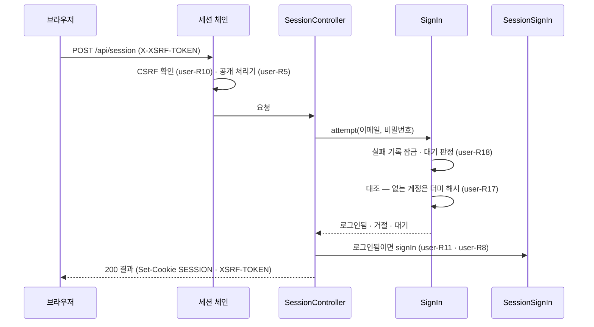

# user 모듈 Spec

공통 구조와 쓰는 규칙은 [specs/README.md](README.md)에 있다.

## 1. 책임과 범위

`user` 는 계정과 그 인증을 맡는다. 앱의 보안 구성 전체가 이 모듈에 있다.

- **계정 · 자격** — 계정(역할 `USER` · `ADMIN`, 상태)과 자체 로그인 자격(이메일 · 비밀번호 해시)을 저장한다. 이메일 정규화와 비밀번호 규칙의 정본이다
- **보안 구성** — 요청을 세 보안 체인(운영자 · 세션 · 기본)으로 나눈다. 두 역할 공통이다
- **운영자 접근 통제** — 운영자 경로를 운영자 토큰(서버 설정 하나)으로 막는다
- **세션** — 화면용 API 를 사용자 ID 만 담은 DB 세션 · 쿠키 CSRF 로 인증하고, 요청마다 계정 상태 · 역할을 읽는다. 공개 표시가 없는 처리기는 세션을 요구한다
- **세션 사용자 범위** — 화면용 API 처리기가 사용자를 인자 타입 `UserId` 로만 받게 한다(요청에서 사용자 ID 를 받지 않는다)
- **자체 로그인** — 로그인 · 로그아웃 · 로그인 상태 조회. 로그인 실패는 계정 유무와 무관하게 같은 응답을 주고, 제출된 이메일마다 연속 실패에 지연을 늘린다
- **정리** — 만료 세션과 오래된 로그인 실패 기록을 지운다
- **(미구현)** 계정을 만드는 길(초대 링크 · 운영자 계정 생성 · 첫 운영자 · 공개 가입), 복구 코드, 비밀번호 변경, 화면 내 알림, 사용자 설정 · 태그 선호와 그 이력, 스토리라인 구독과 그 이력, 리포트 설정 — [security.md "가입"](../security.md#가입) · [data-model.md "사용자"](../data-model.md#사용자)

하지 않는 것:

- 화면용 API 경로의 규약(`/api/**` · `/api/admin/**`)과 공개 표시 애너테이션을 갖지 않는다 — `platform` 의 공개 타입이다([platform Spec §3](platform.md#3-공개-인터페이스))
- 다른 모듈의 처리기가 공개인지 정하지 않는다 — 각 모듈이 자기 처리기에 공개 표시를 단다
- 운영자 경로의 기능을 갖지 않는다 — 운영자 API 는 `admin` 이 낸다
- 메일을 보내지 않는다 — 이메일은 인증하지 않는 로그인 식별자다([ADR-0011](../adr/0011-no-email-in-v1.md))

다른 모듈과의 의존과 이벤트 흐름은 [overview.md §5](../overview.md#5-모듈-지도)에 있다.

## 2. 용어

공개 처리기는 [platform Spec §2](platform.md#2-용어)에 있다.

| 용어 | 뜻 |
|---|---|
| 세션 사용자 | 요청의 세션이 가리키는 계정 — 세션에는 사용자 ID 만 있고, 역할 · 상태는 요청마다 계정에서 읽는다(user-R7) |
| 로그인 유지 | 로그인 때 고르는 선택. 켜면 지속 쿠키 · 비활성 7일, 끄면 브라우저 세션 쿠키 · 비활성 2시간(user-R8) |
| 실패 기록 | 제출된 정규화 이메일의 다이제스트마다 센 연속 로그인 실패 — 계정이 없어도 생긴다(user-R19) |
| 운영자 토큰 | 운영자 경로를 여는 비밀 값 하나 — 서버 설정으로 받고, 화면이 `Authorization: Bearer` 로 보낸다. 설정하지 않으면 운영자 기능이 닫힌다(user-R1 · user-R2) |

## 3. 공개 인터페이스

모듈 최상위 패키지 `net.yozmnews.user` 의 공개 타입은 사용자 식별자 하나(`UserId`)다.

HTTP 엔드포인트:

| 경로 | 메서드 | 용도 |
|---|---|---|
| `/api/session` | `POST` | 로그인 — 판정 결과(로그인됨 · 거절 · 대기)를 200 으로 낸다(user-R17) |
| `/api/session` | `DELETE` | 로그아웃 — 세션이 없어도 204(user-R11) |
| `/api/me` | `GET` | 로그인 상태 조회 — 로그인 여부와 무관하게 200(user-R20) |

세 처리기는 모두 공개 처리기다(user-R5). 요청 · 응답 형식은 `api/openapi.json` 에 있다.

### UserId

사용자 식별자 — `users.id` 다. 다른 모듈의 사용자 데이터가 이 타입으로 사용자를 가리키고, 화면용 API 처리기는 이 타입의 인자로 세션 사용자를 받는다(user-R6).

```java
public record UserId(long value) {}
```

| 필드 | 뜻 | 제약 |
|---|---|---|
| `value` | `users.id` | 1 이상 — 아니면 생성자가 `IllegalArgumentException` 을 던진다 |

관련 규칙: user-R6.

## 4. 내부 구조

### 개관

| 패키지 | 책임 |
|---|---|
| (최상위) | 사용자 식별자(§3) |
| `adapter/in/job` | 만료 세션 정리 · 오래된 실패 기록 정리 반복 작업 |
| `adapter/in/web` | 로그인 · 로그아웃 · 상태 조회 엔드포인트와 그 요청 · 응답 값, 세션 사용자 인자 해석 |
| `adapter/out/persistence` | 실패 기록의 잠금 · 기록 · 삭제 |
| `application` | 보안 구성(체인 셋 · 쿠키 · CSRF), 운영자 토큰 인증, 세션 인증 · 계정 확인 필터 · 공개 처리기 인가, 세션 로그인 · 로그아웃, 로그인 유스케이스, 비밀번호 해시, 정리 유스케이스, 문제 유형 |
| `domain` | 계정 · 자격 aggregate 와 저장소, 이메일 정규화, 비밀번호 규칙, 세션 수명, 실패 지연 일정 · 실패 기록과 그 저장 인터페이스, 운영자 자격 판정 |

협력: 요청은 `SecurityConfiguration` 의 체인 셋 가운데 하나를 탄다(user-R4). 운영자 체인은 `AdminTokenFilter` 가 제시된 토큰을 `AdminTokenAuthenticationProvider` 에 맡겨 `AdminCredential` 과 대조한다. 세션 체인은 Spring Session 이 DB 에서 세션을 읽은 뒤 `SessionAccountFilter` 가 세션의 사용자 ID 로 `AccountRepository` 를 읽어 요청의 인증을 정하고, `PublicApiAuthorization` 이 처리기의 공개 표시로 인가한다. 로그인은 `SessionController` → `SignIn`(실패 기록 `LoginFailures` · 계정 · 자격 · `PasswordHashing` · `LoginThrottle`) → 성공이면 `SessionSignIn` 이 세션을 만든다. 처리기 인자 `UserId` 는 `SessionUserArgumentResolver` 가 요청의 인증에서 채운다. 보안 진입점 · 거부 처리기는 `platform` 의 `ProblemResponses` 로 문제 응답을 쓴다.



역할: `SessionController` · `UserWebConfiguration` 은 화면 역할, `ExpireSessionsJob` · `ForgetLoginFailuresJob` 은 작업 역할에서만 켜진다. 보안 구성을 포함한 나머지는 두 역할 공통이다(user-R4 · [platform Spec](platform.md#역할) platform-R9).

### 들어오는 쪽

| 진입점 | 구성 요소 | 계기 | 내용 |
|---|---|---|---|
| 보안 체인 | `SecurityConfiguration` 의 운영자 · 세션 · 기본 체인 | 모든 HTTP 요청 | 운영자 경로는 운영자 토큰, 화면용 API 는 세션 · CSRF, 그 밖은 연다(user-R1 · R4 · R5 · R10) |
| 운영자 자격 검사 | `SecurityConfiguration` | 기동 | 운영자 토큰의 형식을 확인하고, 틀리면 기동하지 않는다(user-R2) |
| 로그인 · 로그아웃 · 상태 조회 | `SessionController` | `POST` · `DELETE /api/session`, `GET /api/me` | user-R11 · R17 · R20. 응답 값 `SignInResponse` · `MeResponse` |
| 세션 사용자 인자 | `UserWebConfiguration` · `SessionUserArgumentResolver` | 처리기 인자 `UserId` | 요청의 세션 사용자로 채운다(user-R6) |
| 만료 세션 정리 — 반복 작업 ID `expire-sessions` | `ExpireSessionsJob` | 10분마다 | 만료 세션을 지운다(user-R12). 재시도하지 않는다 — 다음 회차가 이어 지운다 |
| 실패 기록 정리 — 반복 작업 ID `forget-login-failures` | `ForgetLoginFailuresJob` | 1시간마다 | 마지막 실패에서 24시간이 지난 실패 기록을 지운다(user-R19). 재시도하지 않는다 |

### `application`

- `SecurityConfiguration` — 보안 구성. 체인 셋(운영자 · 세션 · 기본)의 순서와 경로, 운영자 자격과 토큰 대조 provider, 거부의 문제 응답. 역할 이름의 정본이다(user-R1 · R4)
- `AdminTokenFilter` — 운영자 체인 안에서 `Authorization: Bearer` 의 토큰을 provider 에 맡겨 운영자 인증을 둔다. 빈이 아니다(user-R1)
- `AdminTokenAuthenticationProvider` — 제시된 토큰을 운영자 자격과 대조하는 유일한 자리(user-R2)
- `SessionAccountFilter` — 세션 체인 안에서 세션의 사용자 ID 로 계정을 읽어 요청의 인증(역할 권한)을 정하거나 세션을 끊는다. 빈이 아니다(user-R7)
- `SessionSecurityContexts` — 세션의 보안 문맥 저장소. 읽지 못하는 세션은 지우고 익명으로 둔다(user-R7)
- `PublicApiAuthorization` — 세션 체인의 인가. 요청의 처리기를 앱의 처리기 매핑에서 찾아 공개 표시로 가른다(user-R5)
- `SessionCookies` — 세션 쿠키 직렬화기와 CSRF 토큰 저장소. 쿠키 속성의 정본이다(user-R9)
- `SessionSignIn` — 세션 로그인(세션 ID 교체 · CSRF 토큰 교체 · 보안 문맥 저장 · 수명) · 로그아웃(user-R8 · R11)
- `SignIn` — 로그인 유스케이스. 한 번의 시도가 트랜잭션 하나이고, 실패 기록 행 잠금이 대조 동안 이어진다(user-R17 · R18)
- `PasswordHashing` — Argon2id 해시 · 대조와 더미 해시 대조(user-R15 · R17)
- `SessionExpiry` · `LoginFailureCleanup` — 정리 유스케이스(user-R12 · R19)
- `AccountQueries` — 쓰는 계정 조회. 로그인 상태 조회가 세션 사용자의 계정을 읽는다(user-R20)
- `ProblemTypes` — 보안 거부의 문제 유형 URI 와 제목의 정본(user-R3)
- 그 밖의 값: `AdminSecurityProperties`(설정 `yozmnews.admin` — §7) · `AdminTokenAuthentication`(제시된 토큰 · 운영자 인증) · `AccountAuthentication`(세션 사용자 인증 — 세션에 직렬화되는 유일한 앱 타입) · `SignInOutcome`(로그인됨 · 거절 · 대기)

### `domain`

- `Account` — 계정 aggregate(`users`). 이메일 · 표시 이름 · 역할 · 상태. 비밀번호 해시를 갖지 않는다. 저장소 `AccountRepository`(이메일로 찾기)
- `PasswordCredential` — 자체 로그인 자격 aggregate(`user_password_credentials`). 계정과 사용자 ID 로만 잇는다. 저장소 `PasswordCredentialRepository`
- `EmailAddress` — 이메일 정규화의 정본(user-R13)
- `PasswordPolicy` — 비밀번호 규칙의 정본 — 정규화 · 최소 · 최대 길이 상수(user-R14)
- `SessionLifetime` — 세션 수명의 정본 — 로그인 유지 · 유지 안 함의 비활성 기간 상수(user-R8)
- `LoginThrottle` — 실패 지연 일정의 정본 — 지연 없는 실패 수 · 첫 대기 · 최대 대기 · 기록을 잊는 기간 상수, 다시 시도할 수 있는 때와 정리 기준 시각(user-R19)
- `LoginFailures` — 실패 기록의 잠금 · 기록 · 삭제 저장 인터페이스. 구현은 `adapter/out/persistence` 의 `JdbcLoginFailures` 다(user-R18 · R19)
- `AdminCredential` — 운영자 자격의 판정 정본 — 토큰 형식(최소 · 최대 길이 상수), 열림, 상수 시간 대조. 값은 다이제스트로만 갖는다(user-R2)
- 그 밖의 값: `AccountRole` · `AccountStatus` · `PasswordProblem` · `FailureRecord` · `EmailDigest`

### 나가는 쪽

해당 없음 — 포트가 없다. 세션 저장소(Spring Session JDBC)와 반복 작업(JobRunr)은 프레임워크다. 실패 기록은 `JdbcLoginFailures` 가 `LoginFailures` 의 구현으로 직접 읽고 쓴다(§6).

신뢰할 수 없는 입력: 로그인 요청의 이메일 · 비밀번호(user-R13 · R14 · R17), 세션 쿠키 · CSRF 헤더(user-R7 · R10), 운영자 토큰 헤더(user-R1).

## 5. 규칙과 불변식

### 운영자 접근 통제

판단의 이유는 [ADR-0043](../adr/0043-admin-functions-guarded-by-env-bearer-token-until-account-roles.md)에 있다.

- **user-R1** — 운영자 경로(`/api/admin/**` — `platform` 의 `ApiPaths.ADMIN`)는 `ADMIN` 역할만 쓴다. 운영자 토큰을 `Authorization: Bearer`(스킴은 대소문자 무시)로 제시해 맞으면 `ADMIN` 역할로 인증한다. 운영자 토큰을 설정하지 않은 인스턴스는 운영자 경로가 어떤 토큰에도 403 `admin-closed` 다. 설정한 인스턴스에서 토큰이 없거나 틀리거나 스킴이 다르면 401 `admin-unauthorized` 이고 `WWW-Authenticate: Bearer` 를 단다. 인증했지만 역할이 없으면 403 `admin-forbidden` 이다. 운영자 체인은 세션을 만들거나 읽지 않고 폼 로그인 · Basic · 로그아웃 · 요청 저장 · CSRF 를 쓰지 않는다 — 세션 쿠키는 운영자 경로를 열지 않는다
- **user-R2** — 운영자 토큰은 설정 `yozmnews.admin.token`(§7) 하나다. 없거나 빈 값이면 운영자 기능이 닫힌다. 값은 RFC 6750 b64token(영문 대소문자 · 숫자 · `-` `.` `_` `~` `+` `/`, 끝에 `=` 0개 이상)으로 32 ~ 512 자다(`AdminCredential.MIN_LENGTH` · `MAX_LENGTH`) — 어기면 기동하지 않는다. 대조는 SHA-256 다이제스트를 상수 시간으로 견주고, 대조하는 자리는 하나다. 값은 로그 · 예외 문구 · 응답 · 문자열 표현에 남지 않는다(형식 오류의 기동 실패 문구 포함). 틀린 토큰의 요청을 따로 제한하지 않는다
- **user-R3** — 문제 유형 URI 는 화면과의 계약이다(명세의 `type` 은 열거가 아니다). 정본은 `ProblemTypes` 다: `urn:yozmnews:problem:admin-closed`(403, 운영자 기능 닫힘) · `urn:yozmnews:problem:admin-unauthorized`(401, 토큰 없음 · 틀림) · `urn:yozmnews:problem:admin-forbidden`(403, 역할 없음) · `urn:yozmnews:problem:unauthenticated`(401, 세션 없음 · 만료) · `urn:yozmnews:problem:csrf-rejected`(403, CSRF 토큰 없음 · 틀림). 화면은 `admin-closed` 로 닫힘 안내를, `unauthenticated` 로 로그인 이동을 가른다

### 보안 구성

판단의 이유는 [ADR-0124](../adr/0124-security-configuration-lives-in-the-user-module-and-platform-keeps-only-the-screen-api-path-convention.md)에 있다.

- **user-R4** — 요청은 체인 셋 가운데 처음 맞는 하나를 탄다: ① 운영자 체인 — 운영자 경로(user-R1) ② 세션 체인 — 그 밖의 화면용 API 경로(`/api/**` — `ApiPaths.API`, user-R5 ~ R11) ③ 기본 체인 — 나머지(관리 엔드포인트 · 오류 경로), 모두 허용 · 세션 없음 · CSRF 없음. 보안 구성은 두 역할 공통이다 — 어느 프로세스에도 Spring Boot 의 기본 사용자 · 생성 비밀번호가 생기지 않는다

### 화면용 API 의 공개와 세션 사용자

판단의 이유는 [ADR-0125](../adr/0125-screen-api-handlers-need-a-session-unless-marked-public-and-take-the-user-only-as-a-session-filled-argument.md)에 있다.

- **user-R5** — 세션 체인의 인가: 요청의 처리기(메서드나 그 클래스)에 `platform` 의 `@PublicApi` 가 있으면(판정 정본 `PublicApis`) 세션 없이 연다. 처리기가 없는 요청(없는 경로 · 다른 메서드 · 받지 않는 미디어 타입)은 연다 — 404 · 405 · 415 는 MVC 가 낸다(변경 요청은 그 전에 CSRF 를 본다 — user-R10). 그 밖은 세션 사용자가 있어야 하고, 없으면 401 `unauthenticated` 다. `@PublicApi` 의 이유는 비울 수 없다
- **user-R6** — 화면용 API 처리기는 사용자를 묶기 애너테이션이 없는 인자 타입 `UserId` 로만 받는다 — 요청의 세션 사용자로 채운다. 경로 · 질의 · 본문(본문 레코드의 구성 요소 포함) · 헤더 · 쿠키에서 사용자 ID(`UserId` 타입이나 이름 `userId`)를 받지 않는다. 운영자 경로 밖의 화면용 API 처리기는 모두 공개 처리기이거나 사용자 격리 시험에 등록된다 — 시험 `UserScopeTests` 가 앱의 처리기를 열거해 확인한다([test-strategy §13](../qa/test-strategy.md#13-사용자-격리-시험))

### 세션

판단의 이유는 [ADR-0126](../adr/0126-user-paths-authenticate-with-a-jdbc-session-holding-only-the-user-id-and-cookie-csrf-reading-the-account-per-request.md) · [ADR-0127](../adr/0127-sessions-idle-out-after-seven-days-without-an-absolute-limit-and-without-keep-signed-in-use-a-browser-cookie-and-two-hours.md) · [ADR-0128](../adr/0128-session-and-csrf-cookies-are-always-secure-assuming-tls-in-front.md)에 있다.

- **user-R7** — 세션은 Spring Session JDBC 로 DB 에 둔다. 세션에 담는 앱 값은 사용자 ID 하나이고, 세션의 사용자 이름(`PRINCIPAL_NAME`)은 사용자 ID 의 문자열이다. 세션 체인은 요청마다 세션의 사용자 ID 로 계정을 읽는다 — 계정이 없거나 상태가 `ACTIVE` 가 아니면 세션을 지우고 익명으로 처리하며, 그렇지 않으면 그 계정의 역할을 요청의 권한으로 둔다. 요청마다 정한 권한은 세션에 저장하지 않는다. 세션에 담긴 보안 문맥을 읽지 못하면(배포로 직렬화 형식이 바뀐 세션 등) 그 세션을 지우고 익명으로 처리한다 — 공개 처리기 · 로그인은 그대로 쓸 수 있다
- **user-R8** — 세션 수명은 마지막 요청 뒤의 비활성 기간이고 절대 상한이 없다. 로그인 유지를 켜면 7일(`SessionLifetime.KEEP`)이고 세션 쿠키가 지속 쿠키다 — 쿠키 수명은 서버 만료에 맡긴다. 끄면 2시간(`SessionLifetime.BRIEF`)이고 세션 쿠키는 브라우저 세션 쿠키다
- **user-R9** — 세션 쿠키 `SESSION` 은 `HttpOnly` · `Secure` · `SameSite=Lax` · 경로 `/` 다. CSRF 토큰 쿠키 `XSRF-TOKEN` 은 `HttpOnly` 가 아니고(화면이 읽는다) `Secure` · `SameSite=Lax` · 경로 `/` 다. `Secure` 는 요청의 스킴과 무관하게 언제나 단다 — 앞단(Tunnel · 리버스 프록시)이 TLS 를 맡는다는 전제다
- **user-R10** — 세션 체인의 변경 요청(`POST` · `PUT` · `PATCH` · `DELETE`)은 공개 처리기(로그인 · 로그아웃 포함)도 `X-XSRF-TOKEN` 헤더의 CSRF 토큰이 `XSRF-TOKEN` 쿠키와 맞아야 한다 — 아니면 403 `csrf-rejected`. CSRF 토큰 쿠키가 없는 요청에는 세션 체인이 응답에 새 토큰 쿠키를 싣는다
- **user-R11** — 로그인에 성공하면 세션 ID 와 CSRF 토큰을 새로 발급한다(세션 고정 방지) — 새 CSRF 토큰은 그 응답의 쿠키에 바로 싣는다. 로그아웃은 세션을 지우고 세션 쿠키와 CSRF 토큰 쿠키를 만료시키며, 세션이 없어도 204 다
- **user-R12** — 만료 세션은 작업 역할의 반복 작업이 10분마다 지운다. Spring Session 의 자체 정리 작업은 끈다([platform Spec](platform.md#역할) platform-R9)

### 계정과 자격

판단의 이유는 [ADR-0129](../adr/0129-passwords-are-free-form-from-eight-to-128-code-points-without-a-common-password-list.md)에 있다.

- **user-R13** — 이메일 정규화: 앞뒤 공백을 지우고 소문자로 바꾼다(로캘 무관). 정규화한 값이 254 자 이하이고 `@` 가 정확히 하나이며 그 앞뒤가 비지 않아야 이메일이다. 정규화한 이메일이 계정의 고유 키다
- **user-R14** — 비밀번호는 NFKC 로 정규화한 뒤 코드 포인트로 8 ~ 128 자다(`PasswordPolicy.MIN_CODE_POINTS` · `MAX_CODE_POINTS`). 문자 종류를 강제하지 않고 흔한 비밀번호 목록과 대조하지 않는다. 해시와 로그인 대조는 정규화한 값으로 한다
- **user-R15** — 비밀번호 해시는 Argon2id 다 — 솔트 16바이트 · 해시 32바이트 · 병렬 1 · 메모리 19,456 KiB · 반복 2. 파라미터는 해시 문자열에 함께 저장해, 파라미터를 바꿔도 기존 해시를 그대로 대조한다. 비밀번호 · 해시는 로그 · 예외 문구 · 응답에 남지 않는다
- **user-R16** — 계정 하나는 자체 로그인 자격 하나를 반드시 갖는다(§6). 비밀번호 해시는 자격에만 있고 계정 조회에 딸려 오지 않는다

### 로그인

판단의 이유는 [ADR-0130](../adr/0130-sign-in-failure-delays-count-per-digest-of-the-submitted-normalized-email-regardless-of-account.md) · [ADR-0044](../adr/0044-screen-api-results-as-flat-discriminated-200-and-rfc9457-problems.md)에 있다.

- **user-R17** — 로그인 결과는 200 판정 결과(`result`)다: `SIGNED_IN` · `REJECTED` · `WAIT`(남은 초 — 올림, 다른 결과에서는 null). 계정이 없거나 `ACTIVE` 가 아니거나 비밀번호가 틀리면 모두 같은 본문의 `REJECTED` 다. 계정이 없거나 `ACTIVE` 가 아니면 같은 파라미터의 더미 해시와 한 번 대조해 있는 계정과 같은 계산을 한다. 정규화한 비밀번호가 128 코드 포인트를 넘으면 대조하지 않고 실패로 센다. 요청 본문의 칸(이메일 · 비밀번호 · 로그인 유지)이 없으면 본문 형식 400 이다
- **user-R18** — 한 번의 시도는 트랜잭션 하나다: 제출된 이메일의 실패 기록을 잠그고(없으면 만든다) → 기다릴 때면 대조 없이 `WAIT` → 아니면 대조 → 성공이면 실패 기록을 지우고 `SIGNED_IN`, 실패면 실패 기록을 올리고 `REJECTED`. 잠금이 대조 동안 이어져 같은 이메일의 동시 시도는 줄을 선다
- **user-R19** — 실패 기록은 제출된 이메일을 정규화한 값(이메일로 읽을 수 없으면 앞뒤 공백을 지운 소문자)의 SHA-256 다이제스트마다 하나다 — 계정 유무와 무관하다. 마지막 실패에서 24시간(`LoginThrottle.FORGET_AFTER`) 안의 연속 실패가 n 회면 다시 시도할 수 있는 때는 마지막 실패 시각 + 대기이고, 대기는 n ≤ 3(`FREE_FAILURES`)이면 0, 그 밖 `min(1초(FIRST_WAIT) × 2^(n−4), 15분(MAX_WAIT))` 이다. 24시간이 지난 기록은 실패 0 회로 보고, 작업 역할의 반복 작업이 1시간마다 지운다
- **user-R20** — 로그인 상태 조회는 200 판정 결과(`result`)다: `SIGNED_IN`(사용자 ID · 이메일 · 표시 이름 · 역할) · `ANONYMOUS`(나머지 null)

## 6. 데이터

컬럼 타입 · 인덱스 · 제약 문면의 정본은 `backend/src/main/resources/db/migration/V31__users_and_password_credentials.sql` · `V33__login_failures.sql` 이다. 세션 테이블(Spring Session)은 프레임워크 테이블이라 [data-model.md](../data-model.md)에 있다.

| 테이블 | 주요 컬럼 | 뜻 |
|---|---|---|
| `users` | id, email(고유), display_name, role(`USER`/`ADMIN`), status(`ACTIVE`/`SUSPENDED`/`DELETED`), created_at, deleted_at, version | 계정. `email` 은 정규화한 이메일(user-R13)이고 고유 제약이 계정의 고유 키다. 비밀번호 해시를 두지 않는다 |
| `user_password_credentials` | user_id(PK), password_hash, password_changed_at, version | 자체 로그인 자격 — 계정마다 하나. `user_id` 는 `users.id` 를 가리키고 계정을 지우면 함께 지워진다. `password_hash` 는 파라미터를 담은 Argon2id 해시 문자열(user-R15) |
| `login_failures` | email_digest(PK), failures, last_failed_at | 실패 기록(user-R19). `failures` 0 · `last_failed_at` 없음은 한 시도의 트랜잭션 안에서만 있는 자리 행이고 커밋 뒤에는 남지 않는다(user-R18 — 제약이 두 칸의 짝을 지킨다) |

## 7. 설정

| 설정 키 | 바꾸는 규칙 |
|---|---|
| `yozmnews.admin.token` | 운영자 토큰(user-R1 · user-R2). 없으면 운영자 기능이 닫힌다. 형식이 틀리면 앱이 뜨지 않는다 |
| `spring.session.jdbc.initialize-schema` | `never` — 세션 스키마의 정본은 Flyway 마이그레이션이다 |
| `spring.session.jdbc.cleanup-cron` | `-` — Spring Session 의 자체 정리 작업을 끈다(user-R12) |

## 8. 결정

| ADR | 한 줄 |
|---|---|
| [0009](../adr/0009-authentication-google-and-local.md) | v1 인증은 Google 로그인과 자체(이메일·비밀번호) 로그인 |
| [0011](../adr/0011-no-email-in-v1.md) | v1에서는 메일 발송을 하지 않는다 |
| [0043](../adr/0043-admin-functions-guarded-by-env-bearer-token-until-account-roles.md) | 운영자 기능은 계정 인증 전까지 환경 변수의 Bearer 토큰으로 막고, 계정 인증이 생기면 같은 경로의 `ADMIN` 역할 판정으로 바꾼다 |
| [0044](../adr/0044-screen-api-results-as-flat-discriminated-200-and-rfc9457-problems.md) | 화면 API 는 판정 결과를 판별자 하나의 평평한 200 응답으로, 요청의 문제만 RFC 9457 형식의 자체 오류 레코드로 앱 전체에서 낸다 |
| [0048](../adr/0048-sign-up-closed-by-default-with-invitations-and-operator-bootstrap.md) | 가입은 기본으로 닫고 운영자의 초대 링크와 계정 생성으로 사람을 들이며, 첫 운영자는 기동 때 로그의 초대 링크나 환경 변수로 만든다 |
| [0123](../adr/0123-v1-login-is-local-only-and-oidc-and-account-linking-come-after-v1.md) | v1 의 로그인은 자체 로그인 하나이고, OIDC 로그인과 외부 계정 연결은 v1 뒤로 미룬다 |
| [0124](../adr/0124-security-configuration-lives-in-the-user-module-and-platform-keeps-only-the-screen-api-path-convention.md) | 인증 · 보안 구성은 운영자 토큰 체인까지 `user` 모듈이 갖고, `platform` 은 화면용 API 경로 규약만 갖는다 |
| [0125](../adr/0125-screen-api-handlers-need-a-session-unless-marked-public-and-take-the-user-only-as-a-session-filled-argument.md) | 화면용 API 처리기는 공개 표시가 없으면 세션을 요구하고, 사용자는 세션에서 채운 인자로만 받으며, 등록 가드가 공개 표시나 격리 시험 등록을 강제한다 |
| [0126](../adr/0126-user-paths-authenticate-with-a-jdbc-session-holding-only-the-user-id-and-cookie-csrf-reading-the-account-per-request.md) | 사용자 경로는 사용자 ID 만 담은 JDBC 세션과 쿠키 CSRF 로 인증하고, 요청마다 계정 상태와 역할을 읽는다 |
| [0127](../adr/0127-sessions-idle-out-after-seven-days-without-an-absolute-limit-and-without-keep-signed-in-use-a-browser-cookie-and-two-hours.md) | 세션은 비활성 7일이고 절대 상한이 없으며, 로그인 유지를 끄면 브라우저 세션 쿠키와 비활성 2시간이다 |
| [0128](../adr/0128-session-and-csrf-cookies-are-always-secure-assuming-tls-in-front.md) | 세션 · CSRF 쿠키는 언제나 `Secure` 이고 앞단 TLS 를 전제한다 |
| [0129](../adr/0129-passwords-are-free-form-from-eight-to-128-code-points-without-a-common-password-list.md) | 비밀번호는 8 ~ 128 코드 포인트의 자유형이고 흔한 비밀번호 목록과 대조하지 않는다 |
| [0130](../adr/0130-sign-in-failure-delays-count-per-digest-of-the-submitted-normalized-email-regardless-of-account.md) | 로그인 실패 지연은 제출된 정규화 이메일의 다이제스트마다 세고, 계정 유무와 무관하게 같은 기록과 지연을 준다 |
