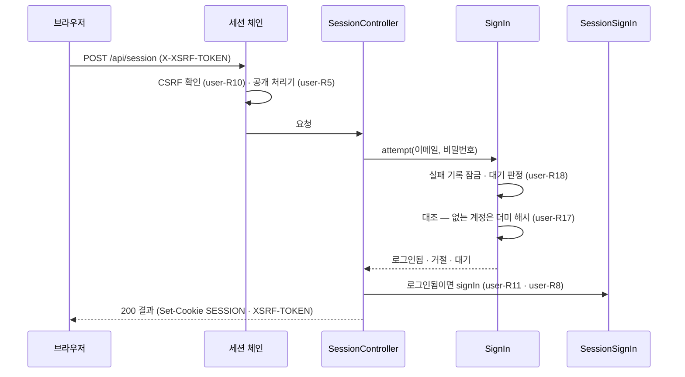

# user 모듈 Spec

공통 구조와 쓰는 규칙은 [specs/README.md](README.md)에 있다.

## 1. 책임과 범위

`user` 는 계정과 그 인증을 맡는다. 앱의 보안 구성 전체가 이 모듈에 있다.

- **계정 · 자격** — 계정(역할 `USER` · `ADMIN`, 상태)과 자체 로그인 자격(이메일 · 비밀번호 해시 · 강제 변경 표시)을 저장한다. 이메일 정규화 · 비밀번호 규칙 · 표시 이름 규칙의 정본이다
- **계정 들이기** — 계정을 만드는 길 넷(공개 가입 · 초대 가입 · 운영자 계정 생성 · 첫 운영자)과 그 정본 하나, 가입 정책(운영자 설정), 초대 링크, 첫 로그인 전 계정의 초기 비밀번호 다시 정하기. 운영 기능은 공개 운영 API 로 두고 운영자 경로는 `admin` 이 낸다
- **비밀번호와 복구** — 첫 로그인의 비밀번호 강제 변경과 그 서버 제한, 비밀번호 변경, 복구 코드(발급 · 재발급 · 복구 재설정), 비밀번호가 바뀌면 그 사용자의 다른 세션 종료
- **보안 구성** — 요청을 세 보안 체인(운영자 · 세션 · 기본)으로 나눈다. 두 역할 공통이다
- **운영자 접근 통제** — 운영자 경로를 운영자 토큰(서버 설정 하나)으로 막는다
- **세션** — 화면용 API 를 사용자 ID 만 담은 DB 세션 · 쿠키 CSRF 로 인증하고, 요청마다 계정 상태 · 역할을 읽는다. 공개 표시가 없는 처리기는 세션을 요구한다
- **세션 사용자 범위** — 화면용 API 처리기가 사용자를 인자 타입 `UserId` 로만 받게 한다(요청에서 사용자 ID 를 받지 않는다)
- **자체 로그인** — 로그인 · 로그아웃 · 로그인 상태 조회. 로그인 실패는 계정 유무와 무관하게 같은 응답을 주고, 제출된 이메일마다 연속 실패에 지연을 늘린다
- **화면 내 알림** — 메일 대신 쓰는 알림을 받는 사용자마다 저장하고, 세션 사용자의 알림함(목록 · 안 읽은 수 · 읽음)을 낸다. 지금 종류는 둘이다 — 피드 상태 알림(`source` 의 피드 상태 변화를 운영자 계정마다 안 읽은 알림 하나에 모은다)과 비밀번호 알림
- **정리** — 만료 세션과 오래된 실패 기록(로그인 · 복구), 읽은 지 오래된 알림을 지운다
- **(미구현)** 키 무효 · 다이제스트 실패 알림, 사용자 설정 · 태그 선호와 그 이력, 스토리라인 구독과 그 이력, 리포트 설정 — [security.md "가입"](../security.md#가입) · [data-model.md "사용자"](../data-model.md#사용자)

하지 않는 것:

- 화면용 API 경로의 규약(`/api/**` · `/api/admin/**`)과 공개 표시 애너테이션을 갖지 않는다 — `platform` 의 공개 타입이다([platform Spec §3](platform.md#3-공개-인터페이스))
- 다른 모듈의 처리기가 공개인지 정하지 않는다 — 각 모듈이 자기 처리기에 공개 표시를 단다
- 운영자 경로의 기능을 갖지 않는다 — 운영자 API 는 `admin` 이 이 모듈의 운영 API 를 불러 낸다
- 계정의 역할을 바꾸지 않는다 — `ADMIN` 은 첫 운영자로만 생긴다(user-R28)
- 메일을 보내지 않는다 — 이메일은 인증하지 않는 로그인 식별자다([ADR-0011](../adr/0011-no-email-in-v1.md))
- 피드 상태를 판정하지 않는다 — 판정은 `source` 가 하고, 이 모듈은 받은 전이를 알림에 담기만 한다

다른 모듈과의 의존과 이벤트 흐름은 [overview.md §5](../overview.md#5-모듈-지도)에 있다.

## 2. 용어

공개 처리기는 [platform Spec §2](platform.md#2-용어)에 있다.

| 용어 | 뜻 |
|---|---|
| 세션 사용자 | 요청의 세션이 가리키는 계정 — 세션에는 사용자 ID 만 있고, 역할 · 상태는 요청마다 계정에서 읽는다(user-R7) |
| 로그인 유지 | 로그인 때 고르는 선택. 켜면 지속 쿠키 · 비활성 7일, 끄면 브라우저 세션 쿠키 · 비활성 2시간(user-R8) |
| 실패 기록 | 제출된 정규화 이메일의 다이제스트마다 종류(로그인 · 복구)별로 센 연속 실패 — 계정이 없어도 생긴다(user-R19) |
| 계정을 만드는 길 | 계정이 생기는 경로 — 공개 가입 · 초대 가입 · 운영자 계정 생성 · 첫 운영자 넷이고, 길마다 역할 · 강제 변경 · 만들 때 복구 코드가 정해진다(user-R28) |
| 초기 비밀번호 | 계정 주인이 아닌 사람(운영자 · 서버 운영자)이 정한 비밀번호 — 운영자 계정 생성 · 첫 운영자가 쓴다 |
| 강제 변경 | 초기 비밀번호로 만든 계정이 첫 로그인에서 비밀번호를 바꾸기 전의 상태 — 그 세션은 비밀번호 변경 · 상태 조회 · 로그아웃만 쓴다(user-R29) |
| 복구 코드 | 계정마다 하나인 160비트 무작위 값 — 비밀번호를 잊었을 때 이메일과 함께 내 비밀번호를 다시 정한다. 한 번만 보여 준다(user-R30) |
| 초대 | 운영자가 발급한 일회용 · 7일 가입 링크(`/invite#토큰`) — 이메일에 묶이지 않는다(user-R31) |
| 가입 정책 | 공개 가입을 여는가 — 운영자 설정이고 처음 값은 닫힘이다(user-R32) |
| 첫 운영자 | 기동 때 설정의 이메일 · 초기 비밀번호로 만드는 `ADMIN` 계정(user-R34) |
| 운영자 토큰 | 운영자 경로를 여는 비밀 값 하나 — 서버 설정으로 받고, 화면이 `Authorization: Bearer` 로 보낸다. 설정하지 않으면 운영자 기능이 닫힌다(user-R1 · user-R2) |
| 알림 | 메일 대신 화면 안에서 알리는 것 — 받는 사용자마다 한 행이고, 종류 하나와 그 종류의 내용을 갖는다(user-R21) |
| 판 | 알림 내용의 고친 횟수 — 1 부터, 내용을 고칠 때마다 하나 오른다. 읽음은 화면이 받은 판이 그대로인 알림만 바꾼다(user-R25) |
| 피드 상태 알림 | 운영자 계정이 받는 피드 상태 변화 알림 — 피드마다 한 줄이고, 줄은 처음 이전 상태 · 마지막 새 상태 · 바뀐 횟수 · 처음 · 마지막 판정 시각이다(user-R23) |
| 모으기 | 검사 회차의 전이를 그 사용자의 안 읽은 피드 상태 알림에 더하는 것 — 없으면 새로 만든다(user-R23) |
| 반영 기준 | 사용자마다 반영한 마지막 검사 회차의 판정 시각 — 읽은 알림과 따로 남아, 다시 처리된 회차와 늦게 온 앞선 회차를 거른다(user-R24) |

## 3. 공개 인터페이스

모듈 최상위 패키지 `net.yozmnews.user` 의 공개 타입은 사용자 식별자 하나(`UserId`), 비밀번호 규칙 위반의 까닭 하나(`PasswordProblem`), 계정 들이기의 운영 API 셋(`AccountAdministration` · `InvitationAdministration` · `SignUpPolicyAdministration`)과 그 결과 · 값 타입(`AccountCreationResult` · `InitialPasswordResetResult` · `IssuedInvitation` · `InvitationView` · `InvitationState` · `InvitationRevocationResult` · `UnknownInvitationException` · `SignUpPolicyChange` · `SignUpPolicyChangeResult`)이다. 운영 API 는 `admin` 이 운영자 경로로 낸다.

HTTP 엔드포인트:

| 경로 | 메서드 | 용도 |
|---|---|---|
| `/api/session` | `POST` | 로그인 — 판정 결과(로그인됨 · 거절 · 대기)를 200 으로 낸다(user-R17) |
| `/api/session` | `DELETE` | 로그아웃 — 세션이 없어도 204(user-R11) |
| `/api/me` | `GET` | 로그인 상태 조회 — 로그인 여부와 무관하게 200(user-R20) |
| `/api/notices` | `GET` | 세션 사용자의 알림 — 최근부터 한 쪽(50개)과 다음 쪽 커서. 질의 `before`(선택, 1 이상)(user-R27) |
| `/api/notices/unread-count` | `GET` | 세션 사용자의 안 읽은 알림 수(user-R27) |
| `/api/notices/read` | `POST` | 화면이 받은 알림의 `{id, revision}` 목록(50개까지)을 읽음으로 — 204(user-R25 · user-R27) |
| `/api/sign-up-policy` | `GET` | 공개 가입이 열렸는가 — `{open}`(user-R32) |
| `/api/sign-ups` | `POST` | 공개 가입 — `SIGNED_UP`(+복구 코드) · `CLOSED` · `EMAIL_UNAVAILABLE` · `EMAIL_MALFORMED` · `DISPLAY_NAME_MALFORMED` · `PASSWORD_REJECTED`(+까닭)(user-R33) |
| `/api/invitation-checks` | `POST` | 초대 토큰의 상태 — `VALID` · `USED` · `EXPIRED` · `REVOKED` · `UNKNOWN`(user-R31) |
| `/api/invitation-acceptances` | `POST` | 초대 가입 — 공개 가입의 결과에서 `CLOSED` 대신 `INVITATION_UNUSABLE`(+초대 상태 `invitation`)(user-R31 · user-R33) |
| `/api/account-recoveries` | `POST` | 복구 코드로 비밀번호 재설정 — `RESET`(+새 복구 코드) · `REJECTED` · `WAIT`(+남은 초) · `PASSWORD_REJECTED`(+까닭)(user-R30) |
| `/api/account/password` | `PUT` | 비밀번호 변경 — `CHANGED`(+강제 변경이었으면 새 복구 코드) · `REJECTED` · `WAIT` · `PASSWORD_REJECTED`(user-R29) |
| `/api/account/recovery-code` | `POST` | 복구 코드 재발급 — `ISSUED`(+새 복구 코드) · `REJECTED` · `WAIT`(user-R30) |

로그인 · 로그아웃 · 로그인 상태 조회 · 가입 정책 조회 · 가입 둘 · 초대 상태 · 복구 재설정은 공개 처리기다. 알림 세 경로 · 비밀번호 변경 · 복구 코드 재발급은 세션이 필요하며 사용자 격리 시험에 등록돼 있다(user-R5 · user-R6). 비밀번호 변경은 강제 변경 중에도 연다(`@AllowedBeforePasswordChange` — user-R29). 판정 결과는 200 이고 요청 본문의 칸이 없으면 본문 형식 400 이다. 요청 · 응답 형식은 `api/openapi.json` 에 있다.

### UserId

사용자 식별자 — `users.id` 다. 다른 모듈의 사용자 데이터가 이 타입으로 사용자를 가리키고, 화면용 API 처리기는 이 타입의 인자로 세션 사용자를 받는다(user-R6).

```java
public record UserId(long value) {}
```

| 필드 | 뜻 | 제약 |
|---|---|---|
| `value` | `users.id` | 1 이상 — 아니면 생성자가 `IllegalArgumentException` 을 던진다 |

관련 규칙: user-R6.

### PasswordProblem

비밀번호 규칙을 어긴 까닭 — 가입 · 재설정 · 변경의 응답과 운영자 계정 운영의 결과가 싣는다.

```java
public enum PasswordProblem { TOO_SHORT, TOO_LONG }
```

관련 규칙: user-R14.

### AccountAdministration

운영자 계정 운영 — `admin` 이 운영자 경로로 낸다. 길이 상수는 운영자 응답의 거부 설명이 읽고, 정본은 표시 이름 · 비밀번호 규칙이다.

```java
public interface AccountAdministration {
	int DISPLAY_NAME_MAX_CODE_POINTS = DisplayName.MAX_CODE_POINTS;
	int PASSWORD_MIN_CODE_POINTS = PasswordPolicy.MIN_CODE_POINTS;
	int PASSWORD_MAX_CODE_POINTS = PasswordPolicy.MAX_CODE_POINTS;
	AccountCreationResult create(String email, String displayName, String initialPassword);
	InitialPasswordResetResult resetInitialPassword(String email, String initialPassword);
}
```

| 메서드 | 결과 |
|---|---|
| `create` | `AccountCreationResult` — `Created(UserId user)` · `EmailTaken()` · `EmailMalformed()` · `DisplayNameMalformed()` · `PasswordRejected(PasswordProblem problem)`. 만든 계정은 `USER` · 강제 변경이다 |
| `resetInitialPassword` | `InitialPasswordResetResult` — `Reset()` · `NotPending()`(계정 주인이 이미 바꿨다) · `NoAccount()`(쓰는 계정이 없거나 이메일이 아니다) · `PasswordRejected(PasswordProblem problem)` |

- 계약
  - 결과는 봉인 인터페이스다 — 받는 쪽은 기본 갈래 없는 망라 분기로 가른다
  - 비밀번호는 결과 · 예외 · 로그에 실리지 않는다

관련 규칙: user-R28 · user-R35.

### InvitationAdministration

초대 운영 — `admin` 이 운영자 경로로 낸다.

```java
public interface InvitationAdministration {
	IssuedInvitation issue(@Nullable String memo);
	List<InvitationView> recent();
	InvitationRevocationResult revoke(long invitationId);
}

public record InvitationView(long id, @Nullable String memo, Instant createdAt, Instant expiresAt,
		InvitationState state, @Nullable Instant usedAt, @Nullable String usedByEmail, @Nullable Instant revokedAt) {}

public enum InvitationState { VALID, USED, EXPIRED, REVOKED }
```

| 메서드 | 결과 |
|---|---|
| `issue` | `IssuedInvitation` — `Issued(long id, String token, Instant expiresAt)`(토큰은 여기서 한 번만 — 문자열 표현은 숨긴다) · `MemoTooLong(int max)` |
| `recent` | 최근 발급한 초대 50개(`InvitationPolicy.LIST_SIZE`), 발급 역순. 토큰은 없다. `usedByEmail` 은 가입한 계정이 지워졌으면 null |
| `revoke` | `InvitationRevocationResult` — `Revoked()` · `NotRevocable(InvitationState state)`(유효한 초대가 아니다). 없는 초대는 `UnknownInvitationException`(`invitationId()`, 문구 "없는 초대: {ID}") |

관련 규칙: user-R31.

### SignUpPolicyAdministration

가입 정책 운영 — `admin` 이 운영자 경로로 낸다.

```java
public interface SignUpPolicyAdministration {
	boolean open();
	SignUpPolicyChangeResult change(boolean open, ChangeActor actor);
	List<SignUpPolicyChange> changes();
}

public record SignUpPolicyChange(@Nullable Boolean previousOpen, boolean open, ChangeActor actor, Instant changedAt) {}
```

| 메서드 | 결과 |
|---|---|
| `open` | 지금 값 |
| `change` | `SignUpPolicyChangeResult` — `Changed(boolean previous, boolean current)` · `Unchanged(boolean current)`(같은 값 — 이력 없음) |
| `changes` | 이력 전부, 최근부터. 처음 값의 `previousOpen` 은 null |

관련 규칙: user-R32.

## 4. 내부 구조

### 개관

| 패키지 | 책임 |
|---|---|
| (최상위) | 사용자 식별자 · 비밀번호 규칙 위반의 까닭 · 계정 들이기의 운영 API 셋과 그 결과 · 값(§3) |
| `adapter/in/job` | 만료 세션 정리 · 오래된 실패 기록 정리 · 읽은 알림 정리 반복 작업 |
| `adapter/in/web` | 로그인 · 로그아웃 · 상태 조회 · 알림함 · 가입 · 초대 · 복구 · 비밀번호 변경 엔드포인트와 그 요청 · 응답 값, 세션 사용자 인자 해석과 그 인자를 화면용 API 명세에서 빼는 설정 |
| `adapter/out/persistence` | 실패 기록의 잠금 · 기록 · 삭제, 알림 · 반영 기준 저장소, 피드 상태 알림의 받는 사람 조회, 복구 코드 저장소, 요청의 세션 계정 조회, 가입 정책 저장소, 첫 운영자 잠금 |
| `application` | 보안 구성(체인 셋 · 쿠키 · CSRF), 운영자 토큰 인증, 세션 인증 · 계정 확인 필터 · 공개 처리기 인가, 세션 로그인 · 로그아웃, 로그인 유스케이스, 비밀번호 해시, 계정을 만드는 정본과 가입 · 운영자 계정 · 첫 운영자 유스케이스, 가입 정책 · 초대 운영, 비밀번호 변경 · 복구 재설정 · 복구 코드 재발급과 다른 세션 종료, 피드 상태 · 비밀번호 알림 유스케이스, 알림함 유스케이스, 정리 유스케이스, 문제 유형 |
| `domain` | `account`(계정 aggregate · 이메일 · 표시 이름 · 계정을 만드는 길), `credential`(자격 aggregate · 비밀번호 규칙), `secret`(비밀 다이제스트 · 복구 코드 · 초대 토큰), `recovery`(복구 코드 저장), `session`(세션 수명 · 요청의 세션 계정), `throttle`(실패 지연 일정 · 실패 기록 · 종류), `invitation`(초대 aggregate · 규칙), `signup`(가입 정책 저장), `bootstrap`(첫 운영자 값 · 판정 · 잠금), `notice`(알림 종류 · 내용 · 모으기 · 반영 기준 · 보존과 그 저장 · 받는 사람 조회), 최상위 운영자 자격 판정 |

협력: 요청은 `SecurityConfiguration` 의 체인 셋 가운데 하나를 탄다(user-R4). 운영자 체인은 `AdminTokenFilter` 가 제시된 토큰을 `AdminTokenAuthenticationProvider` 에 맡겨 `AdminCredential` 과 대조한다. 세션 체인은 Spring Session 이 DB 에서 세션을 읽은 뒤 `SessionAccountFilter` 가 세션의 사용자 ID 로 `SessionAccounts`(계정 상태 · 역할 · 강제 변경)를 읽어 요청의 인증을 정하고, `PublicApiAuthorization` 이 처리기의 공개 · 변경 전 허용 표시로 인가한다. 로그인은 `SessionController` → `SignIn`(`FailureThrottle` 의 실패 기록 · 계정 · 자격 · `PasswordHashing`) → 성공이면 `SessionSignIn` 이 세션을 만든다. 처리기 인자 `UserId` 는 `SessionUserArgumentResolver` 가 요청의 인증에서 채운다. 보안 진입점 · 거부 처리기는 `platform` 의 `ProblemResponses` 로 문제 응답을 쓴다.

계정 들이기: 가입 둘(`SignUpController` → `SignUp`)과 운영자 계정 생성(`OperatorAccountService`) · 첫 운영자(`FirstAdminBootstrap`)가 모두 `AccountProvisioning` 으로 계정 · 자격(· 복구 코드)을 만들고, 그 트랜잭션 경계(같은 이메일 고유 제약 위반을 결과로 옮기기)도 `AccountProvisioning` 하나다. 가입 정책은 `SignUpPolicyService` · `SignUpPolicySeeding` → `SignUpPolicyRepository`, 초대는 `InvitationService` → `InvitationRepository` 다. 가입 · 복구가 로그인하면 `SessionSignIn` 이 들고 온 세션을 버리고 새 세션을 만든다.

비밀번호: 변경(`AccountController` → `PasswordChange`) · 재발급(`RecoveryCodeReissue`)은 `CurrentPasswordCheck` 로 현재 비밀번호를 확인하고, 복구 재설정(`AccountRecovery`)은 `FailureThrottle` 의 복구 실패 기록에 걸어 복구 코드를 대조한다. 자격을 바꾼 유스케이스는 커밋 직전 마지막 단계로 `OtherSessions` 가 그 사용자의 세션을 지우고, 비밀번호 알림은 `PasswordChangedNotices` 가 남긴다.

알림: `source` 의 `FeedStatusesChanged` 를 `FeedStatusNoticeListener` 가 받아 `FeedStatusNotices` 에 맡긴다. 유스케이스는 피드 이름을 `source` 의 `FeedLabels` 로, 받는 사람을 `NoticeRecipients` 로 읽고, 받는 사람마다 `NoticeRepository` 로 반영 기준 행을 잠근 뒤 `FeedStatusReceipt` 로 회차를 거르고, 안 읽은 피드 상태 알림을 `FeedStatusContent` 로 모으거나 새로 만든다. 화면은 `NoticeController` → `NoticeInbox` → `NoticeRepository` 로 세션 사용자의 알림을 읽고 읽음을 쓴다.



역할: `SessionController` · `NoticeController` · `SignUpController` · `AccountController` · `UserWebConfiguration` 은 화면 역할, `ExpireSessionsJob` · `ForgetLoginFailuresJob` · `ForgetReadNoticesJob` 은 작업 역할에서만 켜진다. 보안 구성 · `FeedStatusNoticeListener` · `SignUpPolicySeeding` · `FirstAdminBootstrap` 을 포함한 나머지는 두 역할 공통이다 — 피드 상태 변화는 작업 역할의 피드 건강 검사가 발행하므로 리스너가 작업 역할에서 받는다(user-R4 · [platform Spec](platform.md#역할) platform-R9).

### 들어오는 쪽

| 진입점 | 구성 요소 | 계기 | 내용 |
|---|---|---|---|
| 보안 체인 | `SecurityConfiguration` 의 운영자 · 세션 · 기본 체인 | 모든 HTTP 요청 | 운영자 경로는 운영자 토큰, 화면용 API 는 세션 · CSRF, 그 밖은 연다(user-R1 · R4 · R5 · R10) |
| 운영자 자격 검사 | `SecurityConfiguration` | 기동 | 운영자 토큰의 형식을 확인하고, 틀리면 기동하지 않는다(user-R2) |
| 로그인 · 로그아웃 · 상태 조회 | `SessionController` | `POST` · `DELETE /api/session`, `GET /api/me` | user-R11 · R17 · R20. 응답 값 `SignInResponse` · `MeResponse` |
| 세션 사용자 인자 | `UserWebConfiguration` · `SessionUserArgumentResolver` | 처리기 인자 `UserId` | 요청의 세션 사용자로 채운다(user-R6) |
| 가입 · 초대 | `SignUpController` | `GET /api/sign-up-policy`, `POST /api/sign-ups` · `/api/invitation-checks` · `/api/invitation-acceptances` | user-R31 ~ R33. 응답 값 `SignUpPolicyResponse` · `SignUpResponse` · `InvitationCheckResponse`(`InvitationStatus` — 초대 상태에 `UNKNOWN` 을 더한 것) |
| 복구 · 비밀번호 | `AccountController` | `POST /api/account-recoveries`, `PUT /api/account/password`, `POST /api/account/recovery-code` | user-R29 · R30. 응답 값 `AccountRecoveryResponse` · `PasswordChangeResponse` · `RecoveryCodeResponse`(대기 초는 `RetryAfter`) |
| 운영 API | `OperatorAccountService` · `InvitationService` · `SignUpPolicyService` | `admin` 의 운영자 경로 | §3 의 운영 API 셋의 구현(user-R31 · R32 · R35) |
| 가입 정책 처음 값 | `SignUpPolicySeeding` | 기동 | 지금 값이 없으면 닫힘을 이력과 함께 넣는다(user-R32) |
| 첫 운영자 | `FirstAdminBootstrap` | 기동 | 설정 `yozmnews.first-admin.*` 로 첫 운영자를 판정 · 생성하거나 경고 · 기동 실패(user-R34) |
| 만료 세션 정리 — 반복 작업 ID `expire-sessions` | `ExpireSessionsJob` | 10분마다 | 만료 세션을 지운다(user-R12). 재시도하지 않는다 — 다음 회차가 이어 지운다 |
| 실패 기록 정리 — 반복 작업 ID `forget-login-failures` | `ForgetLoginFailuresJob` | 1시간마다 | 마지막 실패에서 24시간이 지난 실패 기록을 지운다(user-R19). 재시도하지 않는다 |
| 피드 상태 변화 | `FeedStatusNoticeListener` → `FeedStatusNotices` | `source` 의 `FeedStatusesChanged` | 그때 쓰는 운영자 계정마다 안 읽은 피드 상태 알림에 모은다(user-R22 ~ R24). 비동기 · 새 트랜잭션이고 이벤트 발행 레지스트리에 기록된다 — 실패하면 다시 처리되고, 반영 기준이 결과를 같게 한다 |
| 알림함 | `NoticeController` → `NoticeInbox` | `GET /api/notices` · `GET /api/notices/unread-count` · `POST /api/notices/read` | user-R25 · R27. 응답 값 `NoticePageResponse` · `NoticeResponse` · `FeedStatusNoticeResponse` · `FeedStatusEntryResponse` · `UnreadNoticesResponse`, 요청 값 `ReadNoticesRequest` |
| 읽은 알림 정리 — 반복 작업 ID `forget-read-notices` | `ForgetReadNoticesJob` | 하루마다 | 읽은 지 90일이 지난 알림을 지운다(user-R26). 재시도하지 않는다 — 다음 회차가 이어 지운다 |

### `application`

- `SecurityConfiguration` — 보안 구성. 체인 셋(운영자 · 세션 · 기본)의 순서와 경로, 운영자 자격과 토큰 대조 provider, 거부의 문제 응답. 역할 이름의 정본이다(user-R1 · R4)
- `AdminTokenFilter` — 운영자 체인 안에서 `Authorization: Bearer` 의 토큰을 provider 에 맡겨 운영자 인증을 둔다. 빈이 아니다(user-R1)
- `AdminTokenAuthenticationProvider` — 제시된 토큰을 운영자 자격과 대조하는 유일한 자리(user-R2)
- `SessionAccountFilter` — 세션 체인 안에서 세션의 사용자 ID 로 계정을 읽어 요청의 인증(역할 권한)을 정하거나 세션을 끊는다. 빈이 아니다(user-R7)
- `SessionSecurityContexts` — 세션의 보안 문맥 저장소. 읽지 못하는 세션은 지우고 익명으로 둔다(user-R7)
- `PublicApiAuthorization` — 세션 체인의 인가. 요청의 처리기를 앱의 처리기 매핑에서 찾아 공개 표시로 가른다(user-R5)
- `SessionCookies` — 세션 쿠키 직렬화기와 CSRF 토큰 저장소. 쿠키 속성의 정본이다(user-R9)
- `SessionSignIn` — 세션 로그인(세션 ID 교체 · CSRF 토큰 교체 · 보안 문맥 저장 · 수명) · 들고 온 세션을 버린 새 로그인(가입 · 복구) · 지금 세션의 ID 교체(비밀번호 변경) · 로그아웃(user-R8 · R11)
- `SignIn` — 로그인 유스케이스. 한 번의 시도가 트랜잭션 하나이고, 실패 기록 행 잠금이 대조 동안 이어진다(user-R17 · R18)
- `FailureThrottle` — 실패 기록에 건 대조의 정본 — 잠금 · 대기 판정 · 성공이면 지우기 · 실패면 올리기. 결과 `Throttled`(통과 · 실패 · 대기). 로그인 · 현재 비밀번호 확인 · 복구가 쓴다(user-R18 · R19)
- `AccountProvisioning` — 계정을 만드는 정본(계정 · 자격 · 복구 코드)과 계정을 만드는 유스케이스의 트랜잭션 경계(user-R28). 결과 `ProvisionResult`(만듦 · 같은 이메일)
- `SignUp` — 공개 가입 · 초대 가입 유스케이스(user-R33). 입력 `SignUpForm`, 결과 `SignUpOutcome`
- `InvitationService` — 초대 운영(`InvitationAdministration`)과 링크를 연 사람의 상태 확인(user-R31)
- `SignUpPolicyService` · `SignUpPolicySeeding` — 가입 정책 운영(`SignUpPolicyAdministration`)과 처음 값 적재(user-R32)
- `OperatorAccountService` — 운영자 계정 생성 · 초기 비밀번호 다시 정하기(`AccountAdministration`)(user-R35)
- `FirstAdminBootstrap` — 첫 운영자 기동 처리 — 잠금 · 판정 · 생성 · 로그 · 기동 실패(user-R34). 설정 값 `FirstAdminProperties`(문자열 표현은 값을 숨긴다)
- `CurrentPasswordCheck` — 세션 사용자의 현재 비밀번호 확인 — 자격 잠금 뒤 로그인 실패 기록에 걸어 대조(user-R19 · R29)
- `PasswordChange` · `AccountRecovery` · `RecoveryCodeReissue` — 비밀번호 변경 · 복구 재설정 · 복구 코드 재발급(user-R29 · R30). 결과 `PasswordChangeOutcome` · `RecoveryOutcome` · `ReissueOutcome`
- `OtherSessions` — 한 사용자의 세션 지우기 — 전부 · 지금 세션 빼고(user-R29)
- `PasswordChangedNotices` — 비밀번호 알림 남기기(user-R21 · R29)
- `PasswordHashing` — Argon2id 해시 · 대조와 더미 해시 대조(user-R15 · R17)
- `SessionExpiry` · `LoginFailureCleanup` · `NoticeCleanup` — 정리 유스케이스(user-R12 · R19 · R26)
- `FeedStatusNotices` — 피드 상태 알림 유스케이스. 검사 회차 하나가 트랜잭션 하나다(user-R22 ~ R24)
- `FeedStatusNoticeListener` — `FeedStatusesChanged` 리스너(들어오는 쪽). 역할 애너테이션이 없다(user-R22)
- `NoticeInbox` — 알림함 유스케이스 — 세션 사용자의 목록 한 쪽(`NoticePage`) · 안 읽은 수 · 읽음(user-R25 · R27)
- `AccountQueries` — 쓰는 계정 조회. 로그인 상태 조회가 세션 사용자의 계정을 읽는다(user-R20)
- `ProblemTypes` — 보안 거부의 문제 유형 URI 와 제목의 정본(user-R3)
- 그 밖의 값: `AdminSecurityProperties`(설정 `yozmnews.admin` — §7) · `AdminTokenAuthentication`(제시된 토큰 · 운영자 인증) · `AccountAuthentication`(세션 사용자 인증 — 세션에 직렬화되는 유일한 앱 타입) · `SignInOutcome`(로그인됨 · 거절 · 대기)

### `domain`

- `Account` — 계정 aggregate(`users`). 이메일 · 표시 이름 · 역할 · 상태. 비밀번호 해시를 갖지 않는다. 저장소 `AccountRepository`(이메일로 찾기 · 역할과 상태의 계정이 있는가)
- `PasswordCredential` — 자체 로그인 자격 aggregate(`user_password_credentials`). 해시 · 강제 변경 표시 · 바꾼 시각과 그 전이(바꾸기 · 초기 비밀번호 다시 정하기). 계정과 사용자 ID 로만 잇는다. 저장소 `PasswordCredentialRepository`(갱신용 잠금)
- `EmailAddress` — 이메일 정규화의 정본(user-R13)
- `DisplayName` — 표시 이름 규칙의 정본 — 앞뒤 공백을 지운 1 ~ 50 코드 포인트(`MAX_CODE_POINTS`), 이메일의 `@` 앞부분에서 만들기(user-R28)
- `Onboarding` — 계정을 만드는 길의 닫힌 집합 정본 — 길마다 역할 · 강제 변경 · 만들 때 복구 코드(user-R28)
- `PasswordPolicy` — 비밀번호 규칙의 정본 — 정규화 · 최소 · 최대 길이 상수(user-R14)
- `SessionLifetime` — 세션 수명의 정본 — 로그인 유지 · 유지 안 함의 비활성 기간 상수(user-R8)
- `SessionAccounts` — 요청의 세션 계정 조회(계정 상태 · 역할 · 강제 변경 — 읽기 값 `SessionAccount`). 구현은 `JdbcSessionAccounts` 다(user-R7)
- `LoginThrottle` — 실패 지연 일정의 정본 — 지연 없는 실패 수 · 첫 대기 · 최대 대기 · 기록을 잊는 기간 상수, 다시 시도할 수 있는 때와 정리 기준 시각(user-R19)
- `ThrottledAttempt` — 실패 기록 종류의 닫힌 집합 — 로그인(`SIGN_IN` — 현재 비밀번호 확인도) · 복구(`RECOVERY`)(user-R19)
- `LoginFailures` — 실패 기록의 잠금 · 기록 · 삭제 저장 인터페이스(종류를 첫 인자로). 구현은 `adapter/out/persistence` 의 `JdbcLoginFailures` 다(user-R18 · R19)
- `SecretDigest` — 높은 엔트로피 비밀(운영자 토큰 · 초대 토큰 · 복구 코드)의 SHA-256 다이제스트와 상수 시간 대조의 정본(user-R2 · R30 · R31)
- `RecoveryCode` — 복구 코드 — 생성 · 읽기(정규형) · 보이는 꼴(user-R30). 저장 인터페이스 `RecoveryCodeRepository`(사용자마다 한 행 바꾸기 · 읽기), 구현 `JdbcRecoveryCodes`
- `InvitationToken` — 초대 토큰 — 생성 · 형식 읽기(user-R31)
- `Invitation` — 초대 aggregate(`user_invitations`) — 상태 판정 · 쓰기 · 취소. 규칙 `InvitationPolicy`(만료 7일 · 메모 · 목록 크기). 저장소 `InvitationRepository`(토큰 다이제스트 · ID 로 잠금, 최근 목록)(user-R31)
- `SignUpPolicyRepository` — 가입 정책의 지금 값(적재 전 없음) · 잠금 · 바꾸기 · 이력 · 처음 값 적재. 처음 값 상수 `INITIAL_OPEN`. 구현 `JdbcSignUpPolicy`(user-R32)
- `FirstAdminValues` · `FirstAdminDecision` — 첫 운영자 값 읽기(없음 · 하나만 · 규칙 위반 · 있음)와 기동 판정의 정본, 기동 실패 이유 문구(user-R34). 잠금 `FirstAdminLock`, 구현 `JdbcFirstAdminLock`
- `AdminCredential` — 운영자 자격의 판정 정본 — 토큰 형식(최소 · 최대 길이 상수), 열림, 상수 시간 대조. 값은 `SecretDigest` 로만 갖는다(user-R2)
- `NoticeKind` — 알림 종류의 닫힌 집합 정본(user-R21). `NoticeContent` — 종류마다의 내용(봉인 — `FeedStatusContent` · `PasswordChangedContent`)
- `PasswordChangedContent` · `PasswordChangeMethod` — 비밀번호 알림의 내용(방법 — 변경 · 복구 코드, 시각)(user-R29)
- `FeedStatusContent` · `FeedStatusEntry` — 피드 상태 알림의 내용과 그 줄, 모으기 규칙의 정본(user-R23)
- `FeedStatusReceipt` — 반영 기준 판정의 정본(user-R24)
- `NoticeRetention` — 읽은 알림 보존 기간 · 알림함 쪽 크기 상수의 정본(user-R26 · R27)
- `NoticeRepository` — 알림 · 반영 기준의 저장 인터페이스. 구현은 `adapter/out/persistence` 의 `JdbcNoticeRepository` 다(user-R21 · R23 ~ R26)
- `NoticeRecipients` — 피드 상태 알림의 받는 사람 조회 — 사용자 범위가 없는 조회라 리스너만 쓴다. 구현은 `JdbcNoticeRecipients` 다(user-R22)
- 그 밖의 값: `AccountRole` · `AccountStatus` · `FailureRecord` · `EmailDigest` · `Notice`(알림 하나의 읽기 값) · `SeenNotice`(화면이 받은 알림의 판)

### 나가는 쪽

해당 없음 — 포트가 없다. 세션 저장소(Spring Session JDBC)와 반복 작업(JobRunr)은 프레임워크다. 저장 인터페이스의 구현(`JdbcLoginFailures` · `JdbcNoticeRepository` · `JdbcNoticeRecipients` · `JdbcRecoveryCodes` · `JdbcSessionAccounts` · `JdbcSignUpPolicy` · `JdbcFirstAdminLock`)이 직접 읽고 쓴다(§6). 세션 지우기(`OtherSessions`)는 세션 저장소의 사용자 이름 색인을 쓴다. 피드 이름은 `source` 의 공개 조회 `FeedLabels` 로 읽는다([overview §5](../overview.md#5-모듈-지도)).

신뢰할 수 없는 입력: 로그인 요청의 이메일 · 비밀번호(user-R13 · R14 · R17), 가입 · 초대 가입의 이메일 · 표시 이름 · 비밀번호 · 토큰(user-R31 · R33), 복구 요청의 이메일 · 복구 코드 · 새 비밀번호(user-R30), 비밀번호 변경 · 재발급의 비밀번호(user-R29 · R30), 세션 쿠키 · CSRF 헤더(user-R7 · R10), 운영자 토큰 헤더(user-R1), 알림 목록의 질의 `before` · 읽음 요청 본문(user-R27). 운영자 입력(메모 · 계정 생성 칸)과 첫 운영자 설정 값도 규칙으로 거른다(user-R31 · R34 · R35).

## 5. 규칙과 불변식

### 운영자 접근 통제

판단의 이유는 [ADR-0043](../adr/0043-admin-functions-guarded-by-env-bearer-token-until-account-roles.md)에 있다.

- **user-R1** — 운영자 경로(`/api/admin/**` — `platform` 의 `ApiPaths.ADMIN`)는 `ADMIN` 역할만 쓴다. 운영자 토큰을 `Authorization: Bearer`(스킴은 대소문자 무시)로 제시해 맞으면 `ADMIN` 역할로 인증한다. 운영자 토큰을 설정하지 않은 인스턴스는 운영자 경로가 어떤 토큰에도 403 `admin-closed` 다. 설정한 인스턴스에서 토큰이 없거나 틀리거나 스킴이 다르면 401 `admin-unauthorized` 이고 `WWW-Authenticate: Bearer` 를 단다. 인증했지만 역할이 없으면 403 `admin-forbidden` 이다. 운영자 체인은 세션을 만들거나 읽지 않고 폼 로그인 · Basic · 로그아웃 · 요청 저장 · CSRF 를 쓰지 않는다 — 세션 쿠키는 운영자 경로를 열지 않는다
- **user-R2** — 운영자 토큰은 설정 `yozmnews.admin.token`(§7) 하나다. 없거나 빈 값이면 운영자 기능이 닫힌다. 값은 RFC 6750 b64token(영문 대소문자 · 숫자 · `-` `.` `_` `~` `+` `/`, 끝에 `=` 0개 이상)으로 32 ~ 512 자다(`AdminCredential.MIN_LENGTH` · `MAX_LENGTH`) — 어기면 기동하지 않는다. 대조는 SHA-256 다이제스트(`SecretDigest`)를 상수 시간으로 견주고, 대조하는 자리는 하나다. 값은 로그 · 예외 문구 · 응답 · 문자열 표현에 남지 않는다(형식 오류의 기동 실패 문구 포함). 틀린 토큰의 요청을 따로 제한하지 않는다
- **user-R3** — 문제 유형 URI 는 화면과의 계약이다(명세의 `type` 은 열거가 아니다). 정본은 `ProblemTypes` 다: `urn:yozmnews:problem:admin-closed`(403, 운영자 기능 닫힘) · `urn:yozmnews:problem:admin-unauthorized`(401, 토큰 없음 · 틀림) · `urn:yozmnews:problem:admin-forbidden`(403, 역할 없음) · `urn:yozmnews:problem:unauthenticated`(401, 세션 없음 · 만료) · `urn:yozmnews:problem:csrf-rejected`(403, CSRF 토큰 없음 · 틀림) · `urn:yozmnews:problem:password-change-required`(403, 비밀번호를 바꿔야 한다 — user-R29). 화면은 `admin-closed` 로 닫힘 안내를, `unauthenticated` 로 로그인 이동을 가른다

### 보안 구성

판단의 이유는 [ADR-0124](../adr/0124-security-configuration-lives-in-the-user-module-and-platform-keeps-only-the-screen-api-path-convention.md)에 있다.

- **user-R4** — 요청은 체인 셋 가운데 처음 맞는 하나를 탄다: ① 운영자 체인 — 운영자 경로(user-R1) ② 세션 체인 — 그 밖의 화면용 API 경로(`/api/**` — `ApiPaths.API`, user-R5 ~ R11) ③ 기본 체인 — 나머지(관리 엔드포인트 · 오류 경로), 모두 허용 · 세션 없음 · CSRF 없음. 보안 구성은 두 역할 공통이다 — 어느 프로세스에도 Spring Boot 의 기본 사용자 · 생성 비밀번호가 생기지 않는다

### 화면용 API 의 공개와 세션 사용자

판단의 이유는 [ADR-0125](../adr/0125-screen-api-handlers-need-a-session-unless-marked-public-and-take-the-user-only-as-a-session-filled-argument.md) · [ADR-0146](../adr/0146-sessions-of-accounts-with-an-initial-password-open-only-password-change-status-and-sign-out-marked-by-a-platform-annotation.md)에 있다.

- **user-R5** — 세션 체인의 인가: 요청의 처리기(메서드나 그 클래스)에 `platform` 의 `@PublicApi` 가 있으면(판정 정본 `PublicApis`) 세션 없이 연다. 처리기가 없는 요청(없는 경로 · 다른 메서드 · 받지 않는 미디어 타입)은 연다 — 404 · 405 · 415 는 MVC 가 낸다(변경 요청은 그 전에 CSRF 를 본다 — user-R10). 그 밖은 세션 사용자가 있어야 하고, 없으면 401 `unauthenticated` 다. 세션 사용자가 강제 변경이면 `platform` 의 `@AllowedBeforePasswordChange` 가 있는 처리기(판정 정본 `PublicApis`)만 열고 그 밖은 403 `password-change-required` 다(user-R29). `@PublicApi` · `@AllowedBeforePasswordChange` 의 이유는 비울 수 없고, 공개 처리기에는 `@AllowedBeforePasswordChange` 를 달지 않는다 — 등록 가드가 둘 다 확인한다
- **user-R6** — 화면용 API 처리기는 사용자를 묶기 애너테이션이 없는 인자 타입 `UserId` 로만 받는다 — 요청의 세션 사용자로 채운다. 경로 · 질의 · 본문(본문 레코드의 구성 요소 포함) · 헤더 · 쿠키에서 사용자 ID(`UserId` 타입이나 이름 `userId`)를 받지 않는다. 운영자 경로 밖의 화면용 API 처리기는 모두 공개 처리기이거나 사용자 격리 시험에 등록된다 — 시험 `UserScopeTests` 가 앱의 처리기를 열거해 확인한다([test-strategy §13](../qa/test-strategy.md#13-사용자-격리-시험)). 세션 사용자 인자 `UserId` 는 화면용 API 명세의 요청 인자가 아니다 — `UserWebConfiguration` 이 명세에서 뺀다(명세 설정의 나머지는 [platform Spec](platform.md) 이 갖는다)

### 세션

판단의 이유는 [ADR-0126](../adr/0126-user-paths-authenticate-with-a-jdbc-session-holding-only-the-user-id-and-cookie-csrf-reading-the-account-per-request.md) · [ADR-0127](../adr/0127-sessions-idle-out-after-seven-days-without-an-absolute-limit-and-without-keep-signed-in-use-a-browser-cookie-and-two-hours.md) · [ADR-0128](../adr/0128-session-and-csrf-cookies-are-always-secure-assuming-tls-in-front.md)에 있다.

- **user-R7** — 세션은 Spring Session JDBC 로 DB 에 둔다. 세션에 담는 앱 값은 사용자 ID 하나이고, 세션의 사용자 이름(`PRINCIPAL_NAME`)은 사용자 ID 의 문자열이다. 세션 체인은 요청마다 세션의 사용자 ID 로 계정을 읽는다 — 계정이 없거나 상태가 `ACTIVE` 가 아니면 세션을 지우고 익명으로 처리하며, 그렇지 않으면 그 계정의 역할을 요청의 권한으로 둔다 — 자격이 강제 변경이면 역할 대신 강제 변경 권한 하나다(역할 권한이 없다). 상태 · 역할 · 강제 변경은 한 조회로 읽는다. 요청마다 정한 권한은 세션에 저장하지 않는다. 세션에 담긴 보안 문맥을 읽지 못하면(배포로 직렬화 형식이 바뀐 세션 등) 그 세션을 지우고 익명으로 처리한다 — 공개 처리기 · 로그인은 그대로 쓸 수 있다
- **user-R8** — 세션 수명은 마지막 요청 뒤의 비활성 기간이고 절대 상한이 없다. 로그인 유지를 켜면 7일(`SessionLifetime.KEEP`)이고 세션 쿠키가 지속 쿠키다 — 쿠키 수명은 서버 만료에 맡긴다. 끄면 2시간(`SessionLifetime.BRIEF`)이고 세션 쿠키는 브라우저 세션 쿠키다
- **user-R9** — 세션 쿠키 `SESSION` 은 `HttpOnly` · `Secure` · `SameSite=Lax` · 경로 `/` 다. CSRF 토큰 쿠키 `XSRF-TOKEN` 은 `HttpOnly` 가 아니고(화면이 읽는다) `Secure` · `SameSite=Lax` · 경로 `/` 다. `Secure` 는 요청의 스킴과 무관하게 언제나 단다 — 앞단(Tunnel · 리버스 프록시)이 TLS 를 맡는다는 전제다
- **user-R10** — 세션 체인의 변경 요청(`POST` · `PUT` · `PATCH` · `DELETE`)은 공개 처리기(로그인 · 로그아웃 포함)도 `X-XSRF-TOKEN` 헤더의 CSRF 토큰이 `XSRF-TOKEN` 쿠키와 맞아야 한다 — 아니면 403 `csrf-rejected`. CSRF 토큰 쿠키가 없는 요청에는 세션 체인이 응답에 새 토큰 쿠키를 싣는다
- **user-R11** — 로그인에 성공하면 세션 ID 와 CSRF 토큰을 새로 발급한다(세션 고정 방지) — 새 CSRF 토큰은 그 응답의 쿠키에 바로 싣는다. 가입 · 초대 가입 · 복구 재설정이 로그인할 때는 들고 온 세션(다른 계정의 것이어도)을 버리고 새 세션을 만든다. 비밀번호 변경은 지금 세션의 ID 와 CSRF 토큰을 새로 발급한다. 로그아웃은 세션을 지우고 세션 쿠키와 CSRF 토큰 쿠키를 만료시키며, 세션이 없어도 204 다
- **user-R12** — 만료 세션은 작업 역할의 반복 작업이 10분마다 지운다. Spring Session 의 자체 정리 작업은 끈다([platform Spec](platform.md#역할) platform-R9)

### 계정과 자격

판단의 이유는 [ADR-0129](../adr/0129-passwords-are-free-form-from-eight-to-128-code-points-without-a-common-password-list.md)에 있다.

- **user-R13** — 이메일 정규화: 앞뒤 공백을 지우고 소문자로 바꾼다(로캘 무관). 정규화한 값이 254 자 이하이고 `@` 가 정확히 하나이며 그 앞뒤가 비지 않아야 이메일이다. 정규화한 이메일이 계정의 고유 키다
- **user-R14** — 비밀번호는 NFKC 로 정규화한 뒤 코드 포인트로 8 ~ 128 자다(`PasswordPolicy.MIN_CODE_POINTS` · `MAX_CODE_POINTS`). 문자 종류를 강제하지 않고 흔한 비밀번호 목록과 대조하지 않는다. 해시와 로그인 대조는 정규화한 값으로 한다
- **user-R15** — 비밀번호 해시는 Argon2id 다 — 솔트 16바이트 · 해시 32바이트 · 병렬 1 · 메모리 19,456 KiB · 반복 2. 파라미터는 해시 문자열에 함께 저장해, 파라미터를 바꿔도 기존 해시를 그대로 대조한다. 비밀번호 · 해시는 로그 · 예외 문구 · 응답에 남지 않는다
- **user-R16** — 계정 하나는 자체 로그인 자격 하나를 반드시 갖는다(§6). 비밀번호 해시는 자격에만 있고 계정 조회에 딸려 오지 않는다

### 로그인

판단의 이유는 [ADR-0130](../adr/0130-sign-in-failure-delays-count-per-digest-of-the-submitted-normalized-email-regardless-of-account.md) · [ADR-0144](../adr/0144-recovery-code-failures-are-delayed-on-the-sign-in-schedule-in-a-separate-record-and-current-password-checks-share-the-sign-in-record.md) · [ADR-0044](../adr/0044-screen-api-results-as-flat-discriminated-200-and-rfc9457-problems.md)에 있다.

- **user-R17** — 로그인 결과는 200 판정 결과(`result`)다: `SIGNED_IN` · `REJECTED` · `WAIT`(남은 초 — 올림, 다른 결과에서는 null). 계정이 없거나 `ACTIVE` 가 아니거나 비밀번호가 틀리면 모두 같은 본문의 `REJECTED` 다. 계정이 없거나 `ACTIVE` 가 아니면 같은 파라미터의 더미 해시와 한 번 대조해 있는 계정과 같은 계산을 한다. 정규화한 비밀번호가 128 코드 포인트를 넘으면 대조하지 않고 실패로 센다. 요청 본문의 칸(이메일 · 비밀번호 · 로그인 유지)이 없으면 본문 형식 400 이다
- **user-R18** — 한 번의 시도는 트랜잭션 하나다: 제출된 이메일의 그 종류 실패 기록을 잠그고(없으면 만든다) → 기다릴 때면 대조 없이 `WAIT` → 아니면 대조 → 성공이면 실패 기록을 지우고 `SIGNED_IN`, 실패면 실패 기록을 올리고 `REJECTED`. 잠금이 대조 동안 이어져 같은 이메일의 동시 시도는 줄을 선다
- **user-R19** — 실패 기록은 종류와, 제출된 이메일을 정규화한 값(이메일로 읽을 수 없으면 앞뒤 공백을 지운 소문자)의 SHA-256 다이제스트의 짝마다 하나다 — 계정 유무와 무관하다. 종류는 로그인(`SIGN_IN`)과 복구(`RECOVERY`)다. 현재 비밀번호 확인(비밀번호 변경 · 복구 코드 재발급)은 그 계정 이메일의 로그인 기록을 쓰고, 복구 코드 대조는 복구 기록을 쓴다. 일정 · 정리는 종류와 무관하게 같다. 마지막 실패에서 24시간(`LoginThrottle.FORGET_AFTER`) 안의 연속 실패가 n 회면 다시 시도할 수 있는 때는 마지막 실패 시각 + 대기이고, 대기는 n ≤ 3(`FREE_FAILURES`)이면 0, 그 밖 `min(1초(FIRST_WAIT) × 2^(n−4), 15분(MAX_WAIT))` 이다. 24시간이 지난 기록은 실패 0 회로 보고, 작업 역할의 반복 작업이 1시간마다 종류와 무관하게 지운다
- **user-R20** — 로그인 상태 조회는 200 판정 결과(`result`)다: `SIGNED_IN`(사용자 ID · 이메일 · 표시 이름 · 역할 · `passwordChangeRequired`) · `ANONYMOUS`(나머지 null, `passwordChangeRequired` 는 false). `passwordChangeRequired` 는 이 요청의 세션 체인이 정한 강제 변경이다

### 화면 내 알림

판단의 이유는 [ADR-0134](../adr/0134-in-app-notices-are-one-row-per-recipient-with-a-closed-kind-and-per-kind-jsonb-content-and-read-notices-are-deleted-after-ninety-days.md) · [ADR-0135](../adr/0135-feed-status-changes-publish-each-check-runs-transitions-and-gather-into-one-unread-notice-per-active-admin-read-up-to-the-seen-revision.md) · [ADR-0136](../adr/0136-unread-notice-count-refetches-on-navigation-and-window-focus-without-polling.md)에 있다.

- **user-R21** — 알림은 받는 사용자마다 한 행이다. 종류는 닫힌 집합(`NoticeKind` — `FEED_STATUS` · `PASSWORD_CHANGED`)이고, 내용은 종류마다 정한 레코드를 jsonb 한 칸에 둔다. 판은 만들 때 1 이고 내용을 고칠 때마다 하나 오른다. 계정을 지우면 그 계정의 알림과 반영 기준이 함께 지워진다. 종류로 가르는 곳은 기본 갈래 없는 망라 분기다
- **user-R22** — 피드 상태 알림의 받는 사람은 `FeedStatusesChanged` 를 처리할 때 쓰는(`ACTIVE`) 운영자(`ADMIN`) 계정 전부다(계정 ID 순). 이 조회는 사용자 범위가 없어 리스너만 쓴다. 나중에 운영자가 된 계정은 지난 회차를 받지 않고, 알림을 받은 뒤 역할이 바뀌어도 알림은 남는다. 이벤트 하나가 트랜잭션 하나다 — 받는 사람 전부의 반영이 함께 커밋되거나 함께 롤백된다. 받는 사람이 없으면 아무것도 쓰지 않는다. 피드 이름 · 섹션은 처리할 때 `FeedLabels` 로 읽어 내용에 적는다 — 얻지 못한 피드(지운 피드)는 이름 · 섹션이 없다. 내용은 피드 ID · 출처 이름 · 섹션 · 상태 · 판정 시각 · 바뀐 횟수만이다(피드 URL · 실패 문구 · 다른 계정의 정보는 없다)
- **user-R23** — 모으기: 사용자마다 안 읽은 피드 상태 알림은 많아야 하나다(부분 고유 인덱스). 회차를 반영할 때 그 알림이 있으면 거기에 더하고(판 + 1, 고친 시각 = 지금), 없으면 새로 만든다. 더하기는 피드마다 — 이미 있는 피드는 마지막 새 상태 · 마지막 판정 시각을 바꾸고 바뀐 횟수를 하나 올리며(이름 · 섹션은 이번에 얻었으면 바꾸고 아니면 둔다), 없는 피드는 새 줄(처음 = 마지막, 횟수 1)이다. 줄은 피드 ID 순이다. 복귀(`ACTIVE`)도 전이라, 처음 이전 상태와 마지막 새 상태가 같은 줄(되돌아온 피드)은 횟수 2 이상이다. 더하는 회차의 판정 시각이 알림의 어느 줄의 마지막 판정 시각보다 늦지 않으면 거부한다(반영 기준이 먼저 거르므로 정상 경로에서는 일어나지 않는다)
- **user-R24** — 반영 기준: 사용자마다 반영한 마지막 회차의 판정 시각 하나다. 회차를 반영하기 전에 그 사용자의 반영 기준 행을 잠그고(없으면 자리 행을 넣고 잠근다), 기준이 없거나 회차의 판정 시각이 기준보다 늦을 때만 반영한 뒤 기준을 그 판정 시각으로 올린다. 같은 회차의 두 번째 처리 · 늦게 온 앞선 회차는 반영하지 않는다 — 읽은 알림과 무관하다. 이 잠금이 같은 사용자에 대한 리스너들을 줄 세운다. 늦게 온 앞선 회차를 버리므로 바뀐 횟수 · 처음 이전 상태가 빠질 수 있지만 마지막 새 상태는 맞다. 검사 둘이 겹쳐 판정 시각 순서와 커밋 순서가 어긋나면 알림이 한 회차 앞의 상태로 남을 수 있다(source-R49)
- **user-R25** — 읽음: 화면이 받은 알림의 `{id, revision}` 가운데, 세션 사용자의 알림이고 판이 그대로이며 아직 읽지 않은 것만 읽은 시각을 쓴다. 다른 사용자의 알림 · 없는 알림 · 판이 다른 알림은 바뀌지 않고 응답은 같은 204 다(존재를 드러내지 않는다). 리스너가 알림을 고치는 동안 온 옛 판의 읽음은 기다렸다가 바뀌지 않고, 읽음이 먼저 커밋되면 리스너는 새 알림을 만든다
- **user-R26** — 읽은 알림은 읽은 지 90일(`NoticeRetention.KEEP_READ`)이 지나면 지운다 — 읽은 시각이 지금 − 90일보다 이른 알림이다(정확히 90일은 남는다). 작업 역할의 반복 작업이 하루마다 지운다. 안 읽은 알림은 기간과 무관하게 남는다
- **user-R27** — 알림함: 세 경로 모두 세션 사용자로 범위가 정해진다(user-R6). 목록은 최근(ID 큰 것)부터 한 쪽 50개(`NoticeRetention.PAGE_SIZE`)이고, 다음 쪽이 있으면 이 쪽의 마지막 알림 ID 를 `nextBefore` 로 준다 — 다음 쪽은 `before` 로 그 값을 준다. 알림 하나는 종류 판별자와 그 종류의 본문 하나(`feedStatus` · `passwordChanged` — 나머지는 null)다. 읽음 요청은 50개까지다. `before` 가 1 미만이거나 숫자가 아니면, 읽음 요청이 50개를 넘거나 원소의 ID · 판이 1 미만(빠짐 포함)이거나 목록이 없으면 400 이다. 화면은 안 읽은 수를 로그인한 화면에 들어올 때 · 경로를 옮길 때 · 창으로 돌아올 때 · 다시 연결될 때 다시 읽고 주기 조회는 하지 않는다. 알림 페이지에서 읽음을 보내면 안 읽은 수를 다시 읽고, 로그인하면 같은 창에서 앞서 로그인했던 사용자의 알림 캐시를 버린다

### 계정을 만드는 길

판단의 이유는 [ADR-0048](../adr/0048-sign-up-closed-by-default-with-invitations-and-operator-bootstrap.md) · [ADR-0142](../adr/0142-invitations-and-operator-created-accounts-are-always-users-and-admins-come-only-from-the-first-admin.md)에 있다.

- **user-R28** — 계정을 만드는 길은 넷이다(`Onboarding`):

  | 길 | 역할 | 비밀번호 | 강제 변경 | 만들 때 복구 코드 |
  |---|---|---|---|---|
  | 공개 가입 | `USER` | 본인 | 아니다 | 준다 |
  | 초대 가입 | `USER` | 본인 | 아니다 | 준다 |
  | 운영자 계정 생성 | `USER` | 초기 비밀번호 | 그렇다 | 주지 않는다 — 첫 로그인의 변경 때 준다 |
  | 첫 운영자 | `ADMIN` | 초기 비밀번호 | 그렇다 | 주지 않는다 — 첫 로그인의 변경 때 준다 |

  모든 길은 정본 하나(`AccountProvisioning`)로 계정 · 자격(· 복구 코드)을 한 트랜잭션에서 만든다. 같은 이메일의 계정이 있으면 아무것도 쓰지 않고 "같은 이메일" 결과다 — 먼저 본 뒤 끼어든 같은 이메일은 `users.email` 의 고유 제약이 트랜잭션을 깨고, 트랜잭션 바깥에서 같은 결과로 옮긴다. 비밀번호 해시는 이메일 중복과 무관하게 한 번 계산한다. 표시 이름은 앞뒤 공백을 지운 1 ~ 50 코드 포인트(`DisplayName.MAX_CODE_POINTS`)다 — 가입은 본인이, 운영자 계정 생성은 운영자가 입력하고, 첫 운영자는 이메일의 `@` 앞부분(50 코드 포인트까지)이다. 역할을 바꾸는 길은 없다

### 비밀번호 변경과 복구 코드

판단의 이유는 [ADR-0011](../adr/0011-no-email-in-v1.md) · [ADR-0144](../adr/0144-recovery-code-failures-are-delayed-on-the-sign-in-schedule-in-a-separate-record-and-current-password-checks-share-the-sign-in-record.md) · [ADR-0145](../adr/0145-password-notices-are-left-for-password-changes-and-recovery-resets-but-not-for-the-forced-first-sign-in-change.md) · [ADR-0146](../adr/0146-sessions-of-accounts-with-an-initial-password-open-only-password-change-status-and-sign-out-marked-by-a-platform-annotation.md)에 있다.

- **user-R29** — 강제 변경과 비밀번호 변경:
  - 초기 비밀번호로 만든 계정의 자격은 강제 변경이다. 그 세션 사용자는 공개 처리기와 `@AllowedBeforePasswordChange` 처리기(지금 비밀번호 변경 하나)만 쓰고, 그 밖의 화면용 API 는 403 `password-change-required` 다(user-R5 · user-R7). 운영자 경로는 운영자 토큰이 열어 이 제한과 무관하다
  - 비밀번호 변경은 세션 사용자의 일이고 한 번이 트랜잭션 하나다: 새 비밀번호 규칙(어기면 `PASSWORD_REJECTED` + 까닭) → 현재 비밀번호 확인(user-R19 — 자격을 잠근 뒤 대조, 틀리면 `REJECTED`, 기다릴 때면 `WAIT`) → 자격을 새 해시로 바꾸고 바꾼 시각을 쓴다 → 강제 변경이었으면 강제 변경을 풀고 복구 코드를 새로 준다(알림 없음), 아니면 비밀번호 알림(방법 변경)을 남긴다 → 마지막으로 이 세션을 뺀 그 사용자의 세션을 모두 지운다 → `CHANGED`(강제 변경이었을 때만 복구 코드). 지금 세션은 ID 와 CSRF 토큰이 바뀌어 이어진다(user-R11)
  - 비밀번호 알림은 비밀번호가 바뀔 때마다 하나다(모으지 않는다) — 내용은 방법(`CHANGE` · `RECOVERY`)과 시각이다. 첫 로그인의 강제 변경 · 복구 코드 재발급에는 남기지 않는다
  - 세션 지우기는 세션 저장소의 사용자 이름 색인으로 하고 자기 트랜잭션으로 곧바로 커밋한다 — 그래서 자격을 바꾸는 유스케이스의 마지막 단계다. 지우기가 실패하면 자격 변경이 롤백된다
  - 화면은 강제 변경 중인 사용자를 어느 화면에서든 비밀번호 변경 화면(`/password`)으로 보내고, 머리줄에 이름 · 로그아웃만 둔다. 설정(`/settings`)이 비밀번호 변경 · 복구 코드 재발급을 낸다
- **user-R30** — 복구 코드:
  - 계정마다 하나인 160비트 무작위 값이고, Crockford Base32 32자를 4자씩 `-` 로 이어 보인다. 읽을 때 대소문자 · 공백 · `-` 를 무시하고 `I` · `L` 은 `1`, `O` 는 `0` 으로 읽는다. 저장 · 대조는 정규형의 SHA-256 다이제스트로만 하고, 코드는 그 응답에 한 번만 나간다 — 로그 · 예외 · 문자열 표현에 남지 않는다
  - 새 코드를 줄 때(가입 · 첫 로그인의 변경 · 복구 재설정 · 재발급) 앞 코드는 무효다
  - 복구 재설정은 로그인하지 않은 사람의 일이고 한 번이 트랜잭션 하나다: 새 비밀번호 규칙(`PASSWORD_REJECTED` — 까닭을 알려도 계정 유무가 드러나지 않는다) → 제출된 이메일의 복구 실패 기록에 걸어(user-R19 — 기다릴 때면 `WAIT`) 코드를 대조한다 — 계정이 없거나 쓰지 않거나 코드가 없거나 읽을 수 없으면 더미 다이제스트와 같은 대조를 하고 `REJECTED`(로그인과 같은 응답 규칙) → 맞으면 비밀번호를 바꾸고(강제 변경도 풀린다) 복구 코드를 새로 주며 비밀번호 알림(방법 복구 코드)을 남기고, 마지막으로 그 사용자의 세션을 모두 지운 뒤 로그인한다(로그인 유지는 요청 칸 — user-R11) → `RESET`(새 복구 코드)
  - 재발급은 세션 사용자의 일이다: 현재 비밀번호 확인(user-R19) → 새 코드 → `ISSUED`. 세션은 그대로다
  - 화면은 코드를 한 번 보이고 복사 단추 · 다시 볼 수 없다는 안내를 두며, 저장했다고 확인해야 다음으로 간다. 복구 재설정 화면은 `/recover` 이고 로그인 화면이 링크한다

### 초대

판단의 이유는 [ADR-0141](../adr/0141-invitation-links-are-seven-day-single-use-links-not-bound-to-an-email-with-the-token-in-the-fragment-stored-only-as-a-digest.md)에 있다.

- **user-R31** — 초대는 이메일에 묶이지 않은 일회용 가입 링크다:
  - 토큰은 128비트 무작위 값의 base64url(채움 없음) 22자다. 저장 · 대조는 SHA-256 다이제스트로만 하고, 토큰은 발급 결과에 한 번만 나간다. 링크는 운영자 화면이 자기 주소로 만든 `/invite#토큰` 이다 — 토큰은 조각에 있어 서버로 가지 않고, 화면이 상태 확인 · 가입 요청 본문에 싣는다
  - 만료는 발급 시각 + 7일(`InvitationPolicy.VALID_FOR`)이고 그 시각부터 만료다. 상태는 조회 때 정한다 — 쓴 것(`USED`) · 취소한 것(`REVOKED`) · 만료한 것(`EXPIRED`) · 유효한 것(`VALID`) 순이다. 상태 확인은 토큰이 형식에 맞지 않거나 없는 초대면 `UNKNOWN` 이다
  - 메모(선택)는 앞뒤 공백을 지우고 비면 없음이며, 100 코드 포인트(`MEMO_MAX_CODE_POINTS`)를 넘으면 발급하지 않는다(`MemoTooLong`)
  - 초대 가입은 그 초대 행을 잠근 뒤 상태를 보고(유효하지 않으면 `INVITATION_UNUSABLE` + 상태), 계정을 만들고 초대를 쓴 것(쓴 시각 · 가입한 계정)으로 한다 — 같은 초대의 동시 가입은 하나만 된다. 가입한 계정을 지우면 초대의 가입한 계정이 비고 쓴 시각은 남는다
  - 운영자는 유효한 초대만 취소한다(`NotRevocable` + 지금 상태). 취소는 그 행을 잠그고 한다. 최근 목록은 50개(`LIST_SIZE`)이고 토큰을 싣지 않는다. 쓴 · 만료 · 취소 초대는 지우지 않는다

### 가입 정책

판단의 이유는 [ADR-0048](../adr/0048-sign-up-closed-by-default-with-invitations-and-operator-bootstrap.md) · [ADR-0140](../adr/0140-sign-up-policy-is-a-user-module-operator-setting-with-append-only-history-and-starts-closed.md)에 있다.

- **user-R32** — 가입 정책은 공개 가입을 여는가 하나다. 지금 값 한 행과 추가 전용 이력(앞 값 · 값 · 행위자 `ChangeActor` · 시각)이다. 기동 때 지금 값이 없으면 처음 값 닫힘(`SignUpPolicyRepository.INITIAL_OPEN`)을 이력(행위자 `SYSTEM`, 앞 값 없음)과 함께 넣는다 — 두 역할 공통이고 동시에 떠도 한 행이다. 운영자의 변경(행위자 `OPERATOR`)은 지금 값 행을 잠그고, 같은 값이면 바꾸지 않고 이력도 남기지 않는다(`Unchanged`). 공개 가입 조회는 공개 처리기다. 공개 가입에는 아직 가입 요청 제한 · 봇 차단이 없다 — 운영자 화면이 토글 옆에 그 상태를 알린다

### 가입

판단의 이유는 [ADR-0048](../adr/0048-sign-up-closed-by-default-with-invitations-and-operator-bootstrap.md)에 있다.

- **user-R33** — 공개 가입 · 초대 가입은 한 번이 트랜잭션 하나다: 칸의 형식 — 이메일(`EMAIL_MALFORMED`) · 표시 이름(`DISPLAY_NAME_MALFORMED`) · 비밀번호(`PASSWORD_REJECTED` + 까닭) 순 → 공개 가입은 그 트랜잭션에서 읽은 가입 정책이 닫혔으면 `CLOSED`, 초대 가입은 초대(user-R31) → 계정을 만든다(user-R28 — 같은 이메일이면 `EMAIL_UNAVAILABLE`) → `SIGNED_UP`(복구 코드). 가입하면 곧 로그인한다(로그인 유지는 요청 칸 — user-R11). 같은 이메일의 계정이 있다는 것은 `EMAIL_UNAVAILABLE` 로 드러난다 — 화면은 "가입할 수 없는 이메일"이라고만 한다. 공개 가입 화면은 `/sign-up` 이고 가입 정책이 열렸을 때만 입력을 보이며, 로그인 화면은 열렸을 때만 가입 링크를 둔다. 가입하면 복구 코드를 보인 뒤 첫 화면으로 간다

### 첫 운영자와 운영자의 계정 운영

판단의 이유는 [ADR-0139](../adr/0139-first-admin-is-created-only-from-environment-variables-and-startup-warns-without-an-admin-or-about-leftover-values.md) · [ADR-0143](../adr/0143-operators-reset-the-initial-password-only-of-accounts-before-their-first-sign-in-and-end-their-sessions.md)에 있다.

- **user-R34** — 첫 운영자는 설정 `yozmnews.first-admin.email` · `yozmnews.first-admin.password`(§7)로만 만든다. 기동 때 두 역할 공통으로, DB 의 트랜잭션 잠금 하나 안에서 판정하고 만든다(`FirstAdminDecision`):

  | 쓰는(`ACTIVE`) `ADMIN` 계정 | 값 | 결과 |
  |---|---|---|
  | 있다 | 둘 다 없다 | 아무것도 하지 않는다 |
  | 있다 | 그 밖(하나만 · 규칙 위반 포함) | 경고 로그 — 값을 지우라고 한다 |
  | 없다 | 둘 다 없다 | 경고 로그 — 값을 주고 다시 띄우라고 한다 · 기동한다 |
  | 없다 | 하나만 | 기동하지 않는다 — 빠진 변수 이름 |
  | 없다 | 이메일이 아니다 · 비밀번호 규칙을 어긴다 | 기동하지 않는다 — 변수 이름과 규칙 |
  | 없다 | 이미 있는 계정의 이메일 | 기동하지 않는다 — 다른 이메일을 주라고 한다 |
  | 없다 | 그 밖 | 첫 운영자를 만든다(user-R28) — 정보 로그(이메일) |

  값은 비면 없음이다(이메일은 공백만도). 이유 · 로그에 비밀번호는 실리지 않는다. 판정 · 생성의 잠금은 같은 판을 띄운 프로세스들을 줄 세운다 — 하나가 만들고 나머지는 "있다"로 본다. 만드는 사이 같은 이메일이 끼어들면 기동하지 않는다
- **user-R35** — 운영자의 계정 운영(`AccountAdministration`):
  - 계정 생성 — 형식(이메일 → 표시 이름 → 초기 비밀번호 규칙) → 계정을 만든다(user-R28 — `USER` · 강제 변경, 같은 이메일이면 `EmailTaken`)
  - 초기 비밀번호 다시 정하기 — 초기 비밀번호 규칙 → 쓰는 계정을 이메일로 찾고(없거나 이메일이 아니면 `NoAccount`) 자격을 잠근다 → 강제 변경이 아니면 `NotPending`(바꾸지 않는다) → 새 해시로 바꾸고(강제 변경 그대로) 마지막으로 그 사용자의 세션을 모두 지운다 → `Reset`. 한 번이 트랜잭션 하나다

## 6. 데이터

컬럼 타입 · 인덱스 · 제약 문면의 정본은 `backend/src/main/resources/db/migration/V31__users_and_password_credentials.sql` · `V33__login_failures.sql` · `V36__user_notices.sql` · `V37__account_provisioning.sql` · `V38__password_change_and_recovery.sql` · `V39__sign_up_and_invitations.sql` 이다. 세션 테이블(Spring Session)은 프레임워크 테이블이라 [data-model.md](../data-model.md)에 있다.

| 테이블 | 주요 컬럼 | 뜻 |
|---|---|---|
| `users` | id, email(고유), display_name, role(`USER`/`ADMIN`), status(`ACTIVE`/`SUSPENDED`/`DELETED`), created_at, deleted_at, version | 계정. `email` 은 정규화한 이메일(user-R13)이고 고유 제약이 계정의 고유 키다. 비밀번호 해시를 두지 않는다 |
| `user_password_credentials` | user_id(PK), password_hash, password_changed_at, must_change, version | 자체 로그인 자격 — 계정마다 하나. `user_id` 는 `users.id` 를 가리키고 계정을 지우면 함께 지워진다. `password_hash` 는 파라미터를 담은 Argon2id 해시 문자열(user-R15). `must_change` 가 참이면 강제 변경(user-R29) |
| `user_recovery_codes` | user_id(PK), code_digest, issued_at | 복구 코드 — 사용자마다 많아야 한 행(user-R30). `code_digest` 는 정규형의 SHA-256. 계정을 지우면 함께 지워진다 |
| `login_failures` | attempt · email_digest(PK), failures, last_failed_at | 실패 기록(user-R19). `attempt` 는 종류(`SIGN_IN`/`RECOVERY`) — 기본값이 없다. `failures` 0 · `last_failed_at` 없음은 한 시도의 트랜잭션 안에서만 있는 자리 행이고 커밋 뒤에는 남지 않는다(user-R18 — 제약이 두 칸의 짝을 지킨다) |
| `user_notices` | id, user_id, kind(`FEED_STATUS`/`PASSWORD_CHANGED`), content(jsonb), revision(1 이상), created_at, updated_at, read_at | 화면 내 알림(user-R21). `user_id` 는 `users.id` 를 가리키고 계정을 지우면 함께 지워진다. 피드 상태 알림은 사용자마다 안 읽은 것이 많아야 하나다(부분 고유 인덱스 — user-R23). `read_at` 이 없으면 안 읽은 알림 |
| `user_feed_status_receipts` | user_id(PK), received_through | 피드 상태 알림의 반영 기준 — 사용자마다 한 행(user-R24). `received_through` 가 없으면 아직 반영한 회차가 없는 자리 행이다. 계정을 지우면 함께 지워진다 |
| `user_sign_up_policy` | id(PK, 언제나 1), open, changed_at | 가입 정책의 지금 값 — 한 행(user-R32) |
| `user_sign_up_policy_changes` | id, previous_open, open, actor(`SYSTEM`/`OPERATOR`), changed_at | 가입 정책 이력 — 추가 전용(user-R32). 처음 값 행은 `previous_open` 이 없다 |
| `user_invitations` | id, token_digest(고유), memo, created_at, expires_at, revoked_at, used_at, used_by, version | 초대(user-R31). `token_digest` 는 토큰의 SHA-256. 쓴 것과 취소한 것은 함께 있을 수 없다(검사). `used_by` 는 가입한 계정이고, 그 계정을 지우면 비고 `used_at` 은 남는다 |

## 7. 설정

| 설정 키 | 바꾸는 규칙 |
|---|---|
| `yozmnews.admin.token` | 운영자 토큰(user-R1 · user-R2). 없으면 운영자 기능이 닫힌다. 형식이 틀리면 앱이 뜨지 않는다 |
| `spring.session.jdbc.initialize-schema` | `never` — 세션 스키마의 정본은 Flyway 마이그레이션이다 |
| `spring.session.jdbc.cleanup-cron` | `-` — Spring Session 의 자체 정리 작업을 끈다(user-R12) |
| `yozmnews.first-admin.email` · `yozmnews.first-admin.password` | 첫 운영자의 이메일 · 초기 비밀번호(user-R34) — 배포 구성은 환경 변수 `YOZMNEWS_FIRST_ADMIN_EMAIL` · `YOZMNEWS_FIRST_ADMIN_PASSWORD` 로 넘긴다. 운영자가 없을 때만 쓰고, 운영자가 있으면 남은 값에 경고한다. 문자열 표현 · 로그에 비밀번호를 싣지 않는다 |

## 8. 결정

| ADR | 한 줄 |
|---|---|
| [0009](../adr/0009-authentication-google-and-local.md) | v1 인증은 Google 로그인과 자체(이메일·비밀번호) 로그인 |
| [0011](../adr/0011-no-email-in-v1.md) | v1에서는 메일 발송을 하지 않는다 |
| [0043](../adr/0043-admin-functions-guarded-by-env-bearer-token-until-account-roles.md) | 운영자 기능은 계정 인증 전까지 환경 변수의 Bearer 토큰으로 막고, 계정 인증이 생기면 같은 경로의 `ADMIN` 역할 판정으로 바꾼다 |
| [0044](../adr/0044-screen-api-results-as-flat-discriminated-200-and-rfc9457-problems.md) | 화면 API 는 판정 결과를 판별자 하나의 평평한 200 응답으로, 요청의 문제만 RFC 9457 형식의 자체 오류 레코드로 앱 전체에서 낸다 |
| [0048](../adr/0048-sign-up-closed-by-default-with-invitations-and-operator-bootstrap.md) | 가입은 기본으로 닫고 운영자의 초대 링크와 계정 생성으로 사람을 들이며, 첫 운영자는 기동 때 로그의 초대 링크나 환경 변수로 만든다 |
| [0123](../adr/0123-v1-login-is-local-only-and-oidc-and-account-linking-come-after-v1.md) | v1 의 로그인은 자체 로그인 하나이고, OIDC 로그인과 외부 계정 연결은 v1 뒤로 미룬다 |
| [0124](../adr/0124-security-configuration-lives-in-the-user-module-and-platform-keeps-only-the-screen-api-path-convention.md) | 인증 · 보안 구성은 운영자 토큰 체인까지 `user` 모듈이 갖고, `platform` 은 화면용 API 경로 규약만 갖는다 |
| [0125](../adr/0125-screen-api-handlers-need-a-session-unless-marked-public-and-take-the-user-only-as-a-session-filled-argument.md) | 화면용 API 처리기는 공개 표시가 없으면 세션을 요구하고, 사용자는 세션에서 채운 인자로만 받으며, 등록 가드가 공개 표시나 격리 시험 등록을 강제한다 |
| [0126](../adr/0126-user-paths-authenticate-with-a-jdbc-session-holding-only-the-user-id-and-cookie-csrf-reading-the-account-per-request.md) | 사용자 경로는 사용자 ID 만 담은 JDBC 세션과 쿠키 CSRF 로 인증하고, 요청마다 계정 상태와 역할을 읽는다 |
| [0127](../adr/0127-sessions-idle-out-after-seven-days-without-an-absolute-limit-and-without-keep-signed-in-use-a-browser-cookie-and-two-hours.md) | 세션은 비활성 7일이고 절대 상한이 없으며, 로그인 유지를 끄면 브라우저 세션 쿠키와 비활성 2시간이다 |
| [0128](../adr/0128-session-and-csrf-cookies-are-always-secure-assuming-tls-in-front.md) | 세션 · CSRF 쿠키는 언제나 `Secure` 이고 앞단 TLS 를 전제한다 |
| [0129](../adr/0129-passwords-are-free-form-from-eight-to-128-code-points-without-a-common-password-list.md) | 비밀번호는 8 ~ 128 코드 포인트의 자유형이고 흔한 비밀번호 목록과 대조하지 않는다 |
| [0130](../adr/0130-sign-in-failure-delays-count-per-digest-of-the-submitted-normalized-email-regardless-of-account.md) | 로그인 실패 지연은 제출된 정규화 이메일의 다이제스트마다 세고, 계정 유무와 무관하게 같은 기록과 지연을 준다 |
| [0134](../adr/0134-in-app-notices-are-one-row-per-recipient-with-a-closed-kind-and-per-kind-jsonb-content-and-read-notices-are-deleted-after-ninety-days.md) | 화면 내 알림은 받는 사용자마다 한 행이고, 종류는 닫힌 열거 · 내용은 종류마다 정한 레코드(jsonb)이며, 읽은 알림은 읽고 90일 뒤 지운다 |
| [0135](../adr/0135-feed-status-changes-publish-each-check-runs-transitions-and-gather-into-one-unread-notice-per-active-admin-read-up-to-the-seen-revision.md) | 피드 상태 변화는 검사 회차마다 전이를 실은 이벤트로 알리고, 그때의 운영자 계정마다 안 읽은 알림 하나에 모으며, 읽음은 화면이 받은 판까지다 |
| [0136](../adr/0136-unread-notice-count-refetches-on-navigation-and-window-focus-without-polling.md) | 안 읽은 알림 수는 화면 이동 · 창 포커스 때 다시 읽고, 주기 조회를 하지 않는다 |
| [0139](../adr/0139-first-admin-is-created-only-from-environment-variables-and-startup-warns-without-an-admin-or-about-leftover-values.md) | 첫 운영자는 환경 변수로만 만들고, 운영자도 값도 없으면 경고하고 기동하며, 운영자가 생긴 뒤 남은 값은 경고만 한다 |
| [0140](../adr/0140-sign-up-policy-is-a-user-module-operator-setting-with-append-only-history-and-starts-closed.md) | 가입 정책은 `user` 의 운영자 설정(지금 값 한 행 · 추가 전용 이력)이고 처음 값은 닫힘이다 |
| [0141](../adr/0141-invitation-links-are-seven-day-single-use-links-not-bound-to-an-email-with-the-token-in-the-fragment-stored-only-as-a-digest.md) | 초대 링크는 이메일에 묶지 않은 7일 일회용 링크이고, 토큰은 링크의 조각에 담아 다이제스트로만 저장한다 |
| [0142](../adr/0142-invitations-and-operator-created-accounts-are-always-users-and-admins-come-only-from-the-first-admin.md) | 초대와 운영자 계정 생성은 `USER` 계정만 만든다 — `ADMIN` 은 첫 운영자로만 생긴다 |
| [0143](../adr/0143-operators-reset-the-initial-password-only-of-accounts-before-their-first-sign-in-and-end-their-sessions.md) | 운영자는 첫 로그인 전(강제 변경 대기) 계정의 초기 비밀번호를 다시 정하고, 그 계정의 세션을 지운다 |
| [0144](../adr/0144-recovery-code-failures-are-delayed-on-the-sign-in-schedule-in-a-separate-record-and-current-password-checks-share-the-sign-in-record.md) | 복구 코드 실패는 로그인과 같은 일정 · 같은 키의 다른 기록으로 지연하고, 현재 비밀번호 확인 실패는 로그인 실패 기록을 쓴다 |
| [0145](../adr/0145-password-notices-are-left-for-password-changes-and-recovery-resets-but-not-for-the-forced-first-sign-in-change.md) | 비밀번호 알림은 비밀번호 변경과 복구 코드 재설정에 남기고, 첫 로그인의 강제 변경에는 남기지 않는다 |
| [0146](../adr/0146-sessions-of-accounts-with-an-initial-password-open-only-password-change-status-and-sign-out-marked-by-a-platform-annotation.md) | 초기 비밀번호 계정의 세션은 비밀번호 변경 · 상태 조회 · 로그아웃만 열고, 그 허용 표시는 `platform` 의 공개 애너테이션이다 |
