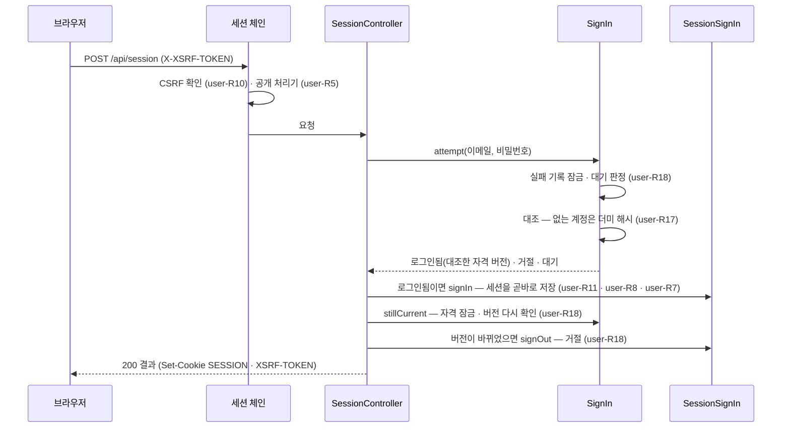

# user 모듈 Spec

공통 구조와 쓰는 규칙은 [specs/README.md](README.md)에 있다.

## 1. 책임과 범위

`user` 는 계정과 그 인증을 맡는다. 앱의 보안 구성 전체가 이 모듈에 있다.

- **계정 · 자격** — 계정(역할 `USER` · `ADMIN`, 상태)과 자체 로그인 자격(이메일 · 비밀번호 해시 · 강제 변경 표시)을 저장한다. 이메일 정규화 · 비밀번호 규칙 · 표시 이름 규칙의 정본이다
- **계정 들이기** — 계정을 만드는 길 넷(공개 가입 · 초대 가입 · 운영자 계정 생성 · 첫 운영자)과 그 정본 하나, 가입 정책(운영자 설정), 초대 링크, 첫 로그인 전 계정의 초기 비밀번호 다시 정하기. 운영 기능은 공개 운영 API 로 두고 운영자 경로는 `admin` 이 낸다
- **비밀번호와 복구** — 첫 로그인의 비밀번호 강제 변경과 그 서버 제한, 비밀번호 변경, 복구 코드(발급 · 재발급 · 복구 재설정), 비밀번호가 바뀌면 그 사용자의 다른 세션 종료
- **보안 구성** — 요청을 세 보안 체인(운영자 · 세션 · 기본)으로 나눈다. 두 역할 공통이다
- **운영자 접근 통제** — 운영자 경로를 `ADMIN` 계정 세션(CSRF)과 스크립트용 선택 운영자 토큰(서버 설정 하나)으로 연다
- **세션** — 화면용 API 를 사용자 ID 만 담은 DB 세션 · 쿠키 CSRF 로 인증하고, 요청마다 계정 상태 · 역할을 읽는다. 공개 표시가 없는 처리기는 세션을 요구한다
- **키 관문** — LLM 키가 없는 세션 사용자에게는 키 없이도 여는 표시가 있는 처리기만 연다. 키 유무는 `credential` 에 묻는다(user-R5)
- **세션 사용자 범위** — 화면용 API 처리기가 사용자를 인자 타입 `UserId` 로만 받게 한다(요청에서 사용자 ID 를 받지 않는다)
- **자체 로그인** — 로그인 · 로그아웃 · 로그인 상태 조회. 로그인 실패는 계정 유무와 무관하게 같은 응답을 주고, 제출된 이메일마다 연속 실패에 지연을 늘린다
- **화면 내 알림** — 메일 대신 쓰는 알림을 받는 사용자마다 저장하고, 세션 사용자의 알림함(목록 · 안 읽은 수 · 읽음)을 낸다. 지금 종류는 여섯이다 — 피드 상태 알림(`source` 의 피드 상태 변화를 운영자 계정마다 안 읽은 알림 하나에 모은다), 비밀번호 알림, 키 무효 알림(`credential` 의 `CredentialInvalidated` 를 받아 남긴다), 선호 조정 알림(태그 체계 활성 전환이 선호를 해제하거나 더했을 때), 사라진 구독 알림(구독한 스토리라인이 지워졌을 때), 다이제스트 실패 알림(`digest` 가 내는 `DigestFailed` 를 받아 남긴다 — 이벤트 타입은 이 모듈이 선언한다)
- **요청 방어** — `platform` 의 요청 방어 표시가 있는 처리기의 요청을 처리기 앞에서 클라이언트 주소 · 세션 사용자로 세고(고정 창 — PostgreSQL), 한도를 넘으면 429 로 거부한다. 봇 차단을 켠 인스턴스에서는 로그인 · 복구 · 공개 가입의 사람 확인 토큰을 봇 차단 서비스(Turnstile — 포트 `HumanVerifier`)로 확인한다. 클라이언트 주소는 배포 proxy 가 덮어쓴 헤더 하나에서 읽는다
- **정리** — 만료 세션과 오래된 실패 기록(로그인 · 복구), 끝난 요청 제한 창, 읽은 지 오래된 알림을 지운다
- **관심 설정** — 사용자마다 설정 행 하나(선호의 체계 버전 · 일정 · 자유 텍스트 관심사 · 고른 모델 · 변화 리포트 · 다이제스트 분량)와 태그 선호(주제 구독 · 지역 제외 · 형식 제외)의 현재 상태 · 추가 전용 이력, 제외 소스. 계정을 만들 때 기본값을 넣고(설정 행이 없는 계정은 기동 때 채운다), 태그 체계의 활성 전환을 따라 선호를 활성 키로 고쳐 쓰고 알린다. 고른 모델과 쓸 모델을 정한다
- **스토리라인 구독** — 사용자마다 따라갈 스토리라인의 현재 상태와 추가 전용 이력, 구독 · 해제 · 내 구독(상한 100) · 내 구독 이력(사용자가 직접 한 구독 · 해제). `storyline` 이 합치거나 지운 스토리라인을 알리면(`StorylinesRetired`) 구독을 남는 스토리라인으로 옮기거나 빼고, 사라진 구독을 알린다. 사용자의 구독 조회 · 저장 앞에서도 같은 정본으로 따라간다. 다이제스트 · 관심도 · 관심사 히스토리 · 변화 리포트가 읽는 공개 조회(`StorylineSubscriptionDirectory`)를 낸다
- **구독 제안 거절** — 구독 제안을 거절한 주제 중분류를 기록 당시 태그 체계 버전 · 거절 때 관심 · 시각과 함께 사용자마다 현재 상태 한 벌로 저장하고(처리기), 활성 키로 풀어 내는 공개 조회(`TopicSuggestionDeclines`)를 낸다. 거절 때 관심은 이 모듈이 선언하고 `digest` 가 구현하는 공급 인터페이스(`TopicInterestNow`)로 묻는다. 제안의 판정은 하지 않는다(user-R64 · R65)
- **다이제스트가 읽는 관심 설정** — 다이제스트 후보 선별 · 구독 제안이 읽는 공개 조회(`DigestInterestsDirectory`) — 활성 키의 주제 구독(펼친 중분류와 함께) · 제외 · 관심사 본문 · 시간대 · 분량 · 요약 길이 · 추론 강도. 쓰지 않는다(user-R57)
- **주제 구독 이력 조회** — 다이제스트의 관심도 · 관심사 히스토리가 읽는 공개 조회(`TopicSubscriptionHistory`) — 기간의 선호 이력 가운데 주제 행을 기록 당시 버전으로 펼치고 활성 중분류로 풀어 원인과 함께 낸다. 쓰지 않는다(user-R58)
- **사용자 시간대 · 일정 조회** — 관심 설정의 시간대를 내는 공개 조회(`UserTimezones`) — 다이제스트의 수동 생성이 오늘의 경계를 정할 때, 관심사 히스토리가 기간을 자를 때 읽는다. 사용자 하나의 일정(시간대 · 생성 시각)을 내는 공개 조회(`UserDigestSchedules`) — 다이제스트의 수동 생성 상태가 오늘의 경계와 오늘 일정 생성 시각을 정할 때 읽는다. 쓰지 않는다(user-R60)
- **다이제스트 일정과 쓸 모델** — 다이제스트의 일정 회차가 읽는 일정 목록(`DigestScheduleDirectory` — 쓰는 계정의 시간대 · 생성 시각)과 일정 · 생성 작업 · 수동 생성 · 수동 생성 상태가 읽는 쓸 모델(`DigestModelDirectory` — `ModelChoice`). 쓰지 않는다(user-R61)
- **(미설계)** 변화 리포트가 관심 설정을 읽는 공개 조회 — 소비자의 작업이 소비 계약과 함께 연다([ADR-0180](../adr/0180-user-settings-changes-publish-no-event-and-consumers-query.md))

하지 않는 것:

- 화면용 API 경로의 규약(`/api/**` · `/api/admin/**`)과 공개 표시 · 요청 방어 표시 애너테이션을 갖지 않는다 — `platform` 의 공개 타입이다([platform Spec §3](platform.md#3-공개-인터페이스))
- 클라이언트 IP 를 믿을 앞단의 범위를 정하지 않는다 — 배포 proxy 설정의 것이다([configuration.md "공개"](../operations/configuration.md#공개))
- 다른 모듈의 처리기가 공개인지 정하지 않는다 — 각 모듈이 자기 처리기에 공개 표시를 단다
- 운영자 경로의 기능을 갖지 않는다 — 운영자 API 는 `admin` 이 이 모듈의 운영 API 를 불러 낸다
- 계정의 역할을 바꾸지 않는다 — `ADMIN` 은 첫 운영자로만 생긴다(user-R28)
- 메일을 보내지 않는다 — 이메일은 인증하지 않는 로그인 식별자다([ADR-0011](../adr/0011-no-email-in-v1.md))
- LLM 키를 보관하거나 키의 상태를 정하지 않는다 — `credential` 의 것이고, 이 모듈은 키 유무를 묻고 무효 이벤트를 알림에 담기만 한다
- 피드 상태를 판정하지 않는다 — 판정은 `source` 가 하고, 이 모듈은 받은 전이를 알림에 담기만 한다
- 태그 체계 · 계보 · 기본 제외를 정하지 않는다 — `tag` 의 것이고, 이 모듈은 활성 체계 · 계보를 읽어 선호를 맞춘다
- 스토리라인을 잇거나 합치거나 지우지 않고, 남는 스토리라인을 정하지 않는다 — `storyline` 의 것이고, 이 모듈은 그 알림과 묶음 찾기로 구독을 맞춘다. 스토리라인의 표시 정보(대표 기사 등)를 내지 않는다
- LLM 을 부르지 않는다 — 쓸 모델은 허용 모델 목록(`llm`)과 키 상태(`credential`)를 읽어 정하기만 한다

다른 모듈과의 의존과 이벤트 흐름은 [overview.md §5](../overview.md#5-모듈-지도)에 있다.

## 2. 용어

공개 처리기는 [platform Spec §2](platform.md#2-용어)에 있다.

| 용어 | 뜻 |
|---|---|
| 세션 사용자 | 요청의 세션이 가리키는 계정 — 세션에는 사용자 ID 만 있고, 역할 · 상태는 요청마다 계정에서 읽는다(user-R7) |
| 로그인 유지 | 로그인 때 고르는 선택. 켜면 지속 쿠키 · 비활성 7일, 끄면 브라우저 세션 쿠키 · 비활성 2시간(user-R8) |
| 실패 기록 | 제출된 정규화 이메일의 다이제스트마다 종류(로그인 · 복구)별로 센 연속 실패 — 계정이 없어도 생긴다(user-R19) |
| 계정을 만드는 길 | 계정이 생기는 경로 — 공개 가입 · 초대 가입 · 운영자 계정 생성 · 첫 운영자 넷이고, 길마다 역할 · 강제 변경 · 만들 때 복구 코드가 정해진다(user-R28) |
| 초기 비밀번호 | 계정 주인이 아닌 사람(운영자 · 서버 운영자)이 정한 비밀번호 — 운영자 계정 생성 · 첫 운영자가 쓴다 |
| 강제 변경 | 초기 비밀번호로 만든 계정이 첫 로그인에서 비밀번호를 바꾸기 전의 상태 — 그 세션은 비밀번호 변경 · 상태 조회 · 로그아웃만 쓴다(user-R29) |
| 키 관문 | LLM 키가 없는 세션 사용자의 요청을 키 없이도 여는 표시가 있는 처리기에만 여는 것(user-R5) |
| 복구 코드 | 계정마다 하나인 160비트 무작위 값 — 비밀번호를 잊었을 때 이메일과 함께 내 비밀번호를 다시 정한다. 한 번만 보여 준다(user-R30) |
| 초대 | 운영자가 발급한 일회용 · 7일 가입 링크(`/invite#토큰`) — 이메일에 묶이지 않는다(user-R31) |
| 가입 정책 | 공개 가입을 여는가 — 운영자 설정이고 처음 값은 닫힘이다(user-R32) |
| 첫 운영자 | 기동 때 설정의 이메일 · 초기 비밀번호로 만드는 `ADMIN` 계정(user-R34) |
| 운영자 토큰 | 스크립트 · 도구가 운영자 경로를 여는 선택 비밀 값 하나 — 서버 설정으로 받고 `Authorization: Bearer` 로 보낸다. 화면은 보내지 않는다. 설정하지 않으면 Bearer 인증이 없을 뿐 운영자 경로는 계정 세션으로 열린다(user-R1 · user-R2) |
| 알림 | 메일 대신 화면 안에서 알리는 것 — 받는 사용자마다 한 행이고, 종류 하나와 그 종류의 내용을 갖는다(user-R21) |
| 판 | 알림 내용의 고친 횟수 — 1 부터, 내용을 고칠 때마다 하나 오른다. 읽음은 화면이 받은 판이 그대로인 알림만 바꾼다(user-R25) |
| 피드 상태 알림 | 운영자 계정이 받는 피드 상태 변화 알림 — 피드마다 한 줄이고, 줄은 처음 이전 상태 · 마지막 새 상태 · 바뀐 횟수 · 처음 · 마지막 판정 시각이다(user-R23) |
| 모으기 | 검사 회차의 전이를 그 사용자의 안 읽은 피드 상태 알림에 더하는 것 — 없으면 새로 만든다(user-R23) |
| 반영 기준 | 사용자마다 반영한 마지막 검사 회차의 판정 시각 — 읽은 알림과 따로 남아, 다시 처리된 회차와 늦게 온 앞선 회차를 거른다(user-R24) |
| 클라이언트 주소 | 요청을 보낸 클라이언트의 IP — 배포 proxy 가 덮어쓴 헤더 `X-Real-IP` 에서 읽는다(user-R37) |
| 요청 제한 | 지키는 동작([platform Spec §2](platform.md#2-용어))마다 클라이언트 주소 · 세션 사용자로 창 하나에 받는 요청 수를 정하고, 넘은 요청을 처리기 앞에서 429 로 거부하는 것(user-R38 ~ R40) |
| 창 | 요청 제한이 세는 고정 시간 칸 — 유닉스 기원부터 창 길이로 나눈 칸이고 시작은 포함 · 끝은 제외다(user-R39) |
| 봇 차단 | 로그인 · 복구 · 공개 가입에서 사람 확인 토큰을 봇 차단 서비스로 확인하는 것 — 운영자 설정으로 켜고 끈다(user-R41) |
| 사람 확인 토큰 | 화면의 봇 차단 위젯이 준 일회용 토큰 — 요청 헤더 `X-Human-Check` 로 보낸다(user-R41) |
| 관심 설정 | 다이제스트 · 리포트가 쓸 사용자의 설정 — 태그 선호 · 제외 소스 · 일정(시간대 · 생성 시각) · 자유 텍스트 관심사 · 변화 리포트 · 고른 모델 · 추론 강도 · 다이제스트 분량 · 요약 길이(user-R43 ~ R51 · R56 · R59) |
| 설정 행 | 사용자마다 한 행인 관심 설정 — 선호의 체계 버전도 여기 있다. 관심 설정의 쓰기 · 조회는 이 행을 잠근다(user-R43 · R46) |
| 태그 선호 | 주제 구독 · 지역 제외 · 형식 제외 — 태그 종류마다 모드 하나다(user-R45) |
| 선호 버전 | 사용자의 태그 선호 전체가 그 키로 적힌 태그 체계 버전 — 설정 행의 칸 하나(user-R45) |
| 선호 이력 | 태그 선호의 추가 전용 변경 기록 — 원인(사용자 · 계정을 만들 때 기본값 · 체계 변경)과 기록 당시 버전을 갖는다. 관심 신호는 원인이 사용자인 행만이다(user-R45) |
| 따라가기 | 선호 버전이 지금 활성 버전과 다른 사용자의 선호를 계보대로 활성 키로 고쳐 쓰는 것(user-R47) |
| 선호 버전 울타리 | 새 설정 행이 활성 전환의 훑기에서 빠지지 않게 하는 advisory 잠금 — 설정 행을 만드는 쪽은 공유, 훑기는 배타(user-R43 · R47) |
| 기동 단계 | 모든 `SmartInitializingSingleton`(태그 체계 첫 기동 적재 포함) 뒤 · 웹 서버 앞의 `SmartLifecycle` 단계 — 첫 운영자 · 기존 계정 채우기가 돈다(user-R44) |
| 제외 소스 | 사용자가 다이제스트 후보에서 뺄 소스 — 소스 단위, 이력 없음(user-R49) |
| 쓸 모델 | 고른 모델 · 허용 모델 목록 · 키 상태로 조회 때 정하는 모델(user-R51) |
| 다이제스트 분량 | 다이제스트 최대 후보 수의 단계(적게 · 보통 · 많이) 또는 직접 입력한 수, 큰 슬롯 수, 요약 길이 — 설정 행의 칸 넷(user-R56) |
| 요약 길이 | 다이제스트 글(개요 · 주요 뉴스 요약)의 길이 단계 — 짧게 · 보통 · 자세히. 단계의 뜻은 다이제스트의 지시가 정한다(user-R56) |
| 추론 강도 | 다이제스트 생성 호출의 추론 강도 — 낮음 · 보통 · 높음(`llm` 의 `ReasoningEffort`), 설정 행의 칸 하나(user-R59) |
| 구독 제안 거절 | 사용자가 구독 제안을 거절한 주제 중분류 — 기록 당시 버전의 키 · 거절 때 관심 · 시각. 관심 신호가 아니다(user-R64) |
| 다이제스트가 읽는 관심 설정 | 다이제스트 후보 선별 · 구독 제안이 읽는 관심 설정 — 활성 키로 낸 주제 구독 행(덮는 중분류와 함께) · 제외 · 관심사 본문 · 시간대 · 분량 · 요약 길이 · 추론 강도(user-R57) |
| 주제 구독 이력 조회 | 다이제스트의 관심도가 읽는 기간의 주제 구독 변경 — 선호 이력의 주제 행을 기록 당시 버전으로 펼쳐 활성 중분류로 풀고 원인과 함께 낸다(user-R58) |
| 스토리라인 구독 | 사용자가 따라가는 스토리라인 — 스토리라인 ID 와 처음 구독한 시각(user-R52) |
| 구독 이력 | 스토리라인 구독의 추가 전용 변경 기록 — 원인(사용자 · 합쳐짐 · 사라짐)을 갖는다. 관심 신호는 원인이 사용자인 행만이다(user-R52 · R53) |
| 구독 따라가기 | 구독 행을 지금 가리키는 스토리라인으로 고쳐 쓰는 것 — 합쳐진 것은 남는 스토리라인으로 옮기고 사라진 것은 뺀다(user-R53) |
| 사라진 구독 알림 | 구독한 스토리라인이 지워져 구독에서 뺐다는 알림 — 스토리라인 ID 와 풀기에서 남은 사건 ID 만 담고, 제목은 알림함을 열 때 읽는다(user-R54) |

## 3. 공개 인터페이스

받는 이벤트는 `source` 의 `FeedStatusesChanged` · `SourceDeleted`, `credential` 의 `CredentialInvalidated`, `tag` 의 `TagSetActivated`, `storyline` 의 `StorylinesRetired`, `digest` 가 내는 `DigestFailed`(이 모듈이 선언한 이벤트 — user-R62)이고, 내는 이벤트는 없다 — 관심 설정 · 스토리라인 구독이 바뀌어도 이벤트를 내지 않는다([ADR-0180](../adr/0180-user-settings-changes-publish-no-event-and-consumers-query.md)).

모듈 최상위 패키지 `net.yozmnews.user` 의 공개 타입은 비밀번호 규칙 위반의 까닭 하나(`PasswordProblem`), 계정 들이기의 운영 API 셋(`AccountAdministration` · `InvitationAdministration` · `SignUpPolicyAdministration`)과 그 결과 · 값 타입(`AccountCreationResult` · `InitialPasswordResetResult` · `IssuedInvitation` · `InvitationView` · `InvitationState` · `InvitationRevocationResult` · `UnknownInvitationException` · `SignUpPolicyChange` · `SignUpPolicyChangeResult`)이다. 운영 API 는 `admin` 이 운영자 경로로 낸다. 다른 모듈이 읽는 공개 조회는 스토리라인 구독(`StorylineSubscriptionDirectory`)과 그 값 타입(`StorylineSubscriptionChange` · `StorylineSubscriptionAction` · `StorylineSubscriptionCause`), 다이제스트가 읽는 관심 설정(`DigestInterestsDirectory`)과 그 값 타입(`DigestInterests` · `TopicSubscription` · `SummaryLength`), 주제 구독 이력(`TopicSubscriptionHistory`)과 그 값 타입(`TopicSubscriptionChanges` · `TopicSubscriptionChange` · `TopicSubscriptionAction` · `TopicSubscriptionCause`), 사용자 시간대(`UserTimezones` · `UserDigestSchedules`), 다이제스트 일정 목록(`DigestScheduleDirectory`)과 그 값 타입(`DigestScheduleEntry`), 다이제스트의 쓸 모델(`DigestModelDirectory`), 구독 제안 거절(`TopicSuggestionDeclines`)과 그 값 타입(`TopicSuggestionDeclineList` · `TopicSuggestionDecline`)이다. 다른 모듈이 구현하는 공급 인터페이스는 지금 관심(`TopicInterestNow` — `digest` 가 구현)이다. 받는 쪽으로 선언한 이벤트는 다이제스트 실패(`DigestFailed`)와 그 값 타입(`DigestFailureCause`)이다. 사용자 식별자 `UserId` 는 `platform` 의 공개 타입이다([platform Spec](platform.md#userid)).

HTTP 엔드포인트:

| 경로 | 메서드 | 용도 |
|---|---|---|
| `/api/session` | `POST` | 로그인 — 판정 결과(로그인됨 · 거절 · 대기)를 200 으로 낸다(user-R17) |
| `/api/session` | `DELETE` | 로그아웃 — 세션이 없어도 204(user-R11) |
| `/api/me` | `GET` | 로그인 상태 조회 — 로그인 여부와 무관하게 200(user-R20) |
| `/api/notices` | `GET` | 세션 사용자의 알림 — 최근부터 한 쪽(50개)과 다음 쪽 커서. 질의 `before`(선택, 1 이상)(user-R27) |
| `/api/notices/unread-count` | `GET` | 세션 사용자의 안 읽은 알림 수(user-R27) |
| `/api/notices/read` | `POST` | 화면이 받은 알림의 `{id, revision}` 목록(50개까지)을 읽음으로 — 204(user-R25 · user-R27) |
| `/api/sign-up-policy` | `GET` | 공개 가입이 열렸는가 — `{open}`(user-R32) |
| `/api/human-check` | `GET` | 봇 차단 설정 — `{provider: OFF · TURNSTILE, siteKey}`(user-R41) |
| `/api/sign-ups` | `POST` | 공개 가입 — `SIGNED_UP`(+복구 코드) · `CLOSED` · `EMAIL_UNAVAILABLE` · `EMAIL_MALFORMED` · `DISPLAY_NAME_MALFORMED` · `PASSWORD_REJECTED`(+까닭)(user-R33) |
| `/api/invitation-checks` | `POST` | 초대 토큰의 상태 — `VALID` · `USED` · `EXPIRED` · `REVOKED` · `UNKNOWN`(user-R31) |
| `/api/invitation-acceptances` | `POST` | 초대 가입 — 공개 가입의 결과에서 `CLOSED` 대신 `INVITATION_UNUSABLE`(+초대 상태 `invitation`)(user-R31 · user-R33) |
| `/api/account-recoveries` | `POST` | 복구 코드로 비밀번호 재설정 — `RESET`(+새 복구 코드) · `REJECTED` · `WAIT`(+남은 초) · `PASSWORD_REJECTED`(+까닭)(user-R30) |
| `/api/account/password` | `PUT` | 비밀번호 변경 — `CHANGED`(+강제 변경이었으면 새 복구 코드) · `REJECTED` · `WAIT` · `PASSWORD_REJECTED`(user-R29) |
| `/api/account/recovery-code` | `POST` | 복구 코드 재발급 — `ISSUED`(+새 복구 코드) · `REJECTED` · `WAIT`(user-R30) |
| `/api/interests/tags` | `GET` | 활성 태그 체계(주제 · 지역 · 형식과 기본 제외)와 세션 사용자의 태그 선호(user-R45 · R46) |
| `/api/interests/tags` | `PUT` | 태그 선호 저장 — `SAVED`(+선호) · `TAG_SET_CHANGED`(+활성 버전 ID). 그 버전에 없는 키는 400(user-R46) |
| `/api/interests/sources` | `GET` | 고를 소스(숨기지 않은 소스의 ID · 이름)와 제외 소스(user-R49) |
| `/api/interests/sources` | `PUT` | 제외 소스 저장 — `SAVED`(+제외 소스)(user-R49) |
| `/api/interests/settings` | `GET` | 시간대 · 생성 시각 · 자유 텍스트 관심사(와 상한) · 변화 리포트(user-R50) |
| `/api/interests/settings` | `PUT` | 저장 — `SAVED` · `UNKNOWN_TIMEZONE` · `INTEREST_TEXT_TOO_LONG`(+상한). 시각 · 요일 형식이 틀리면 400(user-R50) |
| `/api/interests/model` | `GET` | 고를 수 있는 모델 · 고른 모델 · 쓸 모델 · 까닭 · 추론 강도와 그 값들(user-R51 · R59) |
| `/api/interests/model` | `PUT` | 모델 고르기 — `SAVED`(+조회와 같은 칸) · `PROVIDER_WITHOUT_KEY` · `MODEL_NOT_ALLOWED`(user-R51) |
| `/api/interests/effort` | `PUT` | 추론 강도 저장 — 모델 조회와 같은 칸. 키 · 고른 모델과 무관하다. 값 이름이 틀리면 400(user-R59) |
| `/api/interests/volume` | `GET` | 다이제스트 분량 — 단계 · 직접 입력한 수 · 큰 슬롯 수 · 요약 길이와 단계마다의 후보 수 · 직접 입력 · 큰 슬롯 수의 범위 · 요약 길이 값들(user-R56) |
| `/api/interests/volume` | `PUT` | 분량 저장 — `SAVED`(+조회와 같은 칸) · `COUNT_OUT_OF_RANGE`(+범위) · `BIG_SLOTS_OUT_OF_RANGE`(+범위). 직접 입력과 직접 입력한 수의 짝이 맞지 않으면 400(user-R56) |
| `/api/interests/declined-suggestions` | `POST` | 구독 제안 거절 — 본문 `{tagSetId, topic}`, `DECLINED`(+주제 키) · `TAG_SET_CHANGED`(+활성 버전 ID). 그 버전의 주제 중분류 키가 아니거나 `tagSetId` 가 1 보다 작으면 400(user-R64) |
| `/api/storyline-subscriptions` | `GET` | 내 스토리라인 구독 — 스토리라인 ID · 처음 구독한 시각 · 지금 상태, 구독 시각 내림차순과 상한(user-R52) |
| `/api/storyline-subscriptions/{storylineId}` | `PUT` | 구독 — `SUBSCRIBED`(+남는 스토리라인 ID) · `ALREADY_SUBSCRIBED`(+남는 스토리라인 ID) · `UNKNOWN_STORYLINE` · `LIMIT_REACHED`(+상한). ID 가 1 보다 작거나 숫자가 아니면 400(user-R52) |
| `/api/storyline-subscriptions/{storylineId}` | `DELETE` | 해제 — `UNSUBSCRIBED` · `NOT_SUBSCRIBED`. ID 가 1 보다 작거나 숫자가 아니면 400(user-R52) |
| `/api/storyline-subscriptions/changes` | `GET` | 내 구독 이력 한 쪽 — 사용자가 직접 한 구독 · 해제의 지금 스토리라인 ID(지워졌으면 null) · 더함 뺌 · 시각, 최근부터, 다음 쪽 커서. 질의 `beforeAt` · `beforeId`(다음 쪽 커서 — 함께). 하나만 오거나 시각 · ID(1 이상)를 읽을 수 없으면 400(user-R63) |

로그인 · 로그아웃 · 로그인 상태 조회 · 가입 정책 조회 · 봇 차단 설정 조회 · 가입 둘 · 초대 상태 · 복구 재설정은 공개 처리기다. 로그인 · 복구 재설정 · 초대 상태 · 초대 가입 · 공개 가입에는 요청 제한이 걸려 넘으면 429 이고(user-R38 · R40), 로그인 · 복구 재설정 · 공개 가입에는 봇 차단을 켠 인스턴스에서 사람 확인이 걸린다(user-R41). 알림 세 경로 · 비밀번호 변경 · 복구 코드 재발급 · 관심 설정 열두 경로 · 스토리라인 구독 네 경로는 세션이 필요하며 사용자 격리 시험에 등록돼 있고(user-R5 · user-R6), LLM 키가 없는 세션 사용자에게도 연다(`@AllowedWithoutLlmKey` — user-R5). 비밀번호 변경은 강제 변경 중에도 연다(`@AllowedBeforePasswordChange` — user-R29). 판정 결과는 200 이고 요청 본문의 칸이 없으면 본문 형식 400 이다. 요청 · 응답 형식은 `api/openapi.json` 에 있다.

### PasswordProblem

비밀번호 규칙을 어긴 까닭 — 가입 · 재설정 · 변경의 응답과 운영자 계정 운영의 결과가 싣는다.

```java
public enum PasswordProblem { TOO_SHORT, TOO_LONG }
```

관련 규칙: user-R14.

### AccountAdministration

운영자 계정 운영 — `admin` 이 운영자 경로로 낸다. 길이 상수는 운영자 응답의 거부 설명이 읽고, 정본은 표시 이름 · 비밀번호 규칙이다.

```java
public interface AccountAdministration {
	int DISPLAY_NAME_MAX_CODE_POINTS = DisplayName.MAX_CODE_POINTS;
	int PASSWORD_MIN_CODE_POINTS = PasswordPolicy.MIN_CODE_POINTS;
	int PASSWORD_MAX_CODE_POINTS = PasswordPolicy.MAX_CODE_POINTS;
	AccountCreationResult create(String email, String displayName, String initialPassword);
	InitialPasswordResetResult resetInitialPassword(String email, String initialPassword);
}
```

| 메서드 | 결과 |
|---|---|
| `create` | `AccountCreationResult` — `Created(UserId user)` · `EmailTaken()` · `EmailMalformed()` · `DisplayNameMalformed()` · `PasswordRejected(PasswordProblem problem)`. 만든 계정은 `USER` · 강제 변경이다 |
| `resetInitialPassword` | `InitialPasswordResetResult` — `Reset()` · `NotPending()`(계정 주인이 이미 바꿨다) · `NoAccount()`(쓰는 계정이 없거나 이메일이 아니다) · `PasswordRejected(PasswordProblem problem)` |

- 계약
  - 결과는 봉인 인터페이스다 — 받는 쪽은 기본 갈래 없는 망라 분기로 가른다
  - 비밀번호는 결과 · 예외 · 로그에 실리지 않는다

관련 규칙: user-R28 · user-R35.

### InvitationAdministration

초대 운영 — `admin` 이 운영자 경로로 낸다.

```java
public interface InvitationAdministration {
	IssuedInvitation issue(@Nullable String memo);
	List<InvitationView> recent();
	InvitationRevocationResult revoke(long invitationId);
}

public record InvitationView(long id, @Nullable String memo, Instant createdAt, Instant expiresAt,
		InvitationState state, @Nullable Instant usedAt, @Nullable String usedByEmail, @Nullable Instant revokedAt) {}

public enum InvitationState { VALID, USED, EXPIRED, REVOKED }
```

| 메서드 | 결과 |
|---|---|
| `issue` | `IssuedInvitation` — `Issued(long id, String token, Instant expiresAt)`(토큰은 여기서 한 번만 — 문자열 표현은 숨긴다) · `MemoTooLong(int max)` |
| `recent` | 최근 발급한 초대 50개(`InvitationPolicy.LIST_SIZE`), 발급 역순. 토큰은 없다. `usedByEmail` 은 가입한 계정이 지워졌으면 null |
| `revoke` | `InvitationRevocationResult` — `Revoked()` · `NotRevocable(InvitationState state)`(유효한 초대가 아니다). 없는 초대는 `UnknownInvitationException`(`invitationId()`, 문구 "없는 초대: {ID}") |

관련 규칙: user-R31.

### SignUpPolicyAdministration

가입 정책 운영 — `admin` 이 운영자 경로로 낸다.

```java
public interface SignUpPolicyAdministration {
	boolean open();
	SignUpPolicyChangeResult change(boolean open, ChangeActor actor);
	List<SignUpPolicyChange> changes();
}

public record SignUpPolicyChange(@Nullable Boolean previousOpen, boolean open, ChangeActor actor, Instant changedAt) {}
```

| 메서드 | 결과 |
|---|---|
| `open` | 지금 값 |
| `change` | `SignUpPolicyChangeResult` — `Changed(boolean previous, boolean current)` · `Unchanged(boolean current)`(같은 값 — 이력 없음) |
| `changes` | 이력 전부, 최근부터. 처음 값의 `previousOpen` 은 null |

관련 규칙: user-R32.

### StorylineSubscriptionDirectory

스토리라인 구독 조회 — 다이제스트 · 관심도 · 관심사 히스토리 · 변화 리포트가 읽는다. 구현은 `application` 의 `StorylineSubscriptionDirectoryService` 다.

```java
public interface StorylineSubscriptionDirectory {
	List<StorylineId> subscriptions(UserId user);
	List<StorylineSubscriptionChange> changes(UserId user, Instant from, Instant to);
}

public record StorylineSubscriptionChange(StorylineId recorded, @Nullable StorylineId current,
		StorylineSubscriptionAction action, StorylineSubscriptionCause cause, Instant occurredAt) {}

public enum StorylineSubscriptionAction { ADD, REMOVE }

public enum StorylineSubscriptionCause { USER, STORYLINE_MERGED, STORYLINE_REMOVED }
```

| 메서드 · 타입 | 뜻 |
|---|---|
| `subscriptions` | 지금 구독 — 남는 스토리라인 ID 로 풀고 같은 것은 하나로, 사라진 것은 빼고, ID 순 |
| `changes` | 이력 행 가운데 시각이 `from` 이상 · `to` 미만인 것 — 시각 · 행 순. `from` 이 `to` 보다 늦으면 `IllegalArgumentException` |
| `StorylineSubscriptionChange.recorded` | 기록된 스토리라인 ID — 기록 뒤에 합쳐졌거나 지워졌을 수 있다 |
| `StorylineSubscriptionChange.current` | `recorded` 를 지금 푼 스토리라인 ID(합쳐졌으면 남는 쪽) — 지워졌으면 null |
| `StorylineSubscriptionCause` | 사용자(`USER`) · 합쳐져 옮김(`STORYLINE_MERGED`) · 사라져 뺌(`STORYLINE_REMOVED`) — 관심 신호는 `USER` 행만이다 |

- 계약
  - 사용자를 인자로 받는 조회다 — 화면 경로에서는 세션 사용자로만 부른다([ADR-0228](../adr/0228-consumer-queries-scoped-by-a-user-argument-may-be-called-on-screen-paths-with-the-session-user.md))
  - 쓰지 않는다 — 저장된 구독 · 이력의 ID 는 합쳐진 옛 ID 일 수 있어 `storyline` 의 묶음 찾기로 풀어 낸다(user-R53)
  - 기간을 사용자 시간대의 날로 자르는 일과 관심 신호로 쓸 행을 고르는 일은 부르는 쪽이 한다

관련 규칙: user-R55.

### DigestInterestsDirectory

다이제스트가 읽는 관심 설정 — 다이제스트 후보 선별이 읽는다. 구현은 `application` 의 `DigestInterestsDirectoryService` 다.

```java
public interface DigestInterestsDirectory {
	Optional<DigestInterests> interestsOf(UserId user);
}

public record DigestInterests(TagSetId tagSet, List<TopicSubscription> topics, Set<String> excludedRegions,
		Set<String> excludedFormats, Set<SourceId> excludedSources, String interestText, ZoneId timezone,
		int maxCandidates, int bigSlots, SummaryLength summaryLength, ReasoningEffort effort) {}

public record TopicSubscription(String key, Set<String> subtopics) {}

public enum SummaryLength { SHORT, NORMAL, DETAILED }
```

| 메서드 · 타입 | 뜻 |
|---|---|
| `interestsOf` | 그 사용자의 관심 설정 — 계정이 없으면 빈 값 |
| `DigestInterests.tagSet` | 낸 키의 활성 태그 체계 버전 — 부르는 쪽이 기사 평가 키를 푼 계보 표의 버전과 맞춘다 |
| `DigestInterests.topics` | 주제 구독 행 — 키 순 |
| `DigestInterests.excludedRegions` · `excludedFormats` | 제외한 지역 · 형식 — 활성 키 |
| `DigestInterests.interestText` | 자유 텍스트 관심사 — 없으면 빈 문자열 |
| `DigestInterests.timezone` | 사용자 시간대 |
| `DigestInterests.maxCandidates` · `bigSlots` | 다이제스트 분량의 최대 후보 수(단계의 값 또는 직접 입력한 수)와 큰 슬롯 수 |
| `DigestInterests.summaryLength` | 요약 길이(`SummaryLength` — 짧게 · 보통 · 자세히) |
| `DigestInterests.effort` | 생성의 추론 강도(`llm` 의 `ReasoningEffort`) |
| `TopicSubscription` | 구독 행 하나(대분류 또는 중분류 키)와 그 행이 덮는 활성 중분류 — 대분류면 하위 중분류 전부, 중분류면 그 하나 |

- 계약
  - 사용자를 인자로 받는 조회다 — 화면 경로에서는 세션 사용자로만 부른다(구독 제안 — [ADR-0248](../adr/0248-the-digest-interests-and-topic-suggestion-queries-may-be-called-on-screen-paths-with-the-session-user.md))
  - 쓰지 않는다 — 선호 버전이 활성 버전과 다르면 따라가기 결과를 계산해 내고, 설정 행이 없으면 계정을 만들 때의 기본값을 계산해 낸다
  - 계정 상태는 보지 않는다

관련 규칙: user-R57.

### TopicSuggestionDeclines

구독 제안 거절 조회 — 다이제스트의 구독 제안이 다시 내지 않을 주제를 고를 때 읽는다. 구현은 `application` 의 `TopicSuggestionDeclinesService` 다.

```java
public interface TopicSuggestionDeclines {
    TopicSuggestionDeclineList declinesOf(UserId user);
}

public record TopicSuggestionDeclineList(TagSetId tagSet, List<TopicSuggestionDecline> declines) {}
public record TopicSuggestionDecline(String subtopic, double level, Instant declinedAt) {}
```

| 멤버 | 뜻 |
|---|---|
| `declinesOf` | 그 사용자의 거절을 활성 버전의 주제 중분류로 푼 것 — 계정이 없으면 빈 목록 |
| `TopicSuggestionDeclineList.tagSet` | 거절의 키를 푼 활성 버전 — 부르는 쪽이 자기 재료의 버전과 맞춘다 |
| `TopicSuggestionDecline.subtopic` | 활성 중분류 전체 키 — 중분류마다 많아야 하나 |
| `TopicSuggestionDecline.level` · `declinedAt` | 거절 때 관심 x(−1 ~ 1) · 거절한 시각 |

- 계약
  - 사용자를 인자로 받는 조회다 — 화면 경로에서는 세션 사용자로만 부른다
  - 쓰지 않는다

관련 규칙: user-R65.

### TopicInterestNow

지금 관심의 공급 인터페이스 — 이 모듈이 선언하고 `digest` 가 구현한다. 거절 처리기가 거절 때의 관심을 적으려고 부른다([ADR-0247](../adr/0247-topic-suggestion-declines-are-kept-by-user-with-the-recorded-version-and-digest-answers-the-interest-at-decline-through-an-interface-declared-by-user.md)).

```java
public interface TopicInterestNow {
    OptionalDouble levelOf(UserId user, TagSetId tagSet, String subtopic);
}
```

| 멤버 | 뜻 |
|---|---|
| `levelOf` | 지금을 기준 시각으로 둔 그 중분류의 관심(−1 ~ 1 — 신호가 없으면 0). `tagSet` 이 구현이 읽은 활성 버전과 다르거나 계정이 없으면 빈 값 |

- 계약
  - 이 모듈은 관심을 계산하지 않고 `digest` 의 타입을 쓰지 않는다
  - 사용자를 인자로 받는다 — 화면 경로에서는 세션 사용자로만 부른다. 쓰지 않는다

### TopicSubscriptionHistory

주제 구독 이력 조회 — 다이제스트의 관심도 · 관심사 히스토리가 읽는다. 구현은 `application` 의 `TopicSubscriptionHistoryService` 다.

```java
public interface TopicSubscriptionHistory {
	TopicSubscriptionChanges changes(UserId user, Instant from, Instant to);
}

public record TopicSubscriptionChanges(TagSetId tagSet, List<TopicSubscriptionChange> changes) {}

public record TopicSubscriptionChange(String recordedKey, TagSetId recordedVersion, Set<String> subtopics,
		TopicSubscriptionAction action, TopicSubscriptionCause cause, Instant occurredAt) {}

public enum TopicSubscriptionAction { ADD, REMOVE }

public enum TopicSubscriptionCause { USER, ONBOARDING, TAG_SET_CHANGE }
```

| 메서드 · 타입 | 뜻 |
|---|---|
| `changes` | 선호 이력 가운데 주제 행으로 시각이 `from` 이상 · `to` 미만인 것 — 시각 · 행 순. 계정이 없으면 빈 목록. `from` 이 `to` 보다 늦으면 `IllegalArgumentException` |
| `TopicSubscriptionChanges.tagSet` | 행마다 낸 중분류 키의 활성 태그 체계 버전 — 부르는 쪽이 기사 평가 키를 푼 계보 표의 버전과 맞춘다 |
| `TopicSubscriptionChange.recordedKey` · `recordedVersion` | 기록된 키(대분류 키 또는 중분류 전체 키)와 기록 당시 버전 |
| `TopicSubscriptionChange.subtopics` | 그 행이 덮던 중분류(기록 당시 버전에서 대분류는 하위 전체로 펼침)를 활성 중분류로 푼 것 — 계보 없이 지운 것은 빠지고 모두 지웠으면 비었다 |
| `TopicSubscriptionCause` | 선호 이력의 저장 원인을 옮긴 것 — 사용자(`USER`) · 계정을 만들 때 기본값(`ONBOARDING`) · 체계 변경(`TAG_SET_CHANGE`). 관심 신호는 `USER` 행만이다 |

- 계약
  - 사용자를 인자로 받는 조회다 — 화면 경로에서는 세션 사용자로만 부른다([ADR-0228](../adr/0228-consumer-queries-scoped-by-a-user-argument-may-be-called-on-screen-paths-with-the-session-user.md))
  - 쓰지 않는다 — 이력 행의 키는 기록 당시 버전의 것이라 그 버전의 구조로 펼치고 계보로 풀어 낸다
  - 기간을 사용자 시간대의 날로 자르는 일과 관심 신호로 쓸 행을 고르는 일은 부르는 쪽이 한다

관련 규칙: user-R58.

### UserTimezones

사용자 시간대 조회 — 관심 설정의 시간대. 다이제스트의 수동 생성이 사용자 시간대의 오늘을 정할 때, 관심사 히스토리가 기간을 자를 때 읽는다. 구현은 `application` 의 `UserTimezonesService` 다 — 같은 클래스가 [`UserDigestSchedules`](#userdigestschedules) 를 함께 구현하고, 시간대는 그 일정의 시간대다.

```java
public interface UserTimezones {
    Optional<ZoneId> timezoneOf(UserId user);
}
```

| 멤버 | 뜻 |
|---|---|
| `timezoneOf` | 설정 행의 시간대 — 설정 행이 없으면 계정을 만들 때의 값(`InterestDefaults.TIMEZONE`), 계정이 없으면 빈 값 |

- 계약
  - 사용자를 인자로 받는 조회다 — 화면 경로에서는 세션 사용자로만 부른다([ADR-0228](../adr/0228-consumer-queries-scoped-by-a-user-argument-may-be-called-on-screen-paths-with-the-session-user.md))
  - 읽기 전용 트랜잭션 하나다. 쓰지 않는다 — 설정 행이 없어도 만들지 않는다

관련 규칙: user-R60.

### UserDigestSchedules

사용자 하나의 다이제스트 일정 조회 — 관심 설정의 시간대 · 생성 시각. 다이제스트의 수동 생성 상태가 사용자 시간대의 오늘과 오늘 일정 생성 시각을 정할 때 읽는다. 구현은 `application` 의 `UserTimezonesService` 다.

```java
public interface UserDigestSchedules {
    Optional<DigestScheduleEntry> scheduleOf(UserId user);
}
```

| 멤버 | 뜻 |
|---|---|
| `scheduleOf` | 설정 행의 일정(시간대 · 생성 시각) — 설정 행이 없으면 계정을 만들 때의 값(`InterestDefaults.TIMEZONE` · `DIGEST_TIME`), 계정이 없으면 빈 값. 값은 [`DigestScheduleEntry`](#digestscheduledirectory) 다 |

- 계약
  - 사용자를 인자로 받는 조회다 — 화면 경로에서는 세션 사용자로만 부른다([ADR-0228](../adr/0228-consumer-queries-scoped-by-a-user-argument-may-be-called-on-screen-paths-with-the-session-user.md))
  - 읽기 전용 트랜잭션 하나다. 쓰지 않는다 — 설정 행이 없어도 만들지 않는다. 날짜 · 생성 시각 계산은 부르는 쪽이 한다

관련 규칙: user-R60.

### DigestScheduleDirectory

다이제스트 일정 목록 — 다이제스트의 일정 회차가 생성 시각이 된 사용자를 고르려고 읽는다. 구현은 `application` 의 `DigestScheduleDirectoryService` 다.

```java
public interface DigestScheduleDirectory {
    int MAX_PAGE = 500;                                          // 쪽 하나의 상한 — 정본. 측정 전 목표
    List<DigestScheduleEntry> page(long afterUserId, int limit);
}

public record DigestScheduleEntry(UserId user, ZoneId timezone, LocalTime time) {}
```

| 멤버 | 뜻 |
|---|---|
| `page` | 쓰는(`ACTIVE`) 계정 가운데 설정 행이 있는 사용자의 일정 — 사용자 ID 가 `afterUserId` 보다 큰 것부터 ID 순으로 `limit` 개까지. `limit` 이 1 ~ `MAX_PAGE` 밖이면 `IllegalArgumentException` |
| `DigestScheduleEntry` | 사용자 · 일정의 기준 시간대 · 생성 시각(분 단위)(user-R50) — `page` 와 `UserDigestSchedules.scheduleOf` 가 낸다 |

- 계약
  - 백그라운드 작업 전용이다 — 사용자 범위가 없어 화면 경로에서 부르지 않는다
  - 읽기 전용 트랜잭션 하나다. 쓰지 않는다. 날짜 · 생성 시각 계산은 부르는 쪽이 한다

관련 규칙: user-R61.

### DigestModelDirectory

다이제스트를 만들 때 쓸 모델 — 다이제스트의 일정 회차 · 생성 작업 · 수동 생성 · 수동 생성 상태가 읽는다. 구현은 `application` 의 `DigestModelDirectoryService` 다.

```java
public interface DigestModelDirectory {
    Optional<LlmModel> modelOf(UserId user);
}
```

| 멤버 | 뜻 |
|---|---|
| `modelOf` | 그 사용자의 쓸 모델(user-R51 · `ModelChoice`) — 계정이 없거나 쓰는(`ACTIVE`) 계정이 아니거나 쓸 모델이 없으면 빈 값. 설정 행이 없으면 계정을 만들 때의 값(고른 모델 없음)으로 정한다 |

- 계약
  - 사용자를 인자로 받는 조회다 — 화면 경로에서는 세션 사용자로만 부른다
  - 읽기 전용 트랜잭션 하나다. 쓰지 않는다. 판정은 관심 설정 화면의 쓸 모델과 같은 정본이다

관련 규칙: user-R61.

### DigestFailed

다이제스트가 실패로 끝났다 — 받는 쪽인 이 모듈이 선언하고 `digest` 가 실패를 쓰는 트랜잭션에서 낸다. 이 모듈은 받아 그 사용자에게 알림을 남긴다([ADR-0233](../adr/0233-digest-failure-notices-come-through-an-event-declared-by-the-receiving-user-module-for-every-failed-digest.md)).

```java
public record DigestFailed(UserId user, long digestId, LocalDate digestDate, DigestFailureCause cause,
        Instant failedAt) {}

public enum DigestFailureCause { KEY, PROVIDER_ACCOUNT, TEMPORARY, OUTPUT }
```

| 멤버 | 뜻 |
|---|---|
| `digestId` | 실패한 다이제스트(1 이상) — 같은 다이제스트의 알림은 하나다 |
| `digestDate` · `failedAt` | 다이제스트 날짜 · 실패로 끝낸 시각 |
| `DigestFailureCause` | 실패의 갈래 — 사용자가 할 일로 묶는다. 실패 알림과 다이제스트 화면이 할 일 문구를 고른다. `KEY` 키 확인 · `PROVIDER_ACCOUNT` 공급자 계정의 권한 · 잔액 · `TEMPORARY` 잠시 뒤 다시 · `OUTPUT` 모델 출력 문제. 실패 코드를 갈래로 옮기는 정본은 `digest` 에 있다([digest Spec](digest.md#끝내기와-실패-이벤트)) |

- 계약
  - 받는 쪽이 선언한다 — `digest` 는 이 모듈의 공개 조회를 읽어 이 모듈에 기대므로, `digest` 가 선언한 이벤트를 이 모듈이 받으면 두 모듈이 서로 기댄다

관련 규칙: user-R62.

## 4. 내부 구조

### 개관

| 패키지 | 책임 |
|---|---|
| (최상위) | 비밀번호 규칙 위반의 까닭 · 계정 들이기의 운영 API 셋과 그 결과 · 값, 스토리라인 구독 조회 · 다이제스트가 읽는 관심 설정 · 주제 구독 이력 · 사용자 시간대 · 다이제스트 일정 목록 · 쓸 모델 조회와 그 값, 받는 쪽으로 선언한 다이제스트 실패 이벤트와 그 값(§3) |
| `adapter/in/job` | 만료 세션 정리 · 오래된 실패 기록 정리 · 끝난 요청 제한 창 정리 · 읽은 알림 정리 반복 작업 |
| `adapter/in/web` | 로그인 · 로그아웃 · 상태 조회 · 알림함 · 가입 · 초대 · 복구 · 비밀번호 변경 · 봇 차단 설정 조회 · 관심 설정 · 스토리라인 구독 엔드포인트와 그 요청 · 응답 값, 세션 사용자 인자 해석과 그 인자를 화면용 API 명세에서 빼는 설정 |
| `adapter/out/persistence` | 실패 기록의 잠금 · 기록 · 삭제, 요청 제한 기록의 더하기 · 정리, 알림 · 반영 기준 저장소, 피드 상태 알림의 받는 사람 조회, 복구 코드 저장소, 요청의 세션 계정 조회, 가입 정책 저장소, 첫 운영자 잠금, 설정 행 · 태그 선호 · 선호 이력 · 제외 소스 저장소, 선호 버전 울타리, 스토리라인 구독 · 구독 이력 저장소 |
| `adapter/out/turnstile` | 봇 차단 검증 포트의 Turnstile 구현, 봇 차단 설정(`yozmnews.human-check`)의 결선, 비밀 키 유무의 등록 조건 |
| `adapter/out/local` | 로컬 개발의 항상 통과 봇 차단 검증기와 그 결선(platform-R18) |
| `application` | 보안 구성(체인 셋 · 쿠키 · CSRF), 운영자 토큰 인증 · 운영자 경로 인가, 세션 인증 · 계정 확인 필터 · 공개 처리기 인가 · 처리기 찾기 · 요청 방어 필터 · 클라이언트 주소, 요청 제한 · 봇 차단 유스케이스, 세션 로그인 · 로그아웃, 로그인 유스케이스, 비밀번호 해시, 계정을 만드는 정본과 가입 · 운영자 계정 · 첫 운영자 유스케이스, 가입 정책 · 초대 운영, 비밀번호 변경 · 복구 재설정 · 복구 코드 재발급과 다른 세션 종료, 피드 상태 · 비밀번호 · 키 무효 · 다이제스트 실패 알림 유스케이스와 그 리스너, 알림함 유스케이스, 정리 유스케이스, 문제 유형, 관심 설정 — 기본값 쓰기 · 기존 계정 채우기 · 기동 단계 · 조회 · 저장 유스케이스 넷 · 따라가기와 그 리스너 · 소스 삭제 리스너 · 사용자 시간대 · 다이제스트 일정 목록 · 쓸 모델 조회와 쓸 모델 판정의 재료 읽기, 스토리라인 구독 — 조회 · 구독 · 해제 유스케이스 · 구독 따라가기와 그 리스너 · 소비자 조회 · 구독 이력 유스케이스 · 남는 쪽 풀기 · 사라진 구독 알림의 제목 읽기 |
| `domain` | `account`(계정 aggregate · 이메일 · 표시 이름 · 계정을 만드는 길), `credential`(자격 aggregate · 비밀번호 규칙), `secret`(비밀 다이제스트 · 복구 코드 · 초대 토큰), `recovery`(복구 코드 저장), `session`(세션 수명 · 요청의 세션 계정 · 세션 접근 판정 · 운영자 경로 접근 판정), `throttle`(실패 지연 일정 · 실패 기록 · 종류 · 남은 초), `guard`(클라이언트 주소 · 정책 표 · 축 · 규칙 · 창 · 키 · 판정 · 요청 제한 기록 저장), `humancheck`(사람 확인 토큰 · 결과 · 검증 포트 · 설정 판정 · Turnstile 응답 판정), `invitation`(초대 aggregate · 규칙), `signup`(가입 정책 저장), `bootstrap`(첫 운영자 값 · 판정 · 잠금), `notice`(알림 종류 · 내용 · 모으기 · 반영 기준 · 보존과 그 저장 · 받는 사람 조회), `interest`(설정 행 aggregate · 기본값 · 관심사 · 시간대 · 일정 · 리포트 · 고른 모델 · 쓸 모델 판정 · 선호 버전 울타리 · 제외 소스 저장), `preference`(태그 선호 집합 · 모드 · 원인 · 차이 · 정규화 · 따라가기 규칙과 그 저장), `subscription`(구독 상한 · 구독 이력 쪽 크기 · 구독 따라가기 판정 · 구독 · 이력 저장), 최상위 운영자 자격 판정 |

협력: 요청은 `SecurityConfiguration` 의 체인 셋 가운데 하나를 탄다(user-R4). 운영자 체인은 세션 체인과 같은 세션 인증 구성(세션 문맥 저장소 · `SessionAccountFilter`)으로 세션 사용자를 읽고, `Authorization` 헤더를 낸 요청은 `AdminTokenFilter` 가 제시된 토큰을 `AdminTokenAuthenticationProvider` 에 맡겨 `AdminCredential` 과 대조한 뒤, `AdminAuthorization` 이 운영자 토큰 인증 · 세션 사용자의 강제 변경 · 역할을 `AdminAccess` 에 넘겨 인가한다. 세션 체인은 Spring Session 이 DB 에서 세션을 읽은 뒤 `SessionAccountFilter` 가 세션의 사용자 ID 로 `SessionAccounts`(계정 상태 · 역할 · 강제 변경)를 읽어 요청의 인증을 정하고, `PublicApiAuthorization` 이 처리기의 공개 · 변경 전 허용 · 키 없이 허용 표시와 세션 사용자의 강제 변경 · 키 유무(`credential` 의 `LlmKeys`)를 `SessionAccess` 에 넘겨 인가한다(처리기는 `HandlerLookup` 이 찾는다). 인가 뒤 `RequestGuardFilter` 가 같은 `HandlerLookup` 으로 처리기의 요청 방어 표시(`platform` 의 `HandlerGuards`)를 읽어, `ClientAddresses` 의 주소와 세션 사용자로 `RequestLimiter` 에 세고(`RequestCounts`) 넘으면 429 로 끝내며, 봇 차단 표시가 있고 켰으면 `HumanCheck` 가 요청 헤더의 토큰을 `HumanVerifier` 로 확인한다. 로그인은 `SessionController` → `SignIn`(`FailureThrottle` 의 실패 기록 · 계정 · 자격 · `PasswordHashing`) → 성공이면 `SessionSignIn` 이 세션을 만들고(세션 저장소가 곧바로 저장한다), `SignIn.stillCurrent` 가 자격 행을 잠가 대조한 자격의 버전을 다시 확인한다 — 바뀌었으면 `SessionSignIn` 이 그 세션을 거둔다. 처리기 인자 `UserId` 는 `SessionUserArgumentResolver` 가 요청의 인증에서 채운다. 보안 진입점 · 거부 처리기는 `platform` 의 `ProblemResponses` 로 문제 응답을 쓴다.

계정 들이기: 가입 둘(`SignUpController` → `SignUp`)과 운영자 계정 생성(`OperatorAccountService`) · 첫 운영자(`FirstAdminBootstrap`)가 모두 `AccountProvisioning` 으로 계정 · 자격(· 복구 코드)을 만들고, 그 트랜잭션 경계(같은 이메일 고유 제약 위반을 결과로 옮기기)도 `AccountProvisioning` 하나다. 가입 정책은 `SignUpPolicyService` · `SignUpPolicySeeding` → `SignUpPolicyRepository`, 초대는 `InvitationService` → `InvitationRepository` 다. 가입 · 복구가 로그인하면 `SessionSignIn` 이 들고 온 세션을 버리고 새 세션을 만든다.

비밀번호: 변경(`AccountController` → `PasswordChange`) · 재발급(`RecoveryCodeReissue`)은 `CurrentPasswordCheck` 로 현재 비밀번호를 확인하고, 복구 재설정(`AccountRecovery`)은 `FailureThrottle` 의 복구 실패 기록에 걸어 복구 코드를 대조한다. 자격을 바꾼 유스케이스는 커밋 직전 마지막 단계로 `OtherSessions` 가 그 사용자의 세션을 지우고, 비밀번호 알림은 `PasswordChangedNotices` 가 남긴다.

알림: `source` 의 `FeedStatusesChanged` 를 `FeedStatusNoticeListener` 가 받아 `FeedStatusNotices` 에 맡긴다. 유스케이스는 피드 이름을 `source` 의 `FeedLabels` 로, 받는 사람을 `NoticeRecipients` 로 읽고, 받는 사람마다 `NoticeRepository` 로 반영 기준 행을 잠근 뒤 `FeedStatusReceipt` 로 회차를 거르고, 안 읽은 피드 상태 알림을 `FeedStatusContent` 로 모으거나 새로 만든다. `credential` 의 `CredentialInvalidated` 는 `KeyInvalidatedNoticeListener` 가 받아 `KeyInvalidatedNotices` 에 맡기고, 유스케이스는 그 사용자에게 키 무효 알림을 전이마다 하나 남긴다. `digest` 가 낸 `DigestFailed` 는 `DigestFailedNoticeListener` 가 받아 `DigestFailedNotices` 에 맡기고, 유스케이스는 실패한 다이제스트마다 알림 하나를 남긴다(계정이 없으면 남기지 않는다). 화면은 `NoticeController` → `NoticeInbox` → `NoticeRepository` 로 세션 사용자의 알림을 읽고 읽음을 쓴다.

관심 설정: 계정을 만드는 정본(`AccountProvisioning`)이 `InterestDefaultsWriter` 로 설정 행 · 형식 기본 제외를 같은 트랜잭션에서 쓴다 — 울타리(`PreferenceVersionFence`) 공유 잠금 뒤 `tag` 의 `TagSetDirectory` 로 활성 체계를 읽는다. 기존 계정은 기동 단계의 `InterestBackfill` 이 같은 쓰기로 채운다. 화면은 `InterestController` → `TagPreferences` · `ExcludedSources` · `DigestSettings` · `ModelSelection` · `DigestVolumeSettings` 이고, 다섯 모두 설정 행을 잠근 뒤 `PreferenceFollowups.followLocked` 로 먼저 따라간다. 따라가기는 `TagKeyLineage` 의 계보 표와 `TagSetDirectory.tagSet` 의 옛 버전 구조로 `PreferenceFollowup` 이 판정하고, `TagPreferenceRepository` 가 현재 상태 · 이력을 쓰며, 조정이 있으면 `NoticeRepository` 로 알림을 남긴다. `tag` 의 `TagSetActivated` 는 `TagSetActivationListener` → `PreferenceFollowups.followAll`, `source` 의 `SourceDeleted` 는 `SourceDeletedListener` → `ExcludedSources.forget` 이다. 고를 소스는 `source` 의 `SourceNames`, 쓸 모델은 `llm` 의 `LlmModels` 와 `credential` 의 `LlmKeys` 를 `ModelResolutions` 가 읽어 `ModelChoice` 가 정한다 — 관심 설정 화면(`ModelSelection`)과 다이제스트가 읽는 쓸 모델(`DigestModelDirectoryService`)이 함께 쓴다. 다이제스트 일정 목록은 `DigestScheduleDirectoryService` 가 `InterestSettingsRepository.activeSchedules` 로, 사용자 시간대는 `UserTimezonesService` 가 설정 행으로 읽는다. 주제 구독 이력의 소비자 조회는 `TopicSubscriptionHistoryService` 가 `TagPreferenceRepository.topicChanges` 의 행을 `TagSetDirectory.tagSet` 의 기록 버전 구조로 펼치고(`TopicExpansion`) `TagKeyLineage` 의 계보 표로 푼다.

스토리라인 구독: 화면은 `StorylineSubscriptionController` → `StorylineSubscriptions` 이고, 조회 · 구독 · 해제 모두 `InterestSettingsLock.lockFollowed`(설정 행 만들기 · 잠금 · 태그 따라가기) 뒤 `SubscriptionFollowups.followLocked` 로 구독을 먼저 따라간다. 따라가기는 `StorylineSubscriptionRepository`(`JdbcStorylineSubscriptions`)의 구독 행을 `CurrentStorylines`(`storyline` 의 `StorylineDirectory.findAll` 로 남는 쪽을 푸는 정본)로 풀어 `SubscriptionFollow` 가 판정하고, 고쳐 쓰기 · 이력 · 사라진 구독 알림(`NoticeRepository`)을 남긴다. `storyline` 의 `StorylinesRetired` 는 `StorylinesRetiredListener` → `SubscriptionFollowups.followRetired` 가 받아 그 스토리라인을 구독한 사용자를 쪽으로 나눠 사용자마다 같은 정본을 부른다. 알림함(`NoticeInbox.page`)은 사라진 구독 알림이 가리키는 사건의 대표 기사 제목을 `RemovedSubscriptionTitles` 로 읽는다 — `event` 의 `EventDirectory`(남는 사건 · 대표 기사)와 `article` 의 `ArticleDirectory`(제목). 소비자 조회는 `StorylineSubscriptionDirectoryService` 가 저장 행을 읽어 `CurrentStorylines` 로 푼다. 화면의 구독 이력은 `StorylineSubscriptionController` → `StorylineSubscriptionHistory` 가 `StorylineSubscriptionRepository.userChanges` 로 원인이 사용자인 행을 최근부터 한 쪽 읽어 `CurrentStorylines` 로 푼다 — 소비자 조회를 거치지 않는다([ADR-0244](../adr/0244-the-storyline-subscription-history-handler-is-opened-by-user-without-a-key-and-reads-recent-pages-in-the-module.md)).



역할: `SessionController` · `NoticeController` · `SignUpController` · `AccountController` · `HumanCheckController` · `InterestController` · `StorylineSubscriptionController` · `UserWebConfiguration` 은 화면 역할, `ExpireSessionsJob` · `ForgetLoginFailuresJob` · `ForgetRequestCountsJob` · `ForgetReadNoticesJob` 은 작업 역할에서만 켜진다. 보안 구성 · 봇 차단 결선(`HumanCheckConfiguration`)과 설정 검사 · `FeedStatusNoticeListener` · `KeyInvalidatedNoticeListener` · `DigestFailedNoticeListener` · `TagSetActivationListener` · `SourceDeletedListener` · `StorylinesRetiredListener` · `SignUpPolicySeeding` · `FirstAdminBootstrap` · `InterestBackfill` 을 포함한 나머지는 두 역할 공통이다 — 피드 상태 변화는 작업 역할의 피드 건강 검사가 발행하므로 리스너가 작업 역할에서 받는다(user-R4 · [platform Spec](platform.md#역할) platform-R9).

### 들어오는 쪽

| 진입점 | 구성 요소 | 계기 | 내용 |
|---|---|---|---|
| 보안 체인 | `SecurityConfiguration` 의 운영자 · 세션 · 기본 체인 | 모든 HTTP 요청 | 운영자 경로는 운영자 계정 세션 · CSRF 와 운영자 토큰, 화면용 API 는 세션 · CSRF, 그 밖은 연다(user-R1 · R4 · R5 · R10) |
| 운영자 자격 검사 | `SecurityConfiguration` | 기동 | 설정한 운영자 토큰의 형식을 확인하고, 틀리면 기동하지 않는다(user-R2) |
| 요청 방어 | `RequestGuardFilter`(세션 체인 안, 인가 뒤) | 요청 방어 표시가 있는 처리기의 요청 | 요청 제한(user-R37 ~ R40)과 봇 차단(user-R41). 빈이 아니다 |
| 봇 차단 설정 검사 | `HumanCheckConfiguration` · `HumanCheck` | 기동 | 설정 값을 판정하고, 켰는데 사이트 키나 검증기가 없거나 모르는 값이면 기동하지 않는다(user-R41) |
| 봇 차단 설정 조회 | `HumanCheckController` | `GET /api/human-check` | user-R41. 응답 값 `HumanCheckResponse` |
| 로그인 · 로그아웃 · 상태 조회 | `SessionController` | `POST` · `DELETE /api/session`, `GET /api/me` | user-R11 · R17 · R20. 응답 값 `SignInResponse` · `MeResponse` |
| 세션 사용자 인자 | `UserWebConfiguration` · `SessionUserArgumentResolver` | 처리기 인자 `UserId` | 요청의 세션 사용자로 채운다(user-R6) |
| 가입 · 초대 | `SignUpController` | `GET /api/sign-up-policy`, `POST /api/sign-ups` · `/api/invitation-checks` · `/api/invitation-acceptances` | user-R31 ~ R33. 응답 값 `SignUpPolicyResponse` · `SignUpResponse` · `InvitationCheckResponse`(`InvitationStatus` — 초대 상태에 `UNKNOWN` 을 더한 것) |
| 복구 · 비밀번호 | `AccountController` | `POST /api/account-recoveries`, `PUT /api/account/password`, `POST /api/account/recovery-code` | user-R29 · R30. 응답 값 `AccountRecoveryResponse` · `PasswordChangeResponse` · `RecoveryCodeResponse`(대기 초는 domain 의 `RetryAfter`) |
| 운영 API | `OperatorAccountService` · `InvitationService` · `SignUpPolicyService` | `admin` 의 운영자 경로 | §3 의 운영 API 셋의 구현(user-R31 · R32 · R35) |
| 가입 정책 처음 값 | `SignUpPolicySeeding` | 기동 | 지금 값이 없으면 닫힘을 이력과 함께 넣는다(user-R32) |
| 첫 운영자 | `FirstAdminBootstrap` | 기동 단계(user-R44) | 설정 `yozmnews.first-admin.*` 로 첫 운영자를 판정 · 생성하거나 경고 · 기동 실패(user-R34) |
| 기존 계정 채우기 | `InterestBackfill` | 기동 단계(user-R44) | 설정 행이 없는 계정에 관심 설정 기본값을 넣는다(user-R43) |
| 관심 설정 | `InterestController` → `TagPreferences` · `ExcludedSources` · `DigestSettings` · `ModelSelection` · `DigestVolumeSettings` | `GET` · `PUT /api/interests/tags` · `/sources` · `/settings` · `/model` · `/volume`, `PUT /api/interests/effort` | user-R46 · R49 ~ R51 · R56 · R59. 응답 · 요청 값은 `Interest*Response` · `Interest*Request` |
| 태그 체계 활성 전환 | `TagSetActivationListener` → `PreferenceFollowups.followAll` | `tag` 의 `TagSetActivated` | 선호 버전이 활성과 다른 사용자를 따라가게 한다(user-R47). 비동기 · 트랜잭션 없음(`NOT_SUPPORTED` — 사용자마다 트랜잭션 하나)이고 이벤트 발행 레지스트리에 기록된다 — 실패하면 다시 처리되고 남은 사용자만 고친다 |
| 소스 삭제 | `SourceDeletedListener` → `ExcludedSources.forget` | `source` 의 `SourceDeleted` | 그 소스의 제외 행을 지운다(user-R49). 비동기 · 새 트랜잭션, 다시 처리해도 같다 |
| 스토리라인 구독 | `StorylineSubscriptionController` → `StorylineSubscriptions` | `GET /api/storyline-subscriptions`, `PUT` · `DELETE /api/storyline-subscriptions/{storylineId}` | user-R52 · R53. 응답 값 `StorylineSubscriptionsResponse` · `StorylineSubscriptionItem` · `StorylineSubscribeResponse` · `StorylineUnsubscribeResponse` |
| 스토리라인 구독 이력 | `StorylineSubscriptionController` → `StorylineSubscriptionHistory` | `GET /api/storyline-subscriptions/changes` | user-R63. 읽기 전용 트랜잭션 — 잠그지 않고 따라가지 않는다. 응답 값 `StorylineSubscriptionChangesResponse` · `StorylineSubscriptionChangeItem` · `StorylineSubscriptionChangeCursor` |
| 합치거나 지운 스토리라인 | `StorylinesRetiredListener` → `SubscriptionFollowups.followRetired` | `storyline` 의 `StorylinesRetired` | 그 스토리라인을 구독한 사용자의 구독을 따라가게 하고 사라진 구독을 알린다(user-R53 · R54). 비동기 · 트랜잭션 없음(`NOT_SUPPORTED` — 사용자마다 트랜잭션 하나)이고 이벤트 발행 레지스트리에 기록된다 — 실패하면 다시 처리되고 지금 상태로 수렴한다 |
| 스토리라인 구독 조회 | `StorylineSubscriptionDirectoryService` | 다른 모듈의 백그라운드 작업 · 세션 사용자의 화면 경로 | §3 `StorylineSubscriptionDirectory` 의 구현(user-R55). 읽기 전용 트랜잭션 |
| 구독 제안 거절 | `InterestController` → `TopicSuggestionDeclining` | `POST /api/interests/declined-suggestions` | user-R64. 요청 · 응답 값 `TopicSuggestionDeclineRequest` · `TopicSuggestionDeclineResponse`. 트랜잭션 없음 — 거절 때 관심을 트랜잭션 밖에서 묻고 쓰기는 한 문장 |
| 구독 제안 거절 조회 | `TopicSuggestionDeclinesService` | 다른 모듈의 세션 사용자 화면 경로 | §3 `TopicSuggestionDeclines` 의 구현(user-R65). 읽기 전용 `REPEATABLE_READ` 트랜잭션 |
| 다이제스트가 읽는 관심 설정 | `DigestInterestsDirectoryService` | 다른 모듈의 백그라운드 작업 · 세션 사용자의 화면 경로 | §3 `DigestInterestsDirectory` 의 구현(user-R57). 읽기 전용 `REPEATABLE_READ` 트랜잭션 |
| 주제 구독 이력 조회 | `TopicSubscriptionHistoryService` | 다른 모듈의 백그라운드 작업 · 세션 사용자의 화면 경로 | §3 `TopicSubscriptionHistory` 의 구현(user-R58). 읽기 전용 `REPEATABLE_READ` 트랜잭션 |
| 사용자 시간대 · 일정 조회 | `UserTimezonesService` | 다른 모듈의 조회(세션 사용자의 화면 경로 포함) | §3 `UserTimezones` · `UserDigestSchedules` 의 구현(user-R60). 읽기 전용 트랜잭션 |
| 다이제스트 일정 목록 | `DigestScheduleDirectoryService` | 다른 모듈의 백그라운드 작업 | §3 `DigestScheduleDirectory` 의 구현(user-R61). 읽기 전용 트랜잭션 |
| 다이제스트의 쓸 모델 | `DigestModelDirectoryService` | 다른 모듈의 조회(세션 사용자의 화면 경로 포함) | §3 `DigestModelDirectory` 의 구현(user-R61). 읽기 전용 트랜잭션 |
| 만료 세션 정리 — 반복 작업 ID `expire-sessions` | `ExpireSessionsJob` | 10분마다 | 만료 세션을 지운다(user-R12). 재시도하지 않는다 — 다음 회차가 이어 지운다 |
| 실패 기록 정리 — 반복 작업 ID `forget-login-failures` | `ForgetLoginFailuresJob` | 1시간마다 | 마지막 실패에서 24시간이 지난 실패 기록을 지운다(user-R19). 재시도하지 않는다 |
| 끝난 요청 제한 창 정리 — 반복 작업 ID `forget-request-counts` | `ForgetRequestCountsJob` | 10분마다 | 끝난 창의 요청 제한 기록을 지운다(user-R42). 재시도하지 않는다 — 다음 회차가 이어 지운다 |
| 피드 상태 변화 | `FeedStatusNoticeListener` → `FeedStatusNotices` | `source` 의 `FeedStatusesChanged` | 그때 쓰는 운영자 계정마다 안 읽은 피드 상태 알림에 모은다(user-R22 ~ R24). 비동기 · 새 트랜잭션이고 이벤트 발행 레지스트리에 기록된다 — 실패하면 다시 처리되고, 반영 기준이 결과를 같게 한다 |
| 다이제스트 실패 | `DigestFailedNoticeListener` → `DigestFailedNotices` | `digest` 가 낸 `DigestFailed` | 그 사용자에게 다이제스트 실패 알림을 남긴다(user-R62). 비동기 · 새 트랜잭션이고 이벤트 발행 레지스트리에 기록된다 — 실패하면 다시 처리되고, 같은 다이제스트의 알림은 하나만 남는다 |
| 키 무효 | `KeyInvalidatedNoticeListener` → `KeyInvalidatedNotices` | `credential` 의 `CredentialInvalidated` | 그 사용자에게 키 무효 알림을 남긴다(user-R36). 비동기 · 새 트랜잭션이고 이벤트 발행 레지스트리에 기록된다 — 실패하면 다시 처리되고, 같은 전이의 알림은 하나만 남는다 |
| 알림함 | `NoticeController` → `NoticeInbox` | `GET /api/notices` · `GET /api/notices/unread-count` · `POST /api/notices/read` | user-R25 · R27. 응답 값 `NoticePageResponse` · `NoticeResponse` · `FeedStatusNoticeResponse` · `FeedStatusEntryResponse` · `PasswordChangedNoticeResponse` · `KeyInvalidatedNoticeResponse` · `PreferencesAdjustedNoticeResponse` · `AdjustmentResponse` · `StorylineSubscriptionsRemovedNoticeResponse` · `RemovedStorylineResponse` · `UnreadNoticesResponse`, 요청 값 `ReadNoticesRequest` |
| 읽은 알림 정리 — 반복 작업 ID `forget-read-notices` | `ForgetReadNoticesJob` | 하루마다 | 읽은 지 90일이 지난 알림을 지운다(user-R26). 재시도하지 않는다 — 다음 회차가 이어 지운다 |

### `application`

- `SecurityConfiguration` — 보안 구성. 체인 셋(운영자 · 세션 · 기본)의 순서와 경로, 두 세션 인증 체인의 공통 구성, 운영자 자격과 토큰 대조 provider, 거부의 문제 응답(user-R1 · R4)
- `AdminTokenFilter` — 운영자 체인 안(CSRF 필터 앞)에서 `Authorization` 헤더를 낸 요청을 운영자 토큰으로만 판정한다 — 맞으면 운영자 인증을 두고, 틀리면 401 로 끝낸다(세션으로 넘어가지 않는다). 빈이 아니다(user-R1)
- `AdminTokenAuthenticationProvider` — 제시된 토큰을 운영자 자격과 대조하는 유일한 자리(user-R2)
- `SessionAccountFilter` — 세션 체인 · 운영자 체인 안에서 세션의 사용자 ID 로 계정을 읽어 요청의 인증(역할 권한)을 정하거나 세션을 끊는다. 빈이 아니다(user-R7)
- `SessionSecurityContexts` — 세션의 보안 문맥 저장소. 읽지 못하는 세션은 지우고 익명으로 둔다. 세션에는 세션 사용자 인증만 저장한다 — 운영자 토큰 인증은 저장하지 않는다(user-R7)
- `SessionPrincipalNames` — 세션 저장소의 사용자 이름 색인 해석기. 보안 문맥을 읽지 못하는 세션은 빈 색인으로 저장한다 — 곧바로 저장하는 세션 저장소에서 그 요청이 세션을 지우기 전에 저장이 실패하지 않게 한다(user-R7)
- `PublicApiAuthorization` — 세션 체인의 인가. 요청의 처리기(`HandlerLookup`)의 표시와 세션 사용자의 상태를 `SessionAccess` 로 판정하고, 거부의 까닭을 거부 처리기에 넘긴다(user-R5)
- `AdminAuthorization` — 운영자 체인의 인가. 요청의 인증(운영자 토큰 인증 · 세션 사용자)을 `AdminAccess` 로 판정하고, 거부의 까닭을 거부 처리기에 넘긴다. 처리기를 찾지 않는다(user-R1)
- `HandlerLookup` — 세션 체인에서 요청의 처리기를 앱의 처리기 매핑에서 찾는 정본 — 인가와 요청 방어 필터가 함께 쓴다(user-R5 · R40)
- `RequestGuardFilter` — 세션 체인 안(인가 뒤)의 요청 방어 — 요청 제한 → 봇 차단 → 처리기 순서, 거부의 문제 응답. 빈이 아니다(user-R40 · R41)
- `ClientAddresses` — 요청의 클라이언트 주소 — 헤더 이름 `X-Real-IP` 의 코드 쪽 정본(user-R37)
- `RequestLimiter` — 요청 하나를 동작의 규칙마다 세고 판정하는 유스케이스, 넘은 판정의 남은 초(user-R38 · R39)
- `HumanCheck` — 봇 차단 유스케이스 — 켬 · 끔, 토큰 읽기와 검증기에 묻기, 켰는데 검증기가 없으면 기동 실패(user-R41)
- `SessionCookies` — 세션 쿠키 직렬화기와 CSRF 토큰 저장소. 쿠키 속성의 정본이다(user-R9)
- `SessionSignIn` — 세션 로그인(세션 ID 교체 · CSRF 토큰 교체 · 보안 문맥 저장 · 수명) · 들고 온 세션을 버린 새 로그인(가입 · 복구) · 지금 세션의 ID 교체(비밀번호 변경) · 로그아웃(user-R8 · R11)
- `SignIn` — 로그인 유스케이스. 한 번의 시도가 트랜잭션 하나이고, 실패 기록 행 잠금이 대조 동안 이어진다. 결과에 대조한 자격의 버전을 싣고, 세션을 연 뒤의 다시 확인(`stillCurrent` — 자격 행 잠금)을 따로 한 트랜잭션으로 한다(user-R17 · R18)
- `FailureThrottle` — 실패 기록에 건 대조의 정본 — 잠금 · 대기 판정 · 성공이면 지우기 · 실패면 올리기. 결과 `Throttled`(통과 · 실패 · 대기). 로그인 · 현재 비밀번호 확인 · 복구가 쓴다(user-R18 · R19)
- `AccountProvisioning` — 계정을 만드는 정본(계정 · 자격 · 복구 코드 · 관심 설정 기본값)과 계정을 만드는 유스케이스의 트랜잭션 경계(user-R28). 결과 `ProvisionResult`(만듦 · 같은 이메일)
- `SignUp` — 공개 가입 · 초대 가입 유스케이스(user-R33). 입력 `SignUpForm`, 결과 `SignUpOutcome`
- `InvitationService` — 초대 운영(`InvitationAdministration`)과 링크를 연 사람의 상태 확인(user-R31)
- `SignUpPolicyService` · `SignUpPolicySeeding` — 가입 정책 운영(`SignUpPolicyAdministration`)과 처음 값 적재(user-R32)
- `OperatorAccountService` — 운영자 계정 생성 · 초기 비밀번호 다시 정하기(`AccountAdministration`)(user-R35)
- `FirstAdminBootstrap` — 첫 운영자 기동 처리 — 잠금 · 판정 · 생성 · 로그 · 기동 실패(user-R34). 설정 값 `FirstAdminProperties`(문자열 표현은 값을 숨긴다)
- `CurrentPasswordCheck` — 세션 사용자의 현재 비밀번호 확인 — 자격 잠금 뒤 로그인 실패 기록에 걸어 대조(user-R19 · R29)
- `PasswordChange` · `AccountRecovery` · `RecoveryCodeReissue` — 비밀번호 변경 · 복구 재설정 · 복구 코드 재발급(user-R29 · R30). 결과 `PasswordChangeOutcome` · `RecoveryOutcome` · `ReissueOutcome`
- `OtherSessions` — 한 사용자의 세션 지우기 — 전부 · 지금 세션 빼고(user-R29)
- `PasswordChangedNotices` — 비밀번호 알림 남기기(user-R21 · R29)
- `PasswordHashing` — Argon2id 해시 · 대조와 더미 해시 대조(user-R15 · R17)
- `SessionExpiry` · `LoginFailureCleanup` · `RequestCountCleanup` · `NoticeCleanup` — 정리 유스케이스(user-R12 · R19 · R42 · R26)
- `FeedStatusNotices` — 피드 상태 알림 유스케이스. 검사 회차 하나가 트랜잭션 하나다(user-R22 ~ R24)
- `FeedStatusNoticeListener` — `FeedStatusesChanged` 리스너(들어오는 쪽). 역할 애너테이션이 없다(user-R22)
- `KeyInvalidatedNotices` — 키 무효 알림 유스케이스. 이벤트 하나가 트랜잭션 하나다(user-R36)
- `KeyInvalidatedNoticeListener` — `CredentialInvalidated` 리스너(들어오는 쪽). 역할 애너테이션이 없다(user-R36)
- `DigestFailedNotices` — 다이제스트 실패 알림 유스케이스. 이벤트 하나가 트랜잭션 하나다(user-R62)
- `DigestFailedNoticeListener` — `DigestFailed` 리스너(들어오는 쪽). 역할 애너테이션이 없다(user-R62)
- `NoticeInbox` — 알림함 유스케이스 — 세션 사용자의 목록 한 쪽(`NoticePage` — 사라진 구독 알림이 가리키는 사건의 제목 표와 함께) · 안 읽은 수 · 읽음(user-R25 · R27 · R54)
- `RemovedSubscriptionTitles` — 사라진 구독 알림이 가리키는 사건의 지금 대표 기사 제목 읽기 — 알림함 쪽마다 한 번(user-R54)
- `AccountQueries` — 쓰는 계정 조회. 로그인 상태 조회가 세션 사용자의 계정을 읽는다(user-R20)
- `ProblemTypes` — 보안 거부(요청 방어 포함)의 문제 유형 URI 와 제목의 정본(user-R3)
- `InterestDefaultsWriter` — 관심 설정 기본값 쓰기의 정본 — 울타리 공유 잠금 → 활성 체계 → 설정 행 · 형식 기본 제외(이력 원인 `ONBOARDING`). 설정 행이 있으면 쓰지 않는다(user-R43)
- `UserStartup` — 기동 단계 상수 `PHASE` 의 정본(user-R44)
- `InterestBackfill` — 기존 계정 채우기(기동 단계)(user-R44)
- `TagPreferences` · `ExcludedSources` · `DigestSettings` · `ModelSelection` · `DigestVolumeSettings` — 관심 설정 조회 · 저장 유스케이스 다섯(user-R46 · R49 ~ R51 · R56 · R59 — 추론 강도는 `ModelSelection`)
- `PreferenceFollowups` — 따라가기 — 사용자 하나(`followLocked` — 정본)와 전부(`followAll`), 쓰지 않는 계산(`followed` — 계보 표 · 옛 버전 구조를 읽어 `PreferenceFollowup` 을 부르는 정본, `followLocked` 와 다이제스트가 읽는 관심 설정이 함께 쓴다)(user-R47 · R57)
- `TagSetActivationListener` · `SourceDeletedListener` — `TagSetActivated` · `SourceDeleted` 리스너(들어오는 쪽). 역할 애너테이션이 없다(user-R47 · R49)
- `StorylineSubscriptions` — 스토리라인 구독 조회 · 구독 · 해제 유스케이스(user-R52). 결과 `SubscribeOutcome` · `UnsubscribeOutcome`, 조회 값 `SubscriptionsView` · `SubscribedStoryline`
- `SubscriptionFollowups` — 구독 따라가기 — 사용자 하나(`followLocked` — 정본)와 합치거나 지운 스토리라인의 구독자 전부(`followRetired` — 사용자 ID 순 쪽 `BATCH`), 고쳐 쓰기 · 이력 · 사라진 구독 알림(user-R53 · R54)
- `StorylinesRetiredListener` — `StorylinesRetired` 리스너(들어오는 쪽). 역할 애너테이션이 없다(user-R53)
- `StorylineSubscriptionDirectoryService` — 공개 조회 `StorylineSubscriptionDirectory` 의 구현. 읽기 전용이다(user-R55)
- `StorylineSubscriptionHistory` — 화면의 구독 이력 유스케이스 — 세션 사용자의 원인 `USER` 행 한 쪽과 다음 쪽 커서. 값 `HistoryPage` · `HistoryEntry`. 읽기 전용이다(user-R63)
- `CurrentStorylines` — 기록된 스토리라인 ID 를 지금 남는 스토리라인 ID 로 푸는 정본 — 구독 따라가기 · 소비자 조회 · 구독 이력이 함께 쓴다(user-R53 · R55 · R63)
- `DigestInterestsDirectoryService` — 공개 조회 `DigestInterestsDirectory` 의 구현. 설정 행을 잠그지 않으므로 설정 행 · 선호 행 · 활성 체계 · 계보를 한 스냅숏에서 읽도록 읽기 전용 `REPEATABLE_READ` 트랜잭션 하나다 — 기본 격리면 리스너의 따라가기가 그 사이 커밋되어 옛 선호 버전과 새 버전 키를 섞어 읽을 수 있다(user-R57)
- `UserTimezonesService` — 공개 조회 `UserTimezones` · `UserDigestSchedules` 의 구현. 계정 유무와 설정 행을 읽기 전용 트랜잭션 하나에서 읽는다 — 설정 행이 없을 때의 대체는 `scheduleOf` 한 곳이고 `timezoneOf` 는 그 일정의 시간대다(user-R60)
- `DigestScheduleDirectoryService` · `DigestModelDirectoryService` — 공개 조회 `DigestScheduleDirectory` · `DigestModelDirectory` 의 구현. 읽기 전용 트랜잭션 하나(user-R61)
- `ModelResolutions` — 쓸 모델 판정의 재료 읽기(허용 모델 목록 · 키가 있는 공급자 · 쓸 수 있는 키의 공급자)와 고를 수 있는 모델 — `ModelSelection` 과 `DigestModelDirectoryService` 가 함께 쓴다(user-R51 · R61)
- `TopicSuggestionDeclining` — 구독 제안 거절 유스케이스 — 활성 버전 확인 · 중분류 키 확인(`DeclinableTopics`) · 거절 때 관심(`TopicInterestNow`) · upsert. 트랜잭션이 없다(user-R64)
- `TopicSuggestionDeclinesService` — 공개 조회 `TopicSuggestionDeclines` 의 구현. 거절 행 · 활성 체계 · 계보 표를 한 스냅숏에서 읽도록 읽기 전용 `REPEATABLE_READ` 트랜잭션 하나다 — 계보 표의 기준이 읽은 활성 버전이 아니면 불변식 위반이다(user-R65)
- `TopicSubscriptionHistoryService` — 공개 조회 `TopicSubscriptionHistory` 의 구현. 이력 행 · 활성 체계 · 기록 버전의 구조 · 계보 표를 한 스냅숏에서 읽도록 읽기 전용 `REPEATABLE_READ` 트랜잭션 하나다 — 계보 표의 기준이 읽은 활성 버전이 아니면 불변식 위반이다(user-R58)
- 그 밖의 값: `AdminSecurityProperties`(설정 `yozmnews.admin` — §7) · `AdminTokenAuthentication`(제시된 토큰 · 운영자 인증) · `AccountAuthentication`(세션 사용자 인증 — 세션에 직렬화되는 유일한 앱 타입, 역할 권한 이름의 정본) · `SignInOutcome`(로그인됨 · 거절 · 대기)

### `domain`

- `Account` — 계정 aggregate(`users`). 이메일 · 표시 이름 · 역할 · 상태. 비밀번호 해시를 갖지 않는다. 저장소 `AccountRepository`(이메일로 찾기 · 역할과 상태의 계정이 있는가)
- `PasswordCredential` — 자체 로그인 자격 aggregate(`user_password_credentials`). 해시 · 강제 변경 표시 · 바꾼 시각과 그 전이(바꾸기 · 초기 비밀번호 다시 정하기). 계정과 사용자 ID 로만 잇는다. 저장소 `PasswordCredentialRepository`(갱신용 잠금)
- `EmailAddress` — 이메일 정규화의 정본(user-R13)
- `DisplayName` — 표시 이름 규칙의 정본 — 앞뒤 공백을 지운 1 ~ 50 코드 포인트(`MAX_CODE_POINTS`), 이메일의 `@` 앞부분에서 만들기(user-R28)
- `Onboarding` — 계정을 만드는 길의 닫힌 집합 정본 — 길마다 역할 · 강제 변경 · 만들 때 복구 코드(user-R28)
- `PasswordPolicy` — 비밀번호 규칙의 정본 — 정규화 · 최소 · 최대 길이 상수(user-R14)
- `SessionLifetime` — 세션 수명의 정본 — 로그인 유지 · 유지 안 함의 비활성 기간 상수(user-R8)
- `SessionAccess` — 세션 체인 인가 판정의 정본 — 처리기의 표시(`HandlerMarks`)와 세션 사용자의 강제 변경 · 키 유무에서 열림 · 세션 없음 · 비밀번호 변경 필요 · 키 필요를 정한다(user-R5)
- `AdminAccess` — 운영자 경로 인가 판정의 정본 — 운영자 토큰 인증과 세션 사용자의 강제 변경 · 역할에서 열림 · 인증 없음 · 비밀번호 변경 필요 · 운영자 아님을 정한다. LLM 키를 보지 않는다(user-R1)
- `SessionAccounts` — 요청의 세션 계정 조회(계정 상태 · 역할 · 강제 변경 — 읽기 값 `SessionAccount`). 구현은 `JdbcSessionAccounts` 다(user-R7)
- `LoginThrottle` — 실패 지연 일정의 정본 — 지연 없는 실패 수 · 첫 대기 · 최대 대기 · 기록을 잊는 기간 상수, 다시 시도할 수 있는 때와 정리 기준 시각(user-R19)
- `ThrottledAttempt` — 실패 기록 종류의 닫힌 집합 — 로그인(`SIGN_IN` — 현재 비밀번호 확인도) · 복구(`RECOVERY`)(user-R19)
- `LoginFailures` — 실패 기록의 잠금 · 기록 · 삭제 저장 인터페이스(종류를 첫 인자로). 구현은 `adapter/out/persistence` 의 `JdbcLoginFailures` 다(user-R18 · R19)
- `RetryAfter` — 다시 시도할 수 있을 때까지 남은 초(올림 · 1 이상)의 정본 — 실패 지연 응답과 요청 제한 거부가 함께 쓴다(user-R17 · R40)
- `ClientAddress` — 클라이언트 주소 — IP 리터럴만 읽기, 세는 대상(IPv4 · IPv6 /64), 원래 주소(user-R37)
- `RequestLimits` · `LimitRule` · `LimitAxis` — 요청 제한 정책 표의 정본 — 동작마다 규칙(축 · 한도 · 창)(user-R38)
- `LimitWindow` · `LimitKey` · `LimitDecision` — 고정 창 · 기록 키(다이제스트) · 판정의 정본(user-R39)
- `RequestCounts` — 요청 제한 기록의 더하기 · 정리 저장 인터페이스. 구현은 `JdbcRequestCounts` 다(user-R39 · R42)
- `HumanCheckToken` · `HumanCheckResult` — 사람 확인 토큰(1 ~ 2,048자, 문자열 표현이 값을 숨긴다)과 결과(통과 · 거부 · 닿지 못함)(user-R41)
- `HumanCheckSetting` — 봇 차단 설정 값의 판정 정본(끔 · Turnstile)과 설정 · 환경 변수 이름(user-R41)
- `TurnstileAnswers` — Turnstile 검증 응답의 판정 정본(user-R41)
- `SecretDigest` — 높은 엔트로피 비밀(운영자 토큰 · 초대 토큰 · 복구 코드)의 SHA-256 다이제스트와 상수 시간 대조의 정본(user-R2 · R30 · R31)
- `RecoveryCode` — 복구 코드 — 생성 · 읽기(정규형) · 보이는 꼴(user-R30). 저장 인터페이스 `RecoveryCodeRepository`(사용자마다 한 행 바꾸기 · 읽기), 구현 `JdbcRecoveryCodes`
- `InvitationToken` — 초대 토큰 — 생성 · 형식 읽기(user-R31)
- `Invitation` — 초대 aggregate(`user_invitations`) — 상태 판정 · 쓰기 · 취소. 규칙 `InvitationPolicy`(만료 7일 · 메모 · 목록 크기). 저장소 `InvitationRepository`(토큰 다이제스트 · ID 로 잠금, 최근 목록)(user-R31)
- `SignUpPolicyRepository` — 가입 정책의 지금 값(적재 전 없음) · 잠금 · 바꾸기 · 이력 · 처음 값 적재. 처음 값 상수 `INITIAL_OPEN`. 구현 `JdbcSignUpPolicy`(user-R32)
- `FirstAdminValues` · `FirstAdminDecision` — 첫 운영자 값 읽기(없음 · 하나만 · 규칙 위반 · 있음)와 기동 판정의 정본, 기동 실패 이유 문구(user-R34). 잠금 `FirstAdminLock`, 구현 `JdbcFirstAdminLock`
- `AdminCredential` — 운영자 자격의 판정 정본 — 토큰 형식(최소 · 최대 길이 상수), 설정 여부, 상수 시간 대조. 값은 `SecretDigest` 로만 갖는다(user-R2)
- `NoticeKind` — 알림 종류의 닫힌 집합 정본(user-R21). `NoticeContent` — 종류마다의 내용(봉인 — `FeedStatusContent` · `PasswordChangedContent` · `KeyInvalidatedContent` · `PreferencesAdjustedContent` · `StorylineSubscriptionsRemovedContent` · `DigestFailedContent`)
- `DigestFailedContent` — 다이제스트 실패 알림의 내용(다이제스트 ID · 날짜 · 갈래 · 실패 시각)(user-R62)
- `PasswordChangedContent` · `PasswordChangeMethod` — 비밀번호 알림의 내용(방법 — 변경 · 복구 코드, 시각)(user-R29)
- `KeyInvalidatedContent` — 키 무효 알림의 내용(공급자 · 키 ID · 무효 시각)(user-R36)
- `FeedStatusContent` · `FeedStatusEntry` — 피드 상태 알림의 내용과 그 줄, 모으기 규칙의 정본(user-R23)
- `FeedStatusReceipt` — 반영 기준 판정의 정본(user-R24)
- `NoticeRetention` — 읽은 알림 보존 기간 · 알림함 쪽 크기 상수의 정본(user-R26 · R27)
- `NoticeRepository` — 알림 · 반영 기준의 저장 인터페이스. 구현은 `adapter/out/persistence` 의 `JdbcNoticeRepository` 다(user-R21 · R23 ~ R26)
- `NoticeRecipients` — 피드 상태 알림의 받는 사람 조회 — 사용자 범위가 없는 조회라 리스너만 쓴다. 구현은 `JdbcNoticeRecipients` 다(user-R22)
- `InterestSettings` — 설정 행 aggregate(`user_settings`) — 선호 버전 · 일정 · 관심사 · 고른 모델 · 추론 강도 · 리포트 · 다이제스트 분량. 저장소 `InterestSettingsRepository`(잠금 · 없을 때만 넣기 · 바꾸기 · 설정 행 없는 계정 · 선호 버전이 다른 사용자 · 쓰는 계정의 일정 쪽 `activeSchedules` — 값 `ScheduledUser`)(user-R43 · R46 · R61)
- `InterestDefaults` — 관심 설정 기본값의 정본 — 시간대 `Asia/Seoul` · 생성 시각 07:00 · 주간 리포트 켬(월요일) · 월간 리포트 켬 · 다이제스트 분량 보통 · 큰 슬롯 3(user-R43 · R56)
- `DigestVolume` · `CandidateVolume` — 다이제스트 분량과 그 단계 값 · 범위의 정본(user-R56)
- `InterestText` — 자유 텍스트 관심사 규칙의 정본 — 앞뒤 공백을 지운 0 ~ 500 코드 포인트(`MAX_CODE_POINTS`)(user-R50)
- `Timezones` · `DigestSchedule` · `ReportSettings` — 시간대 읽기(IANA 지역 ID 만) · 일정(분 단위) · 리포트 설정(user-R50)
- `ModelRef` · `ModelChoice` · `ModelResolution` · `ModelReason` — 고른 모델과 쓸 모델 판정의 정본(user-R51)
- `PreferenceVersionFence` — 선호 버전 울타리(공유 · 배타). 구현 `JdbcPreferenceVersionFence`(user-R43 · R47)
- `ExcludedSourceRepository` — 제외 소스 저장 — 읽기 · 바꾸기 · 소스 잊기. 구현 `JdbcExcludedSources`(user-R49)
- `PreferenceSet` · `PreferenceChange` · `PreferenceMode` · `PreferenceCause` · `PreferenceAction` — 태그 선호 집합 · 기본값 · 모르는 키 · 정규화 · 차이, 모드 조합 · 원인 · 더함 뺌의 정본(user-R45)
- `PreferenceFollowup` · `FollowResult` · `Adjustment` · `AdjustmentKind` — 따라가기 규칙의 정본(user-R47)
- `TopicExpansion` — 대분류 구독을 그 버전의 하위 중분류로 펼치는 정본 — 정규화 · 따라가기 · 다이제스트가 읽는 관심 설정 · 주제 구독 이력 조회가 함께 쓴다. 그 버전의 중분류 키인지 보는 정본(`isSubtopic`)도 여기 있고 구독 제안 거절이 함께 쓴다(user-R45 · R57 · R58 · R64)
- `DeclinableTopics` — 거절할 수 있는 키(그 버전의 주제 중분류 전체 키)의 정본(user-R64)
- `RecordedDecline` — 저장한 거절 한 행과, 같은 활성 주제에 닿는 두 행 가운데 남길 것(`later` — 늦은 시각, 같으면 큰 관심)의 정본(user-R65)
- `TopicSuggestionDeclineRepository` — 거절 저장 — upsert · 사용자의 행 읽기. 구현 `JdbcTopicSuggestionDeclines`(user-R64 · R65)
- `TagPreferenceRepository` — 태그 선호 현재 상태 · 이력 저장, 기간의 주제 이력 행 읽기(`topicChanges` — 값 `RecordedTopicChange`). 구현 `JdbcTagPreferences`(user-R45 · R58)
- `PreferencesAdjustedContent` — 선호 조정 알림의 내용(user-R48)
- `StorylineSubscriptionsRemovedContent` · `RemovedSubscription` — 사라진 구독 알림의 내용 — 스토리라인 ID 와 풀기에서 남은 사건 ID, 기사 정보 없음(user-R54)
- `StorylineSubscriptionLimit` — 사용자당 구독 상한의 정본(user-R52)
- `SubscriptionFollow` — 구독 따라가기 판정의 정본 — 옮김(`Move`) · 뺌 · 따라간 뒤의 행(user-R53)
- `StorylineSubscriptionHistoryPage` — 구독 이력 한 쪽의 행 수의 정본(user-R63)
- `StorylineSubscriptionRepository` — 구독 현재 상태 · 이력 저장, 구독자 조회(리스너 전용) · 기간 이력 · 사용자 이력 쪽(`userChanges`). 값 `SubscriptionChange` · `StoredSubscriptionChange` · `UserSubscriptionChange` · `SubscriptionChangeCursor`. 구현 `JdbcStorylineSubscriptions`(user-R52 · R53 · R55 · R63)
- 그 밖의 값: `AccountRole` · `AccountStatus` · `FailureRecord` · `EmailDigest` · `Notice`(알림 하나의 읽기 값) · `SeenNotice`(화면이 받은 알림의 판)

### 나가는 쪽

포트는 봇 차단 검증 하나다 — 구현은 `adapter/out/turnstile` 의 `TurnstileHumanVerifier`(비밀 키가 있을 때)와 `adapter/out/local` 의 `AlwaysPassHumanVerifier`(로컬 개발 · 비밀 키 없음)(user-R41).

```java
public interface HumanVerifier {
	HumanCheckResult verify(HumanCheckToken token, GuardedAction action, ClientAddress client);
}
```

세션 저장소(Spring Session JDBC)와 반복 작업(JobRunr)은 프레임워크다. 저장 인터페이스의 구현(`JdbcLoginFailures` · `JdbcRequestCounts` · `JdbcNoticeRepository` · `JdbcNoticeRecipients` · `JdbcRecoveryCodes` · `JdbcSessionAccounts` · `JdbcSignUpPolicy` · `JdbcFirstAdminLock` · `JdbcInterestSettings` · `JdbcTagPreferences` · `JdbcExcludedSources` · `JdbcPreferenceVersionFence` · `JdbcStorylineSubscriptions` · `JdbcTopicSuggestionDeclines`)이 직접 읽고 쓴다(§6). 세션 지우기(`OtherSessions`)는 세션 저장소의 사용자 이름 색인을 쓴다. 피드 이름은 `source` 의 공개 조회 `FeedLabels` 로, 세션 사용자의 키 유무 · 키가 있는 공급자 · 쓸 수 있는 키의 공급자는 `credential` 의 공개 조회 `LlmKeys` 로, 활성 태그 체계 · 버전의 내용 · 계보 표는 `tag` 의 `TagSetDirectory` · `TagKeyLineage` 로, 고를 소스는 `source` 의 `SourceNames` 로, 허용 모델 목록은 `llm` 의 `LlmModels` 로, 구독 제안 거절 때의 관심은 이 모듈이 선언한 `TopicInterestNow`(`digest` 가 구현)로, 구독한 스토리라인의 남는 쪽 · 지금 상태는 `storyline` 의 `StorylineDirectory.findAll` 로, 사라진 구독 알림의 제목은 `event` 의 `EventDirectory`(`find` · `representativesOfAll`)와 `article` 의 `ArticleDirectory.findAll` 로 읽는다([overview §5](../overview.md#5-모듈-지도)).

신뢰할 수 없는 입력: 로그인 요청의 이메일 · 비밀번호(user-R13 · R14 · R17), 가입 · 초대 가입의 이메일 · 표시 이름 · 비밀번호 · 토큰(user-R31 · R33), 복구 요청의 이메일 · 복구 코드 · 새 비밀번호(user-R30), 비밀번호 변경 · 재발급의 비밀번호(user-R29 · R30), 세션 쿠키 · CSRF 헤더(user-R7 · R10), 운영자 토큰 헤더(user-R1), 알림 목록의 질의 `before` · 읽음 요청 본문(user-R27), 클라이언트 주소 헤더(user-R37), 사람 확인 토큰 헤더 · Turnstile 검증 응답 본문(user-R41), 관심 설정 저장의 키 · 소스 ID · 시간대 · 시각 · 요일 · 관심사 · 공급자 · 모델 ID(user-R46 · R49 ~ R51), 스토리라인 구독 경로의 스토리라인 ID(user-R52), 구독 제안 거절의 체계 버전 ID · 주제 키(user-R64). 운영자 입력(메모 · 계정 생성 칸)과 첫 운영자 설정 값도 규칙으로 거른다(user-R31 · R34 · R35).

## 5. 규칙과 불변식

### 운영자 접근 통제

판단의 이유는 [ADR-0043](../adr/0043-admin-functions-guarded-by-env-bearer-token-until-account-roles.md) · [ADR-0183](../adr/0183-admin-paths-open-with-admin-account-sessions-and-keep-the-operator-token-as-an-optional-script-bearer-with-csrf-only-for-sessions.md) · [ADR-0184](../adr/0184-admin-path-denials-share-the-session-chain-problem-types-and-only-a-wrong-operator-token-is-admin-unauthorized.md) · [ADR-0185](../adr/0185-admin-paths-stay-outside-the-llm-key-gate-and-look-only-at-the-role.md)에 있다.

- **user-R1** — 운영자 경로(`/api/admin/**` — `platform` 의 `ApiPaths.ADMIN`)는 `ADMIN` 역할만 쓴다. 운영자 체인은 세션 체인과 같은 세션 인증 구성(user-R7)으로 세션 사용자를 읽고, `Authorization` 헤더를 낸 요청은 운영자 토큰으로만 판정한다 — `Bearer`(스킴은 대소문자 무시)로 제시한 토큰이 맞으면 `ADMIN` 역할로 인증하고, 스킴 · 형식 · 값이 틀리거나 토큰을 설정하지 않았으면 세션으로 넘어가지 않고 401 `admin-unauthorized` 에 `WWW-Authenticate: Bearer` 를 단다. 인가(`AdminAccess`)는 운영자 토큰 인증이면 열고, 그 밖은 세션 사용자가 없으면 401 `unauthenticated`, 강제 변경이면 403 `password-change-required`(user-R29), `ADMIN` 이 아니면 403 `admin-forbidden` 이다 — LLM 키는 보지 않는다(user-R5 의 키 관문 밖). 처리기가 없는 운영자 경로도 이 판정이 먼저다. 세션으로 인증한 변경 요청(`POST` · `PUT` · `PATCH` · `DELETE`)은 CSRF 토큰이 맞아야 하고(user-R10 과 같은 쿠키 · 헤더 · 403 `csrf-rejected` — 익명의 변경 요청도 CSRF 가 먼저 막는다. CSRF 토큰 쿠키가 없는 요청의 응답에 새 토큰 쿠키를 싣는 것도 같다), 운영자 토큰으로 인증한 요청은 쿠키 자격이 아니라 CSRF 를 면한다. 운영자 토큰 인증은 세션에 남지 않는다(user-R7). 화면의 운영자 틀은 로그인 상태(user-R20)로 가른다 — 로그인하지 않았으면 로그인 화면(`/login`)으로, 강제 변경이면 비밀번호 변경 화면(`/password`)으로 돌아올 주소(`next`)를 달아 보내고, `ADMIN` 이 아니면 권한 없음을 알린다. LLM 키가 없어도 열고, 머리줄에 알림 링크 · 사용자 화면 링크 · 이름 · 로그아웃을 둔다. 운영자 API 가 401 이면 로그인 상태를 다시 읽는다. 사용자 화면의 머리줄은 `ADMIN` 이면 운영자 화면 링크를 둔다
- **user-R2** — 운영자 토큰은 설정 `yozmnews.admin.token`(§7) 하나이고 스크립트 · 도구용 선택 설정이다 — 없거나 빈 값이면 Bearer 인증이 없을 뿐 운영자 경로는 계정 세션으로 열린다. 화면은 토큰을 받지도 보내지도 않는다. 값은 RFC 6750 b64token(영문 대소문자 · 숫자 · `-` `.` `_` `~` `+` `/`, 끝에 `=` 0개 이상)으로 32 ~ 512 자다(`AdminCredential.MIN_LENGTH` · `MAX_LENGTH`) — 어기면 기동하지 않는다. 대조는 SHA-256 다이제스트(`SecretDigest`)를 상수 시간으로 견주고, 대조하는 자리는 하나다. 값은 로그 · 예외 문구 · 응답 · 문자열 표현에 남지 않는다(형식 오류의 기동 실패 문구 포함). 틀린 토큰의 요청을 따로 제한하지 않는다
- **user-R3** — 문제 유형 URI 는 화면과의 계약이다(명세의 `type` 은 열거가 아니다). 정본은 `ProblemTypes` 다: `urn:yozmnews:problem:admin-unauthorized`(401, 운영자 토큰(Bearer)이 틀림 · 형식 오류 · 토큰 미설정) · `urn:yozmnews:problem:admin-forbidden`(403, 세션 사용자가 `ADMIN` 이 아님) · `urn:yozmnews:problem:unauthenticated`(401, 세션 없음 · 만료) · `urn:yozmnews:problem:csrf-rejected`(403, CSRF 토큰 없음 · 틀림) · `urn:yozmnews:problem:password-change-required`(403, 비밀번호를 바꿔야 한다 — user-R29) · `urn:yozmnews:problem:llm-key-required`(403, LLM 키를 등록해야 한다 — user-R5) · `urn:yozmnews:problem:rate-limited`(429, 요청이 너무 많다 — user-R40) · `urn:yozmnews:problem:human-check-failed`(403, 사람 확인에 실패했다 — user-R41). 화면은 `unauthenticated` 로 로그인 이동을 가른다(운영자 화면은 로그인 상태를 다시 읽는다 — user-R1)

### 보안 구성

판단의 이유는 [ADR-0124](../adr/0124-security-configuration-lives-in-the-user-module-and-platform-keeps-only-the-screen-api-path-convention.md)에 있다.

- **user-R4** — 요청은 체인 셋 가운데 처음 맞는 하나를 탄다: ① 운영자 체인 — 운영자 경로, 운영자 토큰 · 세션 · CSRF(user-R1) ② 세션 체인 — 그 밖의 화면용 API 경로(`/api/**` — `ApiPaths.API`, user-R5 ~ R11 · 인가 뒤의 요청 방어 user-R40 · R41) ③ 기본 체인 — 나머지(관리 엔드포인트 · 오류 경로), 모두 허용 · 세션 없음 · CSRF 없음. 보안 구성은 두 역할 공통이다 — 어느 프로세스에도 Spring Boot 의 기본 사용자 · 생성 비밀번호가 생기지 않는다

### 화면용 API 의 공개와 세션 사용자

판단의 이유는 [ADR-0125](../adr/0125-screen-api-handlers-need-a-session-unless-marked-public-and-take-the-user-only-as-a-session-filled-argument.md) · [ADR-0146](../adr/0146-sessions-of-accounts-with-an-initial-password-open-only-password-change-status-and-sign-out-marked-by-a-platform-annotation.md) · [ADR-0158](../adr/0158-requests-of-session-users-without-a-key-are-closed-by-default-and-handlers-open-without-a-key-carry-a-platform-annotation.md) · [ADR-0159](../adr/0159-having-a-key-means-having-any-stored-key-regardless-of-its-status.md) · [ADR-0160](../adr/0160-users-without-a-key-may-use-key-account-and-notice-handlers.md)에 있다.

- **user-R5** — 세션 체인의 인가: 요청의 처리기(메서드나 그 클래스)에 `platform` 의 `@PublicApi` 가 있으면(판정 정본 `PublicApis`) 세션 없이 연다. 처리기가 없는 요청(없는 경로 · 다른 메서드 · 받지 않는 미디어 타입)은 연다 — 404 · 405 · 415 는 MVC 가 낸다(변경 요청은 그 전에 CSRF 를 본다 — user-R10). 그 밖은 세션 사용자가 있어야 하고, 없으면 401 `unauthenticated` 다. 세션 사용자가 강제 변경이면 `platform` 의 `@AllowedBeforePasswordChange` 가 있는 처리기(판정 정본 `PublicApis`)만 열고 그 밖은 403 `password-change-required` 다(user-R29). 강제 변경이 아닌 세션 사용자에게 LLM 키가 없으면(`credential` 의 `LlmKeys.present` 가 거짓 — 저장한 키가 하나도 없다) `platform` 의 `@AllowedWithoutLlmKey` 가 있는 처리기만 열고 그 밖은 403 `llm-key-required` 다 — 지금 그 표시가 있는 것은 키 처리기([credential Spec](credential.md#3-공개-인터페이스)) · 비밀번호 변경 · 복구 코드 재발급 · 알림 세 경로 · 관심 설정 열한 경로([ADR-0179](../adr/0179-interest-settings-handlers-are-open-without-a-key.md)) · 스토리라인 구독 네 경로([ADR-0190](../adr/0190-storyline-subscription-handlers-are-open-without-a-key.md) · [ADR-0244](../adr/0244-the-storyline-subscription-history-handler-is-opened-by-user-without-a-key-and-reads-recent-pages-in-the-module.md))다. 판정의 순서는 공개 · 처리기 없음 → 세션 사용자 → 강제 변경 → 키이고 정본은 `SessionAccess` 하나다 — 키 유무는 앞 갈래에서 끝나지 않은 요청에만 묻는다. 운영자 경로는 이 판정 밖이다 — 키를 보지 않는다(user-R1). `@PublicApi` · `@AllowedBeforePasswordChange` · `@AllowedWithoutLlmKey` 의 이유는 비울 수 없고, 공개 처리기에는 뒤의 두 표시를 달지 않는다 — 등록 가드가 모두 확인한다
- **user-R6** — 화면용 API 처리기는 사용자를 묶기 애너테이션이 없는 인자 타입 `UserId`(`platform` 의 공개 타입 — [platform Spec](platform.md#userid))로만 받는다 — 요청의 세션 사용자로 채운다. 경로 · 질의 · 본문(본문 레코드의 구성 요소 포함) · 헤더 · 쿠키에서 사용자 ID(`UserId` 타입이나 이름 `userId`)를 받지 않는다. 운영자 경로 밖의 화면용 API 처리기는 모두 공개 처리기이거나 사용자 격리 시험에 등록된다 — 시험 `UserScopeTests` 가 앱의 처리기를 열거해 확인한다([test-strategy §13](../qa/test-strategy.md#13-사용자-격리-시험)). 세션 사용자 인자 `UserId` 는 화면용 API 명세의 요청 인자가 아니다 — `UserWebConfiguration` 이 명세에서 뺀다(명세 설정의 나머지는 [platform Spec](platform.md) 이 갖는다)

### 세션

판단의 이유는 [ADR-0126](../adr/0126-user-paths-authenticate-with-a-jdbc-session-holding-only-the-user-id-and-cookie-csrf-reading-the-account-per-request.md) · [ADR-0127](../adr/0127-sessions-idle-out-after-seven-days-without-an-absolute-limit-and-without-keep-signed-in-use-a-browser-cookie-and-two-hours.md) · [ADR-0128](../adr/0128-session-and-csrf-cookies-are-always-secure-assuming-tls-in-front.md)에 있다.

- **user-R7** — 세션은 Spring Session JDBC 로 DB 에 둔다. 세션에 담는 앱 값은 사용자 ID 하나이고, 세션의 사용자 이름(`PRINCIPAL_NAME`)은 사용자 ID 의 문자열이다. 세션 체인 · 운영자 체인은 요청마다 세션의 사용자 ID 로 계정을 읽는다 — 계정이 없거나 상태가 `ACTIVE` 가 아니면 세션을 지우고 익명으로 처리하며, 그렇지 않으면 그 계정의 역할을 요청의 권한으로 둔다 — 자격이 강제 변경이면 역할 대신 강제 변경 권한 하나다(역할 권한이 없다). 상태 · 역할 · 강제 변경은 한 조회로 읽는다. 요청마다 정한 권한은 세션에 저장하지 않는다. 세션에 저장하는 인증은 세션 사용자 인증뿐이다 — 운영자 토큰 인증은 세션에 남지 않는다(user-R1). 세션에 담긴 보안 문맥을 읽지 못하면(배포로 직렬화 형식이 바뀐 세션 등) 그 세션을 지우고 익명으로 처리한다 — 공개 처리기 · 로그인은 그대로 쓸 수 있다. 세션 저장소는 세션의 변경을 요청 끝이 아니라 바뀔 때 곧바로 저장한다(§7) — 로그인의 다시 확인(user-R18)은 저장된 세션을 전제로 한다
- **user-R8** — 세션 수명은 마지막 요청 뒤의 비활성 기간이고 절대 상한이 없다. 로그인 유지를 켜면 7일(`SessionLifetime.KEEP`)이고 세션 쿠키가 지속 쿠키다 — 쿠키 수명은 서버 만료에 맡긴다. 끄면 2시간(`SessionLifetime.BRIEF`)이고 세션 쿠키는 브라우저 세션 쿠키다
- **user-R9** — 세션 쿠키 `SESSION` 은 `HttpOnly` · `Secure` · `SameSite=Lax` · 경로 `/` 다. CSRF 토큰 쿠키 `XSRF-TOKEN` 은 `HttpOnly` 가 아니고(화면이 읽는다) `Secure` · `SameSite=Lax` · 경로 `/` 다. `Secure` 는 요청의 스킴과 무관하게 언제나 단다 — 앞단(Tunnel · 리버스 프록시)이 TLS 를 맡는다는 전제다
- **user-R10** — 세션 체인의 변경 요청(`POST` · `PUT` · `PATCH` · `DELETE`)은 공개 처리기(로그인 · 로그아웃 포함)도 `X-XSRF-TOKEN` 헤더의 CSRF 토큰이 `XSRF-TOKEN` 쿠키와 맞아야 한다 — 아니면 403 `csrf-rejected`. CSRF 토큰 쿠키가 없는 요청에는 세션 체인이 응답에 새 토큰 쿠키를 싣는다
- **user-R11** — 로그인에 성공하면 세션 ID 와 CSRF 토큰을 새로 발급한다(세션 고정 방지) — 새 CSRF 토큰은 그 응답의 쿠키에 바로 싣는다. 가입 · 초대 가입 · 복구 재설정이 로그인할 때는 들고 온 세션(다른 계정의 것이어도)을 버리고 새 세션을 만든다. 비밀번호 변경은 지금 세션의 ID 와 CSRF 토큰을 새로 발급한다. 로그아웃은 세션을 지우고 세션 쿠키와 CSRF 토큰 쿠키를 만료시키며, 세션이 없어도 204 다
- **user-R12** — 만료 세션은 작업 역할의 반복 작업이 10분마다 지운다. Spring Session 의 자체 정리 작업은 끈다([platform Spec](platform.md#역할) platform-R9)

### 계정과 자격

판단의 이유는 [ADR-0129](../adr/0129-passwords-are-free-form-from-eight-to-128-code-points-without-a-common-password-list.md)에 있다.

- **user-R13** — 이메일 정규화: 앞뒤 공백을 지우고 소문자로 바꾼다(로캘 무관). 정규화한 값이 254 자 이하이고 `@` 가 정확히 하나이며 그 앞뒤가 비지 않아야 이메일이다. 정규화한 이메일이 계정의 고유 키다
- **user-R14** — 비밀번호는 NFKC 로 정규화한 뒤 코드 포인트로 8 ~ 128 자다(`PasswordPolicy.MIN_CODE_POINTS` · `MAX_CODE_POINTS`). 문자 종류를 강제하지 않고 흔한 비밀번호 목록과 대조하지 않는다. 해시와 로그인 대조는 정규화한 값으로 한다
- **user-R15** — 비밀번호 해시는 Argon2id 다 — 솔트 16바이트 · 해시 32바이트 · 병렬 1 · 메모리 19,456 KiB · 반복 2. 파라미터는 해시 문자열에 함께 저장해, 파라미터를 바꿔도 기존 해시를 그대로 대조한다. 비밀번호 · 해시는 로그 · 예외 문구 · 응답에 남지 않는다
- **user-R16** — 계정 하나는 자체 로그인 자격 하나를 반드시 갖는다(§6). 비밀번호 해시는 자격에만 있고 계정 조회에 딸려 오지 않는다

### 로그인

판단의 이유는 [ADR-0130](../adr/0130-sign-in-failure-delays-count-per-digest-of-the-submitted-normalized-email-regardless-of-account.md) · [ADR-0144](../adr/0144-recovery-code-failures-are-delayed-on-the-sign-in-schedule-in-a-separate-record-and-current-password-checks-share-the-sign-in-record.md) · [ADR-0044](../adr/0044-screen-api-results-as-flat-discriminated-200-and-rfc9457-problems.md) · [ADR-0224](../adr/0224-sign-in-rechecks-the-credential-version-under-its-lock-after-storing-the-session-and-sessions-are-saved-as-they-change.md)에 있다.

- **user-R17** — 로그인 결과는 200 판정 결과(`result`)다: `SIGNED_IN` · `REJECTED` · `WAIT`(남은 초 — 올림, 다른 결과에서는 null). 계정이 없거나 `ACTIVE` 가 아니거나 비밀번호가 틀리면 모두 같은 본문의 `REJECTED` 다. 계정이 없거나 `ACTIVE` 가 아니면 같은 파라미터의 더미 해시와 한 번 대조해 있는 계정과 같은 계산을 한다. 정규화한 비밀번호가 128 코드 포인트를 넘으면 대조하지 않고 실패로 센다. 요청 본문의 칸(이메일 · 비밀번호 · 로그인 유지)이 없으면 본문 형식 400 이다
- **user-R18** — 한 번의 시도는 트랜잭션 하나다: 제출된 이메일의 그 종류 실패 기록을 잠그고(없으면 만든다) → 기다릴 때면 대조 없이 `WAIT` → 아니면 대조 → 성공이면 실패 기록을 지우고 `SIGNED_IN`, 실패면 실패 기록을 올리고 `REJECTED`. 잠금이 대조 동안 이어져 같은 이메일의 동시 시도는 줄을 선다. 로그인의 대조는 자격 행을 잠그지 않는다 — `SIGNED_IN` 이면 세션을 열어 세션 저장소에 저장한 뒤(user-R7 · R11), 따로 한 트랜잭션에서 자격 행을 잠가 대조한 자격의 버전이 그대로인지 다시 확인한다. 바뀌었거나 자격이 없으면 연 세션을 거두고(로그아웃과 같다 — user-R11) `REJECTED` 다 — 실패 기록은 성공 때 지운 그대로다. 비밀번호를 바꾸는 길(user-R29 · R30 · R35)은 자격 행을 잠근 뒤 마지막으로 세션을 지우므로, 다시 확인이 그 잠금보다 먼저면 그 세션 지우기가 저장된 세션을 지우고, 나중이면 다시 확인이 그 커밋을 기다려 바뀐 버전을 본다 — 비밀번호가 바뀐 뒤에는 그 전에 대조를 마친 로그인의 세션도 남지 않는다
- **user-R19** — 실패 기록은 종류와, 제출된 이메일을 정규화한 값(이메일로 읽을 수 없으면 앞뒤 공백을 지운 소문자)의 SHA-256 다이제스트의 짝마다 하나다 — 계정 유무와 무관하다. 종류는 로그인(`SIGN_IN`)과 복구(`RECOVERY`)다. 현재 비밀번호 확인(비밀번호 변경 · 복구 코드 재발급)은 그 계정 이메일의 로그인 기록을 쓰고, 복구 코드 대조는 복구 기록을 쓴다. 일정 · 정리는 종류와 무관하게 같다. 마지막 실패에서 24시간(`LoginThrottle.FORGET_AFTER`) 안의 연속 실패가 n 회면 다시 시도할 수 있는 때는 마지막 실패 시각 + 대기이고, 대기는 n ≤ 3(`FREE_FAILURES`)이면 0, 그 밖 `min(1초(FIRST_WAIT) × 2^(n−4), 15분(MAX_WAIT))` 이다. 24시간이 지난 기록은 실패 0 회로 보고, 작업 역할의 반복 작업이 1시간마다 종류와 무관하게 지운다
- **user-R20** — 로그인 상태 조회는 200 판정 결과(`result`)다: `SIGNED_IN`(사용자 ID · 이메일 · 표시 이름 · 역할 · `passwordChangeRequired` · `llmKeyRequired`) · `ANONYMOUS`(나머지 null, `passwordChangeRequired` · `llmKeyRequired` 는 false). `passwordChangeRequired` 는 이 요청의 세션 체인이 정한 강제 변경이다. `llmKeyRequired` 는 그 사용자에게 LLM 키가 없다는 것이다 — 키 관문과 같은 물음(`LlmKeys.present`)이고 강제 변경 여부와 무관하다. 화면은 강제 변경을 먼저 보고, 그 다음 `llmKeyRequired` 면 키 · 설정 · 비밀번호 변경 · 알림 · 관심 설정(`/interests`) 화면 밖의 주소를 키 화면(`/keys`)으로 보낸다 — 비밀번호 변경 화면도 키 없이 여는 계정 처리기를 쓴다(첫 로그인의 변경 뒤 돌아갈 곳으로 가게). 화면은 로그인 상태 조회가 앞서 읽은 것과 다른 사용자(익명 포함)를 돌려주면 로그인 상태 조회 밖의 조회 캐시를 모두 비운다(처음 상태로 되돌린다 — 지금 화면의 조회는 새 사용자로 다시 받는다). 같은 창에서 바뀐 사용자와 같은 브라우저의 다른 탭에서 바뀐 사용자(탭이 다시 보일 때 다시 읽는다)의 화면에 앞 사용자의 데이터가 그려지지 않게 한다. 로그인 · 가입 · 복구 재설정 · 강제 변경 뒤에는 로그인 상태를 다시 읽은 뒤 화면을 옮기고, 로그아웃하면 캐시를 모두 버린다

### 화면 내 알림

판단의 이유는 [ADR-0134](../adr/0134-in-app-notices-are-one-row-per-recipient-with-a-closed-kind-and-per-kind-jsonb-content-and-read-notices-are-deleted-after-ninety-days.md) · [ADR-0135](../adr/0135-feed-status-changes-publish-each-check-runs-transitions-and-gather-into-one-unread-notice-per-active-admin-read-up-to-the-seen-revision.md) · [ADR-0136](../adr/0136-unread-notice-count-refetches-on-navigation-and-window-focus-without-polling.md)에 있다.

- **user-R21** — 알림은 받는 사용자마다 한 행이다. 종류는 닫힌 집합(`NoticeKind` — `FEED_STATUS` · `PASSWORD_CHANGED` · `KEY_INVALIDATED` · `PREFERENCES_ADJUSTED` · `STORYLINE_SUBSCRIPTIONS_REMOVED` · `DIGEST_FAILED`)이고, 내용은 종류마다 정한 레코드를 jsonb 한 칸에 둔다. 판은 만들 때 1 이고 내용을 고칠 때마다 하나 오른다. 계정을 지우면 그 계정의 알림과 반영 기준이 함께 지워진다. 종류로 가르는 곳은 기본 갈래 없는 망라 분기다
- **user-R22** — 피드 상태 알림의 받는 사람은 `FeedStatusesChanged` 를 처리할 때 쓰는(`ACTIVE`) 운영자(`ADMIN`) 계정 전부다(계정 ID 순). 이 조회는 사용자 범위가 없어 리스너만 쓴다. 나중에 운영자가 된 계정은 지난 회차를 받지 않고, 알림을 받은 뒤 역할이 바뀌어도 알림은 남는다. 이벤트 하나가 트랜잭션 하나다 — 받는 사람 전부의 반영이 함께 커밋되거나 함께 롤백된다. 받는 사람이 없으면 아무것도 쓰지 않는다. 피드 이름 · 섹션은 처리할 때 `FeedLabels` 로 읽어 내용에 적는다 — 얻지 못한 피드(지운 피드)는 이름 · 섹션이 없다. 내용은 피드 ID · 출처 이름 · 섹션 · 상태 · 판정 시각 · 바뀐 횟수만이다(피드 URL · 실패 문구 · 다른 계정의 정보는 없다)
- **user-R23** — 모으기: 사용자마다 안 읽은 피드 상태 알림은 많아야 하나다(부분 고유 인덱스). 회차를 반영할 때 그 알림이 있으면 거기에 더하고(판 + 1, 고친 시각 = 지금), 없으면 새로 만든다. 더하기는 피드마다 — 이미 있는 피드는 마지막 새 상태 · 마지막 판정 시각을 바꾸고 바뀐 횟수를 하나 올리며(이름 · 섹션은 이번에 얻었으면 바꾸고 아니면 둔다), 없는 피드는 새 줄(처음 = 마지막, 횟수 1)이다. 줄은 피드 ID 순이다. 복귀(`ACTIVE`)도 전이라, 처음 이전 상태와 마지막 새 상태가 같은 줄(되돌아온 피드)은 횟수 2 이상이다. 더하는 회차의 판정 시각이 알림의 어느 줄의 마지막 판정 시각보다 늦지 않으면 거부한다(반영 기준이 먼저 거르므로 정상 경로에서는 일어나지 않는다)
- **user-R24** — 반영 기준: 사용자마다 반영한 마지막 회차의 판정 시각 하나다. 회차를 반영하기 전에 그 사용자의 반영 기준 행을 잠그고(없으면 자리 행을 넣고 잠근다), 기준이 없거나 회차의 판정 시각이 기준보다 늦을 때만 반영한 뒤 기준을 그 판정 시각으로 올린다. 같은 회차의 두 번째 처리 · 늦게 온 앞선 회차는 반영하지 않는다 — 읽은 알림과 무관하다. 이 잠금이 같은 사용자에 대한 리스너들을 줄 세운다. 늦게 온 앞선 회차를 버리므로 바뀐 횟수 · 처음 이전 상태가 빠질 수 있지만 마지막 새 상태는 맞다. 검사 둘이 겹쳐 판정 시각 순서와 커밋 순서가 어긋나면 알림이 한 회차 앞의 상태로 남을 수 있다(source-R49)
- **user-R25** — 읽음: 화면이 받은 알림의 `{id, revision}` 가운데, 세션 사용자의 알림이고 판이 그대로이며 아직 읽지 않은 것만 읽은 시각을 쓴다. 다른 사용자의 알림 · 없는 알림 · 판이 다른 알림은 바뀌지 않고 응답은 같은 204 다(존재를 드러내지 않는다). 리스너가 알림을 고치는 동안 온 옛 판의 읽음은 기다렸다가 바뀌지 않고, 읽음이 먼저 커밋되면 리스너는 새 알림을 만든다
- **user-R26** — 읽은 알림은 읽은 지 90일(`NoticeRetention.KEEP_READ`)이 지나면 지운다 — 읽은 시각이 지금 − 90일보다 이른 알림이다(정확히 90일은 남는다). 작업 역할의 반복 작업이 하루마다 지운다. 안 읽은 알림은 기간과 무관하게 남는다
- **user-R27** — 알림함: 세 경로 모두 세션 사용자로 범위가 정해진다(user-R6). 목록은 최근(ID 큰 것)부터 한 쪽 50개(`NoticeRetention.PAGE_SIZE`)이고, 다음 쪽이 있으면 이 쪽의 마지막 알림 ID 를 `nextBefore` 로 준다 — 다음 쪽은 `before` 로 그 값을 준다. 알림 하나는 종류 판별자와 그 종류의 본문 하나(`feedStatus` · `passwordChanged` · `keyInvalidated` · `preferencesAdjusted` · `storylineSubscriptionsRemoved` · `digestFailed` — 나머지는 null)다. 읽음 요청은 50개까지다. `before` 가 1 미만이거나 숫자가 아니면, 읽음 요청이 50개를 넘거나 원소의 ID · 판이 1 미만(빠짐 포함)이거나 목록이 없으면 400 이다. 화면은 안 읽은 수를 로그인한 화면에 들어올 때 · 경로를 옮길 때 · 창으로 돌아올 때 · 다시 연결될 때 다시 읽고 주기 조회는 하지 않는다. 알림 페이지에서 읽음을 보내면 안 읽은 수를 다시 읽는다
- **user-R36** — 키 무효 알림: `credential` 의 `CredentialInvalidated` 하나에 그 사용자의 알림 하나를 남긴다(모으지 않는다). 내용은 공급자 · 키 ID · 무효 시각이고, 화면 응답은 공급자와 무효 시각만 낸다. 같은 사용자 · 키 ID · 무효 시각의 알림은 많아야 하나다(부분 고유 인덱스) — 같은 발행을 거듭 받아도 하나만 남는다. 이벤트 하나가 트랜잭션 하나다. 판단의 이유는 [ADR-0166](../adr/0166-credential-invalidated-is-published-on-each-transition-to-invalid-and-leaves-one-notice-per-transition.md)에 있다
- **user-R62** — 다이제스트 실패 알림: `digest` 가 낸 `DigestFailed` 하나에 그 사용자의 알림 하나를 남긴다(`DIGEST_FAILED` — 모으지 않는다). 내용은 다이제스트 ID · 날짜 · 실패의 갈래(`DigestFailureCause`) · 실패 시각이고, 화면 응답은 날짜 · 갈래 · 실패 시각만 낸다(`digestFailed`). 같은 사용자 · 다이제스트 ID 의 알림은 많아야 하나다(부분 고유 인덱스) — 같은 이벤트를 거듭 받아도 하나만 남는다. 계정이 없으면 남기지 않고 끝낸다(지운 계정의 이벤트가 재처리를 되풀이하지 않는다). 이벤트 하나가 트랜잭션 하나다. 화면은 갈래마다 할 일 문구(다이제스트 화면과 같은 문구)를 보이고 그 날짜의 다이제스트 화면으로 잇는다 — 갈래마다 가 볼 화면(`KEY` 면 LLM 키 화면, `OUTPUT` 이면 관심 설정의 모델 절)으로도 잇고, 다시 만들기가 할 일인 갈래(`TEMPORARY` · `OUTPUT`)의 알림이 해결되지 않은 마지막 실패(`digest` 의 수동 생성 상태 — [digest-R40](digest.md#다이제스트-조회))면 다시 만들기 버튼이 있는 홈으로도 잇는다. 해결 판정은 `digest` 가 하고, 화면은 실패 알림 본문이 홈 응답을 읽어 날짜와 실패 시각이 같은 알림에만 그 링크를 단다(실패 알림이 없으면 홈 응답을 읽지 않고, 읽지 못하면 그 링크만 달지 않는다). 판단의 이유는 [ADR-0233](../adr/0233-digest-failure-notices-come-through-an-event-declared-by-the-receiving-user-module-for-every-failed-digest.md) · [ADR-0240](../adr/0240-digest-failures-show-the-cause-action-and-the-code-and-never-the-failure-message.md)에 있다

### 계정을 만드는 길

판단의 이유는 [ADR-0048](../adr/0048-sign-up-closed-by-default-with-invitations-and-operator-bootstrap.md) · [ADR-0142](../adr/0142-invitations-and-operator-created-accounts-are-always-users-and-admins-come-only-from-the-first-admin.md)에 있다.

- **user-R28** — 계정을 만드는 길은 넷이다(`Onboarding`):

  | 길 | 역할 | 비밀번호 | 강제 변경 | 만들 때 복구 코드 |
  |---|---|---|---|---|
  | 공개 가입 | `USER` | 본인 | 아니다 | 준다 |
  | 초대 가입 | `USER` | 본인 | 아니다 | 준다 |
  | 운영자 계정 생성 | `USER` | 초기 비밀번호 | 그렇다 | 주지 않는다 — 첫 로그인의 변경 때 준다 |
  | 첫 운영자 | `ADMIN` | 초기 비밀번호 | 그렇다 | 주지 않는다 — 첫 로그인의 변경 때 준다 |

  모든 길은 정본 하나(`AccountProvisioning`)로 계정 · 자격(· 복구 코드)과 관심 설정 기본값(user-R43)을 한 트랜잭션에서 만든다. 같은 이메일의 계정이 있으면 아무것도 쓰지 않고 "같은 이메일" 결과다 — 먼저 본 뒤 끼어든 같은 이메일은 `users.email` 의 고유 제약이 트랜잭션을 깨고, 트랜잭션 바깥에서 같은 결과로 옮긴다. 비밀번호 해시는 이메일 중복과 무관하게 한 번 계산한다. 표시 이름은 앞뒤 공백을 지운 1 ~ 50 코드 포인트(`DisplayName.MAX_CODE_POINTS`)다 — 가입은 본인이, 운영자 계정 생성은 운영자가 입력하고, 첫 운영자는 이메일의 `@` 앞부분(50 코드 포인트까지)이다. 역할을 바꾸는 길은 없다

### 비밀번호 변경과 복구 코드

판단의 이유는 [ADR-0011](../adr/0011-no-email-in-v1.md) · [ADR-0144](../adr/0144-recovery-code-failures-are-delayed-on-the-sign-in-schedule-in-a-separate-record-and-current-password-checks-share-the-sign-in-record.md) · [ADR-0145](../adr/0145-password-notices-are-left-for-password-changes-and-recovery-resets-but-not-for-the-forced-first-sign-in-change.md) · [ADR-0146](../adr/0146-sessions-of-accounts-with-an-initial-password-open-only-password-change-status-and-sign-out-marked-by-a-platform-annotation.md)에 있다.

- **user-R29** — 강제 변경과 비밀번호 변경:
  - 초기 비밀번호로 만든 계정의 자격은 강제 변경이다. 그 세션 사용자는 공개 처리기와 `@AllowedBeforePasswordChange` 처리기(지금 비밀번호 변경 하나)만 쓰고, 그 밖의 화면용 API 는 403 `password-change-required` 다(user-R5 · user-R7). 운영자 경로도 운영자 토큰으로 인증하지 않은 요청은 같은 403 이다(user-R1)
  - 비밀번호 변경은 세션 사용자의 일이고 한 번이 트랜잭션 하나다: 새 비밀번호 규칙(어기면 `PASSWORD_REJECTED` + 까닭) → 현재 비밀번호 확인(user-R19 — 자격을 잠근 뒤 대조, 틀리면 `REJECTED`, 기다릴 때면 `WAIT`) → 자격을 새 해시로 바꾸고 바꾼 시각을 쓴다 → 강제 변경이었으면 강제 변경을 풀고 복구 코드를 새로 준다(알림 없음), 아니면 비밀번호 알림(방법 변경)을 남긴다 → 마지막으로 이 세션을 뺀 그 사용자의 세션을 모두 지운다 → `CHANGED`(강제 변경이었을 때만 복구 코드). 지금 세션은 ID 와 CSRF 토큰이 바뀌어 이어진다(user-R11)
  - 비밀번호 알림은 비밀번호가 바뀔 때마다 하나다(모으지 않는다) — 내용은 방법(`CHANGE` · `RECOVERY`)과 시각이다. 첫 로그인의 강제 변경 · 복구 코드 재발급에는 남기지 않는다
  - 세션 지우기는 세션 저장소의 사용자 이름 색인으로 하고 자기 트랜잭션으로 곧바로 커밋한다 — 그래서 자격을 바꾸는 유스케이스의 마지막 단계다. 지우기가 실패하면 자격 변경이 롤백된다. 바꾸기 전에 대조를 마친 채 겹친 로그인의 세션은 로그인의 다시 확인이 거둔다(user-R18)
  - 화면은 강제 변경 중인 사용자를 어느 화면에서든 비밀번호 변경 화면(`/password`)으로 보내고, 머리줄에 이름 · 로그아웃만 둔다. 바꾸고 복구 코드 저장을 확인하면 돌아갈 곳(`next` — 같은 오리진의 경로만, 운영자 틀이 단다 — user-R1)으로, 없으면 첫 화면으로 간다. 설정(`/settings`)이 비밀번호 변경 · 복구 코드 재발급을 낸다
- **user-R30** — 복구 코드:
  - 계정마다 하나인 160비트 무작위 값이고, Crockford Base32 32자를 4자씩 `-` 로 이어 보인다. 읽을 때 대소문자 · 공백 · `-` 를 무시하고 `I` · `L` 은 `1`, `O` 는 `0` 으로 읽는다. 저장 · 대조는 정규형의 SHA-256 다이제스트로만 하고, 코드는 그 응답에 한 번만 나간다 — 로그 · 예외 · 문자열 표현에 남지 않는다
  - 새 코드를 줄 때(가입 · 첫 로그인의 변경 · 복구 재설정 · 재발급) 앞 코드는 무효다
  - 복구 재설정은 로그인하지 않은 사람의 일이고 한 번이 트랜잭션 하나다: 새 비밀번호 규칙(`PASSWORD_REJECTED` — 까닭을 알려도 계정 유무가 드러나지 않는다) → 제출된 이메일의 복구 실패 기록에 걸어(user-R19 — 기다릴 때면 `WAIT`) 코드를 대조한다 — 계정이 없거나 쓰지 않거나 코드가 없거나 읽을 수 없으면 더미 다이제스트와 같은 대조를 하고 `REJECTED`(로그인과 같은 응답 규칙) → 맞으면 비밀번호를 바꾸고(강제 변경도 풀린다) 복구 코드를 새로 주며 비밀번호 알림(방법 복구 코드)을 남기고, 마지막으로 그 사용자의 세션을 모두 지운 뒤 로그인한다(로그인 유지는 요청 칸 — user-R11) → `RESET`(새 복구 코드). 재설정 전에 옛 비밀번호로 대조를 마친 로그인도 세션을 남기지 못한다(user-R18)
  - 재발급은 세션 사용자의 일이다: 현재 비밀번호 확인(user-R19) → 새 코드 → `ISSUED`. 세션은 그대로다
  - 화면은 코드를 한 번 보이고 복사 단추 · 다시 볼 수 없다는 안내를 두며, 저장했다고 확인해야 다음으로 간다. 복구 재설정 화면은 `/recover` 이고 로그인 화면이 링크한다

### 초대

판단의 이유는 [ADR-0141](../adr/0141-invitation-links-are-seven-day-single-use-links-not-bound-to-an-email-with-the-token-in-the-fragment-stored-only-as-a-digest.md)에 있다.

- **user-R31** — 초대는 이메일에 묶이지 않은 일회용 가입 링크다:
  - 토큰은 128비트 무작위 값의 base64url(채움 없음) 22자다. 저장 · 대조는 SHA-256 다이제스트로만 하고, 토큰은 발급 결과에 한 번만 나간다. 링크는 운영자 화면이 자기 주소로 만든 `/invite#토큰` 이다 — 토큰은 조각에 있어 서버로 가지 않고, 화면이 상태 확인 · 가입 요청 본문에 싣는다
  - 만료는 발급 시각 + 7일(`InvitationPolicy.VALID_FOR`)이고 그 시각부터 만료다. 상태는 조회 때 정한다 — 쓴 것(`USED`) · 취소한 것(`REVOKED`) · 만료한 것(`EXPIRED`) · 유효한 것(`VALID`) 순이다. 상태 확인은 토큰이 형식에 맞지 않거나 없는 초대면 `UNKNOWN` 이다
  - 메모(선택)는 앞뒤 공백을 지우고 비면 없음이며, 100 코드 포인트(`MEMO_MAX_CODE_POINTS`)를 넘으면 발급하지 않는다(`MemoTooLong`)
  - 초대 가입은 그 초대 행을 잠근 뒤 상태를 보고(유효하지 않으면 `INVITATION_UNUSABLE` + 상태), 계정을 만들고 초대를 쓴 것(쓴 시각 · 가입한 계정)으로 한다 — 같은 초대의 동시 가입은 하나만 된다. 가입한 계정을 지우면 초대의 가입한 계정이 비고 쓴 시각은 남는다
  - 운영자는 유효한 초대만 취소한다(`NotRevocable` + 지금 상태). 취소는 그 행을 잠그고 한다. 최근 목록은 50개(`LIST_SIZE`)이고 토큰을 싣지 않는다. 쓴 · 만료 · 취소 초대는 지우지 않는다

### 가입 정책

판단의 이유는 [ADR-0048](../adr/0048-sign-up-closed-by-default-with-invitations-and-operator-bootstrap.md) · [ADR-0140](../adr/0140-sign-up-policy-is-a-user-module-operator-setting-with-append-only-history-and-starts-closed.md)에 있다.

- **user-R32** — 가입 정책은 공개 가입을 여는가 하나다. 지금 값 한 행과 추가 전용 이력(앞 값 · 값 · 행위자 `ChangeActor` · 시각)이다. 기동 때 지금 값이 없으면 처음 값 닫힘(`SignUpPolicyRepository.INITIAL_OPEN`)을 이력(행위자 `SYSTEM`, 앞 값 없음)과 함께 넣는다 — 두 역할 공통이고 동시에 떠도 한 행이다. 운영자의 변경(행위자 `OPERATOR`)은 지금 값 행을 잠그고, 같은 값이면 바꾸지 않고 이력도 남기지 않는다(`Unchanged`). 공개 가입 조회는 공개 처리기다. 공개 가입에는 IP별 요청 제한이 걸리고(user-R38) 봇 차단은 설정을 따른다(user-R41) — 운영자 화면이 토글 옆에 지금 봇 차단 상태를 알린다

### 가입

판단의 이유는 [ADR-0048](../adr/0048-sign-up-closed-by-default-with-invitations-and-operator-bootstrap.md)에 있다.

- **user-R33** — 공개 가입 · 초대 가입은 한 번이 트랜잭션 하나다: 칸의 형식 — 이메일(`EMAIL_MALFORMED`) · 표시 이름(`DISPLAY_NAME_MALFORMED`) · 비밀번호(`PASSWORD_REJECTED` + 까닭) 순 → 공개 가입은 그 트랜잭션에서 읽은 가입 정책이 닫혔으면 `CLOSED`, 초대 가입은 초대(user-R31) → 계정을 만든다(user-R28 — 같은 이메일이면 `EMAIL_UNAVAILABLE`) → `SIGNED_UP`(복구 코드). 가입하면 곧 로그인한다(로그인 유지는 요청 칸 — user-R11). 같은 이메일의 계정이 있다는 것은 `EMAIL_UNAVAILABLE` 로 드러난다 — 화면은 "가입할 수 없는 이메일"이라고만 한다. 공개 가입 화면은 `/sign-up` 이고 가입 정책이 열렸을 때만 입력을 보이며, 로그인 화면은 열렸을 때만 가입 링크를 둔다. 가입하면 복구 코드를 보인 뒤 첫 화면으로 간다

### 첫 운영자와 운영자의 계정 운영

판단의 이유는 [ADR-0139](../adr/0139-first-admin-is-created-only-from-environment-variables-and-startup-warns-without-an-admin-or-about-leftover-values.md) · [ADR-0143](../adr/0143-operators-reset-the-initial-password-only-of-accounts-before-their-first-sign-in-and-end-their-sessions.md)에 있다.

- **user-R34** — 첫 운영자는 설정 `yozmnews.first-admin.email` · `yozmnews.first-admin.password`(§7)로만 만든다. 기동 단계(user-R44)에서 두 역할 공통으로, DB 의 트랜잭션 잠금 하나 안에서 판정하고 만든다(`FirstAdminDecision`):

  | 쓰는(`ACTIVE`) `ADMIN` 계정 | 값 | 결과 |
  |---|---|---|
  | 있다 | 둘 다 없다 | 아무것도 하지 않는다 |
  | 있다 | 그 밖(하나만 · 규칙 위반 포함) | 경고 로그 — 값을 지우라고 한다 |
  | 없다 | 둘 다 없다 | 경고 로그 — 값을 주고 다시 띄우라고 한다 · 기동한다 |
  | 없다 | 하나만 | 기동하지 않는다 — 빠진 변수 이름 |
  | 없다 | 이메일이 아니다 · 비밀번호 규칙을 어긴다 | 기동하지 않는다 — 변수 이름과 규칙 |
  | 없다 | 이미 있는 계정의 이메일 | 기동하지 않는다 — 다른 이메일을 주라고 한다 |
  | 없다 | 그 밖 | 첫 운영자를 만든다(user-R28) — 정보 로그(이메일) |

  값은 비면 없음이다(이메일은 공백만도). 이유 · 로그에 비밀번호는 실리지 않는다. 판정 · 생성의 잠금은 같은 판을 띄운 프로세스들을 줄 세운다 — 하나가 만들고 나머지는 "있다"로 본다. 만드는 사이 같은 이메일이 끼어들면 기동하지 않는다
- **user-R35** — 운영자의 계정 운영(`AccountAdministration`):
  - 계정 생성 — 형식(이메일 → 표시 이름 → 초기 비밀번호 규칙) → 계정을 만든다(user-R28 — `USER` · 강제 변경, 같은 이메일이면 `EmailTaken`)
  - 초기 비밀번호 다시 정하기 — 초기 비밀번호 규칙 → 쓰는 계정을 이메일로 찾고(없거나 이메일이 아니면 `NoAccount`) 자격을 잠근다 → 강제 변경이 아니면 `NotPending`(바꾸지 않는다) → 새 해시로 바꾸고(강제 변경 그대로) 마지막으로 그 사용자의 세션을 모두 지운다 → `Reset`. 한 번이 트랜잭션 하나다. 그 전에 앞 초기 비밀번호로 대조를 마친 로그인도 세션을 남기지 못한다(user-R18)

### 요청 방어

판단의 이유는 [ADR-0168](../adr/0168-client-ip-is-read-by-the-proxy-from-trusted-ranges-right-to-left-and-passed-as-one-overwritten-header.md) · [ADR-0169](../adr/0169-request-limits-and-bot-checks-are-platform-marks-applied-by-the-user-session-chain-before-the-handler.md) · [ADR-0170](../adr/0170-request-limits-count-fixed-windows-in-a-user-postgresql-table-with-a-code-constant-policy-table.md) · [ADR-0171](../adr/0171-sign-in-and-recovery-are-limited-per-ip-while-the-email-axis-stays-the-failure-delay.md) · [ADR-0172](../adr/0172-bot-checks-use-turnstile-or-off-pass-when-the-verifier-is-unreachable-and-match-the-action.md)에 있다.

- **user-R37** — 요청의 클라이언트 주소는 헤더 `X-Real-IP`(`ClientAddresses.HEADER`)의 IP 리터럴이고, 헤더가 없거나 IP 리터럴이 아니면 직접 연결한 주소다(개발 · 시험). 앱은 배포 proxy 뒤에만 있어 이 헤더를 믿는다 — 신뢰할 앞단 범위와 헤더를 읽는 방향은 proxy 설정이 정하고, proxy 는 클라이언트가 보낸 같은 헤더를 덮어쓴다([configuration.md "공개"](../operations/configuration.md#공개)). IP 리터럴만 읽고 이름을 조회하지 않는다 — 대괄호 IPv6 는 받고, 이름 · 목록 · 앞뒤 공백 · 인터페이스 이름 영역은 리터럴이 아니다. 요청 제한은 IPv4 를 주소 그대로, IPv6 을 앞 64비트로 묶어 센다. IPv4 사상 IPv6 은 IPv4 다
- **user-R38** — 요청 제한 정책 표(`RequestLimits` — 값의 정본, 측정 전 목표값)는 지키는 동작마다 규칙(축 · 창 하나의 한도 · 창 길이)이다:

  | 동작 | 축 | 한도 / 창 |
  |---|---|---|
  | `SIGN_IN` | 클라이언트 주소 | 30 / 10분 |
  | `ACCOUNT_RECOVERY` | 클라이언트 주소 | 10 / 1시간 |
  | `INVITATION_CHECK` | 클라이언트 주소 | 30 / 1시간 |
  | `INVITATION_ACCEPTANCE` | 클라이언트 주소 | 10 / 1시간 |
  | `SIGN_UP` | 클라이언트 주소 | 5 / 1시간 |
  | `LLM_KEY_CHECK` | 세션 사용자 · 클라이언트 주소 | 20 / 1시간 · 60 / 1시간 |
  | `FEEDBACK` | 세션 사용자 | 750 / 10분 |

  로그인 · 복구의 사용자 축은 이메일별 실패 지연이 맡는다(user-R19) — 요청 제한은 클라이언트 주소로만 센다. `FEEDBACK` 의 한도는 다이제스트 하나의 서로 다른 인용 기사의 위쪽(사건당 기사 상한 5 × 직접 입력한 최대 후보 수의 상한 150 = 750 — [digest Spec](digest.md#후보-선별) digest-R45)을 하나씩 누르는 사용이 창 하나에 드는 값이다. 세션 사용자로 세는 동작의 표시는 세션을 요구하는 처리기에만 단다([platform Spec](platform.md#요청-방어-표시) platform-R25 — 세션 없이 부르면 실패한다). 창 길이는 하루를 나누어떨어지게 하는 1초 이상의 초 단위다
- **user-R39** — 창은 고정 창이다 — 유닉스 기원부터 창 길이로 나눈 칸이고 시작은 포함 · 끝은 제외다. 요청 하나는 동작의 규칙마다 키(SHA-256 — 동작 이름 · 축 이름 · 대상을 줄바꿈으로 이은 것)와 창의 기록에 1을 더한다 — 한 문장(`INSERT … ON CONFLICT DO UPDATE … RETURNING`)이고 트랜잭션이 없으며, 여러 프로세스가 함께 더해도 빠지지 않는다. 더한 수가 한도보다 크면 넘었고 다시 받는 때는 그 창의 끝이다. 규칙이 여럿이면 모든 규칙에서 세고, 넘은 것 가운데 가장 늦게 풀리는 때다. 결과와 무관하게 센다 — 처리기가 실패하거나 봇 차단에 거부된 요청도, 넘은 요청도 센다(앞선 필터 · 인가가 거부한 요청은 세지 않는다 — user-R40). 창 경계 앞뒤로 한도의 두 배까지 몰릴 수 있다
- **user-R40** — 요청 제한은 세션 체인의 인가 뒤 · 처리기 앞에서 `RequestGuardFilter` 가 처리기의 `@RequestLimited` 로 건다. 앞선 필터 · 인가가 거부한 요청(요청 보호 토큰 없음 · 세션 없음 · 강제 변경 · 키 없음)과 표시가 없는 처리기의 요청은 세지 않는다. 넘으면 처리기 · 봇 차단 검증을 부르지 않고 429 `rate-limited`(user-R3) 문제 응답과 `Retry-After`(남은 초 — 올림 · 1 이상, `RetryAfter`)로 끝낸다. 기록을 더하지 못하면(DB 실패) 통과로 바꾸지 않는다 — 요청이 실패한다
- **user-R41** — 봇 차단 설정 `yozmnews.human-check.provider`(§7)는 없음 · 빈 값 · `off`(대소문자 무관)면 끔이고 요청 제한만 남는다. `turnstile` 이면 사이트 키가 있어야 하고 검증기가 있어야 한다 — 검증기는 비밀 키가 있을 때 Turnstile 검증기이고, 로컬 개발(profile `local`)에서 비밀 키가 없으면 어떤 토큰에도 통과하는 로컬 대체물이다([platform Spec](platform.md#로컬-개발) platform-R18). 사이트 키가 없거나 검증기가 없거나 모르는 값이면 기동하지 않는다 — 문구에 설정 이름 · 환경 변수 이름이 있고 값은 없다. 비밀 키의 빈 값은 없음과 같다. 켠 인스턴스에서 `@HumanChecked` 가 있는 처리기(로그인 · 복구 재설정 · 공개 가입)는 요청 제한 뒤 헤더 `X-Human-Check` 의 토큰을 처리기의 동작 이름(`GuardedAction.actionName()`) · 클라이언트 주소와 함께 검증기에 묻는다 — 토큰이 없거나 1 ~ 2,048자가 아니면 묻지 않고 거부한다. 거부면 403 `human-check-failed`(user-R3)다. Turnstile 검증기는 코드 상수 주소(siteverify)에 비밀 키 · 토큰 · 클라이언트 주소를 폼으로 보내고(연결 3초 · 응답 5초 · 본문 64 KiB · 리다이렉트 없음 · 프록시 없음), 답을 판정한다(`TurnstileAnswers`): 연결 · 마감 실패, 본문 상한 넘김, 5xx, 읽지 못하는 본문은 닿지 못함이고 경고 로그를 남긴 뒤 처리기로 넘어간다. `success` 가 참이고 동작 이름이 같으면 통과, 동작 이름이 다르면 거부, `success` 가 거짓이면 오류 코드와 함께 거부한다(서비스 내부 오류 `internal-error` 포함) — 비밀 키 오류 코드면 ERROR 로그로 운영 설정을 확인하라고 한다. 시험 비밀 키의 답(`metadata.result_with_testing_key` 가 참 — Cloudflare 가 시험 비밀 키에만 붙이고 동작 이름을 싣지 않는다)은 동작 이름을 대조하지 않고 통과다. 거부하면 동작과 까닭(오류 코드 · `action-mismatch` · `token-unreadable`)을 INFO 로그로 남긴다. `hostname` 은 보지 않는다. 토큰 · 비밀 키는 로그 · 문구 · 문자열 표현에 남지 않는다. 봇 차단 확인은 켰을 때만 부른다. 공개 조회 `GET /api/human-check` 는 `{provider: OFF · TURNSTILE, siteKey}` 다(끔이면 `siteKey` 가 null). 화면은 TURNSTILE 이면 그 사이트 키 · 동작 이름으로 위젯을 띄워 확인을 마쳐야 제출하고 제출마다 위젯을 다시 받으며(토큰은 한 번만 쓰인다), 설정을 읽지 못했으면 칸 없이 보내고, 위젯 스크립트를 받지 못하면 제출할 수 없는 까닭을 말한다
- **user-R42** — 끝난 창(창 끝이 지금보다 이른)의 기록은 작업 역할의 반복 작업 `forget-request-counts` 가 10분마다 지운다. 재시도하지 않는다 — 다음 회차가 이어 지운다

### 관심 설정

판단의 이유는 [ADR-0175](../adr/0175-tag-preferences-follow-tag-set-activation-events-and-are-rewritten-to-active-keys.md) · [ADR-0176](../adr/0176-tag-set-changes-do-not-narrow-a-users-preferences-without-telling.md) · [ADR-0177](../adr/0177-formats-newly-excluded-by-default-on-activation-are-added-to-existing-users-exclusions.md) · [ADR-0178](../adr/0178-the-llm-model-to-use-is-decided-at-query-time-from-the-chosen-model-the-allowed-list-and-key-status.md) · [ADR-0179](../adr/0179-interest-settings-handlers-are-open-without-a-key.md) · [ADR-0180](../adr/0180-user-settings-changes-publish-no-event-and-consumers-query.md) · [ADR-0181](../adr/0181-tag-preferences-take-only-topic-subscriptions-and-region-and-format-exclusions.md) · [ADR-0182](../adr/0182-startup-work-reading-the-active-tag-set-runs-in-a-lifecycle-phase-after-first-start-seeding-and-before-the-web-server.md)에 있다.

- **user-R43** — 계정을 만들 때(user-R28 의 네 길 모두) 같은 트랜잭션에서 관심 설정 기본값을 쓴다(`InterestDefaultsWriter`): 선호 버전 울타리의 공유 잠금(트랜잭션 advisory 잠금)을 잡고 → 그 순간의 활성 태그 체계를 읽어 → 설정 행(선호 버전 = 활성 버전, 시간대 `Asia/Seoul` · 생성 시각 07:00 · 관심사 없음 · 고른 모델 없음 · 추론 강도 보통 · 주간 리포트 켬 · 요일 월요일 · 월간 리포트 켬 — `InterestDefaults`)과 활성 버전에서 기본 제외인 형식 전부의 제외(이력 원인 `ONBOARDING`)를 쓴다. 주제 구독은 없다 — 화면은 처음 키를 등록하면 관심 설정(`/interests`)으로 보내고, 구독 주제가 없으면 홈 · 관심 설정 화면에 안내한다. 설정 행이 이미 있으면 아무것도 쓰지 않는다. 코드는 특정 형식 키를 알지 않는다 — 기본 제외는 체계 데이터다
- **user-R44** — 기동 단계: 첫 운영자(user-R34)와 기존 계정 채우기(`InterestBackfill`)는 `SmartLifecycle` 의 단계 `UserStartup.PHASE`(웹 서버 시작 단계 `Integer.MAX_VALUE − 2048` 보다 작은 코드 상수)에서 두 역할 공통으로 돈다 — 모든 `SmartInitializingSingleton`(태그 체계의 첫 기동 적재 — [tag Spec](tag.md#기본-체계와-첫-기동) tag-R2 포함) 뒤 · 웹 서버 앞이다. 채우기는 설정 행이 없는 계정을 계정 ID 순 묶음으로 읽어 계정마다 트랜잭션 하나로 user-R43 의 쓰기를 한다 — 대상은 설정 행으로만 고른다 — 설정 행이 있으면 형식 제외 행이 없어도(사용자가 모두 풀었을 수 있다) 대상이 아니다. 동시에 뜬 프로세스 · 가입과 겹쳐도 한 번이다. 기동 단계의 실패(첫 운영자의 기동 거부)는 앱을 띄우지 않는다
- **user-R45** — 태그 선호(`PreferenceSet`)는 주제 구독 · 지역 제외 · 형식 제외다 — 태그 종류마다 모드 하나(`PreferenceMode.of` — 주제 `SUBSCRIBE`, 지역 · 형식 `EXCLUDE`)이고 다른 조합은 저장 제약이 막는다. 주제 구독은 대분류 · 중분류 키를 받고, 대분류를 구독하면 하위 중분류 전체를 구독한 것이며 그 중분류 행은 두지 않는다(정규화). 현재 상태 전체가 선호 버전(설정 행의 칸 하나)의 키다. 이력(`user_tag_preference_events`)은 추가만 하고 행마다 원인(`USER` · `ONBOARDING` · `TAG_SET_CHANGE`) · 기록 당시 버전 · 종류 · 키 · 모드 · 더함 뺌 · 시각을 갖는다. 이력은 활성 키로 푼 집합이 바뀔 때만 남는다 — 이름 변경 · 정규화는 이력이 없다. 관심 신호는 원인이 `USER` 인 행만이다
- **user-R46** — 관심 설정 조회 · 저장(태그 선호 · 제외 소스 · 일정 · 모델)은 한 트랜잭션에서 ① 설정 행이 없으면 user-R43 의 쓰기로 만들고 ② 설정 행을 잠그고(`FOR UPDATE`) ③ 선호 버전이 지금 활성 버전과 다르면 먼저 따라가게 하고(user-R47 의 사용자 하나) ④ 읽거나 쓴다. 저장은 갈래마다 통째로 바꾼다 — 태그 선호는 차이를 이력으로 남기고(user-R45), 나머지 갈래는 이력이 없다. 태그 선호 저장은 화면이 본 체계 버전 ID 를 싣고 — 지금 활성 버전과 다르면 바꾸지 않고 `TAG_SET_CHANGED`(활성 버전 ID)다(③ 의 따라가기는 커밋된다). 같으면 요청을 정규화해 저장하고 `SAVED`(저장한 선호)다. 그 버전에 없는 키 · 빈 키는 400 이다
- **user-R47** — 따라가기: `tag` 의 `TagSetActivated` 를 받으면 울타리의 배타 잠금을 잡았다 놓은 뒤(진행 중인 user-R43 의 쓰기가 모두 끝난다) 지금 활성 버전을 읽고, 선호 버전이 다른 사용자를 ID 순 묶음으로 읽어 사용자마다 트랜잭션 하나에서 설정 행을 잠그고 고쳐 쓴다(`PreferenceFollowups`). 이벤트의 두 버전 ID 는 쓰지 않는다. 사용자 하나를 고쳐 쓰는 규칙(`PreferenceFollowup` — 입력은 현재 선호 · 그 버전 `from` 의 구조 · 활성 버전 `to` · `TagKeyLineage.toActive(from)`):
  1. 키 하나가 활성 키 하나로만 이어지고 그 활성 키의 원천이 그 키 하나뿐이면(일대일) 새 키로 바꾼다 — 조정이 아니다. 병합 대상이 원천 가운데 하나인 계보(`a`, `b` → `a`)의 `a` 는 일대일이 아니다
  2. 지역 · 형식 제외: 활성 키마다 원천(계보로 그 키에 닿는 `from` 키)을 모두 제외했으면 제외하고, 일부만이면 제외하지 않고 제외했던 원천을 해제한다(`RELEASED_PARTIAL_MERGE`). 이어지는 키가 없으면 해제한다(`RELEASED_REMOVED`)
  3. 활성 버전에서 기본 제외이고 어떤 `from` 형식의 계보로도 이어지지 않은 형식을 제외로 더한다(`ADDED_DEFAULT_EXCLUDED`). 이미 있던 형식의 기본 제외가 바뀐 것은 건드리지 않는다
  4. 주제 구독: `from` 에서 실제로 구독한 중분류 = 중분류 행 ∪ 구독한 대분류의 하위 전체. 구독한 대분류는 이어진 대분류를 구독하고, 이어지는 것이 없으면 해제한다(`RELEASED_REMOVED`). 활성 버전의 중분류마다 원천 가운데 실제로 구독한 것이 있고 그 대분류를 구독하지 않으면 구독한다 — 원천이 구독한 대분류의 하위였으면 `ADDED_MOVED_SUBTOPIC`. 계보 없이 지운 중분류 행은 해제한다(`RELEASED_REMOVED`)
  5. 결과를 정규화한다(user-R45)

  해제는 `from` 키의 뺌(버전 `from`), 더함은 활성 키의 더함(버전 `to`)으로 이력에 남기고 원인은 `TAG_SET_CHANGE` 다. 설정 행의 선호 버전을 활성 버전으로 올린다. 한 사용자의 실패는 그 사용자만 되돌리고, 이벤트가 다시 처리되면 남은 사용자만 고친다
- **user-R48** — 선호 조정 알림: 따라가기가 사용자의 선호를 해제하거나 더했으면 그 사용자에게 알림 하나를 남긴다(`PREFERENCES_ADJUSTED` — 모으지 않는다). 내용은 활성 버전 번호와 조정 항목(종류 · 키 · 그 버전의 이름 · 모드 · 조정 종류)이다. 일대일 이어짐 · 정규화는 싣지 않는다
- **user-R49** — 제외 소스는 소스 단위이고 이력이 없다(관심 신호가 아니다). 고를 소스는 `source` 의 `SourceNames`(숨기지 않은 소스)다. 저장은 고를 소스 안에서만 바꾼다 — 새 집합 = (지금 제외 가운데 고를 소스 밖의 것) ∪ (요청 가운데 고를 소스 안의 것)이고 고를 소스 밖의 요청은 버린다. 숨긴 소스의 제외는 남아 다시 보이면 그대로다. `source` 의 `SourceDeleted` 를 받으면 그 소스의 제외 행을 모두 지운다
- **user-R50** — 일정 · 관심사 · 리포트: 시간대는 IANA 시간대 ID(`ZoneId.getAvailableZoneIds` 에 있는 것 — 그 밖의 값은 오프셋(`+09:00` · `Z`) · 목록에 없는 약어(`KST`)를 포함해 `UNKNOWN_TIMEZONE`), 생성 시각은 `HH:mm`(분 단위), 주간 리포트 요일은 `DayOfWeek` 이름이다 — 시각 · 요일의 형식이 틀리면 400. 자유 텍스트 관심사는 앞뒤 공백을 지운 0 ~ 500 코드 포인트이고(빈 문자열은 없음), 넘으면 `INTEREST_TEXT_TOO_LONG`(상한)이다. 리포트 설정은 저장 · 조회만 하고 일정은 리포트의 작업이 쓴다. 화면의 시각 표기는 브라우저 시간대다 — 사용자 시간대는 일정의 기준이다
- **user-R51** — 공급자 · 모델: 고르기는 그 사용자의 키가 있는(상태 무관) 공급자의 허용 모델만 받는다 — 키가 없는 공급자면 `PROVIDER_WITHOUT_KEY`, 목록에 없는 모델이면 `MODEL_NOT_ALLOWED`. 쓸 모델은 조회 때 정한다(`ModelChoice`): 고른 모델이 허용 목록에 있고 그 공급자의 키가 `VALID` 면 그것(`CHOSEN`), 아니면 `VALID` 키가 있는 공급자(`Provider` 선언 순)의 허용 목록 첫 모델, 그것도 없으면 없음. 고른 모델을 못 쓴 까닭은 하나이고 앞의 것부터다 — `NOT_CHOSEN` → `NOT_ALLOWED`(목록에서 빠짐) → `NO_KEY` → `KEY_INVALID`. 조회는 고를 수 있는 모델(키가 있는 공급자의 허용 모델) · 고른 모델 · 쓸 모델 · 까닭을 낸다
- **user-R56** — 다이제스트 분량: 최대 후보 수(다이제스트 후보 사건의 수 — [digest Spec](digest.md#후보-선별) digest-R21)는 단계(`CandidateVolume` — 적게 30 · 보통 60 · 많이 90) 또는 직접 입력(10 ~ 150 — `DigestVolume.MIN_COUNT` · `MAX_COUNT`)이고, 큰 슬롯 수는 0 ~ 10(`MIN_BIG_SLOTS` · `MAX_BIG_SLOTS` — 0 이면 큰 슬롯을 넣지 않는다)이다. 요약 길이는 짧게 · 보통 · 자세히(`SummaryLength` — 단계의 뜻은 다이제스트의 지시가 정한다, [digest-R26](digest.md#프롬프트-구성))이다. 기본은 보통 · 3 · 보통(`InterestDefaults`). 저장은 네 칸을 통째로 바꾸고 이력이 없다. 직접 입력일 때만 직접 입력한 수가 있다(`customCountMatches` — 처리기는 400, 유스케이스는 범위보다 먼저 본다). 범위는 저장할 때만 직접 입력한 수 → 큰 슬롯 수 순으로 보고 어긋난 첫 칸을 결과로 낸다 — 범위 값을 나중에 좁혀도 이미 저장된 값은 그대로 읽는다. 처리기는 키 없이 연다(user-R5). 직접 입력의 상한 150 은 다이제스트 출력 서술의 헤드라인 상한([digest-R5](digest.md#출력-읽기))과 같아야 하고, 큰 슬롯 수의 상한 10 은 큰 슬롯 밖 주요 뉴스 수와 더해 주요 뉴스 상한 안이어야 하며, 직접 입력의 상한 × 사건당 기사 상한이 현재 상태 조회 상한([feedback-R7](feedback.md#5-규칙과-불변식))과 `FEEDBACK` 한도(user-R38) 안이어야 한다 — 이 값들을 올리면 그 값들을 함께 본다. 값은 측정 전 목표다([ADR-0209](../adr/0209-maximum-candidates-and-big-slots-are-user-settings-and-the-big-slot-takes-at-most-half.md) · [ADR-0223](../adr/0223-the-digest-summary-length-is-a-user-setting-in-the-digest-volume-section.md))
- **user-R59** — 추론 강도: 다이제스트 생성 호출의 추론 강도는 `llm` 의 `ReasoningEffort`(낮음 · 보통 · 높음)이고 기본은 보통(`InterestDefaults.REASONING_EFFORT`)이다. 저장(`ModelSelection.saveEffort` — `PUT /api/interests/effort`)은 user-R46 의 트랜잭션에서 칸 하나를 바꾸고 이력이 없다 — 키 · 고른 모델 · 쓸 모델과 무관하게 받는다. 모델 조회 · 고르기 · 저장의 응답이 지금 값과 고를 수 있는 값을 함께 낸다. 처리기는 키 없이 연다(user-R5). 값을 더하는 변경은 `llm` 의 값과 설정 칸의 검사 · 화면용 API 명세를 함께 고친다([ADR-0218](../adr/0218-the-digest-generation-reasoning-effort-is-a-user-setting-defaulting-to-medium.md))

### 스토리라인 구독

판단의 이유는 [ADR-0188](../adr/0188-storyline-subscriptions-follow-retired-storylines-by-event-and-before-each-use-and-notices-point-to-the-remaining-event.md) · [ADR-0189](../adr/0189-subscriptions-to-ended-storylines-stay-and-the-query-carries-the-current-state.md) · [ADR-0190](../adr/0190-storyline-subscription-handlers-are-open-without-a-key.md) · [ADR-0191](../adr/0191-the-consumer-query-of-storyline-subscriptions-is-opened-with-the-subscriptions-and-resolves-ids-without-writing.md) · [ADR-0243](../adr/0243-the-subscription-history-on-the-subscription-screen-shows-only-the-users-own-subscribe-and-unsubscribe.md) · [ADR-0244](../adr/0244-the-storyline-subscription-history-handler-is-opened-by-user-without-a-key-and-reads-recent-pages-in-the-module.md)에 있다. 내 구독 목록을 어느 화면에 두는지는 [ADR-0242](../adr/0242-the-storyline-subscription-list-lives-on-the-key-gated-storyline-screen.md)에 있다.

- **user-R52** — 구독 · 해제: 구독은 사용자 · 스토리라인 ID 마다 한 행(처음 구독한 시각)이고, 이력(`user_storyline_subscription_events`)은 추가만 하며 행마다 스토리라인 ID · 더함 뺌 · 원인(`USER` · `STORYLINE_MERGED` · `STORYLINE_REMOVED`) · 시각을 갖는다. 현재 구독은 이력을 차례로 재생한 집합이다. 관심 신호는 원인이 `USER` 인 행만이다. 조회 · 구독 · 해제는 한 트랜잭션에서 user-R46 ① ~ ③(설정 행 만들기 · 잠금 · 태그 따라가기) 뒤 구독을 따라간다(user-R53). 구독은 받은 ID 를 `storyline` 의 묶음 찾기로 풀어 남는 스토리라인 ID 로 저장한다 — 없는 스토리라인이면 `UNKNOWN_STORYLINE`, 이미 구독했으면 바꾸지 않고 이력도 없이 `ALREADY_SUBSCRIBED`, 구독 수가 상한(`StorylineSubscriptionLimit.MAX` — 100, 측정 전 목표)이면 `LIMIT_REACHED` 다. 해제는 받은 ID 를 풀어 그 행을 지운다 — 구독하지 않았으면 바꾸지 않고 이력도 없이 `NOT_SUBSCRIBED` 다. 조회는 구독 시각 내림차순 · ID 순으로 스토리라인 ID · 구독 시각 · 지금 상태(`StorylineState`)를 내고, 끝난 스토리라인의 구독도 그대로 남는다. 스토리라인의 표시 정보는 내지 않는다. 세 처리기와 구독 이력 처리기(user-R63)는 키 없이 연다(user-R5). 요청 방어 표시는 없다. 포함 관계를 따로 다루지 않는다 — 상위 · 하위 스토리라인은 각각의 ID 로 구독한다
- **user-R53** — 구독 따라가기(`SubscriptionFollow` — 정본): 사용자의 구독 행마다 `storyline` 의 묶음 찾기로 지금 가리키는 스토리라인을 읽어, 합쳐졌으면 남는 스토리라인으로 옮기고 없으면 뺀다. 같은 남는 스토리라인으로 가는 행이 여럿이거나 남는 스토리라인이 이미 행이면 행 하나만 두고 구독 시각은 가장 이른 것이다. 바뀐 것이 있으면 옮긴 행은 옛 ID 의 뺌과(새로 더했으면) 남는 ID 의 더함으로 원인 `STORYLINE_MERGED`, 뺀 행은 뺌으로 원인 `STORYLINE_REMOVED` 의 이력을 남긴다. 계기는 둘이고 사용자 하나를 고치는 정본은 하나다(`SubscriptionFollowups.followLocked`):
  1. `storyline` 의 `StorylinesRetired` 를 받으면 그 스토리라인 가운데 하나라도 구독한 사용자를 사용자 ID 순 쪽(100명)으로 읽어 사용자마다 트랜잭션 하나에서 설정 행을 잠그고 따라간다(설정 행이 없는 사용자는 건너뛴다). 한 사용자의 실패는 그 사용자만 되돌리고, 이벤트가 다시 처리되면 지금 상태로 수렴한다 — 이미 고친 사용자는 바뀌지 않는다
  2. 사용자의 구독 조회 · 저장 앞(user-R52) — 리스너가 닿기 전의 틈과 리스너가 놓친 사용자를 고친다
- **user-R54** — 사라진 구독 알림: 따라가기가 구독을 뺐으면 그 사용자에게 알림 하나를 남긴다(`STORYLINE_SUBSCRIPTIONS_REMOVED` — 모으지 않는다). 내용은 뺀 스토리라인마다 스토리라인 ID 와, 받은 이벤트가 그 스토리라인의 풀기에서 남은 사건을 실었으면 그 사건 ID 다(없으면 비운다). 기사 정보는 담지 않는다. 알림함은 쪽을 읽을 때 그 사건(합쳐졌으면 남는 사건)의 지금 대표 기사 제목을 읽어 항목마다 싣는다 — 사건 · 대표 기사 · 기사를 얻지 못하면 제목이 없다. 그래서 지운 기사의 제목은 알림에 남지 않는다. 알림은 키 없이 열리므로 키 없는 사용자도 이 제목을 본다
- **user-R55** — 소비자 조회(`StorylineSubscriptionDirectory`): 지금 구독은 저장 행을 묶음 찾기로 풀어 남는 스토리라인 ID 로 내고(같은 것은 하나, 사라진 것은 뺌, ID 순), 기간의 변경은 이력 행마다 기록된 ID 와 그 ID 를 지금 푼 ID(지워졌으면 없음) · 원인 · 시각을 시작 포함 · 끝 제외 구간으로 낸다. 쓰지 않는다 — 고쳐 쓰기는 user-R53 의 두 계기만 한다. 사용자를 인자로 받는 조회다 — 화면 경로에서는 세션 사용자로만 부른다
- **user-R63** — 내 구독 이력(`StorylineSubscriptionHistory` · `GET /api/storyline-subscriptions/changes`): 세션 사용자의 이력 행 가운데 원인이 `USER` 인 것만 시각 · 행의 내림차순으로 한 쪽(`StorylineSubscriptionHistoryPage.SIZE` — 50, 측정 전 목표) 낸다. 합쳐져 옮김 · 사라져 뺌(`STORYLINE_MERGED` · `STORYLINE_REMOVED`)은 내지 않는다([ADR-0243](../adr/0243-the-subscription-history-on-the-subscription-screen-shows-only-the-users-own-subscribe-and-unsubscribe.md)). 행마다 기록된 ID 를 지금 푼 스토리라인 ID(합쳐졌으면 남는 쪽, 지워졌으면 없음 — `CurrentStorylines`) · 더함 뺌 · 시각을 싣고, 기록된 ID · 원인 · 스토리라인의 표시 정보는 싣지 않는다. 다음 쪽이 있으면 그 쪽의 마지막 행의 (시각, 행 ID)를 커서로 내고, 다음 쪽은 그 커서보다 앞선 행부터다 — 같은 시각의 행도 빠지거나 겹치지 않는다. 커서 두 값은 함께 오거나 함께 없다 — 하나만 오거나 시각(ISO-8601) · 행 ID(1 이상)를 읽을 수 없으면 400 이다. 읽기 전용 트랜잭션 하나에서 읽고 쓰지 않는다 — 설정 행을 잠그지 않고 구독을 따라가지 않는다. 소비자 조회(user-R55)를 거치지 않는다([ADR-0244](../adr/0244-the-storyline-subscription-history-handler-is-opened-by-user-without-a-key-and-reads-recent-pages-in-the-module.md)). 키 없이 열고(user-R5) 요청 방어 표시는 없다. 한 쪽의 수는 카드 처리기 한 번의 상한(`StorylineDirectory.MAX_PAGE_SIZE` — reader-R6) 이하다 — 화면이 한 쪽의 제목을 카드 한 번으로 붙인다. 구독 상한(`StorylineSubscriptionLimit.MAX`)도 같은 상한 이하다 — 내 구독의 제목도 카드 한 번이다

### 다이제스트가 읽는 관심 설정

판단의 이유는 [ADR-0211](../adr/0211-the-digest-consumer-query-of-interest-settings-writes-nothing-and-returns-followed-preferences-with-expanded-topics.md) · [ADR-0219](../adr/0219-candidate-selection-hands-over-the-prompt-material-read-once-with-its-token-estimate.md) · [ADR-0180](../adr/0180-user-settings-changes-publish-no-event-and-consumers-query.md)에 있다.

- **user-R57** — 다이제스트가 읽는 관심 설정(`DigestInterestsDirectory`): 계정 행이 없으면 빈 값이다. 읽기 전용 `REPEATABLE_READ` 트랜잭션 하나에서 설정 행을 잠그지 않고 읽는다. 설정 행이 없으면 계정을 만들 때의 값(`InterestSettings.defaults` · `PreferenceSet.onboarding`(활성 버전))을 계산하고, 있으면 선호 행을 읽어 선호 버전이 활성 버전과 다를 때 따라가기 결과(`PreferenceFollowups.followed` — user-R47 의 규칙)를 계산한다. 쓰지 않는다 — 설정 행 · 선호 행 · 이력 · 알림은 그대로다. 주제 구독은 구독 행마다 그 버전의 덮는 중분류로 펼쳐(`TopicExpansion`) 키 순으로 내고, 관심사는 본문(없으면 빈 문자열), 시간대, 분량은 최대 후보 수(단계의 값 또는 직접 입력한 수)와 큰 슬롯 수, 요약 길이, 추론 강도를 낸다. 계정 상태는 보지 않는다. 사용자를 인자로 받는 조회다 — 다이제스트 후보 선별(백그라운드 작업)과 구독 제안(세션 사용자의 화면 경로 — [ADR-0248](../adr/0248-the-digest-interests-and-topic-suggestion-queries-may-be-called-on-screen-paths-with-the-session-user.md))이 부른다

### 주제 구독 이력 조회

판단의 이유는 [ADR-0180](../adr/0180-user-settings-changes-publish-no-event-and-consumers-query.md) · [ADR-0211](../adr/0211-the-digest-consumer-query-of-interest-settings-writes-nothing-and-returns-followed-preferences-with-expanded-topics.md)(같은 꼴 — 쓰지 않고 풀어 낸다)에 있다.

- **user-R58** — 주제 구독 이력 조회(`TopicSubscriptionHistory`): 선호 이력의 주제 행 가운데 시각이 시작 포함 · 끝 제외 구간에 드는 것을 시각 · 행 순으로 낸다. 행마다 기록 당시 버전의 구조로 펼치고(대분류는 하위 중분류 전체 — `TopicExpansion`) 중분류마다 그 버전에서 활성 버전으로의 계보 표(`TagKeyLineage.toActive`)로 푼 합집합을 낸다 — 계보 없이 지운 것은 빠진다. 원인 · 더함 뺌은 저장 값을 그대로 옮기고, 관심 신호로 쓸 행을 고르는 일은 부르는 쪽이 한다. 계정 행이 없으면 빈 목록이다. 읽기 전용 `REPEATABLE_READ` 트랜잭션 하나에서 읽고 쓰지 않는다. 낸 키의 활성 버전을 함께 낸다. 사용자를 인자로 받는 조회다 — 화면 경로에서는 세션 사용자로만 부른다

### 구독 제안 거절

판단의 이유는 [ADR-0247](../adr/0247-topic-suggestion-declines-are-kept-by-user-with-the-recorded-version-and-digest-answers-the-interest-at-decline-through-an-interface-declared-by-user.md) · [ADR-0246](../adr/0246-a-declined-topic-suggestion-returns-only-after-a-period-and-a-higher-interest-and-a-decline-is-not-an-interest-signal.md) · [ADR-0248](../adr/0248-the-digest-interests-and-topic-suggestion-queries-may-be-called-on-screen-paths-with-the-session-user.md)에 있다. 제안의 판정(기준 · 다시 내는 조건)은 `digest` 의 것이다([digest Spec "구독 제안"](digest.md#구독-제안)).

- **user-R64** — 거절(`TopicSuggestionDeclining` · `POST /api/interests/declined-suggestions`): 요청은 화면이 본 체계 버전 ID 와 주제 중분류 키다. ① 지금 활성 버전이 그 버전과 다르면 적지 않고 `TAG_SET_CHANGED`(활성 버전 ID) ② 그 버전의 주제 중분류 키가 아니면(대분류 · 다른 종류 · 없는 키) 아무것도 바꾸지 않고 400 ③ 거절 때 관심을 공급 인터페이스 `TopicInterestNow` 로 묻고 — 빈 값이면(그 사이 활성 전환 · 계정 없음 — 계정 없음은 세션 체인이 막아 처리기 경로에서 생기지 않는다) `TAG_SET_CHANGED`(지금 활성 버전) ④ (사용자, 버전, 키) 행을 거절 때 관심 · 시각과 함께 쓴다 — 같은 행이 있으면 관심 · 시각을 바꾼다. `DECLINED`(키). 트랜잭션이 없다 — ③ 은 잠금 · 연결을 쥐지 않고 부르고 ④ 는 한 문장이다. 설정 행을 잠그거나 따라가지 않는다. 관심 신호를 남기지 않는다 — 거절은 이력이 없고 관심도 · 관심사 히스토리의 재료가 아니다. 화면이 보낸 관심 값은 받지 않는다. 키 없이도 연다(관심 설정의 처리기 — user-R5). 행은 계정과 함께 지워진다
- **user-R65** — 거절 조회(`TopicSuggestionDeclines`): 계정 행이 없으면 빈 목록(활성 버전)이다. 읽기 전용 `REPEATABLE_READ` 트랜잭션 하나에서 그 사용자의 거절 행을 읽고, 행마다 기록 당시 버전에서 활성 버전으로의 계보 표(`TagKeyLineage.toActive`)로 키를 활성 중분류 집합으로 푼다 — 계보 없이 지운 키는 빠진다. 같은 활성 중분류에 닿는 행이 여럿이면(합쳐진 키 · 다른 버전의 같은 키) 거절 시각이 늦은 것 하나, 같으면 관심이 큰 것(`RecordedDecline.later`)을 낸다. 낸 키의 활성 버전을 함께 낸다. 쓰지 않는다. 사용자를 인자로 받는 조회다 — 화면 경로에서는 세션 사용자로만 부른다

### 사용자 시간대 조회

판단의 이유는 [ADR-0229](../adr/0229-interest-history-periods-are-monday-weeks-and-calendar-months-in-the-users-zone-and-the-query-takes-a-span-or-reference-times.md) · [ADR-0228](../adr/0228-consumer-queries-scoped-by-a-user-argument-may-be-called-on-screen-paths-with-the-session-user.md)에 있다.

- **user-R60** — 사용자 시간대 · 일정 조회(`UserTimezones` · `UserDigestSchedules`): 계정 행이 없으면 빈 값이다. 설정 행이 있으면 그 일정(user-R50 — 시간대 · 생성 시각), 없으면 계정을 만들 때의 값(`InterestDefaults.TIMEZONE` · `DIGEST_TIME` — user-R43 과 같은 정본)을 낸다. 시간대 조회는 일정 조회의 시간대다. 읽기 전용 트랜잭션 하나에서 읽고 쓰지 않는다. 사용자를 인자로 받는 조회다 — 화면 경로에서는 세션 사용자로만 부른다

### 다이제스트 일정과 쓸 모델

판단의 이유는 [ADR-0230](../adr/0230-scheduled-digests-are-made-after-the-generation-time-and-a-period-runs-from-the-last-ready-or-empty-end-to-that-time.md) · [ADR-0178](../adr/0178-the-llm-model-to-use-is-decided-at-query-time-from-the-chosen-model-the-allowed-list-and-key-status.md)에 있다.

- **user-R61** — 다이제스트 일정 목록(`DigestScheduleDirectory`)은 쓰는(`ACTIVE`) 계정 가운데 설정 행이 있는 사용자의 시간대 · 생성 시각을 사용자 ID 순 쪽(`MAX_PAGE` 500 — 측정 전 목표)으로 낸다 — 정지 · 탈퇴 계정과 설정 행이 없는 계정은 빠진다. 다이제스트의 쓸 모델(`DigestModelDirectory`)은 쓰는 계정이면 설정 행의 고른 모델(행이 없으면 계정을 만들 때의 값 — 고른 모델 없음)과 허용 목록 · 키 상태로 user-R51 의 판정(`ModelChoice`)을 내고, 계정이 없거나 쓰는 계정이 아니면 빈 값이다. 판정의 재료 읽기(`ModelResolutions`)는 관심 설정 화면의 모델 조회와 하나다. 둘 다 읽기 전용 트랜잭션 하나이고 쓰지 않는다. 일정 목록은 사용자 범위가 없어 백그라운드 작업 전용이고, 쓸 모델은 사용자를 인자로 받는 조회다 — 화면 경로에서는 세션 사용자로만 부른다

## 6. 데이터

컬럼 타입 · 인덱스 · 제약 문면의 정본은 `backend/src/main/resources/db/migration/V31__users_and_password_credentials.sql` · `V33__login_failures.sql` · `V36__user_notices.sql` · `V37__account_provisioning.sql` · `V38__password_change_and_recovery.sql` · `V39__sign_up_and_invitations.sql` · `V42__key_invalidated_notices.sql` · `V43__request_limit_counts.sql` · `V44__interest_settings.sql` · `V45__preferences_adjusted_notices.sql` · `V47__storyline_subscriptions.sql` · `V53__digest_volume.sql` · `V55__digest_writing_settings.sql` · `V60__digest_failed_notices.sql` · `V65__topic_suggestion_declines.sql` 이다. 세션 테이블(Spring Session)은 프레임워크 테이블이라 [data-model.md](../data-model.md)에 있다.

| 테이블 | 주요 컬럼 | 뜻 |
|---|---|---|
| `users` | id, email(고유), display_name, role(`USER`/`ADMIN`), status(`ACTIVE`/`SUSPENDED`/`DELETED`), created_at, deleted_at, version | 계정. `email` 은 정규화한 이메일(user-R13)이고 고유 제약이 계정의 고유 키다. 비밀번호 해시를 두지 않는다 |
| `user_password_credentials` | user_id(PK), password_hash, password_changed_at, must_change, version | 자체 로그인 자격 — 계정마다 하나. `user_id` 는 `users.id` 를 가리키고 계정을 지우면 함께 지워진다. `password_hash` 는 파라미터를 담은 Argon2id 해시 문자열(user-R15). `must_change` 가 참이면 강제 변경(user-R29) |
| `user_recovery_codes` | user_id(PK), code_digest, issued_at | 복구 코드 — 사용자마다 많아야 한 행(user-R30). `code_digest` 는 정규형의 SHA-256. 계정을 지우면 함께 지워진다 |
| `login_failures` | attempt · email_digest(PK), failures, last_failed_at | 실패 기록(user-R19). `attempt` 는 종류(`SIGN_IN`/`RECOVERY`) — 기본값이 없다. `failures` 0 · `last_failed_at` 없음은 한 시도의 트랜잭션 안에서만 있는 자리 행이고 커밋 뒤에는 남지 않는다(user-R18 — 제약이 두 칸의 짝을 지킨다) |
| `user_notices` | id, user_id, kind(`FEED_STATUS`/`PASSWORD_CHANGED`/`KEY_INVALIDATED`/`PREFERENCES_ADJUSTED`/`STORYLINE_SUBSCRIPTIONS_REMOVED`/`DIGEST_FAILED`), content(jsonb), revision(1 이상), created_at, updated_at, read_at | 화면 내 알림(user-R21). `user_id` 는 `users.id` 를 가리키고 계정을 지우면 함께 지워진다. 피드 상태 알림은 사용자마다 안 읽은 것이 많아야 하나다(부분 고유 인덱스 — user-R23). 키 무효 알림은 사용자 · 키 ID · 무효 시각마다 많아야 하나다(부분 고유 인덱스 — user-R36). 다이제스트 실패 알림은 사용자 · 다이제스트 ID 마다 많아야 하나다(부분 고유 인덱스 — user-R62). `read_at` 이 없으면 안 읽은 알림 |
| `user_feed_status_receipts` | user_id(PK), received_through | 피드 상태 알림의 반영 기준 — 사용자마다 한 행(user-R24). `received_through` 가 없으면 아직 반영한 회차가 없는 자리 행이다. 계정을 지우면 함께 지워진다 |
| `user_sign_up_policy` | id(PK, 언제나 1), open, changed_at | 가입 정책의 지금 값 — 한 행(user-R32) |
| `user_sign_up_policy_changes` | id, previous_open, open, actor(`SYSTEM`/`OPERATOR`), changed_at | 가입 정책 이력 — 추가 전용(user-R32). 처음 값 행은 `previous_open` 이 없다 |
| `user_invitations` | id, token_digest(고유), memo, created_at, expires_at, revoked_at, used_at, used_by, version | 초대(user-R31). `token_digest` 는 토큰의 SHA-256. 쓴 것과 취소한 것은 함께 있을 수 없다(검사). `used_by` 는 가입한 계정이고, 그 계정을 지우면 비고 `used_at` 은 남는다 |
| `request_limit_counts` | limit_key · window_start(PK), window_end, requests | 요청 제한 기록(user-R39) — 동작 · 축 · 대상의 SHA-256 다이제스트(32바이트)와 고정 창 시작마다 한 행이고 `requests` 는 1 이상이다. 대상(IP · 사용자 ID)을 평문으로 두지 않는다. 끝난 창은 `window_end` 로 찾아 지운다(user-R42) |
| `user_settings` | user_id(PK), tag_set_id, timezone, digest_time, interest_text, llm_provider, llm_model, weekly_report, weekly_report_day, monthly_report, candidate_volume(`FEW`/`NORMAL`/`MANY`/`CUSTOM`), candidate_count, big_slots, summary_length(`SHORT`/`NORMAL`/`DETAILED`), reasoning_effort(`LOW`/`MEDIUM`/`HIGH`), updated_at, version | 설정 행 — 사용자마다 하나(user-R43). `tag_set_id` 는 선호 버전(user-R45 — `tag` 의 버전 ID, FK 없음). `interest_text` 는 빈 문자열이 없음이다. `llm_provider` · `llm_model` 은 함께 있거나 함께 없다(검사). `weekly_report_day` 는 ISO 요일 1 ~ 7. `candidate_count` 는 `CUSTOM` 일 때만 있다(검사) — 단계의 값과 범위는 칸이 아니라 코드(`DigestVolume`)가 갖는다(user-R56). `summary_length` 의 뜻은 다이제스트의 지시가 갖는다(user-R56), `reasoning_effort` 는 `llm` 의 값이다(user-R59). 계정을 지우면 함께 지워진다 |
| `user_tag_preferences` | user_id · tag_kind · tag_key(PK), mode, created_at | 태그 선호의 현재 상태 — 선호 이력의 투영(user-R45). `tag_kind` 는 `TOPIC`/`REGION`/`FORMAT`, `mode` 는 `TOPIC` 이면 `SUBSCRIBE` · 그 밖 `EXCLUDE`(검사). 계정을 지우면 함께 지워진다 |
| `user_tag_preference_events` | id, user_id, cause(`USER`/`ONBOARDING`/`TAG_SET_CHANGE`), tag_set_id, tag_kind, tag_key, mode, action(`ADD`/`REMOVE`), occurred_at | 선호 이력 — 추가만 한다(user-R45). `tag_set_id` 는 기록 당시 버전. 계정을 지우면 함께 지워진다 |
| `user_excluded_sources` | user_id · source_id(PK), created_at | 제외 소스(user-R49). `source_id` 는 `source` 의 소스 ID(FK 없음 — `SourceDeleted` 로 지운다, 소스 ID 색인). 계정을 지우면 함께 지워진다 |
| `user_storyline_subscriptions` | user_id · storyline_id(PK), created_at | 스토리라인 구독의 현재 상태 — 구독 이력의 투영(user-R52). `storyline_id` 는 `storyline` 의 스토리라인 ID(FK 없음 — `StorylinesRetired` 로 따른다, 스토리라인 ID 색인). `created_at` 은 처음 구독한 시각. 계정을 지우면 함께 지워진다 |
| `user_storyline_subscription_events` | id, user_id, storyline_id, action(`ADD`/`REMOVE`), cause(`USER`/`STORYLINE_MERGED`/`STORYLINE_REMOVED`), occurred_at | 구독 이력 — 추가만 한다(user-R52 · R53). `storyline_id` 는 기록 당시의 ID 다. 사용자 · 시각 · 행 순 색인. 계정을 지우면 함께 지워진다 |
| `user_topic_suggestion_declines` | user_id · tag_set_id · topic_key(PK), interest_level, declined_at | 구독 제안 거절의 현재 상태 — 이력이 없다(user-R64). `tag_set_id` 는 기록 당시 버전(1 이상 — `tag` 의 버전 ID, FK 없음), `topic_key` 는 그 버전의 주제 중분류 전체 키 — 기본 키에 버전이 있어 같은 키 문자열의 다른 버전 행이 함께 있을 수 있다. `interest_level` 은 거절 때 관심 x(−1 ~ 1 — 검사). 계정을 지우면 함께 지워진다 |

## 7. 설정

| 설정 키 | 바꾸는 규칙 |
|---|---|
| `yozmnews.admin.token` | 스크립트용 선택 운영자 토큰(user-R1 · user-R2). 없으면 Bearer 인증이 없다(운영자 경로는 계정 세션으로 연다). 형식이 틀리면 앱이 뜨지 않는다 |
| `spring.session.jdbc.initialize-schema` | `never` — 세션 스키마의 정본은 Flyway 마이그레이션이다 |
| `spring.session.jdbc.cleanup-cron` | `-` — Spring Session 의 자체 정리 작업을 끈다(user-R12) |
| `spring.session.jdbc.flush-mode` | `immediate` — 세션 변경을 요청 끝이 아니라 바뀔 때 곧바로 저장한다. 로그인이 세션을 저장한 뒤 자격을 다시 확인한다(user-R7 · R18) |
| `yozmnews.first-admin.email` · `yozmnews.first-admin.password` | 첫 운영자의 이메일 · 초기 비밀번호(user-R34) — 배포 구성은 환경 변수 `YOZMNEWS_FIRST_ADMIN_EMAIL` · `YOZMNEWS_FIRST_ADMIN_PASSWORD` 로 넘긴다. 운영자가 없을 때만 쓰고, 운영자가 있으면 남은 값에 경고한다. 문자열 표현 · 로그에 비밀번호를 싣지 않는다 |
| `yozmnews.human-check.provider` · `yozmnews.human-check.turnstile.site-key` · `yozmnews.human-check.turnstile.secret-key` | 봇 차단(user-R41) — 공급자 `off`(기본) · `turnstile`, Turnstile 위젯의 사이트 키(공개 값)와 서버 검증의 비밀 키(비밀 값 — 빈 값은 없음). 배포 구성은 환경 변수 `YOZMNEWS_HUMAN_CHECK_PROVIDER` · `YOZMNEWS_HUMAN_CHECK_TURNSTILE_SITE_KEY` · `YOZMNEWS_HUMAN_CHECK_TURNSTILE_SECRET_KEY` 로 넘긴다. 켰는데 사이트 키나 비밀 키(로컬 개발 밖)가 없거나 모르는 공급자면 앱이 뜨지 않는다. 문자열 표현 · 로그에 비밀 키를 싣지 않는다 |

## 8. 결정

| ADR | 한 줄 |
|---|---|
| [0009](../adr/0009-authentication-google-and-local.md) | v1 인증은 Google 로그인과 자체(이메일·비밀번호) 로그인 |
| [0011](../adr/0011-no-email-in-v1.md) | v1에서는 메일 발송을 하지 않는다 |
| [0043](../adr/0043-admin-functions-guarded-by-env-bearer-token-until-account-roles.md) | 운영자 기능은 계정 인증 전까지 환경 변수의 Bearer 토큰으로 막고, 계정 인증이 생기면 같은 경로의 `ADMIN` 역할 판정으로 바꾼다 |
| [0044](../adr/0044-screen-api-results-as-flat-discriminated-200-and-rfc9457-problems.md) | 화면 API 는 판정 결과를 판별자 하나의 평평한 200 응답으로, 요청의 문제만 RFC 9457 형식의 자체 오류 레코드로 앱 전체에서 낸다 |
| [0048](../adr/0048-sign-up-closed-by-default-with-invitations-and-operator-bootstrap.md) | 가입은 기본으로 닫고 운영자의 초대 링크와 계정 생성으로 사람을 들이며, 첫 운영자는 기동 때 로그의 초대 링크나 환경 변수로 만든다 |
| [0123](../adr/0123-v1-login-is-local-only-and-oidc-and-account-linking-come-after-v1.md) | v1 의 로그인은 자체 로그인 하나이고, OIDC 로그인과 외부 계정 연결은 v1 뒤로 미룬다 |
| [0124](../adr/0124-security-configuration-lives-in-the-user-module-and-platform-keeps-only-the-screen-api-path-convention.md) | 인증 · 보안 구성은 운영자 토큰 체인까지 `user` 모듈이 갖고, `platform` 은 화면용 API 경로 규약만 갖는다 |
| [0125](../adr/0125-screen-api-handlers-need-a-session-unless-marked-public-and-take-the-user-only-as-a-session-filled-argument.md) | 화면용 API 처리기는 공개 표시가 없으면 세션을 요구하고, 사용자는 세션에서 채운 인자로만 받으며, 등록 가드가 공개 표시나 격리 시험 등록을 강제한다 |
| [0126](../adr/0126-user-paths-authenticate-with-a-jdbc-session-holding-only-the-user-id-and-cookie-csrf-reading-the-account-per-request.md) | 사용자 경로는 사용자 ID 만 담은 JDBC 세션과 쿠키 CSRF 로 인증하고, 요청마다 계정 상태와 역할을 읽는다 |
| [0127](../adr/0127-sessions-idle-out-after-seven-days-without-an-absolute-limit-and-without-keep-signed-in-use-a-browser-cookie-and-two-hours.md) | 세션은 비활성 7일이고 절대 상한이 없으며, 로그인 유지를 끄면 브라우저 세션 쿠키와 비활성 2시간이다 |
| [0128](../adr/0128-session-and-csrf-cookies-are-always-secure-assuming-tls-in-front.md) | 세션 · CSRF 쿠키는 언제나 `Secure` 이고 앞단 TLS 를 전제한다 |
| [0129](../adr/0129-passwords-are-free-form-from-eight-to-128-code-points-without-a-common-password-list.md) | 비밀번호는 8 ~ 128 코드 포인트의 자유형이고 흔한 비밀번호 목록과 대조하지 않는다 |
| [0130](../adr/0130-sign-in-failure-delays-count-per-digest-of-the-submitted-normalized-email-regardless-of-account.md) | 로그인 실패 지연은 제출된 정규화 이메일의 다이제스트마다 세고, 계정 유무와 무관하게 같은 기록과 지연을 준다 |
| [0134](../adr/0134-in-app-notices-are-one-row-per-recipient-with-a-closed-kind-and-per-kind-jsonb-content-and-read-notices-are-deleted-after-ninety-days.md) | 화면 내 알림은 받는 사용자마다 한 행이고, 종류는 닫힌 열거 · 내용은 종류마다 정한 레코드(jsonb)이며, 읽은 알림은 읽고 90일 뒤 지운다 |
| [0135](../adr/0135-feed-status-changes-publish-each-check-runs-transitions-and-gather-into-one-unread-notice-per-active-admin-read-up-to-the-seen-revision.md) | 피드 상태 변화는 검사 회차마다 전이를 실은 이벤트로 알리고, 그때의 운영자 계정마다 안 읽은 알림 하나에 모으며, 읽음은 화면이 받은 판까지다 |
| [0136](../adr/0136-unread-notice-count-refetches-on-navigation-and-window-focus-without-polling.md) | 안 읽은 알림 수는 화면 이동 · 창 포커스 때 다시 읽고, 주기 조회를 하지 않는다 |
| [0139](../adr/0139-first-admin-is-created-only-from-environment-variables-and-startup-warns-without-an-admin-or-about-leftover-values.md) | 첫 운영자는 환경 변수로만 만들고, 운영자도 값도 없으면 경고하고 기동하며, 운영자가 생긴 뒤 남은 값은 경고만 한다 |
| [0140](../adr/0140-sign-up-policy-is-a-user-module-operator-setting-with-append-only-history-and-starts-closed.md) | 가입 정책은 `user` 의 운영자 설정(지금 값 한 행 · 추가 전용 이력)이고 처음 값은 닫힘이다 |
| [0141](../adr/0141-invitation-links-are-seven-day-single-use-links-not-bound-to-an-email-with-the-token-in-the-fragment-stored-only-as-a-digest.md) | 초대 링크는 이메일에 묶지 않은 7일 일회용 링크이고, 토큰은 링크의 조각에 담아 다이제스트로만 저장한다 |
| [0142](../adr/0142-invitations-and-operator-created-accounts-are-always-users-and-admins-come-only-from-the-first-admin.md) | 초대와 운영자 계정 생성은 `USER` 계정만 만든다 — `ADMIN` 은 첫 운영자로만 생긴다 |
| [0143](../adr/0143-operators-reset-the-initial-password-only-of-accounts-before-their-first-sign-in-and-end-their-sessions.md) | 운영자는 첫 로그인 전(강제 변경 대기) 계정의 초기 비밀번호를 다시 정하고, 그 계정의 세션을 지운다 |
| [0144](../adr/0144-recovery-code-failures-are-delayed-on-the-sign-in-schedule-in-a-separate-record-and-current-password-checks-share-the-sign-in-record.md) | 복구 코드 실패는 로그인과 같은 일정 · 같은 키의 다른 기록으로 지연하고, 현재 비밀번호 확인 실패는 로그인 실패 기록을 쓴다 |
| [0145](../adr/0145-password-notices-are-left-for-password-changes-and-recovery-resets-but-not-for-the-forced-first-sign-in-change.md) | 비밀번호 알림은 비밀번호 변경과 복구 코드 재설정에 남기고, 첫 로그인의 강제 변경에는 남기지 않는다 |
| [0146](../adr/0146-sessions-of-accounts-with-an-initial-password-open-only-password-change-status-and-sign-out-marked-by-a-platform-annotation.md) | 초기 비밀번호 계정의 세션은 비밀번호 변경 · 상태 조회 · 로그아웃만 열고, 그 허용 표시는 `platform` 의 공개 애너테이션이다 |
| [0156](../adr/0156-user-id-is-a-platform-public-type.md) | 사용자 식별자 `UserId` 는 `platform` 의 공개 타입이다 |
| [0158](../adr/0158-requests-of-session-users-without-a-key-are-closed-by-default-and-handlers-open-without-a-key-carry-a-platform-annotation.md) | 키 없는 세션 사용자의 요청은 닫힘이 기본이고, 키 없이도 여는 처리기에 `platform` 의 표시를 단다 |
| [0159](../adr/0159-having-a-key-means-having-any-stored-key-regardless-of-its-status.md) | 키 관문과 화면 이동에서 키가 있다는 것은 저장한 키가 하나라도 있다는 것이다(상태 무관) |
| [0160](../adr/0160-users-without-a-key-may-use-key-account-and-notice-handlers.md) | 키 없는 사용자에게 키 · 계정(비밀번호 변경 · 복구 코드 재발급) · 알림 처리기를 연다 |
| [0166](../adr/0166-credential-invalidated-is-published-on-each-transition-to-invalid-and-leaves-one-notice-per-transition.md) | `CredentialInvalidated` 는 `credential` 이 키가 무효가 되는 전이마다 내고, 키 무효 알림은 전이마다 하나다 |
| [0168](../adr/0168-client-ip-is-read-by-the-proxy-from-trusted-ranges-right-to-left-and-passed-as-one-overwritten-header.md) | 클라이언트 IP 는 배포 proxy 가 신뢰 범위(기본 사설 대역)의 앞단에서 오른쪽부터 읽어 덮어쓴 헤더 하나로 넘기고, 앱은 그 헤더만 읽는다 |
| [0169](../adr/0169-request-limits-and-bot-checks-are-platform-marks-applied-by-the-user-session-chain-before-the-handler.md) | 요청 제한 · 봇 차단은 `platform` 의 처리기 표시를 `user` 세션 체인이 처리기 앞에서 요청 제한 → 봇 차단 순으로 걸고, 거부는 429 `rate-limited` · 403 `human-check-failed` 다 |
| [0170](../adr/0170-request-limits-count-fixed-windows-in-a-user-postgresql-table-with-a-code-constant-policy-table.md) | 요청 제한은 `user` 의 PostgreSQL 테이블에 고정 창마다 한 문장으로 세고, 한도는 코드 상수 정책 표 하나다 |
| [0171](../adr/0171-sign-in-and-recovery-are-limited-per-ip-while-the-email-axis-stays-the-failure-delay.md) | 로그인 · 복구의 사용자 축은 이메일별 실패 지연이고, 요청 제한은 IP 로만 센다 |
| [0172](../adr/0172-bot-checks-use-turnstile-or-off-pass-when-the-verifier-is-unreachable-and-match-the-action.md) | 봇 차단은 Turnstile · 끔(기본 끔)이고, 검증 서비스에 닿지 못하면 통과하며 동작 이름을 대조한다 |
| [0175](../adr/0175-tag-preferences-follow-tag-set-activation-events-and-are-rewritten-to-active-keys.md) | 태그 선호는 체계 활성 전환 이벤트를 받아 활성 버전의 키로 고쳐 쓴다 |
| [0176](../adr/0176-tag-set-changes-do-not-narrow-a-users-preferences-without-telling.md) | 체계 변경은 사용자 모르게 선호 범위를 좁히지 않는다 — 일부만 제외한 병합은 해제하고 알리고, 구독한 대분류에서 옮겨 간 중분류는 구독으로 더한다 |
| [0177](../adr/0177-formats-newly-excluded-by-default-on-activation-are-added-to-existing-users-exclusions.md) | 활성 전환 때 새로 생긴 기본 제외 형식은 기존 사용자의 제외로 넣는다 |
| [0178](../adr/0178-the-llm-model-to-use-is-decided-at-query-time-from-the-chosen-model-the-allowed-list-and-key-status.md) | 쓸 LLM 모델은 고른 모델 · 허용 목록 · 키 상태로 조회 때 정한다 |
| [0179](../adr/0179-interest-settings-handlers-are-open-without-a-key.md) | 관심 설정 처리기는 키 없이 연다 |
| [0180](../adr/0180-user-settings-changes-publish-no-event-and-consumers-query.md) | `UserSettingsChanged` 를 내지 않고 소비자가 조회한다 |
| [0181](../adr/0181-tag-preferences-take-only-topic-subscriptions-and-region-and-format-exclusions.md) | 태그 선호는 주제 구독 · 지역 제외 · 형식 제외만 받는다 |
| [0182](../adr/0182-startup-work-reading-the-active-tag-set-runs-in-a-lifecycle-phase-after-first-start-seeding-and-before-the-web-server.md) | 기동 때 활성 태그 체계를 읽는 작업은 웹 서버 앞의 기동 단계에서 첫 기동 적재 뒤에 돈다 |
| [0183](../adr/0183-admin-paths-open-with-admin-account-sessions-and-keep-the-operator-token-as-an-optional-script-bearer-with-csrf-only-for-sessions.md) | 운영자 경로는 `ADMIN` 계정 세션으로 열고, 운영자 토큰은 스크립트용 선택 Bearer 로 남기며, 세션 요청에만 CSRF 를 건다 |
| [0184](../adr/0184-admin-path-denials-share-the-session-chain-problem-types-and-only-a-wrong-operator-token-is-admin-unauthorized.md) | 운영자 경로의 거부는 세션 체인과 같은 문제 유형을 쓰고, 틀린 운영자 토큰만 `admin-unauthorized` 로 가른다 |
| [0185](../adr/0185-admin-paths-stay-outside-the-llm-key-gate-and-look-only-at-the-role.md) | 운영자 경로는 LLM 키 관문 밖이다 — 역할만 본다 |
| [0188](../adr/0188-storyline-subscriptions-follow-retired-storylines-by-event-and-before-each-use-and-notices-point-to-the-remaining-event.md) | 스토리라인 구독은 `storyline` 이 알리는 합침 · 지움과 사용자의 조회 · 저장 앞에서 따라가고, 사라진 구독은 남은 사건을 가리켜 알린다 |
| [0189](../adr/0189-subscriptions-to-ended-storylines-stay-and-the-query-carries-the-current-state.md) | 끝난 스토리라인의 구독은 그대로 두고, 구독 조회가 지금 상태를 함께 낸다 |
| [0190](../adr/0190-storyline-subscription-handlers-are-open-without-a-key.md) | 스토리라인 구독 처리기는 키 없이 연다 |
| [0191](../adr/0191-the-consumer-query-of-storyline-subscriptions-is-opened-with-the-subscriptions-and-resolves-ids-without-writing.md) | 스토리라인 구독의 소비자 조회는 구독을 만든 작업이 열고, 쓰지 않고 남는 스토리라인 ID 로 풀어 낸다 |
| [0209](../adr/0209-maximum-candidates-and-big-slots-are-user-settings-and-the-big-slot-takes-at-most-half.md) | 다이제스트 최대 후보 수와 큰 슬롯 수는 사용자 설정이다 |
| [0211](../adr/0211-the-digest-consumer-query-of-interest-settings-writes-nothing-and-returns-followed-preferences-with-expanded-topics.md) | 다이제스트가 읽는 관심 설정 조회는 쓰지 않고, 따라가기 결과와 펼친 주제 구독을 낸다 |
| [0223](../adr/0223-the-digest-summary-length-is-a-user-setting-in-the-digest-volume-section.md) | 요약 길이는 사용자 설정이고 "다이제스트 분량" 구획에 있다 |
| [0218](../adr/0218-the-digest-generation-reasoning-effort-is-a-user-setting-defaulting-to-medium.md) | 생성의 추론 강도는 사용자 설정이고 기본은 보통이다 |
| [0219](../adr/0219-candidate-selection-hands-over-the-prompt-material-read-once-with-its-token-estimate.md) | 다이제스트가 읽는 관심 설정은 관심사 본문 · 시간대 · 요약 길이 · 추론 강도를 낸다 |
| [0224](../adr/0224-sign-in-rechecks-the-credential-version-under-its-lock-after-storing-the-session-and-sessions-are-saved-as-they-change.md) | 로그인은 세션을 저장한 뒤 자격 행을 잠가 대조한 자격의 버전을 다시 확인하고, 세션 저장소는 세션 변경을 곧바로 저장한다 |
| [0228](../adr/0228-consumer-queries-scoped-by-a-user-argument-may-be-called-on-screen-paths-with-the-session-user.md) | 사용자를 인자로 받는 소비자 조회는 화면 경로에서 세션 사용자로 부를 수 있다 |
| [0229](../adr/0229-interest-history-periods-are-monday-weeks-and-calendar-months-in-the-users-zone-and-the-query-takes-a-span-or-reference-times.md) | 관심사 히스토리의 기간은 관심 설정 시간대로 자르고, 그 시간대는 이 모듈의 사용자 시간대 조회가 낸다 |
| [0230](../adr/0230-scheduled-digests-are-made-after-the-generation-time-and-a-period-runs-from-the-last-ready-or-empty-end-to-that-time.md) | 다이제스트 일정은 생성 시각이 지난 뒤 만든다 — 일정 목록 · 쓸 모델은 이 모듈의 따로 된 조회로 읽는다 |
| [0233](../adr/0233-digest-failure-notices-come-through-an-event-declared-by-the-receiving-user-module-for-every-failed-digest.md) | 다이제스트 실패 알림은 이 모듈이 선언한 이벤트로 받고, 실패한 다이제스트마다 남긴다 |
| [0240](../adr/0240-digest-failures-show-the-cause-action-and-the-code-and-never-the-failure-message.md) | 실패 알림의 할 일 문구는 다이제스트 화면과 함께 쓰고, 알림은 그 날짜의 다이제스트 화면으로 잇는다 |
| [0242](../adr/0242-the-storyline-subscription-list-lives-on-the-key-gated-storyline-screen.md) | 내 스토리라인 구독 목록은 키가 있어야 가는 스토리라인 화면에 둔다 |
| [0243](../adr/0243-the-subscription-history-on-the-subscription-screen-shows-only-the-users-own-subscribe-and-unsubscribe.md) | 내 구독 화면의 구독 이력은 사용자가 직접 한 구독 · 해제만 보인다 |
| [0244](../adr/0244-the-storyline-subscription-history-handler-is-opened-by-user-without-a-key-and-reads-recent-pages-in-the-module.md) | 스토리라인 구독 이력의 화면 처리기는 `user` 가 키 없이 열고, 소비자 조회 대신 같은 모듈의 유스케이스가 최근부터 쪽으로 읽는다 |
| [0246](../adr/0246-a-declined-topic-suggestion-returns-only-after-a-period-and-a-higher-interest-and-a-decline-is-not-an-interest-signal.md) | 거절한 구독 제안은 기간이 지나고 거절 때보다 관심이 커져야 다시 내고, 거절은 관심 신호가 아니다 |
| [0247](../adr/0247-topic-suggestion-declines-are-kept-by-user-with-the-recorded-version-and-digest-answers-the-interest-at-decline-through-an-interface-declared-by-user.md) | 구독 제안의 거절은 이 모듈이 기록 당시 버전과 함께 갖고, 거절 때 관심은 이 모듈이 선언한 공급 인터페이스로 `digest` 가 답한다 |
| [0248](../adr/0248-the-digest-interests-and-topic-suggestion-queries-may-be-called-on-screen-paths-with-the-session-user.md) | 다이제스트가 읽는 관심 설정과 구독 제안의 조회는 화면 경로에서 세션 사용자로 부를 수 있다 |
