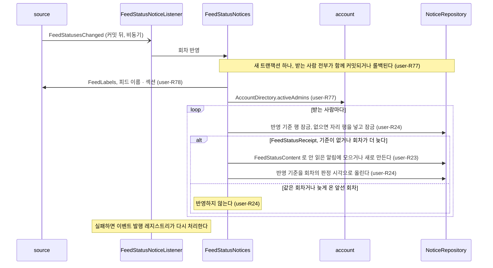
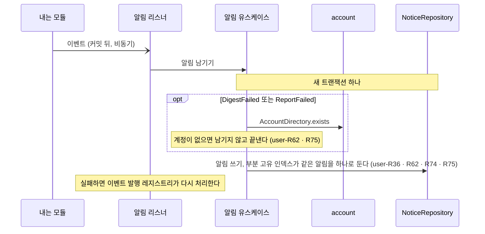
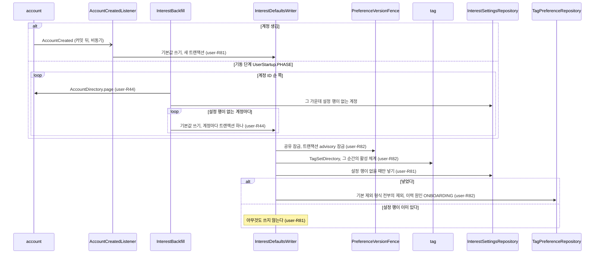
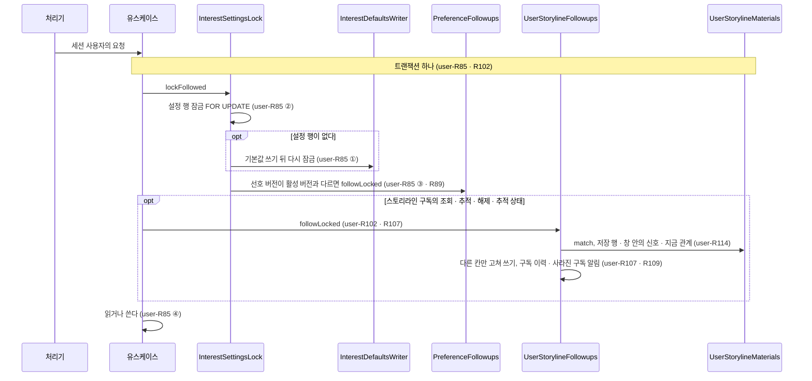
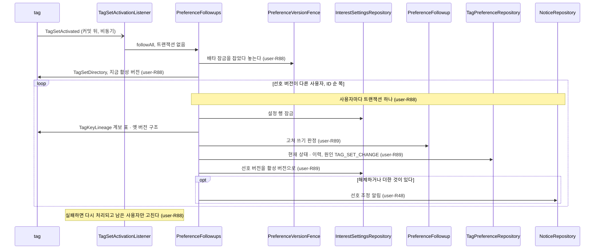
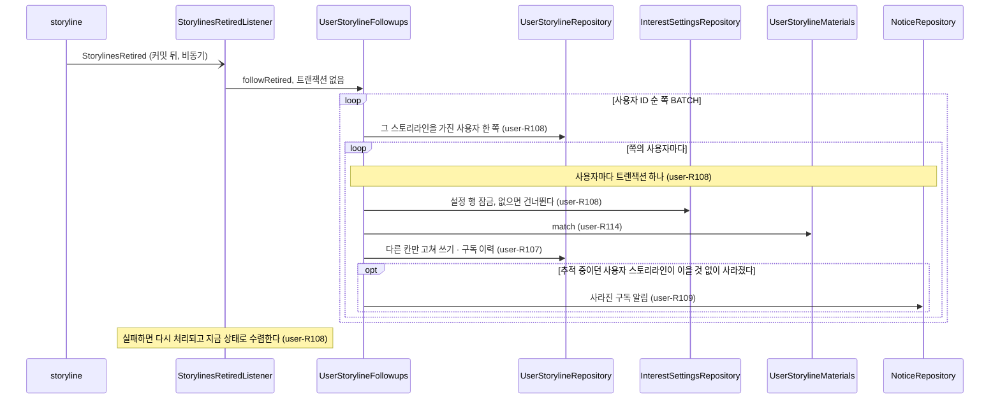
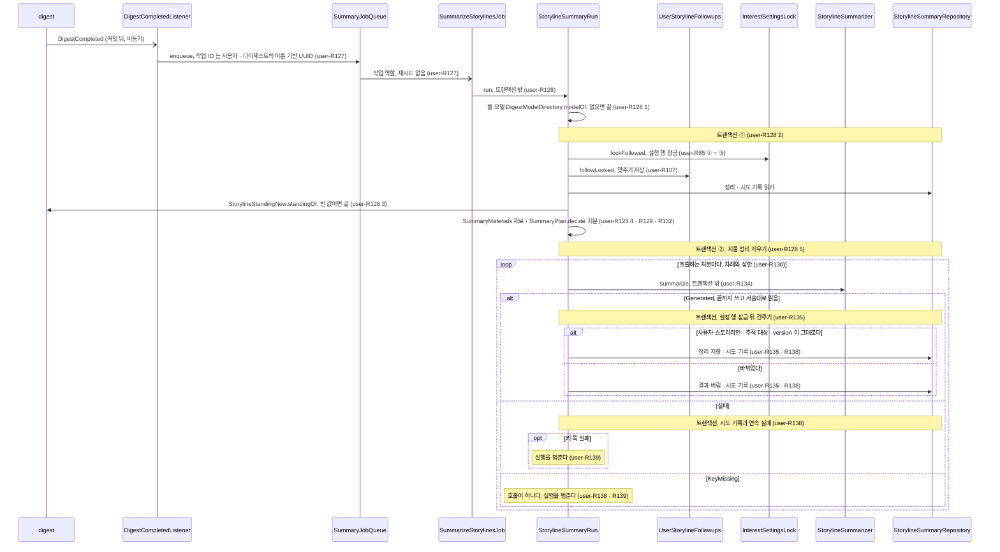
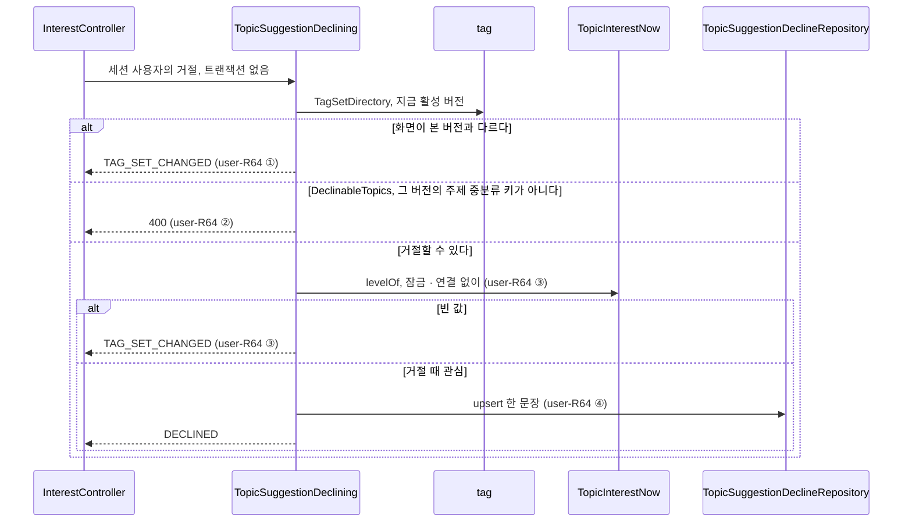

# user 모듈 Spec

공통 구조와 쓰는 규칙은 [specs/README.md](README.md)에 있다.

## 1. 책임과 범위

`user` 는 사용자 한 사람의 관심과 그 사람에게 보이는 기록을 맡는다. 맡는 일은 아래와 같다. 계정 · 인증 · 보안은 [account Spec](account.md)에 있다.

- **화면 내 알림** — 메일 대신 쓰는 알림을 받는 사용자마다 저장하고, 세션 사용자의 알림함(목록 · 안 읽은 수 · 읽음)을 낸다. 알림의 종류는 아래 일곱이다. 두 실패 이벤트의 타입은 이 모듈이 선언한다
  - 피드 상태 알림: `source` 의 피드 상태 변화를 운영자 계정마다 안 읽은 알림 하나에 모은다
  - 비밀번호 알림: `account` 의 `PasswordChanged` 를 받아 남긴다
  - 키 무효 알림: `credential` 의 `CredentialInvalidated` 를 받아 남긴다
  - 선호 조정 알림: 태그 체계 활성 전환이 선호를 해제하거나 더했을 때 남긴다
  - 사라진 구독 알림: 추적하던 사용자 스토리라인이 사라졌을 때 남긴다
  - 다이제스트 실패 알림: `digest` 가 내는 `DigestFailed` 를 받아 남긴다
  - 리포트 실패 알림: `report` 가 내는 `ReportFailed` 를 받아 남긴다
- **읽은 알림 지우기** — 읽은 지 오래된 알림을 지운다
- **관심 설정** — 사용자마다 설정 행 하나와 태그 선호(주제 구독 · 지역 제외 · 형식 제외)의 현재 상태 · 추가 전용 이력, 제외 소스를 갖는다. 설정 행의 칸은 §6 의 `user_settings` 에 있다
  - 계정이 생기면(`account` 의 `AccountCreated`) 기본값을 넣는다. 설정 행이 없는 계정은 처음 저장할 때와 기동 때 채운다
  - 태그 체계의 활성 전환을 따라 선호를 활성 키로 고쳐 쓰고 알린다
  - 고른 모델과 쓸 모델을 정한다
- **사용자 스토리라인** — 사용자가 관심 신호(좋아요 · 싫어요 · 스토리라인 구독)를 준 스토리라인을 사용자마다 저장한다. 씨앗(신호를 받은 스토리라인의 꼭대기)에서 `storyline` 의 이어짐을 앞에서 뒤로 따라 닿는 끝(헤드)마다 사용자 스토리라인 하나로 추적한다. 갈라지기 전 꼭대기는 사용자 스토리라인 여럿에 든다. 공용 관계의 변화(합침 · 지움 · 관계가 생기고 사라짐)를 따른다
  - 저장은 스토리라인 구독의 처리기 · `StorylinesRetired` 리스너 · 정리 작업이 한다
  - 다이제스트의 관심도가 읽는 공개 조회(`UserStorylineDirectory`)는 쓰지 않고 같은 규칙의 결과를 낸다
- **사용자 스토리라인의 정리** — 관심 스토리라인인 사용자 스토리라인마다 그 사용자의 LLM 키로 제목 · 흐름 요약 · 최근 전개를 만들어 그 사용자에게만 저장한다(user-R68 ~ R73)
  - 다이제스트가 끝나면(`digest` 가 내는 `DigestCompleted`) 정리 작업을 등록한다. 이벤트 타입은 이 모듈이 선언한다
  - 작업은 사용자 스토리라인을 맞춘 뒤 스토리라인 판정으로 만들 것 · 고칠 것 · 지울 것을 정해 바뀐 사용자 스토리라인만 부른다. 스토리라인 판정은 이 모듈이 선언하고 `digest` 가 구현하는 공급 인터페이스 `StorylineStandingNow` 가 낸다
  - 생성 호출은 `llm` 의 관문으로 하고(포트 `StorylineSummarizer`), 호출마다 시도 기록(호출 수 · 토큰 합 · 연속 실패)을 남긴다
  - 지운 기사를 넣은 정리는 지운다
  - 독자 화면이 읽는 공개 조회(`UserStorylineSummaries`)는 저장한 정리만 낸다
- **스토리라인 구독(화면 이름 "흐름 추적")** — 사용자 스토리라인을 추적하는 현재 상태와 추가 전용 이력을 갖는다. 사용자가 누른 스토리라인은 그 사용자 스토리라인의 추적 씨앗으로 남는다. 다이제스트 · 관심도 · 관심사 히스토리 · 변화 리포트가 읽는 공개 조회(`StorylineSubscriptionDirectory`)를 낸다. 처리기가 하는 일은 아래다
  - 추적 · 해제
  - 추적 중인 사용자 스토리라인 목록(사용자 스토리라인마다 한 줄 · 상한 100)
  - 추적 상태
  - 추적 이력(사용자가 직접 한 추적 · 해제)
- **구독 제안 거절** — 구독 제안을 거절한 주제 중분류를 사용자마다 현재 상태 한 벌로 저장한다(처리기). 행은 기록 당시 태그 체계 버전 · 거절 때 관심 · 시각을 함께 갖는다. 활성 키로 풀어 내는 공개 조회(`TopicSuggestionDeclines`)를 낸다. 거절 때 관심은 이 모듈이 선언하고 `digest` 가 구현하는 공급 인터페이스(`TopicInterestNow`)로 묻는다. 제안의 판정은 하지 않는다(user-R64 · R65)
- **다이제스트가 읽는 관심 설정** — 다이제스트 후보 선별 · 구독 제안이 읽는 공개 조회(`DigestInterestsDirectory`)를 낸다. 활성 키로 푼 관심 설정이고, 쓰지 않는다(user-R57)
- **주제 구독 이력 조회** — 다이제스트의 관심도 · 관심사 히스토리가 읽는 공개 조회(`TopicSubscriptionHistory`)를 낸다. 기간의 선호 이력 가운데 주제 행을 기록 당시 버전으로 펼치고 활성 중분류로 풀어 원인과 함께 낸다. 쓰지 않는다(user-R58)
- **사용자 시간대 · 일정 조회** — 쓰지 않는 공개 조회 둘을 낸다(user-R60)
  - `UserTimezones`: 관심 설정의 시간대. 다이제스트의 수동 생성이 오늘의 경계를 정할 때, 관심사 히스토리가 기간을 자를 때, 변화 리포트 조회가 시작 전 리포트의 기간 날짜를 적을 때 읽는다
  - `UserDigestSchedules`: 사용자 하나의 일정(시간대 · 생성 시각). 다이제스트의 수동 생성 상태가 오늘의 경계와 오늘 일정 생성 시각을 정할 때 읽는다
- **다이제스트 일정과 쓸 모델** — 쓰지 않는 공개 조회 둘을 낸다(user-R61)
  - `DigestScheduleDirectory`: 다이제스트의 일정 회차가 읽는 일정 목록(쓰는 계정의 시간대 · 생성 시각)
  - `DigestModelDirectory`: 일정 · 생성 작업 · 수동 생성 · 수동 생성 상태가 읽는 쓸 모델(`ModelChoice`)
- **리포트 일정과 쓸 모델** — 쓰지 않는 공개 조회 둘을 낸다(user-R76). 리포트의 재료는 구독 주제를 `DigestInterestsDirectory` 로 읽는다
  - `ReportScheduleDirectory`: 변화 리포트의 일정 회차가 읽는 일정 목록
  - `ReportModelDirectory`: 일정 회차 · 생성 작업 · 다시 만들기가 읽는 쓸 모델과 추론 강도(`ModelChoice`)

하지 않는 것:

- 계정과 그 보안(자격 · 세션 · 보안 구성 · 요청 방어), 계정을 만드는 길을 갖지 않는다 — `account` 의 것이다. 계정의 있음 · 쓰는 계정 · 쓰는 운영자 · 계정 목록은 `account` 의 공개 조회(`AccountDirectory`)로 읽고, 계정이 생기고 비밀번호가 바뀐 사실은 `account` 의 이벤트로 받는다([ADR-0308](../adr/0308-account-authentication-and-security-live-in-the-account-module-while-interests-and-notices-stay-in-user.md) · [ADR-0309](../adr/0309-account-facts-are-published-after-commit-and-user-writes-interest-defaults-and-password-notices-from-them.md))
- LLM 키를 보관하거나 키의 상태를 정하지 않는다 — `credential` 의 것이다. 이 모듈은 쓸 모델을 정할 때 키 상태를 묻고 무효 이벤트를 알림에 담기만 한다
- 피드 상태를 판정하지 않는다 — 판정은 `source` 가 하고, 이 모듈은 받은 전이를 알림에 담기만 한다
- 태그 체계 · 계보 · 기본 제외를 정하지 않는다 — `tag` 의 것이고, 이 모듈은 활성 체계 · 계보를 읽어 선호를 맞춘다
- 스토리라인을 잇거나 합치거나 지우지 않고, 남는 스토리라인을 정하지 않는다 — `storyline` 의 것이고, 이 모듈은 그 알림과 여럿 찾기(`StorylineDirectory.findAll`)로 구독을 맞춘다. 스토리라인의 표시 정보(대표 기사 등)를 내지 않는다
- LLM 공급자를 직접 부르지 않고 키를 다루지 않는다 — 정리의 생성 호출은 `llm` 의 관문이 저장한 키로 한다. 쓸 모델은 허용 모델 목록(`llm`)과 키 상태(`credential`)를 읽어 정하기만 한다
- 관심을 계산하지 않고 관심 스토리라인의 기준을 갖지 않는다 — `digest` 의 것이고, 이 모듈은 판정의 결과를 공급 인터페이스로 받는다
- 공용 스토리라인에 사용자 LLM 의 출력을 두지 않는다 — 정리는 사용자 스토리라인에 붙는 그 사용자의 글이다

다른 모듈과의 의존과 주고받는 이벤트는 [overview.md §5](../overview.md#5-모듈-지도)에 있다.

## 2. 용어

공개 처리기는 [platform Spec §2](platform.md#2-용어)에, 세션 사용자는 [account Spec §2](account.md#2-용어)에, 추론 강도는 [llm Spec §2](llm.md#2-용어)에 있다. 주인을 한 모듈로 정할 수 없는 횡단 용어(사용자 스토리라인 · 헤드 · 꼭대기 등)는 [overview.md §8](../overview.md#8-용어)에 있다.

| 용어 | 뜻 |
|---|---|
| 알림 | 메일 대신 화면 안에서 알리는 것. 받는 사용자마다 한 행이고, 종류 하나와 그 종류의 내용을 갖는다(user-R21) |
| 판 | 알림 내용의 고친 횟수(`revision`). 읽음은 화면이 받은 판이 그대로인 알림만 바꾼다(user-R21 · R25) |
| 피드 상태 알림 | 운영자 계정이 받는 피드 상태 변화 알림. 피드마다 한 줄이다(user-R23) |
| 모으기 | 검사 회차의 전이를 그 사용자의 안 읽은 피드 상태 알림에 더하는 것. 그 알림이 없으면 새로 만든다(user-R23) |
| 반영 기준 | 사용자마다 반영한 마지막 검사 회차의 판정 시각. 읽은 알림과 따로 남아, 다시 처리된 회차와 늦게 온 앞선 회차를 거른다(user-R24) |
| 관심 설정 | 다이제스트 · 리포트가 쓸 사용자의 설정. 설정 행과 태그 선호 · 제외 소스로 이루어진다(user-R43 ~ R51 · R56 · R59) |
| 설정 행 | 사용자마다 한 행인 관심 설정(§6 의 `user_settings`). 선호 버전도 이 행의 칸이다. 관심 설정의 쓰기 · 조회는 이 행을 잠근다(user-R82 · R85) |
| 태그 선호 | 주제 구독 · 지역 제외 · 형식 제외. 태그 종류마다 모드 하나다(user-R83) |
| 선호 버전 | 사용자의 태그 선호 전체가 그 키로 적힌 태그 체계 버전. 설정 행의 칸 하나다(user-R83) |
| 선호 이력 | 태그 선호의 추가 전용 변경 기록. 원인(사용자 · 계정을 만들 때 기본값 · 체계 변경)과 기록 당시 버전을 갖는다. 관심 신호는 원인이 사용자인 행만이다(user-R84) |
| 따라가기 | 선호 버전이 지금 활성 버전과 다른 사용자의 선호를 계보대로 활성 키로 고쳐 쓰는 것(user-R89) |
| 선호 버전 울타리 | 새 설정 행이 활성 전환의 훑기에서 빠지지 않게 하는 advisory 잠금. 설정 행을 만드는 쪽은 공유로, 훑기는 배타로 잡는다(user-R82 · R88) |
| 기동 단계 | 모든 `SmartInitializingSingleton`(태그 체계 첫 기동 적재 포함) 뒤, 웹 서버 앞의 `SmartLifecycle` 단계. 기존 계정 채우기가 이 단계에서 돈다(user-R44) |
| 제외 소스 | 사용자가 다이제스트 후보에서 뺄 소스. 소스 단위이고 이력이 없다(user-R90) |
| 쓸 모델 | 고른 모델 · 허용 모델 목록 · 키 상태로 조회 때 정하는 모델(user-R95) |
| 다이제스트 분량 | 다이제스트 최대 후보 수의 단계(적게 · 보통 · 많이) 또는 직접 입력한 수, 큰 슬롯 수, 요약 길이. 설정 행의 칸 넷이다(user-R96) |
| 요약 길이 | 다이제스트 글(개요 · 주요 뉴스 요약)의 길이 단계 — 짧게 · 보통 · 자세히. 단계의 뜻은 다이제스트의 지시가 정한다(user-R96) |
| 구독 제안 거절 | 사용자가 구독 제안을 거절한 주제 중분류. 기록 당시 버전의 키 · 거절 때 관심 · 시각을 갖는다. 관심 신호가 아니다(user-R64) |
| 스토리라인 구독 | 사용자 스토리라인을 추적하는 상태. 사용자 스토리라인 ID 와 추적하기 시작한 시각을 갖는다(user-R52) |
| 정리 | 사용자 스토리라인 하나를 그 사용자의 LLM 키로 간추린 글. 사용자 스토리라인 전체의 제목 · 흐름 요약 · 최근 전개와 추적 대상 꼭대기마다의 같은 세 글이다. 정리가 있는 사용자 스토리라인만 독자 화면에 보인다(user-R68 · R73) |
| 다이제스트가 읽는 관심 설정 | 다이제스트 후보 선별 · 구독 제안이 읽는, 활성 키로 푼 관심 설정(user-R57) |
| 주제 구독 이력 조회 | 다이제스트의 관심도가 읽는 기간의 주제 구독 변경. 선호 이력의 주제 행을 기록 당시 버전으로 펼쳐 활성 중분류로 풀고 원인과 함께 낸다(user-R58) |
| 씨앗 | 사용자 스토리라인을 만드는 꼭대기 — 관심 창 안에 반응을 받은 사건의 꼭대기, 창 안에 사용자가 추적 · 해제한 스토리라인의 꼭대기, 추적 씨앗의 꼭대기(user-R115) |
| 추적 대상 | 사용자 스토리라인이 따라가는 꼭대기들 — 헤드와, 씨앗 가운데 그 헤드에 닿는 것과, 그 씨앗에서 헤드까지 이어짐을 앞에서 뒤로 따라 닿는 꼭대기(user-R116) |
| 맞추기 | 저장한 사용자 스토리라인을 지금의 신호 · 관계로 낸 묶음에 잇는 것. 잇기 · 만들기 · 합치기 · 지우기를 한다(user-R107 · R117) |
| 추적 씨앗 | 추적 중인 사용자 스토리라인에 남은 스토리라인. 사용자가 누른 것이거나 갈라질 때 물려받은 것이다. 구독 이력과 일대일이다(user-R101) |
| 구독 이력 | 추적 씨앗의 추가 전용 변경 기록. 원인(사용자 · 합쳐짐 · 사라짐 · 갈라져 물려받음)을 갖는다. 관심 신호는 원인이 사용자인 행만이다(user-R101 · R107) |
| 처분 | 정리 실행이 사용자 스토리라인마다 정하는 일 — `Create` · `Rebuild` · `Extend` · `Keep` · `Remove`(user-R129) |
| 넣은 사건 | 정리에 반영한 것으로 기록한 사건과 그 대표 기사. 다음 실행이 새 사건을 가리는 기준이고, 지운 기사를 따르는 색인이다(user-R72 · R129 · R131) |
| 시도 기록 | 사용자 스토리라인마다 정리 호출의 수 · 토큰 합 · 연속 실패 · 마지막 실패. 정리를 지워도 남는다(user-R138 · R141) |
| 사라진 구독 알림 | 추적하던 사용자 스토리라인이 이을 스토리라인 없이 사라졌다는 알림. 지워진 추적 씨앗의 스토리라인 ID 와 풀기에서 남은 사건 ID 만 담고, 제목은 알림함을 열 때 읽는다(user-R109 · R110) |

## 3. 공개 인터페이스

받는 이벤트는 아래다. 내는 이벤트는 없다 — 관심 설정 · 스토리라인 구독이 바뀌어도 이벤트를 내지 않는다([ADR-0180](../adr/0180-user-settings-changes-publish-no-event-and-consumers-query.md)).

- `account` 의 `AccountCreated` · `PasswordChanged`(user-R43 · R74)
- `source` 의 `FeedStatusesChanged` · `SourceDeleted`
- `credential` 의 `CredentialInvalidated`
- `tag` 의 `TagSetActivated`
- `storyline` 의 `StorylinesRetired`
- `article` 의 `ArticlesRemoved`
- `digest` 가 내는 `DigestFailed` · `DigestCompleted`, `report` 가 내는 `ReportFailed` — 이 모듈이 선언한 이벤트다(user-R62 · R68 · R75)

모듈 최상위 패키지 `net.yozmnews.user` 의 공개 타입은 아래 표다. 타입마다 하위 절이 있다. 사용자 식별자 `UserId` 는 `platform` 의 공개 타입이다([platform Spec](platform.md#userid)).

| 쓰임 | 공개 타입과 그 값 타입 |
|---|---|
| 다른 모듈이 읽는 공개 조회 | `StorylineSubscriptionDirectory`(`StorylineSubscriptionChange` · `StorylineSubscriptionAction` · `StorylineSubscriptionCause`) |
| | `UserStorylineDirectory`(`UserStorylineView` · `UserStorylineId`) |
| | `DigestInterestsDirectory`(`DigestInterests` · `TopicSubscription` · `SummaryLength`) |
| | `TopicSubscriptionHistory`(`TopicSubscriptionChanges` · `TopicSubscriptionChange` · `TopicSubscriptionAction` · `TopicSubscriptionCause`) |
| | `UserTimezones` · `UserDigestSchedules` |
| | `DigestScheduleDirectory`(`DigestScheduleEntry`) · `DigestModelDirectory` |
| | `ReportScheduleDirectory`(`ReportScheduleEntry`) · `ReportModelDirectory`(`ReportModel`) |
| | `TopicSuggestionDeclines`(`TopicSuggestionDeclineList` · `TopicSuggestionDecline`) |
| 독자 화면이 읽는 공개 조회 | `UserStorylineSummaries`(`UserStorylineSummaryView` · `TopSummary` · `SummaryUsage` · `UserStorylineSummaryRef`) |
| 다른 모듈이 구현하는 공급 인터페이스(셋 다 `digest` 가 구현) | `TopicInterestNow` · `InterestSignalWindow` · `StorylineStandingNow`(`StorylineStanding`) |
| 받는 쪽으로 선언한 이벤트 | `DigestFailed` · `DigestCompleted` · `ReportFailed`(`ReportFailedKind`) |
| 두 실패 이벤트가 함께 쓰는 실패 원인 | `GenerationFailureCause` |

HTTP 엔드포인트:

| 경로 | 메서드 | 용도 |
|---|---|---|
| `/api/notices` | `GET` | 세션 사용자의 알림 한 쪽과 다음 쪽 커서. 질의 `before`(선택)(user-R79 · R80) |
| `/api/notices/unread-count` | `GET` | 세션 사용자의 안 읽은 알림 수(user-R79) |
| `/api/notices/read` | `POST` | 화면이 받은 알림의 `{id, revision}` 목록을 읽음으로 — 204(user-R25 · R80) |
| `/api/interests/tags` | `GET` | 활성 태그 체계(주제 · 지역 · 형식과 기본 제외)와 세션 사용자의 태그 선호(user-R83 · R85) |
| `/api/interests/tags` | `PUT` | 태그 선호 저장 — `SAVED` · `TAG_SET_CHANGED`(user-R87) |
| `/api/interests/sources` | `GET` | 고를 소스(숨기지 않은 소스의 ID · 이름)와 제외 소스(user-R90) |
| `/api/interests/sources` | `PUT` | 제외 소스 저장 — `SAVED`(user-R90) |
| `/api/interests/settings` | `GET` | 일정 · 리포트 설정과 월간 날짜의 범위(`monthlyReportDayRange`)(user-R92) |
| `/api/interests/settings` | `PUT` | 일정 · 리포트 설정 저장 — `SAVED` · `UNKNOWN_TIMEZONE`(user-R92) |
| `/api/interests/model` | `GET` | 모델 설정(user-R95)과 추론 강도(user-R99) |
| `/api/interests/model` | `PUT` | 모델 고르기 — `SAVED` · `PROVIDER_WITHOUT_KEY` · `MODEL_NOT_ALLOWED`(user-R94) |
| `/api/interests/effort` | `PUT` | 추론 강도 저장 — 응답은 모델 조회와 같은 칸이다. 값 이름이 틀리면 400(user-R100) |
| `/api/interests/volume` | `GET` | 다이제스트 분량과 고를 수 있는 값 · 범위(user-R96) |
| `/api/interests/volume` | `PUT` | 분량 저장 — `SAVED` · `COUNT_OUT_OF_RANGE` · `BIG_SLOTS_OUT_OF_RANGE`(user-R97) |
| `/api/interests/declined-suggestions` | `POST` | 구독 제안 거절 — 본문 `{tagSetId, topic}`, `DECLINED` · `TAG_SET_CHANGED`. `tagSetId` 가 1 보다 작으면 400(user-R64) |
| `/api/storyline-subscriptions` | `GET` | 추적 중인 사용자 스토리라인 목록(user-R105) |
| `/api/storyline-subscriptions/states` | `GET` | 추적 상태 — 질의 `ids`(user-R67) |
| `/api/storyline-subscriptions/{storylineId}` | `PUT` | 추적 — `SUBSCRIBED` · `ALREADY_SUBSCRIBED` · `UNKNOWN_STORYLINE` · `LIMIT_REACHED`. ID 가 1 보다 작거나 숫자가 아니면 400(user-R103) |
| `/api/storyline-subscriptions/{storylineId}` | `DELETE` | 해제 — `UNSUBSCRIBED` · `NOT_SUBSCRIBED`. ID 가 1 보다 작거나 숫자가 아니면 400(user-R104) |
| `/api/storyline-subscriptions/changes` | `GET` | 추적 이력 한 쪽 — 질의 `beforeAt` · `beforeId`(다음 쪽 커서)(user-R111 · R112) |

- 세션 — 알림 세 경로 · 관심 설정 열두 경로 · 스토리라인 구독 다섯 경로는 세션이 필요하고 사용자 격리 시험에 등록돼 있다([account Spec](account.md#화면용-api-의-공개와-세션-사용자) account-R5 · R6)
- 키 — 모두 LLM 키가 없는 세션 사용자에게도 연다(`@AllowedWithoutLlmKey`, account-R5)
- 결과 — 판정 결과는 200 이고, 요청 본문의 칸이 없으면 본문 형식 400 이다. 요청 · 응답 형식은 `api/openapi.json` 에 있다

### StorylineSubscriptionDirectory

스토리라인 구독 조회 — 다이제스트 · 관심도 · 관심사 히스토리 · 변화 리포트가 읽는다. 구현은 `application` 의 `StorylineSubscriptionDirectoryService` 다.

```java
public interface StorylineSubscriptionDirectory {
	List<StorylineId> subscriptions(UserId user);
	List<StorylineSubscriptionChange> changes(UserId user, Instant from, Instant to);
}

public record StorylineSubscriptionChange(StorylineId recorded, @Nullable StorylineId current,
		StorylineSubscriptionAction action, StorylineSubscriptionCause cause, Instant occurredAt) {}

public enum StorylineSubscriptionAction { ADD, REMOVE }

public enum StorylineSubscriptionCause { USER, STORYLINE_MERGED, STORYLINE_REMOVED, STORYLINE_SPLIT }
```

| 메서드 · 타입 | 뜻 |
|---|---|
| `subscriptions` | 지금 추적 씨앗 — 추적 중인 사용자 스토리라인의 추적 씨앗을 남는 스토리라인 ID 로 풀고 같은 것은 하나로, 사라진 것은 빼고, ID 순. 사용자 스토리라인이 이어짐으로 따라가는 뒤 스토리라인은 들지 않는다 — 그것은 `UserStorylineDirectory` 가 낸다 |
| `changes` | 이력 행 가운데 시각이 `from` 이상 · `to` 미만인 것 — 시각 · 행 순. `from` 이 `to` 보다 늦으면 `IllegalArgumentException` |
| `StorylineSubscriptionChange.recorded` | 기록된 스토리라인 ID — 기록 뒤에 합쳐졌거나 지워졌을 수 있다 |
| `StorylineSubscriptionChange.current` | `recorded` 를 지금 푼 스토리라인 ID(합쳐졌으면 남는 쪽) — 지워졌으면 null |
| `StorylineSubscriptionCause` | 사용자(`USER`) · 합쳐져 옮김(`STORYLINE_MERGED`) · 사라져 뺌(`STORYLINE_REMOVED`) · 추적이 사용자 스토리라인 여럿으로 나뉨(`STORYLINE_SPLIT`, user-R104 · R117). 관심 신호는 `USER` 행만이다 |

- 계약
  - 화면 경로에서 부르는 범위는 user-R55 가 정한다([ADR-0228](../adr/0228-consumer-queries-scoped-by-a-user-argument-may-be-called-on-screen-paths-with-the-session-user.md))
  - 쓰지 않는다 — 저장된 추적 씨앗 · 이력의 ID 는 합쳐진 옛 ID 일 수 있어 `storyline` 의 여럿 찾기(`StorylineDirectory.findAll`)로 풀어 낸다(user-R107)
  - 기간을 사용자 시간대의 날로 자르는 일과 관심 신호로 쓸 행을 고르는 일은 부르는 쪽이 한다

관련 규칙: user-R55.

### UserStorylineDirectory

사용자 스토리라인 조회 — 다이제스트의 관심도(후보 선별 · 관심사 히스토리 · 구독 제안)와 변화 리포트의 재료 조립이 읽는다. 구현은 `application` 의 `UserStorylineDirectoryService` 다.

```java
public interface UserStorylineDirectory {
	List<UserStorylineView> of(UserId user, Instant from, Instant to);
}

public record UserStorylineView(@Nullable UserStorylineId id, StorylineId head, Set<StorylineId> tops, boolean tracked) {}

public record UserStorylineId(long value) {}
```

| 메서드 · 타입 | 뜻 |
|---|---|
| `of` | 그 사용자의 사용자 스토리라인 — 저장 행과, 시각이 `from` 이상 · `to` 미만인 신호 · 지금 관계로 맞춘 결과(user-R66). 헤드 ID 순. `from` 이 `to` 보다 늦으면 `IllegalArgumentException` |
| `UserStorylineView.id` | 저장한 사용자 스토리라인이 이은 묶음이면 그 ID — 아직 저장되지 않은 묶음이면 null |
| `UserStorylineView.head` | 헤드 — `tops` 에 든다. 한 사용자의 사용자 스토리라인 사이에 겹치지 않는다 |
| `UserStorylineView.tops` | 추적 대상 — 공용 스토리라인의 꼭대기들. 비지 않는다. 갈라지기 전 꼭대기는 한 사용자의 사용자 스토리라인 여럿에 든다 |
| `UserStorylineView.tracked` | 추적 중인가 — 맞춘 뒤의 값(갈라져 물려받을 조각도 추적 중이다) |
| `UserStorylineId` | 사용자 스토리라인 ID — 1 이상 |

- 계약
  - 사용자를 인자로 받는 조회다 — 화면 경로에서는 세션 사용자로만 부른다([ADR-0228](../adr/0228-consumer-queries-scoped-by-a-user-argument-may-be-called-on-screen-paths-with-the-session-user.md))
  - 쓰지 않는다 — 저장하는 맞추기(user-R107)와 같은 판정을 계산만 한다. 저장 행이 같으면 같은 창에서 같은 결과다
  - 여러 조회가 한 스냅숏이 아니다 — 그 사이 바뀐 관계는 다음 조회에 든다

관련 규칙: user-R66.

### InterestSignalWindow

관심 신호의 창 — 이 모듈이 선언하고 `digest` 가 구현하는 공급 인터페이스다(구현 `digest` 의 `InterestSignalWindows`). 창의 길이는 `digest` 의 관심도가 정본이다.

```java
public interface InterestSignalWindow {
	Instant start(Instant reference);
}
```

| 메서드 | 뜻 |
|---|---|
| `start` | 기준 시각의 관심 창이 시작하는 시각(포함) |

관련 규칙: user-R66.

### DigestInterestsDirectory

다이제스트가 읽는 관심 설정 — 다이제스트 후보 선별과 변화 리포트의 재료 조립(구독 주제 · 시간대)이 읽는다. 구현은 `application` 의 `DigestInterestsDirectoryService` 다.

```java
public interface DigestInterestsDirectory {
	Optional<DigestInterests> interestsOf(UserId user);
}

public record DigestInterests(TagSetId tagSet, List<TopicSubscription> topics, Set<String> excludedRegions,
		Set<String> excludedFormats, Set<SourceId> excludedSources, ZoneId timezone,
		int maxCandidates, int bigSlots, SummaryLength summaryLength, ReasoningEffort effort) {}

public record TopicSubscription(String key, Set<String> subtopics) {}

public enum SummaryLength { SHORT, NORMAL, DETAILED }
```

| 메서드 · 타입 | 뜻 |
|---|---|
| `interestsOf` | 그 사용자의 관심 설정 — 계정이 없으면 빈 값 |
| `DigestInterests.tagSet` | 낸 키의 활성 태그 체계 버전 — 부르는 쪽이 기사 평가 키를 푼 계보 표의 버전과 맞춘다 |
| `DigestInterests.topics` | 주제 구독 행 — 키 순 |
| `DigestInterests.excludedRegions` · `excludedFormats` | 제외한 지역 · 형식 — 활성 키 |
| `DigestInterests.excludedSources` | 제외한 소스 |
| `DigestInterests.timezone` | 사용자 시간대 |
| `DigestInterests.maxCandidates` · `bigSlots` | 다이제스트 분량의 최대 후보 수(단계의 값 또는 직접 입력한 수)와 큰 슬롯 수 |
| `DigestInterests.summaryLength` | 요약 길이(`SummaryLength`: 짧게 · 보통 · 자세히) |
| `DigestInterests.effort` | 생성의 추론 강도(`llm` 의 `ReasoningEffort`) |
| `TopicSubscription` | 구독 행 하나(대분류 또는 중분류 키)와 그 행이 덮는 활성 중분류 — 대분류면 하위 중분류 전부, 중분류면 그 하나 |

- 계약
  - 부르는 쪽과 그 범위, 계정 상태를 보지 않는 것은 user-R57 이 정한다([ADR-0248](../adr/0248-the-digest-interests-and-topic-suggestion-queries-may-be-called-on-screen-paths-with-the-session-user.md))
  - 쓰지 않는다 — 선호 버전이 활성 버전과 다르면 따라가기 결과를 계산해 내고, 설정 행이 없으면 계정을 만들 때의 기본값을 계산해 낸다

관련 규칙: user-R57.

### TopicSuggestionDeclines

구독 제안 거절 조회 — 다이제스트의 구독 제안이 다시 내지 않을 주제를 고를 때 읽는다. 구현은 `application` 의 `TopicSuggestionDeclinesService` 다.

```java
public interface TopicSuggestionDeclines {
    TopicSuggestionDeclineList declinesOf(UserId user);
}

public record TopicSuggestionDeclineList(TagSetId tagSet, List<TopicSuggestionDecline> declines) {}
public record TopicSuggestionDecline(String subtopic, double level, Instant declinedAt) {}
```

| 멤버 | 뜻 |
|---|---|
| `declinesOf` | 그 사용자의 거절을 활성 버전의 주제 중분류로 푼 것 — 계정이 없으면 빈 목록 |
| `TopicSuggestionDeclineList.tagSet` | 거절의 키를 푼 활성 버전 — 부르는 쪽이 자기 재료의 버전과 맞춘다 |
| `TopicSuggestionDecline.subtopic` | 활성 중분류 전체 키 — 중분류마다 많아야 하나 |
| `TopicSuggestionDecline.level` · `declinedAt` | 거절 때 관심 x(−1 ~ 1) · 거절한 시각 |

- 계약
  - 화면 경로에서 부르는 범위는 user-R65 가 정한다
  - 쓰지 않는다

관련 규칙: user-R65.

### TopicInterestNow

지금 관심의 공급 인터페이스 — 이 모듈이 선언하고 `digest` 가 구현한다. 거절 처리기가 거절 때의 관심을 적으려고 부른다([ADR-0247](../adr/0247-topic-suggestion-declines-are-kept-by-user-with-the-recorded-version-and-digest-answers-the-interest-at-decline-through-an-interface-declared-by-user.md)).

```java
public interface TopicInterestNow {
    OptionalDouble levelOf(UserId user, TagSetId tagSet, String subtopic);
}
```

| 멤버 | 뜻 |
|---|---|
| `levelOf` | 지금을 기준 시각으로 둔 그 중분류의 관심(−1 ~ 1, 신호가 없으면 0). `tagSet` 이 구현이 읽은 활성 버전과 다르거나 계정이 없으면 빈 값 |

- 계약
  - 이 모듈은 관심을 계산하지 않고 `digest` 의 타입을 쓰지 않는다
  - 사용자를 인자로 받는다 — 화면 경로에서는 세션 사용자로만 부른다. 쓰지 않는다

### TopicSubscriptionHistory

주제 구독 이력 조회 — 다이제스트의 관심도 · 관심사 히스토리가 읽는다. 구현은 `application` 의 `TopicSubscriptionHistoryService` 다.

```java
public interface TopicSubscriptionHistory {
	TopicSubscriptionChanges changes(UserId user, Instant from, Instant to);
}

public record TopicSubscriptionChanges(TagSetId tagSet, List<TopicSubscriptionChange> changes) {}

public record TopicSubscriptionChange(String recordedKey, TagSetId recordedVersion, Set<String> subtopics,
		TopicSubscriptionAction action, TopicSubscriptionCause cause, Instant occurredAt) {}

public enum TopicSubscriptionAction { ADD, REMOVE }

public enum TopicSubscriptionCause { USER, ONBOARDING, TAG_SET_CHANGE }
```

| 메서드 · 타입 | 뜻 |
|---|---|
| `changes` | 선호 이력 가운데 주제 행으로 시각이 `from` 이상 · `to` 미만인 것 — 시각 · 행 순. 계정이 없으면 빈 목록. `from` 이 `to` 보다 늦으면 `IllegalArgumentException` |
| `TopicSubscriptionChanges.tagSet` | 행마다 낸 중분류 키의 활성 태그 체계 버전 — 부르는 쪽이 기사 평가 키를 푼 계보 표의 버전과 맞춘다 |
| `TopicSubscriptionChange.recordedKey` · `recordedVersion` | 기록된 키(대분류 키 또는 중분류 전체 키)와 기록 당시 버전 |
| `TopicSubscriptionChange.subtopics` | 그 행이 덮던 중분류(기록 당시 버전에서 대분류는 하위 전체로 펼침)를 활성 중분류로 푼 것 — 계보 없이 지운 것은 빠지고 모두 지웠으면 비었다 |
| `TopicSubscriptionCause` | 선호 이력의 저장 원인을 옮긴 것 — 사용자(`USER`) · 계정을 만들 때 기본값(`ONBOARDING`) · 체계 변경(`TAG_SET_CHANGE`). 관심 신호는 `USER` 행만이다 |

- 계약
  - 화면 경로에서 부르는 범위는 user-R58 이 정한다([ADR-0228](../adr/0228-consumer-queries-scoped-by-a-user-argument-may-be-called-on-screen-paths-with-the-session-user.md))
  - 쓰지 않는다 — 이력 행의 키는 기록 당시 버전의 것이라 그 버전의 구조로 펼치고 계보로 풀어 낸다
  - 기간을 사용자 시간대의 날로 자르는 일과 관심 신호로 쓸 행을 고르는 일은 부르는 쪽이 한다

관련 규칙: user-R58.

### UserTimezones

사용자 시간대 조회 — 관심 설정의 시간대. 다이제스트의 수동 생성이 사용자 시간대의 오늘을 정할 때, 관심사 히스토리가 기간을 자를 때, 변화 리포트 조회가 시작 전 리포트의 기간 날짜를 적을 때([report Spec](report.md#리포트-조회) report-R26) 읽는다. 구현은 `application` 의 `UserTimezonesService` 다 — 같은 클래스가 [`UserDigestSchedules`](#userdigestschedules) 를 함께 구현하고, 시간대는 그 일정의 시간대다.

```java
public interface UserTimezones {
    Optional<ZoneId> timezoneOf(UserId user);
}
```

| 멤버 | 뜻 |
|---|---|
| `timezoneOf` | 설정 행의 시간대 — 설정 행이 없으면 기본 일정(`InterestDefaults.SCHEDULE`)의 시간대, 계정이 없으면 빈 값 |

- 계약
  - 화면 경로에서 부르는 범위는 user-R60 이 정한다([ADR-0228](../adr/0228-consumer-queries-scoped-by-a-user-argument-may-be-called-on-screen-paths-with-the-session-user.md))
  - 읽기 전용 트랜잭션 하나다. 쓰지 않는다 — 설정 행이 없어도 만들지 않는다

관련 규칙: user-R60.

### UserDigestSchedules

사용자 하나의 다이제스트 일정 조회 — 관심 설정의 시간대 · 생성 시각. 다이제스트의 수동 생성 상태가 사용자 시간대의 오늘과 오늘 일정 생성 시각을 정할 때 읽는다. 구현은 `application` 의 `UserTimezonesService` 다.

```java
public interface UserDigestSchedules {
    Optional<DigestScheduleEntry> scheduleOf(UserId user);
}
```

| 멤버 | 뜻 |
|---|---|
| `scheduleOf` | 설정 행의 일정(시간대 · 생성 시각) — 설정 행이 없으면 기본 일정(`InterestDefaults.SCHEDULE`), 계정이 없으면 빈 값. 값은 [`DigestScheduleEntry`](#digestscheduledirectory) 다 |

- 계약
  - 화면 경로에서 부르는 범위는 user-R60 이 정한다([ADR-0228](../adr/0228-consumer-queries-scoped-by-a-user-argument-may-be-called-on-screen-paths-with-the-session-user.md))
  - 읽기 전용 트랜잭션 하나다. 쓰지 않는다 — 설정 행이 없어도 만들지 않는다. 날짜 · 생성 시각 계산은 부르는 쪽이 한다

관련 규칙: user-R60.

### DigestScheduleDirectory

다이제스트 일정 목록 — 다이제스트의 일정 회차가 생성 시각이 된 사용자를 고르려고 읽는다. 구현은 `application` 의 `DigestScheduleDirectoryService` 다.

```java
public interface DigestScheduleDirectory {
    int MAX_PAGE = 500;                                          // 쪽 하나의 상한의 정본(측정 전)
    List<DigestScheduleEntry> page(long afterUserId, int limit);
}

public record DigestScheduleEntry(UserId user, ZoneId timezone, LocalTime time) {}
```

| 멤버 | 뜻 |
|---|---|
| `page` | 쓰는(`ACTIVE`) 계정마다의 일정(설정 행이 없으면 기본 일정 `InterestDefaults.SCHEDULE`) — 사용자 ID 가 `afterUserId` 보다 큰 것부터 ID 순으로 `limit` 개까지. `limit` 이 1 ~ `MAX_PAGE` 밖이면 `IllegalArgumentException` |
| `DigestScheduleEntry` | 사용자 · 일정의 기준 시간대 · 생성 시각(분 단위, user-R92). `page` 와 `UserDigestSchedules.scheduleOf` 가 낸다 |

- 계약
  - 부르는 범위는 user-R123 이 정한다
  - 읽기 전용 트랜잭션 하나다. 쓰지 않는다. 날짜 · 생성 시각 계산은 부르는 쪽이 한다

관련 규칙: user-R61.

### DigestModelDirectory

다이제스트를 만들 때 쓸 모델 — 다이제스트의 일정 회차 · 생성 작업 · 수동 생성 · 수동 생성 상태가 읽는다. 구현은 `application` 의 `DigestModelDirectoryService` 다.

```java
public interface DigestModelDirectory {
    Optional<LlmModel> modelOf(UserId user);
}
```

| 멤버 | 뜻 |
|---|---|
| `modelOf` | 그 사용자의 쓸 모델(user-R95 · `ModelChoice`) — 계정이 없거나 쓰는(`ACTIVE`) 계정이 아니거나 쓸 모델이 없으면 빈 값. 설정 행이 없으면 계정을 만들 때의 값(고른 모델 없음)으로 정한다 |

- 계약
  - 화면 경로에서 부르는 범위는 user-R124 가 정한다
  - 읽기 전용 트랜잭션 하나다. 쓰지 않는다. 판정은 관심 설정 화면의 쓸 모델과 같은 정본이다

관련 규칙: user-R61.

### ReportScheduleDirectory

리포트 일정 목록 — 변화 리포트의 일정 회차가 리포트 시점이 된 사용자를 고르려고 읽는다([report Spec](report.md#일정) report-R27). 구현은 `application` 의 `ReportScheduleDirectoryService` 다.

```java
public interface ReportScheduleDirectory {
    int MAX_PAGE = 500;                                          // 쪽 하나의 상한의 정본(측정 전)
    List<ReportScheduleEntry> page(long afterUserId, int limit);
}

public record ReportScheduleEntry(UserId user, ZoneId timezone, LocalTime time, boolean weekly, DayOfWeek weeklyDay,
        boolean monthly, int monthlyDay) {}
```

| 멤버 | 뜻 |
|---|---|
| `page` | 쓰는(`ACTIVE`) 계정마다의 리포트 일정(설정 행이 없으면 기본값) — 사용자 ID 가 `afterUserId` 보다 큰 것부터 ID 순으로 `limit` 개까지. `limit` 이 1 ~ `MAX_PAGE` 밖이면 `IllegalArgumentException` |
| `ReportScheduleEntry.user` · `timezone` | 사용자 · 일정의 기준 시간대 |
| `ReportScheduleEntry.time` | 다이제스트 생성 시각(분 단위). 리포트 기간의 경계 시각이다 |
| `ReportScheduleEntry.weekly` · `weeklyDay` | 주간 리포트를 받는가 · 그 요일 |
| `ReportScheduleEntry.monthly` · `monthlyDay` | 월간 리포트를 받는가 · 그 날짜(1 ~ 31). 그 날이 없는 달의 경계는 부르는 쪽이 정한다(user-R92 · R93) |

- 계약
  - 부르는 범위는 user-R125 가 정한다
  - 읽기 전용 트랜잭션 하나다. 쓰지 않는다. 기간 · 경계 계산은 부르는 쪽이 한다

관련 규칙: user-R76.

### ReportModelDirectory

변화 리포트를 만들 때 쓸 모델과 추론 강도 — 리포트의 일정 회차 · 생성 작업 · 다시 만들기가 읽는다. 구현은 `application` 의 `ReportModelDirectoryService` 다.

```java
public interface ReportModelDirectory {
    Optional<ReportModel> modelOf(UserId user);
}

public record ReportModel(LlmModel model, ReasoningEffort effort) {}
```

| 멤버 | 뜻 |
|---|---|
| `modelOf` | 그 사용자의 쓸 모델(user-R95 · `ModelChoice`)과 추론 강도(user-R99) — 계정이 없거나 쓰는(`ACTIVE`) 계정이 아니거나 쓸 모델이 없으면 빈 값. 설정 행이 없으면 계정을 만들 때의 값으로 정한다 |

- 계약
  - 화면 경로에서 부르는 범위는 user-R126 이 정한다
  - 읽기 전용 트랜잭션 하나다(부르는 쪽의 트랜잭션이 있으면 그 안에서 읽는다). 쓰지 않는다. 판정은 다이제스트의 쓸 모델과 같은 정본이다

관련 규칙: user-R76.

### DigestFailed

다이제스트가 실패로 끝났다 — 받는 쪽인 이 모듈이 선언하고 `digest` 가 실패를 쓰는 트랜잭션에서 낸다. 이 모듈은 받아 그 사용자에게 알림을 남긴다([ADR-0233](../adr/0233-digest-failure-notices-come-through-an-event-declared-by-the-receiving-user-module-for-every-failed-digest.md)).

```java
public record DigestFailed(UserId user, long digestId, LocalDate digestDate, GenerationFailureCause cause,
        Instant failedAt) {}

public enum GenerationFailureCause { KEY, PROVIDER_ACCOUNT, TEMPORARY, OUTPUT }
```

| 멤버 | 뜻 |
|---|---|
| `digestId` | 실패한 다이제스트(1 이상) — 같은 다이제스트의 알림은 하나다 |
| `digestDate` · `failedAt` | 다이제스트 날짜 · 실패로 끝낸 시각 |
| `GenerationFailureCause` | 사용자 키로 하는 생성(다이제스트 · 변화 리포트)의 실패 원인. 사용자가 할 일로 묶는다. 값은 표 아래 목록이다 |

`GenerationFailureCause` 의 값:

- `KEY` — 키 확인. 키가 없거나 무효이거나 쓸 모델이 없다
- `PROVIDER_ACCOUNT` — 공급자 계정의 권한 · 잔액
- `TEMPORARY` — 잠시 뒤 다시. 일시 장애 · 예상 밖의 답 · 생성이 끝나지 않음이다
- `OUTPUT` — 모델 출력 문제

실패 알림과 화면이 이 값으로 할 일 문구를 고르고, 문구 표는 다이제스트 · 리포트가 따로 둔다. 실패 코드를 실패 원인으로 옮기는 정본은 생성한 모듈에 있다([digest Spec](digest.md#끝내기와-실패-이벤트) · [report Spec](report.md#끝내기와-실패-알림)).

- 계약
  - 받는 쪽인 이 모듈이 선언한다 — 그 까닭은 [ADR-0233](../adr/0233-digest-failure-notices-come-through-an-event-declared-by-the-receiving-user-module-for-every-failed-digest.md)에 있다

관련 규칙: user-R62.

### DigestCompleted

다이제스트가 실패가 아닌 끝(내용 있음 · 후보 없음)으로 끝났다 — 받는 쪽인 이 모듈이 선언하고 `digest` 가 끝낸 행을 쓰는 트랜잭션에서 낸다. 이 모듈은 받아 그 사용자의 정리 작업을 등록한다([ADR-0287](../adr/0287-user-storyline-summaries-are-made-and-stored-by-user-with-the-users-key-and-digest-supplies-the-flow-standing.md) · [ADR-0288](../adr/0288-summaries-are-made-after-a-digest-ends-only-for-changed-flows-and-extended-with-new-events.md)).

```java
public record DigestCompleted(UserId user, long digestId, LocalDate digestDate, Instant completedAt) {}
```

| 멤버 | 뜻 |
|---|---|
| `digestId` | 끝난 다이제스트(1 이상) — 같은 사용자 · 다이제스트의 정리 작업은 하나다 |
| `digestDate` · `completedAt` | 다이제스트 날짜 · 끝낸 시각 |

- 계약
  - 받는 쪽이 선언한다 — `DigestFailed` 와 같은 까닭이다
  - 실패로 끝난 다이제스트에는 내지 않는다. 같은 날짜를 다시 만들어 앞선 다이제스트가 가려져도 낸다

관련 규칙: user-R68.

### ReportFailed

변화 리포트가 실패로 끝났다 — 받는 쪽인 이 모듈이 선언하고 `report` 가 실패를 쓰는 트랜잭션에서 낸다. 이 모듈은 받아 그 사용자에게 알림을 남긴다([ADR-0324](../adr/0324-report-failures-become-notices-through-an-event-declared-by-the-receiving-user-module-like-digest-failures.md)).

```java
public record ReportFailed(UserId user, long reportId, ReportFailedKind kind, LocalDate firstDay, LocalDate lastDay,
        GenerationFailureCause cause, Instant failedAt) {}

public enum ReportFailedKind { WEEK, MONTH }
```

| 멤버 | 뜻 |
|---|---|
| `reportId` | 실패한 리포트(1 이상) — 다시 만든 리포트가 또 실패하면 같은 ID 에 실패 시각이 다르다 |
| `kind` | 리포트의 종류 — 주간 · 월간. 받는 쪽인 이 모듈이 선언한다 |
| `firstDay` · `lastDay` | 기간 첫날 · 마지막 날 — 리포트 행의 시간대로 적은 날짜. 마지막 날이 첫날보다 앞이면 `IllegalArgumentException` |
| `cause` | 실패 원인(`GenerationFailureCause`). 다이제스트와 함께 쓴다. 실패 코드를 실패 원인으로 옮기는 정본은 `report` 에 있다([report Spec](report.md#끝내기와-실패-알림)) |
| `failedAt` | 실패로 끝낸 시각 |

- 계약
  - 받는 쪽이 선언한다 — `DigestFailed` 와 같은 까닭이다

관련 규칙: user-R75.

### StorylineStandingNow

사용자 하나의 지금 스토리라인 판정 — 이 모듈이 선언하고 `digest` 가 구현하는 공급 인터페이스다(구현 `digest` 의 `StorylineStandingService`). 정리 실행이 만들 사용자 스토리라인 · 남길 스토리라인을 가리려고 부른다. 판정과 기준은 `digest` 의 관심도가 정본이다([digest Spec](digest.md#관심도) digest-R51).

```java
public interface StorylineStandingNow {
	Optional<StorylineStanding> standingOf(UserId user);
}

public record StorylineStanding(Set<StorylineId> followed, Set<StorylineId> kept) {}
```

| 메서드 · 타입 | 뜻 |
|---|---|
| `standingOf` | 지금을 기준 시각으로 둔 판정 — 계정이 없으면 빈 값. 재료의 태그 체계 활성 버전이 거듭 어긋나 판정을 내지 못하면 `IllegalStateException` |
| `StorylineStanding.followed` | 관심 스토리라인의 꼭대기 — 정리를 새로 만들 수 있는 사용자 스토리라인 |
| `StorylineStanding.kept` | 남길 스토리라인의 꼭대기 — 이미 정리한 사용자 스토리라인을 남기는 기준. `followed` 와 따로 판정한 것이라 추적 중이어서 관심 스토리라인인 꼭대기는 여기 없을 수 있다 |

- 계약
  - 사용자를 인자로 받는다 — 백그라운드 작업이 그 작업의 사용자로 부른다
  - 쓰지 않는다

관련 규칙: user-R68 · R69.

### UserStorylineSummaries

사용자 스토리라인의 정리 조회 — 독자 화면(`reader`)이 정리된 사용자 스토리라인을 엮을 때, 변화 리포트의 재료 조립이 사용자 스토리라인의 글을 실을 때 읽는다. 구현은 `application` 의 `UserStorylineSummariesService` 다.

```java
public interface UserStorylineSummaries {
	int MAX_TOPS = 100;
	List<UserStorylineSummaryView> shown(UserId user);
	Optional<UserStorylineSummaryView> find(UserId user, UserStorylineId id);
	Map<StorylineId, List<UserStorylineSummaryRef>> ofTops(UserId user, Collection<StorylineId> tops);
}

public record UserStorylineSummaryView(UserStorylineId id, StorylineId head, String title, String summary,
		String recent, boolean tracked, Set<StorylineId> members, List<TopSummary> tops, SummaryUsage usage,
		Instant createdAt, Instant updatedAt) {}

public record TopSummary(StorylineId storyline, @Nullable String title, @Nullable String summary,
		@Nullable String recent) {
	public static TopSummary without(StorylineId storyline);
	public boolean written();
}

public record SummaryUsage(String provider, String model, int inputTokens, int outputTokens, int calls,
		long totalInputTokens, long totalOutputTokens) {}

public record UserStorylineSummaryRef(UserStorylineId id, String title) {}
```

| 메서드 · 타입 | 뜻 |
|---|---|
| `shown` | 그 사용자의 정리된 사용자 스토리라인 — 마지막으로 정리한 시각 내림차순, 같으면 ID 순 |
| `find` | 그 사용자의 정리된 사용자 스토리라인 하나 — 다른 사용자의 것이거나 정리가 없으면 빈 값 |
| `ofTops` | 꼭대기 → 그 꼭대기를 저장한 추적 대상으로 가진 정리된 사용자 스토리라인 모두(사용자 스토리라인 ID 순, 비지 않음). 갈라지기 전 꼭대기에는 그 뒤 사용자 스토리라인 여럿이 나온다. 그런 것이 없는 꼭대기는 빠지고 빈 입력이면 빈 맵이다. 서로 다른 꼭대기가 `MAX_TOPS`(100)보다 많으면 `IllegalArgumentException` |
| `UserStorylineSummaryView.head` | 헤드 — 화면의 손잡이(추적 버튼 대상 · 관심사 히스토리 행). 저장한 헤드이고, 헤드를 저장하기 전의 개체(그 사용자의 다음 저장하는 맞추기 전까지)는 저장한 추적 대상 가운데 가장 작은 꼭대기다 — 이 대체는 이 조회 한 곳뿐이다 |
| `UserStorylineSummaryView.title` · `summary` · `recent` | 사용자 스토리라인 전체의 제목 · 흐름 요약 · 최근 전개 |
| `UserStorylineSummaryView.members` | 저장한 추적 대상 — 포함 나무의 꼭대기. 비지 않는다 |
| `UserStorylineSummaryView.tops` | 추적 대상 꼭대기마다의 글 — 스토리라인 ID 순이고 `members` 와 같은 꼭대기다 |
| `TopSummary` | 꼭대기 하나의 글 — 글이 없는 꼭대기(정리할 사건이 없었거나 마지막 정리 뒤에 추적 대상에 들었다)는 세 칸이 모두 null 이다. 세 칸은 함께 있거나 함께 없다 |
| `SummaryUsage.provider` · `model` · `inputTokens` · `outputTokens` | 마지막 정리의 공급자 키(다이제스트의 사용량이 내는 것과 같은 값) · 모델 ID · 입력 · 출력 토큰 |
| `SummaryUsage.calls` · `totalInputTokens` · `totalOutputTokens` | 지금까지 공급자에 보낸 호출 수(실패한 · 버린 호출 포함)와 공급자가 토큰을 알려 준 모든 호출의 토큰 합. 금액으로 바꾸지 않는다 |
| `UserStorylineSummaryRef` | 정리된 사용자 스토리라인을 가리키는 값 — ID 와 사용자 스토리라인 전체의 제목 |

- 계약
  - 사용자를 인자로 받는 조회다 — 화면 경로에서는 세션 사용자로만 부른다([ADR-0228](../adr/0228-consumer-queries-scoped-by-a-user-argument-may-be-called-on-screen-paths-with-the-session-user.md))
  - 내는 범위는 user-R73 이 정한다. 무엇을 정리하고 지울지는 정리 실행이 정한다([ADR-0289](../adr/0289-shown-flows-are-user-storylines-with-a-summary-which-the-summary-job-creates-and-removes.md))
  - 쓰지 않고 사용자 스토리라인을 맞추지 않으며 설정 행을 잠그지 않는다 — 읽기 전용 트랜잭션 하나의 한 시점이다

관련 규칙: user-R73.

## 4. 내부 구조

### 개관

| 패키지 | 책임 |
|---|---|
| (최상위) | §3 의 공개 조회 · 공급 인터페이스 · 받는 쪽으로 선언한 이벤트와 그 값 |
| `adapter/in/job` | 읽은 알림 지우기 반복 작업, 사용자 스토리라인 정리 작업 |
| `adapter/in/web` | 알림함 · 관심 설정 · 스토리라인 구독 엔드포인트와 그 요청 · 응답 값 |
| `adapter/out/persistence` | `domain` 의 저장 인터페이스와 선호 버전 울타리의 JDBC 구현(아래 "나가는 쪽") |
| `adapter/out/job` | 정리 작업 등록 포트의 JobRunr 구현 |
| `adapter/out/llm` | 정리 생성기 포트의 실제 생성기(`local` 밖) |
| `adapter/out/fake` | 정리 생성기 포트의 로컬 대체물(`local`) |
| `application` | 유스케이스와 리스너, 공개 조회의 구현(아래 "`application`") |
| `domain` | 저장 단위와 판단의 정본. 하위 패키지는 아래 목록이다 |

`domain` 의 하위 패키지:

- `notice` — 알림의 종류 · 내용, 피드 상태 알림의 모으기 · 반영 기준, 보존과 그 저장
- `interest` — 설정 행 aggregate 와 기본값, 시간대 · 일정 · 리포트 설정, 고른 모델과 쓸 모델 판정, 선호 버전 울타리 · 제외 소스 저장
- `preference` — 태그 선호 집합 · 모드 · 원인, 차이 · 정규화, 따라가기 규칙과 그 저장
- `subscription` — 추적 중인 사용자 스토리라인 수의 상한, 구독 이력 쪽 크기, 추적 씨앗 따라가기 판정과 구독 이력 저장
- `userstoryline` — 씨앗 · 묶음 · 잇기 판정과 사용자 스토리라인의 저장
- `suggestion` — 거절할 수 있는 주제 · 거절 기록과 그 저장
- `summary` — 정리의 판단(처분 · 입력 · 프롬프트 · 출력 읽기), 시도 기록과 정리의 저장, 생성기 포트 · 작업 등록 포트

과정마다의 협력은 아래와 같다. 트랜잭션 경계 · 잠금 · 외부 호출 · 실패 갈림이 있는 과정은 그림으로 그렸다.

**계정** — 처리기는 세션 체인이 정한 세션 사용자를 처리기 인자 `UserId` 로 받는다. 세션 · 보안 구성 · 요청 방어는 `account` 의 것이다([account Spec §4](account.md#4-내부-구조)).

**피드 상태 알림** — `source` 의 `FeedStatusesChanged` 를 받으면 그때 쓰는 운영자 계정마다 반영 기준 행을 잠그고 회차를 걸러, 안 읽은 피드 상태 알림에 모은다(user-R23 · R24 · R77 · R78).



**이벤트 하나에 알림 하나** — 키 무효 · 비밀번호 바뀜 · 다이제스트 실패 · 리포트 실패 이벤트를 받으면 그 사용자에게 알림 하나를 남긴다(user-R36 · R62 · R74 · R75). 리스너와 유스케이스의 짝은 아래 "들어오는 쪽" 표에 있다.



**알림함** — `NoticeController` → `NoticeInbox` → `NoticeRepository` 로 세션 사용자의 알림을 읽고 읽음을 쓴다. 사라진 구독 알림의 제목은 쪽마다 `RemovedSubscriptionTitles` 가 읽는다(user-R25 · R79 · R110).

**관심 설정의 기본값** — 계정 생김 · 기동 단계 · 관심 설정과 스토리라인 구독의 앞 단계가 `InterestDefaultsWriter` 로 기본값을 쓴다. 설정 행이 이미 있으면 쓰지 않는다(user-R44 · R81 · R82).



**관심 설정 · 스토리라인 구독 요청** — 처리기의 유스케이스는 한 트랜잭션에서 `InterestSettingsLock.lockFollowed` 로 설정 행을 만들고 잠그고 태그 선호를 따라가게 한 뒤 읽거나 쓴다. 스토리라인 구독은 그 사이 `UserStorylineFollowups.followLocked` 로 사용자 스토리라인을 먼저 맞춘다(user-R85 · R102 · R107).



**활성 전환 따라가기** — `tag` 의 `TagSetActivated` 를 받으면 울타리의 배타 잠금을 지난 뒤, 선호 버전이 다른 사용자를 사용자마다 트랜잭션 하나에서 고쳐 쓰고 조정이 있으면 알린다(user-R48 · R88 · R89).



**합치거나 지운 스토리라인** — `storyline` 의 `StorylinesRetired` 를 받으면 그 스토리라인을 추적 대상이나 추적 씨앗으로 가진 사용자를 쪽으로 읽어, 사용자마다 같은 정본으로 맞추고 사라진 구독을 알린다(user-R108 · R109).



**정리 작업** — `digest` 가 낸 `DigestCompleted` 를 받으면 그 사용자의 정리 작업을 등록하고, 작업은 트랜잭션 밖에서 사용자 하나의 정리를 실행한다(user-R127 · R128).



**지운 기사 · 지운 소스** — `article` 의 `ArticlesRemoved` 는 `SummaryArticleRemovalListener` → `SummaryArticleRemoval` 이 받아 그 기사를 넣은 정리를 지운다(user-R72). `source` 의 `SourceDeleted` 는 `SourceDeletedListener` → `ExcludedSources.forget` 이 받아 그 소스의 제외 행을 지운다(user-R91).

**구독 제안 거절** — `InterestController` → `TopicSuggestionDeclining` 이 트랜잭션 없이 활성 버전과 키를 확인하고, 거절 때 관심을 물은 뒤 한 문장으로 쓴다(user-R64).



**공개 조회** — 다른 모듈이 부르는 공개 조회는 모두 읽기 전용 트랜잭션 하나에서 읽고 쓰지 않는다. 구현마다 읽는 정본은 아래다.

- `UserStorylineDirectoryService` — `UserStorylineMaterials.match` 의 결과를 값으로 옮긴다(user-R114)
- `StorylineSubscriptionDirectoryService` — 추적 중인 사용자 스토리라인의 추적 씨앗을 `CurrentStorylines` 로 푼다(user-R55)
- `TopicSubscriptionHistoryService` — 주제 이력 행을 `TagSetDirectory.tagSet` 의 기록 버전 구조로 펼치고(`TopicExpansion`) `TagKeyLineage` 의 계보 표로 푼다(user-R58)
- `DigestScheduleDirectoryService` · `ReportScheduleDirectoryService` — `ScheduleRows` 로 쓰는 계정 쪽과 그 설정 행을 읽는다(user-R123 · R125)

**추적 이력** — `StorylineSubscriptionController` → `StorylineSubscriptionHistory` 가 원인이 사용자인 구독 이력 행을 최근부터 한 쪽 읽어 `CurrentStorylines` 로 푼다. 소비자 조회를 거치지 않는다(user-R111 ~ R113 · [ADR-0244](../adr/0244-the-storyline-subscription-history-handler-is-opened-by-user-without-a-key-and-reads-recent-pages-in-the-module.md)).

**쓸 모델** — `ModelResolutions` 가 `llm` 의 `LlmModels` 와 `credential` 의 `LlmKeys` 를 읽고 `ModelChoice` 가 정한다. 관심 설정 화면(`ModelSelection`)과 다이제스트 · 리포트의 쓸 모델(`UsableModels`)이 함께 쓴다(user-R95 · R124 · R126).

**읽은 알림 지우기** — `ForgetReadNoticesJob` 이 하루마다 `NoticeCleanup` 으로 읽은 지 오래된 알림을 지운다(user-R26).

**역할** — `NoticeController` · `InterestController` · `StorylineSubscriptionController` 는 화면 역할, `ForgetReadNoticesJob` 은 작업 역할에서만 켜진다. 리스너와 `InterestBackfill` 을 포함한 나머지는 두 역할 공통이다. 피드 상태 변화는 작업 역할의 피드 건강 검사가, 계정 생김은 가입(화면 역할) · 첫 운영자(두 역할)가 발행하므로 리스너가 두 역할 모두에서 받는다([platform Spec](platform.md#역할) platform-R9).

### 들어오는 쪽

리스너는 모두 비동기이고 이벤트 발행 레지스트리에 기록된다. 실패한 처리는 레지스트리가 다시 처리한다.

| 진입점 | 구성 요소 | 계기 | 하는 일 | 트랜잭션과 다시 처리 |
|---|---|---|---|---|
| 계정 생김 | `AccountCreatedListener` → `InterestDefaultsWriter` | `account` 의 `AccountCreated` | 그 계정에 관심 설정 기본값을 넣는다(user-R81) | 새 트랜잭션. 다시 처리해도 설정 행은 하나다 |
| 기존 계정 채우기 | `InterestBackfill` | 기동 단계(user-R44) | 설정 행이 없는 계정에 관심 설정 기본값을 넣는다(user-R81) | 계정마다 트랜잭션 하나(user-R44) |
| 관심 설정 | `InterestController` → `TagPreferences` · `ExcludedSources` · `DigestSettings` · `ModelSelection` · `DigestVolumeSettings` | `GET` · `PUT /api/interests/tags` · `/sources` · `/settings` · `/model` · `/volume`, `PUT /api/interests/effort` | user-R85 ~ R87 · R90 · R92 · R94 · R97 · R100 | 요청 하나가 트랜잭션 하나(user-R85) |
| 태그 체계 활성 전환 | `TagSetActivationListener` → `PreferenceFollowups.followAll` | `tag` 의 `TagSetActivated` | 선호 버전이 활성과 다른 사용자를 따라가게 한다(user-R88) | 트랜잭션 없음(`NOT_SUPPORTED`)이고 사용자마다 트랜잭션 하나. 다시 처리하면 남은 사용자만 고친다 |
| 소스 삭제 | `SourceDeletedListener` → `ExcludedSources.forget` | `source` 의 `SourceDeleted` | 그 소스의 제외 행을 지운다(user-R91) | 새 트랜잭션. 다시 처리해도 같다 |
| 스토리라인 구독 | `StorylineSubscriptionController` → `StorylineSubscriptions` | `GET /api/storyline-subscriptions`, `GET /api/storyline-subscriptions/states`, `PUT` · `DELETE /api/storyline-subscriptions/{storylineId}` | user-R67 · R102 ~ R105 | 요청 하나가 트랜잭션 하나(user-R102) |
| 스토리라인 구독 이력 | `StorylineSubscriptionController` → `StorylineSubscriptionHistory` | `GET /api/storyline-subscriptions/changes` | user-R111 · R112 | 읽기 전용 트랜잭션. 잠그지 않고 따라가지 않는다(user-R113) |
| 합치거나 지운 스토리라인 | `StorylinesRetiredListener` → `UserStorylineFollowups.followRetired` | `storyline` 의 `StorylinesRetired` | 그 스토리라인을 추적 대상이나 추적 씨앗으로 가진 사용자의 사용자 스토리라인을 맞추고 사라진 구독을 알린다(user-R108 · R109) | 트랜잭션 없음(`NOT_SUPPORTED`)이고 사용자마다 트랜잭션 하나. 다시 처리하면 지금 상태로 수렴한다 |
| 끝난 다이제스트 | `DigestCompletedListener` → `SummaryJobQueue.enqueue` | `digest` 가 내는 `DigestCompleted` | 그 사용자의 정리 작업을 등록한다(user-R127) | 다시 처리해도 작업은 하나다 |
| 정리 작업 | `SummarizeStorylinesJob` → `StorylineSummaryRun.run` | 작업(JobRunr) | 사용자 하나의 정리 실행(user-R128) | 작업 역할 · 재시도 없음. 트랜잭션 밖에서 부른다 |
| 지운 기사 | `SummaryArticleRemovalListener` → `SummaryArticleRemoval` | `article` 의 `ArticlesRemoved` | 지운 기사를 넣은 정리를 지운다(user-R72) | 새 트랜잭션 |
| 정리 조회 | `UserStorylineSummariesService` | 세션 사용자의 화면 경로(`reader`) | §3 `UserStorylineSummaries` 의 구현(user-R73) | 읽기 전용 트랜잭션 |
| 스토리라인 구독 조회 | `StorylineSubscriptionDirectoryService` | 다른 모듈의 백그라운드 작업 · 세션 사용자의 화면 경로 | §3 `StorylineSubscriptionDirectory` 의 구현(user-R55) | 읽기 전용 트랜잭션 |
| 사용자 스토리라인 조회 | `UserStorylineDirectoryService` | 다른 모듈의 백그라운드 작업 · 세션 사용자의 화면 경로 | §3 `UserStorylineDirectory` 의 구현(user-R66) | 읽기 전용 트랜잭션 |
| 구독 제안 거절 | `InterestController` → `TopicSuggestionDeclining` | `POST /api/interests/declined-suggestions` | user-R64 | 트랜잭션 없음. 거절 때 관심을 트랜잭션 밖에서 묻고 쓰기는 한 문장이다 |
| 구독 제안 거절 조회 | `TopicSuggestionDeclinesService` | 다른 모듈의 세션 사용자 화면 경로 | §3 `TopicSuggestionDeclines` 의 구현(user-R65) | 읽기 전용 `REPEATABLE_READ` 트랜잭션 |
| 다이제스트가 읽는 관심 설정 | `DigestInterestsDirectoryService` | 다른 모듈의 백그라운드 작업 · 세션 사용자의 화면 경로 | §3 `DigestInterestsDirectory` 의 구현(user-R57) | 읽기 전용 `REPEATABLE_READ` 트랜잭션 |
| 주제 구독 이력 조회 | `TopicSubscriptionHistoryService` | 다른 모듈의 백그라운드 작업 · 세션 사용자의 화면 경로 | §3 `TopicSubscriptionHistory` 의 구현(user-R58) | 읽기 전용 `REPEATABLE_READ` 트랜잭션 |
| 사용자 시간대 · 일정 조회 | `UserTimezonesService` | 다른 모듈의 조회(세션 사용자의 화면 경로 포함) | §3 `UserTimezones` · `UserDigestSchedules` 의 구현(user-R60) | 읽기 전용 트랜잭션 |
| 다이제스트 일정 목록 | `DigestScheduleDirectoryService` | 다른 모듈의 백그라운드 작업 | §3 `DigestScheduleDirectory` 의 구현(user-R123) | 읽기 전용 트랜잭션 |
| 다이제스트의 쓸 모델 | `DigestModelDirectoryService` | 다른 모듈의 조회(세션 사용자의 화면 경로 포함) | §3 `DigestModelDirectory` 의 구현(user-R124) | 읽기 전용 트랜잭션 |
| 리포트 일정 목록 | `ReportScheduleDirectoryService` | 다른 모듈의 백그라운드 작업 | §3 `ReportScheduleDirectory` 의 구현(user-R125) | 읽기 전용 트랜잭션 |
| 리포트의 쓸 모델 | `ReportModelDirectoryService` | 다른 모듈의 조회(세션 사용자의 화면 경로 포함) | §3 `ReportModelDirectory` 의 구현(user-R126) | 읽기 전용 트랜잭션 |
| 피드 상태 변화 | `FeedStatusNoticeListener` → `FeedStatusNotices` | `source` 의 `FeedStatusesChanged` | 그때 쓰는 운영자 계정마다 안 읽은 피드 상태 알림에 모은다(user-R23 · R24 · R77) | 새 트랜잭션. 다시 처리해도 반영 기준이 결과를 같게 한다 |
| 다이제스트 실패 | `DigestFailedNoticeListener` → `DigestFailedNotices` | `digest` 가 낸 `DigestFailed` | 그 사용자에게 다이제스트 실패 알림을 남긴다(user-R62) | 새 트랜잭션. 같은 다이제스트의 알림은 하나만 남는다 |
| 리포트 실패 | `ReportFailedNoticeListener` → `ReportFailedNotices` | `report` 가 낸 `ReportFailed` | 그 사용자에게 리포트 실패 알림을 남긴다(user-R75) | 새 트랜잭션. 같은 실패의 알림은 하나만 남는다 |
| 키 무효 | `KeyInvalidatedNoticeListener` → `KeyInvalidatedNotices` | `credential` 의 `CredentialInvalidated` | 그 사용자에게 키 무효 알림을 남긴다(user-R36) | 새 트랜잭션. 같은 전이의 알림은 하나만 남는다 |
| 비밀번호 바뀜 | `PasswordChangedNoticeListener` → `PasswordChangedNotices` | `account` 의 `PasswordChanged` | 그 사용자에게 비밀번호 알림을 남긴다(user-R74) | 새 트랜잭션. 같은 변경의 알림은 하나만 남는다 |
| 알림함 | `NoticeController` → `NoticeInbox` | `GET /api/notices` · `GET /api/notices/unread-count` · `POST /api/notices/read` | user-R25 · R79 · R80 | — |
| 읽은 알림 지우기 — 반복 작업 ID `forget-read-notices` | `ForgetReadNoticesJob` | 하루마다 | 읽은 지 90일이 지난 알림을 지운다(user-R26) | 재시도하지 않는다. 다음 회차가 이어 지운다 |

### `application`

- `PasswordChangedNotices` — 비밀번호 알림 유스케이스. 이벤트 하나가 트랜잭션 하나다(user-R74)
- `PasswordChangedNoticeListener` — `PasswordChanged` 리스너(들어오는 쪽). 역할 애너테이션이 없다(user-R74)
- `NoticeCleanup` — 읽은 알림 지우기 유스케이스(user-R26)
- `FeedStatusNotices` — 피드 상태 알림 유스케이스. 검사 회차 하나가 트랜잭션 하나다(user-R23 · R24 · R77)
- `FeedStatusNoticeListener` — `FeedStatusesChanged` 리스너(들어오는 쪽). 역할 애너테이션이 없다(user-R77)
- `KeyInvalidatedNotices` — 키 무효 알림 유스케이스. 이벤트 하나가 트랜잭션 하나다(user-R36)
- `KeyInvalidatedNoticeListener` — `CredentialInvalidated` 리스너(들어오는 쪽). 역할 애너테이션이 없다(user-R36)
- `DigestFailedNotices` — 다이제스트 실패 알림 유스케이스. 이벤트 하나가 트랜잭션 하나다(user-R62)
- `ReportFailedNotices` — 리포트 실패 알림 유스케이스. 이벤트 하나가 트랜잭션 하나다(user-R75)
- `DigestFailedNoticeListener` — `DigestFailed` 리스너(들어오는 쪽). 역할 애너테이션이 없다(user-R62)
- `ReportFailedNoticeListener` — `ReportFailed` 리스너(들어오는 쪽). 역할 애너테이션이 없다(user-R75)
- `NoticeInbox` — 알림함 유스케이스. 세션 사용자의 목록 한 쪽(`NoticePage`) · 안 읽은 수 · 읽음을 맡는다. 쪽에는 사라진 구독 알림이 가리키는 사건의 제목 표가 함께 있다(user-R25 · R79 · R110)
- `RemovedSubscriptionTitles` — 사라진 구독 알림이 가리키는 사건의 지금 대표 기사 제목 읽기. 알림함 쪽마다 한 번 부른다(user-R110)
- `InterestDefaultsWriter` — 관심 설정 기본값 쓰기의 정본. 설정 행이 있으면 쓰지 않는다(user-R81 · R82)
- `AccountCreatedListener` — `AccountCreated` 리스너(들어오는 쪽). 역할 애너테이션이 없다(user-R81)
- `UserStartup` — 기동 단계 상수 `PHASE` 의 정본(user-R44)
- `InterestBackfill` — 기존 계정 채우기(기동 단계)(user-R44)
- `InterestSettingsLock` — 관심 설정 조회 · 저장의 앞 단계 정본(`lockFollowed`, user-R85). 설정 행이 없으면 만들고, 잠그고, 선호 버전이 지금 활성 버전과 다르면 먼저 따라가게 한다. 같은 사용자의 조회 · 저장 · 따라가기가 이 잠금으로 줄을 선다
- `TagPreferences` · `ExcludedSources` · `DigestSettings` · `ModelSelection` · `DigestVolumeSettings` — 관심 설정 조회 · 저장 유스케이스 다섯(user-R85 ~ R87 · R90 · R92 · R94 · R97 · R100). 추론 강도는 `ModelSelection` 이 맡는다
- `PreferenceFollowups` — 따라가기. 사용자 하나(`followLocked`, 정본)와 전부(`followAll`), 쓰지 않는 계산(`followed`)을 맡는다. `followed` 는 계보 표 · 옛 버전 구조를 읽어 `PreferenceFollowup` 을 부르는 정본이고, `followLocked` 와 다이제스트가 읽는 관심 설정이 함께 쓴다(user-R57 · R88 · R89)
- `TagSetActivationListener` · `SourceDeletedListener` — `TagSetActivated` · `SourceDeleted` 리스너(들어오는 쪽). 역할 애너테이션이 없다(user-R88 · R91)
- `StorylineSubscriptions` — 스토리라인 구독 조회 · 추적 · 해제 · 추적 상태 유스케이스(user-R67 · R102 ~ R105). 결과 `SubscribeOutcome` · `UnsubscribeOutcome`, 조회 값 `SubscriptionsView` · `SubscribedUserStoryline`. 추적 씨앗들의 상태에서 줄의 상태를 고르는 정본(`liveliest`)도 여기 있다
- `UserStorylineMaterials` — 사용자 스토리라인 맞추기의 재료와 판정(`match`, 정본). 저장 행 · 창 안의 신호 · 지금 관계를 읽어 `UserStorylineReconcile` 의 결과를 낸다. 쓰지 않는다. 조회는 한 번의 상한씩 나눠 묻는다(user-R114 · R122)
- `UserStorylineFollowups` — 저장하는 맞추기. 사용자 하나(`followLocked`, 정본)와 합치거나 지운 스토리라인을 가진 사용자 전부(`followRetired`, 사용자 ID 순 쪽 `BATCH`)를 맡고, 저장 행 고쳐 쓰기 · 이력 · 사라진 구독 알림을 남긴다(user-R107 ~ R109)
- `UserStorylineDirectoryService` — 공개 조회 `UserStorylineDirectory` 의 구현. 읽기 전용이다(user-R114)
- `StorylinesRetiredListener` — `StorylinesRetired` 리스너(들어오는 쪽). 역할 애너테이션이 없다(user-R108)
- `StorylineSubscriptionDirectoryService` — 공개 조회 `StorylineSubscriptionDirectory` 의 구현. 읽기 전용이다(user-R55)
- `StorylineSubscriptionHistory` — 화면의 구독 이력 유스케이스. 세션 사용자의 원인 `USER` 행 한 쪽과 다음 쪽 커서를 낸다. 값 `HistoryPage` · `HistoryEntry`. 읽기 전용이다(user-R111 ~ R113)
- `StorylineSummaryRun` — 사용자 하나의 정리 실행(user-R128). 결과 `SummaryRunResult`(저장 · 지움 · 실패 · 버림의 수). 역할 애너테이션이 없다
- `SummaryMaterials` — 정리의 재료 읽기. 추적 대상 꼭대기의 사건(`storyline` 의 타임라인, 하위 스토리라인의 사건까지)과 대표 기사(`event`)의 제목 · 요약문(`article`)을 읽는다. 대표 기사가 없거나 그새 지운 사건은 뺀다. 트랜잭션 없이 조회를 차례로 부른다(user-R132)
- `DigestCompletedListener` — `DigestCompleted` 리스너(들어오는 쪽). 역할 애너테이션이 없다(user-R127)
- `SummaryArticleRemoval` · `SummaryArticleRemovalListener` — 지운 기사 따르기와 `ArticlesRemoved` 리스너(user-R72)
- `UserStorylineSummariesService` — 공개 조회 `UserStorylineSummaries` 의 구현. 읽기 전용이다(user-R73)
- `CurrentStorylines` — 기록된 스토리라인 ID 를 지금 남는 스토리라인 ID 로 푸는 정본. 사용자 스토리라인 맞추기 · 소비자 조회 · 구독 이력이 함께 쓴다(user-R55 · R107 · R111)
- `DigestInterestsDirectoryService` — 공개 조회 `DigestInterestsDirectory` 의 구현. 설정 행을 잠그지 않으므로, 설정 행 · 선호 행 · 활성 체계 · 계보를 한 스냅숏에서 읽도록 읽기 전용 `REPEATABLE_READ` 트랜잭션 하나다([ADR-0211](../adr/0211-the-digest-consumer-query-of-interest-settings-writes-nothing-and-returns-followed-preferences-with-expanded-topics.md), user-R57)
- `UserTimezonesService` — 공개 조회 `UserTimezones` · `UserDigestSchedules` 의 구현. 계정 유무(`AccountDirectory.exists`)와 설정 행을 읽기 전용 트랜잭션 하나에서 읽는다. 설정 행이 없을 때의 일정은 `InterestDefaults.SCHEDULE` 이고 `timezoneOf` 는 그 일정의 시간대다(user-R60)
- `DigestScheduleDirectoryService` · `DigestModelDirectoryService` — 공개 조회 `DigestScheduleDirectory` · `DigestModelDirectory` 의 구현. 읽기 전용 트랜잭션 하나(user-R123 · R124)
- `ModelResolutions` — 쓸 모델 판정의 재료 읽기(허용 모델 목록 · 키가 있는 공급자 · 쓸 수 있는 키의 공급자)와 고를 수 있는 모델. `ModelSelection` 과 `UsableModels` 가 함께 쓴다(user-R95 · R124)
- `UsableModels` — 사용자 하나의 쓸 모델 정하기. 쓰는 계정이면 고른 모델(설정 행이 없으면 계정을 만들 때의 값) · 허용 목록 · 키 상태로 쓸 모델을 정하고 설정 행의 추론 강도를 함께 낸다. `DigestModelDirectoryService` · `ReportModelDirectoryService` 가 함께 쓰고, 부르는 쪽의 트랜잭션에서 읽는다(user-R124 · R126)
- `ScheduleRows` — 쓰는 계정마다의 일정 · 리포트 설정 읽기. 쓰는 계정의 쪽을 `AccountDirectory.activePage` 로 읽고 설정 행의 값(없으면 `ScheduleSettings.DEFAULTS`)을 낸다. `DigestScheduleDirectoryService` · `ReportScheduleDirectoryService` 가 함께 쓴다(user-R123 · R125)
- `ReportScheduleDirectoryService` · `ReportModelDirectoryService` — 공개 조회 `ReportScheduleDirectory` · `ReportModelDirectory` 의 구현. 읽기 전용 트랜잭션 하나(user-R125 · R126)
- `TopicSuggestionDeclining` — 구독 제안 거절 유스케이스. 활성 버전 확인 · 중분류 키 확인(`DeclinableTopics`) · 거절 때 관심(`TopicInterestNow`) · upsert 를 차례로 한다. 트랜잭션이 없다(user-R64)
- `TopicSuggestionDeclinesService` — 공개 조회 `TopicSuggestionDeclines` 의 구현. 거절 행 · 활성 체계 · 계보 표를 한 스냅숏에서 읽도록 읽기 전용 `REPEATABLE_READ` 트랜잭션 하나다. 계보 표의 기준이 읽은 활성 버전이 아니면 불변식 위반이다(user-R65)
- `TopicSubscriptionHistoryService` — 공개 조회 `TopicSubscriptionHistory` 의 구현. 이력 행 · 활성 체계 · 기록 버전의 구조 · 계보 표를 한 스냅숏에서 읽도록 읽기 전용 `REPEATABLE_READ` 트랜잭션 하나다. 계보 표의 기준이 읽은 활성 버전이 아니면 불변식 위반이다(user-R58)

### `domain`

- `NoticeKind` — 알림 종류의 닫힌 집합 정본(user-R21)
- `NoticeContent` — 종류마다의 내용. 봉인 타입이고, 구현은 아래 항목의 내용 레코드 일곱이다(user-R21)
- `DigestFailedContent` — 다이제스트 실패 알림의 내용(다이제스트 ID · 날짜 · 실패 원인 · 실패 시각)(user-R62)
- `ReportFailedContent` — 리포트 실패 알림의 내용(user-R75)
- `PasswordChangedContent` — 비밀번호 알림의 내용(`account` 의 `PasswordChangeMethod` 인 방법 · 바꾼 시각)(user-R74)
- `KeyInvalidatedContent` — 키 무효 알림의 내용(공급자 · 키 ID · 무효 시각)(user-R36)
- `FeedStatusContent` · `FeedStatusEntry` — 피드 상태 알림의 내용과 그 줄, 모으기 규칙의 정본(user-R23)
- `FeedStatusReceipt` — 반영 기준 판정의 정본(user-R24)
- `NoticeRetention` — 읽은 알림 보존 기간 · 알림함 쪽 크기 상수의 정본(user-R26 · R79)
- `NoticeRepository` — 알림 · 반영 기준의 저장 인터페이스. 구현은 `adapter/out/persistence` 의 `JdbcNoticeRepository` 다(user-R21 · R23 ~ R26)
- `InterestSettings` — 설정 행 aggregate(`user_settings`). 저장소 `InterestSettingsRepository` 는 설정 행의 잠금 · 없을 때만 넣기 · 바꾸기와 설정 행을 고르는 조회를 맡는다(user-R82 · R85 · R123 · R125)
- `InterestDefaults` — 관심 설정 기본값의 정본. 기본 일정 `SCHEDULE` 은 설정 행이 없을 때 일정 목록 · 사용자 시간대가 함께 쓴다(user-R82 · R96)
- `DigestVolume` · `CandidateVolume` — 다이제스트 분량과 그 단계 값 · 범위의 정본(user-R96 · R97)
- `Timezones` · `DigestSchedule` · `ReportSettings` · `ScheduleSettings` — 시간대 읽기(IANA 지역 ID 만), 일정(분 단위), 리포트 설정과 월간 날짜 범위의 정본(`MONTHLY_DAY_MIN` · `MONTHLY_DAY_MAX`), 일정과 리포트 설정의 짝(설정 행이 없을 때의 `DEFAULTS`)(user-R92 · R93 · R125)
- `ModelRef` · `ModelChoice` · `ModelResolution` · `ModelReason` — 고른 모델과 쓸 모델 판정의 정본(user-R94 · R95)
- `PreferenceVersionFence` — 선호 버전 울타리(공유 · 배타). 구현 `JdbcPreferenceVersionFence`(user-R82 · R88)
- `ExcludedSourceRepository` — 제외 소스 저장(읽기 · 바꾸기 · 소스 잊기). 구현 `JdbcExcludedSources`(user-R90 · R91)
- `PreferenceSet` · `PreferenceChange` · `PreferenceMode` · `PreferenceCause` · `PreferenceAction` — 태그 선호 집합과 그 정규화 · 차이, 모드 조합 · 원인 · 더함 뺌의 정본(user-R83 · R84)
- `PreferenceFollowup` · `FollowResult` · `Adjustment` · `AdjustmentKind` — 따라가기 규칙의 정본(user-R89)
- `TopicExpansion` — 대분류 구독을 그 버전의 하위 중분류로 펼치는 정본. 정규화 · 따라가기 · 다이제스트가 읽는 관심 설정 · 주제 구독 이력 조회가 함께 쓴다. 그 버전의 중분류 키인지 보는 정본(`isSubtopic`)도 여기 있고 구독 제안 거절이 함께 쓴다(user-R57 · R58 · R64 · R83)
- `DeclinableTopics` — 거절할 수 있는 키(그 버전의 주제 중분류 전체 키)의 정본(user-R64)
- `RecordedDecline` — 저장한 거절 한 행과, 같은 활성 주제에 닿는 두 행 가운데 남길 것(`later`: 늦은 시각, 같으면 큰 관심)의 정본(user-R65)
- `TopicSuggestionDeclineRepository` — 거절 저장(upsert · 사용자의 행 읽기). 구현 `JdbcTopicSuggestionDeclines`(user-R64 · R65)
- `TagPreferenceRepository` — 태그 선호 현재 상태 · 이력 저장과 기간의 주제 이력 행 읽기(값 `RecordedTopicChange`). 구현 `JdbcTagPreferences`(user-R58 · R83 · R84)
- `PreferencesAdjustedContent` — 선호 조정 알림의 내용(user-R48)
- `StorylineSubscriptionsRemovedContent` · `RemovedSubscription` — 사라진 구독 알림의 내용. 스토리라인 ID 와 풀기에서 남은 사건 ID 이고 기사 정보는 없다(user-R109)
- `StorylineSubscriptionLimit` — 사용자당 추적 중인 사용자 스토리라인 수의 상한의 정본(user-R103)
- `SubscriptionFollow` — 추적 씨앗을 남는 스토리라인으로 따라가는 판정의 정본. 옮김(`Move`)과 뺌이다(user-R107)
- `UserStorylineSeeds` — 씨앗 꼭대기의 정본(user-R115)
- `UserStorylineGroups` — 씨앗과 이어짐에서 헤드마다 묶음을 내는 정본과 헤드 판정(`headOf`). 값 `Group`(헤드 · 추적 대상 · 씨앗 꼭대기)(user-R116)
- `UserStorylineReconcile` — 저장한 사용자 스토리라인을 묶음에 잇는 판정의 정본. 값 `Kept` · `Created` · `Lost`, 입력 `StoredUserStoryline`(user-R117)
- `BranchUntracking` — 추적 중인 사용자 스토리라인 일부를 끌 때 함께 가진 추적 씨앗을 각자의 헤드로 바꾸는 판정의 정본(user-R104)
- `UserStorylineRepository` — 사용자 스토리라인과 그 칸(추적 대상 · 추적 씨앗 · 헤드 · 구독 행)의 저장, 그 스토리라인을 가진 사용자 조회(리스너 전용). 값 `UserStorylineRow`. 구현 `JdbcUserStorylines`(user-R101 · R107 · R108 · R119)
- `StorylineSubscriptionHistoryPage` — 구독 이력 한 쪽의 행 수의 정본(user-R112)
- `SummaryRules` — 정리의 상수와 쉬는 끝 · 본문 토큰 상한 계산의 정본. 상수의 값은 user-R130 · R131 · R133 · R140 에 있다
- `SummaryPlan` — 처분의 정본. 입력 `UserStoryline`, 결과 `Action`(봉인 타입, 처분 다섯), 재료를 읽을 사용자 스토리라인(`needingMaterials`)(user-R129)
- `SummaryInput` · `SummaryEvent` — 호출 하나의 재료. 글을 쓸 꼭대기마다 사건 줄(대표 기사의 제목 · 요약문 · 첫 기사 시각)과 지난 글이다(user-R132)
- `SummaryPrompts` · `SummaryPrompt` — 지시와 사용자 구획(JSON 문서) · 꼭대기 별칭 · 출력 스키마(user-R132 · R133)
- `SummaryOutputSchema` · `SummaryOutputReader` · `SummaryRead` — 출력의 서술 하나에서 나온 JSON Schema 문서와 읽기. 읽기 결과는 봉인 타입(`Read` · `Unreadable`)이다(user-R133)
- `SummaryFailure` — 정리 호출의 실패 코드와 키 쪽 실패의 구분(user-R139)
- `SummaryOutcome` — 생성기의 결과(봉인 타입: `Generated` · `Failed` · `KeyMissing`). `SummaryRequest` — 생성기의 요청(user-R134)
- `StorylineSummary` · `SummaryText` — 저장하는 정리(§6 의 `user_storyline_summaries` · `user_storyline_top_summaries` · `user_storyline_summary_events`)와 글 한 벌. 글 없는 꼭대기의 자리는 `SummaryText.NONE` 이다(user-R135)
- `SummaryAttempt` — 시도 기록(user-R138)
- `StorylineSummaryRepository` — 정리 · 꼭대기마다의 글 · 넣은 사건 · 시도 기록 저장. 고쳐 쓰기는 읽은 `version` 을 견준다. 구현 `JdbcStorylineSummaryRepository`(user-R72 · R135 · R138)
- `StorylineSubscriptionRepository` — 구독 이력 저장 · 기간 이력 · 사용자 이력 쪽. 값 `SubscriptionChange` · `StoredSubscriptionChange` · `UserSubscriptionChange` · `SubscriptionChangeCursor`. 구현 `JdbcStorylineSubscriptions`(user-R55 · R101 · R107 · R111)
- 그 밖의 값: `Notice`(알림 하나의 읽기 값) · `SeenNotice`(화면이 받은 알림의 판)

### 나가는 쪽

포트는 둘이다.

- 정리 생성기(`StorylineSummarizer`) — 사용자의 LLM 키로 사용자 스토리라인 하나의 정리 원문을 만든다(user-R134)
  - 실제 생성기: `adapter/out/llm` 의 `LlmStorylineSummarizer`(profile `local` 밖). `llm` 의 `LlmClientFactory.generateStored` 로 부르고, 추론 강도와 출력 본문 토큰 상한은 `SummaryRules` 의 것이다(user-R133)
  - 로컬 대체물: `adapter/out/fake` 의 `FakeStorylineSummarizer`(profile `local`). 사용자의 키와 무관하게 돈다(user-R136)
- 정리 작업 등록(`SummaryJobQueue`) — 작업 서버에 사용자 하나의 정리 작업을 넣는다. 구현은 `adapter/out/job` 의 `JobRunrSummaryJobQueue` 다(user-R127)

```java
public interface StorylineSummarizer {
	SummaryOutcome summarize(SummaryRequest request);
}

public interface SummaryJobQueue {
	void enqueue(UserId user, long digestId);
}
```

반복 작업(JobRunr)은 프레임워크다. 아래 저장 인터페이스의 구현이 직접 읽고 쓴다(§6).

- `JdbcNoticeRepository`
- `JdbcInterestSettings`
- `JdbcTagPreferences`
- `JdbcExcludedSources`
- `JdbcPreferenceVersionFence`
- `JdbcStorylineSubscriptions`
- `JdbcUserStorylines`
- `JdbcStorylineSummaryRepository`
- `JdbcTopicSuggestionDeclines`

다른 모듈에서 읽는 것은 아래 표다([overview §5](../overview.md#5-모듈-지도)).

| 읽는 것 | 읽는 곳 |
|---|---|
| 계정의 있음 · 쓰는 계정 · 쓰는 운영자 · 계정 쪽 | `account` 의 공개 조회 `AccountDirectory` |
| 피드 이름 | `source` 의 공개 조회 `FeedLabels` |
| 고를 소스 | `source` 의 `SourceNames` |
| 키가 있는 공급자 · 쓸 수 있는 키의 공급자 | `credential` 의 공개 조회 `LlmKeys` |
| 활성 태그 체계 · 버전의 내용 · 계보 표 | `tag` 의 `TagSetDirectory` · `TagKeyLineage` |
| 허용 모델 목록 | `llm` 의 `LlmModels` |
| 구독 제안 거절 때의 관심 · 관심 신호의 창 | 이 모듈이 선언하고 `digest` 가 구현한 `TopicInterestNow` · `InterestSignalWindow` |
| 추적 씨앗의 남는 쪽 · 지금 상태 | `storyline` 의 `StorylineDirectory.findAll` |
| 사용자 스토리라인의 꼭대기 · 이어짐 | `storyline` 의 `StorylineDirectory.topsOf` · `topsOfStorylines` · `continuationsOf` |
| 창 안의 좋아요 / 싫어요 이력 | `feedback` 의 `EventFeedback.changes` |
| 사라진 구독 알림의 제목 | `event` 의 `EventDirectory`(`find` · `representativesOfAll`)와 `article` 의 `ArticleDirectory.findAll` |

신뢰할 수 없는 입력과 그 방어 규칙:

- 알림 목록의 질의 `before` · 읽음 요청 본문(user-R80)
- 관심 설정 저장의 입력 — 태그 키(user-R87), 소스 ID(user-R90), 시간대 · 시각 · 요일(user-R92), 공급자 · 모델 ID(user-R94)
- 스토리라인 구독 경로의 스토리라인 ID(user-R67 · R103 · R104)
- 구독 제안 거절의 체계 버전 ID · 주제 키(user-R64)
- 세션 쿠키 · 요청 헤더 · 로그인과 가입의 입력은 `account` 가 거른다([account Spec §4](account.md#나가는-쪽))

## 5. 규칙과 불변식

### 화면 내 알림

판단의 이유는 [ADR-0134](../adr/0134-in-app-notices-are-one-row-per-recipient-with-a-closed-kind-and-per-kind-jsonb-content-and-read-notices-are-deleted-after-ninety-days.md) · [ADR-0135](../adr/0135-feed-status-changes-publish-each-check-runs-transitions-and-gather-into-one-unread-notice-per-active-admin-read-up-to-the-seen-revision.md) · [ADR-0136](../adr/0136-unread-notice-count-refetches-on-navigation-and-window-focus-without-polling.md)에 있다.

- **user-R21** — 알림은 받는 사용자마다 한 행이고, 종류 하나와 그 종류의 내용을 갖는다
  - 종류는 닫힌 집합(`NoticeKind`)이다. 값은 §6 의 `user_notices.kind` 에 있다
  - 내용은 종류마다 정한 레코드를 jsonb 한 칸에 둔다
  - 판은 만들 때 1 이고 내용을 고칠 때마다 하나 오른다
  - 종류로 가르는 곳은 기본 경우(`default`) 없는 망라 분기다
- **user-R22** — 피드 상태 알림의 받는 사람과 내용을 정한다. 하위 규칙: user-R77 · user-R78
- **user-R23** — 모으기: 사용자마다 안 읽은 피드 상태 알림은 많아야 하나다(부분 고유 인덱스). 회차를 반영할 때 그 알림이 있으면 거기에 더하고(판 + 1, 고친 시각 = 지금), 없으면 새로 만든다
  - 줄은 피드마다 하나이고, 처음 이전 상태와 마지막 새 상태, 바뀐 횟수, 처음 판정 시각과 마지막 판정 시각을 갖는다. 줄은 피드 ID 순이다
  - 더하기는 피드마다다. 이미 있는 피드는 마지막 새 상태 · 마지막 판정 시각을 바꾸고 바뀐 횟수를 하나 올린다. 이름 · 섹션은 이번에 얻었으면 바꾸고 아니면 둔다
  - 없는 피드는 새 줄이다(처음 = 마지막, 횟수 1)
  - 복귀(`ACTIVE`)도 전이라, 처음 이전 상태와 마지막 새 상태가 같은 줄(되돌아온 피드)은 횟수 2 이상이다
  - 더하는 회차의 판정 시각이 알림의 어느 줄의 마지막 판정 시각보다 늦지 않으면 거부한다. 반영 기준(user-R24)이 먼저 거르므로 정상 경로에서는 일어나지 않는다
- **user-R24** — 반영 기준: 사용자마다 반영한 마지막 회차의 판정 시각 하나다
  - 회차를 반영하기 전에 그 사용자의 반영 기준 행을 잠근다. 없으면 자리 행을 넣고 잠근다. 이 잠금이 같은 사용자에 대한 리스너들을 줄 세운다
  - 기준이 없거나 회차의 판정 시각이 기준보다 늦을 때만 반영하고, 기준을 그 판정 시각으로 올린다
  - 같은 회차의 두 번째 처리와 늦게 온 앞선 회차는 반영하지 않는다. 읽은 알림과 무관하다
  - 늦게 온 앞선 회차를 버리므로 바뀐 횟수 · 처음 이전 상태가 빠질 수 있지만 마지막 새 상태는 맞다
  - 검사 둘이 겹쳐 판정 시각 순서와 커밋 순서가 어긋나면 알림이 한 회차 앞의 상태로 남을 수 있다(source-R49)
- **user-R25** — 읽음: 화면이 받은 알림의 `{id, revision}` 가운데, 세션 사용자의 알림이고 판이 그대로이며 아직 읽지 않은 것만 읽은 시각을 쓴다
  - 다른 사용자의 알림 · 없는 알림 · 판이 다른 알림은 바뀌지 않고 응답은 같은 204 다. 존재를 드러내지 않는다
  - 리스너가 알림을 고치는 동안 온 옛 판의 읽음은 기다렸다가 바뀌지 않는다. 읽음이 먼저 커밋되면 리스너는 새 알림을 만든다
- **user-R26** — 읽은 알림은 읽은 지 90일(`NoticeRetention.KEEP_READ`)이 지나면 지운다. 읽은 시각이 지금 − 90일보다 이른 알림이고, 정확히 90일은 남는다. 작업 역할의 반복 작업이 하루마다 지운다. 안 읽은 알림은 기간과 무관하게 남는다
- **user-R27** — 알림함의 목록과 요청 검사를 정한다. 하위 규칙: user-R79 · user-R80
- **user-R36** — 키 무효 알림: `credential` 의 `CredentialInvalidated` 하나에 그 사용자의 알림 하나를 남긴다(모으지 않는다). 판단의 이유는 [ADR-0166](../adr/0166-credential-invalidated-is-published-on-each-transition-to-invalid-and-leaves-one-notice-per-transition.md)에 있다
  - 내용은 공급자 · 키 ID · 무효 시각이고, 화면 응답은 공급자와 무효 시각만 낸다
  - 같은 사용자 · 키 ID · 무효 시각의 알림은 많아야 하나다(부분 고유 인덱스). 같은 발행을 거듭 받아도 하나만 남는다
  - 이벤트 하나가 트랜잭션 하나다
- **user-R62** — 다이제스트 실패 알림: `digest` 가 낸 `DigestFailed` 하나에 그 사용자의 알림 하나를 남긴다(`DIGEST_FAILED`, 모으지 않는다). 판단의 이유는 [ADR-0233](../adr/0233-digest-failure-notices-come-through-an-event-declared-by-the-receiving-user-module-for-every-failed-digest.md) · [ADR-0240](../adr/0240-digest-failures-show-the-cause-action-and-the-code-and-never-the-failure-message.md)에 있다
  - 내용은 다이제스트 ID · 날짜 · 실패 원인(`GenerationFailureCause`) · 실패 시각이다. 화면 응답(`digestFailed`)은 날짜 · 실패 원인 · 실패 시각만 낸다
  - 같은 사용자 · 다이제스트 ID 의 알림은 많아야 하나다(부분 고유 인덱스). 같은 이벤트를 거듭 받아도 하나만 남는다
  - 계정이 없으면(`AccountDirectory.exists`) 남기지 않고 끝낸다. 지운 계정의 이벤트가 재처리를 되풀이하지 않는다
  - 이벤트 하나가 트랜잭션 하나다
  - 화면 동작은 [web-R19](web.md#알림)이다
- **user-R74** — 비밀번호 알림: `account` 의 `PasswordChanged`([account Spec](account.md#계정의-사실-알림) account-R36) 하나에 그 사용자의 알림 하나를 남긴다(`PASSWORD_CHANGED`, 모으지 않는다). 판단의 이유는 [ADR-0145](../adr/0145-password-notices-are-left-for-password-changes-and-recovery-resets-but-not-for-the-forced-first-sign-in-change.md) · [ADR-0309](../adr/0309-account-facts-are-published-after-commit-and-user-writes-interest-defaults-and-password-notices-from-them.md)에 있다
  - 내용은 방법(`CHANGE` · `RECOVERY`)과 바꾼 시각이고, 화면 응답(`passwordChanged`)도 그 둘이다
  - 같은 사용자 · 바꾼 시각의 알림은 많아야 하나다(부분 고유 인덱스). 같은 발행을 거듭 받아도 하나만 남는다
  - 첫 로그인의 강제 변경 · 운영자의 초기 비밀번호 다시 정하기 · 복구 코드 재발급은 알리지 않는다. `account` 가 내지 않는다
  - 이벤트 하나가 트랜잭션 하나다
- **user-R75** — 리포트 실패 알림: `report` 가 낸 `ReportFailed` 하나에 그 사용자의 알림 하나를 남긴다(`REPORT_FAILED`, 모으지 않는다). 판단의 이유는 [ADR-0324](../adr/0324-report-failures-become-notices-through-an-event-declared-by-the-receiving-user-module-like-digest-failures.md)에 있다
  - 내용은 리포트 ID 와 종류, 기간 첫날 · 마지막 날, 실패 원인(`GenerationFailureCause`), 실패 시각이다. 화면 응답(`reportFailed`)도 그 내용을 모두 낸다. 실패 메시지는 싣지 않는다
  - 같은 사용자 · 리포트 ID · 실패 시각의 알림은 많아야 하나다(부분 고유 인덱스). 같은 이벤트를 거듭 받아도 하나만 남고, 다시 만든 리포트가 또 실패하면 실패 시각이 달라 알림이 하나 더 생긴다
  - 계정이 없으면(`AccountDirectory.exists`) 남기지 않고 끝낸다
  - 이벤트 하나가 트랜잭션 하나다
  - 화면 동작은 [web-R20](web.md#알림)이다
- **user-R77** — 피드 상태 알림의 받는 사람: `FeedStatusesChanged` 를 처리할 때 쓰는(`ACTIVE`) 운영자(`ADMIN`) 계정 전부다. 계정 ID 순으로 읽는다(`account` 의 `AccountDirectory.activeAdmins`, [account Spec](account.md#계정-공개-조회) account-R37)
  - 이 조회는 사용자 범위가 없어 리스너만 쓴다
  - 나중에 운영자가 된 계정은 지난 회차를 받지 않고, 알림을 받은 뒤 역할이 바뀌어도 알림은 남는다
  - 이벤트 하나가 트랜잭션 하나다. 받는 사람 전부의 반영이 함께 커밋되거나 함께 롤백된다
  - 받는 사람이 없으면 아무것도 쓰지 않는다
- **user-R78** — 피드 상태 알림의 내용은 피드마다 피드 ID 와 출처 이름 · 섹션, 상태 · 판정 시각 · 바뀐 횟수만이다. 피드 URL · 실패 문구 · 다른 계정의 정보는 싣지 않는다
  - 피드 이름 · 섹션은 처리할 때 `FeedLabels` 로 읽어 적는다. 얻지 못한 피드(지운 피드)는 이름 · 섹션이 없다
- **user-R79** — 알림함의 목록: 세 경로 모두 세션 사용자로 범위가 정해진다(account-R6)
  - 목록은 최근(ID 큰 것)부터 한 쪽 50개(`NoticeRetention.PAGE_SIZE`)다. 다음 쪽이 있으면 이 쪽의 마지막 알림 ID 를 `nextBefore` 로 주고, 다음 쪽은 `before` 로 그 값을 준다
  - 알림 하나는 종류 판별자와 그 종류의 본문 하나이고, 나머지 종류의 본문은 null 이다
  - 화면이 안 읽은 수를 다시 읽는 때는 [web-R18](web.md#알림)이다
- **user-R80** — 알림함의 요청 검사: 읽음 요청은 50개까지다. 아래는 400 이다
  - `before` 가 1 미만이거나 숫자가 아니다
  - 읽음 요청이 50개를 넘거나 목록이 없다
  - 읽음 요청 원소의 ID · 판이 1 미만이다(빠짐 포함)

### 관심 설정

판단의 이유는 아래 ADR 에 있다.

- [ADR-0175](../adr/0175-tag-preferences-follow-tag-set-activation-events-and-are-rewritten-to-active-keys.md)
- [ADR-0176](../adr/0176-tag-set-changes-do-not-narrow-a-users-preferences-without-telling.md)
- [ADR-0177](../adr/0177-formats-newly-excluded-by-default-on-activation-are-added-to-existing-users-exclusions.md)
- [ADR-0178](../adr/0178-the-llm-model-to-use-is-decided-at-query-time-from-the-chosen-model-the-allowed-list-and-key-status.md)
- [ADR-0179](../adr/0179-interest-settings-handlers-are-open-without-a-key.md)
- [ADR-0180](../adr/0180-user-settings-changes-publish-no-event-and-consumers-query.md)
- [ADR-0181](../adr/0181-tag-preferences-take-only-topic-subscriptions-and-region-and-format-exclusions.md)
- [ADR-0182](../adr/0182-startup-work-reading-the-active-tag-set-runs-in-a-lifecycle-phase-after-first-start-seeding-and-before-the-web-server.md)

규칙은 아래와 같다.

- **user-R43** — 관심 설정 기본값을 쓰는 계기와 쓰는 내용을 정한다. 하위 규칙: user-R81 · user-R82
- **user-R44** — 기동 단계: 기존 계정 채우기(`InterestBackfill`)는 `SmartLifecycle` 의 단계 `UserStartup.PHASE` 에서 두 역할 공통으로 돈다
  - `UserStartup.PHASE` 는 웹 서버 시작 단계 `Integer.MAX_VALUE − 2048` 보다 작은 코드 상수다. 모든 `SmartInitializingSingleton`(태그 체계의 첫 기동 적재 포함, [tag Spec](tag.md#기본-체계와-첫-기동) tag-R2) 뒤, 웹 서버 앞이다
  - 채우기는 `account` 의 `AccountDirectory.page` 로 계정을 계정 ID 순 쪽으로 읽고, 그 가운데 설정 행이 없는 계정마다 트랜잭션 하나로 user-R82 의 쓰기를 한다
  - 대상은 설정 행으로만 고른다. 설정 행이 있으면 형식 제외 행이 없어도(사용자가 모두 풀었을 수 있다) 대상이 아니다
  - 동시에 뜬 프로세스 · 계정 생김 리스너와 겹쳐도 한 번이다
  - 기동 단계의 실패는 앱을 띄우지 않는다
- **user-R45** — 태그 선호의 꼴과 그 이력을 정한다. 하위 규칙: user-R83 · user-R84
- **user-R46** — 관심 설정 조회 · 저장의 차례와 저장 방식을 정한다. 하위 규칙: user-R85 · user-R86 · user-R87
- **user-R47** — 태그 체계 활성 전환을 따라 선호를 고쳐 쓰는 계기와 규칙을 정한다. 하위 규칙: user-R88 · user-R89
- **user-R48** — 선호 조정 알림: 따라가기가 사용자의 선호를 해제하거나 더했으면 그 사용자에게 알림 하나를 남긴다(`PREFERENCES_ADJUSTED`, 모으지 않는다)
  - 내용은 활성 버전 번호와 조정 항목이다. 조정 항목은 태그(종류 · 키 · 그 버전의 이름)와 모드 · 조정 종류다
  - 일대일 이어짐 · 정규화는 싣지 않는다
- **user-R49** — 제외 소스의 저장과 지운 소스 따르기를 정한다. 하위 규칙: user-R90 · user-R91
- **user-R50** — 일정 · 리포트 설정의 형식과 뜻을 정한다. 하위 규칙: user-R92 · user-R93
- **user-R51** — 공급자 · 모델 고르기와 쓸 모델 판정을 정한다. 하위 규칙: user-R94 · user-R95
- **user-R56** — 다이제스트 분량의 값과 저장, 항목 수의 위쪽을 정한다. 하위 규칙: user-R96 · user-R97 · user-R98
- **user-R59** — 추론 강도의 값과 저장을 정한다. 하위 규칙: user-R99 · user-R100
- **user-R81** — 기본값 쓰기의 계기: 계정을 만드는 네 길 모두에서 계정이 생기면(`account` 의 `AccountCreated`, [account Spec](account.md#계정의-사실-알림) account-R35) 커밋 뒤 받아 새 트랜잭션에서 관심 설정 기본값을 쓴다(`InterestDefaultsWriter`). 이력의 시각은 계정을 만든 시각이다
  - 같은 쓰기를 관심 설정 · 스토리라인 구독의 유스케이스가 설정 행을 잠그기 전에(행이 없으면), 기존 계정 채우기가 기동 때(user-R44) 한다. 먼저 쓴 쪽만 쓴다
  - 설정 행이 이미 있으면 아무것도 쓰지 않는다
  - 그 전의 조회는 기본값으로 답한다(user-R57 · R60 · R61)
  - 화면 동작은 [web-R9](web.md#로그인과-계정)이다
- **user-R82** — 기본값 쓰기의 내용: 선호 버전 울타리의 공유 잠금(트랜잭션 advisory 잠금)을 잡고, 그 순간의 활성 태그 체계를 읽어, 설정 행과 형식 제외를 쓴다
  - 설정 행의 값(`InterestDefaults`)은 아래다
    - 선호 버전: 활성 버전
    - 일정: 시간대 `Asia/Seoul` · 생성 시각 07:00
    - 모델: 고른 모델 없음 · 추론 강도 보통
    - 리포트: 주간 리포트 켬 · 요일 월요일 · 월간 리포트 켬 · 날짜 1일
  - 형식 제외는 활성 버전에서 기본 제외인 형식 전부이고, 이력 원인은 `ONBOARDING` 이다
  - 주제 구독은 없다
  - 코드는 특정 형식 키를 알지 않는다. 기본 제외는 체계 데이터다
- **user-R83** — 태그 선호(`PreferenceSet`)는 주제 구독 · 지역 제외 · 형식 제외다
  - 태그 종류마다 모드 하나다(`PreferenceMode.of`: 주제 `SUBSCRIBE`, 지역 · 형식 `EXCLUDE`). 다른 조합은 저장 제약이 막는다
  - 주제 구독은 대분류 · 중분류 키를 받는다. 대분류를 구독하면 하위 중분류 전체를 구독한 것이고, 그 중분류 행은 두지 않는다(정규화)
  - 현재 상태 전체가 선호 버전(설정 행의 칸 하나)의 키다
- **user-R84** — 선호 이력(`user_tag_preference_events`)은 추가만 한다
  - 행은 원인(`USER` · `ONBOARDING` · `TAG_SET_CHANGE`)과 기록 당시 버전, 바뀐 선호(종류 · 키 · 모드 · 더함 뺌), 시각을 갖는다
  - 이력은 활성 키로 푼 집합이 바뀔 때만 남는다. 이름 변경 · 정규화는 이력이 없다
  - 관심 신호는 원인이 `USER` 인 행만이다
- **user-R85** — 관심 설정 조회 · 저장(태그 선호 · 제외 소스 · 일정 · 모델)은 한 트랜잭션에서 아래 차례로 한다
  - ① 설정 행이 없으면 user-R82 의 쓰기로 만든다
  - ② 설정 행을 잠근다(`FOR UPDATE`)
  - ③ 선호 버전이 지금 활성 버전과 다르면 먼저 따라가게 한다(user-R89 의 사용자 하나)
  - ④ 읽거나 쓴다
- **user-R86** — 관심 설정의 저장은 설정마다 통째로 바꾼다. 태그 선호는 차이를 이력으로 남기고(user-R84), 나머지 설정은 이력이 없다
- **user-R87** — 태그 선호 저장은 화면이 본 체계 버전 ID 를 싣는다
  - 지금 활성 버전과 다르면 바꾸지 않고 `TAG_SET_CHANGED`(활성 버전 ID)다. user-R85 ③ 의 따라가기는 커밋된다
  - 같으면 요청을 정규화해 저장하고 `SAVED`(저장한 선호)다
  - 그 버전에 없는 키 · 빈 키는 400 이다
- **user-R88** — 따라가기의 계기와 차례: `tag` 의 `TagSetActivated` 를 받으면 울타리의 배타 잠금을 잡았다 놓은 뒤 지금 활성 버전을 읽는다. 배타 잠금을 지나면 진행 중인 user-R82 의 쓰기가 모두 끝나 있다
  - 선호 버전이 다른 사용자를 ID 순 쪽으로 읽어, 사용자마다 트랜잭션 하나에서 설정 행을 잠그고 user-R89 로 고쳐 쓴다(`PreferenceFollowups`)
  - 이벤트의 두 버전 ID 는 쓰지 않는다
  - 한 사용자의 실패는 그 사용자만 되돌리고, 이벤트가 다시 처리되면 남은 사용자만 고친다
- **user-R89** — 사용자 하나를 고쳐 쓰는 규칙(`PreferenceFollowup`): 입력은 현재 선호, 그 버전 `from` 의 구조, 활성 버전 `to`, `TagKeyLineage.toActive(from)` 이다
  1. 키 하나가 활성 키 하나로만 이어지고 그 활성 키의 원천이 그 키 하나뿐이면(일대일) 새 키로 바꾼다. 조정이 아니다. 병합 대상이 원천 가운데 하나인 계보(`a`, `b` → `a`)의 `a` 는 일대일이 아니다
  2. 지역 · 형식 제외: 활성 키마다 원천(계보로 그 키에 닿는 `from` 키)을 모두 제외했으면 제외한다. 일부만이면 제외하지 않고 제외했던 원천을 해제한다(`RELEASED_PARTIAL_MERGE`). 이어지는 키가 없으면 해제한다(`RELEASED_REMOVED`)
  3. 활성 버전에서 기본 제외이고 어떤 `from` 형식의 계보로도 이어지지 않은 형식을 제외로 더한다(`ADDED_DEFAULT_EXCLUDED`). 이미 있던 형식의 기본 제외가 바뀐 것은 건드리지 않는다
  4. 주제 구독: `from` 에서 실제로 구독한 중분류는 중분류 행과 구독한 대분류의 하위 전체의 합집합이다. 구독한 대분류는 이어진 대분류를 구독하고, 이어지는 것이 없으면 해제한다(`RELEASED_REMOVED`). 활성 버전의 중분류마다 원천 가운데 실제로 구독한 것이 있고 그 대분류를 구독하지 않으면 구독한다. 원천이 구독한 대분류의 하위였으면 `ADDED_MOVED_SUBTOPIC` 이다. 계보 없이 지운 중분류 행은 해제한다(`RELEASED_REMOVED`)
  5. 결과를 정규화한다(user-R83)

  해제는 `from` 키의 뺌(버전 `from`), 더함은 활성 키의 더함(버전 `to`)으로 이력에 남기고 원인은 `TAG_SET_CHANGE` 다. 설정 행의 선호 버전을 활성 버전으로 올린다
- **user-R90** — 제외 소스는 소스 단위이고 이력이 없다(관심 신호가 아니다). 고를 소스는 `source` 의 `SourceNames`(숨기지 않은 소스)다
  - 저장은 고를 소스 안에서만 바꾼다. 새 집합은 지금 제외 가운데 고를 소스 밖의 것과 요청 가운데 고를 소스 안의 것의 합집합이고, 고를 소스 밖의 요청은 버린다
  - 숨긴 소스의 제외는 남아, 다시 보이면 그대로다
- **user-R91** — `source` 의 `SourceDeleted` 를 받으면 그 소스의 제외 행을 모두 지운다
- **user-R92** — 일정 · 리포트 설정의 형식은 아래다. 시각 · 요일의 형식이 틀리거나 날짜가 범위 밖이면 400 이다
  - 시간대: IANA 시간대 ID(`ZoneId.getAvailableZoneIds` 에 있는 것)다. 그 밖의 값은 오프셋(`+09:00` · `Z`)과 목록에 없는 약어(`KST`)를 포함해 `UNKNOWN_TIMEZONE` 이다
  - 생성 시각: `HH:mm`(분 단위)
  - 주간 리포트 요일: `DayOfWeek` 이름
  - 월간 리포트 날짜: 1 ~ 31(`ReportSettings.MONTHLY_DAY_MIN` · `MONTHLY_DAY_MAX`). 조회가 범위를 함께 낸다
- **user-R93** — 리포트 설정은 저장 · 조회만 하고, 일정은 리포트의 작업이 읽는다(user-R125)
  - 그 날이 없는 달의 경계는 리포트의 일정이 그 달 마지막 날로 정한다([report-R27](report.md#일정))
  - 주간 리포트를 끄면 월간 리포트도 오지 않는다
  - 사용자 시간대는 일정의 기준이다
  - 리포트 설정 화면의 동작은 [web-R21](web.md#관심-설정)이다
- **user-R94** — 고르기는 그 사용자의 키가 있는(상태 무관) 공급자의 허용 모델만 받는다. 키가 없는 공급자면 `PROVIDER_WITHOUT_KEY`, 목록에 없는 모델이면 `MODEL_NOT_ALLOWED` 다
- **user-R95** — 쓸 모델은 조회 때 정한다(`ModelChoice`)
  - 고른 모델이 허용 목록에 있고 그 공급자의 키가 `VALID` 면 그것이다(`CHOSEN`)
  - 아니면 `VALID` 키가 있는 공급자(`Provider` 선언 순)의 허용 목록 첫 모델이고, 그것도 없으면 없음이다
  - 고른 모델을 못 쓴 까닭은 하나이고 앞의 것부터다 — `NOT_CHOSEN` → `NOT_ALLOWED`(목록에서 빠짐) → `NO_KEY` → `KEY_INVALID`
  - 조회는 고를 수 있는 모델(키가 있는 공급자의 허용 모델) · 고른 모델 · 쓸 모델 · 까닭을 낸다
- **user-R96** — 다이제스트 분량의 값은 아래다. 단계 값과 기본값을 정한 근거는 [ADR-0209](../adr/0209-maximum-candidates-and-big-slots-are-user-settings-and-the-big-slot-takes-at-most-half.md) · [ADR-0223](../adr/0223-the-digest-summary-length-is-a-user-setting-in-the-digest-volume-section.md) · [ADR-0272](../adr/0272-the-input-token-budget-is-a-safety-ceiling-and-the-maximum-candidate-steps-set-the-digest-volume.md)에 있다
  - 최대 후보 수(다이제스트 후보 사건의 수, [digest Spec](digest.md#후보-선별) digest-R21)는 단계 또는 직접 입력이다. 단계(`CandidateVolume`)는 적게 20 · 보통 40 · 많이 60 이다. 직접 입력은 10 ~ 100(측정 전)이다(`DigestVolume.MIN_COUNT` · `MAX_COUNT`)
  - 큰 슬롯 수는 0 ~ 10(측정 전)이다(`MIN_BIG_SLOTS` · `MAX_BIG_SLOTS`). 0 이면 큰 슬롯을 넣지 않는다
  - 요약 길이는 짧게 · 보통 · 자세히다(`SummaryLength`). 단계의 뜻은 다이제스트의 지시가 정한다([digest-R26](digest.md#프롬프트-구성))
  - 기본은 단계 보통 · 큰 슬롯 수 3 · 요약 길이 보통이다(`InterestDefaults`)
  - 실제 사건 수는 입력 토큰 예산(안전 상한, [llm Spec](llm.md#공급자와-허용-모델-목록) llm-R4)이 더 줄일 수 있다
- **user-R97** — 분량 저장은 네 칸을 통째로 바꾸고 이력이 없다
  - 직접 입력일 때만 직접 입력한 수가 있다(`customCountMatches`). 처리기는 400 이고, 유스케이스는 범위보다 먼저 본다
  - 범위는 저장할 때만, 직접 입력한 수 → 큰 슬롯 수 순으로 보고 어긋난 첫 칸을 결과로 낸다
  - 범위 값을 나중에 좁혀도 이미 저장된 값은 그대로 읽는다
  - 처리기는 키 없이 연다(account-R5)
- **user-R98** — 다이제스트 하나의 항목 수 위쪽(직접 입력의 상한, 상한을 낮추기 전에 저장된 값은 150 까지)을 고쳐 누르는 사용이 `FEEDBACK` 한도(account-R30) 안이어야 한다. 상한을 올리면 그 한도를 함께 본다
- **user-R99** — 다이제스트 · 변화 리포트 생성 호출의 추론 강도는 `llm` 의 `ReasoningEffort`(낮음 · 보통 · 높음)이고 기본은 보통(`InterestDefaults.REASONING_EFFORT`)이다. 두 과제가 한 칸을 함께 쓴다([ADR-0312](../adr/0312-the-reasoning-effort-setting-is-shared-by-digests-and-change-reports-and-report-lengths-are-constants.md))
  - 값을 더하는 변경은 `llm` 의 값과 설정 칸의 검사 · 화면용 API 명세를 함께 고친다([ADR-0218](../adr/0218-the-digest-generation-reasoning-effort-is-a-user-setting-defaulting-to-medium.md))
- **user-R100** — 추론 강도 저장(`ModelSelection.saveEffort` · `PUT /api/interests/effort`)은 user-R85 의 트랜잭션에서 칸 하나를 바꾸고 이력이 없다
  - 키 · 고른 모델 · 쓸 모델과 무관하게 받는다
  - 모델 조회 · 고르기 · 저장의 응답이 지금 값과 고를 수 있는 값을 함께 낸다
  - 처리기는 키 없이 연다(account-R5)

### 스토리라인 구독

판단의 이유는 아래 ADR 에 있다.

- [ADR-0188](../adr/0188-storyline-subscriptions-follow-retired-storylines-by-event-and-before-each-use-and-notices-point-to-the-remaining-event.md)
- [ADR-0189](../adr/0189-subscriptions-to-ended-storylines-stay-and-the-query-carries-the-current-state.md)
- [ADR-0190](../adr/0190-storyline-subscription-handlers-are-open-without-a-key.md)
- [ADR-0191](../adr/0191-the-consumer-query-of-storyline-subscriptions-is-opened-with-the-subscriptions-and-resolves-ids-without-writing.md)
- [ADR-0243](../adr/0243-the-subscription-history-on-the-subscription-screen-shows-only-the-users-own-subscribe-and-unsubscribe.md)
- [ADR-0244](../adr/0244-the-storyline-subscription-history-handler-is-opened-by-user-without-a-key-and-reads-recent-pages-in-the-module.md)
- 구독이 사용자 스토리라인을 가리키는 것과 저장하는 자리: [ADR-0282](../adr/0282-flow-tracking-points-to-a-user-storyline-which-user-handlers-store-under-the-settings-lock-while-readers-get-the-result-of-the-same-rule.md)
- 추적 중인 사용자 스토리라인 목록을 둘 화면: [ADR-0242](../adr/0242-the-storyline-subscription-list-lives-on-the-key-gated-storyline-screen.md)

규칙은 아래와 같다.

- **user-R52** — 추적 · 해제와 추적 목록 조회를 정한다. 하위 규칙: user-R101 ~ R106
- **user-R53** — 저장하는 맞추기의 정본과 그 계기를 정한다. 하위 규칙: user-R107 · user-R108
- **user-R54** — 사라진 구독 알림과 알림함의 제목을 정한다. 하위 규칙: user-R109 · user-R110
- **user-R55** — 소비자 조회(`StorylineSubscriptionDirectory`): 지금 추적 씨앗은 추적 중인 사용자 스토리라인의 추적 씨앗을 여럿 찾기로 풀어 남는 스토리라인 ID 로 낸다(같은 것은 하나, 사라진 것은 뺌, ID 순). 기간의 변경은 이력 행마다 기록된 ID 와 그 ID 를 지금 푼 ID(지워졌으면 없음) · 원인 · 시각을 시작 포함 · 끝 제외 구간으로 낸다
  - 쓰지 않는다. 고쳐 쓰기는 user-R108 의 세 계기만 한다
  - 사용자를 인자로 받는 조회다 — 화면 경로에서는 세션 사용자로만 부른다
- **user-R63** — 화면의 추적 이력을 정한다. 하위 규칙: user-R111 · user-R112 · user-R113
- **user-R101** — 구독은 추적 중인 사용자 스토리라인(user-R66)마다 한 행이고, 추적하기 시작한 시각을 갖는다
  - 사용자가 누른 스토리라인은 그 사용자 스토리라인의 추적 씨앗으로 남는다. 추적 중인 사용자 스토리라인은 추적 씨앗이 하나 이상이다
  - 이력(`user_storyline_subscription_events`)은 추가만 한다. 행은 스토리라인 ID · 더함 뺌 · 원인(`USER` · `STORYLINE_MERGED` · `STORYLINE_REMOVED` · `STORYLINE_SPLIT`) · 시각을 갖는다
  - 이력은 추적 씨앗과 일대일이다. 지금 추적 씨앗은 이력을 차례로 재생한 집합이다
  - 관심 신호는 원인이 `USER` 인 행만이다
- **user-R102** — 조회 · 추적 · 해제 · 추적 상태(user-R67)는 한 트랜잭션에서 user-R85 ① ~ ③(설정 행 만들기 · 잠금 · 태그 따라가기) 뒤 사용자 스토리라인을 맞춘다(user-R107)
- **user-R103** — 추적: 받은 ID 를 `storyline` 의 여럿 찾기로 풀어 남는 스토리라인과 그 포함 나무의 꼭대기를 얻는다. 없는 스토리라인이면 `UNKNOWN_STORYLINE` 이다
  - 추적은 그 꼭대기를 추적 대상으로 가진 사용자 스토리라인 모두에 한다. 갈라지기 전 꼭대기를 누르면 그 뒤 사용자 스토리라인 모두다
  - 그런 사용자 스토리라인이 모두 추적 중이고 남는 스토리라인이 모두의 추적 씨앗이면, 바꾸지 않고 이력도 없이 `ALREADY_SUBSCRIBED` 다
  - 새로 추적 중이 될 사용자 스토리라인은 그 꼭대기를 추적 대상으로 가진 것 가운데 추적 중이 아닌 것이다. 그 꼭대기를 추적 대상으로 가진 사용자 스토리라인이 없으면 그 꼭대기 하나로 만들 것 하나다. 그것이 있고 그 수를 지금 추적 중인 수에 더하면 상한 100(측정 전)을 넘을 때 `LIMIT_REACHED` 다. 상한의 정본은 `StorylineSubscriptionLimit.MAX` 다
  - 아니면 추적 중인 것에는 추적 씨앗만 더하고, 아닌 것에는 구독 행과 추적 씨앗을 둔다
  - 추적 씨앗을 더하면 더함 · `USER` 의 이력을 남기고 한 번 더 맞춘다. 이어진 뒤 스토리라인이 추적 대상에 들고 헤드마다 맞춰진다
- **user-R104** — 해제: 받은 ID 의 꼭대기를 추적 대상으로 가진 추적 중인 사용자 스토리라인 모두를 끈다. 헤드에서 누르면 그 사용자 스토리라인만, 갈라지기 전 꼭대기에서 누르면 그 뒤 사용자 스토리라인 모두다
  - 끄는 쪽과 남는 추적 중 사용자 스토리라인이 꼭대기를 함께 가진 추적 씨앗은 먼저 양쪽 모두 각자의 헤드로 바꾼다. 갈라지기 전 꼭대기를 눌러 그 뒤 사용자 스토리라인 모두가 가진 씨앗이 그렇다. 그 차이는 `STORYLINE_SPLIT` 이력(뺌 · 더함)으로 남긴다(`BranchUntracking`, 정본). 그 까닭은 [ADR-0294](../adr/0294-a-user-storyline-is-one-per-head-and-a-top-before-a-fork-belongs-to-several-of-them.md)에 있다
  - 그 뒤 끄는 쪽의 구독 행과 추적 씨앗을 지우고, 남는 쪽에 없는 씨앗마다 뺌 · `USER` 의 이력을 남긴다. 관심 신호(뺌)는 끈 사용자 스토리라인에만 든다
  - 하나라도 끈 뒤에는 남는 사용자 스토리라인의 씨앗이 각자의 헤드라, 그 앞 스토리라인에서 새로 갈라지는 사용자 스토리라인은 따라가지 않는다
  - 추적 중이 아니면 바꾸지 않고 이력도 없이 `NOT_SUBSCRIBED` 다
  - 사용자 스토리라인은 지우지 않는다
- **user-R105** — 추적 목록 조회: 추적 중인 사용자 스토리라인마다 한 줄을 추적 시각 내림차순 · 사용자 스토리라인 ID 순으로 낸다. 목록의 꼴을 정한 이유는 [ADR-0290](../adr/0290-the-readers-storyline-tab-shows-the-users-summarized-flows-and-the-tracking-list-has-one-row-per-user-storyline.md)에 있다
  - 줄은 아래 칸을 싣는다
    - 사용자 스토리라인 ID
    - 헤드(user-R66). 줄의 카드 · 해제 대상이다
    - 추적 시각
    - 지금 있는 추적 씨앗의 스토리라인 ID 들(`StorylineDirectory.findAll` 이 낸 것, ID 순)
    - 지금 상태(`StorylineState`)
    - 정리의 제목(user-R135 의 저장 행). 정리가 없으면 없다
  - 줄의 상태는 추적 씨앗들의 상태 가운데 가장 이어지는 것이다. 하나라도 진행이면 진행, 아니고 하나라도 잠잠이면 잠잠, 모두 끝났을 때만 끝남이다(`StorylineSubscriptions.liveliest`, 정본)
  - 끝난 사용자 스토리라인의 줄도 그대로 남는다. 지금 있는 추적 씨앗이 하나도 없는 줄은 내지 않는다
  - 거른 스토리라인이어도 추적 중이면 낸다. 스토리라인의 표시 정보는 내지 않는다
- **user-R106** — 처리기 넷(조회 · 추적 · 해제 · 추적 상태)과 구독 이력 처리기(user-R63)는 키 없이 연다(account-R5). 요청 방어 표시는 없다
- **user-R107** — 사용자 하나의 저장 행을 지금의 신호 · 관계에 맞추는 정본은 하나다(`UserStorylineFollowups.followLocked`). 판정은 user-R66 이다
  - 추적 씨앗은 `storyline` 의 여럿 찾기로 지금 가리키는 스토리라인을 읽는다. 합쳐졌으면 남는 스토리라인으로 옮기고 없으면 뺀다(`SubscriptionFollow`)
  - 맞춘 결과가 저장 행과 다른 칸만 고쳐 쓴다. 칸은 추적 대상 · 추적 씨앗 · 구독 행과 사용자 스토리라인의 생김 · 사라짐이다
  - 추적 씨앗이 바뀐 만큼 이력을 남긴다
    - 옮긴 씨앗: 옛 ID 의 뺌과(새로 더했으면) 남는 ID 의 더함, 원인 `STORYLINE_MERGED`
    - 지워진 씨앗: 뺌, 원인 `STORYLINE_REMOVED`
    - 갈라져 물려받은 씨앗: 더함, 원인 `STORYLINE_SPLIT`
  - 신호의 창은 user-R121 이다
- **user-R108** — 저장하는 맞추기의 계기는 셋이다
  1. `storyline` 의 `StorylinesRetired` 를 받으면 그 스토리라인 가운데 하나라도 추적 대상이나 추적 씨앗으로 가진 사용자를 사용자 ID 순 쪽(100명)으로 읽어, 사용자마다 트랜잭션 하나에서 설정 행을 잠그고 맞춘다. 설정 행이 없는 사용자는 건너뛴다. 한 사용자의 실패는 그 사용자만 되돌리고, 이벤트가 다시 처리되면 지금 상태로 수렴한다. 이미 고친 사용자는 바뀌지 않는다
  2. 사용자의 구독 조회 · 추적 · 해제 · 추적 상태 앞(user-R102)에서 맞춘다. 리스너가 닿기 전의 틈, 리스너가 놓친 사용자, 이벤트가 없는 변화(반응 · 관계가 생기고 사라짐 · 신호가 창 밖으로 나감)를 맞춘다
  3. 정리 실행의 첫 트랜잭션(user-R128)에서 다이제스트가 끝난 뒤 설정 행을 잠그고 맞춘다. 좋아요 · 싫어요만 누르고 추적 화면을 열지 않은 사용자의 사용자 스토리라인도 이때 저장된다
- **user-R109** — 추적 중이던 사용자 스토리라인이 다른 사용자 스토리라인에 합쳐지지 않고 사라지면 그 사용자에게 알림 하나를 남긴다(`STORYLINE_SUBSCRIPTIONS_REMOVED`, 모으지 않는다). 사라짐은 추적 씨앗의 스토리라인이 모두 지워지고 이을 스토리라인이 없는 것이다
  - 추적 씨앗이 지워져도 사용자 스토리라인이 남아 추적이 넘어가면(user-R117 ⑤) 알림은 없다
  - 내용은 지워진 추적 씨앗마다 스토리라인 ID 와, 받은 이벤트가 그 스토리라인의 풀기에서 남은 사건을 실었으면 그 사건 ID 다. 없으면 비운다
  - 기사 정보는 담지 않는다
- **user-R110** — 알림함은 쪽을 읽을 때 사라진 구독 알림이 가리키는 사건(합쳐졌으면 남는 사건)의 지금 대표 기사 제목을 읽어 항목마다 싣는다
  - 사건 · 대표 기사 · 기사를 얻지 못하면 제목이 없다. 그래서 지운 기사의 제목은 알림에 남지 않는다
  - 알림은 키 없이 열리므로 키 없는 사용자도 이 제목을 본다
- **user-R111** — 추적 이력(`StorylineSubscriptionHistory` · `GET /api/storyline-subscriptions/changes`)은 세션 사용자의 이력 행 가운데 원인이 `USER` 인 것만 낸다. 합쳐져 옮김 · 사라져 뺌 · 갈라져 물려받음(`STORYLINE_MERGED` · `STORYLINE_REMOVED` · `STORYLINE_SPLIT`)은 내지 않는다([ADR-0243](../adr/0243-the-subscription-history-on-the-subscription-screen-shows-only-the-users-own-subscribe-and-unsubscribe.md))
  - 행마다 기록된 ID 를 지금 푼 스토리라인 ID(`CurrentStorylines`)와 더함 뺌 · 시각을 싣는다. 지금 푼 ID 는 합쳐졌으면 남는 쪽이고, 지워졌으면 없다
  - 기록된 ID · 원인 · 스토리라인의 표시 정보는 싣지 않는다
- **user-R112** — 추적 이력은 시각 · 행의 내림차순으로 한 쪽 50개(측정 전)를 낸다(`StorylineSubscriptionHistoryPage.SIZE`)
  - 다음 쪽이 있으면 그 쪽의 마지막 행의 (시각, 행 ID)를 커서로 내고, 다음 쪽은 그 커서보다 앞선 행부터다. 같은 시각의 행도 빠지거나 겹치지 않는다
  - 커서 두 값은 함께 오거나 함께 없다. 하나만 오거나 시각(ISO-8601) · 행 ID(1 이상)를 읽을 수 없으면 400 이다
  - 한 쪽의 수는 카드 처리기 한 번의 상한(`StorylineDirectory.MAX_PAGE_SIZE`, reader-R6) 이하다. 화면이 카드를 묻는 방식은 [web-R14](web.md#사건-흐름)이다
- **user-R113** — 추적 이력은 읽기 전용 트랜잭션 하나에서 읽고 쓰지 않는다. 설정 행을 잠그지 않고 사용자 스토리라인을 맞추지 않는다. 소비자 조회(user-R55)를 거치지 않는다([ADR-0244](../adr/0244-the-storyline-subscription-history-handler-is-opened-by-user-without-a-key-and-reads-recent-pages-in-the-module.md))

### 사용자 스토리라인

판단의 이유는 [ADR-0281](../adr/0281-a-user-storyline-is-a-flow-that-received-interest-signals-and-tracks-the-tops-reached-forward-along-follows-from-its-seeds-as-one-group.md) · [ADR-0282](../adr/0282-flow-tracking-points-to-a-user-storyline-which-user-handlers-store-under-the-settings-lock-while-readers-get-the-result-of-the-same-rule.md)에 있다.

- **user-R66** — 사용자 스토리라인은 사용자가 관심 신호를 준 스토리라인이고, 지금의 신호 · 관계에서 낸 묶음에 저장한 개체를 이어 맞춘다. 하위 규칙: user-R114 ~ R122
- **user-R67** — 추적 상태(`GET /api/storyline-subscriptions/states`): 받은 스토리라인 ID 마다 그 포함 나무 꼭대기를 추적 대상으로 가진 사용자 스토리라인 가운데 하나라도 추적 중인지를 받은 순서대로 낸다
  - 합쳐진 ID 는 남는 스토리라인의 꼭대기로 풀고, 없는 스토리라인은 추적 중이 아니다
  - 같은 사용자 스토리라인의 어느 스토리라인(하위 스토리라인 · 이어진 뒤 스토리라인)에서 물어도 같다
  - 사용자 스토리라인의 추적 대상 목록은 싣지 않는다
  - 같은 ID 는 처음 자리에 한 번만 낸다
  - 질의 `ids` 는 한 번에 1 ~ 100개(같은 ID 를 여러 번 보낸 것도 센다)이고 ID 는 1 이상이다. `ids` 가 없거나 이것을 어기면 400 이다
  - 사용자 스토리라인을 먼저 맞추므로(user-R107) 쓰는 트랜잭션이다
  - 키 없이 열고 요청 방어 표시는 없다(user-R106)
- **user-R114** — 판정은 `domain/userstoryline` 의 순수 규칙이고, 재료 읽기와 호출은 `UserStorylineMaterials.match` 하나다. 저장하는 따라가기(user-R107)와 쓰지 않는 공개 조회(`UserStorylineDirectory`)가 함께 쓴다
- **user-R115** — 씨앗(`UserStorylineSeeds`)은 아래 꼭대기다. 노출은 씨앗이 아니다
  - 창 [from, to) 안에 좋아요 / 싫어요 이력 행(되돌리기 포함)이 있는 사건의 지금 사건의 포함 나무 꼭대기. 지운 사건은 빠진다
  - 창 안의 원인 `USER` 구독 이력의 스토리라인(남는 쪽)의 꼭대기
  - 추적 씨앗(남는 쪽)의 꼭대기. 추적 씨앗은 창과 무관하다
- **user-R116** — 묶음(`UserStorylineGroups`): 닿는 꼭대기는 씨앗과, 씨앗에서 `storyline` 의 이어짐을 앞에서 뒤로 따라 닿는 꼭대기다(`StorylineDirectory.continuationsOf`, storyline-R38). 닿은 꼭대기의 이어짐도 읽는다
  - 닿는 꼭대기 가운데 뒤 스토리라인이 없는 것이 헤드다. 빠져나가는 이어짐 없이 서로 이어지는 꼭대기들(순환)은 함께 끝이고, 그 가운데 ID 가 가장 작은 것이 헤드다(`headOf`, 정본)
  - 헤드마다 묶음 하나다. 추적 대상은 닿는 꼭대기 가운데 그 헤드이거나 그 헤드에 닿는 것이고, 씨앗 꼭대기는 그 가운데 씨앗이다
  - 갈라지기 전 꼭대기는 그 뒤 헤드의 묶음 여럿에 든다. 앞 스토리라인은 씨앗일 때만 든다
  - 순서는 헤드 ID 순이다
- **user-R117** — 잇기(`UserStorylineReconcile`): 저장 개체의 추적 대상 · 추적 씨앗 · 헤드는 먼저 지금 꼭대기로 푼다. 합쳐진 스토리라인은 남는 쪽의 꼭대기로 풀고, 지워진 것은 빠진다(지워진 헤드는 없음). 그 뒤 아래 차례로 잇는다
  - ① 저장 개체마다 이을 묶음을 고른다. 저장 헤드를 추적 대상으로 가진 묶음 가운데 헤드 ID 가 가장 작은 것이다(헤드가 그대로이거나 앞으로 옮겨 갔거나 갈라졌다). 저장 헤드가 없거나 그 헤드를 가진 묶음이 없으면 추적 씨앗을 가진 묶음 가운데 헤드 ID 가 가장 작은 것이다. 그것도 없으면 추적 대상과 추적 씨앗의 꼭대기에 겹치는 꼭대기가 가장 많은 묶음(같으면 헤드 ID 가 작은 묶음)이다. 고를 묶음이 없으면 고르지 않는다
  - ② 묶음마다 그 묶음을 고른 개체 가운데 ID 가 가장 작은 것이 잇고, 나머지는 그 개체에 합쳐져 사라진다. 추적 씨앗은 합치고 추적 시각은 가장 이른 것이다
  - ③ 아무도 고르지 않은 묶음은 새 개체다
  - ④ 추적 씨앗은 그 꼭대기를 가진 묶음 모두의 개체로 간다. 갈라지기 전 꼭대기를 추적했으면 그 뒤 사용자 스토리라인 모두가 추적 중이다. 추적 중이 아니던 개체가 옮겨 온 추적 씨앗으로 추적 중이 되면 추적 시각은 씨앗이 온 개체의 것이다(여럿이면 가장 이른 것)
  - ⑤ 추적 중이던 개체의 저장 헤드를 추적 대상으로 가진 묶음 가운데 ② ④ 뒤에 추적 씨앗이 없는 것은 추적을 물려받는다. 그 묶음의 씨앗 꼭대기가 추적 씨앗이 되고 추적 시각은 원래 개체의 것이다. 헤드에서 갈라진 사용자 스토리라인, 이어짐이 사라져 추적 씨앗에서 떨어진 헤드 쪽, 추적 씨앗의 스토리라인이 지워졌어도 헤드가 남은 사용자 스토리라인이 그렇다. 저장 헤드가 없는 개체는 물려받기를 하지 않는다 — 갈라지기 전 꼭대기만 겹치는 다른 사용자 스토리라인으로 추적이 번지지 않는다
  - ⑥ 어느 묶음도 고르지 못한 저장 개체는 사라진다
- **user-R118** — 창 안에 신호가 없고 추적 중도 아닌 사용자 스토리라인은 씨앗이 없어 user-R117 ⑥ 으로 사라진다. 관심 값은 보지 않는다
- **user-R119** — 헤드 저장: 저장하는 맞추기는 이은 묶음 · 새 묶음의 헤드를 개체의 헤드(`user_storylines.head`)로 쓴다
  - 헤드 열이 생기기 전에 저장된 개체는 헤드가 비어 있고, 그 사용자의 다음 저장하는 맞추기가 채운다
  - 그때 user-R117 ① 은 추적 씨앗의 묶음으로 잇고 ⑤ 는 하지 않는다. 그래서 추적 씨앗의 스토리라인이 모두 지워진 추적 중 개체는 ① 의 겹침으로 이을 묶음이 있으면 추적이 꺼진 채 남고, 없으면 ⑥ 으로 사라진다
- **user-R120** — 공용 관계의 변화를 따른다. 맞출 때마다 지금의 꼭대기 · 이어짐으로 묶음을 다시 낸다
  - 물려받기(user-R117 ⑤)는 저장하는 맞추기가 갈라짐을 본 때 일어난다. 갈라진 조각의 신호가 창 밖으로 나갈 때까지 저장하는 맞추기가 한 번도 돌지 않으면 그 조각은 물려받지 못한다
- **user-R121** — 저장하는 맞추기의 창은 [`InterestSignalWindow.start(지금)`, 지금) 이다. 공개 조회는 받은 창으로 계산하고, 저장되지 않은 묶음은 ID 없이 낸다. 창의 길이는 `digest` 의 관심도가 정본이다([digest Spec](digest.md#관심도) digest-R49)
- **user-R122** — 조회는 `storyline` 의 한 번의 상한(`MAX_TOP_EVENTS` · `MAX_TOP_STORYLINES`)씩 나눠 묻는다

### 다이제스트가 읽는 관심 설정

판단의 이유는 [ADR-0211](../adr/0211-the-digest-consumer-query-of-interest-settings-writes-nothing-and-returns-followed-preferences-with-expanded-topics.md) · [ADR-0219](../adr/0219-candidate-selection-hands-over-the-prompt-material-read-once-with-its-token-estimate.md) · [ADR-0180](../adr/0180-user-settings-changes-publish-no-event-and-consumers-query.md)에 있다.

- **user-R57** — 다이제스트가 읽는 관심 설정(`DigestInterestsDirectory`): 계정이 없으면(`AccountDirectory.exists`) 빈 값이다. 읽기 전용 `REPEATABLE_READ` 트랜잭션 하나에서 설정 행을 잠그지 않고 읽는다
  - 설정 행이 없으면 계정을 만들 때의 값(`InterestSettings.defaults` 와 활성 버전의 `PreferenceSet.onboarding`)을 계산한다
  - 설정 행이 있으면 선호 행을 읽어, 선호 버전이 활성 버전과 다를 때 따라가기 결과(`PreferenceFollowups.followed`, user-R89 의 규칙)를 계산한다
  - 쓰지 않는다. 설정 행 · 선호 행 · 이력 · 알림은 그대로다
  - 내는 값은 아래다
    - 주제 구독: 구독 행마다 그 버전의 덮는 중분류로 펼쳐(`TopicExpansion`) 키 순으로
    - 시간대
    - 제외한 지역 · 형식 · 소스
    - 분량: 최대 후보 수(단계의 값 또는 직접 입력한 수)와 큰 슬롯 수
    - 요약 길이 · 추론 강도
  - 계정 상태는 보지 않는다
  - 사용자를 인자로 받는 조회다 — 다이제스트 후보 선별(백그라운드 작업)과 구독 제안(세션 사용자의 화면 경로, [ADR-0248](../adr/0248-the-digest-interests-and-topic-suggestion-queries-may-be-called-on-screen-paths-with-the-session-user.md))이 부른다

### 주제 구독 이력 조회

판단의 이유는 [ADR-0180](../adr/0180-user-settings-changes-publish-no-event-and-consumers-query.md) · [ADR-0211](../adr/0211-the-digest-consumer-query-of-interest-settings-writes-nothing-and-returns-followed-preferences-with-expanded-topics.md)(같은 꼴: 쓰지 않고 풀어 낸다)에 있다.

- **user-R58** — 주제 구독 이력 조회(`TopicSubscriptionHistory`): 선호 이력의 주제 행 가운데 시각이 시작 포함 · 끝 제외 구간에 드는 것을 시각 · 행 순으로 낸다
  - 행마다 기록 당시 버전의 구조로 펼치고(대분류는 하위 중분류 전체, `TopicExpansion`), 중분류마다 그 버전에서 활성 버전으로의 계보 표(`TagKeyLineage.toActive`)로 푼 합집합을 낸다. 계보 없이 지운 것은 빠진다
  - 원인 · 더함 뺌은 저장 값을 그대로 옮기고, 관심 신호로 쓸 행을 고르는 일은 부르는 쪽이 한다
  - 낸 키의 활성 버전을 함께 낸다
  - 계정이 없으면(`AccountDirectory.exists`) 빈 목록이다
  - 읽기 전용 `REPEATABLE_READ` 트랜잭션 하나에서 읽고 쓰지 않는다
  - 사용자를 인자로 받는 조회다 — 화면 경로에서는 세션 사용자로만 부른다

### 구독 제안 거절

판단의 이유는 [ADR-0247](../adr/0247-topic-suggestion-declines-are-kept-by-user-with-the-recorded-version-and-digest-answers-the-interest-at-decline-through-an-interface-declared-by-user.md) · [ADR-0246](../adr/0246-a-declined-topic-suggestion-returns-only-after-a-period-and-a-higher-interest-and-a-decline-is-not-an-interest-signal.md) · [ADR-0248](../adr/0248-the-digest-interests-and-topic-suggestion-queries-may-be-called-on-screen-paths-with-the-session-user.md)에 있다. 제안의 판정(기준 · 다시 내는 조건)은 `digest` 의 것이다([digest Spec "구독 제안"](digest.md#구독-제안)).

- **user-R64** — 거절(`TopicSuggestionDeclining` · `POST /api/interests/declined-suggestions`): 요청은 화면이 본 체계 버전 ID 와 주제 중분류 키다. 아래 차례로 처리한다
  - ① 지금 활성 버전이 그 버전과 다르면 적지 않고 `TAG_SET_CHANGED`(활성 버전 ID)다
  - ② 그 버전의 주제 중분류 키가 아니면(대분류 · 다른 종류 · 없는 키) 아무것도 바꾸지 않고 400 이다
  - ③ 거절 때 관심을 공급 인터페이스 `TopicInterestNow` 로 묻는다. 빈 값이면 `TAG_SET_CHANGED`(지금 활성 버전)다. 빈 값은 그 사이의 활성 전환이나 계정 없음이고, 계정 없음은 세션 체인이 막아 처리기 경로에서 생기지 않는다
  - ④ (사용자, 버전, 키) 행을 거절 때 관심 · 시각과 함께 쓰고 `DECLINED`(키)다. 같은 행이 있으면 관심 · 시각을 바꾼다
  - 트랜잭션이 없다. ③ 은 잠금 · 연결을 쥐지 않고 부르고, ④ 는 한 문장이다
  - 설정 행을 잠그거나 따라가지 않는다
  - 관심 신호를 남기지 않는다. 거절은 이력이 없고 관심도 · 관심사 히스토리의 재료가 아니다
  - 화면이 보낸 관심 값은 받지 않는다
  - 키 없이도 연다(관심 설정의 처리기, account-R5). 행은 계정과 함께 지워진다
- **user-R65** — 거절 조회(`TopicSuggestionDeclines`): 계정이 없으면(`AccountDirectory.exists`) 빈 목록(활성 버전)이다. 읽기 전용 `REPEATABLE_READ` 트랜잭션 하나에서 그 사용자의 거절 행을 읽는다
  - 행마다 기록 당시 버전에서 활성 버전으로의 계보 표(`TagKeyLineage.toActive`)로 키를 활성 중분류 집합으로 푼다. 계보 없이 지운 키는 빠진다
  - 같은 활성 중분류에 닿는 행이 여럿이면(합쳐진 키 · 다른 버전의 같은 키) 거절 시각이 늦은 것 하나, 같으면 관심이 큰 것을 낸다(`RecordedDecline.later`)
  - 낸 키의 활성 버전을 함께 낸다. 쓰지 않는다
  - 사용자를 인자로 받는 조회다 — 화면 경로에서는 세션 사용자로만 부른다

### 사용자 시간대 조회

판단의 이유는 [ADR-0229](../adr/0229-interest-history-periods-are-monday-weeks-and-calendar-months-in-the-users-zone-and-the-query-takes-a-span-or-reference-times.md) · [ADR-0228](../adr/0228-consumer-queries-scoped-by-a-user-argument-may-be-called-on-screen-paths-with-the-session-user.md)에 있다.

- **user-R60** — 사용자 시간대 · 일정 조회(`UserTimezones` · `UserDigestSchedules`): 계정이 없으면(`account` 의 `AccountDirectory.exists`) 빈 값이다. 설정 행이 있으면 그 일정(user-R92 의 시간대 · 생성 시각), 없으면 기본 일정(`InterestDefaults.SCHEDULE`, user-R82 와 같은 정본)을 낸다
  - 시간대 조회는 일정 조회의 시간대다
  - 읽기 전용 트랜잭션 하나에서 읽고 쓰지 않는다
  - 사용자를 인자로 받는 조회다 — 화면 경로에서는 세션 사용자로만 부른다

### 다이제스트 일정과 쓸 모델

판단의 이유는 [ADR-0230](../adr/0230-scheduled-digests-are-made-after-the-generation-time-and-a-period-runs-from-the-last-ready-or-empty-end-to-that-time.md) · [ADR-0178](../adr/0178-the-llm-model-to-use-is-decided-at-query-time-from-the-chosen-model-the-allowed-list-and-key-status.md)에 있다.

- **user-R61** — 다이제스트 일정 목록과 다이제스트의 쓸 모델을 정한다. 하위 규칙: user-R123 · user-R124
- **user-R123** — 다이제스트 일정 목록(`DigestScheduleDirectory`)은 쓰는(`ACTIVE`) 계정마다 시간대 · 생성 시각을 사용자 ID 순 쪽으로 낸다. 쪽의 상한은 `MAX_PAGE` 500(측정 전)이다
  - 쓰는 계정의 쪽은 `account` 의 `AccountDirectory.activePage` 로 읽는다. 설정 행이 있으면 그 일정, 없으면 기본 일정(`InterestDefaults.SCHEDULE`, user-R60 과 같은 대체)이다
  - 정지 · 탈퇴 계정은 빠진다. 쪽마다 쓰는 계정 하나에 항목 하나라 쪽의 길이 · 끝은 계정 쪽과 같다
  - 읽기 전용 트랜잭션 하나이고 쓰지 않는다
  - 사용자 범위가 없어 백그라운드 작업 전용이다
- **user-R124** — 다이제스트의 쓸 모델(`DigestModelDirectory`)은 쓰는 계정(`AccountDirectory.active`)이면 설정 행의 고른 모델과 허용 목록 · 키 상태로 user-R95 의 판정(`ModelChoice`)을 낸다. 설정 행이 없으면 고른 모델은 계정을 만들 때의 값(고른 모델 없음)이다
  - 계정이 없거나 쓰는 계정이 아니면 빈 값이다
  - 판정의 재료 읽기(`ModelResolutions`)는 관심 설정 화면의 모델 조회와 하나다
  - 읽기 전용 트랜잭션 하나이고 쓰지 않는다
  - 사용자를 인자로 받는 조회다 — 화면 경로에서는 세션 사용자로만 부른다

### 리포트 일정과 쓸 모델

판단의 이유는 [ADR-0321](../adr/0321-change-report-periods-end-at-the-digest-time-of-the-chosen-weekday-or-day-are-made-within-two-hours-and-a-changed-setting-makes-a-whole-new-period.md) · [ADR-0180](../adr/0180-user-settings-changes-publish-no-event-and-consumers-query.md)에 있다.

- **user-R76** — 리포트 일정 목록과 리포트의 쓸 모델을 정한다. 하위 규칙: user-R125 · user-R126
- **user-R125** — 리포트 일정 목록(`ReportScheduleDirectory`)은 쓰는(`ACTIVE`) 계정마다 리포트 일정을 사용자 ID 순 쪽으로 낸다. 쪽의 상한은 `MAX_PAGE` 500(측정 전)이다
  - 항목은 일정(시간대 · 다이제스트 생성 시각), 주간 리포트(켬 · 요일), 월간 리포트(켬 · 날짜)다
  - 쓰는 계정의 쪽과 설정 행 읽기는 다이제스트 일정 목록과 하나다(`ScheduleRows`). 설정 행이 없으면 기본값 `ScheduleSettings.DEFAULTS` 이고, 쪽의 길이 · 끝은 계정 쪽과 같다
  - 리포트 기간 · 경계는 리포트가 정한다([report-R27](report.md#일정))
  - 읽기 전용 트랜잭션 하나이고 쓰지 않는다
  - 사용자 범위가 없어 백그라운드 작업 전용이다
- **user-R126** — 리포트의 쓸 모델(`ReportModelDirectory`)은 다이제스트의 쓸 모델과 같은 판정(user-R95 · `ModelChoice`)으로 쓸 모델을 정하고, 설정 행의 추론 강도(user-R99)를 함께 낸다. 정하기는 `UsableModels` 하나다
  - 계정이 없거나 쓰는 계정이 아니거나 쓸 모델이 없으면 빈 값이다
  - 읽기 전용 트랜잭션 하나이고 쓰지 않는다
  - 사용자를 인자로 받는 조회다 — 화면 경로에서는 세션 사용자로만 부른다

### 사용자 스토리라인의 정리

판단의 이유는 [ADR-0287](../adr/0287-user-storyline-summaries-are-made-and-stored-by-user-with-the-users-key-and-digest-supplies-the-flow-standing.md) · [ADR-0288](../adr/0288-summaries-are-made-after-a-digest-ends-only-for-changed-flows-and-extended-with-new-events.md) · [ADR-0289](../adr/0289-shown-flows-are-user-storylines-with-a-summary-which-the-summary-job-creates-and-removes.md) · [ADR-0291](../adr/0291-tokens-spent-on-a-summary-are-shown-on-the-personal-flow-screen-as-the-last-summary-and-the-running-total.md)에 있다.

- **user-R68** — 정리 작업의 등록과 실행 차례를 정한다. 하위 규칙: user-R127 · user-R128
- **user-R69** — 처분과, 한 실행 · 한 호출의 상한을 정한다. 하위 규칙: user-R129 · user-R130 · user-R131
- **user-R70** — 정리 호출의 입력과 출력, 저장, 로컬 대체물과 로그를 정한다. 하위 규칙: user-R132 ~ R137
- **user-R71** — 시도 기록과 실패, 쉼을 정한다. 하위 규칙: user-R138 ~ R141
- **user-R72** — 지운 기사 따르기: `article` 의 `ArticlesRemoved` 를 받으면 그 기사 가운데 하나라도 넣은 사건의 대표 기사로 가진 정리를 모두 지운다. 그 까닭은 [ADR-0287](../adr/0287-user-storyline-summaries-are-made-and-stored-by-user-with-the-users-key-and-digest-supplies-the-flow-standing.md)에 있다
  - 여러 사용자에 걸치므로 백그라운드 전용이다
  - 다음 정리 실행이 남은 사건으로 처음부터 다시 만든다
  - 다시 처리해도 결과가 같다
- **user-R73** — 정리 조회(`UserStorylineSummaries`)는 정리가 있는 사용자 스토리라인만 낸다
  - 추적 대상의 정본은 저장한 추적 대상(`user_storyline_members`)이다. 꼭대기마다의 글은 그 꼭대기만 낸다. 정리 때의 꼭대기가 추적 대상에서 빠졌으면 그 글은 내지 않고, 정리 뒤에 든 꼭대기는 글 없이 낸다
  - `ofTops` 도 저장한 추적 대상으로 찾고, 한 꼭대기를 가진 정리된 사용자 스토리라인을 모두 사용자 스토리라인 ID 순으로 낸다
  - 손잡이(`head`)는 저장한 헤드이고, 헤드를 저장하기 전의 개체는 저장한 추적 대상 가운데 가장 작은 꼭대기다
  - 사용량은 정리 행의 마지막 호출과 시도 기록의 합이다
  - 쓰지 않고 맞추지 않는다. 보이는 사용자 스토리라인은 길어야 다음 정리 실행까지 묵는다
- **user-R127** — `DigestCompleted` 를 받으면 그 사용자의 정리 작업 하나를 등록한다
  - 작업 ID 는 (사용자, 다이제스트)에서 낸 이름 기반 UUID 라, 같은 이벤트를 다시 처리해도 작업은 하나다
  - 작업은 재시도하지 않는다. 다음 다이제스트가 다시 계기가 된다
- **user-R128** — 실행(`StorylineSummaryRun.run`)은 트랜잭션 밖에서 아래 차례로 한다
  1. 쓸 모델(`DigestModelDirectory.modelOf`)이 없으면 아무 일도 하지 않는다
  2. 한 트랜잭션에서 설정 행을 잠그고(user-R85 ① ~ ③) 사용자 스토리라인을 맞춰 저장한 뒤(user-R107 의 정본), 그 사용자의 정리와 시도 기록을 읽는다
  3. 스토리라인 판정(`StorylineStandingNow.standingOf`)을 묻는다. 빈 값이면 아무 일도 하지 않는다(지우지도 않는다)
  4. 정리가 있거나 관심 스토리라인인 사용자 스토리라인의 재료를 읽고(user-R132) 처분을 정한다(user-R129)
  5. 지울 정리를 한 트랜잭션에서 지운 뒤, 호출하는 처분을 차례로 부르고 저장한다(user-R130 · R134 · R135 · R138)
- **user-R129** — 처분(`SummaryPlan.decide`, 정본): 사용자 스토리라인의 헤드가 관심 스토리라인의 꼭대기면 보일 사용자 스토리라인이다. 헤드는 그 사용자 스토리라인에만 들어 그 하나의 관심이고, 갈라지기 전 꼭대기가 관심 스토리라인이어도 다른 사용자 스토리라인은 제 헤드가 관심 스토리라인일 때만 보인다. 재료 사건은 추적 대상 꼭대기들의 재료에 있는 사건이다. 처분은 아래 차례로 정한다
  1. 정리가 없으면 — 보일 사용자 스토리라인이고 재료 사건이 있고 쉬는 중이 아닐 때 새로 만든다(`Create`). 아니면 아무것도 하지 않는다
  2. 정리가 있고 보일 사용자 스토리라인도 아니고 헤드가 남길 스토리라인의 꼭대기도 아니면 지운다(`Remove`)
  3. 쉬는 중이면 그대로 둔다(`Keep`)
  4. 정리 때의 꼭대기 집합이 지금 추적 대상과 다르면 처음부터 다시 만든다(`Rebuild`). 재료 사건이 없으면 그대로 둔다
  5. 재료 사건 가운데 넣은 사건에 없는 것(새 사건)이 있으면 지난 글과 새 사건으로 고친다(`Extend`). 없으면 그대로 둔다
- **user-R130** — 호출하는 처분은 새로 만들기 → 다시 만들기 → 고치기 순이고, 그 안에서 추적 중인 것 먼저 · ID 순이다. 한 실행에 `SummaryRules.MAX_CALLS_PER_RUN` 20개(측정 전)까지 부르고, 넘친 것은 다음 실행으로 미룬다
- **user-R131** — 한 호출에는 대상 사건 가운데 `SummaryRules.MAX_EVENTS` 60개(측정 전)까지 넣는다. 대상 사건은 처음부터면 전부, 고칠 때면 새 사건이다
  - 대상 사건이 있는 꼭대기마다 먼저 그 꼭대기의 늦은 사건을 몫(상한 ÷ 그런 꼭대기 수, 적어도 하나)만큼 담고, 남는 자리를 전체에서 늦은 순으로 채운다
  - 싣는 순서는 첫 기사 시각 · 사건 ID 순이다
  - 대상 사건이 있는 꼭대기는 모두 사건을 하나 이상 받는다
  - 상한에 걸려 넣지 못한 사건도 넣은 사건으로 기록한다
- **user-R132** — 사건은 대표 기사의 제목과 저장된 RSS 요약문, 첫 기사 시각(사용자 시간대의 날짜)으로 싣는다. 본문은 싣지 않는다
  - 사용자 구획은 JSON 문서이고 꼭대기마다 별칭 · 지난 글 · 사건 줄이다
  - 고치는 호출은 지난 글과 새 사건만 싣는다
  - 넣을 사건도 지난 글도 없는 꼭대기는 호출에 넣지 않고 글 없이 둔다. 그런 꼭대기뿐이면 부르지 않는다
  - 지시는 분야를 가리지 않는 일반 원리로만 쓴다
- **user-R133** — 출력의 서술은 하나다(`SummaryOutputSchema`, `platform` 의 `OutputShape`)
  - 사용자 스토리라인 전체의 글(`whole`)은 언제나 있고, 꼭대기가 둘 이상이면 꼭대기 별칭을 키로 한 필수 칸(`tops`)이 더 있다. 꼭대기가 하나면 사용자 스토리라인 전체의 글이 그 꼭대기의 글이다
  - 글 한 벌은 제목 · 흐름 요약 · 최근 전개다. 지시가 권하는 길이는 60 · 600 · 400 코드 포인트이고 서술의 상한은 그 두 배다. 상한을 넘은 글은 상한까지만 남긴다(`OverLimit.TRUNCATE`, [platform Spec](platform.md#3-공개-인터페이스))
  - 출력 본문 토큰 상한은 글 한 벌마다 `SummaryRules.MAX_BODY_TOKENS_PER_PART`(2,400)이고, 관문의 상한을 넘지 않는다
  - 추론 강도는 `LOW` 로 고정한다. 사용자의 추론 강도 설정을 따르지 않는다
- **user-R134** — 생성기(`StorylineSummarizer`)는 트랜잭션 밖에서 부른다. 끝까지 쓴 응답이 아니거나 서술대로 읽지 못하면 실패다(user-R139)
- **user-R135** — 저장은 한 트랜잭션에서 설정 행을 잠근 뒤 견준다
  - 그 사용자 스토리라인이 그대로 있고, 저장한 추적 대상이 호출 때와 같고, 정리의 `version` 이 읽었을 때와 같을 때만 쓴다. 처음이면 정리가 없을 때만 쓴다. 아니면 결과를 버린다
  - 정리 행의 칸은 §6 의 `user_storyline_summaries` · `user_storyline_top_summaries` · `user_storyline_summary_events` 에 있다. 호출에 넣지 않은 꼭대기는 글이 없다
- **user-R136** — 로컬 대체물(`FakeStorylineSummarizer`)은 공급자를 부르지 않고 재료에서 고정 규칙으로 출력을 만든다. 글을 지어내지 않는다
  - 제목은 그 범위에서 가장 늦은 사건의 대표 기사 제목이다
  - 흐름 요약은 사건 수를 담은 고정 문장이다
  - 최근 전개는 가장 늦은 사건의 제목을 담은 고정 문장이다
  - 새 사건이 없는 범위는 지난 글을 그대로 쓴다
- **user-R137** — 로그에는 사용자 ID · 사용자 스토리라인 ID · 실패 코드만 남긴다. 글과 프롬프트는 남기지 않는다
- **user-R138** — 공급자에 보낸 호출마다 시도 기록에 더한다. 저장과 같은 트랜잭션이다
  - 저장한 호출은 호출 수 · 토큰 합을 올리고 연속 실패를 0 으로 한다
  - 결과를 버린 호출은 호출 수 · 토큰 합만 올린다
  - 실패한 호출은 호출 수 · 토큰 합(공급자가 알려 주지 않았으면 0)을 올리고, 연속 실패를 하나 올리며 실패 코드 · 시각을 남긴다
  - 사용자 스토리라인이 그새 사라졌으면 남기지 않는다
  - 저장한 키가 없어 보내지 않은 것(`KeyMissing`)은 호출이 아니다
- **user-R139** — 실패 코드(`SummaryFailure`)는 아래다. 키 쪽의 실패와 저장한 키 없음은 그 실행을 멈춘다. 그 까닭은 [ADR-0288](../adr/0288-summaries-are-made-after-a-digest-ends-only-for-changed-flows-and-extended-with-new-events.md)에 있다
  - 키 쪽: `INVALID_KEY` · `PERMISSION_DENIED` · `QUOTA_EXHAUSTED`
  - 그 밖: `PROVIDER_UNAVAILABLE` · `UNEXPECTED` · `UNREADABLE_OUTPUT` · `OUTPUT_TRUNCATED` · `OUTPUT_REFUSED`
- **user-R140** — 연속 실패가 n 번이면 마지막 실패 시각부터 min(n, 7)일 동안 쉬고, 그동안 그 사용자 스토리라인을 부르지 않는다. 7 은 `SummaryRules.MAX_REST_DAYS` 이고, 쉬는 끝의 정본은 `SummaryRules.restUntil` 이다
- **user-R141** — 정리를 지워도 시도 기록은 남는다. 사용자 스토리라인이 사라지면 함께 지워진다

### 폐지한 규칙

계정 · 인증 · 보안의 규칙은 [account Spec §5](account.md#5-규칙과-불변식)에 있다. 아래 규칙은 그쪽 규칙으로 대체해 폐지했다.

- **user-R1** — (폐지 — [account-R1](account.md#운영자-접근-통제))
- **user-R2** — (폐지 — [account-R2](account.md#운영자-접근-통제))
- **user-R3** — (폐지 — [account-R3](account.md#운영자-접근-통제))
- **user-R4** — (폐지 — [account-R4](account.md#보안-구성))
- **user-R5** — (폐지 — [account-R5](account.md#화면용-api-의-공개와-세션-사용자))
- **user-R6** — (폐지 — [account-R6](account.md#화면용-api-의-공개와-세션-사용자))
- **user-R7** — (폐지 — [account-R7](account.md#세션))
- **user-R8** — (폐지 — [account-R8](account.md#세션))
- **user-R9** — (폐지 — [account-R9](account.md#세션))
- **user-R10** — (폐지 — [account-R10](account.md#세션))
- **user-R11** — (폐지 — [account-R11](account.md#세션))
- **user-R12** — (폐지 — [account-R12](account.md#세션))
- **user-R13** — (폐지 — [account-R13](account.md#계정과-자격))
- **user-R14** — (폐지 — [account-R14](account.md#계정과-자격))
- **user-R15** — (폐지 — [account-R15](account.md#계정과-자격))
- **user-R16** — (폐지 — [account-R16](account.md#계정과-자격))
- **user-R17** — (폐지 — [account-R17](account.md#로그인))
- **user-R18** — (폐지 — [account-R18](account.md#로그인))
- **user-R19** — (폐지 — [account-R19](account.md#로그인))
- **user-R20** — (폐지 — [account-R20](account.md#로그인))
- **user-R28** — (폐지 — [account-R21](account.md#계정을-만드는-길))
- **user-R29** — (폐지 — [account-R22](account.md#비밀번호-변경과-복구-코드))
- **user-R30** — (폐지 — [account-R23](account.md#비밀번호-변경과-복구-코드))
- **user-R31** — (폐지 — [account-R24](account.md#초대))
- **user-R32** — (폐지 — [account-R25](account.md#가입-정책))
- **user-R33** — (폐지 — [account-R26](account.md#가입))
- **user-R34** — (폐지 — [account-R27](account.md#첫-운영자와-운영자의-계정-운영))
- **user-R35** — (폐지 — [account-R28](account.md#첫-운영자와-운영자의-계정-운영))
- **user-R37** — (폐지 — [account-R29](account.md#요청-방어))
- **user-R38** — (폐지 — [account-R30](account.md#요청-방어))
- **user-R39** — (폐지 — [account-R31](account.md#요청-방어))
- **user-R40** — (폐지 — [account-R32](account.md#요청-방어))
- **user-R41** — (폐지 — [account-R33](account.md#요청-방어))
- **user-R42** — (폐지 — [account-R34](account.md#요청-방어))

## 6. 데이터

컬럼 타입 · 인덱스 · 제약 문면의 정본은 `backend/src/main/resources/db/migration/` 의 아래 마이그레이션이다.

- `V36__user_notices.sql`
- `V38__password_change_and_recovery.sql`
- `V42__key_invalidated_notices.sql`
- `V44__interest_settings.sql`
- `V45__preferences_adjusted_notices.sql`
- `V47__storyline_subscriptions.sql`
- `V51__llm_provider_openrouter.sql`(고른 모델의 공급자 제약에 OpenRouter)
- `V53__digest_volume.sql`
- `V55__digest_writing_settings.sql`
- `V60__digest_failed_notices.sql`
- `V65__topic_suggestion_declines.sql`
- `V76__user_storylines.sql`
- `V78__user_storyline_summaries.sql`
- `V79__user_storyline_head.sql`
- `V81__password_changed_notice_once.sql`
- `V82__drop_cross_module_user_foreign_keys.sql`
- `V84__drop_interest_text.sql`(자유 텍스트 관심사 칸 지우기)
- `V86__user_settings_monthly_report_day.sql`(월간 리포트 날짜)
- `V88__report_failed_notices.sql`(리포트 실패 알림의 종류와 부분 고유 인덱스)

`user_id` 는 `account` 의 계정 ID(`platform` 의 `UserId`, 1 이상 검사)이고 모듈 사이라 FK 가 없다. 계정 표는 [account Spec §6](account.md#6-데이터)에 있다.

| 테이블 | 주요 컬럼 | 뜻 |
|---|---|---|
| `user_notices` | id, user_id, kind(`FEED_STATUS`/`PASSWORD_CHANGED`/`KEY_INVALIDATED`/`PREFERENCES_ADJUSTED`/`STORYLINE_SUBSCRIPTIONS_REMOVED`/`DIGEST_FAILED`/`REPORT_FAILED`), content(jsonb), revision(1 이상), created_at, updated_at, read_at | 화면 내 알림(user-R21). `user_id` 는 계정 ID 다(FK 없음). `read_at` 이 없으면 안 읽은 알림이다. 부분 고유 인덱스는 표 아래 목록이다 |
| `user_feed_status_receipts` | user_id(PK), received_through | 피드 상태 알림의 반영 기준. 사용자마다 한 행이다(user-R24). `received_through` 가 없으면 아직 반영한 회차가 없는 자리 행이다 |
| `user_settings` | user_id(PK), tag_set_id, timezone, digest_time, llm_provider, llm_model, weekly_report, weekly_report_day, monthly_report, monthly_report_day, candidate_volume(`FEW`/`NORMAL`/`MANY`/`CUSTOM`), candidate_count, big_slots, summary_length(`SHORT`/`NORMAL`/`DETAILED`), reasoning_effort(`LOW`/`MEDIUM`/`HIGH`), updated_at, version | 설정 행. 사용자마다 하나다(user-R82). `tag_set_id` 는 선호 버전(user-R83)이고 `tag` 의 버전 ID 다(FK 없음). `llm_provider` · `llm_model` 은 함께 있거나 함께 없다(검사). `weekly_report_day` 는 ISO 요일 1 ~ 7, `monthly_report_day` 는 1 ~ 31 이다(검사, user-R92). `candidate_count` 는 `CUSTOM` 일 때만 있다(검사). 단계의 값과 범위는 칸이 아니라 코드(`DigestVolume`)가 갖는다(user-R96). `summary_length` 의 뜻은 다이제스트의 지시가 갖고(user-R96), `reasoning_effort` 는 `llm` 의 값이다(user-R99) |
| `user_tag_preferences` | user_id · tag_kind · tag_key(PK), mode, created_at | 태그 선호의 현재 상태. 선호 이력의 투영이다(user-R83). `tag_kind` 는 `TOPIC`/`REGION`/`FORMAT`, `mode` 는 `TOPIC` 이면 `SUBSCRIBE` · 그 밖 `EXCLUDE`(검사) |
| `user_tag_preference_events` | id, user_id, cause(`USER`/`ONBOARDING`/`TAG_SET_CHANGE`), tag_set_id, tag_kind, tag_key, mode, action(`ADD`/`REMOVE`), occurred_at | 선호 이력. 추가만 한다(user-R84). `tag_set_id` 는 기록 당시 버전 |
| `user_excluded_sources` | user_id · source_id(PK), created_at | 제외 소스(user-R90). `source_id` 는 `source` 의 소스 ID 다(FK 없음, 소스 ID 색인). `SourceDeleted` 로 지운다(user-R91) |
| `user_storylines` | id, user_id, head, created_at | 사용자 스토리라인(user-R66). `head` 는 저장하는 맞추기가 쓴 헤드 스토리라인 ID 다. 열이 생기기 전에 저장된 개체는 비어 있다(user-R119). 사용자 색인 |
| `user_storyline_members` | user_storyline_id · storyline_id(PK) | 사용자 스토리라인의 추적 대상. 마지막으로 맞춘 꼭대기들이다. `storyline_id` 는 `storyline` 의 스토리라인 ID 다(FK 없음, 스토리라인 ID 색인). 읽을 때 지금 꼭대기로 푼다. 사용자 스토리라인을 지우면 함께 지워진다 |
| `user_storyline_tracked_seeds` | user_storyline_id · storyline_id(PK) | 추적 씨앗. 사용자가 누른 스토리라인이거나 갈라질 때 물려받은 스토리라인이다. 구독 이력의 투영이다(user-R101). `storyline_id` 는 `storyline` 의 스토리라인 ID(FK 없음, 스토리라인 ID 색인). 사용자 스토리라인을 지우면 함께 지워진다 |
| `user_storyline_subscriptions` | user_storyline_id(PK), user_id, created_at | 스토리라인 구독의 현재 상태. 추적 중인 사용자 스토리라인마다 한 행이다(user-R101). `created_at` 은 추적하기 시작한 시각. 사용자 색인. 사용자 스토리라인을 지우면 함께 지워진다 |
| `user_storyline_subscription_events` | id, user_id, storyline_id, action(`ADD`/`REMOVE`), cause(`USER`/`STORYLINE_MERGED`/`STORYLINE_REMOVED`/`STORYLINE_SPLIT`), occurred_at | 구독 이력. 추가만 한다(user-R101 · R107). `storyline_id` 는 기록 당시의 ID 다. 사용자 · 시각 · 행 순 색인 |
| `user_storyline_summaries` | user_storyline_id(PK), title, summary, recent, provider, model, input_tokens, output_tokens, created_at, updated_at, version | 정리. 사용자 스토리라인마다 많아야 하나다(user-R135). 글 셋은 사용자 스토리라인 전체의 것이다. `provider` 는 공급자 키, `model` 은 모델 ID 이고 토큰은 마지막 호출의 것(0 이상)이다. `version` 은 저장 때 견주는 값이고 0 부터다. 사용자 스토리라인을 지우면 함께 지워진다 |
| `user_storyline_top_summaries` | user_storyline_id · storyline_id(PK), title, summary, recent | 정리 때의 꼭대기마다의 글. 글 없는 꼭대기는 세 칸이 빈 문자열이다(user-R135). `storyline_id` 는 `storyline` 의 스토리라인 ID(FK 없음). 정리를 지우면 함께 지워진다 |
| `user_storyline_summary_events` | user_storyline_id · event_id(PK), article_id | 넣은 사건과 그 대표 기사(user-R72 · R131). FK 없음, 기사 ID 색인. 정리를 지우면 함께 지워진다 |
| `user_storyline_summary_attempts` | user_storyline_id(PK), calls, total_input_tokens, total_output_tokens, failures, failure_code, failed_at | 시도 기록(user-R138). `calls` 는 1 이상이다. 연속 실패 수와 마지막 실패의 코드 · 시각은 함께 있거나 함께 없다(검사). 사용자 스토리라인을 지우면 함께 지워지고, 정리를 지워도 남는다(user-R141) |
| `user_topic_suggestion_declines` | user_id · tag_set_id · topic_key(PK), interest_level, declined_at | 구독 제안 거절의 현재 상태. 이력이 없다(user-R64). `tag_set_id` 는 기록 당시 버전이다(1 이상, `tag` 의 버전 ID, FK 없음). `topic_key` 는 그 버전의 주제 중분류 전체 키다. 기본 키에 버전이 있어 같은 키 문자열의 다른 버전 행이 함께 있을 수 있다. `interest_level` 은 거절 때 관심 x 다(−1 ~ 1, 검사) |

`user_notices` 의 부분 고유 인덱스는 아래다. 열 조합마다 알림은 많아야 하나다.

- 피드 상태 알림: 사용자마다 안 읽은 것(user-R23)
- 키 무효 알림: 사용자 · 키 ID · 무효 시각(user-R36)
- 다이제스트 실패 알림: 사용자 · 다이제스트 ID(user-R62)
- 비밀번호 알림: 사용자 · 바꾼 시각(user-R74)
- 리포트 실패 알림: 사용자 · 리포트 ID · 실패 시각(user-R75)

## 7. 설정

해당 없음 — 계정 · 보안의 설정 키는 [account Spec §7](account.md#7-설정)에 있다.

## 8. 결정

| ADR | 한 줄 |
|---|---|
| [0044](../adr/0044-screen-api-results-as-flat-discriminated-200-and-rfc9457-problems.md) | 화면 API 는 판정 결과를 판별자 하나의 평평한 200 응답으로, 요청의 문제만 RFC 9457 형식의 자체 오류 레코드로 앱 전체에서 낸다 |
| [0134](../adr/0134-in-app-notices-are-one-row-per-recipient-with-a-closed-kind-and-per-kind-jsonb-content-and-read-notices-are-deleted-after-ninety-days.md) | 화면 내 알림은 받는 사용자마다 한 행이고, 종류는 닫힌 열거 · 내용은 종류마다 정한 레코드(jsonb)이며, 읽은 알림은 읽고 90일 뒤 지운다 |
| [0135](../adr/0135-feed-status-changes-publish-each-check-runs-transitions-and-gather-into-one-unread-notice-per-active-admin-read-up-to-the-seen-revision.md) | 피드 상태 변화는 검사 회차마다 전이를 실은 이벤트로 알리고, 그때의 운영자 계정마다 안 읽은 알림 하나에 모으며, 읽음은 화면이 받은 판까지다 |
| [0136](../adr/0136-unread-notice-count-refetches-on-navigation-and-window-focus-without-polling.md) | 안 읽은 알림 수는 화면 이동 · 창 포커스 때 다시 읽고, 주기 조회를 하지 않는다 |
| [0145](../adr/0145-password-notices-are-left-for-password-changes-and-recovery-resets-but-not-for-the-forced-first-sign-in-change.md) | 비밀번호 알림은 비밀번호 변경과 복구 코드 재설정에 남기고, 첫 로그인의 강제 변경에는 남기지 않는다 |
| [0156](../adr/0156-user-id-is-a-platform-public-type.md) | 사용자 식별자 `UserId` 는 `platform` 의 공개 타입이다 |
| [0160](../adr/0160-users-without-a-key-may-use-key-account-and-notice-handlers.md) | 키 없는 사용자에게 키 · 계정(비밀번호 변경 · 복구 코드 재발급) · 알림 처리기를 연다(연 처리기의 열거는 ADR-0179 · ADR-0190 이 부분 대체) |
| [0166](../adr/0166-credential-invalidated-is-published-on-each-transition-to-invalid-and-leaves-one-notice-per-transition.md) | `CredentialInvalidated` 는 `credential` 이 키가 무효가 되는 전이마다 내고, 키 무효 알림은 전이마다 하나다 |
| [0175](../adr/0175-tag-preferences-follow-tag-set-activation-events-and-are-rewritten-to-active-keys.md) | 태그 선호는 체계 활성 전환 이벤트를 받아 활성 버전의 키로 고쳐 쓴다 |
| [0176](../adr/0176-tag-set-changes-do-not-narrow-a-users-preferences-without-telling.md) | 체계 변경은 사용자 모르게 선호 범위를 좁히지 않는다 — 일부만 제외한 병합은 해제하고 알리고, 구독한 대분류에서 옮겨 간 중분류는 구독으로 더한다 |
| [0177](../adr/0177-formats-newly-excluded-by-default-on-activation-are-added-to-existing-users-exclusions.md) | 활성 전환 때 새로 생긴 기본 제외 형식은 기존 사용자의 제외로 넣는다 |
| [0178](../adr/0178-the-llm-model-to-use-is-decided-at-query-time-from-the-chosen-model-the-allowed-list-and-key-status.md) | 쓸 LLM 모델은 고른 모델 · 허용 목록 · 키 상태로 조회 때 정한다 |
| [0179](../adr/0179-interest-settings-handlers-are-open-without-a-key.md) | 관심 설정 처리기는 키 없이 연다 |
| [0180](../adr/0180-user-settings-changes-publish-no-event-and-consumers-query.md) | `UserSettingsChanged` 를 내지 않고 소비자가 조회한다 |
| [0181](../adr/0181-tag-preferences-take-only-topic-subscriptions-and-region-and-format-exclusions.md) | 태그 선호는 주제 구독 · 지역 제외 · 형식 제외만 받는다 |
| [0182](../adr/0182-startup-work-reading-the-active-tag-set-runs-in-a-lifecycle-phase-after-first-start-seeding-and-before-the-web-server.md) | 기동 때 활성 태그 체계를 읽는 작업은 웹 서버 앞의 기동 단계에서 첫 기동 적재 뒤에 돈다 |
| [0188](../adr/0188-storyline-subscriptions-follow-retired-storylines-by-event-and-before-each-use-and-notices-point-to-the-remaining-event.md) | 스토리라인 구독은 `storyline` 이 알리는 합침 · 지움과 사용자의 조회 · 저장 앞에서 따라가고, 사라진 구독은 남은 사건을 가리켜 알린다(구독 행을 고쳐 쓰는 따라가기는 ADR-0282 가 부분 대체) |
| [0189](../adr/0189-subscriptions-to-ended-storylines-stay-and-the-query-carries-the-current-state.md) | 끝난 스토리라인의 구독은 그대로 두고, 구독 조회가 지금 상태를 함께 낸다 |
| [0190](../adr/0190-storyline-subscription-handlers-are-open-without-a-key.md) | 스토리라인 구독 처리기는 키 없이 연다 |
| [0191](../adr/0191-the-consumer-query-of-storyline-subscriptions-is-opened-with-the-subscriptions-and-resolves-ids-without-writing.md) | 스토리라인 구독의 소비자 조회는 구독을 만든 작업이 열고, 쓰지 않고 남는 스토리라인 ID 로 풀어 낸다 |
| [0209](../adr/0209-maximum-candidates-and-big-slots-are-user-settings-and-the-big-slot-takes-at-most-half.md) | 다이제스트 최대 후보 수와 큰 슬롯 수는 사용자 설정이다 |
| [0211](../adr/0211-the-digest-consumer-query-of-interest-settings-writes-nothing-and-returns-followed-preferences-with-expanded-topics.md) | 다이제스트가 읽는 관심 설정 조회는 쓰지 않고, 따라가기 결과와 펼친 주제 구독을 낸다 |
| [0223](../adr/0223-the-digest-summary-length-is-a-user-setting-in-the-digest-volume-section.md) | 요약 길이는 사용자 설정이고 "다이제스트 분량" 구획에 있다 |
| [0218](../adr/0218-the-digest-generation-reasoning-effort-is-a-user-setting-defaulting-to-medium.md) | 생성의 추론 강도는 사용자 설정이고 기본은 보통이다 |
| [0219](../adr/0219-candidate-selection-hands-over-the-prompt-material-read-once-with-its-token-estimate.md) | 다이제스트가 읽는 관심 설정은 관심사 본문 · 시간대 · 요약 길이 · 추론 강도를 낸다(관심사 본문은 ADR-0314 가 부분 대체) |
| [0228](../adr/0228-consumer-queries-scoped-by-a-user-argument-may-be-called-on-screen-paths-with-the-session-user.md) | 사용자를 인자로 받는 소비자 조회는 화면 경로에서 세션 사용자로 부를 수 있다 |
| [0229](../adr/0229-interest-history-periods-are-monday-weeks-and-calendar-months-in-the-users-zone-and-the-query-takes-a-span-or-reference-times.md) | 관심사 히스토리의 기간은 관심 설정 시간대로 자르고, 그 시간대는 이 모듈의 사용자 시간대 조회가 낸다 |
| [0230](../adr/0230-scheduled-digests-are-made-after-the-generation-time-and-a-period-runs-from-the-last-ready-or-empty-end-to-that-time.md) | 다이제스트 일정은 생성 시각이 지난 뒤 만든다 — 일정 목록 · 쓸 모델은 이 모듈의 따로 된 조회로 읽는다 |
| [0233](../adr/0233-digest-failure-notices-come-through-an-event-declared-by-the-receiving-user-module-for-every-failed-digest.md) | 다이제스트 실패 알림은 이 모듈이 선언한 이벤트로 받고, 실패한 다이제스트마다 남긴다 |
| [0240](../adr/0240-digest-failures-show-the-cause-action-and-the-code-and-never-the-failure-message.md) | 실패 알림의 할 일 문구는 다이제스트 화면과 함께 쓰고, 알림은 그 날짜의 다이제스트 화면으로 잇는다 |
| [0242](../adr/0242-the-storyline-subscription-list-lives-on-the-key-gated-storyline-screen.md) | 내 스토리라인 구독 목록은 키가 있어야 가는 스토리라인 화면에 둔다 |
| [0243](../adr/0243-the-subscription-history-on-the-subscription-screen-shows-only-the-users-own-subscribe-and-unsubscribe.md) | 내 구독 화면의 구독 이력은 사용자가 직접 한 구독 · 해제만 보인다 |
| [0244](../adr/0244-the-storyline-subscription-history-handler-is-opened-by-user-without-a-key-and-reads-recent-pages-in-the-module.md) | 스토리라인 구독 이력의 화면 처리기는 `user` 가 키 없이 열고, 소비자 조회 대신 같은 모듈의 유스케이스가 최근부터 쪽으로 읽는다 |
| [0246](../adr/0246-a-declined-topic-suggestion-returns-only-after-a-period-and-a-higher-interest-and-a-decline-is-not-an-interest-signal.md) | 거절한 구독 제안은 기간이 지나고 거절 때보다 관심이 커져야 다시 내고, 거절은 관심 신호가 아니다 |
| [0247](../adr/0247-topic-suggestion-declines-are-kept-by-user-with-the-recorded-version-and-digest-answers-the-interest-at-decline-through-an-interface-declared-by-user.md) | 구독 제안의 거절은 이 모듈이 기록 당시 버전과 함께 갖고, 거절 때 관심은 이 모듈이 선언한 공급 인터페이스로 `digest` 가 답한다 |
| [0248](../adr/0248-the-digest-interests-and-topic-suggestion-queries-may-be-called-on-screen-paths-with-the-session-user.md) | 다이제스트가 읽는 관심 설정과 구독 제안의 조회는 화면 경로에서 세션 사용자로 부를 수 있다 |
| [0272](../adr/0272-the-input-token-budget-is-a-safety-ceiling-and-the-maximum-candidate-steps-set-the-digest-volume.md) | 입력 토큰 예산은 안전 상한이고, 다이제스트 분량은 최대 후보 수 단계가 정한다 |
| [0281](../adr/0281-a-user-storyline-is-a-flow-that-received-interest-signals-and-tracks-the-tops-reached-forward-along-follows-from-its-seeds-as-one-group.md) | 사용자 스토리라인은 관심 신호를 받은 스토리라인이고, 씨앗에서 이어짐을 앞에서 뒤로 따라 닿는 꼭대기를 한 묶음으로 추적한다 |
| [0282](../adr/0282-flow-tracking-points-to-a-user-storyline-which-user-handlers-store-under-the-settings-lock-while-readers-get-the-result-of-the-same-rule.md) | 스토리라인 구독은 사용자 스토리라인을 가리키고, 사용자 스토리라인은 `user` 의 처리기가 잠그고 저장하며 읽는 쪽은 같은 규칙의 결과를 받는다(저장하는 계기는 ADR-0287 이 부분 대체) |
| [0287](../adr/0287-user-storyline-summaries-are-made-and-stored-by-user-with-the-users-key-and-digest-supplies-the-flow-standing.md) | 사용자 스토리라인의 정리는 이 모듈이 사용자 키로 만들고 저장하며, 스토리라인 판정은 `digest` 가 공급한다 |
| [0288](../adr/0288-summaries-are-made-after-a-digest-ends-only-for-changed-flows-and-extended-with-new-events.md) | 정리는 다이제스트가 끝난 뒤 바뀐 사용자 스토리라인만, 지난 정리에 새 사건을 더해 고친다 |
| [0289](../adr/0289-shown-flows-are-user-storylines-with-a-summary-which-the-summary-job-creates-and-removes.md) | 정리가 있는 사용자 스토리라인만 독자 화면에 보이고, 정리 작업이 정리를 만들고 지운다 |
| [0290](../adr/0290-the-readers-storyline-tab-shows-the-users-summarized-flows-and-the-tracking-list-has-one-row-per-user-storyline.md) | 스토리라인 구독 목록은 사용자 스토리라인마다 한 줄이다 |
| [0291](../adr/0291-tokens-spent-on-a-summary-are-shown-on-the-personal-flow-screen-as-the-last-summary-and-the-running-total.md) | 정리에 쓴 토큰은 마지막 정리와 지금까지의 합으로 낸다 |
| [0294](../adr/0294-a-user-storyline-is-one-per-head-and-a-top-before-a-fork-belongs-to-several-of-them.md) | 사용자 스토리라인은 헤드마다 하나이고, 갈라지기 전 꼭대기는 여러 사용자 스토리라인에 든다 |
| [0308](../adr/0308-account-authentication-and-security-live-in-the-account-module-while-interests-and-notices-stay-in-user.md) | 계정 · 인증 · 보안은 `account` 모듈이 갖고, 관심 · 화면 내 알림은 이 모듈에 남는다 — 계정은 `account` 의 공개 조회로 읽고 `users` 에 FK 를 두지 않는다 |
| [0309](../adr/0309-account-facts-are-published-after-commit-and-user-writes-interest-defaults-and-password-notices-from-them.md) | 계정 생김 · 비밀번호 바뀜을 `account` 의 이벤트로 받아 관심 설정 기본값 · 비밀번호 알림을 쓴다 |
| [0312](../adr/0312-the-reasoning-effort-setting-is-shared-by-digests-and-change-reports-and-report-lengths-are-constants.md) | 추론 강도 설정은 다이제스트와 변화 리포트가 함께 쓰고, 리포트의 글 길이 기준은 상수다 |
| [0314](../adr/0314-the-free-text-interest-setting-is-removed-and-its-stored-values-are-dropped-by-migration.md) | 관심 설정은 자유 텍스트 관심사를 받지 않고, 저장된 값은 마이그레이션에서 지운다 |
| [0321](../adr/0321-change-report-periods-end-at-the-digest-time-of-the-chosen-weekday-or-day-are-made-within-two-hours-and-a-changed-setting-makes-a-whole-new-period.md) | 변화 리포트는 고른 요일 · 날짜의 다이제스트 생성 시각에서 기간을 끊고, 그 시각 뒤 2시간 안에 만들며, 설정을 바꾸면 새 설정의 온전한 기간을 만든다 |
| [0324](../adr/0324-report-failures-become-notices-through-an-event-declared-by-the-receiving-user-module-like-digest-failures.md) | 리포트 실패는 받는 쪽 user 가 선언한 이벤트로 다이제스트와 같은 꼴의 알림이 되고, 실패 원인 타입을 함께 쓴다 |
| [0326](../adr/0326-development-names-call-a-shared-storyline-storyline-a-user-storyline-user-storyline-and-a-judgement-candidate-of-unknown-kind-candidate.md) | 개발 이름은 공유 스토리라인을 `Storyline`, 사용자 스토리라인을 `UserStoryline` 으로 부르고, 종류를 모르는 판정 후보는 `Candidate` 로 부른다 |
